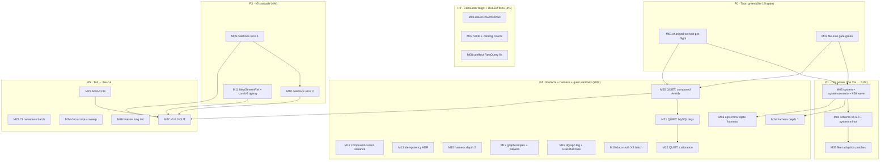

# SUPERB Pareto Plan — Trust-Green → Tag Waves → v5 Cut (2026-10-11 20:16 CEST)

> **Execution status (dated 2026-10-12 ~01:00 CEST):** M01 + M02 DONE (file-size ratchet green;
> the M01 system/metaengine GOWORK=off reds were the UNRELEASED 10-11 coupling, not tagged-surface
> breaks — re-verified green 10-12 after the wave below). M03 + M04 were executed 2026-10-10 by a
> parallel session (system/v4.12.0, systemscenario/v4.0.0, schema/v4.6.0, scheduling/v4.7.0,
> deriver/v4.4.0). The 10-11 reentrancy coupling discovered mid-execution is CLOSED: six tags cut
> and proxy-smoked (event/v4.14.0, dedup/v4.3.0, metaengine/v4.18.0, deriver/v4.5.0,
> watermill/v4.7.0, projectionhost/v4.6.0; dated CHANGELOG section landed). SCOPE CORRECTION vs the
> task table below: transport/http and metaengine/irohengine{,/loopback,/quic} are ADR-0152
> UNTAGGED TRAINS (`scripts/untagged-trains.txt`) — their `Ring[string]`/`Ring[id.EventID]`
> adaptations ship as pin bumps only, no cuts. Next open: M05 fleet adoption, M06 repro tests.

> **Source of truth:** [TODO_LIST.md](../../TODO_LIST.md) (126 open rows across 28 sections, inventoried
> 2026-10-11 20:16). This plan is a **point-in-time snapshot** of that list, Pareto-sequenced.
> Predecessor: [`2026-10-03_17-20_SUPERB-full-todo-pareto-plan.html`](2026-10-03_17-20_SUPERB-full-todo-pareto-plan.html)
> (mostly executed: issues #43/#42/#49/#50/#51 closed, 28-ruling bundle ANSWERED, 42-tag train cut,
> schema T1–T6 shipped — its residue is folded in below). Companion execution-order docs:
> [v5-cut-readiness-checklist](2026-10-01_v5-cut-readiness-checklist.md) (M26 sequencing, still binding)
> and the [v5-schema-evolution execution plan](2026-10-09_18-02_SUPERB-v5-schema-evolution-execution-plan.md)
> (its M1–M5 release wave is this plan's 1%).
> **Anti-Verschlimmbesserung clause:** every task below touches what EXISTS; no speculative rewrites,
> no growing v4 core interfaces (contract 21g), no release without the changed-set test proof
> (2026-10-06 lesson), no quiet-window work under load ≥5, no foreign-module fix-forward during a live
> concurrent session (ROADMAP OQ17).

---

## Step 1 — Pareto breakdown

### The 1% that delivers 51%: **Green the trust chain, then cut the pending tag waves**

Every feature shipped since 10-08 (schema evolution T1–T6, systemscenario harness, queue family,
C043, RequestScope, compound-cursor acceptance, versions manifest) is **dead code to consumers until
tags roll** — and the release chain is blocked by THREE known reds: (1) the 10 file-size NEW offenders,
(2) per-module lint debt from the 10-03..10-10 waves, (3) systemscenario GOWORK=off compile-red
(uses untagged `system.Clock` seam). One dependency-ordered wave (system v4.12.0 → systemscenario
v4.0.0 → schema v4.6.0 + system minor, with stack/postgres #26 riding along) converts the entire
shipped surface into consumer value, unblocks the bank-sync/DiscordSync/cqrs-htmx adoption patches,
unblocks graph-native standalone builds, AND unblocks the composed `#verify` re-record.
**Tasks M01–M05. Customer value: everything already built becomes importable.**

### The 4% that delivers 64%: **1% + real consumer bugs + the RULED lint fixes + first v5 deletions**

The 10-11 fleet session filed 3 live consumer bugs (#62 sqlite time.Time filter binding, #63 memory
field-name vs JSON-key filters, #64 C009 FP + E005 gap) — triaged, unfixed. Two cqrs-lint fixes are
RULED and queue-sized (V006 claiming skip-at-newest-tag; catalog counts test). The coeffect gate's
RawQuery blindness is a documented product bug forcing consumers into a workaround. And the v5
deletion cascade's mechanical first slice (ADR-0126 shells, `BuildWhereClause`, tombstone metadata API
with its listing/taskmanager pre-reqs, `stack.Materialize`) removes the whole deprecated surface the
migration guide promises gone. **Tasks M06–M11.**

### The 20% that delivers 80%: **4% + harness depth + metaengine protocol + quiet-window proof batch**

Compound-cursor issuance closes the M06 tail (wire-format golden-pinned); the idempotency-retirement
ADR converts the 10-11 analysis into a durable decision (10 fleet consumers waiting); BDD-harness
depth assertions + cqrs-htmx sqlite-lifecycle tests finish the adoption wave's residue; CRM graph
recipes fire the ADR-0157 adoption trigger; the quiet-window batch (composed `#verify`, MySQL-VM legs,
calibration) retires the oldest trust debts. **Tasks M12–M22.**

### The other 20% of tasks (→100%): tail, gated, and watch rows

v5 ADR-0139 completion, benchkit parity/tuned-tier, AsyncAPI exporter, pushdown cookbook + F024/F025,
docs-corpus sweeps (2026-10-* reports, archived manifests, crush-config lessons), CI ownerless items
(core/v5 eventtest mirror, settings key-set pin, gofumpt exit-2), and the explicitly gated set
(v5-gated T19–T21, user-action billing/ERRAUDIT_PAT, tooling-blocked evals, operator-gated CV bump,
watch-rows). **Tasks M23–M27 + the T/B/U table.**

---

## Step 2 — Comprehensive plan (27 medium tasks, 30–100 min, ALL TODOs)

| # | Task | Cluster | Why (impact / customer value) | Effort | Depends on |
|---|------|---------|-------------------------------|--------|------------|
| M01 | **Changed-set trust pre-flight** — per-module `GOWORK=off go test -short` over schema, system, systemscenario, decider, snapshot, metaengine, catalog, cqrs-lint (+fixtures tidy); triage every red to owner/fix | 1% | The 2026-10-06 verify≠tests lesson: no wave without per-module proof | 90 min | — |
| M02 | **File-size gate RED → green** — split or baseline-pin the 10 sibling-grown offenders (cqrs-lint d005_version 406, resilience/helpers 507, suppression/stale 533, doctor 433; system system.go 358, constructor.go 413; metaengine engine.go 712, reflect 359, typed_reader_scan 367, adttest/pagination_conformance 353) | 1% | Gate is RED repo-wide; shrink-only ratchet + owners' harness-dir exemption call | 100 min | — |
| M03 | **Tag wave, dependency-ordered** — `system/v4.12.0` (Clock seam) → `systemscenario/v4.0.0` (Memory()) → `stack/postgres` retract rider (#26) → proxy smoke + `pin-sweep --check --remote` | 1% | Unblocks systemscenario standalone + graph-native + #26 closure | 90 min | M01, M02 |
| M04 | **Schema wave** — `schema/v4.6.0` + `system` minor co-released (T1–T6 surface); CHANGELOG dated section; `TestTagContentMatchesChangelog` + changelog-symbols; versions manifest fresh | 1% | The 1%→51%: T1–T6 are dead code until this tag | 90 min | M03 |
| M05 | **Fleet adoption post-tag** — apply bank-sync snapshot patch (`2026-10-10_m13-bank-sync-state-shape.patch`), drop DiscordSync `map[any]any` workaround, collapse cqrs-htmx homegrown UpcasterRegistry; verify graph-native standalone green | 1% | Converts the wave into fleet reality; closes the schema plan's M9–M13 residue | 90 min | M04 |
| M06 | **Consumer bug trio #62/#63/#64** — sqlite `time.Time` filter binding (RFC3339 compare), memory field-name vs JSON-key filter/sort/cursor parity, C009 `len>4` bare-must FP + E005 `system.RegisterCommand` gap; tests + goldens + close issues | 4% | Live consumer-filed bugs, 3 issues closeable | 100 min | — |
| M07 | **cqrs-lint RULED fixes** — V006 skip pins at newest existing tag (linter-semantics ruling) + golden; catalog counts test adoption bump | 4% | Ruled 2026-10-08; XS-sized; unblocks examples' V006 advisories | 45 min | — |
| M08 | **Coeffect gate RawQuery fix** — `buildProjections` extracts fold event types from `rawQuerySpec` into the coeffect universe; system module tests | 4% | Documented product bug forcing the RawQuery workaround | 60 min | — |
| M09 | **v5 deletion cascade slice 1** — `stack.Materialize`, ADR-0126 compat shells, `storage/sql.BuildWhereClause`, deprecated tombstone metadata API (pre-reqs: listing type-driven status, taskmanager off `OnTombstone`, golden regen) | 4% | Mechanically-ready deletions; migration-guide promises | 100 min | M01 |
| M10 | **v5 deletion cascade slice 2** — `storage.RelationalProjection`+`storage/view`, `graph.GraphProjection`, `stack.Bundle`+8 presets+`stack/bench`, transport/http+grpc removal from go.work/flake/api-stability lists | 4% | The big deprecated surface; ADR-0127/ADR-0116 direction | 100 min | M09 |
| M11 | **v5 breakage pair** — `record.NewStreamRef` empty-entityID validation (+ call sites); core/v5 typed `TombstoneFilter` + shared sort-directive type evaluation | 4% | Owner-confirmed 2026-08-22; core/v5 shape decisions before cut | 60 min | — |
| M12 | **Compound-cursor issuance** — engines fill `ScanResult.NextCursor`, `ScanPage` prefers it over reflection, `ParseCursor` round-trip; golden pins (wire-format change) | 20% | Closes M06 tail; makes the tie-safe fix opt-out instead of opt-in | 100 min | — |
| M13 | **Idempotency-retirement ADR** — retire `idempotency/{kvstore,sqlstore}` → `system`-exposed dedup facade over `metaengine.DedupStore`; `check-adr-numbering` before/after; ADR-0152 ghost-verdict addendum; decision routing | 20% | 10-11 analysis has NO artifact; 10 fleet consumers need the migration path | 60 min | — |
| M14 | **BDD harness depth batch 1** — golden-trail payload hashes (modulo stream IDs), `AssertJournalEquivalence` per-stream diffs + stream-order note, snapshot interplay scenario | 20% | Harness trust surface; the wave's §f13/15/16 residue | 90 min | M03 |
| M15 | **BDD harness depth batch 2** — DLQ in-scenario, upcaster given-phase, idempotency + optimistic-concurrency scenarios, `TimeAdvancesTo(t)` sugar | 20% | Same residue; Axon-parity sugar | 90 min | M14 |
| M16 | **cqrs-htmx sqlite-lifecycle tests through the harness** (`sqliteDeployment` variant) | 20% | The adoption wave's largest remaining consumer train | 90 min | M03 |
| M17 | **Graph recipes + ADT waivers + Then\* docs** — recipes §graph end-to-end pattern from the Kith CRM debut (dual collections, EdgeRemoval both-endpoints, `Undirected` contract); write ADTSet recipe (kills waiver); `Then*` first-act semantics into recipes §2.43 | 20% | ADR-0157 adoption trigger FIRED (first real consumer); 5 recipe waivers wait | 90 min | — |
| M18 | **graph-native `--dgraph` ephemeral leg + go-appkit GracefulClose re-check** (tripwire flipped 10-09; verify the upstream ask closable) | 20% | Validates the graph story against a real graph engine | 60 min | — |
| M19 | **Docs-truth XS batch** — `metaengine/COOKBOOK.md` into the md-go walk; `scenario/v4` `testing.TB` refactor; docs-health hygiene gate remainder (day-row presence leg); bench-gate single-mention slice (`--explain`, `--json`) | 20% | Cheap, gate-backed truth wins; XS-class backlog | 90 min | — |
| M20 | **QUIET WINDOW A: composed `#verify`** — `preflight-composed.sh` → `can-run-composed-gate --wait-loop` → exclusive `#verify`; closes dedup tail (a) + S03 re-record + verify-chain v4 in one run | 20% | The oldest trust debt; every receipt since 09-20 says "quiet-gated" | 100 min wall | M01, M02 |
| M21 | **QUIET WINDOW B: MySQL legs** — `#integration-mysql-vm` (cowLookup + hardened vm-mysql live proof) + T18 snapshot-migration MySQL leg + shuffled-seed replay (`build/shuffle-seeds.log` mysql-manual seeds) + F52 receipts | 20% | Three mysql debts share one leg; nspawn stale-port pre-flight rider | 100 min wall | M20 |
| M22 | **Calibration + benchkit proofs (quiet)** — calibration provenance protocol re-runs (SearchQuery count=5, supersede-note, dgraph constants); benchkit oversubscribed-capture supersede-note; bigtable soak env-var run | 20% | Noise-gated evidence only writable in a quiet window | 60 min wall | M20 |
| M23 | **CI/infra ownerless batch** — fork `eventtest` + delivery-mark trio into core/v5/event (mirror-lag); pin `#check-lint-config` settings key-set (the cyclop/errcheck loss class); root-cause `nix fmt` gofumpt exit-2; pre-commit tree-wide gate split | 20% | Each is a recurrence-class killer found by 10-x sessions | 100 min | — |
| M24 | **Docs-corpus sweep** — read+annotate+archive the ~28 live 2026-10-01..11 status reports (14th docs-health pass); planning/reviews archived-dir manifests; crush-config lessons + gotchas (external commits); status-index fast ritual decision | 20% | The 13th pass indexed them; the accumulation rule says one wave per pass | 90 min | — |
| M25 | **v5 ADR-0139 encryption completion** — owner 4-question pack (provider semantics, reference-validation timing, read-model scope, migration) → implementation skeleton → engines fail-loud | tail | Blocks the v5 DeploymentConfig shape | 100 min | ruling |
| M26 | **Long-tail feature batch** — benchkit parity gate + tuned-tier benchmark; AsyncAPI exporter items; pushdown cookbook recipe + F024/F025 variants; `FilterContains`/`FilterPrefix` FilterOp | tail | Real but sub-1% each; batch to avoid context-switch cost | 100 min | — |
| M27 | **v5.0.0 cut assembly** — per the readiness checklist: branch → cascade deletions in order → scan-default flip ON THE BRANCH (ADR-0123) → sweep §4 remainder ruling → docs (migration guide expansion, README, SKILL.md) → full verify → tag all modules | tail | The boss task; everything above is its prep | 100 min (repeats) | M09–M11, M20, M25 |

**Explicitly NOT scheduled (gated/watch/user — tracked, not forgotten):** T19–T21 universal-fold
(v5-gated, ADR-0142 discipline) · GitHub billing + `ERRAUDIT_PAT` (user) · evals execution
(tooling-blocked: `claude` CLI) · CV consumer bump (operator) · F153 license choice (user) ·
watch rows (`TestEngineHealth_CatchUpUnderConcurrentApplies`, dgraph/redis CI shuffle watch,
templ clone groups, md-go-validator upstream filing, graph-native README manifest row,
macOS/nspawn legs, `ResetProjection` stall revisit) · journal-side cqrs-lint adoption
(owner-gated on the wave) · `ResetProjection` ADR-0138 command-side depth (BLOCKED).

---

## Step 3 — Fine plan (≤12 min each, ALL TODOs)

| ID | Fine task | ∈ | ID | Fine task | ∈ |
|----|-----------|---|----|-----------|---|
| F01 | List the changed set: `git diff --name-only` vs last wave → module list | M01 | F02 | Run per-module `-short` suites batch 1 (schema, system, systemscenario) | M01 |
| F03 | Run per-module `-short` suites batch 2 (decider, snapshot, metaengine) | M01 | F04 | Run batch 3 (catalog, cqrs-lint + `testdata/typedfixture` tidy check) | M01 |
| F05 | Triage each red: fix-here / owner-row / known-issue; write the triage note | M01 | F06 | Split `d005_version.go` (406) — extract table + scanner | M02 |
| F07 | Split `resilience/helpers.go` (507) | M02 | F08 | Split `suppression/stale.go` (533) | M02 |
| F09 | Split `doctor.go` (433) | M02 | F10 | Split `system/system.go` (358) + `constructor.go` (413) | M02 |
| F11 | metaengine offenders: `engine.go` 712, `reflect.go` 359, `typed_reader_scan.go` 367 — split or owner-pin | M02 | F12 | `adttest/pagination_conformance.go` 353: harness-dir exemption ruling → baseline-pin or split | M02 |
| F13 | `nix run .#check-file-size` → green; api goldens if exports moved | M02 | F14 | Prep `system/v4.12.0`: CHANGELOG section + tag-content audit | M03 |
| F15 | Cut + push `system/v4.12.0`; proxy smoke | M03 | F16 | Prep + cut `systemscenario/v4.0.0` (carries `Memory()`); smoke | M03 |
| F17 | Verify `systemscenario` GOWORK=off compile-green post-tag | M03 | F18 | Rider: `stack/postgres` patch release carrying `retract v4.2.0`; push; proxy `@latest` check; close #26 with receipt | M03 |
| F19 | `pin-sweep --check --remote` full green | M03 | F20 | Prep `schema/v4.6.0` + `system` minor: CHANGELOG dated section (T1–T6 bullets) | M04 |
| F21 | `batch-release.sh --from-manifest` the pair; push; smoke | M04 | F22 | `check-versions-manifest.sh --check --remote` + README matrix fresh | M04 |
| F23 | changelog-symbols + `TestTagContentMatchesChangelog` green | M04 | F24 | bank-sync: apply `2026-10-10_m13-bank-sync-state-shape.patch`; build + tests | M05 |
| F25 | DiscordSync: drop the `map[any]any` workaround branch; quality battery | M05 | F26 | cqrs-htmx: collapse homegrown UpcasterRegistry onto `UpcastChain()` | M05 |
| F27 | `check-example-standalone.sh --build` → 0 findings (graph-native unblocked) | M05 | F28 | #62: repro test — sqlite `time.Time` filter vs RFC3339 JSON miscompare | M06 |
| F29 | #62: bind/filter values through the encoding-aware converter; fix | M06 | F30 | #62: close issue with receipt | M06 |
| F31 | #63: repro — memory resolves filter/sort/cursor by Go field, SQL by JSON key | M06 | F32 | #63: unify resolution (json-tag OR field, `ExtractFields` precedent); parity test | M06 |
| F33 | #63: close issue | M06 | F34 | #64: repro C009 `len>4` FP on the bare `must` idiom; adjust guard | M06 |
| F35 | #64: E005 `system.RegisterCommand` detection gap + test | M06 | F36 | #64: goldens re-pin; close issue | M06 |
| F37 | V006: teach skip-at-newest-existing-tag; unit + golden | M07 | F38 | Catalog counts test: systemscenario adoption entry bump | M07 |
| F39 | cqrs-lint module lint + suite green | M07 | F40 | `system`: extract fold event types from `rawQuerySpec` | M08 |
| F41 | Feed into `declaredEventTypes`; rejection-path test stays green | M08 | F42 | RawQuery-declared-fold gate test + module suite | M08 |
| F43 | Delete `stack.Materialize` + call sites | M09 | F44 | Delete ADR-0126 shells (`VersionedStore`, `Rejecting*`, `ErrInnerStoreNot*`, `CustomData`) | M09 |
| F45 | Delete `storage/sql.BuildWhereClause` (Checked is the replacement) | M09 | F46 | listing: type-driven tombstone status (replace `DetectTombstone` call site) | M09 |
| F47 | taskmanager: migrate off `OnTombstone` | M09 | F48 | Delete tombstone metadata API + regen golden; V007 table entries | M09 |
| F49 | Delete `storage.RelationalProjection` + `storage/view` | M10 | F50 | Delete `graph.GraphProjection` | M10 |
| F51 | Delete `stack.Bundle` + 8 presets + `stack/bench`; `RunProjections` → projectionhost | M10 | F52 | transport/http+grpc: strip from go.work, flake `testModules`, api-stability list (deletion at cut) | M10 |
| F53 | Full workspace build + per-module suites over touched modules | M10 | F54 | `record.NewStreamRef`: empty-entityID rejection + error | M11 |
| F55 | Migrate call sites + tests | M11 | F56 | core/v5/kv: `TombstoneFilter` enum + evaluate `SyncWritesTier` signature | M11 |
| F57 | Shared sort-directive type evaluation note (`OrderClause` vs `SortSpec`) → decision row | M11 | F58 | `ScanResult.NextCursor` field + engine fill (memory first) | M12 |
| F59 | `ScanPage` prefers `NextCursor` over reflection | M12 | F60 | `ParseCursor` JSON round-trip normalization | M12 |
| F61 | Golden pins per engine + wire-format note in WIRE-FORMAT-KEYS | M12 | F62 | Draft idempotency ADR (verdict + fleet migration scope from the 07-28 report §f5–f12) | M13 |
| F63 | `check-adr-numbering` before; land ADR; run after | M13 | F64 | ADR-0152 addendum: kvstore ghost-verdict; TODO/docs routing | M13 |
| F65 | Harness: golden-trail payload hashes (modulo stream IDs) | M14 | F66 | `AssertJournalEquivalence` per-stream diff diagnostics | M14 |
| F67 | Stream-order contract note + doc | M14 | F68 | Snapshot interplay scenario (`WithSnapshotStrategy` round-trip) | M14 |
| F69 | DLQ in-scenario (`projectionhost.WithDeadLetterStore`) | M15 | F70 | Upcaster in given-phase (`schema.UpcastSourceTransform`) scenario | M15 |
| F71 | Idempotency scenario (same command twice → one event) | M15 | F72 | Optimistic-concurrency scenario (stale version → Conflict) | M15 |
| F73 | `TimeAdvancesTo(t)` sugar + test | M15 | F74 | cqrs-htmx: `sqliteDeployment` variant scaffold | M16 |
| F75 | Migrate sqlite lifecycle trains; suite green | M16 | F76 | Recipes §graph: dual-collection pattern + stateless EdgeRemoval section | M17 |
| F77 | Recipes §graph: `Undirected` planner contract + `[]any` ExecuteCtx cast note | M17 | F78 | ADTSet recipe (kills its waiver); gate refuses stale waivers — verify | M17 |
| F79 | `Then*` first-act semantics paragraph + example in recipes §2.43 | M17 | F80 | graph-native `--dgraph` against ephemeral harness; record results | M18 |
| F81 | go-appkit GracefulClose: verify tripwire flip; close/re-ask the upstream doc | M18 | F82 | md-go walk: add `metaengine/COOKBOOK.md`; fix what it finds | M19 |
| F83 | `scenario/v4` `testing.TB` refactor (constructors parity) | M19 | F84 | docs-health hygiene: day-row presence leg into canonical-facts | M19 |
| F85 | Bench-gate slice: `--explain <bench>` per-sample diagnostics | M19 | F86 | System `Bus()` delivery-mode knobs for test deployments | M15 |
| F87 | Quiet-window guard: `quiet-window-run --ceiling 5` wrapper for M20 | M20 | F88 | `preflight-composed.sh` → 9/9 | M20 |
| F89 | `can-run-composed-gate --wait-loop` → exclusive `#verify`; archive the log | M20 | F90 | Strike dedup-tail (a) + CI re-record row + S03 successor receipt | M20 |
| F91 | `#integration-mysql-vm` cowLookup leg via hardened `vm-mysql.sh` | M21 | F92 | F52/Green-MySQL AGENTS integration rows update | M21 |
| F93 | T18 snapshot-migration MySQL leg (`snapshot_migration_mysql_integration_test.go`) | M21 | F94 | Shuffled-seed replay (`grep 'label=mysql'` from `build/shuffle-seeds.log`) | M21 |
| F95 | nspawn stale-port pre-flight rider + shellcheck | M21 | F96 | calibration-gate: SearchQuery count=5 re-run | M22 |
| F97 | Supersede-note on the 2026-09-19 oversubscribed capture | M22 | F98 | dgraph constants re-anchor + calibration provenance ledger | M22 |
| F99 | bigtableengine soak env-var run | M22 | F100 | core/v5/event: fork `eventtest` mirror (register lockstep row) | M23 |
| F101 | Fork delivery-mark trio; lockstep test | M23 | F102 | `#check-lint-config`: pin the settings key-set (cyclop/errcheck canaries) | M23 |
| F103 | gofumpt exit-2 repro + root-cause note | M23 | F104 | Pre-commit: split the three tree-wide gates (cheap-local + CI legs) | M23 |
| F105 | 14th pass P1: read+annotate 2026-10-01..03 reports (7 files) | M24 | F106 | 14th pass P2: 2026-10-04..08 reports (~16 files) | M24 |
| F107 | 14th pass P3: 2026-10-09..11 reports + archive + manifest | M24 | F108 | planning/reviews archived-dir README manifests | M24 |
| F109 | crush-config: lessons.md commit (gate-derived numbers; loop data-path; gates-first) | M24 | F110 | crush-config: status-report skill `.md`-override note; annotate.go `r`-kind doc | M24 |
| F111 | ADR-0139: draft the 4-question owner pack (provider semantics, validation timing, read-model scope, migration) | M25 | F112 | ADR-0139: implementation skeleton post-ruling; engines fail-loud tests | M25 |
| F113 | benchkit: cross-tier PARITY gate design + impl | M26 | F114 | benchkit: tuned-tier `BuildLayoutPlanFromType` benchmark | M26 |
| F115 | AsyncAPI exporter: request/reply leverage item 1 | M26 | F116 | AsyncAPI exporter: item 2 | M26 |
| F117 | Pushdown cookbook recipe ("legacy grid → read model + pushdown") | M26 | F118 | F024/F025 utilization variants: reader→slice dataflow design | M26 |
| F119 | F024/F025: implement + FP battery | M26 | F120 | `FilterContains`/`FilterPrefix` FilterOp extension | M26 |
| F121 | v5 branch cut: create `v5` branch from master post-M20 | M27 | F122 | Cascade deletions in checklist order (M09/M10 outputs ride along) | M27 |
| F123 | Scan-default flip ON THE BRANCH (ADR-0123/G-T14) | M27 | F124 | Sweep §4 remainder: consumer grep + `listing.aggregate_projection` ruling note | M27 |
| F125 | V5-MIGRATION-GUIDE: before/after per tier + envelope-v2 consumer note | M27 | F126 | README/SKILL.md/examples v5 rewrite pass | M27 |
| F127 | Full `#verify` + `verify-ci` (GOWORK=off matrix) on the branch | M27 | F128 | Cut v5.0.0: tag all modules; CHANGELOG/README; proxy smoke | M27 |
| F129 | Analyzer load-scope widening: design note (scope-limited confidence tier) | tail | F130 | F005 stable anchor re-check; B005 test hardening | tail |
| F131 | New consumer issues triage row: verify #58/#56/#54 still reproduce on master | tail | F132 | cqrs-htmx SQLite-lifecycle: remaining raw-wiring trains census | M16 |
| F133 | Harness: `Scenario.Event` version-hint invalidation doc | M14 | F134 | Observational-equivalence system port: demand-gate check (skip if no fleet ask) | tail |
| F135 | Companion commit hygiene: author proper pilot-commit messages in cqrs-htmx/go-appkit | tail | F136 | M13 stamps: per-module fresh-run stamp protocol (quiet-CPU; extend canonical-facts to FEATURES go.mod count) | tail |
| F137 | Bench-gate slice: `--json` evidence output for quiet-window-run | M19 | F138 | Bench-gate slice: auto-embed noise verdict + CoV + GOVERSION into `--save` headers | M19 |
| F139 | V007 marker-table drift (14 symbols) re-check after cascade slice | M27 | F140 | api-stability meta-tests + `record/v4` consumer pin sweep post-cascade | M27 |
| F141 | cordis: Coeffect-gate product fix — docs (core.md §3.9 cross-ref) | M08 | F142 | README review tail: confirm 97-README corpus still green post-wave | M24 |
| F143 | `--dgraph` example: fixtures + ephemeral script args | M18 | F144 | Pushdown recipe: verify fences compile via recipes harness | M17 |
| F145 | Watermill skill: NATS plugin-gaps parity check vs test-file doc | tail | F146 | `#integration-nats` CI-leg decision note (billing-gated) | tail |
| F147 | T19–T21 universal-fold: NO-OP confirm (v5-gated; ADR-0142 discipline) — skip formally | tail | F148 | `TestEngineHealth_CatchUpUnderConcurrentApplies`: re-check recurrence (skip unless recurs) | tail |
| F149 | Evals: retry `claude` CLI availability; run trigger-eval-set if unblocked | tail | F150 | Post-plan: TODO_LIST header pointer + gates + commit (this plan's own bookkeeping) | — |

**Coverage claim:** every open TODO_LIST row maps to a task above (M01–M27 / F01–F150) or appears in
the explicit not-scheduled list (gated/user/watch rows) in Step 2. Sources: the 28-section inventory
taken 2026-10-11 20:16 + the 13th-pass harvest rows + the three newest status reports' §f tails.

---

## Execution graph

---

## Sequencing rules (Verschlimmbesserung guards)

1. **No wave without M01/M02 green** — the 2026-10-06 lesson is Load-bearing: `verify=ok` is not tests.
2. **Quiet-window tasks (M20–M22) never force** — `load1 < 5` or they stay queued; a foreign lull on a
   47-user host is not our quiet window.
3. **Deletion slices stop at the first surprise** — any consumer of a deleted symbol that isn't in the
   migration guide becomes a guide-fix task BEFORE the next deletion.
4. **Parallel-session courtesy:** systemscenario/cqrs-lint/core-v5 files are other sessions' territory —
   coordinate via their status reports, don't fix-forward (ROADMAP OQ17).
5. **Every medium task ends with its receipts** (CHANGELOG/TODO strike/gates) before the next starts —
   the daemon absorbs mid-phase edits otherwise.
