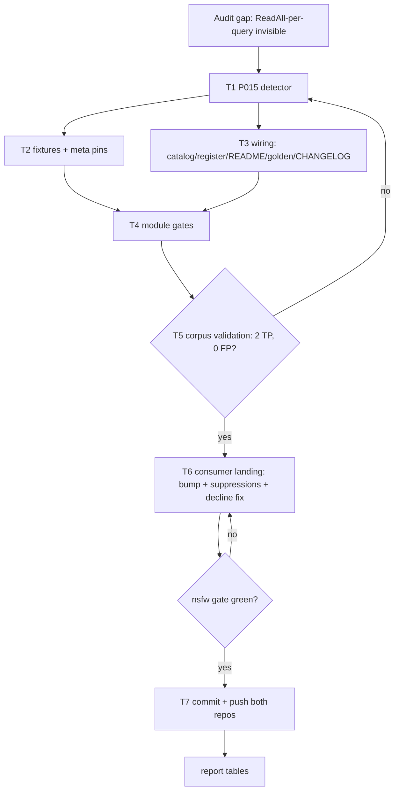

# SUPERB plan: cqrs-lint P015 — journal.ReadAll in query handlers

- **Date:** 2026-10-12 00:20 CEST
- **Goal:** close the single highest-value detection gap found by the 2026-10-11 SQLite audit: the linter cannot see O(journal)-per-query reads. This rule makes cqrs-lint catch exactly the class of bug that made `statsFromJournal` re-fold 1 361 events per stats query in production — the "most correct, most efficient event-sourced systems" mandate, enforced mechanically.
- **Deliverable:** new rule `P015 journal-readall-in-query-handler` in `cmd/cqrs-lint`, fully wired (detector + catalog + register + README + meta-test pins + doctor golden + CHANGELOG), validated positive (2 true positives) and negative (0 false positives) against the real nsfw-classifier corpus.

## Why this rule (evidence, not vibes)

The audit (docs/research/2026-10-11_sqlite-usage-audit.md, nsfw-classifier) measured: `statsFromJournal` and `watchTrendFromJournal` call `journal.ReadAll` from query handlers — every stats/trend request loads and JSON-decodes the **entire journal** (O(journal) on the request path, linear growth). The nearest existing rules (B019/P001) only inspect `SubscribeAll` handlers; B017 only matches functions *named* Rehydrate/Rebuild/Replay. `cqrs-lint` runs clean on the offending repo today — the gap is real and measured.

## Pareto: what delivers the result

### The 1% that delivers 51%

| Item                                                                      | Why it is the 1%                                                                    |
| ------------------------------------------------------------------------- | ------------------------------------------------------------------------------------- |
| P015 detector: `ReadAll` reachable from a `RegisterQuery` handler closure | The one detection that turns this entire audit class into a mechanical gate. 2 true positives in the only real-world corpus checked; 0 false positives by design (init-path filtering). |

### The 4% that delivers 64%

| Item                                                                                         | Adds                                                        |
| -------------------------------------------------------------------------------------------- | ------------------------------------------------------------- |
| 1% (above)                                                                                   | —                                                             |
| Multi-signal receiver evidence (type-assert `.(event.Journal)` / `EventStore()` / journal-ish name, package-call exclusion) | FP control: `io.ReadAll`, `csv.Reader.ReadAll` stay silent |
| One-hop same-file helper reachability (closure → `statsFromJournal` shape)                   | Catches the actual production shape — the ReadAll is never inline in the closure |

### The 20% that delivers 80%

| Item                                                                 | Adds                                                                        |
| -------------------------------------------------------------------- | ----------------------------------------------------------------------------- |
| 4% (above)                                                           | —                                                                             |
| Full wiring: catalog entry, register.go, meta-test pin 212→213, README headline + table, doctor golden, CHANGELOG | The rule exists only if every consumed surface knows it (AGENTS §28: doctor/scorecard JSON are consumed surfaces — extend additively) |
| Positive AND negative fixtures incl. `io.ReadAll`/`csv`/`SubscribeAll`/init-path negatives | Trust engineering: the FP budget is tested, not asserted |
| Real-corpus validation run against nsfw-classifier                    | Discrimination proof on production code: exactly 2 findings, `hydrate` silent |
| Consumer-side honest suppressions (nsfw-classifier, with audit-backed reasons + pin update) + decline-comment truth fix | The ratchet lands green: auditable refusals, not a red gate; the config lie ("closure-path revisit trigger") corrected to "pushdown ≠ indexed" |

### The remaining 80%→100%

| Item                                                                 | Why it is the tail (deliberately NOT in this session)                |
| -------------------------------------------------------------------- | ---------------------------------------------------------------------- |
| JSON-in-JSON payload rule, unindexed-sort-expression rule            | High FP risk / non-AST facts (EXPLAIN, schema) — need golden corpora first; linter-building discipline: no corpus, no rule |
| B017 name-map extension, planned-table coaching, prefetch rules       | Separate decisions with separate FP budgets; do not smuggle into this change |

## Comprehensive plan (30-100 min tasks, sorted by impact/effort/value)

| # | Task (30-100 min)                                                                     | Impact | Effort | Value | Depends |
| - | --------------------------------------------------------------------------------------- | ------ | ------ | ----- | ------- |
| T1 | Design + implement P015 detector (multi-signal, helpers ≤30 lines/file ≤350 lines)     | High   | 60 min | 51%   | —       |
| T2 | Fixtures + tests: 2 TP shapes, 4 negative shapes, count/update meta pins               | High   | 45 min | —     | T1      |
| T3 | Wire consumed surfaces: catalog, register, meta pin, README, doctor golden, CHANGELOG  | High   | 40 min | —     | T1      |
| T4 | Module gates: `GOWORK=off go test ./...`, vet, lint, file-size, art-dupl               | High   | 40 min | —     | T2, T3  |
| T5 | Real-corpus validation: build binary, run on nsfw-classifier, assert 2 TP / 0 FP       | High   | 30 min | proof | T4      |
| T6 | Consumer landing: flake bump, 2 inline suppressions (audited reasons), suppression-pin update, decline-comment fix, gate green | Med    | 60 min | 64%   | T5      |
| T7 | Commit (detailed) + push both repos; status tables in the session report                | Med    | 30 min | —     | T6      |

## Micro plan (≤12 min tasks, execution order)

| #  | Task (≤12 min)                                                                              | Task# |
| -- | --------------------------------------------------------------------------------------------- | ----- |
| M1  | Write plan doc (this file) with Pareto + graph                                               | —     |
| M2  | Read B019/P001/template/analyzer helpers one more time; draft P015 signature                  | T1    |
| M3  | Implement p015.go: roots (RegisterQuery closures) + direct-site scan                          | T1    |
| M4  | Implement helpers: journalEvidence, readAllSites, helper map, package-call exclusion          | T1    |
| M5  | gofmt + module builds (`go build ./...`)                                                      | T1    |
| M6  | Write p015_test.go: TP-inline fixture + assert                                                | T2    |
| M7  | TP one-hop fixture (statsFromJournal shape)                                                   | T2    |
| M8  | NP fixtures: init-path hydrate, io.ReadAll, csv receiver, SubscribeAll                        | T2    |
| M9  | Update meta_test detector pin 212→213                                                         | T2    |
| M10 | Catalog entry P015 + register.go wiring                                                       | T3    |
| M11 | README: headline 213 + performance (11) + table row                                          | T3    |
| M12 | Run module tests; fix what the pins surface                                                   | T3/T4 |
| M13 | Doctor golden regen (UPDATE_GOLDEN=1) + rules list shows 210+ rows                            | T3    |
| M14 | CHANGELOG [Unreleased] row (symbol-gate-safe wording)                                         | T3    |
| M15 | Module vet + golangci (nix) on cmd/cqrs-lint only                                             | T4    |
| M16 | check-file-size + art-dupl check on changed files                                             | T4    |
| M17 | Build cqrs-lint binary; run on nsfw-classifier; assert exactly 2 P015 findings                | T5    |
| M18 | Assert negatives on corpus: hydrate/verdicts store NOT flagged                                | T5    |
| M19 | nsfw-classifier: bump go-cqrs-lite flake input; run their cqrs-lint gate → expect 2 findings  | T6    |
| M20 | Add `//cqrs-lint:ignore(P015)` at the 2 sites with audit-backed reasons                       | T6    |
| M21 | Update suppression pin 26→27/28 + docs/dev/state.md count line (same commit, per pin policy)  | T6    |
| M22 | Fix pushdown-decline comment in .cqrs-lint.json (pushdown ≠ indexed; audit citation)          | T6    |
| M23 | Run nsfw-classifier cqrs-lint gate → green                                                    | T6    |
| M24 | go-cqrs-lite: git add/commit (detailed message) + push                                        | T7    |
| M25 | nsfw-classifier: commit + push                                                                | T7    |
| M26 | Report tables + verification summary in chat                                                  | T7    |

## Execution graph

## Trust engineering (FP budget, per linter-building doctrine)

- **Multi-signal:** a finding requires ALL of: (1) enclosing/root context = func-literal argument of a `*RegisterQuery` call (or one same-file helper hop from it), (2) a non-package-qualified `ReadAll` call, (3) journal evidence — receiver name matches `(?i)journal|jrn` OR the enclosing function contains a `.(event.Journal)` type assertion or an `EventStore()` call.
- **Negative filters tested:** `io.ReadAll` (package-qualified), `csv.Reader.ReadAll`-style (no journal evidence), Open-path hydration (`hydrate` not reachable from any RegisterQuery closure), SubscribeAll handlers (B019/P001's territory — no overlap).
- **Confidence: Medium** (AST heuristics, no type checker) → triage-tier exit behavior; **Severity: Warning** (matches B019 for the same-class problem; the per-request O(journal) is real but each instance is cheap to confirm).
- **Suppression path:** standard `//cqrs-lint:ignore(P015) <reason>` — pinned by the consumer's suppression-count gate, so every refusal stays audited.
- **Discrimination proof:** corpus validation on nsfw-classifier must yield exactly the 2 audited functions and nothing else; fixture suite asserts both directions.

## Verschlimmbesserung guards (what this change must NOT do)

- No new module (no 6-gate module registration), no exported-API change to the library surface (cqrs-lint's own CLI only — additive rule).
- No softening of existing rules, scorecard, or grades (AGENTS §28: teeth by design).
- No baseline re-pin for art-dupl; annotate locally only if a novel clone shape appears.
- Consumer gate must end green with honest suppressions — never red on master, never silent.

## Verification matrix

| Claim                                    | Proof                                                                    |
| ---------------------------------------- | -------------------------------------------------------------------------- |
| Rule detects the production shape         | nsfw-classifier run: exactly `statsFromJournal` + `watchTrendFromJournal` flagged |
| Rule does not over-fire                   | Same run: 0 findings elsewhere; fixture negatives pass                    |
| All consumed surfaces know the rule       | `cqrs-lint rules` row; README 213; meta pin 213; doctor golden updated     |
| Module healthy                            | `GOWORK=off go test ./...` + vet + lint green in cmd/cqrs-lint            |
| Repo gates intact                         | file-size, art-dupl, changelog-symbol gate wording safe                    |
| Consumer ratchet lands green              | nsfw-classifier cqrs-lint exit 0 after suppressions + pin update          |
