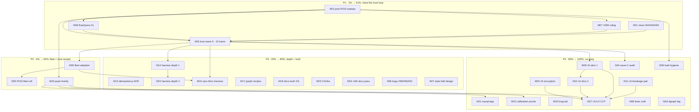

# SUPERB Pareto Plan II — M06 Closed → Next Tag Wave → v5 Cut (2026-10-12 03:30 CEST)

> **Predecessor:** [`2026-10-11_20-16_SUPERB-trust-green-tags-to-v5-cut-pareto-plan.md`](2026-10-11_20-16_SUPERB-trust-green-tags-to-v5-cut-pareto-plan.md)
> — its M01–M04 are DONE (M03/M04 by a parallel session 10-10), M06 is DONE (bug trio
> fixed + mutation-verified 10-12, issues unclosed), M12 is DONE-IN-TREE (T07 compound
> cursors sit in `[Unreleased]`). Everything else carries forward, re-sequenced against
> the post-wave reality. **Source of truth:** [TODO_LIST.md](../../TODO_LIST.md)
> (180 open rows, 2026-10-12 inventory).
>
> **State at authoring:** tree clean @ `d2df70e8c`, master pushed. Reentrancy wave
> CLOSED (6 tags: event/v4.14.0, dedup/v4.3.0, metaengine/v4.18.0, deriver/v4.5.0,
> watermill/v4.7.0, projectionhost/v4.6.0 — pins green local+origin, smoke attempt-1).
> P015 shipped by the parallel session (213 rules, corpus-validated, both repos pushed).
> Six open issues: #62/#63/#64 (FIXED, awaiting closure receipts), #58/#56/#54 (open bugs).
>
> **Anti-Verschlimmbesserung clause:** every task below touches what EXISTS; no
> speculative rewrites; no growing v4 core interfaces (contract 21g); no release
> without the changed-set test proof (2026-10-06 lesson); no quiet-window work under
> load ≥5; no foreign-module fix-forward during a live concurrent session (ROADMAP
> OQ17); API-surface change ⇒ api golden regen in the same edit; untagged-train policy
> (`scripts/untagged-trains.txt`) consulted BEFORE planning any tag.

---

## Step 1 — Pareto breakdown

### The 1% that delivers 51%: **Close the trust loop on what is already built**

Six fixed-or-shipped surfaces are dead value right now: #62/#63/#64 are fixed but the
issues hang OPEN with no receipts; the M06 fixes, P015, E021/E022, T1b–T5, the KV
cursor contract, and the pebble/mysql engine fixes all sit UNRELEASED in
`[Unreleased]` — consumers pin `unstable-fd3b2d8` (P015 §f5). One dependency-ordered
tag wave ("trust wave II": schema → snapshot → decider → catalog → system →
metaengine → engines → cqrs-lint → api-stability, ~15 trains) converts the ENTIRE
post-BDD-wave surface into importable value, and issue-closure receipts convert the
bug trio into answered customers. **Tasks N01–N04 + M07 + M08 (wave prep fixes).
Customer value: everything already built becomes importable and answered.**

### The 4% that delivers 64%: **+ fleet adoption + the oldest trust receipt**

Fleet adoption (M05: bank-sync snapshot patch, DiscordSync CBOR-workaround drop,
cqrs-htmx UpcasterRegistry collapse — now ALSO the P015 fleet roll §f6) converts the
two closed waves into fleet reality. The composed `#verify` re-record (M20, quiet
window) retires the oldest trust debt — every receipt since 09-20 says
"quiet-gated". **Tasks M05, M20.**

### The 20% that delivers 80%: **+ harness depth, ADR decisions, docs truth, CI hygiene**

M13–M19 (BDD harness depth ×2, idempotency-retirement ADR, graph recipes + ADT
waivers, docs-truth XS batch), M23 (CI/infra ownerless: core/v5 eventtest mirror,
lint-config key-set pin, gofumpt exit-2), M24 (14th docs-health pass). These kill
split-brains and make the harness trustworthy for the cut.

### The remaining 80% → 100%

M21–M22 (quiet-window MySQL legs + calibration proofs), M25 (v5 encryption
completion), M26 (long-tail feature batch), M27 (v5.0.0 cut assembly), P015 §f
residue (§f7–§f15), open bug trio #58/#56/#54, hygiene (audit baseline, suppression
parseability, bench gates under load).

---

## Step 2 — Comprehensive plan (31 tasks, 30–100 min, ALL TODOs)

| # | Task | Pareto | Why it matters | Effort | Depends on |
|---|------|--------|----------------|--------|------------|
| N01 | **Close #62/#63/#64 with fix receipts** — load `verify-before-filing` + `github-voice`; per-issue comment citing the fix commit, mutation-proof, and tag availability; close | 1% | Three answered customers; the fixes are verified but silent | 30 min | — |
| N02 | **Post-P015 settle sweeps** — one clean `cmd/cqrs-lint ./...`; metaengine + sqliteengine full suites; api golden regen (`--update`) + mirror meta-test; file-size + art-dupl gates | 1% | M06 + P015 landed interleaved; nobody ran the clean battery | 45 min | — |
| M07 | **cqrs-lint RULED fixes** — V006 skip-pins at newest existing tag (linter-semantics ruling) + golden; catalog counts test adoption bump | 1% | Ruled 10-08; must land BEFORE the cqrs-lint tag so the wave carries it | 45 min | — |
| M08 | **Coeffect gate RawQuery fix** — `buildProjections` extracts fold event types from `rawQuerySpec` into the coeffect universe; system module tests | 1% | Documented product bug; must land BEFORE the system tag | 60 min | — |
| N03 | **Trust wave II: plan + cut** — dependency-ordered tags carrying [Unreleased]: schema v4.7.0 (fingerprints + CBOR transform fix) → snapshot v4.7.0 (StateShape) → decider v4.8.0 (WithSnapshotStateVersion, strips the dev-time sibling replace) → catalog v4.8.0 (FromTypedSchema) → system v4.13.0 (StampSchemaFingerprints + M08) → metaengine v4.19.0 (FilterBindValue + json-tag resolution + KV cursor contract) → sqliteengine v4.5.3 (time binds) → bbolt/badger/pebble/mysql engines (cursor keys + fixes) → cqrs-lint v4.16.0 (P015+E021+E022+M07+M06 lint fixes+path fix) → cmd/api-stability v4.5.0 (mirror gate + golden dedup); dated CHANGELOG section per wave discipline; pin-sweep + manifest + smoke each | 1% | The 1%→51%: ~15 trains of dead code become importable; includes P015 §f5 | 100 min ×2 sessions | N02, M07, M08 |
| N04 | **Wave-C engine delta audit** — the module scan found untagged deltas in ~15 more modules (turso 11 files, duckdb 7, pg 12, dgraph 7, bigtable 4, iroh tests-only, stack/* …); classify each: wave-C content vs pin-only vs untagged-train; fold the content ones into N03 or defer consciously | 4% | Unknown deltas = the next "stale pin" archaeology session | 60 min | N03 plan |
| M05 | **Fleet adoption post-wave** — bank-sync snapshot state-shape patch (`2026-10-10_m13-bank-sync-state-shape.patch`), DiscordSync drop the `map[any]any` workaround branch (schema CBOR fix tagged in N03), cqrs-htmx collapse homegrown UpcasterRegistry onto `UpcastChain()`; `check-example-standalone.sh --build` → 0 findings | 4% | Converts the waves into fleet reality; closes the schema plan's M9–M13 residue | 90 min | N03 |
| N05 | **P015 fleet roll** — cqrs-htmx + go-appkit bump to the N03 cqrs-lint tag; expect P015 hits in their stats folds; audit-or-suppress each with code-verified reasons (P015 §f6) | 4% | The linter beat the audit in nsfw-classifier; the fleet's other trains carry the same shape | 90 min | N03, M05 |
| M20 | **QUIET WINDOW A: composed `#verify`** — `preflight-composed.sh` → `can-run-composed-gate --wait-loop` → exclusive `#verify`; closes dedup tail (a) + S03 re-record + verify-chain v4 in one run | 4% | The oldest trust debt; every receipt since 09-20 says "quiet-gated" | 100 min wall | N02 |
| M09 | **v5 deletion cascade slice 1** — `stack.Materialize`, ADR-0126 compat shells, `storage/sql.BuildWhereClause`, deprecated tombstone metadata API (pre-reqs: listing type-driven status, taskmanager off `OnTombstone`, golden regen) | 4% | Mechanically-ready deletions; migration-guide promises | 100 min | N03 |
| M10 | **v5 deletion cascade slice 2** — `storage.RelationalProjection`+`storage/view`, `graph.GraphProjection`, `stack.Bundle`+8 presets+`stack/bench`, transport/http+grpc removal from go.work/flake/api-stability lists | 4% | The big deprecated surface; ADR-0127/ADR-0116 direction | 100 min | M09 |
| M11 | **v5 breakage pair** — `record.NewStreamRef` empty-entityID validation (+ call sites); core/v5 typed `TombstoneFilter` + shared sort-directive type evaluation | 4% | Owner-confirmed 2026-08-22; core/v5 shape decisions before cut | 60 min | — |
| M13 | **Idempotency-retirement ADR** — retire `idempotency/{kvstore,sqlstore}` → `system`-exposed dedup facade over `metaengine.DedupStore`; `check-adr-numbering` before/after; ADR-0152 ghost-verdict addendum; decision routing | 20% | The 10-11 analysis has NO artifact; 10 fleet consumers need the migration path | 60 min | — |
| M14 | **BDD harness depth batch 1** — golden-trail payload hashes (modulo stream IDs), `AssertJournalEquivalence` per-stream diffs + stream-order note, snapshot interplay scenario | 20% | Harness trust surface; the wave's §f13/15/16 residue | 90 min | N03 |
| M15 | **BDD harness depth batch 2** — DLQ in-scenario, upcaster given-phase, idempotency + optimistic-concurrency scenarios, `TimeAdvancesTo(t)` sugar | 20% | Same residue; Axon-parity sugar | 90 min | M14 |
| M16 | **cqrs-htmx sqlite-lifecycle tests through the harness** (`sqliteDeployment` variant) | 20% | The adoption wave's largest remaining consumer train | 90 min | M05, N03 |
| M17 | **Graph recipes + ADT waivers + Then\* docs** — recipes §graph end-to-end pattern (dual collections, EdgeRemoval both-endpoints, `Undirected` contract); write ADTSet recipe (kills a waiver); `Then*` first-act semantics into recipes §2.43 | 20% | ADR-0157 adoption trigger FIRED (graph-native consumer); 5 recipe waivers wait | 90 min | — |
| M18 | **graph-native `--dgraph` ephemeral leg + go-appkit GracefulClose re-check** (tripwire flipped 10-09) | 20% | Validates the graph story against a real graph engine | 60 min | — |
| M19 | **Docs-truth XS batch** — `metaengine/COOKBOOK.md` into the md-go walk; `scenario/v4` `testing.TB` refactor; docs-health hygiene gate remainder; bench-gate single-mention slice | 20% | Cheap, gate-backed truth wins | 90 min | — |
| M21 | **QUIET WINDOW B: MySQL legs** — `#integration-mysql-vm` (cowLookup + hardened vm-mysql live proof) + T18 snapshot-migration MySQL leg + shuffled-seed replay + F52 receipts | 20% | Three mysql debts share one leg | 100 min wall | M20 |
| M22 | **Calibration + benchkit proofs (quiet)** — calibration provenance re-runs (SearchQuery count=5, supersede-note, dgraph constants); benchkit oversubscribed-capture supersede-note; bigtable soak env-var run | 20% | Noise-gated evidence only writable in a quiet window | 60 min wall | M20 |
| M23 | **CI/infra ownerless batch** — fork `eventtest` + delivery-mark trio into core/v5/event (mirror-lag); pin `#check-lint-config` settings key-set (the cyclop/errcheck loss class); root-cause `nix fmt` gofumpt exit-2; pre-commit tree-wide gate split | 20% | Recurrence-class killers found by the 10-x sessions | 100 min | — |
| M24 | **Docs-corpus sweep (14th pass)** — read+annotate+archive the ~28 live 2026-10-01..12 status reports; planning/reviews manifests; crush-config lessons; status-index fast ritual decision | 20% | The accumulation rule says one wave per pass | 90 min | — |
| N06 | **Open bug trio #58/#56/#54** — system.New journal migration path (#58); event.Subscriber shutdown hook (#56); otel/prometheus Provider.Shutdown nil-receiver panic (#54); triage → fix or convert to ADR/plan rows with owner verdicts | 20% | Three live consumer-filed bugs beyond the M06 trio | 90 min | — |
| N07 | **stats-fold fix design** — the P015 suppressions cite TODO_LIST; make the row actionable: approach (capture read model / day-buckets), estimate, suppression-expiry linkage (P015 §f8/§f10) | 20% | Suppressions without a fix path rot into permanent debt | 60 min | — |
| N08 | **cqrs-lint craft batch** — ruletest `--json` finding-count assertions (P015 §f14); `--show-suppressed` parseability fix; `CQRS_LINT_UPDATE_GOLDEN` write-mode improvement; README rule-writing example from P015 (§f7) | 20% | The linter's own tooling debt, found by its newest rule | 90 min | — |
| M25 | **v5 ADR-0139 encryption completion** — owner 4-question pack → implementation skeleton → engines fail-loud | tail | Blocks the v5 DeploymentConfig shape | 100 min | ruling |
| M26 | **Long-tail feature batch** — benchkit parity gate + tuned-tier benchmark; AsyncAPI exporter items; pushdown cookbook recipe + F024/F025 variants; `FilterContains`/`FilterPrefix` FilterOp | tail | Real but sub-1% each; batched to avoid context-switch cost | 100 min | — |
| M27 | **v5.0.0 cut assembly** — branch → cascade deletions → scan-default flip ON THE BRANCH (ADR-0123) → sweep §4 remainder ruling → docs (migration guide, README, SKILL.md) → full verify → tag all modules | tail | The boss task; everything above is its prep | 100 min (repeats) | M09–M11, M20, M25 |
| N09 | **Machine-load hygiene** — nightly bench + README gates last-run check under the 47-user load (load averaged 74–143 this week); quiet-window discipline for the bench gates | tail | Bench evidence written under load is not decision-grade | 30 min | — |

---

## Step 3 — Micro-tasks (≤12 min each, ALL todos)

| # | Micro-task | Task | # | Micro-task | Task |
|---|------------|------|---|------------|------|
| F01 | Load `verify-before-filing` + `github-voice` skills | N01 | F02 | Draft #62 receipt: fix commit, mutation proof (5 asserts), tag ETA | N01 |
| F03 | Comment + close #62 | N01 | F04 | Draft #63 receipt: parity test + mutation proof (7 asserts) | N01 |
| F05 | Comment + close #63 | N01 | F06 | Draft #64 receipt: C009 fix + E005 pin + goldens | N01 |
| F07 | Comment + close #64 | N01 | F08 | Clean `cmd/cqrs-lint ./...` sweep (post-P015) | N02 |
| F09 | metaengine `GOWORK=off go test ./...` full | N02 | F10 | sqliteengine full suite | N02 |
| F11 | api golden `--update` + commit | N02 | F12 | Mirror meta-test + `TestTagContentMatchesChangelog` | N02 |
| F13 | `check-file-size` + `check-duplication` after M06/N02 | N02 | F14 | V006 skip-pin ruling implementation + golden | M07 |
| F15 | V006 fixture tests | M07 | F16 | Catalog-counts test adoption bump | M07 |
| F17 | `rawQuerySpec` fold-type extraction in `buildProjections` | M08 | F18 | Coeffect-gate system tests for RawQuery | M08 |
| F19 | E018/docs lockstep check for the RawQuery fix | M08 | F20 | Trust-wave II manifest: enumerate [Unreleased] rows → module/version map, write `docs/planning/` wave manifest | N03 |
| F21 | `check-adr-numbering` + untagged-trains consult for all 15 trains | N03 | F22 | schema v4.7.0: CHANGELOG prep + `GOWORK=off go test` changed-set | N03 |
| F23 | Cut + push schema/v4.7.0; smoke | N03 | F24 | snapshot v4.7.0 prep (carries StateShape; wire goldens green) | N03 |
| F25 | Cut + push snapshot/v4.7.0; smoke | N03 | F26 | decider v4.8.0 prep: strips the snapshot dev-time sibling replace | N03 |
| F27 | Cut + push decider/v4.8.0; smoke | N03 | F28 | catalog v4.8.0 prep + cut + push; smoke | N03 |
| F29 | system v4.13.0 prep (M08 inside) + changed-set tests | N03 | F30 | Cut + push system/v4.13.0; smoke | N03 |
| F31 | metaengine v4.19.0 prep (FilterBindValue + json-tag + KV contract) | N03 | F32 | Cut + push metaengine/v4.19.0; smoke | N03 |
| F33 | sqliteengine v4.5.3 prep + cut + push; smoke | N03 | F34 | bbolt/badger/pebble/mysql engine preps (cursor keys + mysql fixes) | N03 |
| F35 | Cut + push the four engine tags; smoke each | N03 | F36 | cqrs-lint v4.16.0 prep (P015+E021+E022+M07+C009/E005+path fix) + full suite | N03 |
| F37 | Cut + push cqrs-lint/v4.16.0; smoke; CONSUMERS unpin `unstable-fd3b2d8` | N03 | F38 | cmd/api-stability v4.5.0 prep + cut + push; smoke | N03 |
| F39 | pin-sweep → commit settlement → `--check --remote` green | N03 | F40 | Dated CHANGELOG wave-II section + changelog-symbols + tag-content test | N03 |
| F41 | `check-versions-manifest --check` + README matrix fresh | N03 | F42 | Push master; verify origin == HEAD | N03 |
| F43 | Wave-C audit script: per-module delta classify (content vs pins vs untagged-train) | N04 | F44 | Fold content-classified deltas into wave II or file deferral rows | N04 |
| F45 | Bank-sync: apply state-shape patch; build + tests | M05 | F46 | DiscordSync: drop `map[any]any` branch; quality battery | M05 |
| F47 | cqrs-htmx: collapse UpcasterRegistry onto `UpcastChain()` | M05 | F48 | `check-example-standalone.sh --build` → 0 findings | M05 |
| F49 | cqrs-htmx + go-appkit bump to cqrs-lint/v4.16.0 | N05 | F50 | Audit-or-suppress each P015 hit in both trains (code-verified reasons) | N05 |
| F51 | Suppression-pin count update + gate green | N05 | F52 | Quiet-window preflight: `preflight-composed.sh` + load ceiling check | M20 |
| F53 | `can-run-composed-gate --wait-loop` → exclusive `#verify` launch | M20 | F54 | dedup tail (a) + S03 re-record receipts from the run | M20 |
| F55 | verify-chain v4 doc update + commit | M20 | F56 | listing type-driven status (M09 pre-req) | M09 |
| F57 | taskmanager off `OnTombstone` (M09 pre-req) | M09 | F58 | Delete `stack.Materialize`; golden regen | M09 |
| F59 | Delete ADR-0126 compat shells; golden regen | M09 | F60 | Delete `storage/sql.BuildWhereClause`; golden regen | M09 |
| F61 | Delete deprecated tombstone metadata API; migration-guide check | M09 | F62 | Delete `storage.RelationalProjection` + `storage/view` | M10 |
| F63 | Delete `graph.GraphProjection` | M10 | F64 | Delete `stack.Bundle` + 8 presets + `stack/bench` | M10 |
| F65 | Strip transport/http+grpc from go.work/flake/api-stability lists | M10 | F66 | `record.NewStreamRef` empty-entityID validation | M11 |
| F67 | Fix `NewStreamRef` call sites (+ tests) | M11 | F68 | core/v5 typed `TombstoneFilter` | M11 |
| F69 | Shared sort-directive type evaluation (core/v5) | M11 | F70 | Idempotency ADR: draft + `check-adr-numbering` before | M13 |
| F71 | Idempotency ADR: system dedup-facade shape + migration path | M13 | F72 | ADR finalize + index row + ghost-verdict addendum | M13 |
| F73 | Golden-trail payload hashes (modulo stream IDs) | M14 | F74 | `AssertJournalEquivalence` per-stream diffs + order note | M14 |
| F75 | Snapshot interplay scenario | M14 | F76 | DLQ in-scenario (`WithDeadLetterStore`) | M15 |
| F77 | Upcaster in given-phase scenario | M15 | F78 | Idempotency + optimistic-concurrency scenarios | M15 |
| F79 | `TimeAdvancesTo(t)` sugar | M15 | F80 | cqrs-htmx `sqliteDeployment` harness variant | M16 |
| F81 | Lifecycle assertions through the harness (cqrs-htmx) | M16 | F82 | recipes §graph end-to-end pattern | M17 |
| F83 | ADTSet recipe (kills waiver) | M17 | F84 | `Then*` first-act semantics into recipes §2.43 | M17 |
| F85 | graph-native `--dgraph` ephemeral leg | M18 | F86 | go-appkit GracefulClose re-check + upstream-ask verdict | M18 |
| F87 | COOKBOOK.md into the md-go walk | M19 | F88 | `scenario/v4` `testing.TB` refactor | M19 |
| F89 | Docs-health hygiene gate remainder (day-row leg) | M19 | F90 | Bench-gate single-mention slice (`--explain`, `--json`) | M19 |
| F91 | MySQL vm leg: cowLookup + hardened live proof | M21 | F92 | T18 snapshot-migration MySQL leg | M21 |
| F93 | Shuffled-seed replay (mysql-manual seeds) + F52 receipts | M21 | F94 | Calibration provenance: SearchQuery count=5 + supersede-note | M22 |
| F95 | dgraph constants + benchkit oversubscribed supersede-note | M22 | F96 | bigtable soak env-var run | M22 |
| F97 | core/v5/event eventtest fork + delivery-mark trio | M23 | F98 | `#check-lint-config` settings key-set pin | M23 |
| F99 | Root-cause `nix fmt` gofumpt exit-2 | M23 | F100 | Pre-commit tree-wide gate split | M23 |
| F101 | 14th docs-health pass: annotate+archive ~28 live reports | M24 | F102 | Planning/reviews archived-dir manifests | M24 |
| F103 | Crush-config lessons + gotchas (external commits) | M24 | F104 | Status-index fast ritual decision | M24 |
| F105 | #58 triage: system.New journal migration path — fix vs ADR verdict | N06 | F106 | #58 implement or plan-row with owner verdict | N06 |
| F107 | #56 event.Subscriber shutdown hook: design + implement | N06 | F108 | #54 otel/prometheus nil-receiver Shutdown panic fix + tests | N06 |
| F109 | stats-fold approach decision (capture RM vs day-buckets) | N07 | F110 | Size + estimate the history stats-fold fix; link suppressions | N07 |
| F111 | Suppression-expiry convention row for the 5 P015 sites | N07 | F112 | ruletest `--json` count assertions helper | N08 |
| F113 | `--show-suppressed` parseability fix | N08 | F114 | `CQRS_LINT_UPDATE_GOLDEN` write-mode improvement | N08 |
| F115 | README rule-writing example from P015 | N08 | F116 | ADR-0139 owner 4-question pack draft | M25 |
| F117 | ADR-0139 implementation skeleton | M25 | F118 | Engines fail-loud on unresolved encryption providers | M25 |
| F119 | benchkit parity gate + tuned-tier benchmark | M26 | F120 | AsyncAPI exporter items | M26 |
| F121 | Pushdown cookbook recipe + F024/F025 variants | M26 | F122 | `FilterContains`/`FilterPrefix` FilterOp | M26 |
| F123 | Cut branch; cascade deletions in order | M27 | F124 | Scan-default flip ON THE BRANCH + sweep §4 ruling | M27 |
| F125 | Migration guide expansion + README + SKILL.md | M27 | F126 | Full verify on the branch; tag all modules v5.0.0 | M27 |
| F127 | Nightly bench + README-gate last-run check | N09 | F128 | Quiet-window bench verdict + doc note | N09 |
| F129 | `tag-release.sh --audit --baseline` run; settle stack/* re-tag question | N04 | F130 | `TODO_LIST.md` harvest: fold the 02-56 §f items into rows | M24 |
| F131 | FEATURES.md row upsert: reentrancy wave + M06 + P015 | M24 | F132 | System/go.mod LSP diagnostic (metadata indirect) tidy | N02 |

---

## Execution graph

---

## Verification matrix (every task)

| Gate | When |
|------|------|
| `source scripts/go-env.sh` | before ANY go/nix command |
| `GOWORK=off go test -count=1 ./...` (changed set) | every code task, per module |
| api golden `--update` same-edit | any exported-symbol change |
| `check-adr-numbering` before AND after | any ADR touch |
| `pin-sweep --check --remote` | every wave boundary |
| smoke (`--smoke <module> <version>`) | every pushed tag |
| changelog-symbols + `TestTagContentMatchesChangelog` | every CHANGELOG section |
| `check-file-size` + `check-duplication` | every session with new files |
| untagged-trains consult | every planned tag |
| quiet-window gate (`--ceiling` per plan) | M20/M21/M22 + bench |
