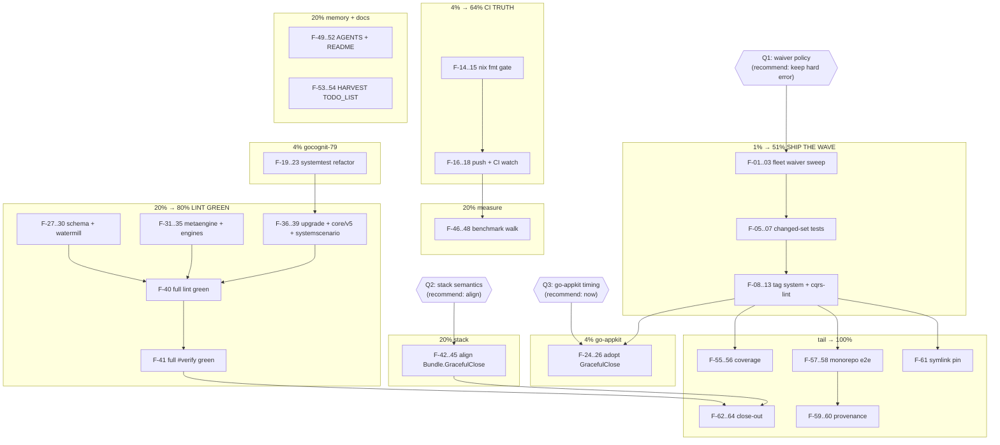

# SUPERB — Ship-the-Wave & Green-CI Pareto Plan (2026-10-13 18:16)

> **Scope:** everything actionable from the 2026-10-13 issue-fix session (issues #67/#69, fixed + closed, zero open issues) plus the CI-restoration work it exposed. The 128-item `TODO_LIST.md` backlog is NOT merged here — it keeps its own sections; routing happens in task M15 (HARVEST). Anti-verschlimmbesser rule in force: every change must leave the repo verifiably no worse than found; no speculative rewrites.

## 0. Current state (measured, not assumed)

- Issues #67 (`system.GracefulClose` drain-error leak) and #69 (scorecard test-only imports) — **fixed, tested, closed**; api golden +1 export; CHANGELOG/FEATURES updated.
- **9 local commits ahead of `origin/master`** (auto-commit daemon + session work). Nothing pushed → CI never saw any of it.
- Full `#lint` on current tree: **78 findings across 11 untouched modules** (schema, watermill, cmd/cqrs-upgrade, metaengine, metaengine/{duckdb,turso,pg,mysql}engine, core/v5, systemscenario, systemtest). Worst: `systemtest/time_fidelity_test.go:81` gocognit 79 (limit 35).
- `nix fmt --fail-on-change` (a CI gate) never ran this session — formatting of 12 touched files is unverified.
- Consumers (go-credentials-store, cqrs-htmx, go-appkit): waiver files unchecked for now-stale scenario waivers; go-appkit still hand-rolls the shutdown contract #67 just made native.
- 3 open decisions (Q1/Q2/Q3 below) — owner: Lars.

## 1. Pareto breakdown

### The 1% that delivers 51% — SHIP THE WAVE
One task line converts the entire session into consumer value; every other task is worth ~0 until it lands:

| Task | Why it is the 51% |
|------|-------------------|
| **T1. Cut the #67/#69 release wave** (sweep fleet waivers → per-module tests on changed set → `batch-release.sh` tag `system` + `cmd/cqrs-lint` → proxy smoke) | An untagged fix is an undelivered fix. Both consumers' bugs stay live on tagged versions until this ships. The 2026-10-06 lesson (90 tags shipped with red suites) is baked in: tests over the CHANGED set first, `verify=ok` alone proves nothing. |

### The 4% that delivers 64% — CI TRUTH + WORST OFFENDER + THE ONE CONSUMER CHANGE
| Task | Why |
|------|------|
| **T2. Make the pushed tree honest**: `nix fmt` gate → push (user-ordered) → watch CI → fix anything session-caused | 9 unpushed commits + 2 never-run CI gates = zero confidence. Cheapest truth money can buy. |
| **T3. Kill the gocognit-79 monster**: refactor `systemtest/time_fidelity_test.go` (complexity 79 → ≤35, table-driven) | Single worst lint finding; un-reddens the most central module; blocks "CI green" claims. |
| **T4. go-appkit adopts `GracefulClose`**: replace hand-rolled `Drain`+always-`Close`+`Join` wrapper, drop `TestEventService_Shutdown_DrainTimeoutStillCloses` | The only consumer-code change in the plan; deletes code using a fix that is otherwise unproven outside this repo's tests. Rides T1's tag. |

### The 20% that delivers 80% — CI GREEN + DIVERGENCE-KILLERS + MEASUREMENT
| Task | Why |
|------|------|
| T5. Lint batches: schema+watermill, metaengine+4 engines, cqrs-upgrade+core/v5+systemscenario | CI red is a standing lie detector disabling every other gate's signal. |
| T6. Q2 decision + `stack.Bundle.GracefulClose` alignment (align with system's always-close, or document divergence as v5-frozen) | Split brain in the making: two `GracefulClose`s with opposite drain-error contracts. |
| T7. Benchmark `CollectTestImportPaths` on the 103-module self repo; optimize only if measurable | A tree walk now rides every scorecard run — unmeasured. |
| T8. Memory + docs: AGENTS.md gotchas (art-dupl placement, live `docs/drafts/` fences), cqrs-lint README test-import line, HARVEST this plan into TODO_LIST | Prevents the session's learnings from dying in a timestamped file. |
| T9. Verification debt: `#check-coverage`, `gh issue view` 67/69, multi-module scorecard e2e | Closes every PARTIALLY-DONE row of the status report. |

### The other 20% to reach 100% — long tail (kept, not padded)
Evidence provenance labels, symlink contract test, CI-watch tail, plan ANNOTATE discipline when stale, backlog pointer maintenance (TODO_LIST stays the living source).

---

## 2. Decision gates (owner: Lars — recommendations included, DO NOT proceed past a gate without a verdict)

| Gate | Question | Recommendation | Blocks |
|------|----------|----------------|-------|
| **Q1** | Stale scenario waivers now hard-error (waive-used) on consumers' first run post-tag. Keep hard error, or one-release warning? | **Keep hard error.** Fleet is first-party, the error message names the exact key to delete, and the scorecard's teeth are BY DESIGN (contract 28). Softening would verschlimmbessern. | T1 (sweep scope) |
| **Q2** | Align `stack.Bundle.GracefulClose` with system's always-close contract, or freeze stack as v5-deprecated and only document the divergence? | **Align.** The divergence is exactly the class ADR-0123 kills at v5; until then consumers reading either godoc get opposite guarantees. Cheap fix + test inversion. | T6 |
| **Q3** | go-appkit migration now (own mini-change) or hold for the next tag wave? | **Now, riding T1's tag** — the fix is in `[Unreleased]`; the wave that tags `system` is the natural vehicle; holding gains nothing. | T4 |

## 3. Comprehensive plan — medium granularity (30–100 min each; sorted by importance → impact → effort → customer-value)

| # | Task (M-*) | Delivers | Impact | Effort | Depends | Tier |
|---|------------|----------|--------|--------|---------|------|
| 1 | **M1 Ship-the-wave prep**: fleet `.cqrs-lint.json` waiver sweep (remove stale scenario/systemscenario rows); `gh issue view` 67/69 comment check; per-module `GOWORK=off go test -count=1 ./...` over changed set (system, cmd/cqrs-lint) | Safe release runway | H | 60m | Q1 | 1% |
| 2 | **M2 Cut the tag wave**: `scripts/batch-release.sh` for `system` + `cmd/cqrs-lint` (versions-manifest check, pin sweep, proxy smoke, attempt-1 discipline) | #67+#69 live for consumers | H | 100m | M1 | 1% |
| 3 | **M3 Format truth**: repo-wide `nix fmt --fail-on-change`; fix + commit any drift | CI parity for 12 touched files | H | 30m | — | 4% |
| 4 | **M4 Push + CI watch**: push master; watch the Actions run end-to-end; fix anything session-caused (expected clean; lint debt pre-exists) | Confidence in 9 commits | H | 45m | M3 | 4% |
| 5 | **M5 gocognit-79 refactor**: `systemtest/time_fidelity_test.go:81` → table-driven, ≤35 complexity, behavior-identical (timing margins preserved) | Worst lint offender dead | H | 90m | — | 4% |
| 6 | **M6 go-appkit migration**: `EventService.Shutdown` → `sys.GracefulClose(ctx)`; drop wrapper + redundant test; run go-appkit suite; release if it tags independently | Consumer deletes code; fix proven outside repo | H | 60m | M2, Q3 | 4% |
| 7 | **M7 Lint batch 2**: schema + watermill findings → zero | CI green progress | H | 90m | — | 20% |
| 8 | **M8 Lint batch 3**: metaengine + duckdb/turso/pg/mysql engines → zero | CI green progress | H | 100m | — | 20% |
| 9 | **M9 Lint batch 4**: cmd/cqrs-upgrade + core/v5 + systemscenario → zero; re-run full `#lint` → expect green | CI GREEN milestone | H | 60m | M5, M7, M8 | 20% |
| 10 | **M10 Full `#verify`**: exclusive run; everything incl. race + doc-check must pass | Wave-quality proof | H | 60m | M9 | 20% |
| 11 | **M11 Q2 decision + stack alignment**: align `stack.Bundle.GracefulClose` (drain error → still Close, errors.Join), invert `TestBundle_GracefulClose_DrainErrorAbortsClose`, CHANGELOG row — OR divergence doc-note if frozen | Split-brain kill | M | 30m | Q2 | 20% |
| 12 | **M12 Benchmark the walk**: time scorecard self-run (103 modules) before/after Pass 2; optimize (dir short-circuit) only if >100ms regression; record numbers in this file's addendum | No silent perf tax | M | 45m | M2 | 20% |
| 13 | **M13 Memory + docs**: AGENTS.md gotchas (art-dupl directive placement tolerance; `docs/drafts/` fences are LIVE for md-go); cqrs-lint README + RULES.md one-liner "`_test.go` imports count as adoption" | Learning retention | M | 30m | — | 20% |
| 14 | **M14 HARVEST**: docs-health HARVEST this plan → TODO_LIST.md rows (incl. 128-backlog routing check) | Backlog hygiene | M | 30m | M2 | 20% |
| 15 | **M15 Coverage gate**: `nix run .#check-coverage`; triage drift in touched modules | Quality gate | M | 30m | M2 | 20% |
| 16 | **M16 Multi-module scorecard e2e**: monorepo fixture (nested go.mods) exercising Pass 2 | Test depth | M | 60m | M2 | 20% |
| 17 | **M17 Evidence provenance**: test-only rows render "test-only import" (additive JSON; regen doctor/scorecard goldens; contract-28 additive rule) | UX polish | L | 60m | M16 | tail |
| 18 | **M18 Symlink contract test**: pin `CollectTestImportPaths` symlink behavior (WalkDir skips) | Contract pin | L | 30m | M2 | tail |
| 19 | **M19 CI-watch tail + plan annotation**: after wave push, confirm Actions green; if this plan goes stale before completion, ANNOTATE (never rewrite) | Process discipline | L | 30m | M4 | tail |
| 20 | **M20 ADR check**: `nix run .#check-adr-numbering` before/after any ADR the wave adds (Q2 may spawn one) | Gate hygiene | L | 30m | M11 | tail |

*All 20 medium tasks ≈ 15.7h. Sorted execution order = table order (1→20), which is already dependency- and value-sorted.*

## 4. Detailed breakdown — fine granularity (≤12 min each; sorted by importance → impact → effort → customer-value)

Group headers name their parent M-task. IDs F-01…F-72. Effort in minutes.

**T1 SHIP-THE-WAVE (1% → 51%) — M1+M2**
| # | Task | Impact | Effort |
|---|------|--------|--------|
| F-01 | Read go-credentials-store `.cqrs-lint.json`; delete stale scenario waivers if present; run its scorecard | H | 8m |
| F-02 | Same sweep for cqrs-htmx + go-appkit (clone/pull, grep waivers, fix) | H | 10m |
| F-03 | Same sweep for browser-history + any other fleet `.cqrs-lint.json` found via `~/projects` grep | H | 10m |
| F-04 | `gh issue view 67` + `69` — confirm comment bodies rendered | L | 5m |
| F-05 | Run `GOWORK=off go test -count=1 ./...` in `system/` (changed set) | H | 10m |
| F-06 | Run same in `cmd/cqrs-lint/` (changed set) | H | 12m |
| F-07 | Run same in `systemtest/` + `systemscenario/` (blast radius of #67) | H | 10m |
| F-08 | `bash scripts/check-versions-manifest.sh --check`; refresh if stale | M | 8m |
| F-09 | Verify-lock free, then `scripts/batch-release.sh` tag `system` (watch attempt-1 discipline) | H | 12m |
| F-10 | Same for `cmd/cqrs-lint` | H | 12m |
| F-11 | `pin-sweep.sh --check --remote` after tags | H | 10m |
| F-12 | Proxy-smoke both new tags from a scratch consumer (`go get` + build) | H | 10m |
| F-13 | CHANGELOG: cut `[Unreleased]` rows into the new wave heading | M | 10m |

**T2 CI TRUTH (4%) — M3+M4**
| # | Task | Impact | Effort |
|---|------|--------|--------|
| F-14 | `nix fmt` repo-wide; `git diff --stat` review; commit drift | H | 10m |
| F-15 | `nix fmt --fail-on-change` re-run → green proof | H | 5m |
| F-16 | `git push origin master` (user-ordered) | H | 2m |
| F-17 | Watch Actions run; record job outcomes (build/vet/test/lint/race/fmt/per-module) | H | 12m |
| F-18 | If CI red on session-caused files: fix immediately; pre-existing lint debt → task F-25+ instead | H | 12m |

**T3 WORST OFFENDER (4%) — M5**
| # | Task | Impact | Effort |
|---|------|--------|--------|
| F-19 | Read `time_fidelity_test.go:81-160`; map the branching (which axis explodes complexity) | H | 10m |
| F-20 | Extract per-leg table cases; keep timing margins + `// skip-validate`-free | H | 12m |
| F-21 | Refactor loop bodies into helpers; complexity ≤35 | H | 12m |
| F-22 | Run `systemtest` suite `-count=1`; compare assertions count unchanged | H | 10m |
| F-23 | `#lint` scoped to systemtest → gocognit gone | H | 8m |

**T4 GO-APPKIT (4%) — M6**
| # | Task | Impact | Effort |
|---|------|--------|--------|
| F-24 | In go-appkit: replace `Shutdown` body with `sys.GracefulClose(ctx)`; keep error contract (`errors.Join` semantics now internal) | H | 10m |
| F-25 | Delete `TestEventService_Shutdown_DrainTimeoutStillCloses`; port its scenario to a GracefulClose-native test if any residual value | M | 10m |
| F-26 | Run go-appkit suite; commit + push its repo | H | 12m |

**T5 LINT GREEN (20%) — M7+M8+M9+M10**
| # | Task | Impact | Effort |
|---|------|--------|--------|
| F-27 | Inventory schema findings (`nix run .#lint` scoped); classify mechanical vs design | H | 8m |
| F-28 | Fix schema findings; module tests green | H | 12m |
| F-29 | Inventory watermill findings; classify | H | 8m |
| F-30 | Fix watermill findings; module tests green | H | 12m |
| F-31 | Inventory metaengine core findings; classify | H | 8m |
| F-32 | Fix metaengine core; tests green | H | 12m |
| F-33 | Inventory 4 engine modules (duckdb/turso/pg/mysql); classify | H | 10m |
| F-34 | Fix duckdb + turso; tests green | H | 12m |
| F-35 | Fix pg + mysql; tests green | H | 12m |
| F-36 | Inventory cqrs-upgrade + core/v5 + systemscenario; classify | H | 8m |
| F-37 | Fix cqrs-upgrade; tests green | H | 10m |
| F-38 | Fix core/v5; tests green | H | 10m |
| F-39 | Fix systemscenario; tests green | H | 10m |
| F-40 | Full `nix run .#lint` → GREEN proof | H | 8m |
| F-41 | Full exclusive `nix run .#verify` → GREEN proof (quiet window if load-sensitive) | H | 12m |

**T6 STACK ALIGNMENT (20%) — M11**
| # | Task | Impact | Effort |
|---|------|--------|--------|
| F-42 | Read `stack` GracefulClose + its backend drain plumbing; confirm abort-vs-close shape | M | 10m |
| F-43 | Implement align (drain error → still Close + Join) at backend level | M | 12m |
| F-44 | Invert `TestBundle_GracefulClose_DrainErrorAbortsClose` → StillCloses | M | 10m |
| F-45 | stack suite green; CHANGELOG Fixed row; ADR only if Lars wants it recorded | M | 12m |

**T7 MEASUREMENT (20%) — M12**
| # | Task | Impact | Effort |
|---|------|--------|--------|
| F-46 | Time `cqrs-lint scorecard --path .` (self, 103 modules) at HEAD~9 (pre-Pass-2) via git worktree | M | 12m |
| F-47 | Same at current HEAD; record delta in this file's addendum | M | 8m |
| F-48 | If delta >100ms: add no-`.go`-dir short-circuit + re-measure; else close as measured-fine | M | 12m |

**T8 MEMORY + DOCS + HARVEST (20%) — M13+M14**
| # | Task | Impact | Effort |
|---|------|--------|--------|
| F-49 | AGENTS.md gotcha: art-dupl accept-directive placement (worked 2-lines-up; docs say on/above — pin the safe rule) | M | 8m |
| F-50 | AGENTS.md gotcha: `docs/drafts/` is LIVE for the md-go gate — new draft fences need `// skip-validate` | M | 8m |
| F-51 | cqrs-lint README scorecard section: "`_test.go` imports count as adoption (#69)" | L | 8m |
| F-52 | RULES.md scorecard row: same one-liner | L | 8m |
| F-53 | docs-health HARVEST: this plan → TODO_LIST rows; check 128-backlog routing | M | 12m |
| F-54 | Update TODO_LIST with shipped-wave completion marks | M | 8m |

**T9 VERIFICATION DEBT (20% + tail) — M15+M16**
| # | Task | Impact | Effort |
|---|------|--------|--------|
| F-55 | `nix run .#check-coverage`; compare vs thresholds | M | 8m |
| F-56 | Triage any coverage drift in system / cqrs-lint (new code covered? tests green → likely fine) | M | 12m |
| F-57 | Build monorepo e2e fixture: temp repo, 2 nested go.mods, `_test.go` importing systemscenario in the inner one | M | 12m |
| F-58 | Assert inner-module test import detected via composed pipeline; add to analyzer tests | M | 12m |

**TAIL → 100% — M17+M18+M19+M20**
| # | Task | Impact | Effort |
|---|------|--------|--------|
| F-59 | Scorecard/JSON: add `test_only` provenance flag on Pass-2-derived rows (additive) | L | 12m |
| F-60 | Regen doctor/scorecard goldens; run render tests | L | 10m |
| F-61 | Symlink contract test: create symlinked pkg dir; assert walk skips it (WalkDir semantics pin) | L | 10m |
| F-62 | Final CI watch after all waves pushed; annotate this plan DONE/DIFFERENT per section | L | 12m |
| F-63 | `check-adr-numbering` run if Q2 spawned an ADR | L | 8m |
| F-64 | Close-out: status report addendum linking this plan's completion state | L | 10m |

*64 fine tasks, total ≈ 9.5h. Every medium task fully covered; no orphan todos from the session's status report (b/c/e lists all map: fmt→F-14/15, verify→F-41, waiver sweep→F-01..03, issue-view→F-04, go-appkit→F-24..26, stack→F-42..45, benchmark→F-46..48, README→F-51/52, AGENTS→F-49/50, coverage→F-55/56, e2e→F-57/58, provenance→F-59/60, symlink→F-61, CI watch→F-17/62, harvest→F-53/54, ADR→F-63).*

## 5. Execution graph

## 6. Definition of done (wave-level)

- [ ] `system` + `cmd/cqrs-lint` tagged; proxy smoke green; consumers' stale waivers gone
- [ ] `nix fmt --fail-on-change` green; pushed; Actions observed; nothing session-caused red
- [ ] Full `#lint` 0 findings; full `#verify` green (exclusive window)
- [ ] go-appkit on `GracefulClose`; stack decided+done; benchmark numbers recorded here
- [ ] AGENTS/README/RULES updated; plan HARVESTed into TODO_LIST; this file ANNOTATEd at completion — never rewritten

## 7. Anti-verschlimmbesser contract

1. No lint "fix" may change behavior: refactors keep assertions byte-count-identical or better; timing margins untouched.
2. No gate gets softened to go green (scorecard teeth, waive-used, file-size ratchet, duplication ratchet all stay hard).
3. Nothing speculative: benchmark before optimizing; stack aligned only on Q2 verdict; provenance is additive-only JSON.
4. Every push is preceded by changed-set tests (the 2026-10-06 90-tag lesson).
