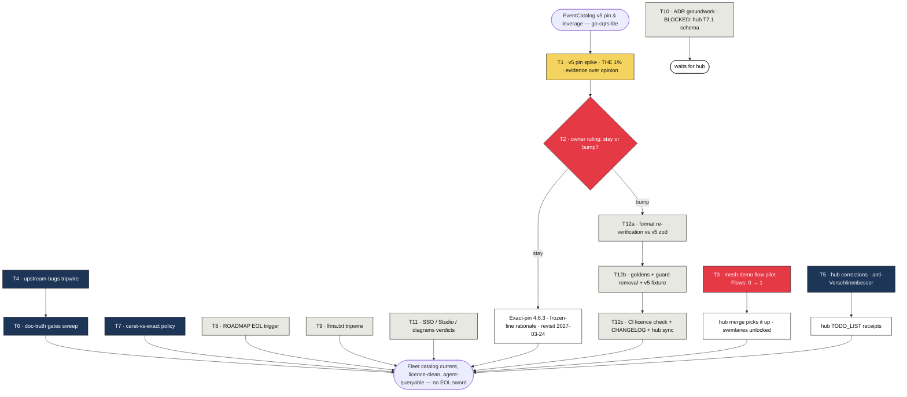

# SUPERB Pareto Plan — EventCatalog v5 Pin Strategy & Fleet Leverage (go-cqrs-lite)

- **Created:** 2026-10-15 19:17 CEST
- **Scope:** the EventCatalog v5 workstream in THIS repo (the `catalog/` module's
  `@eventcatalog/core` pin, the hub's upstream asks, and the agent-surface
  contracts we own). NOT in scope: foreign WIP in the working tree
  (`example/taskmanager`, `cmd/doc-check` recipe meta3, `.agents/skills`
  edits — owned by the parallel 03-01 session), and hub-repo tasks that the
  hub's own plan already owns (its T1 key claim, T5/T6 bake-offs, T17 diff).
- **Source evidence:** this session's analysis
  (`docs/status/2026-10-15_18-02_eventcatalog-v5-licence-impact-analysis.md`
  + its 19:12 addendum), the hub's same-day audit
  (`~/projects/eventcatalog-hub/docs/research/2026-10-15_eventcatalog-deep-dive.html`)
  and leverage plan
  (`~/projects/eventcatalog-hub/docs/planning/2026-10-15_18-22_pareto-eventcatalog-v5-leverage-plan.md`),
  TODO_LIST § "EventCatalog upstream v5 licence shift" + § "Upstream asks from
  eventcatalog-hub", `catalog/AGENTS.md`.
- **Living source:** TODO_LIST.md stays the living backlog; this file is a
  point-in-time snapshot. Harvest decisions back into it as they land.

## Ground truth the plan stands on (all verified 2026-10-15)

- Licence: v5 is BSL 1.1; **Free Use for LarsArtmann is CONFIRMED** (hub audit).
  The licence blocker on the pin decision is gone — what remains is timing,
  verification, and cross-repo coordination.
- Our exporter pins `^4.6.3` (`catalog/eventcatalog/exporter.go:19`); v4 EOL
  ~2027-03-24 (critical-security fixes only until then).
- The hub runs core `^5.0.1` and builds our v4-format exported trees under its
  link-validation-as-CI gate — **v5 parses our output, empirically**.
- Three open upstream facts gate the bump decision, and ONE experiment answers
  all three: does v5 (a) fix the agent-changelog crash (`writer.go:222` guard),
  (b) still log the 3 cosmetic sidebar WARNs, (c) route standalone custom docs?
  Plus: does the render gate pass a v5 pin at all (zod schema drift)?
- `catalog.Flow` exists (`types_resources.go:121`, `Flow.Owners` shipped
  2026-09-24) — no source emits a flow; hub dashboard renders "Flows: 0".
- `catalog.Channel` (types.go:193), `catalog.Entity`, `catalog.Agent`
  (types_resources.go:23,51) are already first-class exporter API — only
  SYSTEMS lack a config type. The hub audit's "blocker is exporter support"
  is wrong for channels/entities; its AsyncAPI "exporter gap" overlooks
  `catalog/asyncapi/` + `catalog/openapi/`.
- `example/mesh-demo` already ships per-context catalog registries
  (`catalog.go`) with bilateral Sends/Receives — the cross-context
  order→billing story is the demo's visible part and the perfect first flow.

## Verschlimmbesser guardrails (read before executing anything)

1. **The spike runs on a scratch worktree/branch.** A pin bump never lands in
   `master` outside an explicit decision commit; `eventCatalogCoreVersion` and
   the goldens move together or not at all.
2. **Golden regen procedure is sacred:** scoped `UPDATE_SNAPS=true go test
   ./eventcatalog/...` THEN `git ls-files -d -- testdata/golden | xargs -r git
   restore --` (catalog/AGENTS.md § Golden tests — the shared snap dir
   cross-deletes).
3. **No ADR emission implementation before the hub confirms the upstream ADR
   frontmatter schema (its T7.1).** Guessing a schema = guaranteed rework.
   Groundwork (T10) is design-only.
4. **No new catalog API surface.** `DEP_BUDGET[catalog]=5` is FULL; the flow
   pilot rides the existing `catalog.Flow` API; a future `SystemConfig` is
   hub-triggered (second deployment shape), not speculative.
5. **The `cId` namespace in `catalogid.go` is frozen.** Changing it re-ids
   every catalog in the fleet.
6. **Foreign WIP is untouchable:** taskmanager compile errors, doc-check
   recipe meta3, skills edits — the 03-01 session owns them.
7. **Every doc edit gets a same-turn diff review** (the "above/below" lesson
   from the 18:02 session — caught during report prep, not before shipping).
8. **Cross-repo hub edits are dated receipt rows only** (their TODO_LIST
   conventions; new files under hub `docs/` need `title`+`summary`
   frontmatter — avoid creating any).
9. **Keys and tokens never enter either repo** (hub guardrail 8, mirrored).

## Pareto breakdown

### The 1% that delivers 51%

**T1 — the v5 pin spike.** One scratch experiment (bump the pin in a
worktree, run `nix run .#check-eventcatalog`, read the logs) converts the
entire stay-vs-bump decision from opinion to evidence: it answers the
changelog-crash question, the sidebar-WARN question, the custom-docs
question, and zod acceptance in a single render-gate run. Every downstream
task (T2, T12a–c) is unplannable without it; every session after it saves the
rediscovery tax. Nothing else in this plan has that leverage ratio.

### The 4% that delivers 64%

T1 plus its decision lock and the one content win we own:

- **T2 — decision + dated receipt.** Owner takes T1's evidence and rules:
  bump (schedule coordinated with the hub's core cadence) or stay (exact-pin
  `4.6.3`, frozen-line rationale, revisit date). Recorded per the receipt
  convention on the TODO_LIST row. Without the receipt, T1's evidence rots
  in a scratch log.
- **T3 — mesh-demo flow pilot.** Emit one `catalog.Flow` for the
  orders→billing context story through the existing API. Pin-outcome-
  independent user-visible value: it feeds the hub's #2 content gap
  ("Flows: 0"), enables v5 swimlanes for our data, and exercises Flow.Owners
  end-to-end for the first time.

### The 20% that delivers 80%

The 4% plus the cheap compounding moves:

- **T4 — upstream-bugs tripwire** (`catalog/AGENTS.md` checklist: bug,
  symptom, guard file:line, verify-at-bump steps). Ends the rediscovery tax
  every future bump would pay.
- **T5 — hub corrections** (dated receipt rows in the hub's TODO_LIST:
  channels/entities/agents already first-class here; asyncapi/openapi
  exporters exist). Prevents the hub from speccing exporter work that exists
  — the cheapest anti-Verschlimmbesser move in the plan.
- **T6 — doc-truth gates** after a doc-heavy day: full `doc-check` +
  `check-md-go` + `check-adr-numbering`; fix findings on sight.
- **T7 — caret-vs-exact pin policy** (folds T2's outcome into the constant's
  docs + README §338): exact-pin maximizes reproducibility on a frozen line;
  caret only if bumping.

### The remaining tasks (to 100%)

- **T8 — ROADMAP EOL trigger** (2027-03-24 revisit row) + v4 security-watch
  note.
- **T9 — llms.txt contract tripwire:** doc note that `writer_llms.go` output
  is the standalone MCP server's input — format changes are breaking for
  agent consumers.
- **T10 — ADR emission groundwork** (API sketch + acceptance criteria ONLY —
  implementation blocked on hub T7.1 schema confirmation).
- **T11 — verdicts:** SSO (why-not), Studio v2 (when), 3-level diagrams vs
  our `catalog/d2` exporter (coexist-or-retire note).
- **T12a–c — IF BUMP (contingent):** (a) full format-contract
  re-verification vs v5 zod schemas (the 10-point checklist in
  catalog/AGENTS.md § Verified format contract); (b) scoped goldens regen +
  changelog-guard removal + ec-fixture v5 profile + WithPlainRefIDs re-check;
  (c) CI licence-key behavior check + CHANGELOG row + hub sync note.

## Comprehensive plan (30–100 min tasks, ALL todos)

Priority = Impact × Ease (1–5 scales). "Owner" = needs Lars.

| #    | Task                                                                                    | Tier  | Min  | I | E | P  | Depends    | Done when                                                              |
| ---- | --------------------------------------------------------------------------------------- | ----- | ---- | - | - | -- | ---------- | ---------------------------------------------------------------------- |
| T1   | v5 pin spike: scratch worktree, bump pin to `^5.1.0`, run `check-eventcatalog`, record crash/WARNs/custom-docs/zod evidence table | 1%    | 100  | 5 | 3 | 15 | —          | Evidence table in scratch log; master untouched                          |
| T2   | Pin decision + dated receipt on the TODO_LIST row (owner rules; stay→exact-pin + revisit date, bump→coordinate with hub cadence) | 4%    | 30   | 5 | 5 | 25 | T1         | Receipt sub-bullet with date + verdict; TODO_LIST row closed or rescheduled |
| T3   | mesh-demo flow pilot: design orders→billing flow steps, emit via `catalog.Flow` in `example/mesh-demo` registries, verify export tree | 4%    | 90   | 4 | 4 | 16 | —          | Export tree carries `flows/`; mesh-demo tests green                      |
| T4   | Upstream-bugs tripwire checklist in catalog/AGENTS.md (changelog crash, 3 WARNs; guard locations; verify-at-bump steps) | 20%   | 30   | 3 | 5 | 15 | —          | Checklist committed; diff-reviewed                                        |
| T5   | Hub corrections: dated receipt rows in hub TODO_LIST for T15 (asyncapi exists) + T18 (channels/entities/agents exist; systems is the only gap) | 20%   | 30   | 3 | 5 | 15 | —          | Hub TODO_LIST rows added, citing our file:line evidence                   |
| T6   | Doc-truth gates sweep: `doc-check` (full file set) + `check-md-go` + `check-adr-numbering`; fix findings | 20%   | 60   | 3 | 4 | 12 | —          | All three gates green (or findings fixed)                                 |
| T7   | Version-reference sweep + caret-vs-exact policy (grep all core-version mentions; update exporter constant docs + README §338) | 20%   | 30   | 2 | 5 | 10 | T2         | No stale version prose; policy recorded at the constant                   |
| T8   | ROADMAP: 2027-03-24 v4-EOL revisit trigger + v4 security-watch note                      | 100%  | 30   | 2 | 5 | 10 | —          | ROADMAP row with explicit trigger date                                    |
| T9   | llms.txt contract tripwire: doc note (writer_llms.go) that output feeds `@eventcatalog/mcp-server` | 100%  | 30   | 2 | 5 | 10 | —          | Note committed at the writer + AGENTS.md bullet                            |
| T10  | ADR emission groundwork: `catalog.ADR` API sketch + exporter acceptance criteria (NO implementation) | 100%  | 45   | 3 | 3 | 9  | —          | Sketch doc filed; explicitly blocked:upstream on hub T7.1                 |
| T11  | Verdicts: SSO why-not + Studio-when + 3-level-diagrams vs catalog/d2 coexist note        | 100%  | 30   | 1 | 5 | 5  | —          | Three dated verdict lines in ROADMAP                                      |
| T12a | IF BUMP: format-contract re-verification vs v5 zod (pointer-object lists, x-*, composite IDs, channel pointers, changelog sidecars, flow node kinds, badges, custom docs) | 100%  | 100  | 5 | 2 | 10 | T2=bump    | Each checklist item verified or adapted; deviations documented            |
| T12b | IF BUMP: scoped goldens regen + changelog-guard removal (if fixed) + ec-fixture v5 profile + WithPlainRefIDs re-check | 100%  | 60   | 4 | 3 | 12 | T12a       | Goldens green via the sacred procedure; guard dropped only if crash gone  |
| T12c | IF BUMP: CI licence-key behavior check (eval window in CI?) + CHANGELOG row + hub sync note | 100%  | 45   | 3 | 4 | 12 | T12a       | Gate behavior recorded; CHANGELOG `[Unreleased]` row; hub TODO_LIST note  |

Totals: 14 tasks (3 contingent on bump), ~715 min (~12 h); the bump-contingent
band (T12a–c, ~205 min) collapses to zero if T2 rules "stay".

## Micro plan (≤12 min tasks, ALL todos)

Global order follows the comprehensive table; IDs are `T<task>.<step>`.

| #  | ID    | Step                                                                                         | Min | Verification                                        |
| -- | ----- | -------------------------------------------------------------------------------------------- | --- | --------------------------------------------------- |
| 1  | T1.1  | Create scratch worktree (`git worktree add ../gcl-v5spike -b spike/v5-pin`)                   | 6   | Worktree exists; master clean                       |
| 2  | T1.2  | Bump `eventCatalogCoreVersion` to `^5.1.0` in the worktree                                    | 3   | One-line diff                                       |
| 3  | T1.3  | Kick off `nix run .#check-eventcatalog` in the worktree (cold npm fetch — background it)      | 6   | Command running; log file path noted                |
| 4  | T1.4  | While it runs: draft the evidence table (crash / WARNs / custom-docs / zod / build-pass)      | 12  | Table skeleton ready                                |
| 5  | T1.5  | Read gate logs: build pass/fail + zod errors (`InvalidContentEntryDataError`?)                | 12  | Build verdict + zod verdict recorded                |
| 6  | T1.6  | Read logs: changelog crash present? (`getBadgeHref` / agent changelog page)                   | 6   | Crash verdict recorded                              |
| 7  | T1.7  | Read logs: 3 sidebar WARNs present? custom-docs routes in dist?                               | 12  | WARNs + routing verdicts recorded                   |
| 8  | T1.8  | Save evidence table to scratch (NOT master); trash the worktree                               | 6   | Evidence file exists; worktree gone                 |
| 9  | T2.1  | Present evidence to owner; get stay/bump ruling                                               | 12  | Ruling quoted in receipt                            |
| 10 | T2.2  | Write dated receipt sub-bullet on the TODO_LIST pin row                                       | 6   | Diff shows receipt; anchor intact                   |
| 11 | T2.3  | IF STAY: change pin to exact `4.6.3` + rationale comment + revisit date                       | 6   | Constant + comment diff; goldens untouched          |
| 12 | T2.4  | IF BUMP: open coordination note to hub (target core version + landing window)                 | 6   | Hub TODO_LIST receipt row added                     |
| 13 | T3.1  | Read mesh-demo `catalog.go` registries; map the orders→billing story to FlowStep kinds        | 12  | Step outline (triggers, messages, container) drafted |
| 14 | T3.2  | Check `catalog.Flow`/`FlowStep` fields + `WithPlainRefIDs` interaction for flow node keys     | 12  | Field list confirmed against types_resources.go     |
| 15 | T3.3  | Add the flow declaration to the orders context registry                                       | 12  | Code compiles                                       |
| 16 | T3.4  | Add `Flow.Owners` (orders-team) + badges per the 2026-09-24 wave conventions                  | 6   | Owner set                                           |
| 17 | T3.5  | Run mesh-demo export; inspect generated `flows/` tree + frontmatter                           | 12  | Flow dir sane; refs resolve                         |
| 18 | T3.6  | Run mesh-demo go tests; fix fallout                                                           | 12  | `go test ./...` green in example/mesh-demo          |
| 19 | T3.7  | Note hub hand-off (their merge picks it up; no hub edits needed) in TODO_LIST flow row        | 6   | Row annotated                                       |
| 20 | T4.1  | Draft checklist header in catalog/AGENTS.md (bug, symptom, guard, verify-at-bump columns)     | 6   | Skeleton placed after the licence bullets           |
| 21 | T4.2  | Row 1: agent-changelog crash (writer.go:222 guard, ec-fixture changelog profile dependency)   | 6   | Row complete with file:line                         |
| 22 | T4.3  | Row 2: 3 sidebar WARNs (route list in AGENTS.md §98-106; render-gate tolerance rule)          | 6   | Row complete                                        |
| 23 | T4.4  | Add "check this list FIRST" line to the pin-bump instruction bullet                           | 3   | Cross-ref present                                   |
| 24 | T4.5  | Diff review the whole edit (same-turn rule)                                                   | 3   | No direction/wording errors                         |
| 25 | T5.1  | Read hub TODO_LIST conventions (row format, receipt style)                                    | 6   | Format understood                                   |
| 26 | T5.2  | Add dated receipt row under hub's T15: asyncapi+openapi exporters exist (cite our paths)      | 6   | Row cites catalog/asyncapi/, catalog/openapi/       |
| 27 | T5.3  | Add dated receipt row under hub's T18: channels/entities/agents exist (cite types.go:193, types_resources.go:23,51); systems is the real gap | 6   | Row cites evidence                                  |
| 28 | T5.4  | Diff review + respect hub frontmatter rules (no new docs files)                               | 6   | Only TODO_LIST touched in hub                       |
| 29 | T6.1  | Run `cd cmd/doc-check && GOWORK=off go run . ../../SKILL.md ../../.agents/skills/go-cqrs-lite/references/*.md ../../AGENTS.md ../../catalog/AGENTS.md` | 12  | Zero warnings (zero-warning policy)                 |
| 30 | T6.2  | Run `nix run .#check-md-go`                                                                   | 12  | Green                                               |
| 31 | T6.3  | Run `nix run .#check-adr-numbering`                                                           | 6   | Green                                               |
| 32 | T6.4  | Fix any findings on sight; re-run failing gate                                                | 12  | All green                                           |
| 33 | T6.5  | Confirm auto-commit daemon state; note any absorbed commits                                   | 3   | `git log --oneline -5` checked                      |
| 34 | T7.1  | Grep sweep: `4.6.3|eventCatalogCoreVersion|@eventcatalog/core` across repo                    | 6   | Hit list written                                    |
| 35 | T7.2  | Fix stale prose (README §338 et al.) per T2 outcome                                           | 12  | Each hit updated or intentionally left (noted)      |
| 36 | T7.3  | Record policy comment at the constant (exact vs caret + why)                                  | 6   | Comment diff                                        |
| 37 | T8.1  | Read ROADMAP conventions; add EOL trigger row (2027-03-24)                                    | 6   | Row with trigger date                               |
| 38 | T8.2  | Add v4 security-watch note (upstream releases scan until EOL)                                 | 6   | Note in same row                                    |
| 39 | T9.1  | Add doc note at writer_llms.go: output is `@eventcatalog/mcp-server` input                    | 6   | Comment/godoc present                               |
| 40 | T9.2  | Mirror one line in catalog/AGENTS.md (embedded-serving area)                                  | 6   | Bullet present                                      |
| 41 | T10.1 | Sketch `catalog.ADR` type (id, title, status, date, context, decision, consequences)          | 12  | Sketch in planning doc                              |
| 42 | T10.2 | Draft exporter acceptance criteria (emission dir, frontmatter TBD, goldens)                   | 12  | Criteria list                                       |
| 43 | T10.3 | File under docs/planning or TODO_LIST as blocked:upstream (hub T7.1 gate)                     | 6   | Row/spec linked                                     |
| 44 | T11.1 | SSO verdict line (why-not: LAN/homelab deploy, no IdP fleet-wide)                             | 6   | ROADMAP line dated                                  |
| 45 | T11.2 | Studio v2 verdict line (when: content-rich catalog, post flow/ADR pilots)                     | 6   | ROADMAP line dated                                  |
| 46 | T11.3 | 3-level-diagrams vs catalog/d2 verdict line (coexist: d2 is consumer-facing export, core diagrams are site render) | 6   | ROADMAP line dated                                  |
| 47 | T12a.1 | IF BUMP: verify pointer-object lists (entities, flows, domains, data-products, sends, receives, writesTo, readsFrom) | 12  | Per-field pass/fail                                 |
| 48 | T12a.2 | IF BUMP: verify channel message pointers + `x-*` extension-property rule                      | 12  | Pass/fail                                           |
| 49 | T12a.3 | IF BUMP: verify composite entry IDs, changelog sidecars, ubiquitous-language + examples files | 12  | Pass/fail                                           |
| 50 | T12a.4 | IF BUMP: verify flow node kinds (container/flow), styles nesting, badge color requirements    | 12  | Pass/fail                                           |
| 51 | T12a.5 | IF BUMP: consolidate deviations; adapt exporter; re-run spike gate                            | 12  | Gate green or deviation doc                         |
| 52 | T12b.1 | IF BUMP: scoped `UPDATE_SNAPS=true go test ./eventcatalog/...` then restore cross-deleted snaps | 12  | Sacred procedure followed; `git status` sane        |
| 53 | T12b.2 | IF BUMP: drop `shouldEnableChangelog` guard + ec-fixture changelog profile IF T1 proved fix   | 12  | Guard diff; gate re-run                             |
| 54 | T12b.3 | IF BUMP: add ec-fixture v5 profile; re-check `WithPlainRefIDs` vs v5 linter                   | 12  | Both profiles render                                |
| 55 | T12c.1 | IF BUMP: check CI licence-key behavior (does `check-eventcatalog` count as production use? eval clock?) | 12  | Behavior recorded (blog says builds never break)    |
| 56 | T12c.2 | IF BUMP: CHANGELOG `[Unreleased]` row + `check-changelog-symbols` symbols                     | 6   | Gate green                                          |
| 57 | T12c.3 | IF BUMP: hub sync note (their next coordinated bump target)                                   | 6   | Hub TODO_LIST receipt                               |
| 58 | T12c.4 | IF BUMP: api-stability regen if exporter surface changed (`--update` + meta-tests)            | 12  | Golden + TestEvery green                            |

Totals: 58 micro tasks, every one ≤12 min, covering all 14 comprehensive tasks
(contingent bump band = #47–58, executed only after a "bump" ruling).

## Execution graph

Read it as: the yellow node turns the decision into evidence; the red band
locks that evidence into a ruling and ships the one content win we own; the
blue band makes every future session cheaper (tripwires, corrections, gates);
the grey band completes the inventory — with the bump band contingent on the
ruling and ADR emission waiting on the hub's schema confirmation.

## Harvest note

Section-level follow-ups already live in TODO_LIST (pin row + upstream-asks
section). After execution, dated receipts land THERE — this file is a
snapshot. New tasks discovered mid-execution go to TODO_LIST first, then
optionally back here as an addendum.
