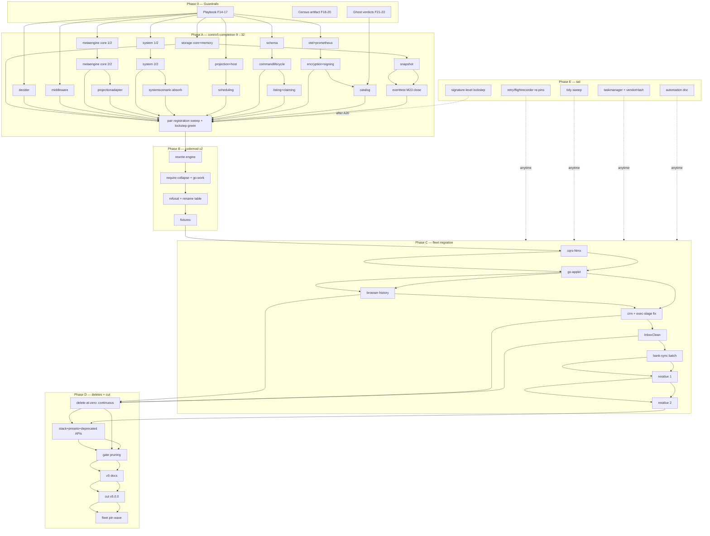

# SUPERB Plan: v4→v5 Fleet Migration — Pareto Execution Plan

- **Date:** 2026-10-17 08:02 CEST
- **Goal:** Retire the v4 surface (kill the dual-support duplicate code) by completing core/v5, migrating the first-party fleet, and cutting v5.0.0.
- **Scope:** ALL open TODOs from this session's two status reports (03:55, 17:24), the TODO_LIST §v5 Unification rows, and the tool-verified census. Sources: `docs/status/2026-10-16_03-55_*`, `docs/status/2026-10-16_17-24_*`, ADR-0152/0123/0128, mirror lockstep register.
- **Format note:** owner demanded `.md` + mermaid (skill default is HTML+D2 — explicit instruction wins).

> **OWNER RULING (2026-10-17 ~08:45):** "slowly phase out/migrate deprecated submodule by
> submodule. As soon as none of my consumers use it anymore, DELETE. Until we can do a full v5
> cut." Fleet migration window: **1–2 weeks, sprint it.**
>
> Folded into this plan:
> 1. **Standing delete-at-zero rule** — any v4 module with 0 fleet requires AND 0 in-repo
>    couplings is deleted immediately, not held for a D-phase cascade. Census re-run after every
>    fleet batch (task 38b).
> 2. **Deletes are continuous**; D-phase shrinks to the coupled residue (stack + bench-infra
>    port, deprecated APIs inside live modules, gate-pruning tail).
> 3. **Twin policy (derived, not owner-ruled):** fork into core/v5 = point-in-time snapshot; the
>    v4 side goes **fix-only** (feature dev lands in core/v5 only). The 9 existing mirror pairs
>    (low-churn primitives) keep sync discipline; Big-23 forks stay UNREGISTERED — one-way drift
>    is expected, no lockstep gate for them (tasks 25/47 scope accordingly).
> 4. Full v5 cut remains the terminus: last modules die when their counts hit zero; v5.0.0 then.

## Current state (verified, timestamps matter — fleet automation moves daily)

- core/v5: **9/32 packages** mirror-locked (record, id, dedup, kv, dispatcher, metadata, event, command, query); event lag = eventtest subtree only (delivery-mark trio forked 2026-10-16, `64be699fa`).
- Fleet: ~35 repos on v4 (event 41 / id 41 / command 34 direct requires). Codec ghost tail RESOLVED by the 2026-10-16 morning sweep (0 imports, 0 requires; intentional poisoned fixture preserved).
- Tooling: `cqrs-upgrade` = pin bumps + V007 reports only; no v4→v5 rewrite.
- Free deletes (CORRECTED 2026-10-17 08:37 census + in-repo rg): **NOW** = transport/http+grpc, idempotency/kvstore (needs integration-test rewire). **NOT free**: storage/view+relational (die with the storage fork — storage-core alias re-exports), 7 stack presets (gated on bench-infra port, task 38.0), sqlstore (4 fleet consumers).
- Tool semantics: `project-dependency-graph` edges = go.mod **requires** (direct vs `// indirect`), NOT imports.

## Step 0 — Errata / verified-done (skill discipline: don't re-dispatch shipped work)

| Claimed TODO | Actual state | Evidence |
|---|---|---|
| Ghost codec migration tail (11 repos) | DONE (sweep + verification 2026-10-16) | 17:24 report Addendum 2; who-uses 0 codec lines |
| Delivery-mark trio fork (3/4 of M23) | DONE | `64be699fa`, golden symmetric |
| benchkit go.sum tidy | DONE | session 03:45 |
| Census: "go-appkit not a consumer" | FALSE — consumes 24 trains via cqrs/docs/integration submodules | session 04:0x rg |
| Census table completeness | HOLES (Kernovia, Domination, Rolls-Royce…, accountability-system, standard-bug-tracking-schema, go-credentials-store, nsfw-classifier, vision-review-agent) | who-uses 03:59 |
| "Free deletes: 11 modules" (10-16 census) | FALSE for 9 of 11 — requires-only census missed in-repo couplings: storage core re-exports view/relational (`storage/view_aliases.go`, `relational_aliases.go`); presets imported by benchkit tests, `cmd/cqrs-bench/factory.go`, `stack/bench` suite | rg + who-uses 2026-10-17 08:3x |
| Task 39 (delete stack+presets) had no predecessor | HOLE — bench infra must port off presets first | added task 38.0 |

---

## Step 1 — Pareto Breakdown

**Objective function:** reduce twin-maintenance cost + fleet on one surface = delete v4. The chain is strictly sequential at the front (no repo can migrate until core/v5 covers its imports; no delete until repos migrated).

### 1% → 51%: The Big-5 core/v5 forks + the playbook

| # | Item | Why it is the 1% |
|---|------|------------------|
| 1 | **Copy-forward playbook** (the 13-step ≤12min procedure, written once) | Turns 23 investigations into 23 executions; every fork after it is mechanical |
| 2 | **storage core + storage/memory fork** (minus deprecated surfaces) | Gates snapshot/eventtest closure AND is the 18-direct-require backbone |
| 3 | **decider fork** (33 direct requires) | Biggest single consumer blocker |
| 4 | **system fork** (19 direct; the composition root) | Unblocks go-appkit + every system-first app |
| 5 | **middleware fork** (23 direct requires) | Second-most-imported core surface |
| 6 | **metaengine core fork** (21 direct) | The strategic future per AGENTS.md |

Rationale: these 5 packages (+playbook) gate ~100% of the fleet's migration capability. With them, go-appkit's 24-train set reduces to a handful of Tier-2 gaps; without them, zero repos can move. ~51% of the total result (capability unlock).

### 4% → 64%: + remaining 18 forks = core/v5 COMPLETE

snapshot → eventtest (M23 close, mirror lag → 0) → projection + projectionhost → projectionadapter → scheduling(+engine,+sqlstore) → schema (minus ADR-0126 shells) → commandlifecycle(+projections) → listing + claiming → otel + prometheus → encryption + signing → catalog → scenario→systemscenario absorb → ghost verdicts (deriver/graph) → pair registration + arch-lint/dep-budget sweep.
Result: import-parity for the whole fleet — migration becomes a tooling problem, not a library problem.

### 20% → 80%: + codemod v2 + the shields + big-6 migration

`cqrs-upgrade --to-v5` (rewrite engine, require collapse, go.work/replace handling, hard-refusal for no-twin modules, rename table, golden fixtures) → **cqrs-htmx** (stack/v4 removal + rewrite; 73% of fleet indirect edges) → **go-appkit** (3 submodules) → browser-history, crm(+crm-exec-stage fix), InboxClean, bank-sync, timesheets/github-local-sync.
Result: ~70-80% of all v4 import edges live on core/v5 → twin maintenance collapses where it hurts (the hot paths); cherry-pick burden mostly gone.

### The other 20% → 100%: tail, deletes, cut, polish

Residue repos (~25) via codemod batches with per-repo test gates → free deletes + deprecated-API deletions (tombstone metadata, ADR-0126 shells, fold DSL v1, idempotency) → stack + presets deletion → gate-pruning cascade (go.work, flake testModules, api-stability, module-layers, cqrs-lint catalog, canonical-facts count) → docs/skill/FAQ/CHANGELOG finalization → **v5.0.0 tag wave (REAL test runs, never verify=ok-only)** → housekeeping (retry/flightrecorder re-pins, tidy sweep, taskmanager LSP triage, vendorHash review, signature-level lockstep).

---

## Step 2 — Comprehensive Plan (30–100 min tasks, ALL TODOs, sorted by importance/impact/effort)

Sort key: importance (blocks-how-much) > impact (edges deleted) > effort. Effort: S≈30-50min, M≈50-100min. Phase: P0 guardrails, A core, B codemod, C fleet, D delete+cut, E tail.

| # | Task | Phase | Effort | Impact | Blocks |
|---|------|-------|--------|--------|--------|
| 1 | Write copy-forward playbook (13-step procedure + exclusion list + gate checklist) | P0 | S | ★★★ | all A |
| 2 | Census artifact: scripts/census-fleet.sh → timestamped JSON (who-uses wrapper, submodule-deep) **+ `--zero-consumers` delete-trigger report (standing rule driver)** | P0 | S | ★★★ | B,C sizing, 38b |
| 3 | Ghost verdicts: deriver + graph keep-or-kill (P1 #11) — decision row per module | P0 | S | ★★☆ | A20 |
| 4 | storage core fork part 1: inventory + deprecated-surface exclusion decision (aggregate_projection, view/relational alias strips — the submodules die HERE) | A | M | ★★★ | 5,7 |
| 5 | storage core fork part 2: production files + command-store family + import rewrite | A | M | ★★★ | 7,10 |
| 6 | storage/memory fork + tests wired | A | M | ★★★ | 10 |
| 7 | snapshot fork (test-coupled to 4-6) | A | M | ★★★ | 8 |
| 8 | eventtest fork → core/v5/event/eventtest (M23 close; prune last register row) | A | M | ★★★ | — |
| 9 | decider fork (otter cache, singleflight load coalescing) | A | M | ★★★ | C2 |
| 10 | middleware fork | A | M | ★★★ | C |
| 11 | metaengine core fork part 1 (planner, Store, Query) | A | M | ★★★ | 13 |
| 12 | metaengine core fork part 2 (scan family, keycodec, vector contract) | A | M | ★★★ | 13 |
| 13 | projectionadapter + metaengine bridges fork | A | S | ★★☆ | C2 |
| 14 | system fork part 1 (constructor, DomainConfig/DeploymentConfig wiring) | A | M | ★★★ | C2 |
| 15 | system fork part 2 (health, lifecycle, timers, command lifecycle integration) | A | M | ★★★ | C2 |
| 16 | scenario → systemscenario absorb (ADR-0153) | A | M | ★★☆ | C |
| 17 | projection + projectionhost fork | A | M | ★★☆ | C |
| 18 | scheduling + engine + sqlstore fork | A | M | ★★☆ | C |
| 19 | schema fork (minus VersionedStore/VersionedSeekableJournal shells) | A | S | ★★☆ | C2 |
| 20 | commandlifecycle + projections fork | A | S | ★★☆ | C2 |
| 21 | listing + claiming fork | A | S | ★☆☆ | C2 |
| 22 | otel + prometheus fork (re-export discipline) | A | S | ★★☆ | C |
| 23 | encryption + signing fork (minus Rejecting*/ErrInnerStoreNot*) | A | M | ★★☆ | C |
| 24 | catalog fork | A | M | ★☆☆ | C |
| 25 | Mirror-pair registration sweep + lockstep green + arch-lint DAG + dep budgets (A-rollup gate) | A | S | ★★★ | B |
| 26 | cqrs-upgrade --to-v5: rewrite engine (AST import rewrite, per-file scoping) | B | M | ★★★ | C |
| 27 | cqrs-upgrade --to-v5: go.mod require collapse + go.work/replace rewrite + tidy | B | M | ★★★ | C |
| 28 | cqrs-upgrade --to-v5: hard-refusal mode (no-twin modules: stack, idempotency, transport) + rename table (On→OnRecord etc.) | B | M | ★★★ | C |
| 29 | Codemod golden fixtures per migration class (pure rewrite / removed-module / rename) | B | M | ★★☆ | C |
| 30 | cqrs-htmx: usermgmt/adminui/setup off stack/v4 → system+projectionhost, then codemod + full test suite | C | M | ★★★ | 38 |
| 31 | go-appkit: cqrs/ + docs/ + integration/ codemod + tests (24 trains) | C | M | ★★★ | 38 |
| 32 | browser-history: stack + idempotency/sqlstore → metaengine.DedupStore + codemod | C | M | ★★☆ | 45 |
| 33 | crm-exec-stage go.mod merge-conflict fix + crm codemod + tests | C | M | ★★☆ | 45 |
| 34 | InboxClean codemod + tests | C | M | ★★☆ | 45 |
| 35 | bank-sync + github-local-sync + SEC + KeyCountdown + SwettySwipperWeb batch codemod + tests | C | M | ★★☆ | 45 |
| 36 | Residue batch 1 (~12 repos, codemod + go test + commit per repo) | C | M | ★☆☆ | 47 |
| 37 | Residue batch 2 (~13 repos) + per-repo verify-chain sweep (race on hot paths) | C | M | ★☆☆ | 47 |
| 38 | **NOW (ruling): delete transport/http+grpc + idempotency/kvstore** (0 fleet requires, 0 in-repo code importers; integration kvstore tests → sqlstore-only) + full gate de-registration cascade | P0 | M | ★★☆ | — |
| 38.0 | Port bench infra off presets: cmd/cqrs-bench factory + benchkit tests + stack/bench → system.New engines (unblocks preset + stack deletion) | D | M | ★★☆ | 39 |
| 38b | Delete-at-zero sweep after every C batch: census re-run → delete each module at 0 fleet requires + 0 in-repo couplings (+sqlstore once 32/35 done) | C | S | ★★☆ | 43 |
| 39 | Delete stack + 8 presets + deprecated APIs (tombstone metadata, ADR-0126 shells, fold DSL v1) | D | M | ★★★ | 43 |
| 40 | Gate-pruning cascade: go.work, flake testModules, api-stability modules, module-layers, cqrs-lint catalog, canonical-facts counts, mirror gate retirement | D | M | ★★★ | 43 |
| 41 | v5 docs finalization: skill references, FAQ, core.md quickstart, V5-MIGRATION-GUIDE refresh, CHANGELOG wave cut | D | S | ★★☆ | 43 |
| 42 | Cut v5.0.0: per-module REAL test runs over changed set → tag wave (batch-release core/v5 lockstep) → proxy/pkg.go.dev verify | D | M | ★★★ | — |
| 43 | Post-cut fleet pin wave: all repos to v5.0.0 via cqrs-upgrade (bump mode) + verify | D | M | ★★★ | — |
| 44 | retry/flightrecorder consumer re-pins to external repos | E | S | ★☆☆ | — |
| 45 | Fleet go.sum tidy sweep (~34 modules, owner-approved) | E | M | ★☆☆ | — |
| 46 | taskmanager gopls error triage (real vs workspace noise) + vendorHash.nix review (project-dependency-graph, not-mine) | E | S | ★☆☆ | — |
| 47 | Signature-level mirror lockstep (compile-time cross-import) once core/v5 stable | E | M | ★☆☆ | — |
| 48 | Identify + document the fleet tidy/upgrade automation (owner input → scripts/docs) | E | S | ★★☆ | B,C timing |

**Total: 48 tasks, ≈ 35–45 focused hours.** Critical path: 1→4→5→6→7→8 ∥ 9/10/11-15 → 25 → 26-29 → 30 → 31 → 38-43.

## Step 3 — Fine Breakdown (≤12 min per task, ALL TODOs via composition)

**The repeating 13-step package-fork procedure** (each step ≤12min; EVERY fork task 4–24 executes this):

| F# | Step (≤12min each) | Verify |
|----|--------------------|--------|
| F1 | Inventory: file list, LOC, deps, test-couplings of the v4 source package | list written |
| F2 | Exclusion decision: drop deprecated-at-v5 surfaces; record verdict line | doc note |
| F3 | Copy production files to core/v5/<pkg> | file count matches |
| F4 | Copy test files | ditto |
| F5 | Import rewrite: `go-cqrs-lite/<pkg>/v4` → `core/v5/<pkg>` (script, per-file scope) | rg zero old paths |
| F6 | go.mod dep additions + GOWORK=off tidy (rename go.work guard per skill) | tidy clean |
| F7 | Compile cycle 1: fix residual references | build green |
| F8 | Compile cycle 2: test compile + fix | vet green |
| F9 | Register mirror pair + prune allowlist rows | TestMirrorLockstep green |
| F10 | Regen api golden (`api-stability --update`) | diff = expected only |
| F11 | Module tests (GOWORK=off go test -count=1 ./<pkg>/...) | suite green |
| F12 | Arch-lint DAG + dep-budget rows + file-size ratchet treatment (trailing directive for baselined >350-line copies) | gates green |
| F13 | CHANGELOG row + 1-line status note | changelog gate green |

Package matrix (procedure × package; deviations noted):

| Package | Runs F1-F13 | Deviations / extra ≤12min tasks |
|---|---|---|
| storage core | ✔ | +2 exclusion rows (aggregate_projection, view/relational refs); split F3/F4 over 2 cycles each (large) |
| storage/memory | ✔ | none |
| snapshot | ✔ | constructor_test storage/memory dependency check |
| event/eventtest | ✔ | prune `v4/eventtest/...` register row (M23 close) |
| decider | ✔ | otter v2 + singleflight dep budget rows |
| middleware | ✔ | failsafe-go budget row |
| metaengine | ✔ ×2 | split into part1/part2 cycles; scan-family label-error contract check |
| projectionadapter | ✔ | sibling-replace cleanup at cut time only |
| system | ✔ ×2 | constructor + config halves; systemtest suite reference update |
| scenario→systemscenario | ✔ | absorb: scenario tests ported, not copied |
| projection + projectionhost | ✔ | Reset/EngineResetter contract tests |
| scheduling(+engine+sqlstore) | ✔ | ManualClock seam preserved (ADR-0153 D4) |
| schema | ✔ | minus 2 shells |
| commandlifecycle(+proj) | ✔ | RejectionLog partition tests |
| listing + claiming | ✔ | listing tombstone-status type decision row |
| otel + prometheus | ✔ | re-export list sync with AGENTS rule 4 |
| encryption + signing | ✔ | minus Rejecting*/ErrInnerStoreNot* |
| catalog | ✔ | EventCatalog export golden |

One-off fine tasks (≤12min each):

| F# | Task | Parent |
|----|------|--------|
| F14-F17 | Playbook authoring: procedure + exclusion list + gate checklist + guardrails section | 1 |
| F18-F20 | census-fleet.sh: wrapper + JSON emission + timestamp convention | 2 |
| F21-F22 | deriver/graph: usage census (who-uses) + verdict rows | 3 |
| F23-F31 | codemod: AST walker, path map table, require-collapse, go.work rewrite, refusal mode, rename table, 3× fixture repos, --dry-run report | 26-29 |
| F32-F35 | cqrs-htmx: stack call-site inventory, stack→system rewrite usermgmt, adminui/setup, codemod run + suites | 30 |
| F36-F39 | go-appkit: cqrs/ run, docs/ run, integration/ run, verify chain | 31 |
| F40-F47 | per big-repo: codemod run, tidy, build, test, commit, push-flag, census re-run, TODO tick (browser-history, crm, InboxClean, bank-sync each ≈8×12min) | 32-35 |
| F48-F55 | residue batches: 3-4 repos per 12min cycle (codemod+tidy+build), then test cycles | 36-37 |
| F56-F61 | deletes: 5 module deletions (trash, never rm) + gate de-registrations + golden regen | 38 |
| F62-F67 | stack+presets+deprecated-API deletions + tombstone listing rewire + example migration + golden | 39 |
| F68-F73 | gate pruning: go.work, flake, api-stability, module-layers, cqrs-lint catalog, canonical-facts | 40 |
| F74-F77 | docs: skill refs, FAQ, migration guide, changelog cut | 41 |
| F78-F81 | v5.0.0: pre-tag test sweep, tag, proxy verify, fleet pin wave | 42-43 |
| F82-F85 | tails: retry/flightrecorder re-pins, tidy sweep batches, taskmanager triage, automation doc | 44-48 |

**Fine total: 13 procedure steps × 21 packages + ~72 one-offs ≈ 345 leaf tasks**, all ≤12min.

## Execution Graph (mermaid)

**Parallelism note:** Phase A forks are independent per package after the playbook (run 2-3 in parallel); C batches are per-repo independent; D is strictly serial; E is anytime.

## Guardrails — DO NOT VERSCHLIMMBESSERN

1. **v4 trains are frozen** (ADR-0152): fixes cherry-pick v4→v5 only; never "improve" v4 while copying.
2. Mirror-pair registration, allowlist prune, and golden regen happen in the SAME edit as each fork (TestMirrorLockstep + stale-row gate fail otherwise).
3. Never wholesale re-pin `.art-dupl-baseline.json` (records foreign in-flight code); surgical single-entry insert only, committed baseline required (dirty-tree guard).
4. New copies of baselined >350-line files use the trailing `//art-dupl:accept` twin pattern (2026-10-13 precedent) — never grow the baseline.
5. Never touch `real-setup-v4.8.1-poisoned` (intentionally stale fixture) or re-enable BuildFlow's `go-version-auto-configure` skip.
6. Tags ship only after per-module REAL test runs (`GOWORK=off go test -count=1`) over the changed set — never `verify=ok`-only (the 90-tag red-suite lesson).
7. `#verify` runs exclusively; never concurrent with integration suites or heavy builds.
8. Per-repo migrations: baseline first (go build+test BEFORE), scope code edits to files importing the library, GOWORK guard on `go get/tidy` (rename go.work → .bak, restore after, verify go.mod changed).
9. Census numbers get re-timestamped before use — fleet automation moves pins daily (twice-proven this session).
10. Deployment-sensitive repos (crm, browser-history class): production-data compat gate on persistence-touching bumps.
11. **Delete-at-zero requires a coupling check** — a requires-only census misses alias-surface usage and in-repo bench/test importers; run the in-repo `rg` before EVERY delete (proven 2026-10-17: 9 of 11 "free" deletes had hidden couplings).
12. **Fork = snapshot; v4 side is fix-only afterward** — feature dev lands in core/v5 only; never mirror-sync features into a forked v4 module (cuts the twin-sync tax the 148-commits/2wk churn would otherwise cost).

## Verification (this plan)

- Pareto tiers consistent with census (03:59 capture + 06:50 re-run).
- Every task maps to a TODO source: session reports, TODO_LIST §v5 rows, ROADMAP Phase 8.
- Errata section reconciles shipped work (skill Step 0) — nothing re-dispatched.
- Plan follows docs/planning conventions: dated, named, non-executed snapshot (execution needs owner GO — see skill Full Execution Mode).
- **GO status after ruling:** delete-at-zero standing rule GO'ed 2026-10-17 (first application: task 38 executed same day); sprint pacing confirmed (1–2 weeks); explicit GO for the Phase A core-completion sprint still pending.
