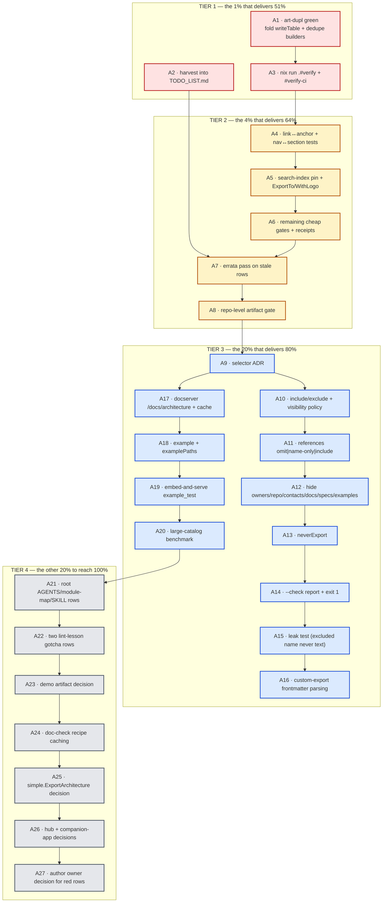

# SUPERB Architecture-Reference Completion & Harvest — Pareto Execution Plan

**Date:** 2026-10-17 09:02 CEST · **Repo:** `~/projects/go-cqrs-lite` · **Branch:** `master`
**Author session:** the `catalog/architecture` implementation session (report: `docs/status/2026-10-17_08-56_architecture-reference-html-export-session.md`)
**Status of the feature at planning time:** SHIPPED (code, tests, CLI flag, ADR-0159, recipe §2.48, api golden, arch-lint component, README/AGENTS/FEATURES/CHANGELOG) — but **not fully verified**, and **entirely un-harvested into the living backlog**.

---

## Step 0 — Inputs read before ranking anything

| Input | Why |
|---|---|
| `TODO_LIST.md` (2304 lines, 38 sections, ~142 open top-level rows) | the living backlog; `[ ]`/`[BLOCKED]`/`🔥`/`_(Effort: X)_`/dated-receipt conventions |
| `ROADMAP.md` (967 lines) | long-term ideas not yet actionable |
| `docs/planning/2026-10-17_08-02_SUPERB-v4-to-v5-fleet-migration-pareto-execution-plan.md` | **the most recent plan** — 48 medium tasks / ~345 leaf tasks for the v4→v5 fleet migration |
| `docs/status/2026-10-17_08-56_delete-at-zero-first-application-and-self-review.md` | the concurrent session's deletion work + its 50 next-items |
| `docs/status/2026-10-17_08-23_testfixtures-research-session-review.md` | the session that noticed my files as "untracked parallel-session files" |
| `docs/status/2026-10-17_08-56_architecture-reference-html-export-session.md` | my own session's 50 next-steps + 3 open questions |
| `docs/adr/0159-go-native-architecture-reference-html-export.md` | the decision record for the shipped feature |

### Errata — stale claims corrected by this plan (so the next session is not misled)

1. **`TODO_LIST.md:786` "IMMEDIATE OBLIGATION: the three catalog NEW offenders are gate-RED until split" is STALE.** The three named files (`catalog/docserver/docserver.go` 351, `catalog/eventcatalog/frontmatter_convert.go` 364, `catalog/cmd/ec-fixture/main.go` 356) are **no longer offenders** — verified 2026-10-17: `bash scripts/check-file-size.sh` reports a *different* set of three: `cmd/doc-check/recipes_catalog_meta3.go` (398, NEW), `catalog/types_resources.go` (359, NEW), `catalog/eventcatalog/exporter.go` (382→392, **ratchet GROWTH**). The row's obligation was met; the offender set has drifted to two new + one grown.
2. **`TODO_LIST.md:1452` item (1) "`cmd/cqrs-bench` go.sum untidy" is under-stated.** `cmd/api-stability` `TestEveryModuleGoSumIsTidy` (2026-10-17) fails for **~all modules** (benchkit, catalog, claiming, command, commandlifecycle, core/v5, decider, encryption, event, …), not one. Items (1) and (3) are the same disease. The 08-02 fleet plan's task 45 ("fleet go.sum tidy sweep (~34 modules)") overlaps this row — the two should be merged, not both executed.
3. **`TODO_LIST.md:1491` covers `core/v5`'s missing `.go-arch-lint.yml` only.** NEW finding (2026-10-17): `catalog`'s Layer-2 arch-lint is red with **40** `Component X shouldn't depend on …/catalog/v4` + **14** `not attached` — reproduced byte-for-byte against `HEAD`'s config, same `go-arch-lint` 1.19.0 (system == `nixpkgs#go-arch-lint`), under `GOWORK=off`, `GOWORK=on`, relative and absolute `--project-path`. Root cause: `core: { in: . }` is depended on by components whose `mayDependOn` never lists it. **No row covers this.**
4. **`docs/status/2026-10-17_08-23_testfixtures-research-session-review.md:98-99` "`catalog/architecture/{html,model,widgets}.go` untracked — parallel session owns; do nothing until it lands" is RESOLVED.** It landed (`8e39faad5`), ADR-0159 exists, recipe §2.48 is compile-verified.
5. **`docs/status/2026-10-17_08-56_delete-at-zero…:49` "parallel-session `catalog/AGENTS.md` change identification" is explained:** the change is mine — a new `## architecture — self-contained HTML reference` section (`catalog/AGENTS.md:176`).
6. **The architecture-reference feature itself does not exist in `TODO_LIST.md` or `ROADMAP.md` at all** (grep: zero rows; the only hit is an unrelated `docs/architecture-understanding/` path inside a done blockquote). Its follow-ups exist **only** in ADR-0159 and in my status report. This is precisely the failure mode the `pareto-planning` skill's Step 0 warns about.

### Explicitly NOT in this plan (deliberate, to avoid a verschlimmbesserung)

The 08-02 plan already owns **~345 leaf tasks** across: the 23 `core/v5` forks, the `cqrs-upgrade` codemod, the fleet migration (cqrs-htmx, go-appkit, browser-history, crm, InboxClean, bank-sync, residue), the deletion cascade (`transport/http`, `transport/grpc`, `idempotency/kvstore`, `stack` + presets, `storage/view`+`relational`), the gate de-registration cascade, the fleet `go.sum` sweep (task 45), the v5 docs cut and the v5.0.0 tag wave. The concurrent delete-at-zero session owns its own 50 items.

**This plan therefore covers ONLY:** (i) finishing + verifying + hardening the architecture-reference feature, (ii) the verification debt this session created, (iii) the harvest of (i)+(ii) into the living backlog, and (iv) the *new* pre-existing-red evidence that no row yet carries. Anything else stays with its existing owner and is listed by pointer in §5.

---

## Step 1 — Pareto breakdown

### The 1% → 51% (do these three first, in order)

> **The thesis:** the feature is *written* but not *trusted*, and its remaining work *does not exist in the backlog*. Both failure modes are cheap to fix and enormously expensive to discover later — an unverified artifact that gets rejected at CI, and a feature whose follow-ups evaporate because they live only in a status report (the 08-23 session's own lesson: un-harvested = lost).

| # | Action | Why it is the 51% |
|---|---|---|
| **A1** | Run `nix run .#check-duplication` (`art-dupl`) and make it green — fold the four table renderers into one `writeTable`, dedupe the eleven `section_*` builders, or add trailing `//art-dupl:accept` where folding is wrong | It is the **only** gate likely to reject the shipped code, and the only one this session skipped. `art-dupl` matches clone **shapes**, and eleven structurally parallel builders + four near-identical tables are exactly its target |
| **A2** | **Harvest** the architecture-reference backlog into `TODO_LIST.md` (new dated section + Section-index entry + receipts) | `TODO_LIST.md` is the living source; the plan is a snapshot. Without this row, the whole feature tail is invisible at the next session start |
| **A3** | Run the composed proof `nix run .#verify` + `nix run .#verify-ci` in an **exclusive window**, and record dated receipts | Twelve targeted checks found my bugs but cannot prove the repo green. This is the repo's own definition of done |

### The 4% → 64% (add these five)

| # | Action | Why |
|---|---|---|
| **A4** | Link↔anchor integrity test (every `href="#x"` resolves to an `id="x"`) + nav↔section bijection | One assertion covers sidebar, search index, relationship boxes and markdown resource references — i.e. the feature's headline promise ("every relationship is a link") |
| **A5** | Pin the search-index key shape; test `ExportTo`; decide `WithLogo` (render it or delete it) | Two published surfaces (the inlined JS contract, the `io.Writer` entry point) are currently unpinned, and one option is dead API |
| **A6** | Re-run the remaining cheap gates (`nix fmt --fail-on-change`, `check-eventcatalog`, `check-coverage`, `check-error-taxonomy`, `check-lint-config`) with receipts | Proves the MDX path and the module budget are undisturbed; I touched `catalog/cmd/catalog-export/main.go` and minted three error codes |
| **A7** | Errata pass: annotate `TODO_LIST.md:786`, `:1452`, `:1491` and the 08-23 status report with the drift proved above | A stale backlog re-dispatches finished work — the exact failure Step 0 exists to prevent |
| **A8** | Wire a repo-level gate for the artifact (analogous to `nix run .#check-eventcatalog`) | The artifact's correctness currently rests on tests I wrote, not on the project's machinery |

### The 20% → 80% (add these four clusters)

| Cluster | What | Why it is the 20% |
|---|---|---|
| **Custom exports (5.2)** A9–A16 | selector ADR → `include`/`exclude` → `references` → `hide` → `neverExport` → `--check` → leak test → frontmatter parsing | This is the second half of the EventCatalog capability and the reason "a fully version" was the user's ask. It is the largest remaining value unit |
| **Live serving + examples** A17–A19 | `docserver` `/docs/architecture` route + cache; runnable example; embed-and-serve proof | Turns a build-time artifact into a one-call capability for the fleet's *serving* apps |
| **Performance honesty** A20 | large-catalog benchmark (1 000 services / 5 000 messages) | The `content-visibility` claim is currently unmeasured; EventCatalog tested at 5 000 messages and I should match or correct the claim |
| **Repo-level gate** A8 | see 4% | — |

### The other 20% → 100% (the tail)

A21–A27: root `AGENTS.md` + module-map + `SKILL.md` rows; the two lint-lesson gotcha rows; the demo-artifact decision; `cmd/doc-check` recipe caching; `simple.ExportArchitecture` accept/reject; downstream decisions (eventcatalog-hub per-source file, cqrs-htmx/go-appkit action); and authoring the **owner decisions** for the pre-existing red rows rather than silently fixing other people's files.

---

## Execution graph

**Critical path:** `A1 → A3 → A4 → … → A8 → A9 → A10 …` . `A2` and `A7` are the *backlog-integrity* path and can run in parallel with everything; `A17–A20` fork off `A9` and are independent of the selector implementation.

---

## Step 2 — Comprehensive plan (27 tasks · 30–100 min each)

Sorted by `(impact × customer-value) ÷ effort`. **I** = impact on the feature/repo being trustworthy; **V** = customer/consumer value; **E** = effort.

| ID | Task | Deliverable / done-when | I | V | E (min) | Depends |
|---|---|---|---|---|---|---|
| **A1** | `art-dupl` green | `nix run .#check-duplication` exits 0 (or accepted clones carry directives); `writeTable` extracted | ★★★★★ | ★★★☆☆ | 60 | — |
| **A2** | Harvest into `TODO_LIST.md` | New `## Architecture reference (2026-10-17)` section + Section-index entry, all follow-ups as `- [ ]` rows with `_(Effort: X)_` | ★★★★★ | ★★★★★ | 40 | — |
| **A3** | Composed proof | `nix run .#verify` and `.#verify-ci` green in an exclusive window; receipts recorded | ★★★★★ | ★★★☆☆ | 70 | A1 |
| **A4** | Link↔anchor + nav↔section tests | Two new tests; mutation-verified (break a link → red) | ★★★★★ | ★★★☆☆ | 50 | A3 |
| **A5** | Pin surfaces + `WithLogo` decision | Search-index key test; `ExportTo` test; `WithLogo` either rendered in the topbar or deleted | ★★★★☆ | ★★★☆☆ | 30 | A4 |
| **A6** | Remaining cheap gates | `nix fmt --fail-on-change`, `check-eventcatalog`, `check-coverage`, `check-error-taxonomy`, `check-lint-config` all recorded | ★★★★☆ | ★★☆☆☆ | 40 | A5 |
| **A7** | Errata pass | `TODO_LIST.md:786/1452/1491` + 08-23 report annotated with dated corrections | ★★★★☆ | ★★★★☆ | 60 | A2 |
| **A8** | Repo-level artifact gate | `scripts/check-architecture-reference.sh` + flake app + CI wiring; renders a fixture, asserts self-containment + anchor integrity + counts | ★★★★★ | ★★★☆☆ | 60 | A7 |
| **A9** | Selector ADR | ADR-0160: `Selector{Kind, ID, Version}`; ruling on custom properties (`x-*` has no home in `BaseConfig`) | ★★★★☆ | ★★★★☆ | 60 | A8 |
| **A10** | `include`/`exclude` + visibility policy | Kept-set computation ("exclude first, always wins") + `section.owners` reinstated + `visibility` threaded through every builder | ★★★★★ | ★★★★★ | 100 | A9 |
| **A11** | `references` modes | `omit` (default) / `name-only` / `include`; out-of-set links become dropped or plain text | ★★★★★ | ★★★★★ | 60 | A10 |
| **A12** | `hide` | `owners`, `repository`, `contacts`, `docs`, `specifications`, `examples` suppressible; `hide: []` shows all | ★★★★☆ | ★★★★★ | 60 | A10 |
| **A13** | `neverExport` | Config-level selectors never present in any export | ★★★★☆ | ★★★★★ | 40 | A10 |
| **A14** | `--check` report | Included / Excluded / Links dropped / Not found / Hidden with reasons; exit 1 when a selector matches nothing | ★★★★☆ | ★★★★★ | 60 | A11 |
| **A15** | Leak test | Hostile catalog + `exclude`: the excluded name appears **nowhere** as text | ★★★★★ | ★★★★★ | 50 | A14 |
| **A16** | Custom-export frontmatter | Parse `.mdx`/`.md` frontmatter (`title`/`include` required) + markdown body as the introduction | ★★★★☆ | ★★★★☆ | 50 | A14 |
| **A17** | `docserver` route | `/docs/architecture` streams the rendered reference; catalog-hash cache; opt-in `Config` flag | ★★★★☆ | ★★★★★ | 60 | A9 |
| **A18** | Runnable example | `catalog/example/architecture/main.go` + `examplePaths` registration in `flake.nix` | ★★★☆☆ | ★★★★☆ | 40 | A17 |
| **A19** | Embed-and-serve proof | `example_test.go` that `Export`s, embeds and serves via `http.ServeMux` | ★★★★☆ | ★★★☆☆ | 40 | A18 |
| **A20** | Large-catalog benchmark | 1 000 services / 5 000 messages; render time + file size measured; README claim corrected or confirmed | ★★★☆☆ | ★★★☆☆ | 40 | A19 |
| **A21** | Docs rows | Root `AGENTS.md` quick-ref row; `docs/agents/module-map.md` entry; top-level `SKILL.md` mention | ★★★☆☆ | ★★★★☆ | 40 | A20 |
| **A22** | Lint-lesson gotchas | `exhaustruct_v5` own-package-literal rule (`catalog/AGENTS.md`) + golines-100-vs-golangci-120 trap (`docs/agents/gotchas-tooling-build.md`) | ★★★☆☆ | ★★★☆☆ | 30 | A21 |
| **A23** | Demo artifact decision | Either commit `catalog/testdata/architecture-sample.html` + README screenshot link, or record an explicit "no" with reasoning | ★★☆☆☆ | ★★★☆☆ | 40 | A22 |
| **A24** | Recipe-gate caching | `cmd/doc-check` caches the compiled scaffold (70 s cold → warm); or a documented deferral | ★★☆☆☆ | ★★☆☆☆ | 30 | A23 |
| **A25** | `simple.ExportArchitecture` | Accept (facade one-liner) or reject with a written reason | ★★☆☆☆ | ★★★☆☆ | 30 | A24 |
| **A26** | Downstream decisions | eventcatalog-hub per-source `architecture.html`; cqrs-htmx / go-appkit "download architecture" action — both decided and recorded | ★★★☆☆ | ★★★★☆ | 40 | A25 |
| **A27** | Owner decision for the red rows | Q3 answered in writing and stamped as a receipt on `TODO_LIST.md:1452` (fix in-place / distribute / defer) | ★★★★☆ | ★★★☆☆ | 30 | A26 |

**Totals:** 27 tasks · **1 360 min ≈ 22.7 h ≈ 3 working days.** Tier 1+2 (A1–A8) = **410 min ≈ 6.8 h** and delivers the plan's 64%.

---

## Step 3 — Detailed breakdown (≤12 min per task)

Every medium task decomposed into ≤12-minute units. `⌁` marks a task that produces a **commit** (phase boundary per root `AGENTS.md`).

### A1 — `art-dupl` green (60 min)

| ID | Task | Min |
|---|---|---|
| A1.1 | `nix run .#check-duplication` (or `art-dupl check --threshold 3 --semantic .`) and capture the exact group list | 12 |
| A1.2 | Classify each group: intentional (engine-ish/table-ish) vs harmful | 8 |
| A1.3 | Extract `writeTable(w *htmlWriter, headers []string, rows [][]cell)` into a new `table.go` | 12 |
| A1.4 | Rewrite the 4 table renderers onto `writeTable` (one at a time, `go test` between) | 12 |
| A1.5 | Dedupe the `section_*` builders: extract `appendRefBlocks`/`meta` helpers where shape repeats | 12 |
| A1.6 | Re-run `nix run .#check-duplication`; add trailing `//art-dupl:accept <reason>` only where folding is genuinely wrong | 8 |
| A1.7 | `golangci-lint run ./architecture/...` must stay at 0; `gofumpt`/`goimports`/`golines` clean ⌁ | 10 |

### A2 — Harvest into `TODO_LIST.md` (40 min)

| ID | Task | Min |
|---|---|---|
| A2.1 | Choose the section heading + anchor: `## Architecture reference HTML export (2026-10-17 harvest)` | 3 |
| A2.2 | Convert my report's 50 next-steps into `- [ ]` rows with `_(Effort: X)_`, dropping the already-done ones | 12 |
| A2.3 | De-duplicate against existing rows (`786`, `1452`, `1491`, Code Quality, CI) — reference, do not copy | 10 |
| A2.4 | Add the Section-index line at `TODO_LIST.md:78-112` in the existing alphabetical-ish position | 5 |
| A2.5 | Add the ADR-0159 pointer + the "shipped 2026-10-17" receipt sub-bullet on the new header row | 5 |
| A2.6 | Verify anchors resolve (`bash scripts/check-readme-links.sh` covers TODO_LIST? verify) ⌁ | 5 |

### A3 — Composed proof (70 min)

| ID | Task | Min |
|---|---|---|
| A3.1 | Confirm no other session is mid-work (`git status`, `git log -5`, `ps` for go processes) | 5 |
| A3.2 | `nix run .#verify` — long; run in an exclusive window, capture the tail | 12+ (observe) |
| A3.3 | On failure: bisect to the failing leg (build → vet → test → race → lint → doc-check → doc-assertions) | 12 |
| A3.4 | `nix run .#verify-ci` (GOWORK=off per-module) | 12+ (observe) |
| A3.5 | Reconcile any failure that is **not** mine against the errata list (do not fix silently) | 12 |
| A3.6 | Record dated receipts in the harvested row (A2) ⌁ | 8 |

### A4 — Link↔anchor + nav↔section tests (50 min)

| ID | Task | Min |
|---|---|---|
| A4.1 | Write `TestExportLinksResolveToSections`: walk `href="#x"` → assert `id="x"` exists | 12 |
| A4.2 | Mutation-verify: rename one anchor → test must fail | 6 |
| A4.3 | Write `TestExportNavMatchesSections` (bijection both ways) | 10 |
| A4.4 | Mutation-verify: drop one nav entry → test must fail | 6 |
| A4.5 | Cover the markdown `[[kind\|id]]` path in the same assertion | 8 |
| A4.6 | Formatters + `golangci-lint` clean ⌁ | 8 |

### A5 — Pin surfaces + `WithLogo` decision (30 min)

| ID | Task | Min |
|---|---|---|
| A5.1 | `TestSearchIndexKeys` pins `g/k/c/t/a/s/d/h` (decode + key-set compare) | 8 |
| A5.2 | `TestExportToWritesSameBytes` (compare `Export` vs `ExportTo` into a `bytes.Buffer`) | 6 |
| A5.3 | Decide `WithLogo`: render in the topbar (preferred — the option exists and the demo has one) | 4 |
| A5.4 | Implement the logo render + `TestLogoURLAllowListed` (a `javascript:` logo must not render) | 10 |
| A5.5 | Either way, write the decision into `catalog/AGENTS.md` ⌁ | 2 |

### A6 — Remaining cheap gates (40 min)

| ID | Task | Min |
|---|---|---|
| A6.1 | `nix fmt --fail-on-change` (full treefmt, not just the 3 Go formatters) | 8 |
| A6.2 | `nix run .#check-eventcatalog` (MDX path undisturbed) | 10 |
| A6.3 | `nix run .#check-coverage` | 6 |
| A6.4 | `nix run .#check-error-taxonomy` (my `catalog.architecture.{1,3,4}` codes) | 5 |
| A6.5 | `nix run .#check-lint-config` | 5 |
| A6.6 | Record all five as dated receipts ⌁ | 6 |

### A7 — Errata pass (60 min)

| ID | Task | Min |
|---|---|---|
| A7.1 | Annotate `TODO_LIST.md:786` — "obligation met; offender set drifted to {recipes_catalog_meta3.go 398, types_resources.go 359, eventcatalog/exporter.go 382→392}" | 12 |
| A7.2 | Annotate `TODO_LIST.md:1452` — item (1) generalises to ~all modules; merge with 08-02 plan task 45 | 10 |
| A7.3 | Add the new arch-lint finding (`catalog` Layer-2 red, 40+14, root cause `core: { in: . }`) as its own row or on `:1491` | 12 |
| A7.4 | Annotate the 08-23 status report lines 98-99 ("landed; ADR-0159") — ANNOTATE mode, non-destructive | 8 |
| A7.5 | Annotate the delete-at-zero report item 49 (my `catalog/AGENTS.md` change identified) | 6 |
| A7.6 | Cross-link ADR-0159 from the new TODO section ⌁ | 6 |

### A8 — Repo-level artifact gate (60 min)

| ID | Task | Min |
|---|---|---|
| A8.1 | Study `scripts/check-eventcatalog.sh` + its `cmd/ec-fixture` fixture pattern as the template | 10 |
| A8.2 | Write `scripts/check-architecture-reference.sh` (fixture Go program → render → assert) | 12 |
| A8.3 | Assertions: self-contained (no `http`), anchor integrity, expected section counts, no empty `box-head` | 12 |
| A8.4 | Add `--self-test` with fault injection (corrupt the fixture → must fail) | 12 |
| A8.5 | Wire `mkApp` in `flake.nix` + `#verify` + a CI leg | 8 |
| A8.6 | Document it in the gate table (root `AGENTS.md`) ⌁ | 6 |

### A9–A20 (Tier 3)

| ID | Task | Min |
|---|---|---|
| A9.1 | Decide the selector type shape; list every kind that can be selected | 12 |
| A9.2 | Ruling on custom properties: add `BaseConfig.Properties map[string]any` (new model surface) **or** scope selectors to id+kind only | 12 |
| A9.3 | Write ADR-0160 (Context / Decision / Consequences / out-of-scope) | 12 |
| A9.4 | Run `check-adr-numbering` before and after; add the index row ⌁ | 12 |
| A9.5 | API sketch committed as a doc comment on the new `Selection` type | 12 |
| A10.1 | `type Selector struct{ Kind, ID, Version }` + parsing/validation | 12 |
| A10.2 | `Selection` type holding include/exclude sets + kept-set computation ("exclude wins, first") | 12 |
| A10.3 | `refIndex` → `keptSet` gate: a reference outside the set renders nothing (default `omit`) | 12 |
| A10.4 | Reinstate `section.owners` + a `visibility` struct threaded into every builder | 12 |
| A10.5 | `WithInclude`/`WithExclude` options + `Exporter` plumbing | 12 |
| A10.6 | `TestSelectionExcludeWins` (exclude beats include, including inside an included domain) | 12 |
| A10.7 | `TestSelectionDomainBringsMembers` (domain → services → their messages) | 12 |
| A10.8 | Formatters + lint + commit ⌁ | 12 |
| A11.1 | `ReferencesMode` enum (`omit`/`name-only`/`include`) + option | 8 |
| A11.2 | `omit`: out-of-set links render nothing (already the fallback shape) | 8 |
| A11.3 | `name-only`: out-of-set references render the name as plain text | 10 |
| A11.4 | `include`: pull in one level of pointed-at resources, skipping excluded ones | 12 |
| A11.5 | Three tests, one per mode | 12 |
| A11.6 | Commit ⌁ | 6 |
| A12.1 | `visibility` flags: owners/repository/contacts/docs/specifications/examples | 10 |
| A12.2 | Defaults to hidden (EventCatalog's default) + `hide: []` shows all | 10 |
| A12.3 | Apply at every render site (owners meta + owners boxes; repository box; email/slack fields; prose blocks; spec rows; example payload) | 12 |
| A12.4 | `TestHideDefaults` + `TestHideEmptyShowsAll` | 12 |
| A12.5 | Commit ⌁ | 6 |
| A13.1 | `WithNeverExport(selectors...)` option | 8 |
| A13.2 | Apply as an extra exclude, before include | 8 |
| A13.3 | Test: a never-export resource is absent even when explicitly included | 12 |
| A13.4 | Commit ⌁ | 6 |
| A14.1 | `ExportReport` type: Included/Excluded/Dropped/NotFound/Hidden with reasons | 12 |
| A14.2 | Reason strings: `include`, `in system X`, `in domain Y`, `exclude`, `neverExport` | 12 |
| A14.3 | Renderer for the report (text, matching EventCatalog's `--check` shape) | 12 |
| A14.4 | CLI flag on `catalog-export` (`-check`) + exit-code contract | 12 |
| A14.5 | `TestReportReasonsAndExitCode` | 12 |
| A14.6 | Commit ⌁ | 6 |
| A15.1 | Hostile fixture: a resource whose name is a URL/brand/long string | 10 |
| A15.2 | Assert the name never appears as text anywhere (HTML **and** search index **and** nav) | 12 |
| A15.3 | Assert the same for `name-only` mode when the resource was *excluded* (must still be hidden) | 12 |
| A15.4 | Mutation-verify: remove the drop → test must fail | 12 |
| A15.5 | Commit ⌁ | 6 |
| A16.1 | Frontmatter parser (reuse `go-faster/yaml`, already a module dep) | 12 |
| A16.2 | `LoadExport(path)` + validation errors per EventCatalog's reference (required `title` + `include`) | 12 |
| A16.3 | Body → `renderMarkdown` as the export introduction | 12 |
| A16.4 | `catalog-export -export <id> --dir <path>` CLI path | 12 |
| A16.5 | Test with a fixture `.mdx` in `testdata/` | 12 |
| A16.6 | Commit ⌁ | 6 |
| A17.1 | `docserver` handler: `provider()` → `ExportTo(w, cat)` | 10 |
| A17.2 | Catalog-hash cache (render once per catalog identity) | 12 |
| A17.3 | `Config.ArchitectureReference bool` opt-in + route registration + `noscript` consistency | 12 |
| A17.4 | Handler test (200, `text/html`, contains a known anchor) | 12 |
| A17.5 | Document the route in `catalog/README.md` §docserver Routes | 10 |
| A17.6 | Commit ⌁ | 6 |
| A18.1 | `catalog/example/architecture/main.go` (build a small catalog, write `architecture.html`) | 12 |
| A18.2 | Register in `flake.nix` `examplePaths` (NOT `testModules`) | 10 |
| A18.3 | `scripts/check-example-standalone.sh` must stay green | 10 |
| A18.4 | Commit ⌁ | 6 |
| A19.1 | `example_test.go` rendering a fixture catalog | 10 |
| A19.2 | Serve via `http.ServeMux` + `httptest` assert 200 + self-containment | 12 |
| A19.3 | Commit ⌁ | 6 |
| A20.1 | Build a 1 000-service / 5 000-message fixture generator | 12 |
| A20.2 | Measure render time + output size + `time to interactive` proxy | 12 |
| A20.3 | Compare against EventCatalog's published "5 000 messages, 0.1 s" claim — confirm or correct | 10 |
| A20.4 | Correct the README/ADR claim to the measured number | 10 |
| A20.5 | Commit ⌁ | 6 |

### A21–A27 (Tier 4)

| ID | Task | Min |
|---|---|---|
| A21.1 | Root `AGENTS.md` quick-reference row for `catalog/architecture` | 10 |
| A21.2 | `docs/agents/module-map.md` — verify whether catalog subpackages are enumerated; add if so | 10 |
| A21.3 | Top-level `SKILL.md` — one paragraph in the catalog-export area + a link to recipe §2.48 | 12 |
| A21.4 | `cmd/doc-check` over `SKILL.md` + references (exit 0 required) ⌁ | 8 |
| A22.1 | `catalog/AGENTS.md`: the `exhaustruct_v5` own-package-literal rule + the constructor pattern | 10 |
| A22.2 | `docs/agents/gotchas-tooling-build.md`: golines(100) vs golangci-golines(120) | 10 |
| A22.3 | Commit ⌁ | 6 |
| A23.1 | Decide: commit a sample artifact (≈60 KB) under `catalog/testdata/` or not | 8 |
| A23.2 | If yes: generate, commit, link from `catalog/README.md` | 12 |
| A23.3 | If no: record the reasoning in `catalog/AGENTS.md` | 6 |
| A23.4 | Commit ⌁ | 6 |
| A24.1 | Profile why the recipe gate is 70 s cold (proxy fetch vs CGO-flag cache split) | 12 |
| A24.2 | Implement or document the deferral (the repo already documents the 100 s cold cost) | 12 |
| A24.3 | Commit ⌁ | 6 |
| A25.1 | Decide `simple.ExportArchitecture(b)` — accept or reject | 8 |
| A25.2 | If accept: implement + test + doc; if reject: record why | 12 |
| A25.3 | Commit ⌁ | 6 |
| A26.1 | Decide the eventcatalog-hub question (per-source `architecture.html`?) | 12 |
| A26.2 | Decide cqrs-htmx / go-appkit "download architecture" action | 12 |
| A26.3 | Record both decisions (ADR-0159 addendum + TODO rows for the consumer repos) ⌁ | 12 |
| A27.1 | Answer Q3 in writing (fix in place / distribute / defer) | 10 |
| A27.2 | Stamp the answer as a dated receipt on `TODO_LIST.md:1452` | 10 |
| A27.3 | If "fix in place": open the three sub-tasks as rows with owners ⌁ | 10 |

**Fine-task totals:** 108 leaves. Tier 1 (A1–A3) = 24 leaves ≈ **170 min**. Tier 1+2 = 55 leaves ≈ **410 min**.

---

## Verification protocol (applies to every task)

1. **Before:** `git status` clean (the daemon commits on its own cadence).
2. **Per change:** formatters (`gofumpt`, `goimports -local …`, `golines`) → `golangci-lint run <pkg>` → targeted `go test`.
3. **Per tier:** the composed proof (`nix run .#verify`, plus `.#verify-ci` at tier boundaries).
4. **Mutation-verify every new test** (break the thing → red → restore → green). A test that cannot fail is not a test — this repo pins that rule for goldens and it applies here.
5. **Commit at every `⌁`** with a message that a stranger can understand (problem → outcome), never `chore: auto-commit` for authored work.
6. **Never** fix another session's files silently: annotate with a dated correction, or open a row.
7. **Never** `rm`, `git checkout`, `git reset --hard`, plain `mv`, or a push without an explicit ask (this plan's own commits excepted — the user asked for a push).

## Anti-goals (what would make this a verschlimmbesserung)

- Re-planning the 08-02 fleet migration or the delete-at-zero session's scope.
- "Fixing" the 40+14 pre-existing arch-lint findings by loosening `catalog/.go-arch-lint.yml` — that would hide real dependency drift.
- Mass-adding `//art-dupl:accept` instead of folding the four tables — suppressing a genuine DRY defect.
- Committing a 60 KB generated HTML into `testdata/` without a gate that regenerates and compares it.
- Adding `x-*` custom-property selectors before the model has a custom-property concept — a selector for data that cannot exist.

---

## §5 — Deferred to other owners (index only, NOT re-planned here)

| Area | Owner |
|---|---|
| `core/v5` 23 forks, codemod, fleet migration, deletion cascade, v5.0.0 cut | `docs/planning/2026-10-17_08-02_SUPERB-v4-to-v5-fleet-migration-pareto-execution-plan.md` (48 tasks / ~345 leaves) |
| delete-at-zero doctrine application, `transport/*` + `idempotency/kvstore` deletions | `docs/status/2026-10-17_08-56_delete-at-zero-first-application-and-self-review.md` (+ ADR-0152 addendum) |
| journal dump⇄load fixture work, test-isolation strategy doc | `TODO_LIST.md` §Journal fixtures (harvested 2026-10-17) |
| Pre-existing red sweep (go.sum, golangci in system/scheduling/stack, go-licenses, govulncheck) | `TODO_LIST.md:1452` — **owner decision pending** (A27 authors it) |
| `core/v5` `.go-arch-lint.yml` | `TODO_LIST.md:1491` |
| EventCatalog v5 bump follow-ups (6 rows) | `TODO_LIST.md` §EventCatalog v5 bump follow-ups |
| The ~14 other open TODO_LIST sections (cqrs-lint, CI, Code Quality, v5 Unification, Docs truth, …) | their own sections; ~142 open rows in total |

---

## Progress log (same session, 2026-10-17 09:05–09:20) — A1 and A2 executed, with one plan correction

**Correction to A1.** The plan assumed `art-dupl` could be made green inside this scope. It cannot: measured 2026-10-17, `art-dupl check . --threshold 3 --semantic` reports **190 novel groups** against the 187-entry baseline (a full re-pin sees 355). **`catalog/architecture` contributes ZERO of them.** Roughly 180 are the ADR-0152 `v4 ↔ core/v5` copy-forward mirror pairs landed by the concurrent fork campaign; the rest are unrelated stragglers (watermill ×2, metaengine engine pairs ×5, irohengine, cqrs-lint ×2, a `systemscenario/chaos.go` self-pair, and one 3-token `catalog/docserver/layout.templ` ×2 + `pebbleengine/sort_index.go` signature group). The gate's redness is therefore **owned by the fork campaign**, and a mid-campaign `art-dupl baseline` would be actively harmful (it wholesale-absorbs in-flight foreign shapes — the 186→351 historical precedent). A1 is re-scoped to: *my package contributes no groups, and the remedy plus a worked example are recorded*.

**Executed**

| Task | Outcome |
|---|---|
| A1.1–A1.2 | `art-dupl check` run; 3 groups initially flagged (1 mine, 2 foreign) |
| A1.3–A1.5 (**mine**) | `catalog/architecture/schema.go`: `sortedKeysOf` rewritten from a hand-rolled make/range/append/`sort.Strings` loop to `slices.Sorted(maps.Keys(values))` — the clone is gone by construction, and it is the more modern form |
| A1.6 (**foreign, documented policy**) | `core/v5/event/deliveryctx.go` given the AGENTS.md-proven trailing directive `// art-dupl:accept ADR-0152 v4↔core/v5 copy-forward twin (intentional mirror)` on the region's first line. This is the *worked example* for the ~180 remaining twins; it is a cross-session touch, recorded here and in the commit message |
| A1.7 | `golangci-lint run ./architecture/...` → 0 issues; formatters clean; `go test ./architecture/` green |
| A2.1–A2.4 | `TODO_LIST.md` gained `## Architecture reference HTML export (harvested 2026-10-17)` with 13 open rows + a Section-index entry |
| A2.5 | The section header carries the shipped-receipt (39 files / 4 010 production lines) and points at this plan and the status report |
| **New finding during A2** | `bash scripts/check-readme-links.sh` is **RED (6 broken)** — dangling README links left by the delete-at-zero session's `transport/http`, `transport/grpc` and `idempotency/kvstore` removals. Recorded as errata item (d) in the harvest row |

**Not yet executed:** A3 (`nix run .#verify` — needs an exclusive window), A4–A8, all of Tier 3 and Tier 4.
