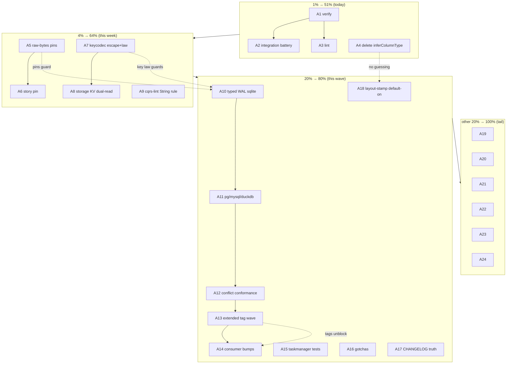

# SUPERB — Disk-Truth Pareto Plan (2026-10-17 20:13)

> **Scope:** the wedge of work surfaced by THIS session — the StreamMarker bare-ID fix wave's
> verification debt + the on-disk schema data-model review
> ([`docs/reviews/2026-10-17_on-disk-schema-data-model-review.html`](../reviews/2026-10-17_on-disk-schema-data-model-review.html))
> — plugged INTO the existing plan ordering, not replacing it. Predecessor master plans:
> [2026-10-11 trust-green-tags](2026-10-11_20-16_SUPERB-trust-green-tags-to-v5-cut-pareto-plan.md)
> (owns the 126-row backlog sequencing) and
> [2026-10-09 v5 schema evolution](2026-10-09_v5-declarative-schema-evolution.md) (owns the
> upcasting/fingerprint machinery). `TODO_LIST.md` stays the living source; harvest at the end.
>
> Format: `.md` + mermaid per explicit user demand (pareto-planning default is HTML — overridden).

## Sources

1. Status reports `2026-10-17_19-36_*` and `19-57_*` (fix wave + round-2 self-review, §f lists).
2. On-disk schema review PC-1…PC-14 (13 findings, 1 cleared) + 8-step roadmap.
3. TODO_LIST.md Step-0 verification pass (see Errata).

## Errata (Step 0 — corrections before planning, so nobody re-dispatches)

| # | Correction |
|---|---|
| E1 | **PC-5 was partially stale.** `LayoutPlan.Fingerprint` + `RecordLayoutStamps`/`LayoutStampDiffs` shipped 2026-10-10 (TODO_LIST §V5-schema-evolution T3+T5, DONE). Review corrected same-session; the remaining real gap is re-scoped as D4 below (default-off, no conformance proof that planned-table column changes trip the diff). |
| E2 | **Tag wave already has an owner row.** TODO_LIST §V5-schema-evolution keeps an OPEN "Release wave: schema v4.6.0 + system minor" — this plan EXTENDS that wave with the six StreamMarker-fixed modules (event, command, system, storage, commandlifecycle, projectionhost) instead of creating a parallel release row. |
| E3 | **Upcaster machinery exists and is fleet-proven** (T2 `schema.Chain` + bank-sync/DiscordSync/cqrs-htmx adoption DONE) — the "author an upcaster recipe" idea narrows to a recipes.md §schema doc entry (D18), not new code. |
| E4 | go.sum untidies (6 modules) belong to the in-flight go-codec v0.3.2 train — planned here only as "tidy-or-confirm-owner" (D17), never racing a parallel session. |

---

## Pareto Breakdown

### The 1% that delivers 51%

**Prove what already shipped + delete the horoscope.** Two tiny acts: (P1) run the composed
`#verify` + integration battery + lint over the changed set — without them the entire
StreamMarker fix is an unverified claim; (P2) delete `inferColumnType` (one function) — the only
finding that silently corrupts FUTURE data on every write. Everything else in this plan is worth
<51% if these two are skipped.

### The 4% that deliver 64% (adds)

**Make the leak class mechanically dead.** (P3) raw-bytes persistence pins, (P4) key round-trip
law + sep/esc escaping, (P5) cqrs-lint branded-`.String()` rule (warn-first). After these, the
bug class that cost this session (and #70 before it) cannot recur unnoticed.

### The 20% that deliver 80% (adds)

**Ship the disk truth to the fleet.** (P6) typed WAL columns on meta engines (PC-1) — the
journal of record gets constraints; (P7) the extended tag wave so fleet binaries stop writing
prefixed bytes; (P8) taskmanager test repair + gotchas/CHANGELOG truth fixes (the docs ARE the
product for a library).

### The other 20% to reach 100%

Envelope + time unification, column vocabulary, wire tags, cursor/sweep audits, compat fixtures,
goal.db, recipes, TODO_LIST harvest. Small, serial, zero-risk tail — mostly ≤30min items that
close every open finding from both reports.

---

## Table A — Comprehensive plan (30–100 min per task, 24 tasks)

Sorted by importance/impact/effort/customer-value (customer = first-party fleet consumers
cqrs-htmx/go-appkit/bank-sync/DiscordSync + future-self).

| # | Task | Tier | Impact | Effort | Maps to |
|---|------|------|--------|--------|---------|
| A1 | Run `nix run .#verify` on current tree; triage any red to zero | 1% | protects everything shipped today | M (60–90 min) | SR2 f.1 |
| A2 | Run integration battery `#test-integration` / `#test-all-backends` (pg/mysql/duckdb/dgraph WAL paths) | 1% | proves the fix on real engines | L (90–100 min, mostly machine) | SR2 f.2 |
| A3 | `nix run .#lint` over the 8 changed modules + core/v5 twins | 1% | gate honesty | S (30 min) | SR2 f.4 |
| A4 | Delete `inferColumnType`; unknown → TEXT + loud warning; update layout tests | 1% | kills silent wrong-typing class | M (45 min) | PC-2 |
| A5 | Raw-bytes pin: SQL backend round-trip asserts stored WAL bytes contain no `StreamMarker:`, no base64 payload | 4% | makes leak class visible to tests | M (40 min) | PC-1/SR2 f.3 |
| A6 | goal-shaped-app story assertion `TaskView.ID == bare stream value` (+ inspect goal.db for prefixed rows; regenerate if local artifact) | 4% | end-to-end pin, mirrors #70 | S (30 min) | SR2 f.13 |
| A7 | keycodec sep/esc escaping + `decode(encode(k))==k` round-trip law (rapid, adversarial ids `:` `\x00` 255+) across badger/bbolt-meta/pebble-meta | 4% | kills separator injection | L (100 min) | PC-3 |
| A8 | storage/pebble + storage/bbolt: switch journal/event keys to escaped form behind versioned family prefix, dual-read one release | 4% | same fix, legacy KV stores | L (100 min) | PC-3 |
| A9 | cqrs-lint rule: branded-ID `.String()` outside log/trace positions, warn-first ratchet + waiver | 4% | recurrence prevention, mechanical | M (90 min) | SR1 e.1 |
| A10 | Typed WAL columns on sqliteengine: additive ALTER + backfill via json_extract + UNIQUE(event_id), UNIQUE(collection,stream_id,version); journal rows COPIED never rewritten (ADR-0143) | 20% | journal of record gets constraints | L (100 min) | PC-1 |
| A11 | Same typed-WAL migration for pgengine + mysqlengine + duckdbengine (dialect variants, one conformance test each) | 20% | engine parity | L (100 min) | PC-1 |
| A12 | WAL conformance addition: duplicate-append must conflict on EVERY SQL engine (extends adttest pattern) | 20% | proves A10/A11 invariants | M (45 min) | PC-1 |
| A13 | Extend the OPEN schema v4.6.0 + system tag wave with the six StreamMarker modules; run changed-set suites per the 2026-10-06 lesson BEFORE tagging | 20% | fleet stops writing prefixed bytes | L (90–100 min) | E2/SR2 f.10 |
| A14 | Consumer bumps cqrs-htmx + go-appkit onto the retagged modules (ADR-0152 order), smoke their suites | 20% | value delivery to real consumers | M (60–90 min) | SR2 f.11 |
| A15 | Fix example/taskmanager test compilation (undefined `idStreamID`/`servertiming`, unused dep) → deriver.go gains coverage | 20% | example = docs | M (45 min) | SR2 f.6 |
| A16 | Gotchas update: sweep-complete note (8 sites), cursor-pairing lesson, four-layer compat checklist, raw-bytes-pin convention | 20% | memory that prevents re-learning | S (30 min) | SR2 f.5 |
| A17 | CHANGELOG compat wording → four-layer story (envelope-keyed heal on rebuild / payload-carried need upcasters / journal cosmetic / cursors fixed) | 20% | docs stop overclaiming | S (30 min) | SR2 f.8 |
| A18 | Layout-stamp coverage: default stamps ON for planned tables + conformance test that a column change trips `LayoutStampDiffs` on every engine | 20% | closes re-scoped PC-5 | M (60–90 min) | E1/PC-5 |
| A19 | Timers payload → ADR-0044 gcdc envelope (decode-old-wrap-new migration) | tail | one envelope system | M (60 min) | PC-7 |
| A20 | Time discipline: new WAL writes UnixNano (rides A10–A11); SQLite TEXT readers keep legacy parse; document UTC rule | tail | kills PC-6 ordering trap | S (30 min) | PC-6 |
| A21 | Wire tags for untagged persisted structs (`Causation`, `TombstoneMark`) + raw-bytes pin of the wire shape | tail | PC-12 wire lock-in | S (30 min) | PC-12 |
| A22 | Cursor/checkpoint sweep: audit pebble/bbolt/watermill keyset readers for cursor-form vs stored-form mismatch (read-only audit + tests where suspect) | tail | closes the bug class the SQL cursor revealed | M (45–60 min) | SR1 f.7 |
| A23 | `Record.StreamRef.Split()` consumer audit + legacy prefixed-row decode fixture (golden v4-era bytes through current code) | tail | compat proof | M (45 min) | SR2 f.18/19 |
| A24 | Harvest this plan into TODO_LIST (docs-health HARVEST) + benchkit `countKey` bare alignment + `ParseStreamID` strictness ruling prepped as owner question | tail | backlog hygiene | S (30 min) | SR2 f.9/20/21 |

## Table B — Fine breakdown (≤12 min per task)

Sorted within wave order (importance first, then dependency).

| # | Fine task | Parent | Est |
|---|-----------|--------|-----|
| B01 | `nix run .#verify` kick-off in quiet window; watch log | A1 | 12 |
| B02 | Triage verify reds: classify mine vs parallel-session | A1 | 12 |
| B03 | Fix each own-red (≤3 expected: doc-check/format) one commit-batch | A1 | 12×3 |
| B04 | `#test-integration` sqlite+pebble+bbolt+duckdb leg | A2 | 12 |
| B05 | `#integration-pg` ephemeral leg | A2 | 12 |
| B06 | `#integration-mysql-vm` leg (QEMU ~131s budget) | A2 | 12 |
| B07 | `#integration-dgraph` + `#integration-redis` legs | A2 | 12 |
| B08 | Record results matrix into CHANGELOG entry appendix | A2 | 10 |
| B09 | `nix run .#lint` changed-set; nolint only with reasons | A3 | 12 |
| B10 | Delete `inferColumnType` func + word lists | A4 | 10 |
| B11 | `sqlTypeOf` returns (string, error); unknown→TEXT+warn | A4 | 12 |
| B12 | Update layout_test golden columns (price/count cases→TEXT) | A4 | 12 |
| B13 | CHANGELOG row + api golden regen if exported surface moved | A4 | 10 |
| B14 | WAL pin: write 1 event via sqlite backend, read raw row bytes | A5 | 12 |
| B15 | Assert no `StreamMarker:` prefix, payload not base64, metadata JSON | A5 | 10 |
| B16 | Same pin for command envelope (serializedCommand) | A5 | 10 |
| B17 | goal-story assert `TaskView.ID == doneID.Get()` | A6 | 10 |
| B18 | Inspect goal.db: grep prefixed ids; decide regenerate | A6 | 10 |
| B19 | keycodec: add `escapeComponent`/`unescapeComponent` + unit table | A7 | 12 |
| B20 | Wire escaping into StreamKey/JournalKey/MapKey families (v2 prefix) | A7 | 12 |
| B21 | rapid property: round-trip over adversarial id corpus | A7 | 12 |
| B22 | badgerengine + bboltengine + pebbleengine suites green | A7 | 12 |
| B23 | storage/pebble: escaped key builder + legacy-range dual-read | A8 | 12 |
| B24 | storage/bbolt: same + `cqrs_journal_idx` secondary-index rekey | A8 | 12 |
| B25 | Migration note in both modules' README (one release dual-read) | A8 | 10 |
| B26 | cqrs-lint: analyzer skeleton match `.String()` on branded receivers | A9 | 12 |
| B27 | Whitelist positions: slog/attribute/log-fmt contexts | A9 | 12 |
| B28 | Test fixtures (3 good, 3 bad sites) + warn severity | A9 | 12 |
| B29 | Register rule + ratchet note + `.cqrs-lint.json` waiver example | A9 | 12 |
| B30 | sqliteengine: ALTER meta_stream_log add typed columns (guarded) | A10 | 12 |
| B31 | Backfill UPDATE from json_extract(value,'$.field') per column | A10 | 12 |
| B32 | Add UNIQUE(event_id) + UNIQUE(collection,stream_id,version) via recreate-table path | A10 | 12 |
| B33 | Writer: fill typed columns (payload raw BLOB, metadata JSON text, occurred_at nanos) | A10 | 12 |
| B34 | Reader: prefer typed columns, fallback value JSON (legacy rows) | A10 | 12 |
| B35 | pgengine: same 5 steps with JSONB/JSONB→TEXT metadata variant | A11 | 12×5 |
| B36 | mysqlengine: same with VARCHAR(768) ids, JSON metadata | A11 | 12×5 |
| B37 | duckdbengine: same with sequence-backed recreate | A11 | 12×5 |
| B38 | adttest: duplicate-append conflict case all SQL engines | A12 | 12 |
| B39 | adttest: (stream,version) double-write conflict case | A12 | 10 |
| B40 | Enumerate changed modules; run changed-set GOWORK=off suites | A13 | 12 |
| B41 | Co-release with schema v4.6.0 wave owner: batch-release smoke | A13 | 12 |
| B42 | Post-tag: verify proxy resolution + consumer `go get` probe | A13 | 10 |
| B43 | cqrs-htmx bump + suite (ADR-0152 first consumer) | A14 | 12 |
| B44 | go-appkit bump + suite (thin wrapper, 8 prod files) | A14 | 12 |
| B45 | taskmanager: restore `servertiming` import path / drop usage | A15 | 12 |
| B46 | taskmanager: fix `idStreamID`/`parseIDString` test helpers | A15 | 12 |
| B47 | taskmanager: go.mod dep prune + full suite green | A15 | 12 |
| B48 | gotchas-language-footguns: display-form sweep-complete block (8 sites listed) | A16 | 10 |
| B49 | gotchas: cursor-pairing invariant bullet | A16 | 8 |
| B50 | gotchas: four-layer compat checklist (envelope/payload/journal/cursor) | A16 | 10 |
| B51 | gotchas: raw-bytes-pin convention bullet | A16 | 8 |
| B52 | CHANGELOG: replace compat sentence with four-layer wording | A17 | 10 |
| B53 | Layout-stamp: flip default ON for planned tables (config knob inverted) | A18 | 12 |
| B54 | Conformance: column-add + column-rename trip LayoutStampDiffs per engine | A18 | 12 |
| B55 | Wire stamp diff into Doctor section assertion | A18 | 10 |
| B56 | timers: replace hand envelope with codec.WrapEncode | A19 | 12 |
| B57 | timers: DecodeEnvelopeOrLegacy fallback + migration test | A19 | 12 |
| B58 | A10–A11 occurred_at nanos: writer + order-by test | A20 | 12 |
| B59 | Doc: UTC/unixnano rule in gotchas-language-footguns | A20 | 8 |
| B60 | Add json tags Causation/TombstoneMark + golden bytes test | A21 | 12 |
| B61 | Grep audit: pebble/bbolt/watermill `After`/cursor readers vs stored form | A22 | 12 |
| B62 | Add suspect-path tests (2 expected) | A22 | 12 |
| B63 | `StreamRef.Split()` consumer grep + findings note | A23 | 10 |
| B64 | Legacy prefixed-row golden fixture through decode path | A23 | 12 |
| B65 | benchkit countKey → Get() (or comment why display fine) | A24 | 8 |
| B66 | docs-health HARVEST: plan → TODO_LIST rows; decline-list check | A24 | 12 |

---

## Execution graph

## Safety rails (the no-verschlimmbesserung contract)

1. **Additive only.** Journal rows are facts (ADR-0143): migrations COPY to new columns, never
   rewrite `value`; legacy readers keep working; dual-read windows span one release.
2. **Warn-first gates.** cqrs-lint rule and layout-stamp enforcement ship as warnings before
   errors; hard mode only at v5 (the established rollout pattern).
3. **No pin, no change.** Every behavior change lands with its raw-bytes/law test in the same
   edit; tests that assert old behavior get repinned in the same commit.
4. **Never race parallel sessions.** go.sum tidies and the tag wave coordinate with the
   go-codec v0.3.2 train owner (E2/E4); changed-set test suites run before any tag (2026-10-06
   lesson: verify=ok is not tests).
5. **Scope discipline.** This plan touches the disk-truth wedge only; the 126-row backlog keeps
   its 2026-10-11 owner.

## Harvest note

A24 runs docs-health HARVEST: W1–W2 items land as TODO_LIST rows (CI/Code Quality sections),
W3 tag extension MERGES into the open schema-v4.6.0 release row (E2), W4 tail rows land in
Code Quality / Docs sections. Declined-if-any go to the Declined guard.
