# SUPERB — BDD Depth-Spec Follow-Ups: Pareto Execution Plan (2026-10-17 20:18)

> **Input universe:** ALL follow-up TODOs from this session's self-review
> ([`docs/status/2026-10-17_20-13_bdd-harness-depth-specs-execution-and-self-review.md`](../status/2026-10-17_20-13_bdd-harness-depth-specs-execution-and-self-review.md)
> — 40 next-things + 3 owner questions). The session shipped: 5 systemscenario
> depth specs, the `nextVersion` out-of-band-append fix, the projectionadapter
> decode-error → Corruption classification, 2 lagging bare-ID test fixes, and
> the docs close-out.
>
> **Scope guard (anti-verschlimmbesserung):** other TODO_LIST sections owned
> by LIVE parallel sessions (queue, schema-evolution waves, core/v5, catalog,
> metaengine growth) are EXCLUDED — executing their rows from this plan is
> how parallel work gets sabotaged. Foreign drift appears here only as
> ROUTING tasks, never as drive-by fixes (taskmanager's build break is the
> one deliberate exception — it is a 2-line dep restore with an
> ownership-check guard).
>
> **Errata / still-open verification (from the skill's Step-0 discipline):**
> every task below was re-checked against the 20:13 report; nothing ranked
> had already shipped by another session as of plan time.

---

## 1. Pareto Breakdown

### The 1% that delivers 51%

**ONE cluster: run the real consumers against the changed code.**
cqrs-htmx (~30 trains, full-surface chassis) + go-appkit (thin system
wrapper) full suites vs the WORKSPACE-local go-cqrs-lite. The projectionadapter
Corruption reclassification is the only shipped BEHAVIOR change with
unverified blast radius beyond the repo wall; every other session deliverable
is green in-repo and additive. Until this runs, "would a consumer trust this"
is an untested claim. Nothing else in this plan matters if this is red.

### The 4% that delivers 64% (+13%)

**Finish the verification receipt block** — close every "I reasoned instead
of ran" gap from the self-review: api-stability golden proof (+`TestEvery`),
GOWORK=off standalone legs for the two changed modules, `#verify-fast`,
`#check-coverage`, erraudit sweep. Individually small; together they convert
the session's receipts from "targeted gates green" to "the gates that own
this change are green."

### The 20% that delivers 80% (+16%)

**Trust-surface hardening:**
- taskmanager `servertiming` build-break fix (restores green example builds —
  the highest-VISIBILITY customer surface this session noticed);
- finish the partial depth work: DLQ projection-name pin, OCC sentinel
  assert, upcaster version-stamp assert, payload-trap sweep v2;
- memorialize the two copy-out surfaces: coeffect-gate-on-Schema FAQ entry,
  dedup-middleware recipes fence (consumers WILL copy it out of the test
  file);
- race-flake TODO row + quiet-window measurement (untracked flake =
  tomorrow's mystery CI red).

### The other 80% of tasks → the last 20% of value

The long tail: harness residue rows (TimeAdvancesTo, bus knobs, equivalence
port, conformance reuse, scenario/v4 TB refactor, sqlite-lifecycle
migration), owner-gated classification reviews (apply-boundary wrap,
`buildEventDecoder`), tag-wave sequencing, companion hygiene, reconciliation
and polish. Valuable, none of it urgent, ALL of it safer after the 20% layer
has landed.

---

## 2. Decision Gates (owner input required — cannot be self-answered)

| Gate | Question | Blocks |
| --- | --- | --- |
| **D1** | Tag timing for the corruption reclassification: ride the NEXT tag wave (companions meet it under CI soonest) or batch with the systemscenario depth wave? | M16, indirectly M18+ |
| **D2** | Erroring consumer folds in `system.Lookup`/projections (v4.x additive vs v5 vs never) — makes DLQ reachable for DOMAIN poisons, not just decode poisons | M08 (retry-journey spec), M15 |
| **D3** | Race flake: track as TODO + quiet-window treatment (recommended) or close as runner noise? | M13 |

---

## 3. Comprehensive Plan — medium tasks (30–100 min each)

Sorted by importance / impact / effort / customer-value (P0 = do first).

| # | Task | Layer | Impact | Effort | Value rationale |
| --- | --- | --- | --- | --- | --- |
| M01 | cqrs-htmx full suite vs workspace (corruption-classified decode errors + nextVersion reach it at tag) | 1% | CRITICAL | 60m | Only unverified fleet blast radius |
| M02 | go-appkit full suite vs workspace (cqrs/ submodule) | 1% | CRITICAL | 45m | Second consumer of both changed modules |
| M03 | api-stability golden proof: run `cmd/api-stability` (no `--update` unless drift), `TestEvery`; confirm dep-direct moves need no golden delta | 4% | HIGH | 30m | Unverified "no API drift" assumption |
| M04 | GOWORK=off standalone `go test ./...` in systemscenario + projectionadapter (the `#verify-ci` matrix shape) | 4% | HIGH | 30m | Proxy-pinned build/test shape after go.mod changes |
| M05 | `nix run .#verify-fast`; triage any red to mine-vs-foreign with worktree isolation | 4% | HIGH | 90m | Full-chain receipt; foreign red gets routed, not fixed blind |
| M06 | `nix run .#check-coverage` + `scripts/erraudit-sweep.sh` over the changed set | 4% | MED | 45m | Coverage drift + context-loss class audit |
| M07 | taskmanager build-break fix: restore `httputil/server_timing` dep (GUARD: `git log example/taskmanager` first — if a parallel session is mid-removal, route instead) | 20% | HIGH | 30m | Green example builds = visible fleet health |
| M08 | DLQ depth v2: pin exact `ProjectionName`; design retry-journey spec (needs D2) | 20% | MED | 45m | Finish partial work; deepest poison story |
| M09 | Depth-spec pins: `ThenError(event.ErrVersionConflict)` in OCC; read-back schema-version stamp in upcaster | 20% | MED | 30m | Sentinel identity + upcast stamp honesty |
| M10 | Payload-trap sweep v2: `Unmarshal`/`DeepEqual`/`%v`-formatting over payloads in systemscenario + recipes | 20% | MED | 45m | M14 gotcha class, adjacent patterns |
| M11 | Coeffect-gate-on-Schema FAQ entry + cross-link from upcasting recipes | 20% | MED | 30m | Cost me a red cycle; will cost the next one too |
| M12 | Dedup middleware → compile-verified recipes fence + `recipes_catalog` entry + coverage ratchet | 20% | HIGH | 90m | THE ADR-0158 migration recipe, copy-out surface |
| M13 | Race-flake: TODO row (done in harvest) + `#quiet-window-run`/`#load-sweep` measurement of systemscenario parallel budget | 20% | MED | 60m | Untracked flake = tomorrow's mystery red |
| M14 | Erroring-folds decision memo → small ADR or documented wontfix (needs D2) | 20% | MED | 30m | Unblocks M08 depth |
| M15 | Classification review memo: projectionadapter apply-boundary wrap + `system buildEventDecoder` wraps (owner ruling; NO drive-by fix) | 20% | MED | 45m | Same unclassified-default class as the fixed decode path |
| M16 | Tag-wave sequencing decision + pre-tag checklist (needs D1) | 20% | MED | 30m | Companion CI meets the change on purpose, not by surprise |
| M17 | Foreign-drift routing rows: catalog file-size offenders, mesh-demo 8/7 budget, 2 dup groups — precise rows for owners | 20% | MED | 30m | Gates stay red until routed; visibility is the deliverable |
| M18 | cqrs-htmx sqlite-lifecycle tests through the harness (wave leftover, in companion repo) | 80% | MED | 100m | Closes the adoption wave's own open row |
| M19 | `TimeAdvancesTo(t)` sugar + `system` `Bus()` delivery-mode knobs | 80% | MED | 90m | Two S-effort wave rows, harness ergonomics |
| M20 | Observational-equivalence port to system level + store-conformance suite reuse in harness | 80% | MED | 100m | Deployment-swap proof parity |
| M21 | `scenario/v4` `testing.TB` refactor (bench parity with systemscenario) | 80% | LOW | 60m | Ride-any-touch refactor |
| M22 | systemscenario tag-wave prep (unblocks example/graph-native standalone build) | 80% | HIGH | 60m | Standing [BLOCKED] row; coordinate with D1 |
| M23 | Companion commit-history hygiene: authored messages over daemon `chore:` (cqrs-htmx + go-appkit, if history matters) | 80% | LOW | 45m | Optional per wave row |
| M24 | go-appkit GracefulClose upstream-ask re-check (closable?) | 80% | LOW | 30m | Standing XS row |
| M25 | Reconcile: 14-49 plan addendum pointer + TODO_LIST rows stay in lockstep with this plan's closure | 80% | MED | 30m | docs-health discipline |
| M26 | Idempotency ergonomics: `WithDedupScope` preset decision + OCC-fixture purity convention note in fixtures header | 80% | LOW | 30m | DRY if more specs need dedup wiring |

**26 tasks, ~17.5 h total.** Phases: P0 = M01–M06 (verification, ~5h) →
P1 = M07–M17 (hardening, ~8h) → P2 = M18–M26 (tail, ~8h, gates D1/D2 where marked).

---

## 4. Fine Breakdown — ALL tasks, ≤12 min each

Sorted by phase then dependency. IDs map to medium tasks (F⟨M⟩.⟨n⟩).

### Phase P0 — Verification debt (the 1% + 4%)

| ID | Task (≤12 min) | Dep |
| --- | --- | --- |
| F01.1 | In cqrs-htmx: `git status` clean check + record base commit | — |
| F01.2 | Wire cqrs-htmx to workspace: `go work use`/replace check (do NOT edit go.mod blindly; prefer temp `go.work` in companion) | F01.1 |
| F01.3 | Run cqrs-htmx full suite (workspace mode), capture failures | F01.2 |
| F01.4 | Triage each failure: corruption-class-related vs pre-existing (worktree isolation if unclear) | F01.3 |
| F01.5 | If companion-side fix needed (test expectation class only): apply + rerun; else file precise row | F01.4 |
| F01.6 | Record verdict + evidence in plan addendum; revert any temp wiring | F01.5 |
| F02.1 | go-appkit `cqrs/` submodule: base-commit + workspace wiring (same pattern) | F01.6 |
| F02.2 | Run go-appkit full suite, capture | F02.1 |
| F02.3 | Triage mine-vs-pre-existing; fix companion test expectations only if decode-family related | F02.2 |
| F02.4 | Record verdict; revert temp wiring | F02.3 |
| F03.1 | `cd cmd/api-stability && GOWORK=off go run .` — expect clean; if drift, inspect BEFORE updating | — |
| F03.2 | If drift is legitimate: `--update`, diff the golden, verify every line is explainable | F03.1 |
| F03.3 | `GOWORK=off go test -run TestEvery .` green | F03.2 |
| F04.1 | `cd systemscenario && GOWORK=off go test -count=1 ./...` | — |
| F04.2 | `cd metaengine/projectionadapter && GOWORK=off go test -count=1 ./...` | — |
| F04.3 | `GOWORK=off go list ./...` in both modules (tidy-shape proof) | F04.1 |
| F05.1 | `nix run .#verify-fast` (exclusive window — no parallel suites) | M01–M04 |
| F05.2 | Attribute every red: mine / foreign / flake; write the three lists | F05.1 |
| F05.3 | Mine → fix now; foreign → ensure M17 rows exist; flake → M13 evidence | F05.2 |
| F06.1 | `nix run .#check-coverage`; compare changed modules vs last pin | — |
| F06.2 | `scripts/erraudit-sweep.sh` over systemscenario + projectionadapter changed files | F06.1 |
| F06.3 | File/fix any finding (context-loss class first) | F06.2 |

### Phase P1 — Trust-surface hardening (the 20%)

| ID | Task (≤12 min) | Dep |
| --- | --- | --- |
| F07.1 | GUARD: `git log --oneline -5 -- example/taskmanager` — parallel session active? | — |
| F07.2 | If clear: restore `github.com/larsartmann/httputil/server_timing` to go.mod via `go get`+tidy | F07.1 |
| F07.3 | `go build ./...` + suite green in example/taskmanager; else route to owner row | F07.2 |
| F08.1 | Read DLQ WARN log / run spec to capture exact `ProjectionName` value | D2 (journey half) |
| F08.2 | Pin exact name in `TestDepth_PoisonEventDeadLetters`; rerun green | F08.1 |
| F08.3 | If D2=build: sketch retry-journey fixture (erroring fold) as fine tasks here | D2 |
| F09.1 | Add `ThenError(event.ErrVersionConflict)` to OCC spec; verify chain holds; rerun | — |
| F09.2 | Add read-back `SchemaVersion()==2` assert to upcaster spec (`ThenEventsSatisfy`); rerun | — |
| F10.1 | Grep `Unmarshal\|DeepEqual\|Sprintf` over payload variables in systemscenario prod code | — |
| F10.2 | Same sweep over recipes.md fences mentioning payloads | F10.1 |
| F10.3 | Findings → fix on sight (≤5min each) or file; record sweep result in TODO row | F10.2 |
| F11.1 | Write FAQ entry: Schema declaration activates coeffect gate + `DomainConfig.Events` backstop | — |
| F11.2 | Cross-link from recipes §2.43 upcasting paragraph; run doc-check + TestRecipes | F11.1 |
| F12.1 | Draft recipes §2.x fence: dedup middleware over `sys.Dedup()` (importable snippet) | — |
| F12.2 | Add `recipes_catalog` entry (compiled scaffold class); run `TestRecipes` | F12.1 |
| F12.3 | Coverage ratchet check (TestRecipesCatalogCoversFile + class counts) | F12.2 |
| F12.4 | If compile flags the snippet: fix the DOC, not the catalog | F12.2 |
| F13.1 | Reproduce: full-package `-race` ×5 under `#quiet-window-run`; record failure shape | D3 |
| F13.2 | If reproducible: bisect parallelism (`GOMAXPROCS`/test count) to find budget breach | F13.1 |
| F13.3 | Verdict → TODO row update (track+mitigate or close-as-noise with evidence) | F13.2 |
| F14.1 | Draft D2 decision memo: erroring folds — v4.x additive / v5 / never, with DLQ-reachability rationale | D2 |
| F14.2 | Owner ruling → either ADR stub + fine task breakdown, or wontfix note in TODO | F14.1 |
| F15.1 | Audit `projectionadapter` apply-boundary wrap + `buildEventDecoder` wraps: list each error path + current family | — |
| F15.2 | Write classification proposal (Corruption vs Infrastructure per path) into owner memo | F15.1 |
| F16.1 | Draft D1 pre-tag checklist: which modules tag, companion expectations, smoke path | D1 |
| F16.2 | Record decision in TODO (tag-wave row) + CHANGELOG note if batching changes | F16.1 |
| F17.1 | TODO row: catalog `types_resources.go` 359 / `architecture/selection.go` 397 (file-size gate) | — |
| F17.2 | TODO row: mesh-demo dep budget 8/7 (errorfamily) — budget review or dep drop | — |
| F17.3 | TODO row: 2 foreign dup groups (docserver templ ×2; catalog/architecture vs cqrs-lint fixture) | — |
| F17.4 | Cross-link rows to the gate commands so owners can self-verify | F17.1 |

### Phase P2 — The tail (last 20% of value)

| ID | Task (≤12 min) | Dep |
| --- | --- | --- |
| F18.1 | Companion: inventory cqrs-htmx sqlite lifecycle tests on raw wiring | M01 |
| F18.2 | Map each to harness shape (Deployment=SQLite(t), acts, asserts) | F18.1 |
| F18.3 | Migrate first train; suite green in companion | F18.2 |
| F18.4 | Migrate remainder in ≤12min slices (one train each; count as repeated task) | F18.3 |
| F18.5 | Delete legacy twins only after parity green (Q3 rule); update companion CHANGELOG | F18.4 |
| F19.1 | Implement `TimeAdvancesTo(t)` in when.go + doc comment | — |
| F19.2 | Spec: absolute-time timer fire via `TimeAdvancesTo`; rerun suite | F19.1 |
| F19.3 | `system` `Bus()` delivery-mode knob design note (test deployments); decide v4.x additive or not | — |
| F19.4 | If additive: implement + spec + CHANGELOG + api golden regen | F19.3 |
| F20.1 | Port `AssertJournalEquivalence` semantics audit — what is scenario/v4-only today | — |
| F20.2 | Implement system-level observational-equivalence helper + spec | F20.1 |
| F20.3 | Store-conformance reuse: adapter from harness Scenario to conformance suite; smoke on memory+sqlite | F20.1 |
| F21.1 | `scenario/v4`: convert constructors to `testing.TB` (mechanical sweep) | — |
| F21.2 | Add one benchmark proof; api golden regen (public API may shift — check) | F21.1 |
| F22.1 | Pre-tag: `check-example-standalone.sh --build` for graph-native; confirm only blocker is the pin | D1 |
| F22.2 | Run tag-release flow per gotchas (self-sources go-env.sh); smoke `go get` from proxy | F22.1 |
| F22.3 | Post-tag: unblock row closure + graph-native standalone verify | F22.2 |
| F23.1 | Companion repos: `git log` audit — which daemon `chore:` commits carry wave work | — |
| F23.2 | If history matters: author proper messages per repo policy (their AGENTS rules) | F23.1 |
| F24.1 | Re-check go-appkit tripwire + upstream-ask doc; close or re-schedule row | — |
| F25.1 | After execution: annotate THIS plan + 14-49 addendum with per-section status | — |
| F25.2 | TODO_LIST lockstep: close rows as their mediums land (no batch-at-end) | F25.1 |
| F26.1 | Decide `WithDedupScope` preset: promote fixture middleware or keep per-spec; note in fixtures header | F12 |
| F26.2 | OCC-fixture purity convention note (deliberate out-of-band append inside decide) in fixtures comment | — |

**62 fine tasks** (several are explicitly repeatable slices — F18.4, F23.2 —
so execution count is higher; every slice stays ≤12 min).

---

## 5. Execution Graph

```mermaid
flowchart TD
    START((Plan approved)) --> G_D3{D3: race flake<br/>track or close?}
    START --> G_D1{D1: tag timing}
    START --> G_D2{D2: erroring folds}

    subgraph P0["P0 — Verification debt (1%+4%, ~5h)"]
        M01[M01 cqrs-htmx vs workspace] --> M02[M02 go-appkit vs workspace]
        M03[M03 api-stability proof] --> M05[M05 verify-fast + triage]
        M04[M04 GOWORK=off legs] --> M05
        M01 --> M05
        M02 --> M05
        M06[M06 coverage + erraudit]
    end

    START --> P0

    subgraph P1["P1 — Trust-surface hardening (20%, ~8h)"]
        M07[M07 taskmanager dep restore] 
        M08[M08 DLQ depth v2]
        M09[M09 depth pins]
        M10[M10 payload sweep v2]
        M11[M11 coeffect FAQ]
        M12[M12 dedup recipes fence]
        M13[M13 race-flake measure]
        M14[M14 erroring-folds memo]
        M15[M15 classification review memo]
        M16[M16 tag checklist]
        M17[M17 foreign-drift rows]
    end

    P0 -->|all green| P1
    G_D2 --> M14
    G_D1 --> M16
    G_D3 --> M13
    M14 --> M08

    subgraph P2["P2 — Tail (last 20%, ~8h)"]
        M18[M18 cqrs-htmx sqlite→harness]
        M19[M19 TimeAdvancesTo + bus knobs]
        M20[M20 equivalence + conformance]
        M21[M21 scenario/v4 TB]
        M22[M22 systemscenario tag wave]
        M23[M23 companion history]
        M24[M24 GracefulClose re-check]
        M25[M25 reconcile docs]
        M26[M26 dedup ergonomics]
    end

    P1 --> P2
    M16 --> M22
    M12 --> M26
    M01 --> M18

    P2 --> DONE((All rows closed<br/>+ docs lockstep))
    M25 -.closure discipline.-> DONE
```

**Critical path:** M01 → M02 → M05 → M12 → M22 (verification → trust
surface → the tag that ships it all). D1 gates the tail's most valuable task
(M22); D2 gates the deepest depth work (M08); D3 gates a measurement, not a
feature.

---

## 6. Living-source discipline

- New tasks surfaced by this plan are being added to `TODO_LIST.md` under
  **"BDD depth-spec follow-ups (2026-10-17 plan)"** — the plan is the
  snapshot, TODO_LIST is the source of truth.
- Execution updates go to TODO_LIST rows AS mediums land (F25.2), never
  batched at the end.
- Foreign-drift rows (M17) carry gate commands so owning sessions can
  self-verify without archaeology.

*Written 2026-10-17 20:18 CEST. Awaiting approval; no execution started.*
