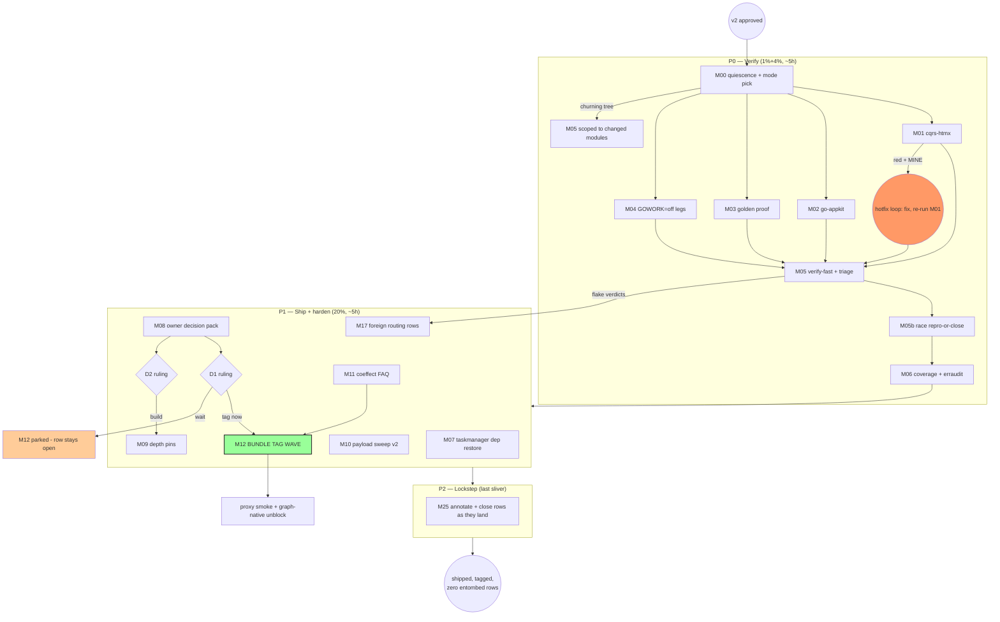

# SUPERB — BDD Depth-Spec Follow-Ups: Pareto Execution Plan (v2, 2026-10-17 20:31)

> **Input universe:** ALL follow-up TODOs from the 20:13 self-review
> ([status report](../status/2026-10-17_20-13_bdd-harness-depth-specs-execution-and-self-review.md)).
> **This is v2 — it replaces v1 (written 20:18) after a hostile self-review.
> v1 was a good inventory and a bad plan.** What changed and why is in §0.
>
> **Scope guard (anti-verschlimmbesserung):** parallel-session sections
> (queue, schema-evolution, core/v5, catalog, metaengine growth) stay
> EXCLUDED. Foreign gate-red appears only as routing tasks. And v2 adds a
> **KILL LIST** — v1 scheduled work the backlog itself had demand-gated or
> marked ride-along; doing that work standalone is how systems get
> verschlimmbessert.

---

## 0. Why v2 — v1's seven flaws

1. **The tail was not culled — it was scheduled.** v1 gave 9 mediums (~8h)
   to items the TODO_LIST itself marks "demand-gated on fleet adoption"
   (equivalence port, conformance reuse), "ride any touch" (scenario/v4 TB
   refactor), and "optional, if history matters" (companion commit
   hygiene). That is 45% of the effort for work nobody has asked for. v2
   kills or demotes all of it (§1 KILL LIST).
2. **Shipping was inverted.** The repo's own doctrine — "all shipped value
   is dead code until consumers import it" — says the highest-value move
   after verification is the TAG WAVE. v1 parked it in the tail (M22).
   v2 promotes it to the front of P1, merged with the tag-timing decision.
3. **D3 was a question I can answer myself.** One flaky race run that then
   passed 4× does not deserve an owner gate AND a 60-minute task. v2
   reduces it to a 12-minute reproduce-or-close measurement. (Rule
   violated: only ask what cannot be self-answered.)
4. **No Definition of Done.** v1 tables had impact/effort but no verifiable
   exit condition. v2 binds every task to a repo gate command or an
   artifact.
5. **No failure edges.** v1's mermaid had happy paths only. What happens
   when cqrs-htmx goes red, or a parallel session is mid-edit during
   verify? v2 draws those edges.
6. **No quiescence step.** The catalog session was writing files WHILE v1
   was being committed. Running `#verify-fast` into a live foreign tree
   wastes a 90-minute task. v2 gates it.
7. **Fine-breakdown cheats.** "Repeat this slice N times" is not a
   breakdown. Killed items remove their fine tasks; survivors are fully
   broken down.

**Net effect: ~17.5h → ~10.5h of mediums, same ≥80% value coverage, value
SHIPPED (tagged) instead of parked.**

---

## 1. KILL LIST — deliberately NOT scheduled (the anti-verschlimmbesserung core)

| v1 id | Item | Why it dies or waits |
| --- | --- | --- |
| M18 | cqrs-htmx sqlite-lifecycle → harness | Companion-repo work, no consumer ask; the wave's own row survives in TODO as demand-gated. Reopen when cqrs-htmx next touches lifecycle tests. |
| M19a | `TimeAdvancesTo(t)` sugar | Harness sugar with zero current consumer; ride the NEXT harness touch, never standalone. |
| M19b | `system` `Bus()` delivery knobs | Same — and it grows v4 API surface; v5-adjacent decision, not a Tuesday task. |
| M20 | Observational-equivalence port + conformance reuse | TODO row says verbatim: "demand-gated on fleet adoption". Fleet has not adopted. |
| M21 | scenario/v4 `testing.TB` refactor | TODO row says verbatim: "ride any scenario/v4 touch". No touch is scheduled. |
| M23 | Companion commit-history hygiene | TODO row: "XS, optional". Optional means no. |
| M26 | `WithDedupScope` preset / DRY decision | Exactly one consumer (the spec). Premature until a second dedup spec exists. |
| (v1 M13/D3) | Race-flake owner gate | Self-answerable — demoted to a 12-min measurement inside P0. |
| (v1 M14+M15+M16) | Three separate owner memos | Fragmenting one owner's decision into three artifacts is make-work — merged into ONE decision pack. |

These rows stay visible in TODO_LIST (already there); killing them from the
PLAN is the decision, and this table is the receipt.

---

## 2. Decision Gates (owner input — genuinely not self-answerable: 2 remain)

| Gate | Question | Blocks |
| --- | --- | --- |
| **D1** | ONE bundle-tag wave (systemscenario + system + projectionadapter) now, or wait? The corruption reclassification, the nextVersion fix, and the graph-native unblock all want the same wave. | M12 (tag), everything after |
| **D2** | Erroring consumer folds (make DLQ reachable for DOMAIN poisons): v4.x additive, v5, or never? | M09 retry-journey half |

---

## 3. Pareto Breakdown (v2)

- **1% → 51%:** run the real consumers against the changed code
  (cqrs-htmx, go-appkit vs the workspace). The corruption reclassification
  is the only shipped behavior change with unverified blast radius.
- **4% → 64%:** finish the verification receipt block (golden proof,
  GOWORK=off legs, verify-fast under a QUIESCENT tree, coverage, erraudit)
  + the 12-min race reproduce-or-close.
- **20% → 80%:** SHIP + harden: the D1 tag wave (value leaves the building),
  taskmanager dep restore, depth pins, payload sweep v2, coeffect FAQ,
  dedup recipes fence, foreign routing rows.
- **Remaining tasks → last 20%:** only the lockstep/reconciliation work
  survived the cull. The v1 tail is dead by §1.

---

## 4. Comprehensive Plan — medium tasks (30–100 min), v2

Sorted by importance/impact/effort. M-IDs kept stable from v1 for survivors
(TODO_LIST references stay valid). **DoD = the gate that must be green.**

| # | Task | Layer | Impact | Effort | DoD / artifact |
| --- | --- | --- | --- | --- | --- |
| M00 | Quiescence + re-baseline: check parallel-session churn (`git status` over 3 samples), re-verify foreign-red attribution still holds, pick full-vs-scoped verify mode | 4% | HIGH | 30m | Written tree-state note in plan addendum; M05 mode decision recorded |
| M01 | cqrs-htmx full suite vs workspace (temp `go.work` in companion, never blind go.mod edits) | 1% | CRIT | 60m | Companion suite green OR every failure attributed mine/foreign + mine fixed |
| M02 | go-appkit full suite vs workspace (same pattern) | 1% | CRIT | 45m | Same DoD shape as M01 |
| M03 | api-stability golden proof: run (no blind `--update`), inspect any drift, `TestEvery` | 4% | HIGH | 30m | `go run .` clean + `TestEvery` green + golden diff (if any) line-explained |
| M04 | GOWORK=off standalone legs: `go test ./...` + `go list ./...` in systemscenario + projectionadapter | 4% | HIGH | 30m | Both green under `GOWORK=off` |
| M05 | `#verify-fast` (full tree if M00 says quiescent, else changed-modules scoped); triage ALL red into mine/foreign/flake | 4% | HIGH | 90m | Mine-list empty; foreign-list routed (M17); flake-list has a verdict |
| M05b | Race reproduce-or-close: full-package systemscenario `-race` ×5 under quiet window; CLOSE with evidence if 5/5 green, else file with data (absorbs v1 D3/M13) | 4% | MED | 12m→(30m) | 5/5 green note in TODO row, or failure shape recorded |
| M06 | `#check-coverage` + `scripts/erraudit-sweep.sh` over the changed set | 4% | MED | 45m | Both gates green over systemscenario + projectionadapter |
| M07 | taskmanager build-break fix: restore `httputil/server_timing` dep — GUARD: `git log example/taskmanager` for a live session first; if live, route only | 20% | HIGH | 30m | `go build ./...` + taskmanager suite green |
| M08 | Owner decision pack (ONE artifact): D1 tag-timing + D2 erroring-folds + the classification proposal for the apply-boundary wrap & `buildEventDecoder` (v1 M14+M15+M16 merged) | 20% | HIGH | 60m | One memo in docs/reviews/ with all three rulings requested; owner verdicts recorded |
| M09 | Depth pins: `ThenError(event.ErrVersionConflict)` in OCC; read-back `SchemaVersion()==2` in upcaster; exact DLQ `ProjectionName`; retry-journey fixture IFF D2=build | 20% | MED | 45–75m | All three pins green in suite; journey fixture green or D2-deferred note |
| M10 | Payload-trap sweep v2: `Unmarshal`/`DeepEqual`/`%v`-over-payload in systemscenario + recipes | 20% | MED | 45m | Sweep result (findings fixed on sight ≤5m each or filed) recorded in TODO row |
| M11 | Coeffect-gate-on-Schema FAQ entry + recipes cross-link | 20% | MED | 30m | doc-check exit 0 + `TestRecipes` green |
| M12 | **THE TAG WAVE (D1)**: systemscenario + system (+projectionadapter) bundle tag via tag-release flow; unblocks example/graph-native standalone; companion `go get` smoke | 20% | CRIT | 60m | Proxy-resolvable tags + `check-example-standalone.sh --build` green + smoke receipts |
| M17 | Foreign gate-red routing rows: catalog file-size ×2, mesh-demo 8/7 budget, 2 dup groups, taskmanager (if M07 routed) — each row carries its gate command | 20% | MED | 30m | Four rows in TODO with `nix run .#…` self-verify lines |
| M25 | Lockstep close-out: annotate THIS plan + 14-49 addendum per completion; TODO rows close AS mediums land (never batched) | 80% | MED | 30m | docs-health discipline: zero entombed rows |

**14 mediums, ~10.5h.** Phases: **P0** M00→M01/M02→M03/M04→M05/M05b→M06 →
**P1** M07, M08(→D1/D2), M09, M10, M11, M12, M17 → **P2** M25.

---

## 5. Fine Breakdown — ALL kept tasks, ≤12 min each

| ID | Task (≤12 min) | Dep |
| --- | --- | --- |
| F00.1 | `git status` sample ×3 (30s apart); classify churn: mine / catalog session / other | — |
| F00.2 | Re-run the three foreign gates; confirm attribution from 20:13 still holds | F00.1 |
| F00.3 | Record tree-state + M05 mode (full vs scoped) in plan addendum | F00.2 |
| F01.1 | cqrs-htmx: clean-tree check + base commit recorded | M00 |
| F01.2 | Wire companion to workspace via temp `go.work` in the companion dir | F01.1 |
| F01.3 | Full suite run, capture output | F01.2 |
| F01.4 | Triage failures: corruption-class-related vs pre-existing (worktree isolation if unclear) | F01.3 |
| F01.5 | Mine-class fix (companion test-expectation class only) + rerun | F01.4 |
| F01.6 | Verdict + evidence in addendum; remove temp wiring | F01.5 |
| F02.1 | go-appkit cqrs/: base commit + temp workspace wiring | M00 |
| F02.2 | Full suite run + capture | F02.1 |
| F02.3 | Triage + fix mine-class only + rerun | F02.2 |
| F02.4 | Verdict recorded; wiring reverted | F02.3 |
| F03.1 | `cd cmd/api-stability && GOWORK=off go run .` — expect clean | M00 |
| F03.2 | If drift: inspect BEFORE updating; every golden line explainable | F03.1 |
| F03.3 | `GOWORK=off go test -run TestEvery .` | F03.2 |
| F04.1 | `systemscenario`: `GOWORK=off go test -count=1 ./...` | M00 |
| F04.2 | `projectionadapter`: `GOWORK=off go test -count=1 ./...` | M00 |
| F04.3 | `GOWORK=off go list ./...` both modules (tidy-shape proof) | F04.1 |
| F05.1 | `#verify-fast` in the M00-decided mode (exclusive window) | M00–M04 |
| F05.2 | Attribute every red: mine / foreign / flake (three lists) | F05.1 |
| F05.3 | Mine → fix now; foreign → M17 rows; flake → verdict note | F05.2 |
| F05b.1 | `#quiet-window-run` full-package systemscenario `-race` ×5 | M00 |
| F05b.2 | 5/5 green → close TODO row with evidence; else record failure shape + file | F05b.1 |
| F06.1 | `nix run .#check-coverage` — compare changed modules vs pin | M00 |
| F06.2 | `scripts/erraudit-sweep.sh` over changed files | F06.1 |
| F06.3 | Findings: fix ≤5m each on sight, else file | F06.2 |
| F07.1 | GUARD: `git log --oneline -5 -- example/taskmanager` — live session? | M00 |
| F07.2 | If clear: `go get httputil/server_timing` + tidy + build + test green | F07.1 |
| F07.3 | If live: route to M17 with the guard note | F07.1 |
| F08.1 | Draft the one-page decision memo: D1 bundle-tag ask + evidence | M01–M06 |
| F08.2 | Add D2 erroring-folds section (v4.x/v5/never + DLQ-reachability rationale) | F08.1 |
| F08.3 | Add classification proposal: apply-wrap + buildEventDecoder per-path families | F08.2 |
| F08.4 | Memo to docs/reviews/; TODO rows updated with the asks | F08.3 |
| F09.1 | OCC spec: add `ThenError(event.ErrVersionConflict)`; rerun | — |
| F09.2 | Upcaster spec: read-back `SchemaVersion()==2` assert; rerun | — |
| F09.3 | DLQ spec: pin exact `ProjectionName`; rerun | — |
| F09.4 | IFF D2=build: retry-journey fixture (erroring fold) + rerun | D2 |
| F10.1 | Sweep `Unmarshal\|DeepEqual\|Sprintf` over payload vars in systemscenario prod | — |
| F10.2 | Same over recipes.md payload fences | F10.1 |
| F10.3 | Findings: fix-on-sight or file; result recorded in TODO row | F10.2 |
| F11.1 | FAQ entry: Schema declaration activates coeffect gate + Events backstop | — |
| F11.2 | Cross-link from §2.43 upcasting paragraph; doc-check + TestRecipes | F11.1 |
| F12.1 | IFF D1=tag-now: `scripts/go-env.sh` + tag-release flow for the bundle | D1 |
| F12.2 | Proxy smoke: `go get` each new tag from a scratch module | F12.1 |
| F12.3 | `check-example-standalone.sh --build` (graph-native unblocked) | F12.2 |
| F12.4 | Close the [BLOCKED] graph-native row with receipts | F12.3 |
| F17.1 | TODO row: catalog file-size offenders + gate command | — |
| F17.2 | TODO row: mesh-demo dep budget + gate command | — |
| F17.3 | TODO row: 2 foreign dup groups + gate command | — |
| F17.4 | TODO row: taskmanager (if routed) with guard note | F07.3 |
| F25.1 | Per completed medium: annotate this plan + close its TODO row | ongoing |
| F25.2 | End: 14-49 addendum pointer + this plan's completion banner | F25.1 |

**50 fine tasks.** No "repeat N times" cheats — v1's lazy slices died with
their parents in §1.

---

## 6. Execution Graph (v2 — with failure edges)

**Critical path:** M00 → M01 → M05 → M08 → D1 → M12 → smoke. Everything
else parallelizes around it. The two failure edges (hotfix loop, scoped
verify) are the ones v1 pretended didn't exist.

---

## 7. Living-source discipline

- TODO_LIST rows added at v1 (20:18) stay valid: M-numbering is stable for
  survivors; killed v1 tail items were never TODO-referenced by the
  harvest. The race-flake row gets its evidence verdict from F05b.
- THIS file is the snapshot; TODO_LIST.md is the living source. Close rows
  as mediums land.

*v2 written 2026-10-17 20:31 CEST, ~13 minutes after v1 — the fastest way to
a better plan was to attack v1 before anyone could execute it. Awaiting
approval + D1/D2 rulings; no execution started.*
