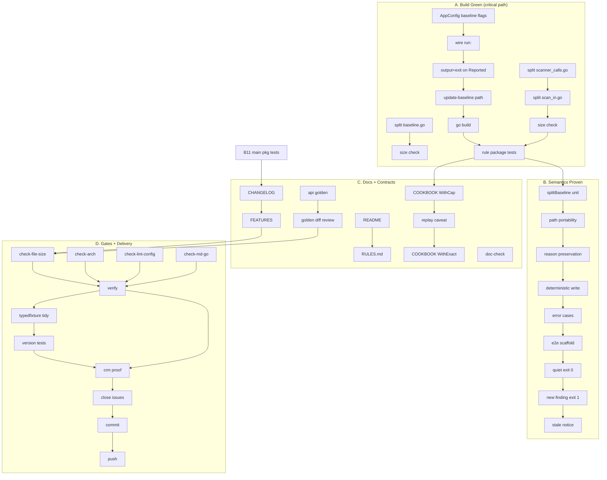

# SUPERB: Open-Issues Closeout, CI Green, and Findings-Baseline Delivery

**Created:** 2026-10-23 09:49 +0200
**Owner:** Crush session (open-issues remediation, continuation)
**Predecessor report:** [docs/status/2026-10-23_09-28_open-issues-remediation-comprehensive-status.md](../status/2026-10-23_09-28_open-issues-remediation-comprehensive-status.md)

---

## 1. Context: Where We Are

Ten open GitHub issues were reviewed. Seven cqrs-lint detector fixes, both metaengine
primitives (#71, #72), and the already-fixed #70 are implemented and package-tested.
The findings-baseline feature (#83) has its core written (`cmd/cqrs-lint/baseline.go`) but
is not wired to the CLI, so `cmd/cqrs-lint` currently does **not build**.

Three classes of work remain:

1. **CI blockers introduced by this work**: three files exceed the file-size ratchet
   (`scanner_calls.go` grew 360→401, `scan_in.go` 386, `baseline.go` 357).
2. **Unfinished feature**: #83 flags, `run()` wiring, exit semantics, tests, docs.
3. **Delivery hygiene**: API-stability golden, CHANGELOG/FEATURES, docs, gates,
   consumer proof, issue closure, commit + push.

Nothing shipped is broken; the unbuilt state is a direct consequence of the unfinished
baseline wiring, not of the seven completed detector fixes (all pass their package suites).

---

## 2. Pareto Analysis — What Actually Moves the Needle

### 2.1 The 1% that delivers 51%

**Add `Baseline` + `UpdateBaseline` to `AppConfig` and wire `applyBaseline` into `run()`.**

Why: this single change takes `cmd/cqrs-lint` from *does not compile* to *fully
functional* and completes the only feature-shaped gap in the backlog. Everything else
(issue fixes) is already code-complete; the tree's red state is caused by this one
missing wiring. Effort: ~30–45 min. Blast radius: one config struct + one function body.

### 2.2 The 4% that delivers 64%

**The 1% above + the three file splits that satisfy the ratchet gate.**

Why: compiling is not the same as CI-green. `scripts/check-file-size.sh` is the widest
mechanical gate in the repo and currently fails on exactly three files we touched.
Splitting them is pure code motion (no behavior change) and unblocks every downstream
gate (`#verify` runs lint over the same tree). Effort: ~90–120 min. Risk: near zero.

### 2.3 The 20% that delivers 80%

**Everything above + baseline tests + docs + API golden + CHANGELOG/FEATURES.**

Why: this is the difference between "works on my machine" and "a release-ready change a
consumer can trust". Regression tests pin the new semantics; the API golden makes the
new exported surface intentional; CHANGELOG/FEATURES make the change discoverable; docs
teach the cap/baseline workflows. Effort: ~4–5 hours.

### 2.4 The remaining 20% to reach 100%

- Run the authoritative gates (`#verify`, `#check-arch`, `#check-lint-config`, `#check-md-go`).
- Repair the stale `testdata/typedfixture` module so `pkg/rules/version` stops failing
  (pre-existing, but it is the last red test in the cqrs-lint suite).
- Prove the fixes against the real consumer (crm) where possible.
- Close/annotate the ten issues with evidence.
- Commit with a detailed message and push.

---

## 3. Comprehensive Plan — 30 to 100 Minute Tasks

Sorted by priority (impact × urgency ÷ effort). "Done" means the stated verification
command exits 0 and the evidence is captured in the status report.

| ID | Task | Why / outcome | Effort | Impact | Effort/Value | Depends on | Done when |
|----|------|---------------|--------|--------|--------------|------------|-----------|
| T3 | Wire baseline flags into `AppConfig` + `run()` | Makes the CLI compile and #83 usable; unblocks everything | 60 min | Critical | ★★★★★ | — | `go build ./...` in `cmd/cqrs-lint` exits 0; flag help shows `--baseline` |
| T1 | Split `scanner_calls.go` and `scan_in.go` | Satisfies the file-size ratchet; no behavior change | 60 min | Critical | ★★★★★ | — | both files ≤ their limits; rule package tests pass |
| T4 | Baseline unit + end-to-end tests | Pins new/known/stale semantics and exit codes | 80 min | High | ★★★★☆ | T3 | `go test .` in `cmd/cqrs-lint` passes; new tests fail if semantics are reverted |
| T2 | Split `baseline.go` into matching + file IO | Satisfies the ratchet; keeps #83 maintainable | 30 min | High | ★★★★★ | — | `baseline.go` ≤ 350 lines; build passes |
| T5 | Baseline docs (README + RULES.md) | Consumers can adopt the workflow without reading code | 40 min | Medium | ★★★★☆ | T3 | sections exist, flags match implementation |
| T6 | Metaengine docs: `WithCap` + `WithExact` recipes | #72 explicitly asks for a recipe; prevents re-hand-rolling | 40 min | Medium | ★★★★☆ | — | `metaengine/COOKBOOK.md` has both recipes incl. replay caveat |
| T7 | Regenerate api-stability golden + doc-check | New exported symbols are a tracked contract | 30 min | High | ★★★★★ | T3, T6 | `go run . --update` diff contains exactly the new symbols; `doc-check` exits 0 |
| T8 | CHANGELOG + FEATURES rows | Release hygiene; E003 count change must be visible | 30 min | Medium | ★★★★☆ | T3 | `[Unreleased]` lists all user-visible changes |
| T9 | Run authoritative gates, fix fallout | Proves the tree is releasable | 100 min | Critical | ★★★★★ | T1–T8 | `#verify` + `#check-file-size` + `#check-arch` exit 0 |
| T10 | Tidy `testdata/typedfixture` | Removes the last red suite in cqrs-lint | 30 min | Low/Medium | ★★★★☆ | — | `go test ./pkg/rules/version/` passes |
| T11 | Consumer proof on crm | Validates the issue claims end-to-end | 60 min | High (evidence) | ★★★☆☆ | T9 | counts match expected deltas, recorded in report |
| T12 | Issue comments/closures | Closes the loop for the backlog | 30 min | Medium | ★★★★☆ | T9, T11 | each issue has verification evidence or explicit remaining work |
| T13 | Commit + push | Delivers the work | 30 min | Critical | ★★★★★ | all | clean tree, detailed commit, push succeeds |

**Total:** ~10 hours of serial work (≈ 6.5 h if T10/T11 are skipped due to environment).
Every task is independently verifiable; none requires a rewrite of shipped behavior.

---

## 4. Micro-Plan — Every Task ≤ 12 Minutes

Sorted by execution order within each workstream (dependencies respected).

### Workstream A — Tree compiles and builds clean (T3, T2, T1)

| ID | Micro-task | Min | Verify |
|----|-----------|-----|--------|
| A1 | Add `Baseline` and `UpdateBaseline` fields with cmdguard tags to `AppConfig` | 5 | field compiles |
| A2 | Add `--update-baseline requires --baseline` validation in `applyBaseline` | 4 | unit test later |
| A3 | Insert `applyBaseline` call after `filterFindings` in `run()` | 8 | build |
| A4 | Route `outputFindings` and `shouldExitWithError` through `Reported` | 8 | build |
| A5 | Add `--update-baseline` maintenance early-return with notice | 8 | build |
| A6 | Run `go build ./...` in `cmd/cqrs-lint` | 3 | exit 0 |
| A7 | Split `baseline.go`: move load/write into `baseline_file.go` | 8 | build |
| A8 | Verify `baseline.go`/`baseline_file.go` ≤ 350 lines | 3 | `wc -l` |
| A9 | Create `scanner_catalog_simple.go` with case body + helpers | 8 | build |
| A10 | Delete moved helpers from `scanner_calls.go` | 5 | build |
| A11 | Create `scan_in_paths.go` with `hasCallOnImportedPackage` | 8 | build |
| A12 | Move `usesMetaengineGraph` into `scan_in_metaengine.go` | 6 | build |
| A13 | Verify `scanner_calls.go` ≤ 360 and `scan_in.go` ≤ 350 | 3 | `wc -l` |
| A14 | `gofmt -l` all touched files | 4 | no output |
| A15 | Run analyzer + adoption + architecture tests | 10 | exit 0 |

### Workstream B — Baseline semantics proven (T4)

| ID | Micro-task | Min | Verify |
|----|-----------|-----|--------|
| B1 | Unit: `splitBaseline` known/new/stale partition | 8 | test passes |
| B2 | Unit: relative-path key portability (two roots) | 6 | test passes |
| B3 | Unit: reason preservation across regeneration | 8 | test passes |
| B4 | Unit: deterministic write (sorted, byte-identical twice) | 8 | test passes |
| B5 | Unit: version mismatch / malformed / missing-file errors | 8 | test passes |
| B6 | Unit: `--update-baseline` without `--baseline` errors | 5 | test passes |
| B7 | E2E scaffolding: temp module with a known finding | 12 | `run()` returns without load error |
| B8 | E2E: write baseline, rerun quiet + exit 0 | 10 | assertion passes |
| B9 | E2E: add a finding, only it is reported, exit non-zero | 10 | assertion passes |
| B10 | E2E: remove a finding → stale notice on stderr | 8 | assertion passes |
| B11 | Run `go test .` (main package) | 10 | exit 0 |
| B12 | Update flag-contract test snapshots if needed | 8 | exit 0 |

### Workstream C — Documentation and contracts (T5, T6, T7, T8)

| ID | Micro-task | Min | Verify |
|----|-----------|-----|--------|
| C1 | README: baseline section (why, flags, format, exit semantics) | 10 | flags match code |
| C2 | RULES.md: baseline section + stale-entry policy | 10 | links resolve |
| C3 | COOKBOOK: `WithCap` keep-newest-N recipe | 12 | compiles mentally against API |
| C4 | COOKBOOK: replay caveat + enforcement cadence | 8 | stated |
| C5 | COOKBOOK: `WithExact` truncation recipe | 8 | stated |
| C6 | Regenerate api-stability golden | 10 | diff = expected symbols |
| C7 | Review golden diff for accidental surface growth | 8 | only listed symbols |
| C8 | Run doc-check on SKILL/references/AGENTS | 8 | exit 0 |
| C9 | CHANGELOG: metaengine entries (#71, #72) | 8 | present |
| C10 | CHANGELOG: cqrs-lint entries (#74, #78–#83, E003 count change) | 10 | present |
| C11 | FEATURES.md: update affected rows | 8 | present |

### Workstream D — Gates, proof, delivery (T9, T10, T11, T12, T13)

| ID | Micro-task | Min | Verify |
|----|-----------|-----|--------|
| D1 | `bash scripts/check-file-size.sh` | 5 | exit 0 |
| D2 | `nix run .#check-arch` | 10 | exit 0 |
| D3 | `nix run .#check-lint-config` | 5 | exit 0 |
| D4 | `nix run .#check-error-taxonomy` | 5 | exit 0 |
| D5 | `nix run .#check-md-go` | 10 | exit 0 |
| D6 | `nix run .#verify` | 30 | exit 0 |
| D7 | Fix fallout round 1 | 12 | re-run affected gate |
| D8 | Tidy `typedfixture/go.mod` | 10 | `go build` in fixture |
| D9 | `go test ./pkg/rules/version/` | 10 | exit 0 |
| D10 | Locate crm checkout + build `cqrs-lint` | 10 | binary exists |
| D11 | Run against crm, capture counts | 12 | deltas recorded |
| D12 | Compare with expected issue numbers | 10 | evidence table |
| D13 | Close #70 with verification comment | 5 | closed |
| D14 | Comment+close #74, #78–#82 | 12 | closed with evidence |
| D15 | Comment #71/#72 with API + caveats | 8 | present |
| D16 | Comment #83 with status/remaining | 5 | present |
| D17 | `git status` + review diff | 6 | only intended files |
| D18 | Detailed commit(s) per workstream | 12 | `git log` shows narrative |
| D19 | `git push` | 5 | remote updated |
| D20 | Verify clean tree + pushed state | 5 | porcelain empty |

**Micro-task total:** ≈ 8.5 h including gate waits.

---

## 5. Execution Graph

**Critical path:** A1 → A3 → A4 → A6 → A15 → B11 → D1 → D6 → D18 → D19.
**Parallelizable:** the file splits (A7/A9/A11) and docs (C1–C5) are independent of bot
the wiring and of each other.

---

## 6. Verification Gates (Definition of Done)

| Gate | Command | Must |
|------|---------|------|
| Compile | `cd cmd/cqrs-lint && GOWORK=off go build ./...` | exit 0 |
| Rule suites | `GOWORK=off go test ./pkg/rules/... ./pkg/analyzer/ ./pkg/toolspec/` | exit 0 |
| Main CLI | `GOWORK=off go test .` | exit 0 |
| Metaengine | `cd metaengine && GOWORK=off go test .` | exit 0 |
| File size | `bash scripts/check-file-size.sh` | exit 0 for touched files |
| Format | `nix fmt --fail-on-change` or `gofmt -l` | no diff |
| Arch | `nix run .#check-arch` | exit 0 |
| Lint config | `nix run .#check-lint-config` | exit 0 |
| Error taxonomy | `nix run .#check-error-taxonomy` | exit 0 |
| Docs | `nix run .#check-md-go` + `cmd/doc-check` | exit 0 |
| API | `cd cmd/api-stability && go run .` | golden matches |
| Full | `nix run .#verify` | exit 0 |

---

## 7. Guardrails (Do Not Make It Worse)

1. **Code motion only for splits.** No signature or behavior changes while satisfying the
   ratchet; verify with the same tests before and after.
2. **Baseline never inflates health.** Health score keeps using the full unsuppressed set;
   only reporting and the exit gate use new findings.
3. **No baseline auto-write.** `--update-baseline` is explicit and requires `--baseline`.
4. **No ratchet baseline refresh** to hide growth (`--update-baseline` on
   `scripts/file-size-baseline.txt` is forbidden for this work).
5. **No touching foreign work.** Pre-existing `catalog/*` ratchet violations and parallel
   session changes stay untouched; they are reported, not "fixed".
6. **No force push.** Plain `git push` only. If the remote moved, stop and report.
7. **Auto-commit daemon awareness.** Commit at each workstream boundary; if the daemon
   absorbs a phase, continue and note it.
8. **Do not weaken detection to make tests pass.** Any detector change needs a regression
   test proving the false positive is gone while the true positive remains.

---

## 8. Evidence to Capture

- `go test` outputs per package (success lines).
- `check-file-size.sh` final line ("no new offenders, no growth").
- `#verify` tail.
- api-stability diff (new symbols only).
- Consumer counts before/after (crm or a documented substitute).
- Final `git log --oneline` + `git status`.

---

## 9. Rollback

Each workstream is independently revertible:
- Splits: revert commits touching only the split files.
- Baseline wiring: remove the `applyBaseline` call and the two config fields; the core
  file is inert without them.
- Docs: revert doc commits (no runtime effect).

No migration, no data mutation, no schema change in this plan.
