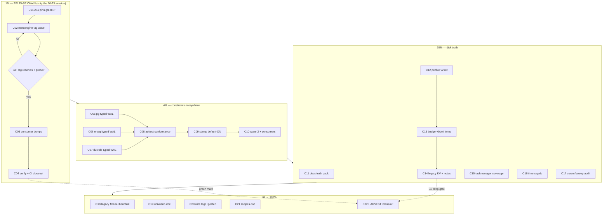

# SUPERB — Disk-Truth Tail Delivery Pareto Plan v3 (2026-10-23 17:05)

> **Scope:** the remaining tail of the disk-truth wedge (plan v2's A9 adoption, A11 finish,
> A12–A24) plus the release/debt chain the 2026-10-23 session created — sequenced onto
> DELIVERY first, again. Predecessors: [2026-10-17 disk-truth v2](2026-10-17_20-13_SUPERB-disk-truth-pareto-plan.md)
> (A1–A8 shipped or rowed; see its residue section in TODO_LIST) and the 2026-10-23 session
> status report (`docs/status/2026-10-23_17-08_disk-truth-tail-session-status.md`; the
> session's a–g breakdown is the ground truth this plan consumes).
> `TODO_LIST.md` stays the living source; the "Disk-truth plan residue" section (added
> 2026-10-23) is this plan's backlog mirror.
>
> **Where the last session stopped:** A11 shipped with 4/4 pins GREEN (the two red pins were
> fixture bugs — hand-written base64 vs. real-serializer fixtures, plus a real double-decode
> bug in the extraction — both fixed and verified); everything from A5/A8/A11 through the
> StreamKey completion wave (id/v4.7.3, system/v4.15.2, systemscenario/v4.2.1) is either
> tagged or sitting unreleased in `[Unreleased]`. The 1% below is: SHIP IT.

## Quantified blast radius

- Typed-WAL parity touches **3 SQL engines** (pg, mysql, duckdb) + 1 conformance suite in adttest.
- keycodec v2 adoption touches **3 LSM metaengines** (pebble reference + badger/bbolt twins) and
  **2 legacy KV stores** (storage/pebble, storage/bbolt incl. `cqrs_journal_idx` rekey) — the
  single largest remaining item (XL), deliberately sequenced AFTER the 20% cluster per v2's
  Pareto ranking and the 2026-10-23 context-budget call.
- The release chain re-tags **1 module (metaengine)** carrying four content deltas
  (A5 name-typing kill, rule-path FromType fix, keycodec v2, sqlite typed WAL) + the parallel
  session's [Unreleased] metaengine rows — waves carry all unreleased module content (repo
  convention), so co-review those rows before cutting.
- Docs truth pack: **8 gotcha blocks** + CHANGELOG four-layer wording + 4 new lessons from the
  2026-10-23 session (tx-iso rerun safety, sticky stream keys, /tmp volatility re-hit,
  buildcache disk-full).

---

## Pareto Breakdown (v3)

### The 1% that delivers 51% — THE RELEASE CHAIN (ship what already works)

Everything the 2026-10-23 session built is unreleased polish until metaengine tags and the
consumers re-pin. One chain converts it: **A11 pins green (DONE this session) → CHANGELOG rows
(DONE) → pin-sweep + clean tree → tag metaengine → consumer bumps → #verify + CI green.**
~½ day, mostly machine time. Skip it and the name-typing kill, the injection laws, the typed
WAL, and the WAL pins are code nobody imports.

### The 4% that deliver 64% — typed-WAL parity + stamp default (the "constraints everywhere" cluster)

1. pgengine typed WAL (JSONB metadata; unique indexes; same migration-in-place contract).
2. mysqlengine typed WAL (VARCHAR(768) ids, JSON columns, ONLINE-DDL-safe ADD INDEX — **no table
   recreate ever**, the risk-register item).
3. duckdbengine typed WAL (ADD COLUMN path; engine-level unique check + dedup table where DDL
   lacks partial/unique indexes — documented constraint story).
4. adttest WAL conformance (duplicate-append + (stream,version) conflict) wired into all four
   SQL engine suites — the invariant proven per engine forever.
5. Layout-stamp default-ON (warn-first per G4) + column add/rename `LayoutStampDiffs`
   conformance — closes re-scoped PC-5.
6. Second metaengine wave + consumers (this cluster rides ONE tag wave).

### The 20% that deliver 80% — the disk truth proper

1. A9 keycodec v2 adoption: pebbleengine reference (alias swap → V2, dual exact-key reads,
   dual concatenated scans, both-tag seq seeding, both-range reset, sortIndexKey v2) →
   badger/bbolt twins → legacy storage/pebble + storage/bbolt (colon-join injection, journal_idx
   rekey) → README migration notes + G3 dual-read window.
2. A16 docs truth pack (gotchas + CHANGELOG four-layer compat wording + the four new lessons).
3. A17 taskmanager deriver coverage verification (suite already green — parallel session fixed it).
4. A18 timers payload → gcdc envelope (decode-old-wrap-new + migration test).
5. A22 cursor/sweep audit (keyset readers vs stored form; `StreamRef.Split()` consumer grep).

### The other 20% → 100%

A19 UTC/UnixNano rule doc (A6's received_at fix + A11's nanos column already did the code),
A20 Causation/TombstoneMark wire tags + golden bytes, A21 recipes §schema upcasting doc,
A23 legacy prefixed-row golden fixture + benchkit countKey, A24 docs-health HARVEST +
closeout gates (incl. the deferred `#verify` and CI confirmation).

---

## Table A — Comprehensive plan (30–100 min, 22 tasks, delivery-first order)

| #   | Task | Tier | Impact | Effort | Gate/Acceptance |
|-----|------|------|--------|--------|-----------------|
| C01 | A11 closeout: 4/4 pins green (DONE 2026-10-23: real-serializer fixtures + double-decode fix) + full suite green + CHANGELOG row (DONE) | 1% | unblocks the wave | S | 4 pins + suite green (met) |
| C02 | metaengine release wave: review parallel-session [Unreleased] metaengine rows, api golden regen check, `pin-sweep`, clean-tree wait, `batch-release`, push, `--smoke`, G1 scratch-consumer probe | 1% | fleet binaries get A5/A8/A11 | L | proxy serves; probe resolves siblings |
| C03 | Consumer bumps: go-appkit (cqrs+integration `go get metaengine/v4@<new>` + suites), cqrs-htmx (release-train `--refresh-cache` FIRST, then bump + full battery) | 1% | value delivered | M | both suites green |
| C04 | Closeout gates: `#verify` in a quiet window (can-run-composed-gate --wait-loop), CI green on master (confirm go.work/shfmt/private-deps/getting-started fixes + new wave), engine standalone suites green post-tag | 1% | delivery proven | M | verify rc=0; CI matrix green |
| C05 | A12a: pgengine typed WAL — typed columns + JSONB metadata variant + guarded migration + backfill + unique indexes + typed inserts + ErrVersionConflict mapping + reader prefers typed | 4% | journal constraints on PG | L | pg pins (dup ×2 + columns + legacy migration) green |
| C06 | A12b: mysqlengine typed WAL — same shape; VARCHAR(768) id columns, JSON metadata, ONLINE-DDL ADD INDEX only, **NO table recreate** (pin that) | 4% | parity without lock risk | L | mysql pins green incl. no-recreate proof |
| C07 | A13: duckdbengine typed WAL — ADD COLUMN path, engine-level unique check + dedup-table fallback where DDL lacks it, documented constraint story | 4% | parity without recreate risk | M | duck pins green + story documented |
| C08 | A14: adttest WAL conformance — `AssertWALDuplicateAppendConflicts` + `AssertWALStreamVersionConflict`, wired into sqlite/pg/mysql/duckdb suites | 4% | invariants proven per engine | M | 4 engines × 2 cases green |
| C09 | A15: layout-stamp default-ON (config inversion, warn-first per G4) + conformance: column-add and column-rename each trip `LayoutStampDiffs` on every engine | 4% | closes re-scoped PC-5 | M | diff fires on all engines |
| C10 | Second metaengine wave (A12–A15 + any A16-adjacent doc deltas) + settle + consumer bumps (same chain as C02–C03) | 4% | constraints fleet-wide | L | tags resolve; consumers green |
| C11 | A16: docs truth pack — gotchas (sweep-complete 8 sites, cursor-pairing invariant, four-layer compat checklist, raw-bytes-pin convention) + 4 new 2026-10-23 lessons + CHANGELOG four-layer wording | 20% | docs stop overclaiming | S | doc-check + md-go green |
| C12 | A9a: pebbleengine v2 adoption (reference) — alias swap, `getAny` dual exact-key reads, dual concatenated scans (v1 range first: seq families order by tail, v2 seqs continue past v1 max), seq_seeding both tags, resetTagPrefixes both ranges (journal families stay reset-immune), sortIndexKey v2 (own injection), legacy v1 fixture | 20% | kills injection on the LSM reference | L | conformance + v1-fixture green |
| C13 | A9b: badgerengine + bboltengine twins (same diffs, same fixtures) | 20% | LSM parity | L | both suites green |
| C14 | A9c: legacy storage/pebble + storage/bbolt — escape adoption, dual-read window, bbolt `cqrs_journal_idx` rekey, README migration notes (G3: one release, then drop v1 ranges) | 20% | same fix, legacy KV | L | both suites + notes green |
| C15 | A17: taskmanager deriver.go coverage verification (suite green already; confirm the deriver paths are exercised; row receipt) | 20% | example = consumer docs | S | coverage evidence rowed |
| C16 | A18: timers payload → ADR-0044 gcdc envelope (WrapEncode replace, decode-old-wrap-new, migration test old→new) | 20% | one envelope system | M | migration test green |
| C17 | A22: cursor/sweep audit — pebble/bbolt/watermill keyset readers vs stored form, tests where suspect, `StreamRef.Split()` consumer grep + note | 20% | closes cursor bug class | M | findings rowed or tests added |
| C18 | A23: legacy prefixed-row decode fixture (golden v4-era bytes → current code green) + benchkit `countKey` → `Get()` | tail | compat proof + hygiene | S | fixture green; benchkit lint green |
| C19 | A19: UTC/UnixNano rule doc (A6 received_at-UTC + A11 nanos column are the shipped code; write the rule + cross-offset ordering note riding typed columns) | tail | kills PC-6 ordering trap | S | doc lands in gotchas/SPAN-style doc |
| C20 | A20: `Causation`/`TombstoneMark` wire tags + golden-bytes pin | tail | PC-12 wire lock-in | S | golden committed, red-on-change |
| C21 | A21: recipes.md §schema — legacy payload-ID strip via `Chain.Upcasters()` (doc only, E3) | tail | consumer playbook | S | doc-check + recipe gate green |
| C22 | A24: docs-health HARVEST — status-report next-items → TODO_LIST (incl. the 3 owner questions as decision rows), `ParseStreamID` strictness ruling prep, go.sum tidy-or-confirm-owner (E4), receipts for every closed row | tail | backlog hygiene | S/M | TODO_LIST rows land; zero orphans |

## Table B — Fine breakdown (≤12 min each, no compound rows)

| #   | Fine task | Parent | Est |
|-----|-----------|--------|-----|
| F01 | Review parallel-session [Unreleased] metaengine rows for wave co-release | C02 | 12 |
| F02 | api-stability golden regen + meta-tests (`--update`, `TestEvery\|TestMirror`) | C02 | 12 |
| F03 | `bash scripts/pin-sweep.sh` full pass; fix any non-convergent tidy (per-module `go list` verify) | C02 | 12 |
| F04 | Clean-tree wait-loop (daemon + parallel session aware) | C02 | 8 |
| F05 | `batch-release.sh` metaengine `<ver>`; push; `tag-release --smoke`; G1 scratch-consumer probe | C02 | 12 |
| F06 | go-appkit cqrs+integration: `go get metaengine/v4@<new>` + tidy + suites | C03 | 12 |
| F07 | cqrs-htmx: `check-release-train.sh --refresh-cache` BEFORE the re-pin commit (their gotcha #27) | C03 | 12 |
| F08 | cqrs-htmx: bump + tidy + `nix run .#test` battery | C03 | 12 |
| F09 | `can-run-composed-gate --wait-loop && nix run .#verify` | C04 | 12 |
| F10 | `gh run list` + per-job verdicts on the post-fix master; triage residuals | C04 | 12 |
| F11 | Engine standalone (`GOWORK=off`) suites green post-tag | C04 | 12 |
| F12 | pgengine: typed columns + JSONB variant in DDL + guarded migration | C05 | 12 |
| F13 | pgengine: backfill (`value::jsonb->>'id'` etc.) + unique indexes | C05 | 12 |
| F14 | pgengine: typed inserts + unique-violation → ErrVersionConflict | C05 | 12 |
| F15 | pgengine: StreamLoadByEventID prefers typed; reader fallback | C05 | 12 |
| F16 | pgengine: 4 acceptance pins (dup ×2, columns, legacy migration) + suite vs ephemeral PG | C05 | 12 |
| F17 | mysqlengine: typed columns (VARCHAR(768), JSON) + guarded ALTER (no recreate) | C06 | 12 |
| F18 | mysqlengine: backfill (JSON_EXTRACT) + online ADD INDEX | C06 | 12 |
| F19 | mysqlengine: typed inserts + conflict mapping + reader | C06 | 12 |
| F20 | mysqlengine: pins incl. no-recreate proof (information_schema table_id stable) + suite vs userspace MariaDB | C06 | 12 |
| F21 | duckdbengine: ADD COLUMN path + engine-level unique check + dedup fallback | C07 | 12 |
| F22 | duckdbengine: backfill + reader + constraint-story doc block | C07 | 12 |
| F23 | duckdbengine: pins + suite green | C07 | 12 |
| F24 | adttest: `AssertWALDuplicateAppendConflicts` helper (env-agnostic, run-unique collections) | C08 | 12 |
| F25 | adttest: `AssertWALStreamVersionConflict` helper | C08 | 12 |
| F26 | Wire both into sqlite/pg/mysql/duck suites; green ×4 | C08 | 12 |
| F27 | A15: flip stamp default ON (config inversion) + migration note | C09 | 12 |
| F28 | A15 conformance: column-add trips LayoutStampDiffs per engine | C09 | 12 |
| F29 | A15 conformance: column-rename trips diff per engine | C09 | 12 |
| F30 | Wave 2: CHANGELOG rows for A12–A15 | C10 | 12 |
| F31 | Wave 2: pin-sweep → tag → push → smoke → G1 probe | C10 | 12 |
| F32 | Wave 2: consumer bumps + suites (go-appkit, cqrs-htmx) | C10 | 12 |
| F33 | gotchas: sweep-complete block (8 sites) | C11 | 12 |
| F34 | gotchas: cursor-pairing invariant block | C11 | 8 |
| F35 | gotchas: four-layer compat checklist | C11 | 10 |
| F36 | gotchas: raw-bytes-pin convention (B23 proof pattern) | C11 | 8 |
| F37 | gotchas: tx-iso rerun-safety + cleanup-deadlock lesson (2026-10-23) | C11 | 8 |
| F38 | gotchas: sticky stream keys + consumer store-pin lesson | C11 | 8 |
| F39 | gotchas: /tmp volatility re-hit + buildcache disk-full ops runbook | C11 | 8 |
| F40 | CHANGELOG: four-layer compat wording swap | C11 | 10 |
| F41 | doc gates: `cmd/doc-check` + `check-md-go` green | C11 | 12 |
| F42 | pebbleengine: engine.go alias block → V2 + v1 funcs kept for fallback | C12 | 12 |
| F43 | pebbleengine: `getAny(v2, v1)` on exact-key reads (MapGet/SetContains/oldVal ×2/sort_index/layout_planner) | C12 | 12 |
| F44 | pebbleengine: dual concatenated prefix scans (stream/journal/log/multimap/vector/graph/map) | C12 | 12 |
| F45 | pebbleengine: seq_seeding scans BOTH tags; resetTagPrefixes both ranges (journal families stay immune) | C12 | 12 |
| F46 | pebbleengine: sortIndexKey/layout index v2 (own injection family) | C12 | 12 |
| F47 | pebbleengine: legacy v1 fixture (pre-v2 bytes readable) + conformance green | C12 | 12 |
| F48 | badgerengine: replicate F42–F47 | C13 | 12 |
| F49 | bboltengine: replicate F42–F47 | C13 | 12 |
| F50 | storage/pebble: escape eventKey joins + dual-read | C14 | 12 |
| F51 | storage/bbolt: same + `cqrs_journal_idx` rekey | C14 | 12 |
| F52 | Both READMEs: migration notes + G3 drop gate declaration | C14 | 10 |
| F53 | taskmanager: deriver.go coverage evidence (which test exercises it) + TODO receipt | C15 | 12 |
| F54 | timers: WrapEncode replace + legacy decode path | C16 | 12 |
| F55 | timers: migration test old-wrap → new-envelope | C16 | 12 |
| F56 | A22: grep keyset/cursor readers vs stored form; list suspects | C17 | 12 |
| F57 | A22: tests for confirmed suspects; `StreamRef.Split()` consumer grep + note | C17 | 12 |
| F58 | A23: legacy prefixed-row golden fixture (v4-era bytes → current decode green) | C18 | 12 |
| F59 | A23: benchkit `countKey` → `Get()` + lint | C18 | 8 |
| F60 | A19: UTC/UnixNano rule doc + cross-offset ordering note | C19 | 8 |
| F61 | A20: Causation/TombstoneMark json tags + golden bytes test | C20 | 12 |
| F62 | A21: recipes.md §schema upcasting entry + classification in recipes catalog | C21 | 12 |
| F63 | A24: HARVEST rows from both status reports → TODO_LIST | C22 | 12 |
| F64 | A24: 3 owner questions → decision rows (census, taskmanager ownership, A9 scheduling confirmation) | C22 | 8 |
| F65 | A24: `ParseStreamID` strictness ruling prep (usage census) | C22 | 10 |
| F66 | A24: go.sum tidy-or-confirm-owner per E4 | C22 | 10 |
| F67 | A24: receipts sweep (every closed row gets a dated receipt) + final status doc | C22 | 12 |

## Execution graph

## Decision gates

- **G1 (post-tag):** proxy resolves + scratch-consumer minimums correct — else re-tag per
  go-release skill; never debug downstream first.
- **G2 (closeout):** `#verify` rc=0 in a quiet window AND CI per-job green on master — the
  deferred gate from 2026-10-23 (verify never ran: load-guard at load≈295, wait-loop timeout).
- **G3 (pre-A9c merge):** dual-read window declared in BOTH legacy READMEs; one release later
  the v1 ranges drop (needs the owner's deployed-DB census answer).
- **G4 (A15):** stamp default-on ships WARN mode; hard-fail only at v5 (established pattern).

## Risk register

| Risk | Mitigation |
|------|------------|
| MySQL ALTER locks `meta_stream_log` | Additive ALTER + ONLINE ADD INDEX only; no recreate (pinned by table_id-stability test) |
| DuckDB lacks partial/unique index DDL | Engine-level check + dedup table fallback, documented (C07) |
| Parallel session owns files this plan touches (metaengine [Unreleased], taskmanager, TODO_LIST) | Re-read section immediately before each edit; co-review their metaengine rows in F01; surface conflicts via TODO_LIST, never in-place reverts |
| keycodec v2 dual-read miss (v1 rows orphaned) | Legacy v1 fixture per engine (F47–F51); G3 drop gate |
| Verify gate starves again under machine load | Quiet-window wait-loop + verify-chain script (load-guard retries are rc=12-safe); run overnight if needed |
| Wave co-releases foreign content silently | F01 review step is mandatory before batch-release |
| Fixture rot repeats (the A11 lesson) | ALL wire fixtures generated through the producing serializer, never hand-written |

## Wave acceptance criteria

- **D-W2-DONE (1%):** metaengine tag proxy-served; go-appkit + cqrs-htmx suites green on it;
  `#verify` rc=0; CI matrix green on master.
- **P-W2-DONE (4%):** duplicate-append + (stream,version) conflicts fire on all 4 SQL engines
  via shared adttest helpers; `json_extract` no longer required to find an event's identity on
  ANY engine; `LayoutStampDiffs` fires on column drift per engine; stamps default-on in warn mode.
- **T-W2-DONE (20%):** keycodec v2 adopted on all 3 LSM engines + both legacy stores with v1
  dual-read fixtures green; docs truth pack lands with all doc gates green; deriver coverage
  evidenced; timers ride one envelope; cursor audit rows findings or tests.
- **X-W2-DONE (tail):** TODO_LIST harvested with receipts; zero orphan findings; the 3 owner
  questions rowed as decision items.

## What this plan deliberately does NOT do

- No v5 API breaks (String()/Display() flip, aggregate_*→stream_* renames) — v5-cut work.
- No journal rewriting ever (ADR-0143) — typed columns are additive copies; v1 key ranges stay
  readable through every migration window.
- No new envelopes/formats beyond unifying timers onto the existing gcdc envelope.
- No re-tag of modules whose only delta is cosmetic (the wave-I "(10 tags)" heading stays).
