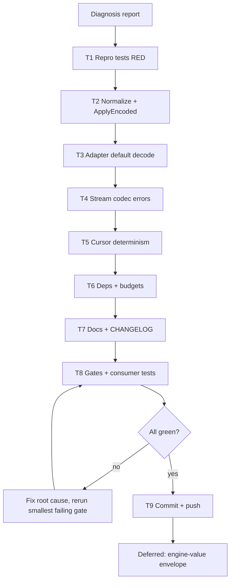

# SUPERB Plan: Metaengine Codec Boundary Repair (first slice)

> **Status:** EXECUTING (created 2026-10-23 17:31 CEST)
> **Owner ruling:** go-codec is a **Tier -1 substrate**, not an external leaf dependency.
> **Parent diagnosis:** `docs/status/2026-10-23_17-20_metaengine-go-codec-tier-minus-one-gap-status.md`
> **Scope:** correctness only. No on-disk format change, no breaking API, no engine-value envelope in this slice.

---

## 1. Context: what is actually broken

metaengine was built stdlib-only (ADR-0062) and chose bare JSON engine values plus a `reify` round-trip (ADR-0066), explicitly rejecting stamped values. The 2026-08-06 addendum declared the zero-dependency premise wrong but only re-admitted `record/`. The codec question was never re-opened.

The concrete, user-visible consequences:

1. `Store.ApplyEncoded` and `Store.ApplyEncodedRecord` accept **JSON only**. Events default to **CBOR** (`event.DefaultCodec`), so the library's own default payload cannot feed the encoded entry point.
2. `projectionadapter`'s default decoder uses `json.Unmarshal` (`adapter.go:145`). A CBOR event with no explicit `TypeDecoder`/`EventDecoder` becomes a `Corruption` error and can be dead-lettered.
3. `EncodeStreamValue` discards `json.Marshal` errors (`stream_codec.go:14`); `DecodeStreamValue` silently returns the raw string on any decode failure (`:24`). Write paths in pg/duckdb/mysql/dgraph therefore lose values silently.
4. `Cursor.Encode` uses non-deterministic `json.Marshal` for maps (`cursor.go:35`), so identical cursor values can produce different bytes.
5. Stale comments still claim a "zero-dependency boundary" (`projectionadapter/adapter.go:70`) that the ADR addendum already repealed.

## 2. Pareto framing

### The 1% that delivers 51%

**Make the encoded entry point and the default projection decoder encoding-aware via go-codec.** One shared normalization helper (`AutoDetect` + `TranscodeToJSON`) fixes the actual correctness hole for every direct metaengine consumer and for the default `system` fallback. It changes zero stored bytes.

### The 4% that delivers 64%

The above **plus** stream-codec write errors (stop silent loss) and deterministic cursor encoding (stable bytes). These are small, local, and independently testable.

### The 20% that delivers 80%

The above **plus** dependency/budget wiring, exported-API golden, docs, CHANGELOG, and the full changed-set gate matrix (metaengine, projectionadapter, system, affected engines).

### The other 20% to reach 100%

Deferred by design, because it needs owner rulings on compatibility and appetite:

- stamped engine-value envelope (ADR-0066 reversal) across all engines,
- custom/encrypted codec support for engine values,
- full per-engine audit and JSON-vs-CBOR benchmarks,
- replacing `reify` as the primary cross-engine path.

**Non-goals for this slice:** no change to persisted row bytes, no change to event wire format, no removal of `reify`, no change to `record.Encoding`, no engine envelope.

## 3. Comprehensive task plan (30-100 minutes each)

Sorted by importance x impact / effort. `CV` = customer value.

| #   | Task                                                                                                    | Why / impact                                                                 | Effort | Priority | CV    |
| --- | ------------------------------------------------------------------------------------------------------- | ---------------------------------------------------------------------------- | ------ | -------- | ----- |
| T1  | Add failing repro tests: CBOR through `ApplyEncoded`, CBOR through default adapter, stream error paths   | Proves the bug before touching production code; mutation-grade evidence      | 45m    | P0       | High  |
| T2  | Implement `NormalizeEncoded` / `NormalizeEncodedWithEncoding` and wire `ApplyEncoded*`                  | The 1% fix; go-codec `AutoDetect` + `TranscodeToJSON` at the boundary         | 75m    | P0       | High  |
| T3  | Make `projectionadapter` default decode codec-aware                                                     | Kills the CBOR-to-DLQ trap for zero-config consumers                          | 45m    | P0       | High  |
| T4  | Add `EncodeStreamValueErr` / `DecodeStreamValueErr`; migrate write paths in pg/duckdb/mysql/dgraph      | Stops silent data loss where values are persisted                             | 90m    | P0       | High  |
| T5  | Make `Cursor.Encode` deterministic and add a round-trip test                                            | Stable pagination bytes; safe as a cache key                                  | 30m    | P1       | Medium |
| T6  | Add go-codec as a direct dependency in metaengine + projectionadapter; raise dep budgets                | Makes the Tier -1 substrate explicit in the build graph                       | 30m    | P0       | Medium |
| T7  | Update README, adapter comments, skill refs, FAQ, CHANGELOG                                             | Removes the stale zero-dep claim and documents the new boundary contract      | 60m    | P1       | Medium |
| T8  | Run gates: fmt, tests (incl. consumers), api golden, file-size, duplication, doc-check                   | Proves the change is safe and complete                                        | 90m    | P0       | High  |
| T9  | Commit + push + final status update in this plan                                                       | Durable handoff                                                               | 30m    | P1       | Medium |

## 4. Micro-task plan (max 12 minutes each)

| ID    | Task                                                                                  | Parent | Est. |
| ----- | ------------------------------------------------------------------------------------- | ------ | ---- |
| T1.1  | Read the existing `ApplyEncoded` Ginkgo harness and the adapter test harness            | T1     | 8m   |
| T1.2  | Write `TestApplyEncoded_CBORPayload` (red)                                             | T1     | 10m  |
| T1.3  | Write `TestAdapter_DefaultDecoder_CBOR` (red)                                          | T1     | 10m  |
| T1.4  | Write stream-codec error-path tests (red)                                              | T1     | 10m  |
| T1.5  | Run the three tests and capture the red evidence                                        | T1     | 5m   |
| T2.1  | Define exported normalization API + doc comments                                      | T2     | 10m  |
| T2.2  | Implement sniff -> transcode -> passthrough, with Corruption classification            | T2     | 12m  |
| T2.3  | Wire `ApplyEncoded`                                                                    | T2     | 8m   |
| T2.4  | Wire `ApplyEncodedRecord` using `Record.Encoding` when known                           | T2     | 10m  |
| T2.5  | Unit tests: JSON passthrough, CBOR transcode, empty, raw, invalid CBOR                  | T2     | 12m  |
| T2.6  | Run metaengine codec tests                                                             | T2     | 5m   |
| T3.1  | Add adapter generic decode helper (transcode + json decode)                            | T3     | 10m  |
| T3.2  | Replace the default `json.Unmarshal` path                                              | T3     | 8m   |
| T3.3  | Run adapter tests incl. new CBOR test                                                  | T3     | 6m   |
| T4.1  | Add `EncodeStreamValueErr` + `DecodeStreamValueErr`                                    | T4     | 10m  |
| T4.2  | Deprecate the silent wrappers with precise docs                                        | T4     | 6m   |
| T4.3  | Migrate pgengine write sites                                                           | T4     | 8m   |
| T4.4  | Migrate duckdbengine write sites                                                       | T4     | 8m   |
| T4.5  | Migrate mysqlengine write sites                                                        | T4     | 8m   |
| T4.6  | Migrate dgraphengine write sites                                                       | T4     | 8m   |
| T4.7  | Run the four engine test suites (build at minimum)                                     | T4     | 12m  |
| T5.1  | Use `json.Deterministic(true)` in `Cursor.Encode`                                      | T5     | 5m   |
| T5.2  | Add map-cursor determinism test                                                        | T5     | 8m   |
| T6.1  | `go mod tidy` metaengine                                                               | T6     | 8m   |
| T6.2  | `go mod tidy` projectionadapter                                                        | T6     | 8m   |
| T6.3  | Raise `DEP_BUDGET` entries and comments                                                | T6     | 7m   |
| T6.4  | Run `check-arch`                                                                       | T6     | 8m   |
| T7.1  | Update `metaengine/README.md` encoding section                                         | T7     | 12m  |
| T7.2  | Update `projectionadapter` boundary comment and skill refs                             | T7     | 10m  |
| T7.3  | Add FAQ entry for the CBOR/DLQ symptom                                                 | T7     | 8m   |
| T7.4  | Add CHANGELOG `[Unreleased]` entry                                                     | T7     | 8m   |
| T7.5  | Note stream-value + boundary contract in `docs/WIRE-FORMAT-KEYS.md` if applicable      | T7     | 10m  |
| T8.1  | `nix fmt`                                                                              | T8     | 12m  |
| T8.2  | Regenerate API golden                                                                  | T8     | 10m  |
| T8.3  | Run api-stability meta-tests                                                           | T8     | 8m   |
| T8.4  | Run metaengine tests                                                                   | T8     | 10m  |
| T8.5  | Run projectionadapter tests                                                            | T8     | 8m   |
| T8.6  | Run system tests                                                                       | T8     | 12m  |
| T8.7  | Build/test pgengine, mysqlengine, duckdbengine, dgraphengine, bigtableengine            | T8     | 12m  |
| T8.8  | Run file-size and duplication gates                                                    | T8     | 8m   |
| T8.9  | Run doc-check on touched docs                                                          | T8     | 8m   |
| T8.10 | Verify no persisted-format changes (diff audit)                                        | T8     | 8m   |
| T9.1  | Append execution results to this plan                                                  | T9     | 8m   |
| T9.2  | Commit (detailed message)                                                              | T9     | 8m   |
| T9.3  | Push                                                                                   | T9     | 5m   |

## 5. Execution graph



## 6. Verification matrix

| Area                    | Command                                                                 | Required result |
| ----------------------- | ----------------------------------------------------------------------- | --------------- |
| metaengine              | `cd metaengine && GOWORK=off go test ./... -count=1`                    | green           |
| projectionadapter       | `cd metaengine/projectionadapter && GOWORK=off go test ./... -count=1`  | green           |
| system (consumer)       | `cd system && GOWORK=off go test -short ./... -count=1`                 | green           |
| pgengine                | `cd metaengine/pgengine && GOWORK=off go test -short ./... -count=1`    | green           |
| mysqlengine             | `cd metaengine/mysqlengine && GOWORK=off go test -short ./... -count=1` | green           |
| duckdbengine            | `cd metaengine/duckdbengine && GOWORK=off go test -short ./... -count=1`| green           |
| dgraphengine            | `cd metaengine/dgraphengine && GOWORK=off go test -short ./... -count=1`| green           |
| bigtableengine          | `cd metaengine/bigtableengine && GOWORK=off go test -short ./... -count=1` | green        |
| API surface             | `cd cmd/api-stability && GOWORK=off go run . --update` + meta-tests     | golden updated  |
| Architecture            | `nix run .#check-arch`                                                  | green           |
| File size               | `nix run .#check-file-size`                                             | green           |
| Duplication             | `nix run .#check-duplication`                                           | green           |
| Docs                    | `cd cmd/doc-check && GOWORK=off go run . ../../SKILL.md ...`            | zero warnings   |

## 7. Verschlimmbessern guard

1. **No stored-byte changes.** The normalization runs on ingress only; engine rows, EventLog entries, and replication payloads keep their existing JSON representation.
2. **No API removals.** `EncodeStreamValue`/`DecodeStreamValue` keep working; they become documented legacy wrappers. New behavior arrives through additive `*Err` functions.
3. **No broad engine refactor.** Only write sites that can propagate errors are migrated. Read sites keep their fallback contract and are pinned by tests instead of rewritten.
4. **No interface changes** to `StreamLogBackend`, `Engine`, or `query`.
5. **Red-then-green.** Every production change is preceded by a failing test in T1.
6. **One concern per commit.** If the gate matrix surfaces an unrelated pre-existing red, it is recorded, not "fixed" opportunistically.

## 8. Open owner questions (deferred, not blocking this slice)

1. Should the stamped engine-value envelope replace bare JSON (ADR-0066 reversal), and with what dual-read window?
2. Do any deployments require byte-identical legacy rows forever?
3. Is custom/encrypted codec support in scope for read-model values?

---

## 9. Execution log

> Appended during execution. See §10 for the final verification matrix.

_(empty at plan creation)_

### 9.1 RED evidence (T1, before any production edit)

`metaengine` (Ginkgo, `encoded_codec_test.go`):

```
[FAIL] ApplyEncoded payload codecs [It] applies a CBOR payload with a sniffed encoding
  Expected success, but got an error:
  batch apply on memory: ... [corruption:metaengine.apply.encoded_decode]
  decode TaskCreated: json decode into TaskCreated:
  json: unable to unmarshal JSON number into Go time.Time within "/At"
[FAIL] ApplyEncoded payload codecs [It] applies a CBOR payload stamped on the Record
  (same failure)
214 Passed | 2 Failed
```

`metaengine/projectionadapter` (`adapter_default_codec_test.go`):

```
--- FAIL: TestAdapter_DefaultDecode_Codecs/json
    Handle(json) = ... collection poisoned by fold panic:
    reflect: Call using map[string]interface {} as type projectionadapter_test.CounterIncremented
--- FAIL: TestAdapter_DefaultDecode_Codecs/cbor
    Handle(cbor) = [corruption:projectionadapter.decode_payload]
    projectionadapter: decode payload for CounterIncremented:
    jsontext: invalid character '\xa2' at start of value
```

The JSON sub-case is the important one: the documented `map[string]any`
zero-config default was ALREADY broken for every typed fold, independent of
CBOR. That killed the "decode to a generic map" plan before it shipped.

### 9.2 Two design corrections made during execution (against this plan's text)

1. **No schema-free CBOR→JSON normalization.** §1/T2 assumed `AutoDetect` +
   `TranscodeToJSON` was the fix. The RED run proved it lossy: go-codec's
   canonical CBOR encodes `time.Time` as an untagged epoch integer
   (`EncOptions.Time = TimeUnixDynamic`), so the transcoded JSON holds a number
   that `encoding/json` refuses to unmarshal into `time.Time`. A schema-free
   transcode therefore cannot be the ingress normal form. Final design: a
   private `encodedPayload{raw, encoding}` pipeline marker; each fold decodes
   with `codec.ForEncoding(encoding)` into its own sample type. JSON keeps the
   historical `jsontext.Value` marker, so EventLog/replication/replay paths are
   untouched and the public `EventInput.Payload … jsontext.Value` contract holds.
   The exported `NormalizeEncoded*` helper was dropped (never released); it would
   have shipped the lossy behaviour as API.
2. **The adapter delegates instead of decoding.** §3 planned a generic
   transcode-then-`json.Unmarshal`. The RED output showed the map intermediate is
   what breaks typed folds, so the no-decoder path now calls
   `Store.ApplyEncodedRecord` with the raw bytes. Decode failures stay
   Corruption-classified because the encoded fold path now wraps its own decode
   errors with `errorfamily.WrapCorruption` (`metaengine.apply.encoded_decode`).

### 9.3 What shipped (per task)

| Task | Result |
| ---- | ------ |
| T1 | 3 new test files: `metaengine/encoded_codec_test.go` (Ginkgo: CBOR sniffed, CBOR stamped, JSON regression, non-JSON/CBOR rejection), `metaengine/projectionadapter/adapter_default_codec_test.go` (JSON + CBOR through a nil decoder), `metaengine/stream_codec_test.go` (encode/decode error paths + legacy fallback), `metaengine/cursor_deterministic_test.go` |
| T2 | `metaengine/encoded.go`: `encodePayload` (AutoDetect / `Record.Encoding`), `encodedPayload` marker, `decodeJSONFoldPayload`, `decodeEncodedFoldPayload`, `corruptionDecodeError`; both `ApplyEncoded*` wired |
| T3 | `projectionadapter/adapter.go`: no-decoder path → `ApplyEncodedRecord`; stale "zero-dependency boundary" and "map[string]any" docs corrected |
| T4 | `EncodeStreamValueErr`/`DecodeStreamValueErr`; `EncodeStreamValue` deprecated (still exact-behaviour); write sites migrated in pg (`copyAppend`, `streamInsertBatch`), duckdb, mysql, dgraph; dgraph `StreamAppendExpected`'s ignored `json.Marshal` error fixed |
| T5 | `Cursor.Encode` → `json.Marshal(v, json.Deterministic(true))` |
| T6 | `metaengine/go.mod`: go-codec v0.3.2 direct (pulls error-family v0.12.0, aligning the module with event/ and projectionadapter); `DEP_BUDGET[metaengine]` 7 → 8 with rationale |
| T7 | `metaengine/README.md` (encodings + toolchain + ApplyEncoded), recipes §"Encoded Applies" (both claims were wrong), modules.md one-liner, FAQ entry for the CBOR/DLQ symptom, CHANGELOG Fixed entry |
| T8 | See §9.4 |
| T9 | this log + commit |

**Deliberately NOT changed:** persisted bytes (event wire format, engine rows,
EventLog payloads), `vector_binary.go`, `keycodec/`, `layout_fingerprint.go`,
read-side `DecodeStreamValue` call sites (their raw-string fallback is pinned by
a test instead), and `reify`.

### 9.4 Gate matrix (final run)

| Gate | Command | Result |
| ---- | ------- | ------ |
| metaengine | `GOWORK=off go test ./... -count=1` | green (216 specs + packages) |
| projectionadapter | `GOWORK=off go test ./... -count=1` | green |
| system | `GOWORK=off go test -short ./... -count=1` | green |
| pg / duckdb / mysql / dgraph / sqlite / bigtable engines | `GOWORK=off go test -short ./... -count=1` | green |
| builds | `GOWORK=off go build ./...` in all 8 changed modules | green |
| API surface | `cmd/api-stability --update` + `TestEvery` | golden +2 exports (`EncodeStreamValueErr`, `DecodeStreamValueErr`), meta-tests green |
| layers/budgets | `scripts/check-module-layers.sh` | green |
| error taxonomy | `scripts/check-error-taxonomy.sh` | green (542 codes, 4 new documented) |
| doc references | `cmd/doc-check … SKILL.md references/*.md AGENTS.md` | green (1349 refs) |
| recipes compile | `go test -run TestRecipes ./cmd/doc-check` | green |
| formatting | `nix fmt` | applied |

**Pre-existing reds found by the matrix (NOT caused by this change, NOT
touched — foreign in-flight work):**

- `check-file-size`: `system/adapter_event.go` 351 lines, `metaengine/layout.go`
  360 lines (uncommitted edits from a parallel session), and
  `metaengine/sqliteengine/engine.go` grown 663 → 668 against its ratchet.
- `check-duplication`: 4 new clone groups, all outside this change
  (`system/adapter_{command,event}.go`, `system/wal_raw_bytes_pin_test.go` vs
  `queue/conformance/facthelpers.go`, a templ signature group, and
  `metaengine/keycodec/escape.go`).

