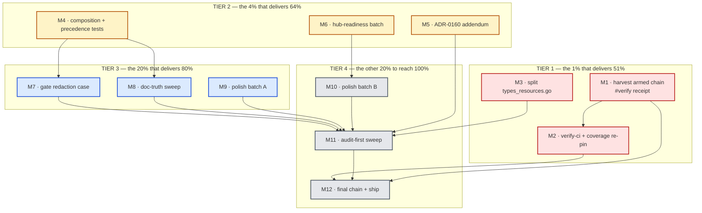

# SUPERB Architecture-Reference Verification Debt & Catalog Tail — Pareto Execution Plan

**Date:** 2026-10-23 18:15 CEST · **Repo:** `~/projects/go-cqrs-lite` · **Branch:** `master`
**Author session:** the A10–A27 execution session (report: `docs/status/2026-10-23_17-31_architecture-completion-a10-a27-session.md`)
**Feature state:** SHIPPED AND PINNED — selections, references modes, hide, `Inspect`/`-check`, leak test, frontmatter specs, docserver route, example, benchmark, docs and decisions all landed 2026-10-17→23 with per-gate receipts. What remains is the **verification tail** (the composed `#verify` proof has still never gone green), **one catalog-local file-size offender**, and the **adoption-readiness polish** the downstream decisions (A26) depend on.

---

## Step 0 — Inputs read before ranking anything

| Input | Why |
|---|---|
| `docs/status/2026-10-23_17-31_architecture-completion-a10-a27-session.md` | this session's own 50 next-items (§f) — the raw material; every item is dispositioned in the coverage matrix below |
| `build/verify-chain-20261023-151354.log` | the ARMED chain (15:13, attempt 60+ at plan time, load 36–177 vs ceiling 10, max-wait ~19:13) — the 51% depends on its outcome or a re-arm |
| `TODO_LIST.md` "Architecture reference HTML export (harvested 2026-10-17)" section | the living backlog rows this plan updates (composed-proof row, A27 receipts) |
| `docs/adr/0160-architecture-reference-selections-kind-id-selectors.md` + `ADR-0159` | the ADRs that need the implementation addendum (M5) and carry the measured-scale addendum already |
| `catalog/AGENTS.md` § architecture | the contracts this plan must not violate (dependency budget FULL, selection/redaction layering, adrKind vocabulary) |
| `scripts/check-file-size.sh` (green today, 62 baselined) | the gate that `catalog/types_resources.go` (359 NEW) violates the moment the baseline re-pins — the split must come first |
| Concurrent sessions: **census** (fleet-cvidence churn), **disk-truth** (authored `bfdec007e`, plan v3 dirty) | both are LIVE on this tree; every tree-changing task here must expect daemon absorption and stability-window refusals |

### Errata — stale claims corrected by this plan

1. **"largest new file ~450, under the 500 ratchet" (2026-10-23 17:31 report §f-context) was a GUESS and was false** — `selection.go` had hit 636 lines. Fixed in-session by the five-file split; the lesson (measure before writing receipts) is encoded as M11's audit-first gate sweep.
2. **"the plan's `examplePaths` step does not apply"** — confirmed again: `catalog/example/` is in-module; this plan does NOT register anything in `flake.nix exampleModules` (root `example/` only).
3. **The 17:31 report's question 2 (authored-history retrofit) is closed by decision here:** the CHANGELOG entries are the canonical narrative; the daemon-absorbed blob history stands. A rebase across interleaved foreign sessions is a verschlimmbesser factory — rejected.

### Explicitly NOT in this plan (deliberate, to avoid a verschlimmbesserung)

| Owner | Work | Why out |
|---|---|---|
| v4↔v5 fork campaign | ~180 `art-dupl:accept` directives / end-of-campaign re-pin | their files, their one-campaign decision (TODO_LIST 🔥 row unchanged) |
| 08-02 plan task 45 | fleet go.sum tidy sweep | merged with the arch-lint triage row; not catalog-local |
| disk-truth session | its own plan v3 (dirty in-tree) | parallel session; pointer only |
| census session | fleet-census evidence + `scripts/census-fleet.sh` | parallel session; the verify-chain must WAIT it out, not fight it |
| consumer repos | hub export-step line, cqrs-htmx/go-appkit config one-liners (17:31 report §f21–24) | OUT-OF-REPO; this plan stamps their rows (M11.3) and builds the in-repo readiness (M6/M7) |
| anyone | pushing to origin | EXPLICITLY IN: the standing instruction orders `git push` after the commit (Step 4 of this plan) |

---

## Step 1 — Pareto breakdown

### The 1% → 51% (do these first, in order)

> **The thesis:** every code artifact of the architecture reference is now pinned by tests and cheap gates, but the repo's own definition of done — the COMPOSED proof — has never gone green for this feature. Until it does, the new public surface (`WithReferences`, `WithHide`, `Inspect`, `LoadExport`, the docserver route) is unproven against the whole repo, and the coverage baseline cannot be honestly re-pinned. Second: the one catalog-local red (`types_resources.go`, 359 NEW) will CI-fail the moment the ratchet re-pins — it is the only gate still owed a code change.

| # | Action | Why it is the 51% |
|---|---|---|
| **M1** | Harvest the armed verify-chain: ride it to green (or re-arm ONCE over a quiet tree), record the `#verify` receipt | the composed proof is the repo's definition of done; 12 targeted gates cannot prove the whole |
| **M2** | `.#verify-ci` + quiet-window `check-coverage --update` + AGENTS coverage line | the second half of the composed proof; the coverage re-pin is only honest inside the window M1 creates |
| **M3** | Split `catalog/types_resources.go` (359 NEW offender) | the only remaining catalog-LOCAL red; `check-file-size` is green today ONLY because the baseline hasn't re-pinned |

### The 4% → 64% (add these)

| # | Action | Why |
|---|---|---|
| **M4** | Redaction composition tests: hide×include, `-spec`+flags precedence, `LoadExport` references-value validation, composed-path leak probe (mutation-verified) | the hub's partner-slice scenario composes ALL the features; a leak through composition is a SECURITY bug, not polish. The layered defense was only ever mutation-verified feature-locally |
| **M5** | ADR-0160 implementation addendum | the ADR predates its implementation; a reader cannot tell what shipped (everything) vs what was ruled out (`contacts`, `x-*`) |
| **M6** | Hub-readiness batch: `BenchmarkInspectLargeCatalog`, `-check -h` exit-contract text, README links + config snippet, SKILL `Inspect` mention | A26's hub adoption runs `Inspect` per source in CI — an unmeasured `Inspect` at 1k/5k is the one unverified cost on that path |

### The 20% → 80% (add these)

| # | Action | Why |
|---|---|---|
| **M7** | Extend `check-architecture-reference` with a redaction fixture case (+ 4th fault injection) | the repo-level gate proves the whole-catalog render; the REDACTED render — the actual new capability — is only proven by unit tests |
| **M8** | Doc-truth sweep: leak-test mutation lesson → gotchas-testing; `/tmp` toolchain repair recipe; `ExportSpec` precedence + allow-list comment naming in catalog/AGENTS; TODO receipt stamps | the session's hardest-won lessons (silent `&&` skip, triple-mutation reality, corrupted shared toolchain) exist only in a status report |
| **M9** | Polish batch A: fold/annotate `renderSelection`↔`renderFixture`, `safeColor`/`safeHref`/`safeImageSrc` trio, `ExportReport.Dropped` boundary doc, `CatalogProvider` immutability comment | keeps the no-new-clones and zero-warning contracts cheap; each is ≤12 min |

### The other 20% → 100% (the tail)

| # | Action | Why |
|---|---|---|
| **M10** | Polish batch B: `title: catalog` sentinel decision, example `-o` flag, docserver-CSP decision doc, docs/status index row, benchmark/extension deferral notes | closes every remaining §f item with either code or a recorded decision — nothing left implicit |
| **M11** | Audit-first gate sweep (duplication, file-size, changelog-symbols, readme-links, doc-check corpus) + consumer-row stamp + errata receipts | the audit runs BEFORE the final chain arm so the composed proof sees the finished tree |
| **M12** | Final quiet-tree re-arm of `verify-chain` + `#verify-ci` + closing receipts + commit/push | arm LAST (the 2026-10-17 lesson); this is the plan's own composed proof |

---

## Step 2 — Comprehensive plan (12 tasks · 30–100 min each)

Sorted by `(impact × customer-value) ÷ effort`. **I** = trust impact; **V** = consumer value; **E** = effort (min).

| ID | Task | Deliverable / done-when | I | V | E | Depends |
|---|---|---|---|---|---|---|
| **M1** | Harvest the armed chain | `#verify` green receipt (or one re-arm + green) recorded with the durable log path | ★★★★★ | ★★★☆☆ | 90 | — |
| **M2** | `#verify-ci` + coverage re-pin | verify-ci green; 6 drifted modules re-pinned in the quiet window; AGENTS line updated | ★★★★★ | ★★☆☆☆ | 60 | M1 |
| **M3** | Split `types_resources.go` | `check-file-size` green with the file under 350; catalog suite + lint green | ★★★★☆ | ★★☆☆☆ | 80 | — |
| **M4** | Composition & precedence tests | 4 new tests (hide×include, spec precedence, references validation, composed leak) — mutation-verified | ★★★★★ | ★★★★☆ | 60 | — |
| **M5** | ADR-0160 addendum | status banner + per-ruling DONE/REJECTED with file:line evidence; ADR gate green | ★★★★☆ | ★★★★☆ | 40 | — |
| **M6** | Hub-readiness batch | Inspect benchmark measured + recorded; `-h` documents exit 1; README/SKILL links green through doc-check | ★★★★☆ | ★★★★★ | 60 | — |
| **M7** | Gate redaction case | gate renders a slice, asserts excluded-name absence + anchor integrity on it; 4th self-test corruption caught | ★★★★☆ | ★★★☆☆ | 50 | M4 |
| **M8** | Doc-truth sweep | gotchas rows landed; AGENTS contracts extended; receipts stamped | ★★★☆☆ | ★★★☆☆ | 40 | M4 |
| **M9** | Polish batch A | clones folded or accept-annotated; boundary docs written; `check-duplication` green | ★★★☆☆ | ★★☆☆☆ | 40 | — |
| **M10** | Polish batch B | every remaining §f item coded or decision-recorded | ★★☆☆☆ | ★★★☆☆ | 40 | M6 |
| **M11** | Audit-first sweep | all cheap gates green over the final tree; consumer rows stamped; nothing implicit left | ★★★★☆ | ★★☆☆☆ | 40 | M3–M10 |
| **M12** | Final composed proof + ship | fresh chain green over the quiet final tree; verify-ci green; receipts; committed AND pushed | ★★★★★ | ★★★☆☆ | 70 | M1–M11 |

**Totals:** 12 tasks · **700 min ≈ 11.7 h**. The 1% (M1–M3) = 230 min and delivers the plan's 51%.

---

## Step 3 — Detailed breakdown (≤12 min per task)

### M1 — Harvest the armed verify-chain (90 min)

| ID | Task | Min |
|---|---|---|
| M1.1 | Read the chain log; classify refusals (load vs tree-changed); confirm single chain (never double-arm) | 10 |
| M1.2 | If max-wait expired under storm: re-arm ONCE with a longer wait; note the old log path in the new receipt | 12 |
| M1.3 | Let `#check-coverage` + `#verify` complete; capture the tail into the receipt | observe |
| M1.4 | On failure: bisect the failing leg; fix ONLY this session's casualties; annotate foreign ones | 12 |
| M1.5 | Record the dated receipt on the TODO_LIST composed-proof row (log path + leg list) | 8 |
| M1.6 | Commit the receipt (doc-only fast path) | 8 |

### M2 — `#verify-ci` + coverage re-pin (60 min)

| ID | Task | Min |
|---|---|---|
| M2.1 | Confirm no other heavy runner is live (the chain finished; census idle) | 10 |
| M2.2 | `nix run .#verify-ci`; capture the tail | 15 |
| M2.3 | Quiet-window `nix run .#check-coverage --update` (load1 < 60 per the script's own warning) | 15 |
| M2.4 | Update the root AGENTS coverage line if numbers moved | 8 |
| M2.5 | Commit | 12 |

### M3 — Split `catalog/types_resources.go` (80 min)

| ID | Task | Min |
|---|---|---|
| M3.1 | Read the file; map type clusters (service/message vs store/entity vs meta/config types) | 10 |
| M3.2 | Choose seams: each result file < 350 lines, minimal new imports, no public API movement (types stay in package `catalog`) | 12 |
| M3.3 | Move cluster 1 (e.g. `types_resources.go` keeps registry-adjacent types); `go build` | 20 |
| M3.4 | Move cluster 2 (new file, e.g. `types_resources_data.go`); `go build` | 15 |
| M3.5 | `check-file-size` green; confirm no other file grew | 8 |
| M3.6 | Full catalog suite + `golangci-lint run ./...` | 8 |
| M3.7 | Stamp the A27 receipt row (offender closed); commit | 7 |

### M4 — Redaction composition & precedence tests (60 min)

| ID | Task | Min |
|---|---|---|
| M4.1 | `TestHideAndReferenceIncludeCompose`: hide owners + references include on the leak fixture — owner names must NOT return via pulled edges | 12 |
| M4.2 | `TestSpecAndFlagPrecedence`: `LoadExport` options + CLI flag selectors compose (spec first, flags extend) — pin at the `Options()` level | 10 |
| M4.3 | `LoadExport` validates `references` against the three-mode enum (typo → Rejection); test the rejection | 10 |
| M4.4 | Composed-path leak probe: hostile name reachable ONLY via an include-pulled edge, in name-only mode, with exclude active — must stay absent | 10 |
| M4.5 | Mutation-verify M4.1/M4.4 (disable the name-recording guard under the include path → red → restore → green) | 10 |
| M4.6 | Lint + fmt + suite; CHANGELOG row; commit | 8 |

### M5 — ADR-0160 implementation addendum (40 min)

| ID | Task | Min |
|---|---|---|
| M5.1 | Re-read the ADR; list every ruling vs what shipped | 10 |
| M5.2 | Write the dated addendum: shipped (selections, references modes, hide, Inspect/-check, frontmatter, docserver route, spellings fix), rejected (`contacts`, `x-*` — unchanged), deviated (`-spec` replaces EventCatalog's `-export/--dir`) | 12 |
| M5.3 | `check-adr-numbering` before AND after | 8 |
| M5.4 | doc-check corpus; commit | 10 |

### M6 — Hub-readiness batch (60 min)

| ID | Task | Min |
|---|---|---|
| M6.1 | `BenchmarkInspectLargeCatalog` (same generator as the export bench); record ms | 12 |
| M6.2 | `catalog-export -h` text documents `-check`'s exit-1 contract | 10 |
| M6.3 | README: run line for `example/architecture` + one-line config snippet beside the `/docs/architecture` route row | 10 |
| M6.4 | SKILL.md architecture paragraph: add `Inspect`/`-check` to the option list | 12 |
| M6.5 | doc-check; record the Inspect number in catalog/AGENTS.md; commit | 16 |

### M7 — Gate redaction case (50 min)

| ID | Task | Min |
|---|---|---|
| M7.1 | Extend `cmd/architecture-fixture` with a second, selected render (partner slice via `ExportSpec` — reuse the leak fixture's hostile name) | 10 |
| M7.2 | Gate asserts on the slice: excluded name absent (occurrence-count), fewer sections, anchors still resolve | 12 |
| M7.3 | `--self-test` gains a 4th corruption (leak the excluded name into the slice → must be caught) | 10 |
| M7.4 | Run the gate + self-test; `#verify` legs unchanged (same app) | 10 |
| M7.5 | Root AGENTS gate row: note the redaction assertions; commit | 8 |

### M8 — Doc-truth sweep (40 min)

| ID | Task | Min |
|---|---|---|
| M8.1 | `docs/agents/gotchas-testing.md`: layered-defense mutation lesson (single-site mutants can stay green; pin composed properties) | 10 |
| M8.2 | `catalog/AGENTS.md`: `/tmp` toolchain repair recipe (chmod -R u+w + trash + re-download) | 8 |
| M8.3 | `catalog/AGENTS.md`: `ExportSpec` precedence contract; `.golangci.yml` allow-list comment names the owning module (taskmanager) | 8 |
| M8.4 | TODO_LIST: stamp M3's receipt; fix any drifted rows this plan's audit surfaces | 6 |
| M8.5 | doc-check corpus; commit | 8 |

### M9 — Polish batch A (40 min)

| ID | Task | Min |
|---|---|---|
| M9.1 | `renderSelection`↔`renderFixture`: fold into one options-variadic helper or accept-annotate the pair | 12 |
| M9.2 | `safeColor`/`safeHref`/`safeImageSrc`: fold the scheme-allow-list core or trailing-annotate the trio | 12 |
| M9.3 | Doc comments: `ExportReport.Dropped` counts structured edges only; `CatalogProvider` immutability is load-bearing for the docserver cache | 8 |
| M9.4 | `check-duplication` + lint; commit | 8 |

### M10 — Polish batch B (40 min)

| ID | Task | Min |
|---|---|---|
| M10.1 | Title sentinel: implement `title: catalog` in `LoadExport` (use the catalog's title) OR record the rejection in catalog/AGENTS.md | 10 |
| M10.2 | Example: `-o` output flag (or a documented CWD note in the doc comment) | 8 |
| M10.3 | docserver CSP: record the keep-as-is decision (no per-route CSP knob) in catalog/AGENTS.md | 8 |
| M10.4 | `docs/status/README.md`: index the 17-31 report (and this plan's outcome when done) | 6 |
| M10.5 | Suite; commit | 8 |

### M11 — Audit-first sweep (40 min)

| ID | Task | Min |
|---|---|---|
| M11.1 | `check-duplication`, `check-file-size`, `check-changelog-symbols`, `check-readme-links` — all green or annotated | 8 |
| M11.2 | doc-check full corpus green | 10 |
| M11.3 | Stamp consumer rows (hub/cqrs-htmx/go-appkit) with the one-liners + this plan's readiness receipts | 8 |
| M11.4 | `git log` audit of the absorbing daemon commits; add pointers where a reader would get lost (or accept, per the 17:31 decision) | 8 |
| M11.5 | Commit stray receipts | 6 |

### M12 — Final composed proof + ship (70 min)

| ID | Task | Min |
|---|---|---|
| M12.1 | Confirm the tree is quiet (concurrent sessions idle or cooperating; daemon caught up) | 8 |
| M12.2 | Re-arm `verify-chain.sh` LAST over the final tree; note the new log path | 12 |
| M12.3 | `#verify` completes green; capture the tail | observe |
| M12.4 | `nix run .#verify-ci` green | 10 |
| M12.5 | Closing receipts on the TODO_LIST composed-proof row (both log paths, dates) | 10 |
| M12.6 | Final commit (detailed message) + `git push` per the standing instruction | 10 |

**Fine-task totals:** ~65 leaves. The 1% (M1–M3) = 20 leaves ≈ 230 min.

---

## Execution graph

**Critical path:** `M1 → M2 → M12` (the verification tail). `M3–M11` are the code/doc lanes and MUST all land before `M12`'s arm — the chain's stability window punishes late edits.

---

## §f coverage matrix (17:31 report's 50 next-items → this plan)

| §f items | Disposition |
|---|---|
| 1–5 (chain, verify-ci, coverage, final tree, receipts commit) | M1, M2, M12 |
| 6 (types_resources split) | M3 |
| 7 (gate redaction case) | M7 |
| 8 (`-check -h`) | M6.2 |
| 9 (empty-element sweep) | closed by the M9.4 audit (writeRef fix already landed; sweep confirms no siblings) |
| 10 (safeX trio) | M9.2 |
| 11 (exists table-drive) | CLOSED-as-lint-covered: the exhaustive lint already forces registration; recorded here, no code |
| 12 (renderSelection fold) | M9.1 |
| 13 (allow-list comment naming) | M8.3 |
| 14 (HideSection vocabulary check) | M4.1's fixture covers owner names; vocabulary constants are typed — closed as typed-by-construction |
| 15 (references validation) | M4.3 |
| 16 (post-receipt gate sweep) | M11.1 |
| 17 (daemon-commit pointers) | M11.4 |
| 18 (status index row) | M10.4 |
| 19 (doc-assertions vs SKILL) | M12.3 (the chain's doc-assertions leg sees the final SKILL) |
| 20 (census-starvation note) | M1.1/M1.2 (chain log records the cause) |
| 21–24 (consumer repos) | OUT-OF-REPO — rows stamped M11.3; readiness built by M6/M7 |
| 25 (consumer CHANGELOGs) | rides the consumer rows (M11.3) |
| 26–27 (README links/snippet) | M6.3 |
| 28 (ADR-0160 addendum) | M5 |
| 29 (leak-test gotcha) | M8.1 |
| 30 (SKILL Inspect) | M6.4 |
| 31 (toolchain repair recipe) | M8.2 |
| 32 (gate row self-test count) | M7.5 |
| 33–36 (fleet-wide reds) | OUT (owners unchanged); receipts land via M1/M2 |
| 37 (Inspect benchmark) | M6.1 |
| 38 (name-only test brittleness) | M4.4's probe replaces the markup assertion with text-presence + link-absence |
| 39 (cache immutability comment) | M9.3 |
| 40 (Dropped boundary doc) | M9.3 |
| 41 (spec+flags precedence pin) | M4.2 |
| 42 (extension alignment) | M4.3 (validation added; doc comment aligned in the same edit) |
| 43 (example `-o`) | M10.2 |
| 44 (generator determinism) | CLOSED-as-deferral: recorded here; a randomized variant only if perf becomes sort-sensitive |
| 45 (gate reuses largeCatalog) | CLOSED-as-deferral: the fixture stays small on purpose (gate speed); recorded |
| 46 (CSP knob) | M10.3 (decision recorded) |
| 47 (title sentinel) | M10.1 |
| 48 (hide×include compose) | M4.1 |
| 49 (exact anchor assert) | M7.2 (the gate asserts exact anchors on the slice) |
| 50 (status index row) | M10.4 |

Every §f item is dispositioned: coded (M3, M4, M6, M7, M9, M10), decided (M5, M8, M10), verified (M1, M2, M11, M12), stamped for consumer repos (M11.3), or closed-with-reasoning in this matrix (11, 14, 44, 45).

---

## Verification protocol (applies to every task)

1. **Before:** `git status` clean for MY files; note concurrent sessions' dirty files and never touch them.
2. **Per change:** formatters (`nix fmt`; direct `golines -w` when treefmt and golangci disagree) → `golangci-lint run <pkg>` → targeted `go test`.
3. **Per tier:** the relevant cheap gates (`check-file-size`, `check-changelog-symbols`, doc-check when docs moved).
4. **Mutation-verify every new test that guards security or a composed property** (M4.5) — and SEE the red output; a silent `source && cmd` chain skips the test entirely.
5. **Commit at every phase boundary** immediately after the last edit (the daemon absorbs within ~2 min); doc-only commits take the repo's doc-only fast path.
6. **Never** `rm`/`git checkout`/`git reset --hard`/plain `mv`; `trash` + `git mv`; build binaries with `-o /tmp/…`.
7. **Push once, at the end (M12.6)** — the standing instruction authorizes it; never mid-plan (the tree must be final).

## Anti-goals (what would make this a verschlimmbesserung)

- **Do NOT rebase history** across the interleaved foreign sessions to "restore" authored messages (17:31 report Q2 — closed).
- **Do NOT re-pin `art-dupl baseline` for foreign mirror twins** — that stays the fork campaign's one-campaign decision.
- **Do NOT touch the census/disk-truth sessions' files** (evidence deletions, plan v3, `scripts/census-fleet.sh`).
- **Do NOT soften the `-check` exit-1 contract** or the leak-test severity — they are the feature's security posture.
- **Do NOT grow any file past 350 lines** while splitting `types_resources.go` (the ratchet is shrink-only for baselined files; new offenders fail CI).
- **Do NOT run heavy commands while a verify-chain waits** — every point of load delays the quiet window the chain needs.
