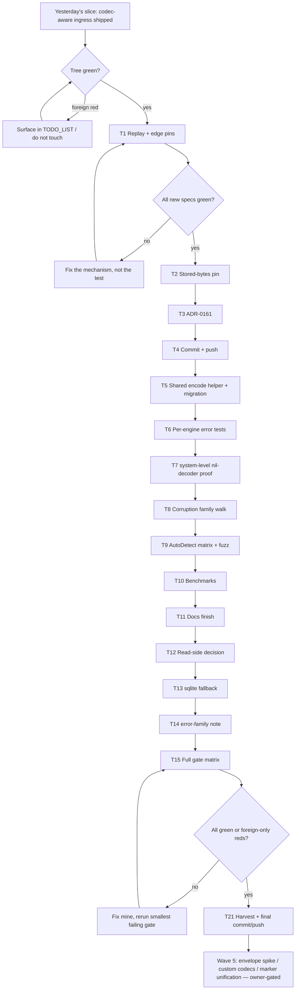

# SUPERB Plan: Metaengine Codec Boundary Completion

> **Created:** 2026-10-24 05:33 CEST
> **Status:** EXECUTING (Scope A)
> **Predecessor:** [`2026-10-23_17-31_SUPERB-metaengine-codec-boundary-repair.md`](2026-10-23_17-31_SUPERB-metaengine-codec-boundary-repair.md) (first slice shipped; its §9.4 is the current truth)
> **Session report:** [`docs/status/2026-10-24_05-27_metaengine-codec-boundary-repair-status.md`](../status/2026-10-24_05-27_metaengine-codec-boundary-repair-status.md)
> **Scope:** finish the codec boundary work started yesterday: prove the risky parts, record the decision, remove the remaining footguns, and deliver.

---

## 1. Context: what already shipped (do not re-plan it)

Yesterday's slice landed and is green:

- `Store.ApplyEncoded` / `ApplyEncodedRecord` accept JSON **and** CBOR; the codec is sniffed (`codec.AutoDetect`) or honored from `Record.Encoding`; each fold decodes with `codec.ForEncoding` into its own sample (`metaengine/encoded.go:47,70,102,180`).
- A zero-config `projectionadapter` delegates raw bytes to `ApplyEncodedRecord` instead of building a `map[string]any` that panicked typed folds (`projectionadapter/adapter.go:148-158`).
- Deterministic decode failures classify as Corruption (`metaengine/encoded.go:205`).
- `EncodeStreamValueErr` / `DecodeStreamValueErr` exist and the pg/duckdb/mysql/dgraph write paths use them; dgraph's ignored `json.Marshal` error is fixed (`metaengine/stream_codec.go:28,62`).
- `Cursor.Encode` is deterministic (`metaengine/cursor.go:38`).
- `metaengine` declares `go-codec v0.3.2` directly; dep budget 7 → 8.
- Docs (README, skill recipes/modules/FAQ), CHANGELOG, taxonomy (4 codes), API golden (+2 exports) are updated.
- The plan's original design (schema-free CBOR→JSON transcode) was **disproved** on `time.Time` and replaced; the correction is recorded in the predecessor plan §9.2.

**Delivery state corrected at plan time:** the foreign `runSuffix` breakage is fixed (`metaengine/pgengine` vets clean), `origin/master` is at `20a95af2c`, and local master is ahead by the status-report commit. The push is therefore unblocked, but the tree still carries a **foreign uncommitted** `CHANGELOG.md` + `TODO_LIST.md` edit (parallel typed-WAL session) that must not be staged by this plan.

What is **not** done is everything that makes the new behavior hard to break again: replay pins for the unexported payload marker, a decision record, a stored-bytes pin, dedupe of the four engine write sites, a system-level proof, measurement, and the read-side footgun.

---

## 2. Pareto framing

### The 1% that delivers 51%: make the risky mechanism provable, then ship

1. **Replay + edge pins for `encodedPayload`.** The marker is an unexported type crossing the public `EventInput.Payload any` boundary. `Verify`, `Backfill`, `DemoteEngine` catch-up and `failover.go` pass it through `Apply`/`dispatchFolds`, which the type switch handles — *reasoned, never executed*. If replay were wrong, projections rebuild wrong and nobody notices until a failover. Nothing else in this plan matters as much.
2. **Deliver what already works.** Master is pushable again; an unshipped fix is a fix that does not exist.

### The 4% that delivers 64%: prevent silent regressions

3. **Stored-bytes pin.** This repo's wire claims are pinned by tests (`system/wal_raw_bytes_pin_test.go`). "The encoded ingress changes no persisted bytes" is currently an argument, not a fact.
4. **ADR-0161.** The codec question was never re-opened after ADR-0062/0066. Without a decision record the next session re-litigates it (this session exists because nobody wrote it down).
5. **Shared engine encode helper + per-engine error tests.** Four engines duplicate a six-line encode block with drifting context strings, and nothing proves the write sites actually propagate the new error.

### The 20% that delivers 80%: prove it in the composition root and measure it

6. `system`-level test that a CBOR event with no decoder reaches a read model (the delegation path is only unit-tested today).
7. Corruption-family walk-through (`errors.Is` on the family through `ApplyError`).
8. `AutoDetect` payload-shape matrix + `encodePayload` fuzz (the sniff is a heuristic; a shape the matrix misses is a silent failure mode).
9. Benchmark the encoded ingress (JSON vs CBOR vs `Apply(struct)`) so the added reflect path is a number, not a worry.
10. Docs finish: `metaengine/COOKBOOK.md` codec contract, FAQ cross-link, projectionadapter surface.
11. Full gate matrix (`#verify-fast`, repo lint, coverage, modsums) rather than the targeted subset.

### The other 20% to reach 100% (needs an owner ruling or a separate wave)

12. Read-side `DecodeStreamValue` hardening (11 call sites, no errors today).
13. `sqliteengine/encoding.go` `fmt.Sprintf("%v")` fallback (same silent-loss class).
14. `go-error-family 0.11 → 0.12` review + changelog note (forced by go-codec).
15. Stamped engine-value envelope (ADR-0066 reversal), custom/encrypted codec support for read-model values, unified pipeline marker, exported `EncodedPayload` for external raw replay, fleet benchmark.

**Non-goals:** no persisted-format change, no breaking API, no interface changes, no touching another session's files, no engine refactor.

---

## 3. Comprehensive task plan (30–100 minutes each)

Sorted by importance × impact / effort, then dependency order. `CV` = customer value. `Wave` = execution grouping.

| #   | Task                                                                                                         | Why it matters                                                                    | Effort | Priority | CV     | Wave |
| --- | ------------------------------------------------------------------------------------------------------------ | --------------------------------------------------------------------------------- | ------ | -------- | ------ | ---- |
| T1  | Replay + edge pins for `encodedPayload` (Verify, Backfill, record-sniff, lying stamp, empty/unknown, []byte)   | The marker crosses a public `any`; replay correctness is the whole point           | 100m   | P0       | High   | 1    |
| T2  | Stored-bytes pin: JSON `ApplyEncoded` leaves EventLog payload + engine rows byte-identical                    | Turns "no format change" from an argument into a test                              | 60m    | P0       | High   | 1    |
| T3  | ADR-0161: encoded ingress decodes with the producer's codec (schema-free transcode rejected)                  | Records the reversal of ADR-0062/0066's codec silence; stops re-litigation         | 60m    | P0       | High   | 1    |
| T4  | Deliver Scope A (fmt, targeted tests, commit, push)                                                           | An unshipped fix does not exist                                                   | 30m    | P0       | High   | 1    |
| T5  | Shared `EncodeStreamValuesErr([]any)` + migration of the 4 engine write paths                                 | Removes 4× duplicated encode block and the context-string drift                    | 90m    | P1       | Medium | 2    |
| T6  | Per-engine write-path error tests (unrepresentable value must fail, not store "")                             | Proves the migrated call sites actually propagate                                  | 60m    | P1       | High   | 2    |
| T7  | `system`-level nil-decoder proof: CBOR event → read model through `system.New`                                | The delegation path is production-shaped and only unit-tested today                | 60m    | P1       | High   | 2    |
| T8  | Corruption-family assertion through `ApplyError` + error-message contract test                                 | A refactor could silently downgrade a deterministic failure to Transient            | 30m    | P1       | Medium | 2    |
| T9  | `AutoDetect` payload-shape matrix (map/array/text/int/float/bool/null) + `encodePayload` fuzz                  | The sniff is a heuristic; untested shapes are silent failure modes                 | 45m    | P1       | High   | 2    |
| T10 | Benchmark: `ApplyEncoded` JSON vs CBOR vs `Apply(struct)` (ns/op, allocs) and record the numbers               | The new reflect path must be a measurement, not a worry                            | 60m    | P2       | Medium | 3    |
| T11 | Docs finish: COOKBOOK codec contract, FAQ cross-link, projectionadapter surface                               | Consumers read COOKBOOK; it says nothing about encodings                           | 60m    | P2       | Medium | 3    |
| T12 | Read-side `DecodeStreamValue` decision: additive `DecodeStreamValueOk` or documented migration plan           | 11 read sites still hide corruption behind a raw-string fallback                   | 60m    | P2       | Medium | 4    |
| T13 | `sqliteengine/encoding.go` `fmt.Sprintf("%v")` fallback: fix or row it with evidence                          | Same silent-loss class, one module over                                            | 45m    | P2       | Medium | 4    |
| T14 | `go-error-family 0.11 → 0.12` review + CHANGELOG note                                                         | The bump was forced by go-codec; nobody reviewed the delta                         | 45m    | P2       | Low    | 4    |
| T15 | Full gate matrix: `#verify-fast`, repo `#lint`, `#check-coverage`, `#check-modsums`                          | Closes the "targeted subset" gap from the last session                             | 90m    | P1       | High   | 4    |
| T16 | Stamped engine-value envelope spike (ADR-0066 reversal): design + cost, no code                                        | The deferred question that decides whether `reify` survives                          | 100m   | P3       | Low    | 5    |
| T17 | Custom/encrypted codec scope decision for read-model values                                                   | Owner-gated; affects the envelope design                                           | 60m    | P3       | Low    | 5    |
| T18 | Unify the two pipeline markers (`jsontext.Value` + `encodedPayload`)                                          | Two markers are a future split brain; needs a compat story first                   | 90m    | P3       | Low    | 5    |
| T19 | Export an `EncodedPayload` constructor for external raw-CBOR replay                                          | Only if a consumer needs it; today nobody does                                     | 45m    | P3       | Low    | 5    |
| T20 | Fleet benchmark of the encoded ingress across engines                                                         | Useful, but only after T10 exists                                                  | 60m    | P3       | Low    | 5    |
| T21 | Harvest this plan into `TODO_LIST.md` (docs-health HARVEST)                                                   | The living backlog, not the snapshot, is the source of truth                       | 30m    | P2       | Medium | 4    |

**Wave map:** Wave 1 = T1–T4 (ship), Wave 2 = T5–T9 (harden), Wave 3 = T10–T11 (measure + document), Wave 4 = T12–T15 + T21 (close the gaps), Wave 5 = T16–T20 (owner-gated).

---

## 4. Micro-task plan (max 12 minutes each)

| ID    | Task                                                                                  | Parent | Est. |
| ----- | ------------------------------------------------------------------------------------- | ------ | ---- |
| T1.1  | Read `TestEventLog_ReplayAndVerify` + `Backfill` fixtures to copy the harness shape     | T1     | 8m   |
| T1.2  | Write replay test: CBOR `ApplyEncoded` + `WithEventLog` + `Verify`                     | T1     | 12m  |
| T1.3  | Write replay test: `Backfill`/`DemoteEngine` path carries the marker                    | T1     | 12m  |
| T1.4  | Write record-sniff test (`EncodingUnknown` + CBOR through `ApplyEncodedRecord`)         | T1     | 8m   |
| T1.5  | Write lying-stamp test (JSON stamp + CBOR bytes → Corruption)                           | T1     | 8m   |
| T1.6  | Write empty-payload + unknown-codec family assertions                                   | T1     | 8m   |
| T1.7  | Write `[]byte`-sample fold test (raw CBOR bytes delivered)                              | T1     | 8m   |
| T1.8  | Run the new specs, fix only genuine failures                                            | T1     | 10m  |
| T2.1  | Read the EventLog payload accessors + memory engine row API                             | T2     | 8m   |
| T2.2  | Capture pre-change bytes for a fixed JSON payload into a golden file                    | T2     | 10m  |
| T2.3  | Assert EventLog payload bytes unchanged after `ApplyEncoded`                            | T2     | 8m   |
| T2.4  | Assert memory-engine row value bytes unchanged for the same payload                     | T2     | 10m  |
| T2.5  | Mutation-verify the pin (break the marker path, see red, restore)                       | T2     | 10m  |
| T3.1  | Read ADR-0062 + ADR-0066 + the ADR index conventions                                    | T3     | 10m  |
| T3.2  | Run `check-adr-numbering` before writing (claim 0161)                                   | T3     | 4m   |
| T3.3  | Draft the ADR: context, decision, alternatives (transcode rejected), consequences         | T3     | 12m  |
| T3.4  | Add the ADR index row + link from the codec docs                                        | T3     | 8m   |
| T3.5  | Run `check-adr-numbering` after writing                                                 | T3     | 4m   |
| T4.1  | `nix fmt` on changed files (treefmt)                                                    | T4     | 8m   |
| T4.2  | Run metaengine + projectionadapter + system suites                                      | T4     | 12m  |
| T4.3  | Stage only this plan's files; verify no foreign file is staged                          | T4     | 6m   |
| T4.4  | Commit with a detailed message                                                          | T4     | 6m   |
| T4.5  | Push master; verify `origin/master` == HEAD                                             | T4     | 5m   |
| T5.1  | Design the helper signature (`[]any → []string, error`, label parameter)                 | T5     | 8m   |
| T5.2  | Implement + unit-test the helper in `metaengine/stream_codec.go`                        | T5     | 12m  |
| T5.3  | Migrate pg `copyAppend`                                                                | T5     | 8m   |
| T5.4  | Migrate pg `streamInsertBatch`                                                         | T5     | 8m   |
| T5.5  | Migrate duckdb (2 sites)                                                               | T5     | 10m  |
| T5.6  | Migrate mysql (2 sites)                                                                | T5     | 10m  |
| T5.7  | Migrate dgraph (2 sites)                                                               | T5     | 10m  |
| T5.8  | Build all 4 engine modules                                                             | T5     | 8m   |
| T6.1  | Design the per-engine test shape (unrepresentable value via `StreamAppend`)             | T6     | 8m   |
| T6.2  | Add the pg test (unit-level, no live DB needed if the encode fails first)               | T6     | 10m  |
| T6.3  | Add the duckdb test                                                                     | T6     | 10m  |
| T6.4  | Add the mysql test                                                                      | T6     | 10m  |
| T6.5  | Add the dgraph test                                                                     | T6     | 10m  |
| T6.6  | Run the four module suites `-short`                                                     | T6     | 12m  |
| T7.1  | Read `system/projection_wiring.go` + an existing system projection test                 | T7     | 10m  |
| T7.2  | Write the CBOR-event/no-decoder system test                                             | T7     | 12m  |
| T7.3  | Prove it fails if the adapter delegation is reverted (mutation)                         | T7     | 10m  |
| T7.4  | Run system `-short`                                                                     | T7     | 8m   |
| T8.1  | Assert the family via `errors.Is`/`errorfamily` classification through `ApplyError`      | T8     | 10m  |
| T8.2  | Assert the stable message prefix (`decode <type>`)                                      | T8     | 8m   |
| T8.3  | Run the metaengine codec specs                                                          | T8     | 6m   |
| T9.1  | Table-drive `AutoDetect` over 7 CBOR shapes + 4 JSON shapes                             | T9     | 12m  |
| T9.2  | Add `encodePayload` fuzz target (arbitrary bytes: JSON marker or Corruption, never panic) | T9   | 12m  |
| T9.3  | Run fuzz for a bounded time and record the result                                       | T9     | 8m   |
| T10.1 | Read `metaengine/encoded_bench_test.go` for the existing harness                         | T10    | 8m   |
| T10.2 | Add JSON vs CBOR vs `Apply` benchmarks                                                  | T10    | 12m  |
| T10.3 | Run with `-benchtime` fixed and record ns/op + allocs                                    | T10    | 10m  |
| T10.4 | Write the numbers into the plan/README                                                  | T10    | 8m   |
| T11.1 | Read `metaengine/COOKBOOK.md` structure                                                 | T11    | 8m   |
| T11.2 | Add the codec contract section (JSON/CBOR, stamps, custom codecs out of scope)           | T11    | 12m  |
| T11.3 | Cross-link the FAQ entries (CBOR/DLQ ↔ time.Time drift)                                  | T11    | 6m   |
| T11.4 | Note the delegation contract on the projectionadapter surface                            | T11    | 8m   |
| T11.5 | Run `cmd/doc-check` on the touched docs                                                  | T11    | 10m  |
| T12.1 | Inventory the 11 `DecodeStreamValue` call sites and classify each                        | T12    | 12m  |
| T12.2 | Decide additive `DecodeStreamValueOk` vs a documented migration plan                     | T12    | 8m   |
| T12.3 | Implement or write the plan section, with tests                                           | T12    | 12m  |
| T13.1 | Read `metaengine/sqliteengine/encoding.go` and its callers                               | T13    | 8m   |
| T13.2 | Fix the fallback to return an error, or row it with evidence                             | T13    | 12m  |
| T13.3 | Run sqliteengine `-short`                                                                | T13    | 8m   |
| T14.1 | Diff error-family v0.11.0 vs v0.12.0 release notes                                       | T14    | 10m  |
| T14.2 | Add the CHANGELOG note if the bump changes behavior                                      | T14    | 8m   |
| T15.1 | `nix run .#verify-fast`                                                                  | T15    | 12m  |
| T15.2 | `nix run .#lint`                                                                         | T15    | 12m  |
| T15.3 | `nix run .#check-coverage`                                                               | T15    | 12m  |
| T15.4 | `nix run .#check-modsums`                                                                | T15    | 12m  |
| T15.5 | Record every red, classified mine vs foreign                                              | T15    | 8m   |
| T16–T20 | Spike/decision tasks (owner-gated; see §7)                                             | §7     | 12m each |
| T21.1 | Harvest Scope B/C rows into `TODO_LIST.md` (only when the file is clean)                 | T21    | 12m  |
| T21.2 | Verify the TODO_LIST diff contains only my rows                                          | T21    | 6m   |

---

## 5. Execution graph

---

## 6. Verification matrix

| Area | Command | Required |
| ---- | ------- | -------- |
| metaengine | `cd metaengine && GOWORK=off go test ./... -count=1` | green |
| projectionadapter | `cd metaengine/projectionadapter && GOWORK=off go test ./... -count=1` | green |
| system | `cd system && GOWORK=off go test -short ./... -count=1` | green |
| engines | `cd metaengine/{pg,duckdb,mysql,dgraph,sqlite,bigtable}engine && GOWORK=off go test -short ./... -count=1` | green |
| escape/fuzz | `GOWORK=off go test -run TestEncodePayload -fuzz FuzzEncodePayload -fuzztime 20s .` | no crash, no invariant break |
| API surface | `cd cmd/api-stability && GOWORK=off go run . --update && GOWORK=off go test -run TestEvery .` | golden intentional |
| ADR numbering | `nix run .#check-adr-numbering` | green |
| layers | `bash scripts/check-module-layers.sh` | green |
| taxonomy | `bash scripts/check-error-taxonomy.sh` | green |
| docs | `cd cmd/doc-check && GOWORK=off go run . ../../SKILL.md ../../.agents/skills/go-cqrs-lite/references/*.md ../../AGENTS.md` | zero warnings |
| formatting | `nix fmt` | no diff after |
| full | `nix run .#verify-fast` (and `#verify` when load permits) | green or foreign-only reds recorded |

---

## 7. Verschlimmbessern guard

1. **No persisted-byte change.** No marker reaches an engine; no EventLog format change. T2 pins it.
2. **No breaking API.** T5 adds a helper; T12 may add an additive function. Nothing removed or re-signed.
3. **No touching foreign work.** `CHANGELOG.md` and `TODO_LIST.md` currently carry a parallel session's uncommitted edits; this plan stages only its own files. If a foreign red appears, it is recorded, never "fixed".
4. **RED-first or mutation-verified.** New behavior gets a test that fails before the change; pure pins get mutated (break the code, watch the pin go red, restore).
5. **One concern per commit, committed at the phase boundary** (the auto-commit daemon will otherwise absorb the tree; that exact race already cost yesterday's authored commit).
6. **No speculative rewrites.** The envelope, marker unification and custom-codec work are spike/decision tasks only; no code lands without an owner answer.
7. **No benchmarks in gates.** T10 numbers are recorded, not enforced; machine noise is not a regression signal.
8. **Do not re-plan shipped work.** §1 is the boundary; anything already there is out of scope.

---

## 8. Risks

| Risk | Mitigation |
| ---- | ---------- |
| Auto-commit daemon races the staging (happened yesterday) | Stage + commit immediately at each phase boundary; verify `git status` after |
| Foreign uncommitted `CHANGELOG.md`/`TODO_LIST.md` get swept into my commit | Explicit path staging only; verify with `git diff --cached --name-only` |
| `Verify`/`Backfill` replay of the marker exposes a design gap | T1 runs first; if replay is broken, fix the marker before any other task |
| ADR number collision with a parallel session | `check-adr-numbering` before and after writing |
| Benchmark noise read as a regression | Fixed `-benchtime`, single machine, record load; no gate |
| `DecodeStreamValueOk` invites a wide migration | Additive only, no call-site migration in this wave without an owner decision |
| Test-suite runtime creep (metaengine suite already 30–50 s) | Put new pins in focused files; use `-ginkgo.focus` during iteration |

---

## 9. Backlog sync / errata

- **Errata (predecessor plan §9.2):** the CBOR→JSON transcode design was wrong (`time.Time`). Do not revive it; the ADR (T3) records why.
- **Errata:** yesterday's status report says master is blocked by `runSuffix`; that is now fixed and pushed (`origin/master = 20a95af2c`). The status report is a snapshot and stays as written.
- **TODO_LIST harvest is deferred (T21)** because the file currently carries a foreign uncommitted edit. Harvest as soon as it is clean.
- **Not re-planned:** typed WAL (A11–A13), keycodec v2 adoption, the planned-path integration reds — all owned by other sessions and already rowed.

---

## 10. Owner-gated questions

1. **Envelope (ADR-0066 reversal):** adopt a stamped engine-value envelope? If yes, what dual-read window is acceptable?
2. **Custom/encrypted codecs for read-model values:** in scope, or permanently out (JSON/CBOR only)?
3. **Read-side `DecodeStreamValue`:** is silent raw-string fallback acceptable forever, or should the engines get a two-value API and a migration window?

---

## 11. Execution log

_(appended during execution)_
