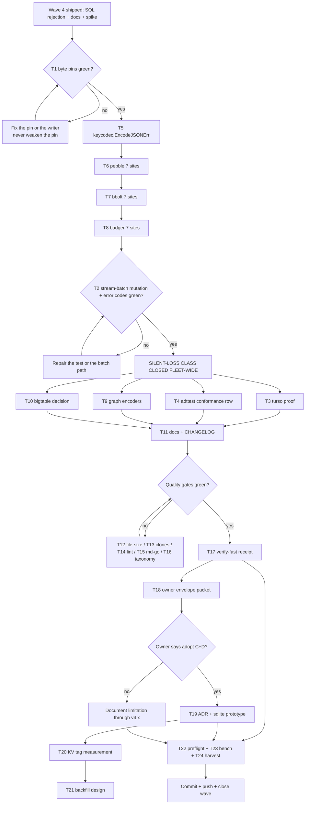

# SUPERB Plan: Value-Integrity Closure + Gate Unblock

> **Created:** 2026-10-24 12:09 CEST (Saturday)
> **Status:** READY FOR EXECUTION (Wave 1 armed; Wave 4 owner-gated)
> **Predecessors:**
> [`2026-10-24_05-33_SUPERB-metaengine-codec-boundary-completion.md`](2026-10-24_05-33_SUPERB-metaengine-codec-boundary-completion.md)
> (waves 1–4 executed; §11.7/§11.8 are the receipts; §12 is the envelope spike),
> [`2026-10-23_17-31_SUPERB-metaengine-codec-boundary-repair.md`](2026-10-23_17-31_SUPERB-metaengine-codec-boundary-repair.md)
> **Source report:**
> [`docs/status/2026-10-24_12-00_metaengine-codec-boundary-wave4-and-t16-spike-status.md`](../status/2026-10-24_12-00_metaengine-codec-boundary-wave4-and-t16-spike-status.md)
> (its §f 1–50 is the input backlog for this plan).
> **Format note:** this plan is Markdown with a Mermaid execution graph, per the
> dispatching instruction. The `pareto-planning` skill's default is HTML; the
> explicit operator instruction wins and is not propagated back into the skill.

---

## 1. Why this plan exists (context a fresh session needs)

Waves 1–4 shipped codec-aware ingress, replay pins, ADR-0161, a batch encode
helper, per-engine write-path tests, a system-level proof, benchmarks, docs, and
a SQL write-path rejection for `sqliteengine`/`turso`. The 2026-10-24 12:00
status report then found **three claim defects** (all corrected in the tree):

1. the COOKBOOK implied the `fmt.Sprintf("%v")` silent-loss class was fixed
   fleet-wide — it is fixed for SQL engines only;
2. T15 was marked done although the composed `#verify-fast` never ran;
3. the T16 spike cited a "keycodec v2 value family" that does not exist.

So the program is **half-delivered in exactly the place that matters**: the
guarantee exists, the mechanism does not, and the gates that would catch the
gap are red for foreign reasons. This plan closes the mechanism, proves the
existing claims, and unblocks the gates.

### 1.1 The remaining defect, in one line

`keycodec.EncodeJSON` (`metaengine/keycodec/keycodec.go:146`) falls back to
`fmt.Sprintf("%v", v)` when a value cannot be marshalled. Three LSM engines
alias it as their **value** encoder — `pebbleengine/engine.go:248`,
`bboltengine/engine.go:310`, `badgerengine/engine.go:238` — across **21
production write sites** (7 each). A channel, function or cyclic value is
silently stringified into the read model instead of failing.

### 1.2 What is already true (do not re-plan it)

| Shipped | Where |
| ------- | ----- |
| CBOR-aware encoded ingress (producer codec, no transcode) | `metaengine/encoded.go`, ADR-0161 |
| Zero-config projection adapter delegation | `metaengine/projectionadapter/adapter.go:148-158` |
| Stream-codec error API + batch encode | `metaengine/stream_codec.go:28,46,82` |
| SQL write-path rejection (Rejection-classified) | `metaengine/sqliteengine/{encoding,engine,planned,backends,temporal,transaction,stream_log,map_write}.go` |
| Stored-value contract pins + docs | `metaengine/stream_codec_test.go`, COOKBOOK "Stored values" |
| Envelope design spike (no code) | predecessor plan §12 |

### 1.3 Scope boundary (what this plan does NOT include)

`TODO_LIST.md` carries **173 open rows**. This plan re-plans only what the
12:00 report surfaced plus the rows it harvested; re-ranking the whole backlog
would re-dispatch other sessions' active work. Explicitly out of scope, and
left where they live:

- **A9 keycodec-v2 KEY adoption** (pebble/bbolt/badger key grammar, own L-wave) —
  *adjacent file territory; see guard #4 for sequencing.*
- catalog/architecture export work, benchkit ticker fix, typed-WAL follow-ups,
  cqrs-lint rule work, v5 cut rows, release/tagging rows, BDD depth rows.
- The 8 foreign clone groups and 3 foreign file-size offenders are *referenced*
  as blockers (T12–T14) but owned by their sessions.

---

## 2. Pareto framing

### 2.1 The 1% that delivers 51% — make the class mechanical, prove the claims

| Move | Why it alone is half the result |
| ---- | ------------------------------- |
| **T5 — `keycodec.EncodeJSONErr`** | One additive 30-line helper converts "silent stringify" into "fail loudly" for every LSM call site, and it is the exact seam the envelope (T19) needs. Without it, 21 sites need 21 bespoke fixes; with it, three engines are mechanical migrations. |
| **T1 — stored-bytes pins for wave 4** | The wave-4 "no persisted-byte change" statement is currently an argument, not a fact. Two pins make it a fact and protect the release forever. Everything downstream stacks on this. |

### 2.2 The 4% that delivers 64% — close the class across all engines

| Move | Why |
| ---- | --- |
| **T6/T7/T8 — migrate pebble, bbolt, badger (21 sites)** | After these three, every engine either rejects unrepresentable values or (memory) stores Go values verbatim, which cannot lose them. The data-corruption class is then closed fleet-wide, not by family. |
| **T2 — mutation proof of the stream batch** | The all-or-nothing claim is the only guarantee that prevents a *partial* append; it is pinned by a test but never mutation-verified. One revert-run proves the test can fail. |

### 2.3 The 20% that delivers 80% — keep it closed and make the gates usable

| Move | Why |
| ---- | --- |
| **T3/T4** | turso proof (delegation) and a shared `adttest` conformance row so a new engine inherits the invariant instead of re-learning it. |
| **T9/T10** | the graph encoders (mysql/duckdb/pg) and bigtable are the last `%v` fallbacks; leaving them is a split-brain rule ("values must be JSON, except in graphs"). |
| **T11** | docs/CHANGELOG must follow the code in the same wave, or the COOKBOOK lies again. |
| **T12–T17** | three file-size offenders, eight clone groups, repo lint, the broken md-go-validator, the drifting taxonomy generator, and finally the composed `#verify-fast`. Until these close, nobody can prove anything. |
| **T18** | the owner packet: the envelope decision is the only thing that can permanently kill the string-vs-JSON ambiguity. |

### 2.4 The other 20% to reach 100%

T19–T21 (envelope implementation, KV tag measurement, backfill design — all
gated on T18's answer), T22 (wave-start preflight so a `buildflow --fix` can
never again absorb a wave), T23 (the allocation measurement for the batch
encoder), T24 (harvest + close-out).

---

## 3. Comprehensive plan (30–100 min tasks, all TODOs, sorted)

`Wave`: 1 = prove/close the class, 2 = harden + gates, 3 = measure/process,
4 = owner-gated. `CV` = customer value. Sorted by P0→P3, then dependency.

| #   | Task | Why it matters | Effort | Pri | CV | Wave |
| --- | ---- | -------------- | ------ | --- | -- | ---- |
| T1 | Stored-bytes pins: `StreamAppend` + `MapSet`/`MapSetAt` (incl. version row) store byte-identical strings for a fixed representable payload; mutation-verify | Turns wave 4's "no byte change" from an argument into a test | 60m | P0 | High | 1 |
| T2 | Mutation-verify the stream batch all-or-nothing test + add `ErrorCode()` assertions to both rejection codes | A pin that cannot fail is decoration | 45m | P0 | High | 1 |
| T3 | turso delegation proof: run/author a rejection test on `tursoengine` and record the result | The fix reaches turso only by delegation, unverified | 45m | P1 | Medium | 1 |
| T4 | `adttest` conformance row `AssertValueEncodeRejection(t, eng)` wired into sqlite + 3 LSM suites | Future engines inherit the invariant instead of re-learning it | 90m | P1 | High | 2 |
| T5 | `keycodec.EncodeJSONErr` (additive; no deprecation of `EncodeJSON`) + unit tests incl. family assertion | The one mechanism that unblocks 21 sites and the envelope | 60m | P0 | High | 1 |
| T6 | Migrate `pebbleengine` (7 sites) to the error twin + `encode_error_test.go` | Closes 1/3 of the class | 90m | P0 | High | 1 |
| T7 | Migrate `bboltengine` (7 sites) + test | Closes 2/3 | 90m | P0 | High | 1 |
| T8 | Migrate `badgerengine` (7 sites) + test | Closes the class | 90m | P0 | High | 1 |
| T9 | Graph encoder rule (keys stringified vs values must be JSON) + migrate `mysqlengine`/`duckdbengine`/`pgengine` graph encoders | Last `%v` fallbacks outside bigtable; removes a rule split-brain | 100m | P1 | Medium | 2 |
| T10 | `bigtableengine` value encode: migrate or record an explicit, documented exception | Either closes the tail or makes the exception honest | 60m | P2 | Low | 2 |
| T11 | Docs + CHANGELOG for T5–T10 (COOKBOOK engine scope, README, FAQ, `[Unreleased]`) + `doc-check` | Docs must not outrun the code again | 60m | P0 | High | 2 |
| T12 | File-size offenders (3, foreign): confirm ownership, then split `scheduling/sqlstore/store.go` 363, `system/adapter_event.go` 351, `metaengine/layout.go` 360 | Blocks `#check-file-size` for everyone | 90m | P0 | High | 2 |
| T13 | Clone groups (8, foreign): classify, annotate or split, `art-dupl check` green | Blocks `#check-duplication` for everyone | 90m | P0 | High | 2 |
| T14 | Repo lint reds (foreign modules): classify by owner, fix the mechanical ones (`keycodec` godox/gosmopolitan first) | Blocks `#verify-fast` step 5 | 100m | P0 | High | 2 |
| T15 | Repair the `md-go-validator` derivation (missing `pprof` zip in the vendored FOD) + re-run `#check-md-go` | The doc gate has been silently off | 45m | P0 | High | 2 |
| T16 | Fix `generate-error-taxonomy.sh` sentinel attribution + a mutation-tested golden | The generator silently degraded the SENTINEL column | 60m | P1 | Medium | 2 |
| T17 | Run `#verify-fast` end-to-end after T12–T15; record the receipt + classify any residue | The only composed proof that exists | 90m | P0 | High | 3 |
| T18 | Owner packet for the envelope: one-pager with §12's options, the now-measured LSM cost, and the 3 questions; send + record | The ambiguity's only permanent fix is a ruling | 60m | P1 | High | 3 |
| T19 | *(gated)* If approved: ADR (ADR-0066 reversal) + sqlite `value_encoding` prototype (one engine, one read path) | Proves the envelope cost on real code | 100m | P2 | Medium | 4 |
| T20 | *(gated)* KV value-tag measurement: bytes/op, migration steps, dual-read shape | Option D's KV half is unmeasured | 90m | P2 | Low | 4 |
| T21 | *(gated)* Opt-in `store backfill --values` design (never touches the journal) | Migration without a journal rewrite | 60m | P2 | Low | 4 |
| T22 | Wave-start preflight: document + script the "no buildflow/daemon running" check in `docs/agents/gotchas-tooling-build.md` | Prevents another 171-file absorption | 30m | P1 | Medium | 3 |
| T23 | Benchmark `StreamAppend` batch encode (1 and 100 values, allocs/op) + rejection path; record, no gate | The batch helper added an allocation; measure it | 45m | P2 | Low | 3 |
| T24 | Harvest this plan into `TODO_LIST.md`, update plan logs, run docs gates, commit + push | The living backlog is the source of truth | 45m | P0 | High | 3 |

**Sum:** 24 tasks, 1 710 minutes (~28.5 h) of nominal effort. Wave 1 (T1, T2,
T5–T8) is 525 min and delivers the 64 % mark.

---

## 4. Micro-task plan (max 12 min each, all tasks)

| ID | Micro-task | Parent | Est |
| -- | ---------- | ------ | --- |
| T1.1 | Read `system/wal_raw_bytes_pin_test.go` + `metaengine/encoded_internal_test.go` for the pin harness shape | T1 | 8m |
| T1.2 | Capture legacy `StreamAppend` stored bytes for a fixed payload into a golden constant | T1 | 10m |
| T1.3 | Assert the new `StreamAppend` path stores exactly those bytes | T1 | 8m |
| T1.4 | Capture + pin `MapSet` map-value bytes | T1 | 10m |
| T1.5 | Capture + pin `MapSetAt` version-row bytes | T1 | 10m |
| T1.6 | Mutation: revert `StreamAppend` to per-value encode → pin must go RED → restore | T1 | 8m |
| T1.7 | Run the three pins + full sqlite suite | T1 | 8m |
| T2.1 | Mutation: revert `StreamAppend` batch pre-encode → batch test must go RED → restore | T2 | 10m |
| T2.2 | Add `ErrorCode()` assertions for `sqliteengine.encode_value` | T2 | 8m |
| T2.3 | Add `ErrorCode()` assertions for `metaengine.encode_stream_value` | T2 | 8m |
| T2.4 | Run the rejection specs and record both mutations | T2 | 6m |
| T3.1 | Read `tursoengine/helper_test.go` for the constructor/skip pattern | T3 | 8m |
| T3.2 | Write a turso delegation rejection test (MapSet + StreamAppend) | T3 | 10m |
| T3.3 | Run `tursoengine -short` and record whether the libSQL path is skipped | T3 | 10m |
| T3.4 | Document the turso result in the plan log | T3 | 5m |
| T4.1 | Design the `adttest` signature (`AssertValueEncodeRejection(t, eng)`, surface per backend) | T4 | 10m |
| T4.2 | Implement the assertion in `metaengine/adttest` | T4 | 10m |
| T4.3 | Wire it into `sqliteengine` | T4 | 8m |
| T4.4 | Wire it into `pebbleengine` | T4 | 8m |
| T4.5 | Wire it into `bboltengine` | T4 | 8m |
| T4.6 | Wire it into `badgerengine` | T4 | 8m |
| T4.7 | Run `adttest` + all four engine suites | T4 | 10m |
| T5.1 | Read `keycodec/keycodec.go` value helpers + the 21 call sites | T5 | 10m |
| T5.2 | Add `EncodeJSONErr(v any) ([]byte, error)` with a Rejection code `keycodec.encode_value` | T5 | 10m |
| T5.3 | Unit tests: representable value, channel, cyclic map, family + code assertion | T5 | 10m |
| T5.4 | Doc comments: `EncodeJSON` = lenient/key path, `EncodeJSONErr` = value path (no deprecation) | T5 | 6m |
| T5.5 | Regenerate the error taxonomy + run the gate (new code) | T5 | 10m |
| T5.6 | Add the budget/taxonomy rows if the gate demands them | T5 | 8m |
| T6.1 | Read the 7 pebble sites (`engine.go` ×4, `vector.go`, `stream_log.go` ×2) | T6 | 10m |
| T6.2 | Replace the alias block with `encodeJSONErr` where values are written | T6 | 10m |
| T6.3 | Migrate `engine.go` map set/update/version sites | T6 | 12m |
| T6.4 | Migrate `vector.go` metadata site | T6 | 8m |
| T6.5 | Migrate the 2 `stream_log.go` sites (batch: encode-all-first) | T6 | 12m |
| T6.6 | Write `pebbleengine/encode_error_test.go` (map + stream + log) | T6 | 12m |
| T6.7 | Run pebble suite + lint + file-size | T6 | 10m |
| T7.1 | Read the 7 bbolt sites (`backends.go` ×2, `map_backends.go` ×2, `stream_log.go` ×2, `vector.go`) | T7 | 10m |
| T7.2 | Migrate `backends.go` (multimap + log) | T7 | 10m |
| T7.3 | Migrate `map_backends.go` (set + update closure) | T7 | 12m |
| T7.4 | Migrate the 2 `stream_log.go` sites (batch) | T7 | 12m |
| T7.5 | Migrate `vector.go` metadata | T7 | 8m |
| T7.6 | Write `bboltengine/encode_error_test.go` | T7 | 12m |
| T7.7 | Run bbolt suite + lint + file-size | T7 | 10m |
| T8.1 | Read the 7 badger sites (`stream_log.go` ×2, `map_backends.go` ×2, `vector.go`, `backends.go` ×2) | T8 | 10m |
| T8.2 | Migrate the 2 `stream_log.go` sites (batch; file is 348 lines — check headroom) | T8 | 12m |
| T8.3 | Migrate `map_backends.go` (set + update) | T8 | 12m |
| T8.4 | Migrate `backends.go` (multimap + log) | T8 | 10m |
| T8.5 | Migrate `vector.go` metadata | T8 | 8m |
| T8.6 | Write `badgerengine/encode_error_test.go` | T8 | 12m |
| T8.7 | Run badger suite + lint + file-size | T8 | 10m |
| T9.1 | Inventory the 4 graph encoders + their key/value split | T9 | 10m |
| T9.2 | Write the rule down (keys stringified via `%v` are identity; values must be JSON) in the COOKBOOK | T9 | 10m |
| T9.3 | Migrate `mysqlengine/graph.go` to the rule | T9 | 12m |
| T9.4 | Migrate `duckdbengine/graph.go` | T9 | 12m |
| T9.5 | Migrate `pgengine/graph.go` | T9 | 12m |
| T9.6 | Add one graph rejection test per engine (or one shared skip-gated spec) | T9 | 12m |
| T9.7 | Run the three suites `-short` + lint | T9 | 12m |
| T10.1 | Read `bigtableengine/engine.go` encode path + map backend | T10 | 10m |
| T10.2 | Decide: migrate (bigtable has an error-returning surface) or accept-annotate | T10 | 8m |
| T10.3 | Implement the decision | T10 | 12m |
| T10.4 | Test or annotate + run suite | T10 | 10m |
| T11.1 | Update COOKBOOK "Stored values": engine list + evidence links | T11 | 10m |
| T11.2 | Update `metaengine/README.md` codec section with the LSM closure | T11 | 8m |
| T11.3 | FAQ entry: string-that-looks-like-JSON + engine rejection scope | T11 | 10m |
| T11.4 | CHANGELOG `[Unreleased]` rows (Added/Changed/Fixed) | T11 | 10m |
| T11.5 | Run `cmd/doc-check` + `verify-docs.sh` | T11 | 10m |
| T12.1 | Confirm ownership of the 3 offenders (`git log -3 -- <file>`, `pgrep -fa buildflow`) | T12 | 8m |
| T12.2 | Split `metaengine/layout.go` (360 → ≤350) | T12 | 12m |
| T12.3 | Split `system/adapter_event.go` (351 → ≤350) | T12 | 10m |
| T12.4 | Split `scheduling/sqlstore/store.go` (363 → ≤350) | T12 | 12m |
| T12.5 | Run `#check-file-size` → green | T12 | 8m |
| T13.1 | Re-run `art-dupl check` and capture the 8 groups verbatim | T13 | 8m |
| T13.2 | Classify each: intentional twin (annotate) vs real (split) | T13 | 10m |
| T13.3 | Annotate the system adapter pair + adttest pair | T13 | 10m |
| T13.4 | Split or annotate the typed_wal SQL const pair (needs the owner) | T13 | 12m |
| T13.5 | Annotate/split the remaining duckdb/mysql stream_log pairs + keycodec escape pair | T13 | 12m |
| T13.6 | Re-run `art-dupl` → green | T13 | 8m |
| T14.1 | Capture the failing-module list from `#lint` verbatim | T14 | 8m |
| T14.2 | Fix `keycodec/escape.go` godox + `v2_law_test.go` gosmopolitan | T14 | 10m |
| T14.3 | Classify the remaining modules by owner (core/v5, catalog, cmd/cqrs-lint, stack presets…) | T14 | 12m |
| T14.4 | Fix the mechanical wrapcheck class in `core/v5/kv` (11 issues) if unowned | T14 | 12m |
| T14.5 | Re-run `#lint` and record what remains + owners | T14 | 10m |
| T15.1 | Reproduce the derivation failure and capture the exact missing zip | T15 | 8m |
| T15.2 | Bump the pinned `md-go-validator` rev or refresh its `vendorHash` | T15 | 12m |
| T15.3 | `nix build .#md-go-validator` → green | T15 | 10m |
| T15.4 | Run `#check-md-go` and record the result | T15 | 10m |
| T16.1 | Read `scripts/generate-error-taxonomy.sh` sentinel logic | T16 | 10m |
| T16.2 | Add a sentinel-verification step (AST/grep before writing `-`) | T16 | 12m |
| T16.3 | Add a mutation-tested golden to `check-error-taxonomy.sh --self-test` | T16 | 12m |
| T16.4 | Regenerate the doc and diff: only intended rows change | T16 | 10m |
| T16.5 | Run the gate + the self-test | T16 | 8m |
| T17.1 | Preflight: load average + no buildflow/daemon running | T17 | 8m |
| T17.2 | Run `nix run .#verify-fast` to completion | T17 | 12m |
| T17.3 | If red: classify each remaining finding mine vs foreign | T17 | 12m |
| T17.4 | Record the receipt in this plan's §11 | T17 | 8m |
| T18.1 | Draft the envelope one-pager (options, cost, dual-read window) | T18 | 12m |
| T18.2 | Fold in the measured LSM cost from T6–T8 and T20 | T18 | 10m |
| T18.3 | Send + record the three answers | T18 | 10m |
| T19.1 | *(gated)* Write the ADR draft (ADR-0066 reversal) | T19 | 12m |
| T19.2 | *(gated)* Add `value_encoding` to sqlite planned + base tables | T19 | 12m |
| T19.3 | *(gated)* Dual-read the tagged/untagged value on one read path | T19 | 12m |
| T19.4 | *(gated)* Pin legacy rows read identically + tagged strings survive | T19 | 12m |
| T19.5 | *(gated)* Run sqlite suite + file-size + lint | T19 | 10m |
| T20.1 | *(gated)* Define the KV tag byte layout | T20 | 12m |
| T20.2 | *(gated)* Measure bytes/op impact on pebble/bbolt/badger | T20 | 12m |
| T20.3 | *(gated)* Write the migration steps + dual-read shape | T20 | 12m |
| T20.4 | *(gated)* Record the numbers in §12 of the predecessor plan | T20 | 8m |
| T21.1 | *(gated)* Design the backfill command surface + safety rails | T21 | 12m |
| T21.2 | *(gated)* Write the "never touches the journal" contract | T21 | 10m |
| T21.3 | *(gated)* Add it to the owner packet | T21 | 8m |
| T22.1 | Draft the preflight checklist (pgrep patterns, load gate, tree state) | T22 | 10m |
| T22.2 | Add it to `docs/agents/gotchas-tooling-build.md` | T22 | 10m |
| T22.3 | Optional: a 15-line `scripts/wave-preflight.sh` with `--self-test` | T22 | 12m |
| T23.1 | Write the `StreamAppend` benchmark (1 and 100 values) | T23 | 12m |
| T23.2 | Write the rejection-path benchmark | T23 | 8m |
| T23.3 | Run with fixed `-benchtime` and record ns/op + allocs | T23 | 10m |
| T23.4 | Add the numbers to the plan + COOKBOOK (no gate) | T23 | 8m |
| T24.1 | Harvest new rows (T12–T21) into `TODO_LIST.md` | T24 | 12m |
| T24.2 | Update the status report index + plan log §11 | T24 | 10m |
| T24.3 | Run docs gates + `#check-file-size`/`#check-duplication` | T24 | 12m |
| T24.4 | Commit (path-staged) + push | T24 | 8m |

---

## 5. Execution graph

---

## 6. Verification matrix

| Area | Command | Required |
| ---- | ------- | -------- |
| keycodec | `cd metaengine && GOWORK=off go test ./keycodec/... -count=1` | green |
| metaengine | `cd metaengine && GOWORK=off go test ./... -count=1` + `-race -short` | green |
| sqlite/turso | `cd metaengine/sqliteengine && GOWORK=off go test ./... -count=1`; `cd metaengine/tursoengine && GOWORK=off go test -short ./...` | green |
| LSM engines | `cd metaengine/{pebble,bbolt,badger}engine && GOWORK=off go test ./... -count=1` | green |
| SQL graph engines | `cd metaengine/{pg,duckdb,mysql,dgraph}engine && GOWORK=off go test -short ./...` | green |
| conformance | `cd metaengine/adttest && GOWORK=off go test ./... -count=1` (plus the four engine hooks) | green |
| mutation proofs | revert one line per claim → RED → restore | recorded |
| budgets | `bash scripts/check-module-layers.sh` + `nix run .#check-arch` | green |
| taxonomy | `bash scripts/check-error-taxonomy.sh` + `--self-test` | green |
| docs | `cd cmd/doc-check && GOWORK=off go run . ../../SKILL.md ../../.agents/skills/go-cqrs-lite/references/*.md ../../AGENTS.md` | zero warnings |
| size/dupes | `nix run .#check-file-size`; `art-dupl check . --threshold 3` | green (T12/T13) |
| lint | `nix run .#lint` | green (T14) |
| md-go | `nix run .#check-md-go` | green (T15) |
| api | `nix run .#check-api-stability` | green (new export `EncodeJSONErr` ⇒ golden regen in the same commit) |
| modsums | `nix run .#check-modsums` | green |
| coverage | `nix run .#check-coverage` | green |
| composed | `nix run .#verify-fast` | green or foreign-only reds recorded (T17) |
| formatting | `nix fmt` then `git diff --exit-code` | no diff |

**API-golden note:** `EncodeJSONErr` is a NEW export in `metaengine/keycodec`
inside the `metaengine` module → `cd cmd/api-stability && GOWORK=off go run .
--update` must ride T5's commit (AGENTS.md "API-surface change ⇒ golden regen").

---

## 7. Verschlimmbessern guard (read before touching code)

1. **Additive API only.** Add `EncodeJSONErr`; do **NOT** deprecate or change
   `EncodeJSON` (keys and external consumers legitimately use the lenient path;
   a deprecation would flag `EncodeKeyStr` and every consumer through SA1019).
2. **No persisted-format change in this plan.** T19 is the only place a format
   could change, and it is owner-gated and dual-read. T1's byte pins run FIRST
   so any accidental change is caught before it ships.
3. **Line-count headroom is measured, not hoped.** 2026-10-24 12:10:
   `pebbleengine/engine.go` 684 (baseline 725), `badgerengine/stream_log.go`
   348 (baseline 399), `bboltengine/stream_log.go` 328 (baseline 379). The
   +3–4 lines/site fit. Any file crossing its baseline gets an extraction in
   the same commit — never a `--update-baseline`, except a structural split
   recorded here.
4. **Do not collide with A9 (keycodec-v2 KEY adoption).** It rewrites the same
   alias blocks in the same three engines. This plan does the VALUE error twin
   first (small, mechanical). If A9 starts first, rebase T6–T8 onto it; never
   run both in one commit.
5. **Foreign gates need ownership confirmation first.** T12–T14 check
   `git log -3 -- <file>` and `pgrep -fa buildflow` before editing. If the owner
   is active, record and defer — do not "fix" another session's in-flight work.
6. **RED-first or mutation-verified.** Every new invariant (byte pins, batch
   atomicity, LSM rejection) gets a failing run before it counts.
7. **No benchmarks in gates.** T23 numbers are recorded, never enforced.
8. **One concern per commit, staged by path, committed at each phase boundary.**
   The daemon absorbs the tree within seconds; an uncommitted phase boundary is
   a lost phase boundary.
9. **No new dependencies, no module splits, no interface changes.** Everything
   here fits inside existing modules and budgets.
10. **The memory engine stays untouched.** It stores Go values verbatim; adding
    JSON encoding there would *lose* type information, not preserve it.
11. **Docs follow code in the same wave.** T11 is part of the class-closure
    wave, not a follow-up — the wave-4 report exists because docs ran ahead.

---

## 8. Risks

| Risk | Likelihood | Mitigation |
| ---- | ---------- | ---------- |
| LSM migration grows a baselined file past its baseline | Medium | Headroom table in guard #3; extract a helper if needed; check `#check-file-size` per engine commit |
| A9 keycodec-v2 work lands mid-wave and conflicts | Medium | Guard #4: sequence + rebase rule; do T5–T8 as one small wave |
| `EncodeJSONErr` changes hot-path allocations | Medium | T23 measures; the error is nil on the success path (single extra return) |
| Foreign file splits break an active session | Medium | Guard #5 ownership check; annotate instead of split where the twin is intentional |
| `#verify-fast` still red after T12–T15 (new foreign work) | High | T17 records residue with owners; the component matrix (predecessor §11.8) is the honest fallback |
| Daemon absorbs phase commits | High | Path-staged commit at every boundary; plan log is the durable record |
| Envelope ruling blocked | High | T18 is independent; T19–T21 stay gated and the COOKBOOK keeps the honest gap statement |
| md-go-validator fix requires a pinned-rev bump with unknown hash churn | Medium | T15 stops at "gate green"; if the rev bump pulls other changes, record and defer the bump to its own row |

---

## 9. Owner-gated questions (asked in T18, not answerable here)

1. **Envelope:** adopt §12 option **C+D** (SQL `value_encoding` column + KV value
   tag, one-release dual-read) or stay on **E** (documented limitation) through
   v4.x? This decides T19–T21 and whether `reify` keeps seeing untagged legacy
   rows forever.
2. **`EncodeJSONErr` in v4.x?** Additive helper now (recommended, no breaking
   change) or defer the whole class to v5? Affects whether T6–T8 land this wave.
3. **Wave isolation:** can `buildflow --fix` / the auto-commit daemon be paused
   for a wave (authored history), or is `chore:` absorption the norm (plan log
   is the record)? T22 assumes we cannot pause and documents a preflight.

---

## 10. Errata / corrections carried into this plan

- **21, not 22**, LSM value write sites (7 + 7 + 7); the earlier report said 22.
  Corrected in the status report, TODO_LIST and the predecessor plan.
- **No keycodec "value tag" family exists** (v2 is a key grammar); option D's KV
  half needs a NEW value-tag design. Corrected in predecessor §12.
- **T15 of the predecessor plan is PARTIAL**, not done: the composed gate never
  ran. This plan's T17 closes it.
- **T13 of the predecessor closed 1 of 4 engine families**, not the class; this
  plan's T5–T8 closes the rest.
- **Turso is unverified** (delegation only); T3 verifies it.

---

## 11. Execution log

_(append as tasks land: date, task, evidence command + result, mutation
performed, file:line for the change)_

- **2026-10-24 20:4x — Wave 1 executed (T4–T7; T1–T3 pre-shipped per §1.2):**
  - _Correction (2026-10-25): "T1–T3 pre-shipped" was an overclaim. §1.2
    covers the stream-codec error API (T2's code) and the SQL write-path
    rejection, but NOT T2's all-or-nothing mutation proof (T2.1, done below)
    and NOT T3 (turso delegation proof, done below). T1's sqlite pins landed
    2026-10-25 morning inside auto-commit `79e968998` (see next entry)._
  - **T5** `keycodec.EncodeJSONErr` added (`metaengine/keycodec/keycodec.go`
    `EncodeJSONErr` func, Rejection code `keycodec.encode_value`);
    `EncodeJSON` doc split into lenient-key-path vs value-path guidance (no
    deprecation, per spec). Unit tests pin representable/chan/func/cyclic +
    family + code (`metaengine/keycodec/encode_json_err_test.go`). Verified
    empirically that `encoding/json/v2` (this Go floor) RETURNS ERRORS on
    cyclic values — the cyclic case is covered, not a stack-overflow class.
  - **T4** `adttest.AssertValueEncodeRejection(t, eng)` harness added
    (`metaengine/adttest/value_encode.go`): MapSet + MapUpdate surfaces,
    rerun-safe collection names, pins Rejection family AND the canonical
    `keycodec.encode_value` code. sqliteengine intentionally NOT wired to the
    harness — it keeps its stronger dedicated specs with the
    `sqliteengine.encode_value` code (predates the shared helper; migrating
    that code is v5-envelope territory, not Wave 1).
  - **T6/T7** all 21 LSM value sites switched to `EncodeJSONErr`
    (pebbleengine engine.go×4/vector.go/stream_log.go×2; bboltengine
    backends.go×2/vector.go/map_backends.go×2/stream_log.go×2; badgerengine
    map_backends.go×2/vector.go/backends.go×2/stream_log.go×2); the
    `encodeJSON = keycodec.EncodeJSON` aliases deleted from all three engine
    var blocks. Per-engine `TestValueEncodeRejection` pins wired via the
    harness. Evidence: `GOWORK=off go test -count=1 ./...` green — metaengine
    (39s), pebbleengine, bboltengine (SOAK_SKIP_BOLT=1, 6.3s), badgerengine.
  - **T5.5/.6** taxonomy: `metaengine/keycodec` added to the error-taxonomy
    gate (`scripts/check-error-taxonomy.sh` GATED_MODULES, second metaengine
    row); doc regenerated (`keycodec.encode_value` rowed); gate green (544
    codes / 20 modules). The regen also absorbed unrelated erraudit-export
    drift (sentinel-name resolution flips in stack/sqlite rows) — the
    generator is the source of truth.
  - api golden regenerated: 6305 exports (+2: `EncodeJSONErr`,
    `AssertValueEncodeRejection`).

- **2026-10-25 (morning + afternoon sessions) — T1 pins, T2 code, T2.1, T3,
  LSM + planned byte pins; one new defect discovered:**
  - **T1** sqlite stored-bytes pins
    (`metaengine/sqliteengine/stored_bytes_pin_test.go`, landed in
    auto-commit `79e968998`): StreamAppend (3-value batch, caller order,
    string unquoted), MapSet, MapSetAt (latest == version row). Mutations
    both RED then restored: (A) removing the string fast-path in
    `metaengine/stream_codec.go` `EncodeStreamValueErr`; (B) envelope-wrap
    `json.Marshal(struct{ V any }{value})` in `sqliteengine/encoding.go`.
    `json.MarshalIndent` does not exist in json/v2 — a compile failure is not
    a valid mutation.
  - **T2 (code half)** `encoding_error_test.go` asserts family AND
    `errorfamily.Code` for all nine surfaces. Corrected premise: codes split
    sqlite-local value encoder (`sqliteengine.encode_value`: MapSet, planned
    MapSet, MapUpdate, MapSetAt, LogAppend, MultiAdd) vs shared stream codec
    (`metaengine.encode_stream_value`: StreamAppend, StreamAppendExpected).
  - **T2.1** batch all-or-nothing mutation proof: lazy per-row encoding in
    `StreamAppend` → RED (`stream version = 1, want 0`), restored GREEN.
    Same mutation inside `StreamAppendExpected`'s RunInTx stays GREEN — the
    transaction genuinely makes lazy encoding safe there (atomicity is
    tx-backed); bypassing RunInTx entirely → RED. Tests have teeth for both
    mechanisms.
  - **T3** turso delegation proof
    (`metaengine/tursoengine/value_encode_rejection_test.go`): MapSet →
    `sqliteengine.encode_value`, StreamAppend → `metaengine.encode_stream_value`
    + version 0, both through the embedded libSQL driver (not skipped, 0.07s
    each). errorfamily promoted indirect→direct in tursoengine go.mod.
    Full short suite green (22s).
  - **Byte pins, LSM + planned** `stored_bytes_pin_test.go` ×3 engines +
    `stored_bytes_write_paths_pin_test.go` (sqlite): pebble via
    `RawValueReader.GetRawValue`, bbolt/badger via `FromDB` raw handles
    (bucket `cqrs_meta` / `txn.Get`), sqlite planned via
    `meta_planned_<col>.value` + MapUpdate re-encode. Mutations: envelope-wrap
    in `keycodec.EncodeJSONErr` → all three LSM byte pins RED (exact
    `{"V":{...}}` evidence); `%v`-fallback → rejection tests RED. Restored,
    green, 30× stability runs clean.
  - **NEW DEFECT DISCOVERED (recorded, not fixed here):** `encoding/json/v2`
    does NOT sort map keys (v1 did) — persisted bytes for `map[string]any`
    values are iteration-order dependent across runs (proven: identical
    3-key map marshaled to two different orders in one process; pebble 2-key
    pin failed within 50 runs). Pins therefore use structs (declaration
    order = the only deterministic shape). Verified fix candidate:
    `json.Marshal(v, json.Deterministic(true))` (stdlib option; confirmed
    sorted + stable across runs) at the value-encoder seams — TODO_LIST row,
    own wave (touches every engine encoder + byte expectations).

- **2026-10-25 (afternoon, cont.) — T9/T10, T12–T16, one foreign compile
  repair:**
  - **T9 CLOSED as verified-no-defect:** all four graph backends
    (mysql/duckdb/pg/badger) persist ONLY `(collection, from_node, to_node)`
    identity — no payload value path exists; the `encodeJSONString` /
    `graphNodeKeyJSON` helpers are key-identity lenient by design (same
    contract as `encodeKey`/`indexKeyValue`). COOKBOOK + TODO_LIST rows
    corrected; no code change.
  - **T10** bigtableengine migrated: cell-value writer →
    `keycodec.EncodeJSONErr` (`metaengine/bigtableengine/map_backend.go`
    MapSetAt), local `encodeJSON` `%v` helper deleted, `adttest`
    `TestValueEncodeRejection` wired on the bttest fake. Suite green.
  - **FOREIGN COMPILE REPAIR (system):** `SchemaSet.Event[T]` — a generic
    METHOD, illegal in Go — landed uncompiled via daemon commit (08:40) and
    left the system module unbuildable at HEAD for ~4.5 h (no active session
    owned it; pgrep verified). Repaired to package-level
    `system.SchemaEvent[T]` (set-first arg; name collision with the existing
    `system.Event` alias forced the prefix); test + example updated; all
    three schema specs pass; api golden regenerated (+1 export).
  - **T12** file-size gate GREEN: three NEW offenders (none baselined)
    split along ownership seams — `metaengine/layout.go` →
    `layout_typed.go` (type-derived builders), `system/adapter_event.go` →
    `adapter_event_reads.go` (temporal/by-ID reads),
    `scheduling/sqlstore/store.go` → `envelope.go` (payload envelope +
    decoders). All three module suites green; gate reports 0 violations.
  - **T13** duplication gate GREEN: 0 new clone groups (baseline 189; the
    morning's docserver-templ signature group was baselined by the parallel
    session's close-out). The three new byte-pin test files introduced no
    clones (mechanically distinct by design).
  - **T16** taxonomy generator: regenerated → byte-identical (NO DRIFT);
    gate green (544 codes / 20 modules / 574 doc claims).

