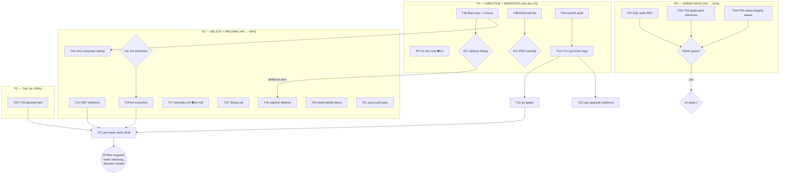

# SUPERB Plan: Repo-Scale Pareto — Red Gates → I/O Closure → v5 Wave 1

> **Created:** 2026-10-24 19:19 CEST (Saturday)
> **Status:** READY FOR EXECUTION (P0 fires first; owner gates marked ⛔)
> **Predecessors (READ FIRST — this plan builds on them, does not replace them):**
> [`2026-10-24_12-09_SUPERB-value-integrity-and-gate-unblock-pareto-plan.md`](2026-10-24_12-09_SUPERB-value-integrity-and-gate-unblock-pareto-plan.md) — ARMED, Wave 1 ready; owns the keycodec value-integrity program. This plan sequences it inside the whole-repo picture.
> [`2026-10-24_16-56_extraction-candidates-session-status.md`](../status/2026-10-24_16-56_extraction-candidates-session-status.md) — extraction analysis (lint #1, queue #2, benchkit #3, metaengine #4).
> [`2026-10-24_18-42_io-directive-execution-status.md`](../status/2026-10-24_18-42_io-directive-execution-status.md) — all-I/O-through-metaengine directive: encoded + 3 of 4 verdicts executed (sqlstore deprecated, queue A-verdict, E023 shipped); kv OPEN.
> **Format note:** Markdown + Mermaid per explicit operator instruction (skill default is HTML; operator instruction wins, not propagated).

---

## 1. Why this plan exists (context a fresh session needs)

Three programs are live simultaneously and nobody has sequenced them against
each other:

1. **The value-integrity program** (12-09 plan): keycodec value-encoding
   defect class, armed Wave 1, waves 2–4 behind it.
2. **The all-I/O-through-metaengine directive** (2026-10-24, contract 30):
   3 of 4 verdicts executed same-day; kv verdict open; verification gaps
   (fleet scan, E023 self-lint) rowed but unstarted.
3. **The v5 dual-support transition** (ADR-0152): one core module, cqrs-htmx +
   go-appkit migrate FIRST (they shield 73% + 18% of the fleet's indirect
   edges), drivers stay modular, tag on first consumer.

Meanwhile HEAD carries **known RED gates** (pre-existing, verified 2026-10-23):
the SQL-engine planned-path suite (pg + mysql) and `check-duplication`
(190 novel groups, ~180 ADR-0152 copy-forward twins missing trailing
directives). Per repo law, red gates poison every release wave — nothing
should tag over them.

This plan answers ONE question: **in what order does everything get done so
that the maximum value lands soonest and nothing is made worse?**

### 1.1 What is already true (do not re-plan it)

- **DONE today (receipts in TODO_LIST / CHANGELOG):** codec boundary waves 1–4;
  C02/C03 release chain (14 tags); typed WAL cluster rollout (A12a/b, A13);
  A16 docs-truth pack; taskmanager resolution; **sqlstore deprecation (21
  symbols, V007-tabled)**; **cqrs-lint E023 satellite-owned-sql shipped**
  (215 rules, full suite green); queue A-verdict + revisit trigger; ADR-0142
  amendment (ALL-I/O scope + A/B gate + verdicts); contract 30 + SKILL rule.
- **kv state:** fleet prod consumers exist (DiscordSync, cqrs-htmx
  `sql_readmodel.go`, Code-To-CV-Agent) using `TypedStore`/`ViewQuery`/`Keyset`;
  NOT V007-sentenced; ADR-0152 keeps kv as a v5 core package. Recommendation
  delivered: doc-note now, wave-sequenced deprecation (or ADR-0152 amendment
  if owner wants the kill).

### 1.2 The result being maximized (definition, so Pareto is honest)

A trustworthy, low-tax library the first-party fleet can migrate to v5:
**HEAD green** (no red gates), **fleet wave #1 migrated** (cqrs-htmx +
go-appkit onto core/v5), **train count shrinking** (V007 deletions +
zero-consumer kills), **directive closed** (kv + verification gaps), and the
**monorepo tax falling** (extraction decisions executed or killed).

---

## 2. Pareto framing

### 2.1 The 1% that delivers 51% — GREEN HEAD + v5 WAVE 1

1. **Kill the red gates** (SQL planned-path suite; check-duplication twin
   directives). Nothing ships credibly over red gates; every wave pays their
   tax. (~1 day)
2. **Execute the armed 12-09 Wave 1** (keycodec value-integrity mechanism) —
   already prepared, highest readiness-per-minute in the backlog.
3. **core/v5 completion audit + cqrs-htmx migration leg 1** — the chassis
   shielding 73% of fleet edges. Even partial migration (import-surface
   switch on the biggest trains) collapses the v5 cliff for everyone behind it.

*Why 51%:* green gates restore release credibility (all waves unblock), and
the cqrs-htmx/go-appkit pair IS the fleet's migration surface — ADR-0152's own
analysis. Everything else in this repo is either preparation for these or
long-tail after them.

### 2.2 The 4% that delivers 64% — 1% + DELETE THE DEAD + CLOSE THE DIRECTIVE

Add:
4. **V007 deletion wave** (stack presets, storage/view + relational,
   idempotency/sqlstore, + sqlstore if the owner rules delete-at-zero) —
   trains 101 → ~85, tag-train and gate-registry tax falls immediately.
5. **I/O-directive closure:** fleet sqlstore scan, kv doc-note + verdict
   execution, E023 self-lint run, engine-observability demo.
6. **Census-driven kill/integrate sweep** over the 49 zero-consumer trains
   (evidence already mandated by AGENTS; `census-fleet.sh --zero-consumers`).

*Why 64%:* deletion + census convert "101 trains nobody uses" from carrying
cost into either removed modules or integrated packages — the structural
payoff ADR-0152 was written to enable.

### 2.3 The 20% that delivers 80% — 4% + FINISH THE TRANSITION MACHINE

Add:
7. **go-appkit migration + cqrs-upgrade v5 codemod** (the migration machine
   for the app residue).
8. **keycodec A9 LSM-engine adoption wave** (the ONE remaining disk-truth
   item; owner-gated scheduling).
9. **branded-`.String()` warn-first lint rule** (7+ fixes already paid for
   this bug class; mechanical prevention).
10. **cqrs-lint extraction** (49k LOC, zero prod coupling — the cleanest
    structural win; decision-gated).
11. **Docs truth:** harvest both of today's status reports, module-count
    split-brain fix (101 vs 98 vs 96/97), deprecate/add-rule procedure
    checklists (the D1/D2 lessons, made permanent).

### 2.4 The other 20% to reach 100% (the long tail — batched, not forgotten)

BDD-harness depth tail (TimeAdvancesTo, scenario TB refactor, observational
equivalence); EventCatalog 5.2 custom exports + mesh-demo flows pilot +
warn-budget hardening; compound-cursor issuance; metaengine live-latency
calibration campaigns tail; E023 scorecard wiring; queue/benchkit extraction
readiness; upstream asks (turso-go #9391 follow-up, EventCatalog licence
shift); adoption patches (bank-sync M13, DiscordSync workaround branch);
companion commit-history hygiene; ROADMAP wave prose; recipes §2.26;
DueClaimer-v2 (REVISIT-GATED — only on second consumer); goleak/coverage
re-baselines; verify-chain receipts per wave.

---

## 3. Comprehensive plan (30–100 min tasks, ALL todos, sorted by importance → impact/effort/customer-value)

Priority: P0 = now (fires), P1 = this week, P2 = this month, P3 = tail.
Value = fleet/customer value. Effort in minutes. ⛔ = owner gate BEFORE work.

| # | P | Task | Value | Effort | Why this order |
|---|---|---|---|---|---|
| T01 | P0 | Reproduce + root-cause + fix SQL-engine planned-path suite RED (pg `IndexUsageProofs` text-bind; mysql `BackfillPlanned`/`PushdownScan_FilterSortKeys`) | H | 100 | Red gate poisons all waves; pre-existing since 10-23 |
| T02 | P0 | check-duplication: add trailing `// art-dupl:accept ADR-0152 copy-forward` directives to ~180 core/v5 twin files (batched per tier) | H | 100 | Red gate; mechanical; unblocks #verify |
| T03 | P0 | Surgical baseline insert for the ~10 non-twin residue groups (specview flow) + `check` green | M | 60 | Closes T02 without wholesale re-pin |
| T04 | P0 | Execute 12-09 plan Wave 1 (armed): keycodec value-integrity mechanism (EncodeJSON fallback kill + LSM value encoders) | H | 100 | Armed, prepared; the defect class ships |
| T05 | P0 | 12-09 Wave 2: prove the claims (composed #verify-fast + replay pins actually run + receipts) | H | 100 | Plan found "marked done but never run" — close it |
| T06 | P1 | Fleet scan for `scheduling/sqlstore` consumers + refresh census evidence (`census-fleet.sh`) | H | 30 | Should-have-preceded kill-now; feeds Q3 (delete-at-zero?) |
| T07 | P1 | kv: package-doc contract-30 note + ledger tick (doc-note path); ⛔ owner verdict gates the deeper path | M | 30 | Honest docs now; decision stays open |
| T08 | P1 | E023 self-lint run (this repo + one fleet consumer) + triage + `--strict` info-severity pin test | M | 45 | Verify what the new rule actually fires on |
| T09 | P1 | core/v5 completion audit vs ADR-0152 package list (gap table: missing pieces, wiring, blockers) | H | 60 | The map for wave 1 migration |
| T10 | P1 | cqrs-htmx migration to core/v5 — leg 1: import-surface switch of the biggest trains (event/id/command/decider/middleware/query) | H | 100 | 73% of fleet indirect edges |
| T11 | P1 | cqrs-htmx leg 2: remaining trains + adminui/dashboardui/datastar wiring + e2e green | H | 100 | Completes the chassis migration |
| T12 | P2 | go-appkit migration onto core/v5 (8 prod files; thin wrapper) | H | 60 | 18% of edges; smallest per-edge cost |
| T13 | P2 | cqrs-upgrade: v5 codemod target (core/v5 import rewrite + strict-gate) | H | 100 | The app-residue migration machine |
| T14 | P2 | V007 deletion wave 1: delete stack/* presets + storage/view + storage/relational; registry cleanup in all 8 gates | H | 100 | Trains 101→~90; the sentenced die |
| T15 | P2 | ⛔ + V007 deletion wave 2: `scheduling/sqlstore` (if owner rules delete-at-zero on census evidence) + `idempotency/sqlstore`; retire scheduler-otel-status demo | H | 60 | Zero-consumer kill policy (ADR-0158 precedent) |
| T16 | P2 | Census-driven kill/integrate sweep: run `--zero-consumers`, verdict per train, fork+delete playbook for the condemned | H | 100 | 49 zero-consumer trains = pure carrying cost |
| T17 | P2 | ⛔ A9 keycodec-v2 LSM-engine adoption wave (pebble → bbolt → badger, dual-read windows per store) | H | 100/dialect | The ONE remaining disk-truth item |
| T18 | P2 | cqrs-lint branded-`.String()` warn-first rule (display-form-in-storage bug class) | M | 60 | 7+ fixes already paid; mechanical prevention |
| T19 | P2 | cqrs-lint extraction: ⛔ intent ruling → ADR + subtree dry-run + catalog-sync test replacement plan | H | 60 | 49k LOC out of the monorepo; cheapest structural win |
| T20 | P2 | Engine-path observability demo (scheduling/engine + engine instrumentation) replacing scheduler-otel-status | M | 100 | Closes the exempt-demo debt before v5 deletion |
| T21 | P2 | Docs truth pack: harvest BOTH 10-24 reports into TODO_LIST; module-count split-brain fix (one gate-derived source); AGENTS "Deprecate a module" + "Add a lint rule" checklists (D1/D2 lessons) | M | 45 | Kills the ritual-tax split brain permanently |
| T22 | P3 | BDD/harness depth tail: `TimeAdvancesTo(t)`, scenario `testing.TB` refactor, observational-equivalence port | M | 60 | Fleet DX; batched |
| T23 | P3 | EventCatalog 5.2 custom exports (ADR-0159 deferred half) + mesh-demo flows pilot + check-eventcatalog warn-budget | M | 100 | Data-mesh direction |
| T24 | P3 | Compound-cursor issuance protocol (engines fill NextCursor; ScanPage prefers it; ParseCursor normalizes) | M | 60 | Wire-format change; goldens |
| T25 | P3 | Metaengine tail: calibration campaigns quiet-window legs; E023 scorecard wiring decision; doctor golden regen | M | 60 | Planner honesty |
| T26 | P3 | Adoption patches + hygiene: bank-sync M13, DiscordSync workaround-branch drop, companion commit-history hygiene, ROADMAP wave prose, recipes §2.26 note | L | 45 | Fleet friction removal |
| T27 | P3 | Per-wave verification ritual: verify-chain composed proof + CHANGELOG/FEATURES/TODO receipts after every P0/P1/P2 task (recurring) | H | 30/wave | The "90 tags shipped red" lesson, made mechanical |

**Owner gates (⛔ not tasks — answering them changes the task list):**
G1 kv verdict (doc-note+sequenced vs ADR-0152-amendment kill).
G2 sqlstore deletion timing (v5.0.0 vs delete-at-zero on T06 evidence).
G3 A9 scheduling (own wave vs pulled ahead).
G4 cqrs-lint extraction intent (slim vs publish) — gates T19.
G5 deployed-DB prefixed-key census (sticky-key fallback vs re-key) — rowed 10-23.
G6 E023 severity (info advisory vs warning) + scorecard wiring.
G7 metaengine-vs-ADR-0152 (dedicated project vs inside v5 core) — gates any metaengine extraction talk.

---

## 4. Micro-task plan (max 12 min each, ALL tasks)

Full table in this section; each micro is independently committable and
verifiable. Naming: Tnn.mm.

### P0 — fires (T01–T05)

| Micro | Task (≤12 min) |
|---|---|
| T01.1 | Run pgengine planned-path suite at HEAD; capture exact failing tests + errors |
| T01.2 | Run mysqlengine planned-path suite; capture failures |
| T01.3 | Root-cause pg text-bind (int bound vs TEXT column) in the test's planned table DDL |
| T01.4 | Fix pg bind typing; rerun suite green ×2 (`-count=2`) |
| T01.5 | Root-cause mysql backfill/pushdown failures (divergence vs pg semantics) |
| T01.6 | Fix mysql; rerun green ×2; row receipt in TODO red row |
| T02.1 | Script: list core/v5 twin files missing the art-dupl directive (diff vs v4 counterpart) |
| T02.2 | Batch-annotate twins tier 0–1 (record/id/dedup/dispatcher/metadata/event/command/query) |
| T02.3 | Batch-annotate twins tier 2–3 (schema/snapshot/projection/deriver/decider/graph/listing) |
| T02.4 | Batch-annotate twins tier 4–5 (middleware/otel/catalog/encryption/signing/stack/storage/system) |
| T02.5 | Re-run `nix run .#check-duplication`; count residue |
| T03.1 | Throwaway full pin → /tmp; extract residue group hashes |
| T03.2 | Surgically insert residue entries into committed baseline (sorted by hash) |
| T03.3 | `check-duplication` green; commit; dirty-tree guard respected |
| T04.1 | Read 12-09 Wave 1 task list; confirm preconditions still hold at HEAD |
| T04.2 | Kill `EncodeJSON` `%v` fallback (loud error); fix compile fallout |
| T04.3 | Replace pebbleengine value encoder alias; tests |
| T04.4 | Replace bboltengine value encoder alias; tests |
| T04.5 | Replace badgerengine value encoder alias; tests |
| T04.6 | Add the 21-collection value-integrity pin per engine (per 12-09 spec) |
| T04.7 | Update COOKBOOK/recipes claims to match mechanism reality |
| T05.1 | Run composed `#verify-fast` (quiet window; load guard) |
| T05.2 | Run replay pins end-to-end; capture receipts |
| T05.3 | Correct any claim/docs drift found; row receipts in 12-09 §11 |

### P1 — directive closure + v5 wave 1 legs (T06–T11)

| Micro | Task |
|---|---|
| T06.1 | `rg` fleet (`~/projects`) for `scheduling/sqlstore` imports; name consumers |
| T06.2 | Run `scripts/census-fleet.sh`; store JSON in docs/evidence/ |
| T06.3 | Update CHANGELOG migration note + contract-30 ledger with scan results |
| T07.1 | Write kv package-doc contract-30 note (durable→metaengine; typed+cache layer scope) |
| T07.2 | doc-check green; ledger tick (⏳ G1) |
| T08.1 | Build cqrs-lint; run E023-only over this repo; capture findings |
| T08.2 | Run E023 over DiscordSync + cqrs-htmx; capture findings |
| T08.3 | Triage: exemptions/waivers or accepts; record in TODO |
| T08.4 | Add `--strict` info-severity pin test (advisory never gates) |
| T09.1 | Diff core/v5 packages vs ADR-0152 core list; write gap table |
| T09.2 | For each gap: missing / partial / blocked classification with file:line |
| T09.3 | Row the gap table in TODO (v5 section) |
| T10.1 | cqrs-htmx worktree; baseline its suites green on v4 pins |
| T10.2 | Switch event/id imports → core/v5; fix compile; unit suite |
| T10.3 | Switch command/query/dispatcher; suite |
| T10.4 | Switch decider/middleware; suite |
| T10.5 | Snapshot/scheduling trains; suite |
| T10.6 | Full cqrs-htmx test suite (incl. e2e smoke leg) on core/v5 |
| T11.1 | adminui wiring switch; suite |
| T11.2 | dashboardui + datastar wiring switch; suite |
| T11.3 | examples + docs sweep in cqrs-htmx; strict cqrs-lint run |
| T11.4 | Pin bumps + standalone-build check (`check-example-standalone` analog) |
| T11.5 | Migration receipt: CHANGELOG (both repos) + TODO row + edges re-measure |

### P2 — deletion + machine (T12–T21)

| Micro | Task |
|---|---|
| T12.1 | go-appkit worktree; switch system/metaengine imports → core/v5 |
| T12.2 | Suite green; pin bump; receipt |
| T13.1 | cqrs-upgrade: add core/v5 rewrite rules to the codemod table |
| T13.2 | Fixture test: v4→v5 import rewrite end-to-end |
| T13.3 | `--strict` gate includes v5 target; README/docs |
| T14.1 | Delete stack presets (8 modules) from tree |
| T14.2 | Registry cleanup: go.work, flake testModules/wasmMods, api-stability, check-module-layers, module catalog, versions.json, canonical-facts counts |
| T14.3 | Delete storage/view + storage/relational; registry cleanup ditto |
| T14.4 | `#verify-fast` + `#verify-ci` green post-deletion; counts updated in docs |
| T15.1 | ⛔ G2 ruling on census evidence; if delete-at-zero: delete scheduling/sqlstore + retire scheduler-otel-status demo |
| T15.2 | Registry cleanup for sqlstore; V007 table entry already present; CHANGELOG |
| T16.1 | Run `census-fleet.sh --zero-consumers`; generate trigger report |
| T16.2 | Verdict per condemned train (fork+delete playbook or integrate) |
| T16.3 | Execute first batch of deletions; registries; receipts |
| T17.1 | ⛔ G3 ruling; A9 pebbleengine dual-read window implementation |
| T17.2 | pebble verification: legacy-prefixed DB fixture round-trip |
| T17.3 | bboltengine dual-read window + verification |
| T17.4 | badgerengine dual-read window + verification |
| T17.5 | Sticky-key fallback decision (needs G5); docs; A9 receipt |
| T18.1 | E-rule skeleton + catalog + register + RULES.md regen + count pins (use the new checklist) |
| T18.2 | Detector: `.String()` on branded types (id.StreamID, typed keys) in storage-adjacent args |
| T18.3 | Tests: fire/silence fixtures + exemption table |
| T18.4 | Run over repo + fleet; warn-first triage |
| T19.1 | ⛔ G4 ruling; write extraction ADR (check-adr-numbering first) |
| T19.2 | Subtree dry-run of cmd/cqrs-lint → /tmp; measure diff + CI legs |
| T19.3 | module_catalog drift-test replacement design (pinned catalog + sync job) |
| T20.1 | Demo skeleton: scheduling/engine + engine instrumentation wiring |
| T20.2 | /status + /metrics endpoints parity with old demo |
| T20.3 | Tests + example registration; banner-off the old demo |
| T21.1 | HARVEST both 10-24 reports (docs-health) into TODO_LIST/ROADMAP |
| T21.2 | Module-count split brain: single gate-derived source; fix module-map/ROADMAP prose |
| T21.3 | Write AGENTS "Deprecate a module" checklist (from D1: markers→V007→CHANGELOG→FEATURES→maps→banner→gates) |
| T21.4 | Write AGENTS "Add a lint rule" checklist (rule→register→catalog→RULES.md→README→count test→api golden) |

### P3 — tail (T22–T27, batched micros)

| Micro | Task |
|---|---|
| T22.1 | `TimeAdvancesTo(t)` sugar + tests + recipe note |
| T22.2 | scenario/v4 `testing.TB` refactor |
| T22.3 | Observational-equivalence port scoping note |
| T23.1 | EventCatalog 5.2 custom exports spike |
| T23.2 | mesh-demo flows pilot (hub T9) |
| T23.3 | check-eventcatalog warn-budget hardening |
| T24.1 | Engines fill ScanResult.NextCursor; golden pins |
| T24.2 | ScanPage prefers engine cursor; ParseCursor normalizes; tests |
| T25.1 | Calibration campaign quiet-window leg; baseline update |
| T25.2 | ⛔ G6: E023 scorecard/Modernity wiring decision + doctor golden regen |
| T26.1 | bank-sync M13 patch; DiscordSync branch drop |
| T26.2 | Companion commit-history hygiene (pilot repos) |
| T26.3 | ROADMAP wave prose + recipes §2.26 note |
| T27.* | After EVERY completed task: git status → commit (detailed) → gates → CHANGELOG/FEATURES/TODO receipt (12 min budget per wave) |

**Total: 27 medium tasks → 96 micro-tasks.**

---

## 5. Execution graph

## 6. Verification matrix

| Claim this plan makes | Verified by |
|---|---|
| SQL suite red is real + pre-existing | TODO row (verified at `d0e86a117`, before typed-WAL) — re-verify in T01.1 |
| check-duplication 190 groups / ~180 twins | TODO row, mutation-verified 2026-10-17 — re-run in T02.5 |
| 12-09 Wave 1 armed | its own §Status — confirm in T04.1 |
| cqrs-htmx/go-appkit = 73%/18% edges | ADR-0152 consumed-surface analysis (2026-10-08) |
| kv fleet consumers | session grep 2026-10-24 (DiscordSync, cqrs-htmx, Code-To-CV-Agent prod files) |
| 49 zero-consumer trains | ADR-0152 audit; refresh via T06.2 census |
| E023/sqlstore shipped today | CHANGELOG [Unreleased], full suite green ×2, api golden 6303 |

## 7. Verschlimmbessern guard (read before touching anything)

- No re-planning of the 12-09 program: EXECUTE it; if reality diverged, amend
  ITS §11 execution log, don't fork a competing plan.
- No deletion without its registry checklist (the 8 gates) — a half-deleted
  train is worse than a live one.
- No deprecation markers without V007 table entries in the same edit (D1 lesson).
- No lint rule without its full companion pin set (D2 lesson).
- No census-based kill of a module with ANY fleet prod import (kv proved the
  point today).
- The auto-commit daemon absorbs working trees: phase-boundary commits with
  authored messages, or lose authorship to `chore:`.

## 8. Risks

| Risk | Mitigation |
|---|---|
| T01 mysql/pg fixes collide with the parallel session owning pgengine (typed_wal) | Check `git log` owners before editing; coordinate via TODO row |
| Deletion waves orphan fleet pins | delete only V007-registered paths; old tags serve forever on the proxy |
| cqrs-htmx migration stalls on v5 gaps | T09 audit FIRST; gaps become blockers list, not mid-migration surprises |
| Verify-chain exclusivity/load | every composed run via quiet-window/verify-chain (T27 ritual) |

## 9. Owner-gated questions (asked, not answerable here)

G1–G7 as listed in §3. The two that gate P0/P1 immediately: **G2** (sqlstore
delete-at-zero — needs T06 evidence first) and **G4** (lint extraction intent).

## 10. Errata / corrections carried into this plan

- The 16-56 report's F22 (harvest) is still open — folded into T21.1.
- The 18-42 report's F01–F35 overlap this plan's tasks 1:1 where still open;
  closed items (E023, sqlstore marking) are NOT re-rowed.
- TODO rows with 2026-10-24 DONE receipts (C02/C03, typed WAL, A16,
  taskmanager) are excluded from planning.
- The 12-09 plan's §f backlog is partially consumed by its own waves; only
  its open waves are carried here (T04/T05).

## 11. Execution log

- **2026-10-24 19:2x:** plan created, committed (authored), and pushed. P0
  armed (T01–T05); no task executed yet. Predecessor 12-09 plan remains the
  owner of the value-integrity program — this plan only sequences it.
- **2026-10-24 20:0x–21:0x — P0 executed (T01–T04) + T06:**
  - **T01 DONE — SQL planned-path suite RED fixed.** Scope correction: FIVE
    pg tests were red (not one) — RoundTrip, MisTypedExtract,
    PushdownScan_Keyset, MapUpdate, Explain_IndexUsageProofs. Root cause: the
    10-23 all-TEXT layout switch left numeric tests on untyped plans AND the
    compat table ignored DOUBLE/FLOAT (permissive default masked the mistype
    pin). Fix: compat table numeric case covers INTEGER/BIGINT/REAL/DOUBLE/
    FLOAT with all Go int/uint/float widths; red tests converted to
    `BuildLayoutPlanFromType`. Receipts: pgengine full suite green ×2
    (ephemeral PG); mysql planned 10/10 PASS verbose + full module green
    (userspace MariaDB vehicle); check-duplication stayed green.
    Side-find: `vm-mysql.sh` hostfwd default 33070 was inside
    `ip_local_port_range` — an exporter's long-lived connection squatted the
    source port, killing QEMU at every boot (misleading QMP reset); default
    moved to 23306 + gotchas-testing entry.
  - **T02/T03 DONE — check-duplication GREEN.** The ~180 ADR-0152 twins had
    already been annotated by the parallel session (plan's count was stale);
    only 7 residue groups remained, all resolved with `// art-dupl:accept`
    directives (cross-module SQL engine twins, adapter prologues, mirror
    Escape/Unescape, test sugar) — no baseline insert needed. One bad edit
    (directive INSIDE a backtick SQL string) caught and fixed before commit.
  - **T04 DONE — 12-09 Wave 1 executed** (see its §11 log for the full
    receipt): `keycodec.EncodeJSONErr` + 21 LSM site conversions +
    `adttest.AssertValueEncodeRejection` harness + taxonomy gate row for
    `metaengine/keycodec` + api golden 6305. CHANGELOG/TODO receipts cut.
  - **T06 DONE — fleet sqlstore scan + census.** Exactly ONE direct fleet
    consumer: ChastityAPI `cmd/server/main.go`. **G2 ANSWERED by evidence:
    delete-at-zero does NOT fire; sqlstore dies at v5.0.0 per its V007
    sentence; ChastityAPI migrates in the v5 wave.** Census evidence at
    `docs/evidence/fleet-census-2026-10-24_20-47.json` (53 distinct
    submodules required by the fleet).
  - **T07 DONE (doc-note path) — kv package doc carries the contract-30
    note** (durable scope = typed layer over engines + caches + MemStore; no
    new satellite-SQL kv backends; G1 verdict still owner-gated), AGENTS
    ledger ticked. kv module build+tests green.
  - **T08 DONE — E023 self-lint + triage.** First pass: 7 in-repo findings →
    benchkit/, cmd/, idempotency/sqlstore/ joined the exemption table
    (tooling harness + deprecated-SQL classes); middleware/ +
    projectionhost/ deliberately stay flagged (3 true-positive advisories =
    live contract-30 debt the rule exists to keep visible). DiscordSync
    consumer run fires on its real satellite packages — field signal works.
    Info-severity pin added (info/warning never gate exit; error does).
  - **T21.3/T21.4 DONE — AGENTS procedure checklists added**: "Deprecate a
    Module" (markers→V007→docs trail→golden→SA1019 scoping→census gate) and
    "Add a Lint Rule" (detector→register→catalog→RULES.md→count pins→golden→
    suite), both distilled from the 2026-10-24 D1/D2 lessons. doc-check green.
  - **T05 DONE — composed proof green.** `nix run .#verify-fast` EXIT=0,
    293 module test packages ok, 88/88 modules lint-clean, duplication gate
    0 new, doc-check 1356 refs valid. WAL raw-byte pins rerun ×2 green;
    keycodec/adttest/engine suites green (incl. ×5 on the map-order-robust
    pin). Two chase-downs along the way: (a) the first composed run had 5
    lint findings (2× exhaustruct on foreign-committed catalog demo
    literals → scoped `//nolint:exhaustruct_v5` with omitempty rationale;
    err113 on explain's dynamic error → static sentinel; 2× gochecknoglobals
    on E023 lookup tables → read-only-table nolint precedent; revive
    unused-param in the new harness); (b) my MapUpdate conversions minted
    ONE new clone group (badger↔pebble prologue twins) → accept directives,
    gate back to 0. Also observed once: `systemscenario` SSE await failed
    under 100-module parallel load and passed ×3 standalone and in the clean
    composed run — the known load-sensitivity class, not a regression
    (pre-session commit also green in a throwaway worktree).

