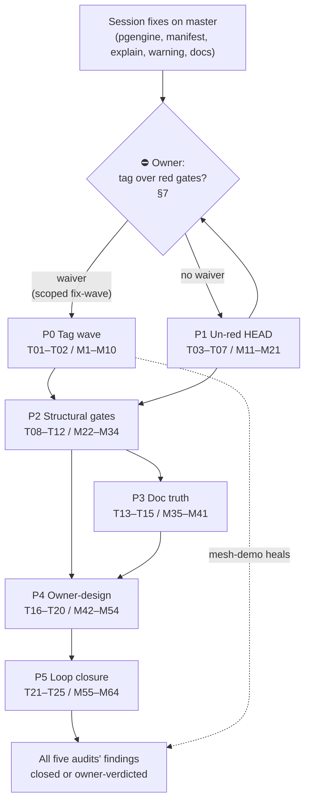

# SUPERB Plan: Consumer-Fleet Audit Follow-Up — Release, Un-Red, and Close the Loop

> **Created:** 2026-10-24 19:40 CEST (Saturday)
> **Status:** READY FOR EXECUTION — P0 carries an ⛔ owner gate (red-gates law); P1 can start immediately
> **Author session:** the 19:29 fleet-audit follow-up (status: [`../status/2026-10-24_19-29_consumer-fleet-audit-follow-up-status.md`](../status/2026-10-24_19-29_consumer-fleet-audit-follow-up-status.md))
> **Predecessors (READ FIRST — this plan builds beside them, does not replace them):**
> [`2026-10-24_19-19_SUPERB-repo-scale-pareto-red-gates-to-v5-wave.md`](2026-10-24_19-19_SUPERB-repo-scale-pareto-red-gates-to-v5-wave.md) — owns repo-scale v5 sequencing and the OLDER red gates (SQL planned-path suite, `check-duplication` 190 groups). This plan owns the FIVE-AUDIT universe only; where they meet (tag wave vs red gates, file-size trio) the conflict is resolved in §7.
> **Format note:** Markdown + Mermaid per explicit operator instruction (skill default is HTML; operator instruction wins, not propagated).

---

## 1. Why this plan exists

Five consumer projects (nsfw-classifier, CV, dnsblockd, pbx-lens, InboxClean) deep-dived
go-cqrs-lite's catalog/bench/testing modules on 2026-10-24. The 19:29 session read all ten
docs, verified every claim against source, and already LANDED the mechanical fixes:

| Already true (do not re-plan) | Receipt |
| --- | --- |
| pgengine `AsType` anonymous-interface compile error fixed + 7-case unit test | `typed_wal.go:189`, build/vet/test green, commit `2504e78e6` |
| versions.json regenerated (112 trains) + `batch-release.sh` refreshes it | `--check` exit 0; release-scripts smoke green |
| `cqrs-lint explain E004` prints rule cards; unknown IDs fail loudly | full cqrs-lint suite `ok` |
| systemscenario empty-`DomainConfig` hollow-root WARNING | module suite green, `1c1d5cead` |
| benchkit README `FactoryFromSystem`-first | doc verified against `run.go:26,49` |
| SKILL/faq/FEATURES updated; md-go-validator vendorHash re-pinned (6th time) | doc-check 1356 refs green; `check-md-go` 1519 blocks green |
| 6 audit rows harvested into TODO_LIST; CHANGELOG rows written (symbols gate green) | TODO_LIST § two new sections; CHANGELOG [Unreleased] |

**Discovered but NOT healed:** the MarkDemo untagged-API incident (mesh-demo unbuildable
against the proxy), the file-size ratchet red at HEAD (3 files), the tag-wave question,
and the auditor feedback loop. Plus the §f tail (28 items) from the status report.

### 1.1 Errata (skill Step 0 corrections)

- Status-report §f-25 ("add pool-index row") — **already done** at 19:29; dropped from this plan.
- Status-report §b-5 suspicion (nightly manifest check silent) — kept as task T11, downgraded from "gate bug" to "unverified workflow state".
- The 19-19 plan's red-gate law ("nothing tags over red gates") now ALSO covers this plan's file-size trio; see §7 for the P0 conflict and its owner gate.

### 1.2 The result being maximized

Every consumer-visible fix from the five audits reaches consumers **through tags** (not
just checkout-riders), every NEW incident class found this week is **mechanically gated**,
and every finding that needs an owner decision has a **prepared, one-meeting decision
package** — without making anything worse (no tags over red gates, no parallel-session
work touched).

---

## 2. Pareto framing

### 2.1 The 1% that delivers 51% — THE TAG WAVE (T01–T02)

One act: cut the audit-follow-up wave (catalog v4.11.x with `MarkDemo` + pgengine patch
with the `AsType` fix + systemscenario minor with the warning + cmd/cqrs-lint minor with
`explain` rule-IDs), refresh the manifest via the now-wired batch-release path, proxy-smoke
each tag, and re-verify mesh-demo `GOWORK=off`.

*Why 51%:* every fix from §1 is worth zero to tag-pinned consumers until it is tagged;
mesh-demo stays unbuildable; checkout-riders keep drifting. Tags convert the entire
session from "landed" to "delivered", and the census/currency tables all five auditors
used go stale until this lands.

### 2.2 The 4% that delivers 64% — 1% + UN-RED HEAD (T03–T07)

Add: split (or owner-baseline) the three file-size offenders, then run the composite
`#verify` chain green.

*Why 64%:* a green HEAD is the precondition for EVERY future wave (the 19-19 plan's own
law) — without it, T01 is a one-off and the next session inherits the same tax.

### 2.3 The 20% that delivers 80% — 4% + CLOSE THE INCIDENT CLASSES (T08–T12)

Add: the GOWORK=off example-build gate (kills the MarkDemo class), the mysqlengine twin
test, the api-golden mechanical check, the nightly-matrix extension (file-size + example
builds + manifest check state), and the taxonomy/duplication runs.

*Why 80%:* every "found by accident / found by a consumer" class from this week becomes
"found by a gate at commit time"; the fleet stops being the test suite.

### 2.4 The other 20% to reach 100% (long tail — batched, owner-gated)

Owner-design packages (catalog Registry derivation, `scenario.Given` versioned decides,
warning opt-out, md-go-validator pin policy), doc truth (AGENTS gotchas, explain→RULES.md,
benchkit RunSuite, recipes §2.43, FAQ↔cqrs-upgrade), the auditor loop (case studies,
§g answers), the timing regression, the static empty-DomainConfig rule design, hygiene
(daemon-commit titling, per-module sweep, post-wave audit reconciliation).

---

## 3. Comprehensive plan (30–100 min tasks — ALL todos, impact-sorted)

| Task | Phase | What (all todos covered) | Est | Impact | Effort | Gate |
| ---- | ----- | ------------------------ | --- | ------ | ------ | ---- |
| T01 | P0 | **Cut the audit-follow-up wave**: catalog v4.11.x (contains `MarkDemo`) + pgengine patch (`AsType` fix) + systemscenario minor (warning) + cmd/cqrs-lint minor (rule-ID explain) via batch-release.sh (manifest auto-refresh); proxy-smoke every tag | 60–90 | 🔥 highest | M | ⛔ owner (§7) |
| T02 | P0 | **Post-tag healing**: mesh-demo `GOWORK=off` build green again; re-run `measure-engine-fleet.sh`/census so the auditors' currency tables go current | 30 | high | S | — |
| T03 | P1 | Split `scheduling/sqlstore/store.go` (382 → ≤350) | 45 | high | M | — |
| T04 | P1 | Split `system/adapter_event.go` (351 → ≤350) | 45 | high | S | — |
| T05 | P1 | Split `metaengine/layout.go` (360 → ≤350) | 60 | high | M | — |
| T06 | P1 | OR owner-baseline the trio with written rationale (if a split is structural) — pick per file | 15 | med | XS | ⛔ owner option |
| T07 | P1 | **`nix run .#verify` composite green** on the post-un-red tree | 60–100 | 🔥 | M | — |
| T08 | P2 | **GOWORK=off `examplePaths` build leg** in `check-example-standalone.sh` (+ self-test leg) — kills the MarkDemo class | 45 | 🔥 | S | — |
| T09 | P2 | mysqlengine unique-violation unit test (twin of pgengine's 7 cases) | 30 | med | S | — |
| T10 | P2 | api-stability golden mechanical no-op check (run + record) | 30 | med | XS | — |
| T11 | P2 | Nightly truth: verify why `check-versions-manifest --check --remote` stayed silent since 10-17; add file-size + example-build legs to `nightly-gates.yml` | 45 | high | S | — |
| T12 | P2 | `check-error-taxonomy` + `check-duplication` on session edits; route any red to the 19-19 plan's duplication program | 30 | med | S | — |
| T13 | P3 | AGENTS.md gotchas: untagged-API-in-examples + tag-vs-checkout blast-radius rule | 30 | high | XS | — |
| T14 | P3 | explain rule cards → link RULES.md / add when-it-fires pointer | 30 | med | XS | — |
| T15 | P3 | Doc polish batch: benchkit RunSuite `FactoryFromSystem` variant + recipes §2.43 warning mention + FAQ↔cqrs-upgrade linkage | 30 | med | XS | — |
| T16 | P4 | **catalog Registry-from-DomainConfig derivation** design package (options A: reflection-read-only, B: hybrid explicit; ADR sketch; dnsblockd's 40-line pain as evidence) | 90 | high | L | ⛔ owner |
| T17 | P4 | `scenario.Given` version-carrying decide variant — design + implement if shape is obvious (InboxClean's `adaptDecide` wrappers as evidence) | 60 | med | M | ⛔ owner (API) |
| T18 | P4 | Empty-domain warning opt-out decision + impl (`WithAllowEmptyDomain`, naming-review first) | 30 | med | S | ⛔ owner |
| T19 | P4 | md-go-validator input policy: rev-pin vs master-track — decision + execute | 30 | med | S | ⛔ owner |
| T20 | P4 | cqrs-lint 2.0s→7.4s timing regression: cold/warm profile on a mid-size consumer corpus | 60–100 | med | M | — |
| T21 | P5 | **Auditor loop**: answer the five projects' §g questions; invite case studies (CV's bench artifacts post-cutover) | 45 | med | S | — |
| T22 | P5 | Owner verdicts batch: catalog C1 appetite (dnsblockd), `WithSkipBootstrapFiles` CLI exposure (pbx-lens), FakeStore no-journal twin (InboxClean) | 30 | low-med | S | ⛔ owner |
| T23 | P5 | Per-module test sweep (`GOWORK=off go test -count=1`) over the post-wave tree | 60–100 | med | M | — |
| T24 | P5 | Commit-history hygiene: retitle-or-accept decision for this week's daemon commits | 30 | low | XS | ⛔ owner |
| T25 | P5 | Static empty-DomainConfig advisory rule — DESIGN only (E021 sketch; complements the runtime warning) | 45 | low-med | M | — |

Coverage check: §f 1–28 → T01/T02(1,20,28), T08(2), T03–T06(3), T07(4), T10(5), T09(6), T20(7), T16(8), T17(9), T21(10), T18(11), T19(12), T13(14), T14(15), T15(16,17), T15(23-linkage... see §4 M48), T11(24), errata(25), T18(26), T22(27), T02(28) ✅ — plus §b partials (b1→T01/T02, b2→T14, b3→T23, b5→T11, b6→T21) and §d reds (d3→T03–T06, d4→T08).

---

## 4. Micro-breakdown (≤12 min each — ALL todos)

### P0 — Release wave (⛔ owner gate §7)

| # | Micro-task | ≤min |
| --- | --- | --- |
| M1 | Present §7 conflict to owner; get tag-over-red-gates waiver or sequence after P1 | 10 |
| M2 | Inventory wave contents: list trains whose HEAD > latest tag among {catalog, pgengine, systemscenario, cmd/cqrs-lint} | 10 |
| M3 | Pre-flight: per-module `GOWORK=off go test -count=1` on the four trains | 12 |
| M4 | Pre-flight: `check-arch` + `check-file-size` on the four trains | 10 |
| M5 | Run batch-release.sh for the wave (manifest auto-refreshes) | 10 |
| M6 | `git push origin <tags>` | 5 |
| M7 | Proxy-smoke each tag (`tag-release.sh --smoke` per train) | 12 |
| M8 | CHANGELOG: move [Unreleased] rows into the new wave section | 12 |
| M9 | mesh-demo `GOWORK=off go build ./...` — verify MarkDemo heals | 5 |
| M10 | Re-run `bash scripts/measure-engine-fleet.sh` + census; note new counts | 12 |

### P1 — Un-red HEAD

| # | Micro-task | ≤min |
| --- | --- | --- |
| M11 | `store.go`: read structure, choose split line (claims vs store core) | 10 |
| M12 | Extract part 1 to new file; build + targeted tests | 12 |
| M13 | `check-file-size` single-file green; module tests green | 10 |
| M14 | `adapter_event.go`: read + choose split | 8 |
| M15 | Extract; build + module tests; ratchet green | 12 |
| M16 | `layout.go`: read + choose split | 10 |
| M17 | Extract; build + tests | 12 |
| M18 | Ratchet green on all three; or file T06 baseline request with rationale | 8 |
| M19 | Kick off `nix run .#verify` (quiet window) | 5 |
| M20 | Triage any #verify finding; re-run to green | 12 |
| M21 | Record #verify receipt (log path + exit) in this plan's appendix | 5 |

### P2 — Structural gates

| # | Micro-task | ≤min |
| --- | --- | --- |
| M22 | Read `check-example-standalone.sh` structure; pick insertion point for build leg | 10 |
| M23 | Implement GOWORK=off loop over `examplePaths` (from flake) | 12 |
| M24 | Fixture: plant an untagged-API example; prove the leg catches it | 12 |
| M25 | Wire self-test leg; run `check-release-scripts` | 12 |
| M26 | Commit gate + fixture | 5 |
| M27 | Write mysqlengine test file (mirror pgengine's 7 cases, `*mysql.MySQLError`-shaped) | 12 |
| M28 | Run + green; note driver-type assertion difference | 8 |
| M29 | `cd cmd/api-stability && GOWORK=off go run .` diff vs golden; record no-op receipt | 10 |
| M30 | `go run . test` meta-tests (TestEvery) green | 8 |
| M31 | Inspect `nightly-gates.yml` last runs (Actions) for the silent manifest check | 12 |
| M32 | Add file-size + example-build jobs to nightly matrix | 12 |
| M33 | `nix run .#check-error-taxonomy` + record | 8 |
| M34 | `nix run .#check-duplication`; route red rows into the 19-19 duplication program | 12 |

### P3 — Doc truth

| # | Micro-task | ≤min |
| --- | --- | --- |
| M35 | AGENTS.md gotchas-module-management: add untagged-API-in-examples entry | 10 |
| M36 | AGENTS.md gotchas-tooling: add tag-vs-checkout blast-radius rule ("severity words need `git tag --contains`") | 10 |
| M37 | explain_rules.go: add `Docs` pointer line to RULES.md section anchors | 10 |
| M38 | Update explain tests; run suite | 8 |
| M39 | benchkit README: RunSuite `FactoryFromSystem` example | 10 |
| M40 | recipes.md §2.43: one-paragraph hollow-root warning note (+ doc-check) | 10 |
| M41 | faq.md version-probe entry: add `cqrs-upgrade` cross-reference | 8 |

### P4 — Owner-design sessions (⛔)

| # | Micro-task | ≤min |
| --- | --- | --- |
| M42 | Gather evidence pack: three auditors' registry code (dnsblockd/pbx-lens/InboxClean shapes) | 12 |
| M43 | Draft options A (reflection) / B (hybrid) with API sketches | 12 |
| M44 | ADR sketch + open questions; schedule owner review | 10 |
| M45 | Read scenario DSL decide-func plumbing; sketch `GivenVersioned` | 12 |
| M46 | Implement + adapt InboxClean's wrapper case as test | 12 |
| M47 | API-golden regen + module tests | 8 |
| M48 | Naming review `WithAllowEmptyDomain`; owner ping | 8 |
| M49 | Implement opt-out + test (warn suppressed / still warns) | 12 |
| M50 | Rev-pin md-go-validator input (flake.input.rev) — draft diff | 10 |
| M51 | Execute policy decision + re-pin vendorHash if needed | 12 |
| M52 | Timing harness: consumer-corpus fixture + cold/warm loop script | 12 |
| M53 | Profile + attribute (scanner vs rules vs IO); write findings | 12 |
| M54 | File fix row(s) with the 19-19 plan linkage | 8 |

### P5 — Loop closure

| # | Micro-task | ≤min |
| --- | --- | --- |
| M55 | Draft §g answers: nsfw (E004 confirm → DONE, link explain), CV (trap → DONE, link warning) | 12 |
| M56 | Draft §g answers: dnsblockd (README → DONE; tag wave), pbx-lens (versions.json → DONE), InboxClean (compile error → DONE) | 12 |
| M57 | Case-study invites (CV bench artifacts, dnsblockd reopen-gate story) | 10 |
| M58 | Owner verdict sheet: catalog C1 / SkipBootstrap / FakeStore-twin (one table, one meeting) | 12 |
| M59 | Per-module sweep batch 1 (metaengine/*) | 12 |
| M60 | Per-module sweep batch 2 (system*, scenario*, storage*) | 12 |
| M61 | Sweep receipt: pass/fail table appended to this plan | 8 |
| M62 | Retitle-or-accept decision note for daemon commits | 10 |
| M63 | E021 sketch: detector for `System(t, ctx, system.DomainConfig{}, …)` in tests | 12 |
| M64 | Post-wave re-read of the five audits' currency tables; mark reconciled | 10 |

Coverage: every comprehensive task decomposes; M-set covers ALL of §3 with no orphans.

---

## 5. Execution graph

**Critical path:** GATE0 → P0 → P2 → P4 → P5. P1 and P3 run parallel to P0 whenever the
waiver fires; if it does not, P1 IS the critical path.

---

## 6. Guardrails (Verschlimmbessern defense)

1. **No tag over red gates without the explicit §7 waiver** — the 19-19 plan's law stands;
   a scoped fix-wave waiver must name the exact trains and the gates being waived.
2. **Never touch the parallel session's deliverables** (16-54 architecture-review files,
   19-19 plan, keycodec program) — reference, don't edit.
3. **Tags are immutable** — the MarkDemo heal is a NEW catalog tag, never a re-tag.
4. **Every behavioral change ships with its test in the same commit** (session rule;
   kept).
5. **Gates before glory** — T07's composite #verify receipt is the only "HEAD healthy"
   claim this plan accepts.
6. **Owner-gated items (T01-waiver, T06, T16–T19, T22, T24) are prepared, never executed
   unilaterally.**

## 7. Open conflict requiring the owner (resolves M1)

The 19-19 plan's law says nothing tags over red gates; HEAD currently carries
(a) the SQL planned-path suite red and `check-duplication` 190 groups (19-19's program),
(b) this plan's file-size trio. Meanwhile the pgengine compile fix, the manifest
refresh, the warning, and the explain fix benefit consumers **only via tags**, and
mesh-demo stays unbuildable until a catalog tag ships.

**Options:** (1) waiver-scoped fix-wave now (name the trains; accept the unrelated reds
as documented); (2) un-red first (T03–T07 ≈ 1 day) then tag; (3) split: tag the four
clean trains after a targeted green on THOSE trains' suites + the file-size trio, defer
the rest. Owner picks; M1 documents the verdict here.
