# SUPERB Testing Improvements: Pareto Execution Plan

**Created:** 2026-10-25 04:21 CET
**Status:** PARTIALLY EXECUTED (2026-10-27 00:10) — the 1% task, the 4% task and five
of the seven 20% tasks are shipped (T01-T04, T07-T09), T05/T08/T12 are partial, T06 was
verified as already covered, and T10-T27 are untouched. Receipts and deviations:
[`docs/status/2026-10-27_00-10_testing-gates-execution-and-forgotten-verifications.md`](../status/2026-10-27_00-10_testing-gates-execution-and-forgotten-verifications.md)
and `TODO_LIST.md` § Testing improvements. Everything below is the ORIGINAL plan text,
kept for the decision trail; read §10 for what reality corrected.
**Input:** [`docs/planning/2026-10-24_50-testing-improvements.md`](2026-10-24_50-testing-improvements.md) (50 ideas, census-grounded)
**Predecessor plans read:** `2026-10-17_20-18_SUPERB-bdd-depth-followups-pareto-plan.md`, `2026-10-09_04-04_SUPERB-bdd-testing-harness-pareto-plan.md`, `2026-10-09_14-49_SUPERB-bdd-harness-adoption-wave.md`, `2026-10-17_20-13_SUPERB-disk-truth-pareto-plan.md`
**Living backlog read:** `TODO_LIST.md` § BDD harness adoption wave, § BDD depth-spec follow-ups, § CI / Infrastructure, § Code Quality
**Repo state at planning time:** `master` clean, HEAD `fbb7281c8`

---

## 1. How to read this plan

Three levels, deliberately:

| Level | Granularity | Count | Where |
| --- | --- | --- | --- |
| Pareto | Which 10 of 50 ideas carry 80% of the value | 4 tiers | §3 |
| Comprehensive | One task per work package, 30-100 min | 27 tasks | §4 |
| Execution | One commit-sized step, max 12 min | 143 subtasks | §5 |

Execution order is the tier order in §3: 1% first, then the 4%, then the 20%,
then the tail. Task IDs (`T01`..`T27`) are assigned in that execution order, so
a lower number is always higher priority and never depends on a higher number
except where §4 says so explicitly.

**Anti-verschlimmbessern rules.** These are constraints on the plan, not
suggestions. A task that violates one is rejected at review, no exceptions:

1. **A gate must be able to go red.** Every new check ships with a
   mutation/fault proof (plant the defect, see red, restore, see green). A gate
   that cannot fail is decoration.
2. **Never widen a gate to make it pass.** Baselines move only by an explicit
   `--update` run in the same change, with the measured number in the commit
   message.
3. **No repo-wide mutation while foreign dirty files exist** (2026-09-06
   lesson): `nix fmt`, `go work sync`, and `--fix` runs stay scoped to the
   files the task owns.
4. **Every task is independently revertible.** No task leaves the tree in a
   state where `#verify` is red for a reason it did not introduce.
5. **No speculative rewrites.** If a subtask finds the premise false, it
   records an erratum in §10 and closes, rather than building on a broken
   assumption.
6. **Test count is not progress.** A new test that cannot fail does not close
   a row; item 4 of the source document is itself a gate against that.

**Verification ladder** (from `docs/agents/gotchas-testing.md`, climb, do not
jump): module meta-tests -> touched-module lint -> `#verify-fast` -> composed
`#verify` (via `preflight-composed.sh` + `can-run-composed-gate --wait-loop`).
Timing-sensitive tasks additionally run under `nix run .#quiet-window-run`.

---

## 2. Step 0 errata: what already shipped since the 50-idea document

Writing this plan without this section would re-dispatch six items that are
already done or half-done. Each correction was verified against code, the
CHANGELOG, or TODO_LIST rows, not against memory.

| # | Original idea | Verified state | Plan adjustment |
| --- | --- | --- | --- |
| E1 | Idea 25: fix the synchronous-deriver bus deadlock | **SHIPPED.** ADR-0154; `deriver.WithAsyncDispatch`, `watermill.ErrReentrantPublish` (CHANGELOG 2026-10-10). The journal-tailed host remains the v5 direction. | Idea 25 is reframed as a **regression pin** (T07.3), not a fix. |
| E2 | Idea 12: add `goleak` everywhere | **PARTIAL.** Present in `system`, `metaengine`, `projectionhost`, `systemtest` (6 files). Absent in `watermill`, `scheduling`, `commandlifecycle/projections`, `queue`, `deriver`, engines. | T04 becomes a **gap-fill**, not a greenfield rollout. |
| E3 | Idea 41: fault injection | **PARTIAL.** Latency chaos exists: `systemscenario.DelayedDriver` (+ crash and SSE legs, adoption wave T23). Error injection does not exist. | Idea 41 narrows to **error-family injection**; latency chaos is cited, not rebuilt. |
| E4 | Idea 17: expand property testing | **PARTIAL.** `rapid` already spans 20 modules, including temporal semantics (`metaengine` M18 properties). | Idea 17 narrows to the **missing invariant families** (codec, envelope, `record`), not a rollout. |
| E5 | Idea 24: ratchet `systemscenario` adoption | **PARTIAL.** Harness shipped and deepened (ADR-0153, v4.2.0 depth wave), adopted by taskmanager, goal-shaped-app, graph-native, and two fleet pilots. Additions survive in TODO_LIST (`TimeAdvancesTo`, observational equivalence). | Idea 24 becomes a **measurement ratchet + the three open TODO residues**, not a harness build. |
| E6 | Ideas 9/10: shuffle unit tests | **PARTIAL.** Shuffle with logged seeds has run in integration legs since 2026-09-13 (`scripts/lib/shuffle-seed.sh`, `build/shuffle-seeds.log`). Unit suites never shuffle. | T03 **extends the existing mechanism**, reusing the seed helper. |
| E7 | Idea 29: consumer-side tag fixtures | **TODO exists.** TODO_LIST § Untagged-API incident rows the `GOWORK=off examplePaths` build leg after the `MarkDemo` break. | T17 **absorbs that row** instead of duplicating it, and widens it to recipe fixtures. |
| E8 | Idea 15: flake accounting | **PARTIAL.** `autoretry.yml` re-runs failed jobs once, but a retried-green run is indistinguishable from a clean one. | Idea 15 stays; T12 adds **flaky classification**, not another retry. |

Two more corrections for honesty:

| # | Claim in the 50-idea doc | Reality |
| --- | --- | --- |
| E9 | "11 of 97 modules have a coverage floor" | Correct for `scripts/check-coverage.sh`, and TODO_LIST § CI additionally rows a "coverage-floor decrease without issue reference" hole. Both are addressed by T01/T02, not contradicted. |
| E10 | "0 `synctest` usages" | Verified: 0 files. The `scheduling.WithClock` seam (ADR-0153 D4) exists and is the sanctioned alternative for system-level scenarios; `synctest` targets package-level timer tests, so T13 must not fight that seam. |

---

## 3. Pareto breakdown

### 3.1 The 1% that delivers 51%: idea #1

**Idea 1, a coverage floor for every module.** One mechanical change, 80
minutes of work, and it converts 86 unmeasured modules into a ratcheted
surface. Nothing else in this plan is *verifiable* at repo scale until this
exists: a flake gate cannot tell you which package has no tests, a skip gate
cannot tell you which skips hide entire features, and a latency ceiling cannot
tell you where behavior is unexercised. This is the single highest
value-per-minute item in the 50, and it is why it is first.

Measured today: 11 modules in `scripts/check-coverage.sh`, 7,556 tests, 101
`go.mod` files. The gap between "1,513 test files" and "11 measured modules"
is the blind spot.

### 3.2 The 4% that delivers 64%: ideas #1-#3

The two ratchets that make #1 non-gameable:

- **#2 per-package coverage ratchet.** A module can hold its number while a
  package rots. `metaengine`'s 2026-10-23 re-baseline is the documented case:
  the denominator grew and the module number hid it.
- **#3 untested-export gate.** `cmd/api-stability` already enumerates the
  public surface. A public symbol with zero test references is a promise
  nobody checked.

Together: coverage truth that cannot be satisfied by deleting a module,
renaming a package, or shipping API without a test.

### 3.3 The 20% that delivers 80%: ideas #1-#5, #9, #12, #22, #23, #24

Ten items, exactly 20% of the 50, each removing a defect *class* rather than a
defect:

| Idea | Class removed | Why this one |
| --- | --- | --- |
| #1 coverage floor everywhere | unmeasured surface | see §3.1 |
| #2 per-package ratchet | hidden regression | see §3.2 |
| #3 untested-export gate | unchecked API promise | see §3.2 |
| #4 zero-assertion test gate | false confidence | a test that cannot fail inflates 7,556 into a number nobody can trust |
| #5 skip inventory | silent abandonment | 224 skip sites, no reason, no gate |
| #9 unit-test shuffle | order dependence | mechanism already exists, only the scope is missing |
| #12 goleak gap-fill | goroutine leaks | 4 of ~10 goroutine-owning modules are covered |
| #22 fuzz rotation | dormant defense | 4 of 115 targets run; the investment is already paid |
| #23 snapshot equals replay | non-determinism | the library's core promise, currently not pinned as equivalence |
| #24 systemscenario ratchet | consumer-shaped drift | the harness exists; nothing measures whether new modules use it |

Ideas #27 and #28 ride inside T06 because they share its fixtures; #13
(synctest), #33 (latency ceilings), #41 (error injection), and #49 (mutation
gate) sit at the top of the tail, because they are high value but block on
tooling or on a tier above.

### 3.4 The remaining 80%: the last 20% of value, 100% of completeness

The other 40 ideas are not filler. They are the difference between "the
library is measured" and "the library is *proven*": durability under power
loss, broker partitions, cancellation semantics, crypto negatives, HTTP
injection, span shape, companion auth, and the long tail of per-engine
parity. They are ordered in §4 as T10-T27, and none of them is optional for a
release-grade claim; they are simply worth less per hour than the ten above.

---

## 4. Level 1: comprehensive plan (27 tasks, 30-100 min each)

Sorted by priority = impact x customer value / effort. `Tier` marks the
Pareto slice. `Ideas` traces back to the source document. `Min` includes a
verification buffer beyond the sum of the 12-minute blocks in §5.

| # | Task | Tier | Ideas | Min | Impact | Depends on | Definition of done |
| --- | --- | --- | --- | --- | --- | --- | --- |
| T01 | All-module coverage census, baseline file, and trend artifacts | 1% | 1, 8 | 90 | 5 | - | `check-coverage.sh` reads a baseline covering every non-testdata module; per-module coverage and test counts land as CI artifacts; gate green and mutation-proven |
| T02 | Per-package ratchet plus untested-export gate | 4% | 2, 3 | 75 | 5 | T01 | Package-level drop >1pt fails; an exported symbol with zero test references fails unless allowlisted |
| T03 | Unit-test shuffle, seed replay, repeat-mode leg | 20% | 9, 10, 11 | 60 | 5 | - | `#test`/`#test-race` shuffle by default with logged seed; `#rerun-shuffle-seed` replays one; nightly `-count=5 -cpu=1,4` leg runs |
| T04 | `goleak` gap-fill plus `time.Sleep` ban | 20% | 12, 14 | 60 | 5 | - | Every goroutine-owning module has `goleak.VerifyTestMain`; a lint rule rejects new `time.Sleep` in tests with a documented allowlist |
| T05 | Skip inventory, short-mode audit, zero-assertion gate | 20% | 4, 5, 6 | 75 | 4 | - | Every skip carries a reason and sits in a baseline; zero-assertion tests fail; every environment-conditional skip has a nightly route |
| T06 | Replay determinism: snapshot equals replay, reset/CatchUp parity, idempotency conformance | 20% | 23, 27, 28 | 90 | 5 | - | Snapshot-load and replay-load decisions are equal for randomized inputs; every `EngineResetter` has reset+replay parity; double dispatch yields one event on every engine |
| T07 | `systemscenario` adoption ratchet plus async-deriver regression pin | 20% | 24, 25 | 75 | 4 | - | Spec count per module is measured and ratcheted; reentrant publish loud-fails in a spec |
| T08 | Fuzz rotation for all 115 targets, codec/envelope and replay targets | 20% | 20, 21, 22 | 80 | 4 | - | Nightly rotation covers every target; corpora persist; codec/envelope and replay-determinism targets exist |
| T09 | Absolute latency ceilings per engine | 20% | 33 | 65 | 4 | - | A ceiling table fails the bench gate on breach, independent of the noise gate; measured in a quiet window |
| T10 | Mutation-verify gate, gate `--self-test`s, fixture standard | tail | 49, 50 | 75 | 4 | - | A new test that does not go red under mutation fails CI; `check-coverage`/`check-file-size`/`check-arch` gain self-tests; fixture rules documented |
| T11 | Deployment-config boot matrix | tail | 26 | 50 | 3 | T07 | Every documented engine permutation boots, projects, queries, and closes |
| T12 | Flake ledger and per-package runtime budget | tail | 15, 16 | 50 | 3 | T03 | Retried-green runs are reported FLAKY; a package runtime regression fails |
| T13 | `synctest` migration wave 1 | tail | 13 | 90 | 3 | - | `scheduling`, `projectionhost`, circuit breaker, and snapshot TTL tests use virtual time; margin hacks deleted |
| T14 | Planner model-based test | tail | 18 | 75 | 3 | T09 | Randomized capability sets assert plan equals reference model, including hysteresis and quarantine exclusion |
| T15 | Differential engine harness | tail | 19 | 80 | 3 | T06 | One operation script, all engines, results diffed with documented allowed divergences |
| T16 | Error-taxonomy behaviour tests plus deprecation pins | tail | 30, 32 | 60 | 3 | - | Every documented code has a family+wrapping test; deprecated shells keep working |
| T17 | Executable examples, tag fixtures, promoted recipes | tail | 7, 29, 31 | 75 | 3 | - | Examples build `GOWORK=off` and boot a scenario; recipes run, not just compile; tag-pinned fixtures exist |
| T18 | Tail-latency concurrency matrix | tail | 34 | 60 | 3 | T09 | P99 ceilings asserted for singleflight, WAL, projection fan-out, SSE under fixed concurrency |
| T19 | Heap, goroutine, and disk budgets | tail | 35, 36, 38 | 65 | 3 | T04 | Replay/SSE heap ceilings, post-Close goroutine baseline, and disk-growth budgets exist per engine |
| T20 | Crash-consistency tests | tail | 37 | 65 | 3 | - | `kill -9` mid-write on sqlite/pebble/bbolt leaves no journal gaps or duplicates |
| T21 | Error-injecting capability wrapper | tail | 41 | 55 | 3 | - | A forwarding wrapper fails the Nth call per family without dropping optional capabilities |
| T22 | Broker partition, redelivery, DLQ, and outbox crash matrix | tail | 42 | 80 | 3 | T21 | Redis/NATS disconnect, duplicate delivery, poison-to-DLQ, and commit-publish crash are pinned |
| T23 | Quarantine-and-recover property test | tail | 43 | 55 | 3 | T21 | Reroute after N failures; reactivation only after a clean `CatchUpEngine` rebuild |
| T24 | Context-cancellation matrix plus crypto negative corpus | tail | 44, 45 | 55 | 3 | - | Five blocking APIs x four context states assert family and no leak; tamper matrix yields `Corruption` |
| T25 | HTTP injection pins, span shape, companion auth flows | tail | 46, 47, 48 | 75 | 3 | - | SSE CRLF, docserver traversal, span naming, and companion auth E2E are pinned |
| T26 | Weekly heavy soaks plus race completeness | tail | 39, 40 | 40 | 2 | - | bbolt/dgraph/duckdb soaks run weekly; race module set equals `testModules` |
| T27 | `rapid` expansion to codec, envelope, and `record` invariants | tail | 17 | 55 | 2 | - | Three property families exist and each is mutation-proven |

**Totals:** 27 tasks, 1,830 minutes (30.5 h) including verification buffer;
1,634 minutes (27.2 h) of 12-minute blocks in §5. Tier split: 1 task at 1%, 1
at 4%, 7 at 20%, 18 in the tail.

**Traceability check:** all 50 source ideas appear exactly once across the 27
tasks (T01 holds 1 and 8; T02 holds 2 and 3; T03 holds 9-11; T04 holds 12 and
14; T05 holds 4-6; T06 holds 23, 27, 28; T07 holds 24 and 25; T08 holds 20-22;
T09 holds 33; T10 holds 49 and 50; T11 holds 26; T12 holds 15 and 16; T13
holds 13; T14 holds 18; T15 holds 19; T16 holds 30 and 32; T17 holds 7, 29,
31; T18 holds 34; T19 holds 35, 36, 38; T20 holds 37; T21 holds 41; T22 holds
42; T23 holds 43; T24 holds 44 and 45; T25 holds 46-48; T26 holds 39 and 40;
T27 holds 17).

---

## 5. Level 2: fine breakdown (143 subtasks, max 12 min each)

Every subtask is commit-sized: one coherent edit, one verification command,
one receipt. `Min` is the cap, not a target. Grouping follows §4 order.

### T01 - Coverage census and all-module baseline (7 subtasks, 80 min)

| ID | Subtask | Min |
| --- | --- | --- |
| T01.1 | Quiet-window census: run `GOWORK=off go test -cover ./...` per module, capture module percent | 10 |
| T01.2 | Write `scripts/coverage-baseline.txt` (module, percent, measured date, measurement mode) | 12 |
| T01.3 | Refactor `check-coverage.sh` to read the baseline file, preserving tolerance and CI lower-bound logic | 12 |
| T01.4 | Fail-fast on dangling baseline keys (module deleted or renamed) with a self-test fixture | 12 |
| T01.5 | Add deterministic `--update` that rewrites the baseline file, never a manual edit | 12 |
| T01.6 | Emit per-module coverage plus test counts as CI artifacts; add a trend table row to the docs | 12 |
| T01.7 | Run the gate plus self-test green; record the receipt and close the TODO row | 10 |

### T02 - Per-package ratchet and untested-export gate (6 subtasks, 68 min)

| ID | Subtask | Min |
| --- | --- | --- |
| T02.1 | Generate `scripts/coverage-package-baseline.txt` from `-coverprofile` data | 10 |
| T02.2 | Add `--per-package` mode: any package dropping more than 1 point fails | 12 |
| T02.3 | Handle moved/renamed packages (dangling key fails with "re-baseline or restore") | 12 |
| T02.4 | Map `cmd/api-stability` golden symbols to test-file references | 12 |
| T02.5 | Gate the mapping with `scripts/untested-exports-allow.txt` for deprecated shells | 12 |
| T02.6 | Verify on `id`, `event`, `metaengine`: delete a test, see red, restore, see green | 10 |

### T03 - Unit-test shuffle, seed replay, repeat mode (5 subtasks, 54 min)

| ID | Subtask | Min |
| --- | --- | --- |
| T03.1 | Record the current shuffled-unit failure set as the baseline (start empty, prove it) | 8 |
| T03.2 | Add `-shuffle=on` to `#test`/`#test-race` with `SHUFFLE_SEED` defaulting to random, logged | 12 |
| T03.3 | Print the failing seed and exact rerun command; add `#rerun-shuffle-seed` | 12 |
| T03.4 | Add nightly repeat leg: `-count=5 -cpu=1,4` over the 20 stateful packages | 12 |
| T03.5 | Three consecutive shuffled `#test` runs green; document seed handling in gotchas-testing | 10 |

### T04 - `goleak` gap-fill and `time.Sleep` ban (5 subtasks, 56 min)

| ID | Subtask | Min |
| --- | --- | --- |
| T04.1 | Census goroutine-owning modules against the four that have goleak today | 10 |
| T04.2 | Add `goleak.VerifyTestMain` to `watermill`, `scheduling`, `commandlifecycle/projections`, `queue` | 12 |
| T04.3 | Add to `deriver`, `transport/http`, and the KV/SQL engines with worker loops | 12 |
| T04.4 | Lint rule rejecting new `time.Sleep` in `_test.go`, with a documented allowlist | 12 |
| T04.5 | Verify `-race` green per module; mutation: plant a leaked goroutine, see red | 10 |

### T05 - Skip inventory, short-mode audit, zero-assertion gate (6 subtasks, 68 min)

| ID | Subtask | Min |
| --- | --- | --- |
| T05.1 | Prototype the zero-assertion AST scan; count real hits before choosing a baseline | 10 |
| T05.2 | `check-test-assertions.sh` plus baseline; wire into `#verify-ci` | 12 |
| T05.3 | Skip census: extract every `t.Skip` with its reason, classify environment vs permanent | 12 |
| T05.4 | `check-test-skips.sh`: reasons required, baseline enforced, new skips fail | 12 |
| T05.5 | List conditional skips with no nightly route and assign each one | 10 |
| T05.6 | Both gates get `--self-test` with planted fixtures; verify red then green | 12 |

### T06 - Replay determinism, reset parity, idempotency conformance (7 subtasks, 80 min)

| ID | Subtask | Min |
| --- | --- | --- |
| T06.1 | Map which engines already pin `Reset` + `CatchUpEngine` parity | 10 |
| T06.2 | Reuse `systemscenario.AssertJournalEquivalence` for engine-level parity assertions | 12 |
| T06.3 | Extend the resettest matrix to every `EngineResetter` implementation | 12 |
| T06.4 | Snapshot-equals-replay: randomized command sequences, compare decisions | 12 |
| T06.5 | Idempotency conformance: same command twice per engine, including `MapDedupStore` | 12 |
| T06.6 | Run sqlite/pebble/bbolt plus ephemeral pg/mysql/dgraph legs green | 12 |
| T06.7 | Publish the parity matrix (engine x capability) and record receipts | 10 |

### T07 - `systemscenario` ratchet and async-deriver pin (6 subtasks, 68 min)

| ID | Subtask | Min |
| --- | --- | --- |
| T07.1 | Count system-level specs per module with `system.New` usage; publish the table | 10 |
| T07.2 | CI ratchet: a module on the composition root with zero specs fails unless allowlisted | 12 |
| T07.3 | Spec asserting reentrant publish loud-fails (`watermill.ErrReentrantPublish`) | 12 |
| T07.4 | Close the `TimeAdvancesTo` sugar row or explicitly defer it with a reason | 12 |
| T07.5 | Add system-level observational-equivalence coverage where the harness allows it | 12 |
| T07.6 | Run `systemscenario` + `systemtest` under `-race`; document the adoption table | 10 |

### T08 - Fuzz rotation, codec/envelope and replay targets (6 subtasks, 70 min)

| ID | Subtask | Min |
| --- | --- | --- |
| T08.1 | Enumerate all 115 targets into `scripts/fuzz-targets.txt` with package mapping | 10 |
| T08.2 | Rotation script: deterministic by date, time-boxed per target, corpus per target | 12 |
| T08.3 | Nightly workflow: four shards, 90 minutes each, failure corpus uploaded | 12 |
| T08.4 | Persist corpora across runs; commit seed corpora for the codec/envelope targets | 12 |
| T08.5 | Add `WrapEncode`/`UnwrapDecode` and `decodeEnvelopeOrLegacy` fuzz targets | 12 |
| T08.6 | Add replay-determinism fuzz target (random event sequence, identical replay) | 12 |

### T09 - Absolute latency ceilings (5 subtasks, 56 min)

| ID | Subtask | Min |
| --- | --- | --- |
| T09.1 | Select the headline metrics per engine from `cqrs-bench list-phases` | 10 |
| T09.2 | Author `scripts/latency-ceilings.json` from a quiet-window run plus rated headroom | 12 |
| T09.3 | Extend `benchmark-regression.sh`: ceiling breach fails separately from the noise gate | 12 |
| T09.4 | Record the calibration receipt (date, load, numbers) and a re-measure expiry | 12 |
| T09.5 | Verify: synthetic breach goes red, restore goes green | 10 |

### T10 - Mutation gate, gate self-tests, fixture standard (6 subtasks, 68 min)

| ID | Subtask | Min |
| --- | --- | --- |
| T10.1 | Evaluate mutation tooling on `id` and `record` (gremlin vs mutants vs AST operator swap) | 10 |
| T10.2 | Record the baseline mutation score for `id` and `record` | 12 |
| T10.3 | PR-scoped mutation check for changed packages only (diff-based, time-boxed) | 12 |
| T10.4 | Add `--self-test` to `check-coverage`, `check-file-size`, `check-arch` | 12 |
| T10.5 | Document the fixture standard: factories, `t.Cleanup`, run-unique names, wire fixtures via real serializers | 12 |
| T10.6 | Demonstrate the gate: break a new test, see red; restore, see green | 10 |

### T11 - Deployment-config boot matrix (4 subtasks, 44 min)

| ID | Subtask | Min |
| --- | --- | --- |
| T11.1 | Enumerate documented engine permutations from `DeploymentConfig` and the engine matrix | 10 |
| T11.2 | Table-driven boot -> project -> query -> close test in `systemtest` | 12 |
| T11.3 | Include timers, snapshots, and the iroh-via-local path | 12 |
| T11.4 | Run all legs green; record the matrix in `system/README.md` | 10 |

### T12 - Flake ledger and runtime budget (4 subtasks, 42 min)

| ID | Subtask | Min |
| --- | --- | --- |
| T12.1 | Define `scripts/flaky-tests.txt` (test, owner, first seen, failing seed) and seed it from T03 | 10 |
| T12.2 | Make `autoretry.yml` classify a retried-green run as FLAKY in the summary | 12 |
| T12.3 | Per-package duration budget parsed from `go test -json`, with a committed baseline | 12 |
| T12.4 | Verify with a planted slow test; document the escape hatch | 8 |

### T13 - `synctest` migration wave 1 (7 subtasks, 82 min)

| ID | Subtask | Min |
| --- | --- | --- |
| T13.1 | Prototype `synctest` in `scheduling` against the poll tick and deadline path | 12 |
| T13.2 | Migrate the `scheduling` timer tests; keep `WithClock` for system-level scenarios | 12 |
| T13.3 | Migrate `projectionhost` retry and backoff tests | 12 |
| T13.4 | Migrate middleware circuit-breaker half-open transitions | 12 |
| T13.5 | Migrate snapshot TTL and retention tests | 12 |
| T13.6 | Delete the margin hacks and sleeps those tests no longer need | 12 |
| T13.7 | Verify `-race -count=3`; document the pattern in gotchas-testing | 10 |

### T14 - Planner model-based test (6 subtasks, 68 min)

| ID | Subtask | Min |
| --- | --- | --- |
| T14.1 | Define the reference planner model (cost order, capability filter, tie-break) | 12 |
| T14.2 | Generate randomized engine capability sets with `rapid` | 12 |
| T14.3 | Assert plan equals model or the documented tie-break, never silently | 12 |
| T14.4 | Assert hysteresis (`WithRoutingHysteresis`, `WithRoutingMinDelta`) | 10 |
| T14.5 | Assert no plan targets a quarantined engine (`effectiveQueryLocked` behavior) | 12 |
| T14.6 | Mutation: disable the capability filter, see red | 10 |

### T15 - Differential engine harness (6 subtasks, 70 min)

| ID | Subtask | Min |
| --- | --- | --- |
| T15.1 | Define the operation-script format (put/get/scan/delete/aggregate/vector) | 12 |
| T15.2 | Driver for map-shaped engines (memory, pebble, bbolt, badger) | 12 |
| T15.3 | Driver for SQL engines (sqlite, turso, pg, mysql, duckdb) | 12 |
| T15.4 | Comparator with a documented allowlist of legitimate divergences | 12 |
| T15.5 | Run four local engines plus two ephemeral; triage every divergence | 12 |
| T15.6 | File rows for real divergences and record the harness receipt | 10 |

### T16 - Error taxonomy and deprecation pins (5 subtasks, 56 min)

| ID | Subtask | Min |
| --- | --- | --- |
| T16.1 | Extract documented codes from `docs/error-taxonomy.md` into a test table source | 12 |
| T16.2 | Assert family and wrapping per code against `errorfamily` | 12 |
| T16.3 | Behaviour pins for the deprecated shells (`schema`, `signing`, `metadata`, `idempotency`) | 12 |
| T16.4 | Gate: an exported sentinel without a test fails the check | 12 |
| T16.5 | Verify and receipt the taxonomy coverage table | 8 |

### T17 - Executable examples, tag fixtures, promoted recipes (6 subtasks, 68 min)

| ID | Subtask | Min |
| --- | --- | --- |
| T17.1 | Add the `GOWORK=off` build leg for `examplePaths` (absorbs the TODO_LIST row) | 12 |
| T17.2 | Boot one `systemscenario` spec per example | 12 |
| T17.3 | Tag-pinned compile fixtures for the top five recipes, proxy mode | 12 |
| T17.4 | Promote ten recipes to executable scenarios | 12 |
| T17.5 | Wire into `check-example-standalone.sh` and a flake app | 10 |
| T17.6 | Verify green and document the three tiers (build, boot, behave) | 10 |

### T18 - Tail-latency concurrency matrix (5 subtasks, 56 min)

| ID | Subtask | Min |
| --- | --- | --- |
| T18.1 | Select the four paths (singleflight, WAL, projection fan-out, SSE) and their ceilings | 10 |
| T18.2 | Harness with fixed concurrency and a fixed duration, no wall-clock sleeps in assertions | 12 |
| T18.3 | Assert P99 against the T09 ceiling table | 12 |
| T18.4 | Nightly quiet-window workflow leg | 12 |
| T18.5 | Three consecutive green runs recorded as the receipt | 10 |

### T19 - Heap, goroutine, and disk budgets (5 subtasks, 58 min)

| ID | Subtask | Min |
| --- | --- | --- |
| T19.1 | Heap ceiling for projection replay under a fixed event count | 12 |
| T19.2 | Heap ceiling for `ServeSSE` ring under a slow consumer (drop-old path) | 12 |
| T19.3 | Shared post-`Close` goroutine baseline helper, used by system and projectionhost | 12 |
| T19.4 | Disk-growth budget for pebble, bbolt, badger after N events plus reopen | 12 |
| T19.5 | Document thresholds and their measurement conditions | 10 |

### T20 - Crash-consistency tests (5 subtasks, 58 min)

| ID | Subtask | Min |
| --- | --- | --- |
| T20.1 | Child-process writer plus `kill -9` harness (build tag gated) | 12 |
| T20.2 | SQLite WAL crash test, reopen, assert no gaps or duplicates | 12 |
| T20.3 | Pebble crash test with the same assertion shape | 12 |
| T20.4 | bbolt crash test with the same assertion shape | 12 |
| T20.5 | Five consecutive stable runs; document the harness | 10 |

### T21 - Error-injecting capability wrapper (4 subtasks, 48 min)

| ID | Subtask | Min |
| --- | --- | --- |
| T21.1 | Enumerate the optional capabilities that must be hand-forwarded (the A11 lesson) | 12 |
| T21.2 | `FailingPublisher`/`FailingStore` with an Nth-call policy per error family | 12 |
| T21.3 | Contract tests proving every capability is forwarded, not dropped | 12 |
| T21.4 | Adopt in three suites; verify no silent capability loss | 12 |

### T22 - Broker partition, redelivery, DLQ, outbox crash (6 subtasks, 70 min)

| ID | Subtask | Min |
| --- | --- | --- |
| T22.1 | Redis disconnect mid-flight, reconnect, assert redelivery | 12 |
| T22.2 | Duplicate delivery of the same message, assert idempotent fold | 12 |
| T22.3 | Poison message lands in DLQ with diagnostics | 12 |
| T22.4 | Forwarder crash between database commit and publish, assert no lost event | 12 |
| T22.5 | NATS variants where the broker supports them | 12 |
| T22.6 | Document the matrix and record broker-side receipts | 10 |

### T23 - Quarantine-and-recover property (4 subtasks, 48 min)

| ID | Subtask | Min |
| --- | --- | --- |
| T23.1 | Wire the T21 failure driver into metaengine health injection | 12 |
| T23.2 | Assert reroute after N consecutive infrastructure failures | 12 |
| T23.3 | Assert reactivation only after a clean `CatchUpEngine` rebuild | 12 |
| T23.4 | Mutation: allow timeout-based reactivation, see red | 12 |

### T24 - Cancellation matrix and crypto negatives (4 subtasks, 48 min)

| ID | Subtask | Min |
| --- | --- | --- |
| T24.1 | Five blocking APIs x four context states (pre-cancelled, mid-flight, deadline, nil) | 12 |
| T24.2 | Assert error family and no goroutine growth per case | 12 |
| T24.3 | Crypto tamper matrix: ciphertext, key, metadata, signature, truncation | 12 |
| T24.4 | Fuzz the signature/envelope path; every failure is `Corruption`, never a panic | 12 |

### T25 - HTTP injection, span shape, companion auth (6 subtasks, 68 min)

| ID | Subtask | Min |
| --- | --- | --- |
| T25.1 | SSE header CRLF injection pins at the wire level | 12 |
| T25.2 | docserver and catalog path-traversal pins | 12 |
| T25.3 | Span name and attribute assertions with an in-memory exporter (`docs/SPAN_NAMING.md`) | 12 |
| T25.4 | Metric label cardinality assertion for the hot counters | 12 |
| T25.5 | Companion auth E2E scope: WebAuthn/OAuth2/TOTP/CSRF in `cqrs-htmx` | 12 |
| T25.6 | Record receipts and the cross-repo boundary | 8 |

### T26 - Weekly soaks and race completeness (3 subtasks, 34 min)

| ID | Subtask | Min |
| --- | --- | --- |
| T26.1 | Weekly workflow for the bbolt, dgraph, and duckdb soaks that `#verify` skips | 12 |
| T26.2 | Gate: race module set equals `testModules`; nightly `-race -count=3` for the top 20 allocation-heavy packages | 12 |
| T26.3 | Verify via workflow dispatch; document the schedule | 10 |

### T27 - `rapid` expansion to codec, envelope, `record` (4 subtasks, 48 min)

| ID | Subtask | Min |
| --- | --- | --- |
| T27.1 | Codec roundtrip property (JSON and CBOR) | 12 |
| T27.2 | Envelope property: `WrapEncode`/`UnwrapDecode` idempotence plus legacy decode | 12 |
| T27.3 | `record.ParseEncoding` totality and accessor clone defensiveness | 12 |
| T27.4 | Mutation-prove each property goes red when the invariant breaks | 12 |

---

## 6. Execution graph

```mermaid
flowchart TD
    subgraph TIER1["1% that delivers 51%"]
        T01["T01 coverage floor for all modules"]
    end
    subgraph TIER4["4% that delivers 64%"]
        T02["T02 per-package ratchet + untested-export gate"]
    end
    subgraph TIER20["20% that delivers 80%"]
        T03["T03 unit shuffle + seeds + repeat"]
        T04["T04 goleak gaps + no-sleep rule"]
        T05["T05 skip + zero-assertion gates"]
        T06["T06 replay = snapshot = reset = idempotent"]
        T07["T07 systemscenario ratchet + async pin"]
        T08["T08 fuzz rotation + codec/replay targets"]
        T09["T09 absolute latency ceilings"]
    end
    subgraph TAIL["Tail: last 20% of value, 100% completeness"]
        T10["T10 mutation gate + self-tests"]
        T11["T11 boot matrix"]
        T12["T12 flake ledger + runtime budget"]
        T13["T13 synctest wave 1"]
        T14["T14 planner model-based"]
        T15["T15 differential engines"]
        T16["T16 taxonomy + deprecation pins"]
        T17["T17 examples + tag fixtures + recipes"]
        T18["T18 tail-latency matrix"]
        T19["T19 heap/goroutine/disk budgets"]
        T20["T20 crash consistency"]
        T21["T21 error injection wrapper"]
        T22["T22 broker/outbox failures"]
        T23["T23 quarantine recovery"]
        T24["T24 cancellation + crypto negatives"]
        T25["T25 HTTP/span/companion auth"]
        T26["T26 weekly soaks + race completeness"]
        T27["T27 rapid expansion"]
    end

    T01 --> T02
    T02 --> T03
    T03 --> T05
    T03 --> T12
    T04 --> T19
    T05 --> T16
    T06 --> T15
    T07 --> T11
    T09 --> T14
    T09 --> T18
    T21 --> T22
    T21 --> T23
    T10 --> T17
    T24 --> T25

    T01 --> VERIFY["#verify + quiet-window receipts"]
    T09 --> VERIFY
    T13 --> VERIFY
    VERIFY --> DONE["Release-grade testing claim"]
```

Reading the graph: the left spine (T01 -> T02 -> T03 -> T05) is the measurement
spine and is strictly sequential. Everything else can run in parallel once its
single dependency is satisfied. `T10 -> T17` encodes that the mutation gate
must exist before new executable-example tests are trusted. `T21 -> T22/T23`
encodes that one deterministic failure driver underpins both resilience suites.

---

## 7. Definition of done per tier

| Tier | Done means |
| --- | --- |
| 1% (T01) | `nix run .#check-coverage` covers every module, fails on a 3-point drop, and its self-test proves the failure path |
| 4% (T02) | A package-level drop and an untested exported symbol both go red; both are mutation-proven |
| 20% (T03-T09) | All seven class gates are in `#verify-ci`, each with a red-run receipt; no gate exists that cannot fail |
| Tail (T10-T27) | Each task closes with a dated receipt (command, observed number, link) per the TODO_LIST receipt convention |

**Global done:** `nix run .#verify` green, `#verify-ci` green across all
modules, no new flake sources (shuffle seeds replayed clean), and the testing
section of `docs/testing-guide.md` updated to describe the gates that now
exist. `FEATURES.md` and `CHANGELOG.md` gain rows only where a consumer-visible
behavior changed; pure test infrastructure stays out of both.

---

## 8. Risks and mitigations

| Risk | Likelihood | Mitigation |
| --- | --- | --- |
| Coverage baseline ratifies low numbers in 86 modules | High | T01 ships as a *floor*, not a target; AGENTS-style guidance names >80% for core packages and the ratchet only prevents regression |
| Shuffle surfaces real order bugs and blocks the tree | Medium | T03 lands the shuffle flag behind a seed log first; the first run's failures become the flake ledger, not a gate |
| `goleak` finds leaks in engines whose `Close` is best-effort | Medium | Land module by module; a real leak is a bug to fix, not a gate to weaken |
| `synctest` conflicts with `scheduling.WithClock` | Medium | T13.2 keeps `WithClock` for system-level scenarios (E10) and uses `synctest` only for package-level timer tests |
| Mutation testing is slow and blocks PRs | High | PR-scoped to changed packages, time-boxed, nightly full run; never a pre-push blocker |
| Crash tests are flaky on CI filesystems | Medium | Build-tag gated, run in the weekly soak job, not per-push |
| Differential harness finds dozens of legitimate divergences | High | The allowlist is a reviewed file with reasons, not a mute button; each entry names the semantic reason |
| Baseline churn from parallel sessions (the daemon commits mid-run) | Medium | T01.5 makes updates deterministic; re-run the census in a quiet window before re-pinning |

## 9. Non-goals

- Rewriting the existing suite. The census shows strong conformance coverage;
  the gap is reach and honesty, not volume.
- Replacing Ginkgo, Gomega, `adttest`, `rapid`, or `systemscenario`. Every
  item builds on an existing mechanism.
- Chasing a coverage percentage as a goal. The floors exist to catch
  regression, not to rank modules.
- Adding a new CI provider or moving off Nix. Every task lands in the existing
  flake apps, scripts, and workflows.
- Touching consumer repositories beyond T25.5, which is explicitly scoped as
  a cross-repo companion step.

## 10. Errata log

| Date | Correction |
| --- | --- |
| 2026-10-25 | E1-E10 in §2 verified against CHANGELOG, TODO_LIST, and source. Idea 25 reclassified from "fix" to "pin"; idea 12 and 17 narrowed to gap-fill; idea 41 narrowed to error injection; idea 29 merged with an existing TODO row. |
| 2026-10-26 | **E11 (T05.1/T05.2, idea 4): a text/AST zero-assertion scan is not shippable.** A prototype flagged 1,300 of 7,556 tests and almost every hit asserted through a package helper (`matchD2Golden`, `assertSnapshot`, …). A 1,300-row allowlist is a mute button, so the zero-assertion idea moved to T10 (mutation is the honest detector of a test that cannot fail). |
| 2026-10-26 | **E12 (T06, ideas 23/27/28): already covered — no code written.** Snapshot-vs-replay lives in `decider/decider_snapshot_test.go` + `systemscenario`'s snapshot-deployment journal equivalence; `ResetEngine_ClearsEveryADT` exists in 9 engines; idempotency is `adttest.AssertDedupStore` + `AssertWALDuplicateAppendConflicts`; CatchUp has failover + stress suites. |
| 2026-10-26 | **E13 (T07.3, idea 25): the reentrant-publish pin already existed** (`watermill/reentrancy_test.go`, ADR-0154). T07 shipped only the adoption ratchet. |
| 2026-10-26 | **E14 (T08.5, idea 20): the envelope fuzz target is out of this repo.** `codec.WrapEncode` lives in the external `go-codec` module; in-repo codec coverage already has 19 targets in `event`. T08 shipped rotation + the inventory gate instead of a duplicate target. |
| 2026-10-26 | **E15 (T05.3, idea 5): the skip number is 238, not 217.** The scanner also counts `tb.Skip`, `rt.Skip` and subtest sites; 18 reasonless sites across 5 files were fixed by hand. The plan's 217 counted only `t.Skip*` in a narrower grep. |
| 2026-10-26 | **E16 (T01/T09 measurement correction): the old "module coverage" was the FIRST PACKAGE's line.** Aggregate statement coverage moves six of the eleven old pins substantially (metaengine 83.9 → 70.7, kv 73.7 → 52.0, query 90.2 → 85.7). The 21 latency ceilings are 3x the committed baseline, generated by `--write-ceilings`. |
| 2026-10-26 | **E17 (new defect found, not a premise correction): shuffle exposed an order-dependent decider test.** `makeCounterEvent` (decider BDD helper) used Gomega's global `Expect`, whose fail handler only the Ginkgo bootstrap registers; with shuffle the ref-causation property test ran first and panicked. Fixed; the rapid fail seed is kept as a passing regression pin. |

When a subtask disproves its premise, append a row here and close the subtask
as an erratum rather than building on it.

---

## 11. Handoff

The plan is a snapshot. `TODO_LIST.md` is the living source: the ten new
rows from this plan live under § Testing improvements (2026-10-25 plan), each
linking back here. Promote accepted tasks there with an owner; delete rows from
the plan-facing list only after the TODO row carries the receipt.
