# SUPERB Plan: Architecture-Review Follow-Up — From Findings to Gate-Protected Work

**Created:** 2026-10-25 04:25 CET
**Author:** Crush (session of the 2026-10-24 architecture review)
**Inputs:** `docs/status/2026-10-25_03-14_architecture-review-session.md` (50 next tasks),
`docs/architecture-understanding/2026-10-24_16-54_architecture-review.html` (7 findings, 10-step roadmap)
**Status:** PLAN ONLY. Nothing in this plan has been executed yet.
**Repo state at authoring:** `master` at `fbb7281c8`, clean tree, `gates`: `check-module-layers` green,
`nix fmt` green (3562 files, 0 changed), `check-file-size` RED (3 offenders, owned elsewhere),
`check-doc-links` green (0 broken).

---

## 1. Why this plan exists

The 2026-10-24 review produced 7 findings and a 10-step roadmap. The status report that followed
produced 50 next tasks. Neither document executes anything: one is a scored snapshot, the other a
state inventory. Meanwhile two **parallel plans already own a large part of the work**:

- `docs/planning/2026-10-24_19-19_SUPERB-repo-scale-pareto-red-gates-to-v5-wave.md` (446 lines)
  owns: the red SQL-engine test suite, the duplication-annotation program, `core/v5` completion
  audit, the `cqrs-upgrade --to-v5` codemod, delete-at-zero census/kills, and the cqrs-lint
  extraction decision.
- `docs/planning/2026-10-24_19-40_SUPERB-fleet-audit-followup-pareto-plan.md` (289 lines)
  owns: the exact three file-size splits the review flagged (`T03`–`T05`), the composed `#verify`
  un-red (`T07`), and nightly-truth repair.

Writing a third plan that re-dispatches those items would be **verschlimmbessern**: three sessions
would split the same files and edit the same TODO rows. So this plan's job is narrower and sharper:

> **Convert the review's 50 findings into (a) an owned ledger, (b) permanent gates that make the
> findings impossible to forget, and (c) the one structural design document (the metaengine split)
> that no other plan covers — and route everything else to its owning plan instead of copying it.**

### 1.1 The result being maximized (so Pareto is honest)

**"No review finding can silently rot."** Concretely: every one of the 50 items is either
executed here, routed to a named owning plan with a verification step, or waiting on a named owner
decision — and the two biggest findings (829-symbol package, unmaintained cycle invariant) are
backed by a CI gate rather than a paragraph.

Non-goals: re-splitting files another plan owns; rewriting v4; executing v5 copy-forwards;
changing release cadence.

---

## 2. Step 0 reconnaissance and errata (corrections to the status report)

The planning skill requires verifying that ranked work is still open. Four corrections:

| #  | Prior claim (status report)                                                               | Verified reality (2026-10-25 04:2x)                                                                                                                                                                                                                                                                 | Consequence                                                                                                                                  |
| -- | ----------------------------------------------------------------------------------------- | --------------------------------------------------------------------------------------------------------------------------------------------------------------------------------------------------------------------------------------------------------------------------------------------------- | -------------------------------------------------------------------------------------------------------------------------------------------- |
| E1 | Items 1–3 (split three files) are unowned P0 work                                         | **Owned** by `2026-10-24_19-40` `T03`–`T05`, with `T06` offering an owner-baseline alternative                                                                                                                                                                                                      | Not re-planned; only verified (`T23`)                                                                                                        |
| E2 | Item 13–15, 18, 19, 26, 28 (codemod, census kills, cqrs-lint extraction) are new          | **Owned** by `2026-10-24_19-19` `T13`, `T14`, `T16`, `T19`                                                                                                                                                                                                                                          | Routed, not duplicated; only the codemod **mapping table** (additive pre-work) is added here (`T22`)                                         |
| E3 | "`nix fmt --fail-on-change` is a documented blocking gate while ≥3 files are unformatted" | **Wrong.** `treefmt.programs` = gofumpt, goimports, golines, nixfmt. **dprint is NOT in treefmt.** `nix fmt -- --fail-on-change` is GREEN (3562 files, 0 changed). A repo-wide `dprint check` reports **114** drifted markdown/JSON/YAML files, but markdown formatting is **ungated**, not broken. | The real finding is a _policy gap_ (a `dprint.json` exists with no gate), not a CI break. Item 45 re-framed; status report annotated (`T15`) |
| E4 | Item 43 (verify duplication gate) is open                                                 | The 19-19 duplication program **closed green at 21:0x** per the 19-40 plan's errata                                                                                                                                                                                                                 | Verify-only (`T12`)                                                                                                                          |

Two additional discoveries made while planning, added as items N1/N2:

- **N1:** the markdown-format policy gap above (no gate, 114 drifted files, `dprint.json` unused
  by CI). One decision, then either one mechanical commit or a documented exclusion.
- **N2:** three live plans now target overlapping structural work with no cross-reference between
  them. Without a ledger, the next session will re-dispatch (the exact failure mode the Pareto
  skill's Step 0 exists to prevent).

**Universe for this plan:** items **I01–I50** (status report §f) + **N1, N2** = 52 items. Every
item below appears in §5 (routing), §6 (medium task) and §7 (fine task).

---

## 3. Pareto framing

### 3.1 The 1% that delivers 51% — LEDGER + THE ONE MISSING GATE (≈150 min)

| Task                                                                                                | Why it is 51%                                                                                                                                                                                                  |
| --------------------------------------------------------------------------------------------------- | -------------------------------------------------------------------------------------------------------------------------------------------------------------------------------------------------------------- |
| **T01** Review-followup ledger in `TODO_LIST.md` with routing + v5-order-impact columns             | 40 of the 50 items currently live only in a timestamped status file. The repo's documented failure mode is entombment. Without routing, this session's work is wasted and duplicates two live plans.           |
| **T02** `check-package-surface.sh` (max exported symbols + files per package, shrink-only baseline) | The review's #1 finding (829 symbols in one package, 13% of the API) is invisible to every gate. File size is capped; package surface is not. This is the only new mechanism that makes the finding permanent. |

### 3.2 The 4% that delivers 64% — 1% + INVARIANTS + REPRODUCIBILITY + THE DESIGN DOC (≈400 min total)

| Task                                                                                                   | Why it is in the 4%                                                                                                                                                                                                                                                                              |
| ------------------------------------------------------------------------------------------------------ | ------------------------------------------------------------------------------------------------------------------------------------------------------------------------------------------------------------------------------------------------------------------------------------------------ |
| **T03** `check-cycles.sh` (production imports only) wired into `#verify`                               | "0 production cycles" cost a hand-written parser. Make it a maintained invariant instead of a snapshot.                                                                                                                                                                                          |
| **T04** `scripts/arch-metrics` (JSON + markdown emitter)                                               | Every number in the review came from ad-hoc heredocs. One committed tool makes the next review a 5-minute diff instead of a 3-hour re-derivation.                                                                                                                                                |
| **T05** Metaengine 5-package v5 split plan (file-by-file move table, dependency rule, symbol ceilings) | The single largest structural recommendation in the review, and **no live plan covers it** (`grep` for "metaengine split"/"memoryengine" across all three plans: zero hits). Without the design document, the v5 fork will copy the god package verbatim and the split becomes impossible later. |

### 3.3 The 20% that delivers 80% — 4% + API HONESTY, DISCOVERABILITY, SKILL DEBT (≈820 min total)

| Task                                                                                          | Why                                                                                                                              |
| --------------------------------------------------------------------------------------------- | -------------------------------------------------------------------------------------------------------------------------------- |
| **T06** API-golden tiering (stable core vs experimental) + `api-stability` section support    | 6,301 symbols are one promise; the `# Experimental` doc stamp is invisible to tooling.                                           |
| **T07** Docs discoverability pack (directory README, `docs/README` link, CHANGELOG row)       | The review is currently discoverable only by `ls`.                                                                               |
| **T08** Visualization/review skill updates + PNG companions + diagram embedding               | The D2 flattening trap cost ~10 render cycles this session; the next reviewer must not pay it again.                             |
| **T09** `DOMAIN_LANGUAGE.md` "engine" disambiguation + per-family dialect-seam notes          | Two meanings of "engine" and 189 accepted clone groups are currently tribal knowledge.                                           |
| **T10** Layer-gate production-vs-test edge distinction                                        | The gate reads `go.mod`, so it cannot distinguish a test-only edge from a production one; the review had to compute both graphs. |
| **T11** Status-report archival pass (124 live reports) + index                                | The link gate warns above 10; the loop is documented but never run.                                                              |
| **T12** Unrun-gate sweep (`check-md-go`, `check-arch`, `check-duplication`, `check-coverage`) | The review explicitly stated these are "unrun, not green".                                                                       |
| **T13** Provenance markers + TODO↔finding cross-links                                         | Mixed measured/inherited claims currently read with equal confidence.                                                            |
| **T14** Cross-skill filename convention alignment                                             | Two skills demand different session-slug formats for the same artifact pair.                                                     |

### 3.4 The other 20% to reach 100% — LONG TAIL (≈600 min, batched)

| Task                                                                                        | Why it is tail                                                                    |
| ------------------------------------------------------------------------------------------- | --------------------------------------------------------------------------------- |
| **T15** Markdown-format policy decision (N1) + execute                                      | Owner-gated; large mechanical diff either way.                                    |
| **T16** Foreign-work ownership marker convention                                            | Process debt; no code.                                                            |
| **T17** Housekeeping: stray 18 MB binary, `stack/metaengine` census naming                  | Cosmetic/small.                                                                   |
| **T18** Pre-commit growth guards (staged file-size + dprint check)                          | Prevents recurrence of the ratchet drift seen live (363 → 382 lines in one hour). |
| **T19** Verify `core/v5` = 9 of 32 packages + inventory the 23 missing with consumer counts | Inherited claim from `TODO_LIST`; cheap to verify, feeds v5 planning.             |
| **T20** Tooling product-line decision pack (ADR sketch: separate repos vs in-repo `tools/`) | Strategic; owner-gated; depends on T19/T23 evidence.                              |
| **T21** Owner-decision note: v4 fix-only + the three open questions                         | One paragraph that unblocks or defers everything structural.                      |
| **T22** Codemod mapping table pre-work (v4 path → `core/v5` package)                        | Additive to 19-19 `T13`; unblocks it without duplicating it.                      |
| **T23** Verify externally-routed items (E1/E2 list) actually shipped                        | Closes the loop; prevents ledger drift.                                           |
| **T24** Next-review trigger + metric-diff procedure                                         | Makes reviews periodic instead of ad-hoc.                                         |

---

## 4. Routing table — all 52 items, no item left behind

Legend: **EXEC** = executed by this plan · **ROUTE** = owned by another plan (verify only) ·
**OWNER** = blocked on a decision only the owner can make.

| Item | Description (short)                           | Routing                      | Tier       | Task     |
| ---- | --------------------------------------------- | ---------------------------- | ---------- | -------- |
| I01  | Split `scheduling/sqlstore/store.go` (382)    | ROUTE → 19-40 T03            | —          | T23      |
| I02  | Split `system/adapter_event.go` (352)         | ROUTE → 19-40 T04            | —          | T23      |
| I03  | Split `metaengine/layout.go` (360)            | ROUTE → 19-40 T05            | —          | T23      |
| I04  | Staged file-size pre-commit leg               | EXEC                         | tail       | T18      |
| I05  | Package-surface gate                          | EXEC                         | **1%**     | T02      |
| I06  | Production-cycle gate                         | EXEC                         | 4%         | T03      |
| I07  | Arch-metrics script                           | EXEC                         | 4%         | T04      |
| I08  | Markdown-format policy                        | OWNER                        | tail       | T15      |
| I09  | Format-once if approved                       | OWNER                        | tail       | T15      |
| I10  | v4 fix-only declaration                       | OWNER                        | tail       | T21      |
| I11  | Metaengine 5-package split plan               | EXEC                         | 4%         | T05      |
| I12  | v5-order-impact on TODO rows                  | EXEC                         | **1%**     | T01      |
| I13  | Codemod mapping table                         | EXEC (additive to 19-19 T13) | tail       | T22      |
| I14  | Codemod implementation                        | ROUTE → 19-19 T13            | —          | T23      |
| I15  | Codemod fixture tests                         | ROUTE → 19-19 T13            | —          | T23      |
| I16  | Verify 9/32 `core/v5` packages                | EXEC                         | tail       | T19      |
| I17  | Inventory 23 missing packages                 | EXEC                         | tail       | T19      |
| I18  | `stack/*` preset census/retire                | ROUTE → 19-19 T14/T16        | —          | T23      |
| I19  | Fate of `storage/view`/`relational`/`listing` | ROUTE → 19-19 T14            | —          | T23      |
| I20  | Census awareness of `core/v5`                 | ROUTE-ADJACENT → 19-19 T06   | —          | T23      |
| I21  | API-golden tiering                            | EXEC                         | 20%        | T06      |
| I22  | `api-stability` dual-section emit             | EXEC                         | 20%        | T06      |
| I23  | "engine" disambiguation                       | EXEC                         | 20%        | T09      |
| I24  | Dialect-seam notes                            | EXEC                         | 20%        | T09      |
| I25  | `art-dupl:accept` directives                  | ROUTE → 19-19 T02/T03        | —          | T23      |
| I26  | Split `pkg/analyzer`                          | ROUTE → 19-19 T19            | —          | T23      |
| I27  | Tooling product-line decision                 | OWNER                        | tail       | T20      |
| I28  | Extract `cmd/cqrs-lint`                       | ROUTE → 19-19 T19            | —          | T23      |
| I29  | Extract `catalog` exporters                   | OWNER                        | tail       | T20      |
| I30  | `architecture-understanding/README.md`        | EXEC                         | 20%        | T07      |
| I31  | Link review from `docs/README.md`             | EXEC                         | 20%        | T07      |
| I32  | CHANGELOG docs row                            | EXEC                         | 20%        | T07      |
| I33  | Embed diagram in report                       | EXEC                         | 20%        | T08      |
| I34  | PNG companions                                | EXEC                         | 20%        | T08      |
| I35  | D2 flat-node guidance in skill                | EXEC                         | 20%        | T08      |
| I36  | Filename-convention alignment                 | EXEC                         | 20%        | T14      |
| I37  | "Verify prior claims" skill checklist         | EXEC                         | 20%        | T08      |
| I38  | Provenance markers                            | EXEC                         | 20%        | T13      |
| I39  | TODO↔finding cross-links                      | EXEC                         | **1%**/20% | T01, T13 |
| I40  | Foreign-work ownership convention             | EXEC                         | tail       | T16      |
| I41  | Run `check-md-go`                             | EXEC                         | 20%        | T12      |
| I42  | Run `check-arch`                              | EXEC                         | 20%        | T12      |
| I43  | Run `check-duplication`                       | EXEC                         | 20%        | T12      |
| I44  | Run `check-coverage`                          | EXEC                         | 20%        | T12      |
| I45  | Format-gate investigation                     | EXEC (re-framed per E3)      | tail       | T15      |
| I46  | Archive status reports                        | EXEC                         | 20%        | T11      |
| I47  | Remove stray 18 MB binary                     | EXEC                         | tail       | T17      |
| I48  | `stack/metaengine` census naming              | EXEC                         | tail       | T17      |
| I49  | Layer-gate prod/test edges                    | EXEC                         | 20%        | T10      |
| I50  | Next-review trigger                           | EXEC                         | tail       | T24      |
| N1   | No markdown gate despite `dprint.json`        | OWNER                        | tail       | T15      |
| N2   | Cross-plan ledger (duplicate-dispatch risk)   | EXEC                         | **1%**     | T01      |

Counts: **EXEC 38** · **ROUTE 12** · **OWNER 4** (I08/I09 and N1 share T15; I10, I27, I29).

---

## 5. Comprehensive plan (24 tasks, 30–100 min each, sorted by tier then impact)

| ID  | Tier | Task                                                                                                                                                                                     | Impact   | Effort (min) | Customer value             | Depends on          | Definition of done                                                                           |
| --- | ---- | ---------------------------------------------------------------------------------------------------------------------------------------------------------------------------------------- | -------- | ------------ | -------------------------- | ------------------- | -------------------------------------------------------------------------------------------- |
| T01 | 1%   | Ledger: add "Architecture-review follow-up" section to `TODO_LIST.md` with all 52 items, routing column, v5-order-impact flag, and links to the review + both live plans                 | Critical | 60           | Indirect (fleet stability) | —                   | 52 rows present; section-index row added; `grep -c` = 52                                     |
| T02 | 1%   | `scripts/check-package-surface.sh`: exported-symbols and files per package, shrink-only baseline, `--self-test`, wired into `#verify` and CI                                             | Critical | 90           | Indirect                   | —                   | Gate green on baselined tree; planted offender fails; metaengine 829 recorded as the ceiling |
| T03 | 4%   | `scripts/check-cycles.sh`: production-import cycle detection (non-test), JSON + human output, wired into `#verify`                                                                       | High     | 60           | Indirect                   | —                   | Reports 0 cycles at HEAD; planted cycle fixture fails; documents the 10 test-only cycles     |
| T04 | 4%   | `scripts/arch-metrics`: modules, edges, fan-in/out, instability, LOC, API counts → JSON + markdown; regenerate the review's §02 tables                                                   | High     | 90           | Internal                   | T03 (shared parser) | Re-running reproduces the review's published numbers within 1 unit                           |
| T05 | 4%   | Metaengine v5 split plan: 5 packages, dependency rule, file-by-file move table (166 files), symbol ceilings, alias strategy                                                              | Critical | 100          | Indirect                   | —                   | ADR draft + move table covers 100% of files; rule is checkable by import-direction grep      |
| T06 | 20%  | API-golden tiering: stable-core vs experimental sections in `api-stability` (write + verify + cross-section-move guard)                                                                  | High     | 100          | Direct (consumer promises) | T05 (boundaries)    | Golden regenerated with 2 sections; moving a symbol across sections fails                    |
| T07 | 20%  | Docs discoverability: `docs/architecture-understanding/README.md`, `docs/README.md` link, CHANGELOG `[Unreleased]` docs row                                                              | Medium   | 45           | Indirect                   | —                   | All links resolve; report listed with date/focus/score                                       |
| T08 | 20%  | Skill + artifact polish: D2 flat-node guidance, PNG export step, verify-prior-claims checklist, embed diagram link in report                                                             | Medium   | 60           | Internal                   | —                   | Skill updated; PNGs committed; report appendix links both                                    |
| T09 | 20%  | `DOMAIN_LANGUAGE.md`: "engine" disambiguation + 5 dialect-seam notes (pg, badger, duckdb, mysql, memory)                                                                                 | Medium   | 60           | Indirect                   | —                   | Terms defined; one note per family linked from `.art-dupl` docs                              |
| T10 | 20%  | Layer gate: distinguish production vs test-only `go.mod` edges in output and documentation                                                                                               | Medium   | 90           | Internal                   | —                   | Output shows both; exit semantics unchanged; self-test covers a test-only edge               |
| T11 | 20%  | Status archival: classify, `git mv` finished reports to `archived/`, update `docs/status/README.md`, fix links                                                                           | Medium   | 90           | Internal                   | —                   | Live count < 30; `check-doc-links` green                                                     |
| T12 | 20%  | Unrun-gate sweep: run `check-md-go`, `check-arch`, `check-duplication`, `check-coverage`; triage reds into ledger rows; record outputs                                                   | High     | 90           | Indirect                   | T01                 | Four rc values + logs recorded; every red has a row                                          |
| T13 | 20%  | Provenance + cross-links: `[measured]`/`[inherited]` on review method claims; TODO row ↔ finding anchor links                                                                            | Low      | 45           | Internal                   | T01                 | Every method row tagged; anchors resolve                                                     |
| T14 | 20%  | Filename convention: one shared session slug for review + both diagram pairs in both skills                                                                                              | Low      | 30           | Internal                   | —                   | Both skills state the same pattern; archive note added                                       |
| T15 | tail | Markdown-format policy (N1/I08/I09/I45): record `nix fmt` scope evidence, present options A (add dprint to treefmt + format 114 files) vs B (document exclusion); execute if owner rules | High     | 60           | Internal                   | Owner decision      | Decision recorded; gate or exclusion implemented exactly one way                             |
| T16 | tail | Foreign-work ownership convention: marker in TODO + AGENTS gotchas + report template                                                                                                     | Medium   | 45           | Internal                   | —                   | Convention documented with an example                                                        |
| T17 | tail | Housekeeping: delete stray `cmd/api-stability/api-stability`; clarify `stack/metaengine` census classification                                                                           | Low      | 30           | Internal                   | —                   | Binary gone; census wording explicit; `git status` unchanged                                 |
| T18 | tail | Pre-commit growth guards: staged file-size leg + staged markdown dprint leg; document bypass                                                                                             | High     | 60           | Indirect                   | T15 (policy)        | Hook blocks a planted 351-line file; bypass documented                                       |
| T19 | tail | Verify `core/v5` package count; inventory the 23 missing with consumer counts; record canonical numbers                                                                                  | Medium   | 60           | Indirect                   | 19-19 T09           | Numbers in one doc, cited by TODO + review                                                   |
| T20 | tail | Tooling product-line decision pack (ADR sketch: separate repos vs in-repo product line), evidence table                                                                                  | High     | 60           | Direct (fleet)             | T19, T23            | ADR sketch with cost/benefit; owner review requested                                         |
| T21 | tail | Owner-decision note: v4 fix-only statement + Q1 (file owners) + Q2 (tooling split) + Q3 (format policy)                                                                                  | Critical | 30           | Indirect                   | —                   | One file, three questions, explicit defaults                                                 |
| T22 | tail | Codemod mapping table pre-work: v4 import path → `core/v5` package for the 9 existing + 23 pending                                                                                       | High     | 60           | Direct (fleet migration)   | T19                 | Table validated against `core/v5` dirs; handed to 19-19 T13                                  |
| T23 | tail | Verify routed items: check 19-40 T03–T05 and 19-19 T13/T14/T16/T19 evidence; tick ledger rows or record divergence                                                                       | Medium   | 45           | Internal                   | T01                 | Every ROUTE row has a status + evidence link                                                 |
| T24 | tail | Next-review trigger + metric-diff procedure (re-run T04 metrics, diff against the 2026-10-24 baseline)                                                                                   | Medium   | 30           | Internal                   | T04                 | Procedure documented; trigger condition added to TODO                                        |

**Total medium effort:** ≈ 1,490 min ≈ 24.8 h across 24 tasks (Pareto order, not calendar order).

---

## 6. Fine plan (138 tasks, ≤12 min each, sorted in execution order)

### T01 — Ledger (60 min)

| ID    | Task                                                                | Min |
| ----- | ------------------------------------------------------------------- | --- |
| T01.1 | Extract the 52 items from the status report §f into a scratch table | 10  |
| T01.2 | Assign routing + v5-order-impact value to each row                  | 10  |
| T01.3 | Append the ledger section to `TODO_LIST.md`                         | 12  |
| T01.4 | Add the section-index row                                           | 3   |
| T01.5 | Cross-link ledger ↔ review HTML anchors                             | 10  |
| T01.6 | Verify 52 rows + counts                                             | 7   |
| T01.7 | Commit the ledger                                                   | 8   |

### T02 — Package-surface gate (90 min)

| ID    | Task                                                                       | Min |
| ----- | -------------------------------------------------------------------------- | --- |
| T02.1 | Inventory exported symbols per package (baseline generator skeleton)       | 12  |
| T02.2 | Add files-per-package + produce baseline JSON                              | 12  |
| T02.3 | Write `scripts/check-package-surface.sh` with thresholds and baseline file | 12  |
| T02.4 | Add `--update-baseline` + shrink-only ratchet logic                        | 12  |
| T02.5 | Add `--self-test` fixture (planted 400-symbol package)                     | 12  |
| T02.6 | Wire into `flake.nix` `#verify` + CI check job                             | 12  |
| T02.7 | Run on tree; record current ceilings (`metaengine` 829)                    | 12  |
| T02.8 | Commit; verify gate green and mutation red                                 | 6   |

### T03 — Cycle gate (60 min)

| ID    | Task                                          | Min |
| ----- | --------------------------------------------- | --- |
| T03.1 | Import-graph parser over non-test `.go` files | 12  |
| T03.2 | Tarjan/DFS cycle detection + readable output  | 12  |
| T03.3 | JSON output + human summary                   | 10  |
| T03.4 | Wire into `#verify`                           | 8   |
| T03.5 | Self-test with a planted two-package cycle    | 12  |
| T03.6 | Run at HEAD; confirm 0 cycles; commit         | 6   |

### T04 — Arch metrics (90 min)

| ID    | Task                                                         | Min |
| ----- | ------------------------------------------------------------ | --- |
| T04.1 | Module list + owning-dir mapping                             | 12  |
| T04.2 | Production/test edges, fan-in/out, instability               | 12  |
| T04.3 | LOC per module (production/test, excl. testdata)             | 12  |
| T04.4 | API-surface grouping from `docs/api_surface.txt`             | 12  |
| T04.5 | Markdown table emitter                                       | 12  |
| T04.6 | Regenerate review §02 tables; diff against published numbers | 12  |
| T04.7 | Save JSON snapshot under `docs/evidence/`                    | 12  |
| T04.8 | Document usage in the script header; commit                  | 6   |

### T05 — Metaengine split design (100 min)

| ID    | Task                                                           | Min |
| ----- | -------------------------------------------------------------- | --- |
| T05.1 | Re-derive the concern census from filenames + symbol counts    | 12  |
| T05.2 | Draft the 5-package boundary table                             | 12  |
| T05.3 | Map all 166 files into target packages                         | 12  |
| T05.4 | State the dependency rule and check it against current imports | 12  |
| T05.5 | Estimate symbol ceilings per target package                    | 12  |
| T05.6 | Decide the alias/forwarding strategy (v5 breaking allowed)     | 12  |
| T05.7 | Write the migration sequence + risk list                       | 12  |
| T05.8 | Write the ADR draft                                            | 10  |
| T05.9 | Link it from the ledger row; commit                            | 8   |

### T06 — API-golden tiering (100 min)

| ID    | Task                                                                                              | Min |
| ----- | ------------------------------------------------------------------------------------------------- | --- |
| T06.1 | Define the stable-core package set (composition root, decider, event, command, query, record, id) | 12  |
| T06.2 | Define the experimental set (metaengine family, catalog exporters)                                | 12  |
| T06.3 | Add section support to the golden writer                                                          | 12  |
| T06.4 | Add cross-section-move guard to the verifier                                                      | 12  |
| T06.5 | Regenerate the golden                                                                             | 12  |
| T06.6 | Update docs + skill snippet describing the sections                                               | 12  |
| T06.7 | Run the api-stability meta-tests                                                                  | 12  |
| T06.8 | Record the section counts                                                                         | 8   |
| T06.9 | Commit the tiered golden                                                                          | 8   |

### T07 — Discoverability (45 min)

| ID    | Task                                                       | Min |
| ----- | ---------------------------------------------------------- | --- |
| T07.1 | Write `docs/architecture-understanding/README.md` skeleton | 10  |
| T07.2 | Populate rows for every HTML report (date, focus, score)   | 12  |
| T07.3 | Add the `docs/README.md` link                              | 6   |
| T07.4 | Add the CHANGELOG `[Unreleased]` docs row                  | 10  |
| T07.5 | Verify links + commit                                      | 7   |

### T08 — Skill + artifact polish (60 min)

| ID    | Task                                                                       | Min |
| ----- | -------------------------------------------------------------------------- | --- |
| T08.1 | Add flat-node pattern + flattening-trap warning to the visualization skill | 12  |
| T08.2 | Add the PNG-companion export step                                          | 8   |
| T08.3 | Add the "verify prior-report claims" checklist to the review skill         | 10  |
| T08.4 | Embed/point to the diagram in the review appendix                          | 12  |
| T08.5 | Export both PNG companions                                                 | 8   |
| T08.6 | Re-render, verify, commit                                                  | 10  |

### T09 — Domain language (60 min)

| ID    | Task                                                                  | Min |
| ----- | --------------------------------------------------------------------- | --- |
| T09.1 | Add the "engine" disambiguation entry                                 | 12  |
| T09.2 | Document `metaengine.Engine` vs `scheduling/engine` with file anchors | 10  |
| T09.3 | Draft the dialect-seam note template                                  | 10  |
| T09.4 | Write the PostgreSQL + Badger notes                                   | 10  |
| T09.5 | Write the DuckDB, MySQL and memory notes                              | 12  |
| T09.6 | Link notes from the duplication acceptance docs; commit               | 6   |

### T10 — Layer-gate edges (90 min)

| ID    | Task                                                   | Min |
| ----- | ------------------------------------------------------ | --- |
| T10.1 | Read the current `go.mod`-require handling             | 12  |
| T10.2 | Classify requires as test-only where resolvable        | 12  |
| T10.3 | Add production/test columns to the output              | 12  |
| T10.4 | Keep exit semantics unchanged                          | 12  |
| T10.5 | Add a fixture self-test (test-only edge must not fail) | 12  |
| T10.6 | Run and compare with the production graph from T04     | 12  |
| T10.7 | Document the interpretation in the script header       | 12  |
| T10.8 | Commit                                                 | 6   |

### T11 — Status archival (90 min)

| ID    | Task                                       | Min |
| ----- | ------------------------------------------ | --- |
| T11.1 | List live reports with dates + last commit | 10  |
| T11.2 | Classify finished vs still-live            | 12  |
| T11.3 | `git mv` the finished set into `archived/` | 12  |
| T11.4 | Update `docs/status/README.md` index       | 12  |
| T11.5 | Fix relative links that broke on the move  | 12  |
| T11.6 | Run `check-doc-links.sh`                   | 10  |
| T11.7 | Repeat for the remaining batch             | 12  |
| T11.8 | Commit                                     | 10  |

### T12 — Unrun-gate sweep (90 min)

| ID    | Task                                         | Min |
| ----- | -------------------------------------------- | --- |
| T12.1 | Run `check-md-go`; capture rc + log          | 12  |
| T12.2 | Run `check-arch`                             | 12  |
| T12.3 | Run `check-duplication`                      | 12  |
| T12.4 | Run `check-coverage`                         | 12  |
| T12.5 | Triage every red into a ledger row           | 12  |
| T12.6 | Save baseline outputs under `docs/evidence/` | 12  |
| T12.7 | Update the TODO rows with results            | 10  |
| T12.8 | Commit                                       | 8   |

### T13 — Provenance + cross-links (45 min)

| ID    | Task                                                     | Min |
| ----- | -------------------------------------------------------- | --- |
| T13.1 | Add `[measured]`/`[inherited]` to the review method rows | 12  |
| T13.2 | Add TODO → finding-anchor links                          | 12  |
| T13.3 | Add finding → TODO row IDs in the report                 | 12  |
| T13.4 | Re-validate anchors; commit                              | 9   |

### T14 — Filename convention (30 min)

| ID    | Task                                      | Min |
| ----- | ----------------------------------------- | --- |
| T14.1 | Choose the shared session-slug convention | 10  |
| T14.2 | Update both skills' filename sections     | 12  |
| T14.3 | Note it in the directory README; commit   | 8   |

### T15 — Markdown-format policy (60 min, owner-gated)

| ID    | Task                                                                        | Min |
| ----- | --------------------------------------------------------------------------- | --- |
| T15.1 | Record the treefmt-scope evidence (no dprint; 114 drifted)                  | 8   |
| T15.2 | Draft options A (add dprint to treefmt + format) and B (document exclusion) | 12  |
| T15.3 | If A: format all drifted files with the pinned dprint; capture diff size    | 12  |
| T15.4 | If A: verify `nix fmt --fail-on-change` still green                         | 8   |
| T15.5 | If B: add explicit excludes + AGENTS note                                   | 12  |
| T15.6 | Record the decision in the ledger; commit                                   | 8   |

### T16 — Ownership convention (45 min)

| ID    | Task                                                 | Min |
| ----- | ---------------------------------------------------- | --- |
| T16.1 | Draft the convention text                            | 12  |
| T16.2 | Add it to AGENTS gotchas                             | 12  |
| T16.3 | Add it to the TODO legend                            | 10  |
| T16.4 | Add an example to the status-report template; commit | 11  |

### T17 — Housekeeping (30 min)

| ID    | Task                                                     | Min |
| ----- | -------------------------------------------------------- | --- |
| T17.1 | Confirm the binary is gitignored, then `trash` it        | 8   |
| T17.2 | Clarify `stack/metaengine` classification in census docs | 10  |
| T17.3 | Commit                                                   | 12  |

### T18 — Pre-commit growth guards (60 min)

| ID    | Task                                                | Min |
| ----- | --------------------------------------------------- | --- |
| T18.1 | Read the current `.githooks/pre-commit`             | 10  |
| T18.2 | Add the staged file-size leg                        | 12  |
| T18.3 | Add the staged markdown dprint leg (per T15 policy) | 12  |
| T18.4 | Self-test the hook on a planted violation           | 12  |
| T18.5 | Document the bypass path                            | 8   |
| T18.6 | Commit                                              | 6   |

### T19 — v5 count + inventory (60 min)

| ID    | Task                                                | Min |
| ----- | --------------------------------------------------- | --- |
| T19.1 | Count `core/v5` packages from the tree              | 12  |
| T19.2 | Read the v5 plan's 32-package list                  | 12  |
| T19.3 | Build the 23-missing inventory with consumer counts | 12  |
| T19.4 | Record canonical numbers in one doc                 | 12  |
| T19.5 | Update the ledger row; commit                       | 12  |

### T20 — Tooling decision pack (60 min)

| ID    | Task                                                     | Min |
| ----- | -------------------------------------------------------- | --- |
| T20.1 | Gather size/coupling evidence (48.7k / 22.2k LOC, 32.8%) | 12  |
| T20.2 | Build option A/B cost table                              | 12  |
| T20.3 | Write the ADR sketch                                     | 12  |
| T20.4 | Draft the owner review ask                               | 12  |
| T20.5 | Link from the ledger; commit                             | 12  |

### T21 — Owner-decision note (30 min)

| ID    | Task                                    | Min |
| ----- | --------------------------------------- | --- |
| T21.1 | Draft the v4 fix-only statement         | 10  |
| T21.2 | Fold in Q1/Q2/Q3 with explicit defaults | 10  |
| T21.3 | Publish + link from TODO; commit        | 10  |

### T22 — Codemod mapping pre-work (60 min)

| ID    | Task                                   | Min |
| ----- | -------------------------------------- | --- |
| T22.1 | Parse `versions.json` + module list    | 10  |
| T22.2 | Map the 9 existing v5 packages         | 12  |
| T22.3 | Mark the 23 unmapped explicitly        | 10  |
| T22.4 | Validate against `core/v5` directories | 12  |
| T22.5 | Hand the table to 19-19 T13's row      | 8   |
| T22.6 | Commit                                 | 8   |

### T23 — Verify routed items (45 min)

| ID    | Task                                           | Min |
| ----- | ---------------------------------------------- | --- |
| T23.1 | Check 19-40 T03–T05 against the file-size gate | 10  |
| T23.2 | Check 19-19 T13 codemod status                 | 10  |
| T23.3 | Check 19-19 T14/T16 deletion status            | 10  |
| T23.4 | Tick or diverge the ledger rows with evidence  | 10  |
| T23.5 | Commit                                         | 5   |

### T24 — Next-review trigger (30 min)

| ID    | Task                                                          | Min |
| ----- | ------------------------------------------------------------- | --- |
| T24.1 | Define trigger conditions (after metaengine split; quarterly) | 10  |
| T24.2 | Write the metric-diff procedure using T04                     | 10  |
| T24.3 | Add the TODO row + link; commit                               | 10  |

**Fine-task count: 141. Max per task: 12 min.**

---

## 7. Execution graph

```mermaid
flowchart TD
    subgraph TIER1["1% — 51% of value"]
        T01["T01 Ledger of 52 items<br/>60 min"]
        T02["T02 Package-surface gate<br/>90 min"]
    end
    subgraph TIER4["4% — 64%"]
        T03["T03 Cycle gate<br/>60 min"]
        T04["T04 Arch-metrics<br/>90 min"]
        T05["T05 Metaengine split plan<br/>100 min"]
    end
    subgraph TIER20["20% — 80%"]
        T06["T06 API-golden tiering<br/>100 min"]
        T07["T07 Discoverability<br/>45 min"]
        T08["T08 Skill + artifact polish<br/>60 min"]
        T09["T09 Domain language<br/>60 min"]
        T10["T10 Layer-gate edges<br/>90 min"]
        T11["T11 Status archival<br/>90 min"]
        T12["T12 Unrun-gate sweep<br/>90 min"]
        T13["T13 Provenance + links<br/>45 min"]
        T14["T14 Filename convention<br/>30 min"]
    end
    subgraph TAIL["Tail — to 100%"]
        T15["T15 Format policy<br/>OWNER"]
        T16["T16 Ownership convention<br/>45 min"]
        T17["T17 Housekeeping<br/>30 min"]
        T18["T18 Pre-commit guards<br/>60 min"]
        T19["T19 v5 count + inventory<br/>60 min"]
        T20["T20 Tooling decision pack<br/>OWNER"]
        T21["T21 Owner-decision note<br/>30 min"]
        T22["T22 Codemod mapping<br/>60 min"]
        T23["T23 Verify routed items<br/>45 min"]
        T24["T24 Next-review trigger<br/>30 min"]
    end
    subgraph EXTERNAL["Routed — do not duplicate"]
        P1940["19-40 T03-T05<br/>the three file splits"]
        P1919A["19-19 T13<br/>cqrs-upgrade --to-v5"]
        P1919B["19-19 T14/T16<br/>delete-at-zero census"]
        P1919C["19-19 T19<br/>cqrs-lint extraction"]
    end

    T01 --> T12
    T01 --> T13
    T01 --> T23
    T03 --> T04
    T04 --> T24
    T05 --> T06
    T05 --> T22
    T15 -. policy .-> T18
    T19 --> T20
    T19 --> T22
    T23 --> T20
    T21 --> T05
    T21 --> T15
    T23 -. verifies .-> P1940
    T23 -. verifies .-> P1919A
    T23 -. verifies .-> P1919B
    T23 -. verifies .-> P1919C
    T22 -. pre-work for .-> P1919A
```

Reading the graph: solid arrows are hard dependencies inside this plan; dotted arrows are
verification or hand-off relationships that must never become duplicated execution.

---

## 8. Definition of done and verification

A task counts as done only when all four hold:

1. **Artifact exists** and is committed (auto-commit daemon counts, but the message must be
   reconstructable from the diff).
2. **Its gate/check runs** and the result is recorded (rc + one-line output) in the ledger row.
3. **No regression**: `check-module-layers`, `check-doc-links`, `nix fmt` still green; the
   file-size gate's state is unchanged by this plan (it is owned elsewhere).
4. **Ledger row updated** with `DONE <date>` and evidence link. A task without a ledger update is
   not done — that is the harvesting failure this plan exists to prevent.

Plan-level verification: `T23` must show every ROUTE row either closed by its owner plan or
explicitly diverged with a reason.

---

## 9. Risks and verschlimmbesserung guards

| Risk                                                        | Guard                                                                                                                                      |
| ----------------------------------------------------------- | ------------------------------------------------------------------------------------------------------------------------------------------ |
| Duplicating 19-19 / 19-40 work                              | §4 routing table is authoritative; T23 verifies. No task in §5 touches a ROUTE item's content.                                             |
| Package-surface gate producing a huge immediate red list    | Shrink-only baseline, exactly like `check-file-size.sh`; the gate fails only on NEW growth.                                                |
| API-golden tiering accidentally breaking stability promises | Sections are additive: same symbol set, partitioned; the verifier fails only on cross-section movement, and the split ships in v5, not v4. |
| Formatting 114 files annoying parallel sessions             | T15 is owner-gated; option B (documented exclusion) is a legitimate outcome.                                                               |
| Status archival breaking links                              | T11 ends with `check-doc-links.sh` as the gate, not with the move.                                                                         |
| Metaengine split plan becoming a second design authority    | T05 produces an ADR draft linked to ADR-0152; the v5 cut list stays the sequencing authority.                                              |
| Ledger drift (rows ticked without evidence)                 | T01.6 + §8 rule 4: rc + output recorded, not "done".                                                                                       |

---

## 10. Open owner decisions (blocking the tail)

1. **Q1 — File ownership.** `scheduling/sqlstore/store.go` grew 363 → 382 lines while the review
   was being written. Is it mine to split (via 19-40 T03) or the other session's? Without an
   answer, T23 can only verify, never close.
2. **Q2 — Tooling product line.** Separate repositories for `cmd/cqrs-lint` (48.7k LOC) and the
   `catalog` exporters (22.2k LOC), or in-repo with separate cadence? Decides T20's ADR sketch
   direction and half the scalability score.
3. **Q3 — Markdown format policy.** `dprint.json` exists but treefmt does not run dprint; 114
   files are drifted. Add dprint to treefmt and format once, or document the exclusion? Decides
   T15 and T18's second leg.

---

## 11. Provenance

- Item universe: `docs/status/2026-10-25_03-14_architecture-review-session.md` §f (50 items).
- Findings, scores, measurements: `docs/architecture-understanding/2026-10-24_16-54_architecture-review.html`
  (basis commit `ed984c6d1`, re-verified where noted).
- Ownership overlap: `docs/planning/2026-10-24_19-19_…v5-wave.md`,
  `docs/planning/2026-10-24_19-40_…fleet-audit-followup…md`.
- Gate states at authoring: `check-module-layers` green; `nix fmt --fail-on-change` green
  (3562 files, 0 changed); `check-file-size` RED (3 offenders); `check-doc-links` 0 broken;
  `dprint check` 114 drifted (ungated).
- Errata E1–E4 correct the status report; E3 is a factual correction of a claim I made there.
