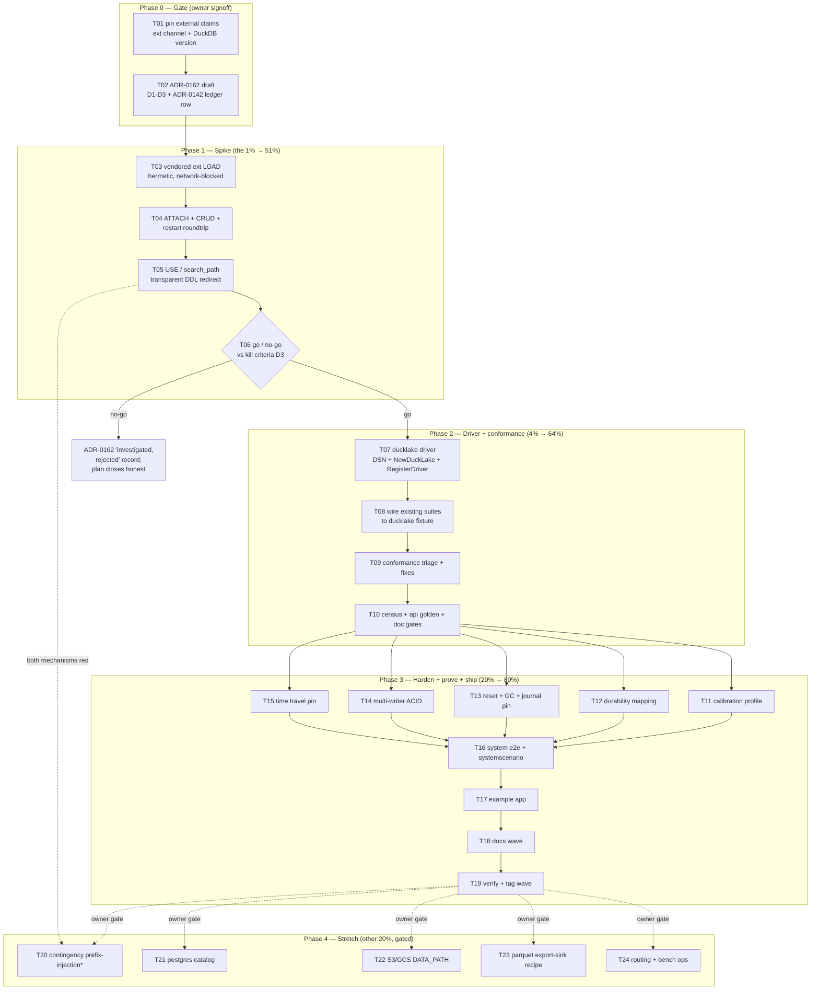

# SUPERB Plan: DuckLake Engine Driver

> **Created:** 2026-10-25 15:17 CEST
> **Status:** READY FOR EXECUTION (Phase 0 owner-gated: ADR-0162 before code; Phase 1 is the kill-fast spike)
> **Provenance:** operator directive 2026-10-25 ("CREATE A PLAN to ADD SUPPORT FOR ducklake"),
> following the architecture consult of the same day (Apache Iceberg as engine: REJECTED;
> DuckLake named "the better path" by
> [`docs/research/archive/2026-07-11_PARQUET_JOURNAL_DUCKDB_MATERIALIZATIONS.md`](../research/archive/2026-07-11_PARQUET_JOURNAL_DUCKDB_MATERIALIZATIONS.md) §7.2).
> **Format note:** Markdown with a Mermaid execution graph, per the dispatching
> instruction (same override as the 2026-10-24 value-integrity plan).

---

## 1. Why this plan exists (context a fresh session needs)

The repo has **zero DuckLake presence** today (grep over TODO_LIST, ROADMAP,
CHANGELOG, all go.mod: no hits; the only mentions are the archived 2026-07
research doc and one row in the database taxonomy research HTML). This plan
adds DuckLake support **as a metaengine engine driver** so operators get a
durable, multi-writer, Parquet-backed analytical engine selectable in
`DeploymentConfig` like any other engine.

### 1.1 What DuckLake is (30 seconds)

DuckLake (DuckDB team, announced 2025-05, **v1.0 April 2026**) is a lakehouse
format where **metadata lives in a plain SQL database** (SQLite, Postgres,
MySQL, or DuckDB itself — no catalog server) and **data lives in Parquet
files** (Iceberg-compatible). Via the `ducklake` DuckDB extension:

```sql
INSTALL ducklake;
ATTACH 'ducklake:metadata.ducklake' AS my_lake (DATA_PATH 'data/');
```

It gives what vanilla DuckDB cannot: **multi-writer ACID** across multiple
DuckDB instances, **time travel** (`AT (VERSION => n)`), schema evolution, and
portable Parquet that Spark/Trino/Pandas read directly.

### 1.2 Why this is NOT the rejected Iceberg idea

| Question | Raw Iceberg engine | DuckLake driver (this plan) |
| --- | --- | --- |
| Point CRUD via SQL? | No — copy-on-write file rewrites, worst-in-fleet fit for claims/counters/KV upserts | **Yes** — full SQL CRUD through DuckDB, the engine substrate absorbs it with (near) zero SQL changes |
| Catalog dependency | REST/Nessie/Polaris server | Plain SQL DB file/connection — reuses infra we already run |
| Go client | `iceberg-go` v0.7.0, Arrow-heavy, v0.x | none needed — rides `duckdb-go` already pinned in `duckdbengine` |
| New module? | would need one (6-gate ritual) | **no new module** — driver registered inside `metaengine/duckdbengine` |

The 2026-07 research §7.2 dismissed implementing a lakehouse **journal
format** for a single-process library — that verdict stands untouched. This
plan follows the same §7.2's own recommendation: *"If multi-writer ACID is
needed, DuckLake (which wraps this complexity) is the better path."*

### 1.3 What already exists (do not re-plan it)

| Shipped | Where |
| --- | --- |
| Mature DuckDB engine: planned tables, pushdown, vector, graph, typed WAL (A13 landed 2026-10-24), calibration profile, claimkit runtimes | `metaengine/duckdbengine/` (all `//go:build cgo`) |
| Driver self-registration pattern + durability rejection + DSN-based constructor | `metaengine/duckdbengine/register.go`, `engine.go` `New(dsn)` → `sql.Open("duckdb", dsn)` |
| Conformance suites that parametrize over engines (engine/adtmatrix/planned-parity/typed-WAL/cross-engine) | `metaengine/duckdbengine/*_cgo_test.go`, `metaengine/adttest`, `cross_engine_meta_test.go` |
| Engine capability census gate (register.go-driver-derived, generated doc) | `scripts/check-engine-capabilities.sh`, `docs/engine-capabilities.md` |
| Contract-30 A/B gate + ADR-0142 amendment ledger | AGENTS.md contract 30, `docs/adr/0142-*` |

### 1.4 Scope boundary

OUT of scope: Iceberg engine (rejected 2026-10-25), any new go.mod module,
journal-format changes, `transport/` sinks, v5 train items. The
export-sink-for-Spark recipe (T23) is a stretch item, gated behind Phase 3
completion.

---

## 2. External claims verification (per verify-external-claims; checked 2026-10-25)

| Claim | Status | Source |
| --- | --- | --- |
| DuckLake = SQL catalog + Parquet; catalogs SQLite/Postgres/MySQL/DuckDB; multi-writer ACID; time travel; `INSTALL ducklake` / `ATTACH 'ducklake:...' (DATA_PATH ...)` | ✅ verified | duckdb.org/2025/05/27/ducklake.html, ducklake.select docs, github.com/duckdb/ducklake; corroborated by repo research doc §2.3-2.4 |
| DuckLake v1.0 released April 2026 | ✅ verified | ducklake.select (release page) |
| `SET search_path = 'my_lake.main'` redirects unqualified DDL/DML into an ATTACHed database (first entry) | ✅ verified for current docs; ⚠ full DDL semantics documented on the 2.0 docs — on older DuckDB `USE db.schema` is the reliable equivalent | duckdb.org configuration "Schema and Search Path"; duckdb#11839 (maintainer: unqualified CREATE TABLE goes to first search-path entry) |
| `USE my_lake.main` sets default database+schema for unqualified DDL on all versions | ✅ verified | duckdb.org USE statement docs |
| DuckLake write ops (append/overwrite/CoW-delete/pos+eq deletes/row-delta) exist in Go? | n/a — not used; we go through DuckDB SQL, no Go lake client | — |
| `ducklake` extension binary channel + exact URL pattern for nix `fetchurl` pinning (core `extensions.duckdb.org` vs community repo), for our pinned DuckDB | ❓ **UNVERIFIED** (fetch rate-limited at plan time) — **T01a must pin this before any vendoring** | spike |
| `duckdb-go/v2 v2.10506.0` maps to which DuckDB version (1.5.x?) — extension ABI must match | ❓ **UNVERIFIED mapping** — confirm via `SELECT version()` in T01b before downloading any extension binary | `metaengine/duckdbengine/go.mod` |

**Rule carried into execution:** no external claim below becomes code until
its ❓ row turns ✅ (or the task works around it explicitly).

---

## 3. Design decision (the contract-30 B-path record)

**Decision D1 — integration shape: `ducklake` driver registered INSIDE
`metaengine/duckdbengine`** (new `ducklake.go` + `register.go` entry, behind
`//go:build cgo`). Constructor = `New(":memory:")` (volatile scratch main DB)
→ vendored `LOAD` of the ducklake extension → `ATTACH 'ducklake:<catalog>'
AS cqrs_lake (DATA_PATH '<dir>')` → `USE cqrs_lake.main` so every existing
unqualified `CREATE TABLE`/DML statement lands in the lake **with zero SQL
changes in the engine**.

| Option | Verdict | Why |
| --- | --- | --- |
| A. Driver in `duckdbengine` (chosen) | ✅ | same CGo, same deps, same dialect; no new module → none of the 6-gate ritual; census auto-picks up the new register.go driver; fleet binary count unchanged |
| B. New `metaengine/ducklakeengine` module | rejected | would duplicate or wrap the entire SQL engine for zero isolation benefit; turso-delegation precedent doesn't apply (nothing to delegate to — the logic IS duckdbengine) |
| C. Iceberg-style lake client | rejected 2026-10-25 | no SQL CRUD; catalog server; v0.x Arrow-heavy Go client |

**Decision D2 — hermetic extension loading.** Runtime `INSTALL ducklake`
(downloads from the network) is FORBIDDEN in this repo (hermetic nix builds,
CI, the sqlite-vec precedent). The extension binary is vendored via nix
`fetchurl` (hash-pinned, per-platform) and loaded via absolute-path `LOAD`
with `SET autoinstall_known_extensions=false; SET
autoload_known_extensions=false;`. T01/T03 verify feasibility; if the
extension channel cannot be pinned hermetically, that is a documented
go/no-go input, not a reason to relax hermeticity.

**Decision D3 — kill criteria (go/no-go at T06).** The plan dies (reverts to
a documented ADR-0162 "investigated, rejected" record) if ANY of:
1. the pinned duckdb-go DuckDB build cannot LOAD a vendored ducklake
   extension (ABI/platform), or
2. neither `USE` nor `search_path` redirects unqualified DDL into the
   attached catalog on our pinned version, or
3. conformance reds in T09 reveal per-table SQL rewrites (that is Option B
   cost via the back door — escalate to owner before T20 contingency).

**ADR-0162** carries D1-D3 + the ADR-0142 amendment ledger row (DuckLake =
B-verdict capability: a driver over the ONE shared engine runtime, not a
fork). `nix run .#check-adr-numbering` runs before AND after adding it.

---

## 4. Pareto framing

- **The 1% that delivers 51%: the transparent-redirect spike (Phase 1).**
  Vendored-extension LOAD + ATTACH + `USE`/`search_path` redirect proven in
  one Go test. This single proof (or failure) decides whether DuckLake
  support costs ~2 weeks (driver + existing suites) or ~2 months (forked
  engine). Everything else in the plan is downstream of it.
- **The 4% that delivers 64%: register the driver + run the EXISTING
  conformance suites against it (Phase 2).** The suites are already written
  (engine matrix, ADT matrix, planned parity, typed WAL, cross-engine);
  pointing them at the new driver is where "engine support" becomes true at
  near-zero new-test cost.
- **The 20% that delivers 80%: honest costs, the DuckLake-specific value
  props, and shipping (Phase 3).** Calibrated profile, durability mapping,
  reset/GC, multi-writer + time-travel proofs (the reasons to pick this
  engine at all), system-level e2e, example, docs wave, verified tag.
- **The other 20% to 100% (Phase 4, gated stretch):** pg-catalog + S3/GCS
  DATA_PATH variants, the Spark-facing export-sink recipe, contingency
  prefix-injection, ops/bench wiring.

---

## 5. Comprehensive plan (30–100 min tasks, all TODOs, sorted by importance/impact/effort/customer-value)

| # | Task | Phase | Impact | Effort | Customer value |
| --- | --- | --- | --- | --- | --- |
| T01 | Pin the two ❓ external claims: extension channel + URL pattern for hash-pinned vendoring; exact DuckDB version of `duckdb-go v2.10506.0` via `SELECT version()` probe | 0 gate | unblocks ALL | 30m | hermetic trust |
| T02 | ADR-0162 draft: D1-D3 decisions, kill criteria, ADR-0142 ledger row; `#check-adr-numbering` before/after | 0 gate | contract-30 gate | 45m | owner signoff artifact |
| T03 | S1 spike: nix `fetchurl` vendored ducklake ext (amd64+arm64) + Go test `LOAD '/abs/path'` + autoinstall/autoload OFF + network-blocked hermetic run | 1 spike | kill-fast | 90m | feasibility |
| T04 | S2 spike: `ATTACH 'ducklake:catalog.ducklake' AS cqrs_lake (DATA_PATH tmp)` + CRUD roundtrip + reopen-after-restart + parquet-on-disk sanity | 1 spike | kill-fast | 45m | feasibility |
| T05 | S3 spike: `USE cqrs_lake.main` AND `SET search_path` redirect of unqualified DDL/DML on our pinned version; record chosen mechanism; red ⇒ arm T20 contingency | 1 spike | THE 1% | 60m | no-fork thesis |
| T06 | Spike receipts appended to ADR-0162; go/no-go verdict vs kill criteria; update plan execution log | 1 spike | gate | 30m | honest record |
| T07 | `ducklake.go`: branded DSN type (catalog + DATA_PATH + options, turso `DbPath` precedent) + `NewDuckLake` (memory scratch + LOAD + ATTACH + USE) + `RegisterDriver("ducklake")` + durability mapping + DSN unit tests | 2 driver | core | 90m | operator-selectable engine |
| T08 | Wire `ducklake` into the existing suite matrices: engine/ADT matrix, planned parity, typed WAL, cross-engine meta | 2 driver | leverage | 60m | correctness for free |
| T09 | Run full conformance vs ducklake; triage + fix reds (PK/unique constraints, tx routing, index nuances); escalate per D3 if structural | 2 driver | correctness | 100m | trust |
| T10 | Regen gates: `check-engine-capabilities --update` (row: CGo, graph=WITH RECURSIVE), api-stability golden, doc-check, md-go | 2 driver | drift-proof | 45m | gates green |
| T11 | Calibration benchmarks on lake tables (write/scan/agg/point) → honest `Profile()` constants + comments (multi-writer tradeoff noted) | 3 harden | planner honesty | 90m | routing quality |
| T12 | Durability tier mapping (catalog checkpoint/fsync semantics); Strict = support or loud `RejectDurabilityTier`; tests | 3 harden | honesty | 45m | ops trust |
| T13 | `EngineResetter` over lake tables + journal-survives-reset pin (ADR-0143) + orphan-parquet GC check after reset/restart | 3 harden | contract | 60m | reset ladder |
| T14 | Multi-writer ACID proof: 2 connections same-process + cross-process (integration tier); document concurrency contract vs duckdb single-writer | 3 harden | THE value prop | 90m | new capability |
| T15 | Time-travel pin: `AT (VERSION => n)` snapshot read test + COOKBOOK demo fence | 3 harden | value prop | 45m | new capability |
| T16 | System e2e: `DeploymentConfig` driver name → `system.New` boots ducklake engine; `systemscenario` Given/When/Then over it | 3 harden | composition root | 60m | consumer DX |
| T17 | `example/ducklake-lakehouse` demo (build-only): register under `examplePaths` (NOT testModules), `check-example-standalone`, README + banner | 3 ship | story | 90m | copy-paste on-ramp |
| T18 | Docs wave: module-map, FEATURES row, CHANGELOG `[Unreleased]` (symbols gate), skill `modules.md`+`core.md` engine list, COOKBOOK, recipes § (compile-gated fence) | 3 ship | anti-drift | 90m | docs truth |
| T19 | Verify + release: load-sweep (timing paths touched), quiet-window `#verify`, REAL per-module test runs over changed set (batch-release `verify=ok` lesson), tag wave | 3 ship | ship | 60m | released |
| T20 | CONTINGENCY (only if T05 red): schema-prefix injection through engine SQL builders + re-run conformance | 4 stretch | fallback | 100m | de-risk |
| T21 | Postgres-catalog variant: vendor `postgres` ext, `ducklake:postgres:` DSN form, reuse `#integration-pg` harness | 4 stretch | fleet fit | 90m | ops choice |
| T22 | S3/GCS `DATA_PATH` via `httpfs` ext vendoring; hermetic test or documented skip | 4 stretch | cloud | 90m | cloud lake |
| T23 | Export-sink recipe: `StreamCollection` → Parquet segments in `DATA_PATH` readable by Spark/DuckDB as plain Parquet (the Iceberg-consult "yes" path) | 4 stretch | analytics | 90m | interop |
| T24 | Planner-routing guidance (when ducklake vs duckdb vs pg) + nightly-bench/doctor inclusion | 4 stretch | ops | 60m | operability |

**Sequencing:** T01→T02 | T03→T04→T05→T06 (kill-fast, parallelizable with nothing) | T07→T08→T09→T10 | T11-T18 (parallelizable pairs) | T19 last. T20-T24 only after T19 green + owner gate on §11 questions.

---

## 6. Micro-task plan (max 12 min each, all tasks, sorted by importance/impact/effort/customer-value)

| # | Micro-task | Parent | Est |
| --- | --- | --- | --- |
| T01a | Pin ducklake ext distribution channel + exact binary URL pattern for our DuckDB version (fetch/primary source) | T01 | 10m |
| T01b | `SELECT version()` probe test in duckdbengine; record exact DuckDB + ABI facts into plan/ADR appendix | T01 | 10m |
| T01c | Flip §2 ❓ rows to ✅/workaround; commit receipt | T01 | 10m |
| T02a | ADR-0162 skeleton: context, D1 shape table, D2 hermetic rule | T02 | 12m |
| T02b | ADR-0162: D3 kill criteria + ADR-0142 ledger row + consequences | T02 | 12m |
| T02c | `nix run .#check-adr-numbering` green; link ADR from plan | T02 | 5m |
| T03a | nix `fetchurl` pin ducklake ext linux_amd64 + sha256 | T03 | 12m |
| T03b | nix `fetchurl` pin linux_arm64 twin | T03 | 12m |
| T03c | Go test: `LOAD '/abs/path/ducklake.duckdb_extension'` succeeds | T03 | 12m |
| T03d | Set autoinstall/autoload OFF; assert no network path used | T03 | 12m |
| T03e | Hermetic proof: suite green with network blocked | T03 | 12m |
| T04a | `ATTACH 'ducklake:catalog.ducklake' AS cqrs_lake (DATA_PATH tmp)` via `sql.Exec` | T04 | 12m |
| T04b | CREATE/INSERT/SELECT roundtrip on a lake table | T04 | 12m |
| T04c | Close + reopen: catalog + parquet survive restart | T04 | 12m |
| T04d | Disk sanity: parquet files exist under DATA_PATH; catalog tables present | T04 | 9m |
| T05a | `USE cqrs_lake.main` → unqualified `CREATE TABLE` lands in lake (query `duckdb_tables()`/`information_schema`) | T05 | 12m |
| T05b | `SET search_path='cqrs_lake.main'` variant on pinned version; compare semantics | T05 | 12m |
| T05c | Full engine-shape smoke: temp table + index + tx commit via chosen mechanism | T05 | 12m |
| T05d | Record chosen mechanism in ADR; if both red ⇒ arm T20, owner ping | T05 | 10m |
| T06a | Append spike receipts to ADR-0162 + go/no-go verdict row | T06 | 12m |
| T06b | Update this plan's execution log (§13) | T06 | 5m |
| T07a | Branded DSN type: parse `<catalog>` + `DATA_PATH` + options; reject unknowns | T07 | 12m |
| T07b | `NewDuckLake`: scratch `:memory:` + vendored LOAD + ATTACH + USE/search_path | T07 | 12m |
| T07c | `RegisterDriver("ducklake", ...)` + durability tier mapping decision | T07 | 12m |
| T07d | DSN parse/construction unit tests (table-driven, bad-input rejection) | T07 | 12m |
| T07e | `String()`/redacted-DSN logging helper (no path leaks in errors) | T07 | 10m |
| T08a | Add ducklake fixture to engine matrix + ADT matrix tests | T08 | 12m |
| T08b | Add ducklake to planned-parity + layout matrices | T08 | 12m |
| T08c | Add ducklake to typed-WAL + cross-engine meta tests | T08 | 10m |
| T08d | Add ducklake to reset/watcher/health cgo suites | T08 | 12m |
| T09a | Full module suite run vs ducklake; write triage list (red/expected-red/bug) | T09 | 12m |
| T09b | Fix constraint-class reds (PK/unique on lake tables) | T09 | 12m |
| T09c | Fix tx-routing/isolation reds | T09 | 12m |
| T09d | Re-run; if structural reds remain ⇒ D3 escalation note, stop | T09 | 12m |
| T10a | `check-engine-capabilities --update`; eyeball generated row (CGo, graph same as duckdb) | T10 | 12m |
| T10b | api-stability `--update` (new exports); `TestEvery` meta-tests | T10 | 10m |
| T10c | doc-check + `#check-md-go` on touched docs | T10 | 10m |
| T11a | Port calibration bench harness onto lake tables | T11 | 12m |
| T11b | Measure batch-insert / pushdown-scan / agg / point-lookup | T11 | 12m |
| T11c | Write constants + measurement comments (duckdbengine precedent style) | T11 | 12m |
| T11d | Profile(): honest notes incl. multi-writer + parquet flush tradeoff | T11 | 10m |
| T12a | Map tiers to catalog CHECKPOINT/fsync behavior; decide Strict support vs reject | T12 | 12m |
| T12b | Durability tests for chosen mapping (incl. reject path) | T12 | 12m |
| T13a | `EngineResetter`: DROP/recreate lake tables through catalog | T13 | 12m |
| T13b | Journal-survives-reset pin (ADR-0143 semantics) | T13 | 12m |
| T13c | Orphan-parquet GC check post-reset/restart (no file litter growth) | T13 | 12m |
| T14a | Same-process 2-connection concurrent-writer ACID test | T14 | 12m |
| T14b | Cross-process writer test (integration tier, nix-run pattern) | T14 | 12m |
| T14c | Concurrency-contract doc blurb (vs duckdb single-writer; catalog-lock notes) | T14 | 10m |
| T15a | `AT (VERSION => n)` snapshot-read pin test | T15 | 12m |
| T15b | COOKBOOK demo fence (compile-safe or skip-validated) | T15 | 10m |
| T16a | `system.New` DeploymentConfig e2e on driver name `ducklake` | T16 | 12m |
| T16b | `systemscenario` Given/When/Then over the ducklake engine | T16 | 12m |
| T17a | `example/ducklake-lakehouse` skeleton + go.mod | T17 | 12m |
| T17b | Demo main: ATTACH, declare fold, query, time-travel flourish | T17 | 12m |
| T17c | Register under `examplePaths` in flake; `check-example-standalone` green | T17 | 12m |
| T17d | Example README + EXPERIMENTAL banner | T17 | 10m |
| T18a | module-map row + FEATURES row + module README note | T18 | 12m |
| T18b | CHANGELOG `[Unreleased]` rows (cited symbols pass `check-changelog-symbols`) | T18 | 12m |
| T18c | Skill refs: `modules.md` engine row, `core.md` matrix mention | T18 | 12m |
| T18d | COOKBOOK + recipes.md § (fence classified in recipes catalog) | T18 | 12m |
| T18e | ROADMAP engine list + engine-capabilities cross-links check | T18 | 10m |
| T19a | Load-sweep (`Latency|Timer|Deadline` timing check) after profile changes | T19 | 12m |
| T19b | Quiet-window `#verify` (or verify-chain) composed green | T19 | 12m |
| T19c | REAL per-module tests over changed set (GOWORK=off, -count=1) | T19 | 12m |
| T19d | Tag wave via batch-release + `--smoke`; receipts in plan log | T19 | 12m |
| T20a | Contingency: thread schema-prefix through DDL/DML builders | T20 | 12m |
| T20b | Contingency: migration of engine SQL call sites | T20 | 12m |
| T20c | Contingency: re-run full conformance vs ducklake | T20 | 12m |
| T21a | Vendor `postgres` ext (same hermetic pattern as T03) | T21 | 12m |
| T21b | `ducklake:postgres:` DSN form + tests vs `#integration-pg` | T21 | 12m |
| T22a | Vendor `httpfs` ext; `DATA_PATH s3://` form | T22 | 12m |
| T22b | Hermetic object-store test (minio/testcontainers) or documented skip | T22 | 12m |
| T23a | `StreamCollection` → parquet-segment writer into DATA_PATH | T23 | 12m |
| T23b | Segment manifest + read-back-from-raw-parquet demo (DuckDB/Spark) | T23 | 12m |
| T23c | Recipe doc + catalog classification | T23 | 12m |
| T24a | Planner-routing guidance doc (ducklake vs duckdb vs pg decision table) | T24 | 12m |
| T24b | nightly-bench backend + doctor/profile sanity | T24 | 10m |

**Totals:** 24 medium tasks (~22.7h), 79 micro-tasks. Phases 0-3 (the 80%):
~17.6h. Phase 4 stretch: ~5.1h.

---

## 7. Execution graph



`*` T20 only fires on the T05-red contingency or a D3 escalation.

---

## 8. Verification matrix

| After | Command(s) | Gate |
| --- | --- | --- |
| T02 | `nix run .#check-adr-numbering` | numbering lockstep |
| T03-T05 | `cd metaengine/duckdbengine && GOWORK=off go test -tags '' -run Spike -count=1 ./...` (cgo default on) + network-blocked rerun | hermetic spike green |
| T07-T09 | `cd metaengine/duckdbengine && GOWORK=off go test ./... -count=1` (full suite incl. matrices); `nix run .#test` for workspace | conformance |
| T10 | `nix run .#check-engine-capabilities`; `cd cmd/api-stability && GOWORK=off go run . --update` + `go test -run TestEvery .`; `nix run .#check-md-go` | drift gates |
| T11 | calibration benches (`-bench Calibration`); `nix run .#load-sweep` (timing paths) | honest costs |
| T16 | system module tests + systemscenario suite | composition root |
| T17 | `bash scripts/check-example-standalone.sh`; flake `examplePaths` build | example gates |
| T18 | `cd cmd/doc-check && GOWORK=off go run . ../../SKILL.md ../../.agents/skills/go-cqrs-lite/references/*.md ../../AGENTS.md`; `cd cmd/doc-check && GOWORK=off go test -run TestRecipes .`; `bash scripts/check-changelog-symbols.sh` | docs truth |
| T19 | `nix run .#verify` (quiet window; exclusively — no concurrent suites); REAL per-module tests over changed set BEFORE tagging (batch-release `verify=ok` does not run tests); `nix run .#check-duplication` | ship gate |

---

## 9. Verschlimmbessern guard (read before touching code)

1. **The native `duckdb` driver path must stay byte-identical.** The ducklake
   driver is purely additive (new file + new register entry). Any diff inside
   existing duckdbengine SQL/behavior needs a reason written down first.
2. **No runtime network. Ever.** Autoinstall/autoload OFF + vendored absolute
   LOAD. A green test that secretly downloaded an extension is a red test.
3. **No forked engine SQL.** If a fix requires per-engine SQL divergence,
   that is metaengine-core shared plumbing (contract 27), not a ducklake
   special case — and if it is table-prefix surgery, that is T20 territory
   behind the owner gate, not a quiet retrofit.
4. **No new module** without reopening D1 in ADR-0162.
5. **No baseline re-pins** (art-dupl, file-size) to absorb the new driver —
   use `//art-dupl:accept` directives on register.go twins (contract 19
   precedent) and keep files under 350 lines.
6. **Kill honestly.** If D3 fires, close as a documented rejected-ADR; do not
   ship a half-working driver to justify the sunk spike.

---

## 10. Risks

| Risk | Likelihood | Blast | Mitigation |
| --- | --- | --- | --- |
| Extension ABI mismatch vs pinned duckdb-go bindings | medium | kills T03 | T01b version probe FIRST; pin matching binary; fallback = bump duckdb-go (owner gate, tag-wave implication) |
| `USE`/`search_path` redirect incomplete on our DuckDB version (2.0-docs behavior) | medium | T20 contingency (100m+ surge) | both mechanisms tested in T05; `USE` verified as version-stable |
| Point-write write-amp on parquet (small-file churn) | high (inherent) | profile honesty, not correctness | T11 measures; document as OLAP-leaning engine in profile + routing guidance (T24); planner prefers others for point lookups |
| Catalog lock contention (sqlite file catalog single-writer at a time) | medium | multi-writer claim nuance | T14 measures actual concurrency contract; document precisely, overclaim nothing |
| Typed WAL (A13) semantics unsupported on lake tables | medium | WAL scoped to scratch DB | T08c surfaces; if red, scope WAL to main DB + document (engine still honest) |
| ducklake v1.0 youth (Apr 2026) | accepted | upstream bugs | pinned vendored version; kill criteria; EXPERIMENTAL banner on example + docs |
| Vendored-extension hash rot on DuckDB bumps | low | build break | sha256-pinned fetchurl fails loudly; version probe test ties LOAD to go.mod version |

---

## 11. Owner-gated questions (asked at T06/T19, not answerable here)

1. **Stretch scope:** are T21 (postgres catalog) and T22 (S3 DATA_PATH) in
   the first release wave, or parked until a named consumer asks (fleet-first
   consumer-scope policy)?
2. **Strict durability:** may `ducklake` advertise `DurabilityStrict`, or
   reject it loudly until checkpoint semantics are proven under crash tests?
3. **Tag timing:** ride the next metaengine train (with the A13 WAL cluster)
   or cut a separate duckdbengine-tagged wave?
4. **T23 export-sink:** is the Spark-facing parquet export a product goal or
   a demo recipe only? (Decides whether T23 grows a capability ADR.)

---

## 12. Errata / corrections carried into this plan

- TODO_LIST/ROADMAP/CHANGELOG carry **no** prior DuckLake rows — nothing
  stale to re-plan; this epic is net-new (verified by grep 2026-10-25).
- The 2026-07 research §7.2 "DuckLake is the better path" quote is about the
  JOURNAL format question, not engine support — this plan cites it as
  directional precedent, not as an existing decision.
- `duckdb-go v2.10506.0` → DuckDB version mapping is UNVERIFIED (§2); the
  plan refuses to assume 1.5.x until T01b proves it.
- The architecture consult (2026-10-25, this thread) rejected an Iceberg
  ENGINE, not lakehouse interop as such — T23 is the surviving interop path.

## 13. Execution log

| Date | Entry |
| --- | --- |
| 2026-10-25 15:17 | Plan created (this session). Phase 0 pending owner review. |
| 2026-10-25 15:2x | Gates at creation: `#check-md-go` green (1520 blocks valid, 84 skipped, 105 baselined archived errors unchanged — no new errors from this plan or the TODO_LIST rows). TODO_LIST harvest section added (4 epic rows, this plan linked). Note: the auto-commit daemon absorbed the initial plan + TODO_LIST edit into `0012ec2bb` together with a parallel session's `tursoengine` go.mod/go.sum drift; this receipt commit carries the authored message. Phase 0 (T01/T02) NOT started — awaiting owner go. |
