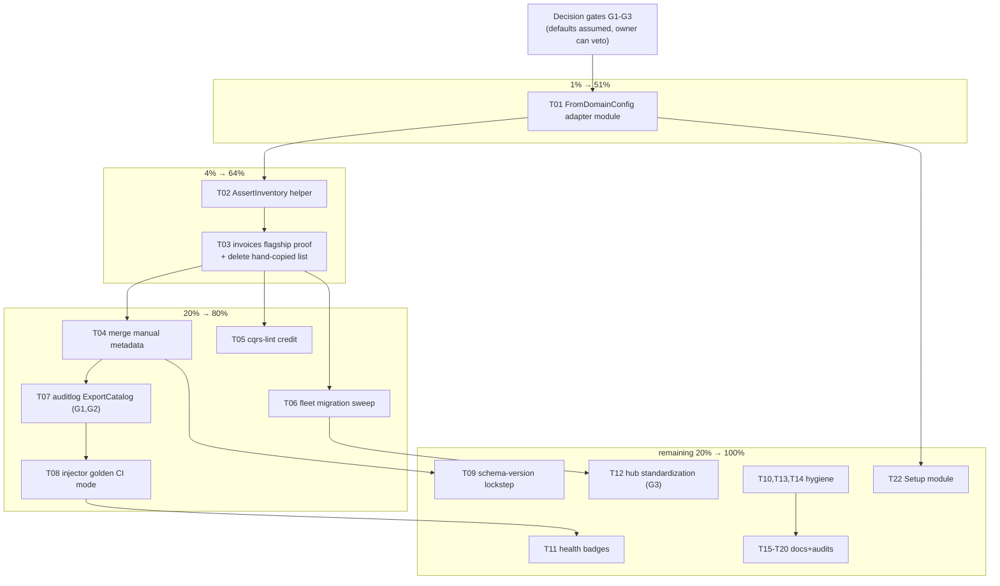

# SUPERB Plan: Catalog Truth Derivation — catalog × samber/do × auditlog Pareto Plan

**Date:** 2026-10-26 11:21
**Source:** Session findings recorded in [`docs/status/2026-10-26_11-18_catalog-do-auditlog-bridge-analysis.md`](../status/2026-10-26_11-18_catalog-do-auditlog-bridge-analysis.md) (33 items, 3 owner questions).
**Goal:** Fleet catalogs stop being hand-copied lies and become DERIVED from declared truth (`system.DomainConfig`) + runtime truth (`samber-do-auditlog`), with drift gates that make regression a build failure.
**Errata (Step-0 backlog cross-check):** `TODO_LIST.md` catalog items (ADR-0159/0160 export features, EventCatalog licence, custom exports) do NOT overlap with this session's 33 items — all 33 are new. Nothing here is already shipped (verified against CHANGELOG/TODO_LIST 2026-10-26).
**Verschlimmbessern guard:** no API is renamed, no consumer is migrated before the derivation proves byte-equivalent on one flagship repo (invoices). Every phase ends green (`#verify-fast` for lib changes; consumer module tests for fleet changes).

---

## Decision gates (block specific tasks, not the plan)

| Gate | Question (from status report §g) | Default assumption if unanswered | Blocks |
| ---- | ---------------------------------------------------------------- | ------------------------------------------------------------- | ------ |
| **G1** | Catalog Service granularity: 1 per deployable vs per bounded context? | **1 per deployable** (fleet convention); derivation leaves room for opt-in context split via option | T07 (graph→services mapping) |
| **G2** | Bridge ownership: catalog→auditlog, auditlog→catalog, or third module? | **auditlog-side exporter** (`samber-do-auditlog` imports catalog; catalog stays dep-free pure data) | T07 |
| **G3** | Is `catalog.home.lan` hub still the federation target? | **Yes, keep** — standardize toward it; architecture export is parallel, not replacement | T12 |

---

## Step 1 — Pareto breakdown

### The 1% that delivers 51%: `catalog.FromDomainConfig`
One derivation function turns every consumer's hand-copied message list (the thing that drifts, the thing that lies) into generated truth. `DomainConfig` already declares `Events`, `Schema`, commands/queries via registration, and the coeffect gate already computes producers/consumers. Everything else is leverage ON TOP of this.

### The 4% that delivers 64%: derivation + shared drift gate + one flagship proof
+ `catalog.AssertInventory` test helper (drift becomes a build failure for free) + wiring both into `invoices` and DELETING its hand-copied list. One repo fully converted is the template; the rest is mechanical.

### The 20% that delivers 80%: + fleet migration + runtime bridge
+ Migrate the remaining hand-rolled repos (Zlota44, CV, bank-sync, DiscordSync, github-local-sync, InboxClean) + `samber-do-auditlog` `ExportCatalog()` (registrations → service inventory) + injector golden-report CI mode. Now BOTH declared and runtime truth feed the catalog, fleet-wide.

### The remaining 20% (to 100%): lockstep, health, polish, audits
Schema-version lockstep (kill the split brain), health badges in the architecture export, version-from-BuildInfo, hub export standardization, skill/docs updates, stale-doc fixes, usage-depth audits, upcast-chain rendering, Setup-style fleet module.

---

## Step 2 — Comprehensive plan (medium tasks, 30–100 min each)

Sorted by importance/impact/effort/customer-value. **All 33 status-report items map into T01–T24** (mapping table at the end).

| # | Task | Tier | Impact | Effort | Value |
| --- | --- | --- | --- | --- | --- |
| T01 | `FromDomainConfig` derivation: adapter module (system-side types → `catalog.Catalog`: Services, Messages with reflection schemas, producers/consumers) + new-module ritual (8 gates) | 1% | H | 90m | Deletes the #1 fleet duplication class |
| T02 | `catalog.AssertInventory(t, cat, want...)` shared test helper + unit tests | 4% | H | 45m | Free drift ratchet for every consumer |
| T03 | invoices flagship: derive catalog from DomainConfig, AssertInventory gate, delete hand-copied message list | 4% | H | 60m | The template all other repos copy |
| T04 | Merge strategy: derived Messages + manual Flows/Owners/DataStores survive derivation (round-trip test) | 20% | H | 90m | Derivation usable without losing curated metadata |
| T05 | cqrs-lint: scorecard breadth credit for "catalog has inventory drift test" | 20% | M | 60m | Mechanical adoption pressure |
| T06 | Fleet migration sweep: Zlota44, CV, bank-sync, DiscordSync, github-local-sync → derived + gated | 20% | H | 100m | Fleet-wide truth, mechanical after T03 |
| T07 | `samber-do-auditlog`: `ExportCatalog()` (registrations → Service/Entity inventory; `ServiceGraph` → Flow steps; provider types) — auditlog-side per G2, granularity per G1 | 20% | H | 100m | Runtime truth enters the catalog |
| T08 | Injector golden CI mode: test helper boots injector, dumps `Report()` JSON, diffs as golden | 20% | M | 60m | DI graph drift becomes build failure |
| T09 | Schema-version lockstep: derived Messages carry `schema.EventSchema` version; drift between reflection shape and Schema declaration warns | rest | H | 90m | Kills the schema split brain |
| T10 | `catalog.VersionFromBuildInfo()` helper; replace hand-maintained CatalogVersion constants | rest | L | 30m | Stops version-constant rot |
| T11 | Health badges in architecture export (service cards link/aggregate health) | rest | M | 90m | Catalog starts answering "is it alive" |
| T12 | Hub export standardization: one export entrypoint convention + `catalog.home.lan` ingestion contract doc (G3) | rest | M | 60m | Consistent federation |
| T13 | InboxClean: migrate hand-rolled golden (`internal/domain/email/catalog_test.go`) to shared AssertInventory | rest | M | 30m | One-off ratchet becomes shared |
| T14 | Stale-doc fixes: samber-do-auditlog README `GOEXPERIMENT=jsonv2` removal + skill verification-table refresh | rest | L | 30m | Honesty of docs |
| T15 | Skill updates: recipes §catalog-derivation recipe (compile-verified), `catalog/simple` in quickstart | rest | M | 60m | Agents stop teaching hand-rolled catalogs |
| T16 | Dual-consumer usage-depth audit (10 repos: trivial vs flows vs full catalog) | rest | L | 60m | Right-size migration effort |
| T17 | Cross-check `catalog.DeriveProducersConsumers` vs runtime coeffect gate outputs (three-tier lockstep, contract 24) | rest | M | 60m | One producer/consumer truth |
| T18 | webphone/crm/go-appkit: classify catalog imports as intent vs transitive | rest | L | 30m | Census accuracy |
| T19 | Reuse assessment: cqrs-htmx `auditlog.Setup` live viewer as chassis for a catalog live view | rest | L | 45m | Cheap follow-on |
| T20 | Upcast-chain rendering in architecture export message sections (old→current versions) | rest | L | 90m | Schema history visible |
| T21 | `systemscenario` coverage: derivation test that boots a real `system.New` and asserts catalog matches DomainConfig | rest | M | 60m | Derivation can't silently rot |
| T22 | Setup-style fleet module: one call → derived catalog + docserver handler + export command + hub push | rest | M | 100m | The cqrs-htmx auditlog pattern, catalog side |
| T23 | Owner gate session: resolve G1/G2/G3 (30 min, blocks refinements not foundations) | — | H | 30m | Wrong granularity = rework |
| T24 | Close-out: TODO_LIST harvest, ADR for the adapter module, CHANGELOG, api-stability golden, FEATURES row | — | H | 45m | Session-close ritual (AGENTS "Close a Wave") |

---

## Step 3 — Fine breakdown (≤12 min each)

Grouped under their medium task; sorted by importance/impact/effort within the same global order as Step 2.

| Fine # | Task (≤12 min) | Parent | Est |
| --- | --- | --- | --- |
| F01 | Write design note: adapter module name/path options, dep-budget check for system→catalog edge (choose adapter module) | T01 | 12m |
| F02 | Scaffold module (`go.mod`, go.work, flake testModules, api-stability modules slice, module-layers LAYER+DEP_BUDGET, cqrs-lint module_catalog_test, api-stability exclusion maps) | T01 | 12m |
| F03 | Implement core: DomainConfig → builder calls for Service + Commands/Queries/Events from Schema + registration closures | T01 | 12m |
| F04 | Reflection schema reuse: delegate to existing `catalog.Command[T]`-style derivation for payload types | T01 | 12m |
| F05 | Producers/consumers wiring from coeffect-gate derivation | T01 | 12m |
| F06 | Options: title/version/owner/summary overrides, service ID | T01 | 12m |
| F07 | Unit tests: golden catalog from a fixture DomainConfig | T01 | 12m |
| F08 | `#verify-fast` + api-stability golden regen + doc-check | T01 | 12m |
| F09 | API sketch: `AssertInventory` signature + failure message shapes | T02 | 8m |
| F10 | Implement AssertInventory (+ variants commands/events/queries) | T02 | 12m |
| F11 | Unit tests incl. empty-catalog and drift-message clarity | T02 | 12m |
| F12 | invoices: locate DomainConfig construction, confirm derivation inputs complete | T03 | 8m |
| F13 | invoices: swap BuildCatalog body to derivation + curated metadata | T03 | 12m |
| F14 | invoices: add AssertInventory test; delete hand-copied message constants | T03 | 12m |
| F15 | invoices: run module tests + `invoices catalog` export; eyeball parity vs before | T03 | 12m |
| F16 | Merge semantics test: derivation preserves manually added Flows/Users/DataStores | T04 | 12m |
| F17 | Implement merge (derivation only adds/updates messages, never culls curated resources) | T04 | 12m |
| F18 | Round-trip test: derive → curate → derive again = stable | T04 | 12m |
| F19 | cqrs-lint: FeatureProfile field for inventory-test presence | T05 | 12m |
| F20 | cqrs-lint: scorecard credit row + tests | T05 | 12m |
| F21 | cqrs-lint: RULES.md regen + count pins + api-stability | T05 | 10m |
| F22 | Zlota44: derive + gate + delete hand-copied list + module tests | T06 | 12m |
| F23 | CV (career-pipeline): same conversion | T06 | 12m |
| F24 | bank-sync: same conversion | T06 | 12m |
| F25 | DiscordSync: same conversion (custom docs survive via merge) | T06 | 12m |
| F26 | github-local-sync: same conversion | T06 | 12m |
| F27 | auditlog: map `ServiceInfo`/`ServiceGraph` → catalog resources (design note, G1/G2 defaults) | T07 | 12m |
| F28 | auditlog: implement `ExportCatalog()` (registrations only, no invocation edges) | T07 | 12m |
| F29 | auditlog: graph→Flow steps export behind option | T07 | 12m |
| F30 | auditlog: tests with a fixture injector; golden catalog | T07 | 12m |
| F31 | auditlog: README + docs update | T07 | 10m |
| F32 | Golden helper: boot injector in test, `Report()` → JSON file, diff | T08 | 12m |
| F33 | Golden helper: normalize timestamps/RunID for determinism | T08 | 12m |
| F34 | Pilot golden in cqrs-htmx auditlog integration test | T08 | 12m |
| F35 | Derived Message: carry Schema version field | T09 | 12m |
| F36 | Drift check: reflection shape vs Schema payload type mismatch → warning (loud, not fatal in v4) | T09 | 12m |
| F37 | Tests: version stamping + mismatch warning | T09 | 12m |
| F38 | `VersionFromBuildInfo()` helper + tests | T10 | 10m |
| F39 | invoices + migrated repos: adopt BuildInfo version | T10 | 8m |
| F40 | Architecture export: health-link/badge field on Service rendering | T11 | 12m |
| F41 | Exporter option: health URL template per service | T11 | 12m |
| F42 | Self-test fault-inject (ArchRef gate) for the new section | T11 | 12m |
| F43 | Decide export entrypoint convention (subcommand name, flags) | T12 | 8m |
| F44 | Write hub ingestion contract doc (paths, frontmatter, versions) | T12 | 12m |
| F45 | Convert CV bespoke exporter + invoices subcommand to convention | T12 | 12m |
| F46 | InboxClean: replace hand-rolled golden with AssertInventory | T13 | 10m |
| F47 | auditlog README: drop GOEXPERIMENT=jsonv2 note | T14 | 5m |
| F48 | Skill: refresh samber-do-best-practices verification table (verified rows + file:line) | T14 | 12m |
| F49 | Skill: recipes.md derivation recipe skeleton | T15 | 12m |
| F50 | Recipe: compile-verify via doc-check TestRecipes catalog entry | T15 | 12m |
| F51 | Skill: quickstart section names `catalog/simple` for single-service apps | T15 | 10m |
| F52 | Audit matrix: for each of 10 dual consumers, record catalog depth | T16 | 12m |
| F53 | Cross-check script/test: DeriveProducersConsumers vs coeffect gate on fixture | T17 | 12m |
| F54 | Record discrepancies; file follow-ups if any | T17 | 8m |
| F55 | webphone/crm/go-appkit import classification (direct code vs go.mod residue) | T18 | 10m |
| F56 | cqrs-htmx auditlog viewer: capability inventory vs catalog live-view needs | T19 | 12m |
| F57 | Write reuse verdict note (build / reuse / skip) | T19 | 8m |
| F58 | Architecture export: render upcast chain on message sections (data plumbing) | T20 | 12m |
| F59 | Upcast rendering tests + gate | T20 | 12m |
| F60 | systemscenario test: boot system.New, assert derived catalog matches DomainConfig | T21 | 12m |
| F61 | Setup module API sketch (mirror cqrs-htmx auditlog.Setup shape) | T22 | 12m |
| F62 | Setup module: implement + tests | T22 | 12m |
| F63 | Setup module: one pilot consumer | T22 | 12m |
| F64 | Prepare G1/G2/G3 one-pager for owner decision | T23 | 10m |
| F65 | TODO_LIST harvest of all closed/open items from this plan | T24 | 12m |
| F66 | ADR draft for adapter module decision (if T01 shipped) | T24 | 12m |
| F67 | CHANGELOG [Unreleased] rows + changelog-symbols gate | T24 | 10m |
| F68 | FEATURES.md row + module-map + api-stability golden regen | T24 | 12m |

*(68 fine tasks covering all 24 medium tasks; every status-report item mapped below.)*

---

## Coverage audit — all 33 status-report items mapped

| Status item(s) | Covered by |
| -------------- | ---------- |
| 1–6 (derivation, granularity, bridge, golden mode, schema stamps, lazy-blind-spot) | T01, T23(G1), T07, T08, T09, F27 (registrations-only default) |
| 7–10 (drift gates, InboxClean migration, lint credit, fleet sweep) | T02, T13, T05, T06 |
| 11–15 (simple-migration, Setup module, export entrypoint, hub contract, BuildInfo) | T06, T22, T12, T12, T10 |
| 16–18 (health badges, viewer cross-link, health in HTML report) | T11, T19, T07-adjacent (auditlog side, folded into T07 docs) |
| 19–22 (README fix, skill table, recipe, simple in quickstart) | T14, T14, T15, T15 |
| 23–25 (schema version on Message, drift warn, upcast rendering) | T09, T09, T20 |
| 26–30 (depth audit, hub consistency, producers/consumers cross-check, transitive classification, viewer reuse) | T16, T12, T17, T18, T19 |
| 31–33 (harvest, dep-free catalog, new-module ritual) | T24, G2 default, F02 |

## Verification & safety rules

1. Library changes: `nix run .#verify-fast` minimum; touched modules get `GOWORK=off go test -count=1 ./...`.
2. API-surface change ⇒ api golden regen in the SAME edit (AGENTS contract).
3. New module ⇒ full 8-gate registration ritual (F02) — never partially registered.
4. No consumer migration before invoices proves parity (F15).
5. Nothing renamed, nothing deleted from public surfaces; v4.x additive only.
6. md-go gate: this file contains no Go fences (mermaid only) — compliant by construction.

## Open risks

- **G1 wrong = T07 rework** (mitigated: registrations-only default keeps granularity out of the core exporter).
- **system dep budget** may refuse a catalog edge — that's exactly why F01 decides adapter-module-first.
- **Fleet repos have their own auto-commit daemons and parallel sessions** — convert one repo per commit, never batch-push across repos.
