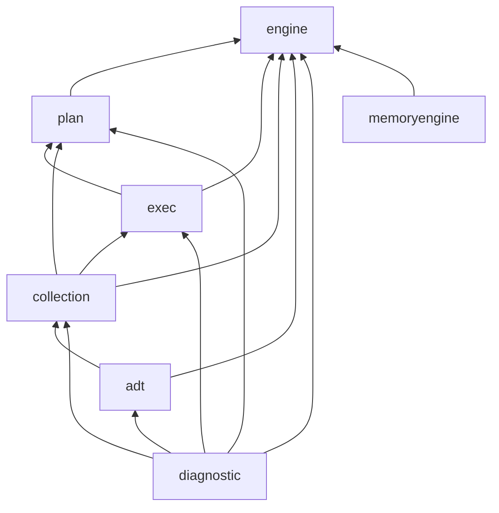

# Metaengine v5: split one 829-symbol package into seven

**Created:** 2026-10-26 CET
**Author:** Crush (architecture-review follow-up, plan task T05)
**Basis commit:** `002fa3f18` (working tree)
**Status:** DESIGN ONLY. No code has moved; this document is the execution blueprint for v5.
**Decision record:** [ADR-0162](../adr/0162-metaengine-v5-seven-package-split.md)
**Inputs:** `docs/architecture-understanding/2026-10-24_16-54_architecture-review.html` (finding 1),
`docs/planning/2026-10-25_04-25_SUPERB-architecture-review-followup-pareto-plan.md` (T05),
`docs/adr/0152-fleet-first-module-topology-v5-dual-support.md` (v5 module topology).

---

## 1. The problem, measured

`metaengine` (the module root package) is the single largest API surface in the library and the
only place where nine unrelated concerns share one namespace:

| Measure | Value | Source |
| ------- | ----: | ------ |
| Production files in the root package | 167 | `ls metaengine/*.go` minus `_test.go` |
| Exported top-level declarations (AST) | 935 | `go/ast` walk over those files |
| Exported symbols in the api-stability golden | 829 | `docs/api_surface.txt`, `^metaengine/` rows |
| Production LOC | 27,716 | `wc -l` over those files |
| Share of the library API | 13.1% | 829 / 6,327 exported symbols |
| Test files in the same package | 180 | `ls metaengine/*_test.go` |

The two symbol numbers differ (935 vs 829) because the api-stability golden applies its own
counting rules; the split below uses the AST number consistently for every target package, so the
comparison between target packages is apples-to-apples. The 106-symbol delta is a property of the
golden, not of this design.

Nothing in the current gate set can see this: `check-file-size.sh` bounds FILES (and the largest
file, `metaengine/fold.go`, is 58 symbols, well under any per-file notion of too big), while the
new `check-package-surface.sh` bounds PACKAGES — which is why this package is one of its 8
baselined offenders and why a v5 split is now measurable rather than a matter of taste.

## 2. The seven targets

| Target package | Files | Exported decls | Production LOC | Max symbols | Role |
| -------------- | ----: | -------------: | -------------: | ----------: | ---- |
| `metaengine/engine` | 28 | 248 | 5,247 | 248 | Engine SPI, shared contract types, driver registry, capability interfaces (`Prober`, `DedupStore`, `DueClaimer`, ...), health/lifecycle, durability + reliability contracts. |
| `metaengine/plan` | 29 | 142 | 4,117 | 142 | Cost model, layout arithmetics + scoring, plan rules (11 `rule_*.go`), calibration and live-latency priors, plan audit/diff, re-layout. |
| `metaengine/exec` | 20 | 80 | 3,076 | 80 | Execution of a plan: execute/dispatch, transactions, SSE streaming + replay, keyset/cursor paging, routing between engines. |
| `metaengine/collection` | 22 | 132 | 4,176 | 132 | The `Store` facade and the write model: folds + derivations, materialized views, backfill, reset, persistence, hooks. |
| `metaengine/adt` | 47 | 195 | 7,472 | 195 | Typed read side and ADTs: typed readers, aggregate/query builders, vector/temporal/spatial/graph ADTs, scan + filter helpers, reflect/inference glue. |
| `metaengine/diagnostic` | 13 | 72 | 2,246 | 72 | Explain/doctor/DX: plan explanation, `Doctor`, traces, observability, stats, benchmarks. |
| `metaengine/memoryengine` | 8 | 66 | 1,382 | 66 | The in-process memory driver — a sibling of `sqliteengine`/`pebbleengine`/..., not a resident of the planning package. |
| **total** | **167** | **935** | **27,716** | — | nothing is dropped |

Every target sits under the 300-symbol ceiling the review proposed; the largest (`engine`) is
248, a 70% reduction from 829. Two decisions deserve naming:

- **`engine` owns the shared types.** `types.go`, `errors.go`, `branded_units.go`, `enum_validation.go` are imported by every other target. A five-way split with no home for them
  forces either a sixth package (what this design does) or duplication (what a naive split does).
- **`memoryengine` is a driver, not planning logic.** The eight `memory_*.go` files (1,382 LOC —
  the exact figure the review reported) move beside the other eleven driver modules. `register.go`'s
  `RegisterDriver("memory", ...)` init moves with them; the generic registry stays in `engine`.

## 3. Dependency rule



| Package | May import |
| ------- | ---------- |
| `engine` | none (Tier-0 inside the family: stdlib + `record` + `dedup`) |
| `plan` | engine |
| `exec` | engine, plan |
| `collection` | engine, plan, exec |
| `adt` | engine, collection |
| `diagnostic` | all of the above (read-only consumer) |
| `memoryengine` | engine (+ the capability interfaces it implements) |

The rule is a strict DAG: `engine` is a leaf, `diagnostic` is a sink. It is checkable mechanically
with commands that already exist:

```bash
# 1. no cycles at all (test-only edges excluded by construction)
bash scripts/check-cycles.sh
# 2. the rule itself: the only in-repo imports of a metaengine subpackage
rg -n 'go-cqrs-lite/metaengine/v5/' metaengine/ | grep -v _test.go
# 3. per-package ceilings after the move
bash scripts/check-package-surface.sh --report
```

`rg` over the imports is the executable form of the table above; the v5 module path makes the
packages greppable, which today they are not (every symbol lives at `metaengine/`).

## 4. File-by-file move table

Every one of the 167 production files is assigned. `syms` = exported top-level declarations in that
file, `loc` = physical lines. Test files are not listed individually: each `*_test.go` moves with
the file of the same base name (180 files; any orphan test is a compile error in the same commit,
which is the point of making the move in compile-gated steps).

### 4.1 `engine` — 28 files, 248 symbols, 5,247 LOC

| File | syms | loc |
| ---- | ---: | --: |
| `engine.go` | 40 | 644 |
| `types.go` | 39 | 164 |
| `probe.go` | 24 | 356 |
| `errors.go` | 18 | 196 |
| `reliability.go` | 17 | 360 |
| `enum_validation.go` | 12 | 79 |
| `runtime_backend.go` | 12 | 448 |
| `engine_health.go` | 11 | 386 |
| `consistency.go` | 10 | 186 |
| `dueclaim.go` | 9 | 199 |
| `replication.go` | 9 | 73 |
| `durability.go` | 8 | 109 |
| `roles.go` | 8 | 212 |
| `registry.go` | 6 | 104 |
| `branded_units.go` | 4 | 16 |
| `demote.go` | 4 | 322 |
| `capability_audit.go` | 3 | 340 |
| `errors_planned.go` | 3 | 66 |
| `catchup_state.go` | 2 | 124 |
| `dedup_store.go` | 2 | 52 |
| `engine_sqlite_profile.go` | 2 | 69 |
| `failover.go` | 2 | 236 |
| `identifier.go` | 1 | 29 |
| `replicator.go` | 1 | 316 |
| `sanitize.go` | 1 | 29 |
| `doc.go` | 0 | 8 |
| `health_observer.go` | 0 | 93 |
| `register.go` | 0 | 31 |

### 4.2 `plan` — 29 files, 142 symbols, 4,117 LOC

| File | syms | loc |
| ---- | ---: | --: |
| `plan_types.go` | 14 | 194 |
| `priority.go` | 13 | 183 |
| `latency.go` | 12 | 268 |
| `plan_diff.go` | 11 | 239 |
| `planner_options.go` | 10 | 112 |
| `layout_fingerprint.go` | 8 | 215 |
| `layout_observability.go` | 8 | 177 |
| `layout_scoring.go` | 8 | 230 |
| `layout.go` | 7 | 164 |
| `layout_type.go` | 5 | 26 |
| `relayout.go` | 5 | 206 |
| `rules.go` | 5 | 104 |
| `cost.go` | 4 | 235 |
| `layout_typed.go` | 3 | 207 |
| `planner.go` | 3 | 476 |
| `dsl.go` | 2 | 51 |
| `plan_audit.go` | 2 | 123 |
| `rule_degraded_adt.go` | 2 | 82 |
| `rule_durability.go` | 2 | 105 |
| `rule_layout.go` | 2 | 97 |
| `rule_live_latency.go` | 2 | 98 |
| `rule_mapupdate_warn.go` | 2 | 79 |
| `rule_replication.go` | 2 | 46 |
| `rule_schema.go` | 2 | 54 |
| `rule_shared_collection.go` | 2 | 153 |
| `rule_temporal_asof.go` | 2 | 55 |
| `rule_writeamp.go` | 2 | 18 |
| `ddl_lock.go` | 1 | 54 |
| `layout_stamp_boot.go` | 1 | 66 |

### 4.3 `exec` — 20 files, 80 symbols, 3,076 LOC

| File | syms | loc |
| ---- | ---: | --: |
| `scan_options.go` | 14 | 133 |
| `store_collaborators.go` | 11 | 174 |
| `scan.go` | 10 | 318 |
| `sse.go` | 7 | 263 |
| `execute.go` | 5 | 702 |
| `sse_replay.go` | 5 | 134 |
| `stream_codec.go` | 5 | 101 |
| `sort_paginate.go` | 4 | 152 |
| `sql_keyset.go` | 4 | 125 |
| `store_routing.go` | 4 | 275 |
| `cursor.go` | 3 | 106 |
| `dispatch.go` | 3 | 57 |
| `seq_seek.go` | 2 | 57 |
| `raw_reader.go` | 1 | 15 |
| `stream_collection.go` | 1 | 78 |
| `transaction.go` | 1 | 9 |
| `execute_adts.go` | 0 | 109 |
| `scan_drain.go` | 0 | 44 |
| `sse_loop.go` | 0 | 114 |
| `subscribers.go` | 0 | 110 |

### 4.4 `collection` — 22 files, 132 symbols, 4,176 LOC

| File | syms | loc |
| ---- | ---: | --: |
| `fold.go` | 58 | 480 |
| `store.go` | 15 | 578 |
| `materialized_view.go` | 10 | 139 |
| `advanced.go` | 8 | 394 |
| `materialize.go` | 7 | 156 |
| `auto_named_events.go` | 5 | 147 |
| `backfill.go` | 5 | 184 |
| `persistence.go` | 5 | 44 |
| `reset.go` | 5 | 113 |
| `auto_fold.go` | 4 | 200 |
| `materialized_view_versions.go` | 3 | 17 |
| `export_import.go` | 2 | 132 |
| `hooks.go` | 2 | 166 |
| `auto_naming.go` | 1 | 212 |
| `fold_inference.go` | 1 | 291 |
| `override.go` | 1 | 69 |
| `fold_classify.go` | 0 | 153 |
| `fold_locks.go` | 0 | 40 |
| `store_folds.go` | 0 | 325 |
| `store_folds_adts.go` | 0 | 208 |
| `task_snapshot.go` | 0 | 55 |
| `version_chain.go` | 0 | 73 |

### 4.5 `adt` — 47 files, 195 symbols, 7,472 LOC

| File | syms | loc |
| ---- | ---: | --: |
| `vector_search.go` | 19 | 357 |
| `aggregations.go` | 16 | 141 |
| `query.go` | 16 | 331 |
| `query_config.go` | 14 | 230 |
| `query_builder.go` | 10 | 84 |
| `serializable.go` | 9 | 165 |
| `typed_reader_grouped.go` | 9 | 332 |
| `spatial.go` | 8 | 122 |
| `temporal_write.go` | 8 | 178 |
| `map_dueclaim.go` | 7 | 260 |
| `vector_memory.go` | 7 | 150 |
| `planned_filter.go` | 6 | 149 |
| `typed_reader.go` | 6 | 163 |
| `map_dedup.go` | 5 | 149 |
| `typed_reader_aggregates.go` | 5 | 129 |
| `vector_binary.go` | 5 | 133 |
| `cap.go` | 4 | 328 |
| `exported_helpers.go` | 4 | 64 |
| `vector_path.go` | 4 | 161 |
| `extract_helpers.go` | 3 | 140 |
| `planned_tables_observability.go` | 3 | 96 |
| `record_fold.go` | 3 | 272 |
| `temporal.go` | 3 | 111 |
| `vector_scan.go` | 3 | 86 |
| `vector_search_execute.go` | 3 | 208 |
| `encoded.go` | 2 | 225 |
| `graph_walk.go` | 2 | 88 |
| `vector_dimension.go` | 2 | 44 |
| `vector_insert.go` | 2 | 45 |
| `filter_bind.go` | 1 | 51 |
| `infer_named.go` | 1 | 82 |
| `planned_tables.go` | 1 | 42 |
| `reflect.go` | 1 | 347 |
| `register_query.go` | 1 | 157 |
| `typed_reader_cursor.go` | 1 | 145 |
| `typed_reader_scan.go` | 1 | 246 |
| `collection.go` | 0 | 119 |
| `compare.go` | 0 | 233 |
| `graph_fallback.go` | 0 | 73 |
| `infer_composite.go` | 0 | 266 |
| `infer_filters.go` | 0 | 142 |
| `infer_sort.go` | 0 | 50 |
| `record_context.go` | 0 | 197 |
| `record_stamp.go` | 0 | 99 |
| `reflect_row.go` | 0 | 37 |
| `reify.go` | 0 | 90 |
| `typed_reader_closure.go` | 0 | 155 |

### 4.6 `diagnostic` — 13 files, 72 symbols, 2,246 LOC

| File | syms | loc |
| ---- | ---: | --: |
| `dx.go` | 18 | 443 |
| `observability.go` | 16 | 315 |
| `explain.go` | 8 | 331 |
| `trace_player.go` | 8 | 136 |
| `trace.go` | 7 | 132 |
| `benchmark.go` | 5 | 189 |
| `stats.go` | 4 | 83 |
| `engine_stats.go` | 3 | 176 |
| `inspect.go` | 2 | 38 |
| `materialized_view_doctor.go` | 1 | 69 |
| `doctor_degraded.go` | 0 | 68 |
| `explain_doctor.go` | 0 | 210 |
| `reset_observability.go` | 0 | 56 |

### 4.7 `memoryengine` — 8 files, 66 symbols, 1,382 LOC

| File | syms | loc |
| ---- | ---: | --: |
| `memory_engine.go` | 18 | 301 |
| `memory_stream_log.go` | 11 | 255 |
| `memory_versioned.go` | 10 | 297 |
| `memory_backends.go` | 9 | 111 |
| `memory_dueclaim.go` | 8 | 70 |
| `memory_snapshot.go` | 5 | 95 |
| `memory_graph.go` | 4 | 205 |
| `memory_reset.go` | 1 | 48 |

## 5. Ceilings and verification

| Check | Before the split | After the split |
| ----- | ---------------- | --------------- |
| `check-package-surface.sh` max exported decls per metaengine package | 829 (`metaengine`) | 248 (`metaengine/engine`) |
| `check-package-surface.sh` max files per metaengine package | 167 | 47 (`metaengine/adt`) |
| `check-cycles.sh` production cycles | 0 | 0 (the DAG above forbids them) |
| `#check-arch` dependency budgets | n/a (one package) | seven module-internal packages: no new go.mod, so no new budget rows |

The baseline entry for `metaengine` (829 / 167) is removed when the split lands; each new package
lands under both ceilings and therefore needs no baseline row at all. That is the ratchet working
as designed: the historical offender disappears instead of following the code into six packages.

## 6. Alias and forwarding strategy

**No compatibility shims.** v5 is a breaking module path; the v4 module keeps its current shape
and keeps serving its pins. A `metaengine` facade that re-exported seven packages would:

1. re-create the 935-symbol namespace the split exists to remove,
2. make `check-package-surface.sh` red on day one (the facade itself),
3. give consumers a migration path that never ends (nothing forces them off the facade).

Instead: one `core`-style facade per consumer need — i.e. the composition root (`system`) keeps
constructing a `*collection.Store`; consumers that only ever touched `Store` see a type rename,
not a redesign. The mechanical rename is the `cqrs-upgrade --to-v5` codemod's job (19-19 T13),
which today has zero `core/v5` awareness — the split therefore lands with the codemod's metaengine
mapping table, not before it.

## 7. Migration sequence (v5 branch only, never in v4)

| Step | Move | Compile gate | Why this order |
| ---- | ---- | ------------ | -------------- |
| 1 | `engine` (28 files) | `go build ./...` + `go test ./metaengine/...` | The leaf: everything else will import it. |
| 2 | `plan` (29) | same | Only depends on `engine`. |
| 3 | `exec` (20) | same | Depends on `engine` + `plan`. |
| 4 | `collection` (22) | same | The `Store` facade; every consumer of the old package now has a home. |
| 5 | `adt` (47) | same | Read side; consumes `collection`. |
| 6 | `diagnostic` (13) | same | Sink; last because it reads everything. |
| 7 | `memoryengine` (8) | `go build ./...` across the workspace | Driver extraction; `register.go` init moves with it. |
| 8 | delete the old root package | `bash scripts/check-package-surface.sh` + `check-cycles.sh` + `check-arch` | Proves nothing is left behind and no ceiling regressed. |

Steps 1–8 must be separate commits on the v5 branch, each green: a single "move 167 files" commit
is unreviewable and, when it fails, indistinguishable from a design error.

## 8. Risks

| Risk | Guard |
| ---- | ----- |
| Internal-identifier leakage: 500+ unexported helpers are shared across what become package boundaries | Step 1–7 compile gates; each leakage becomes a missing `engine`/`adt` export, which the ceiling table then budgets |
| `Store` is a god facade that touches every target | Keep `Store` in `collection` and route through the `exec` and `adt` interfaces it already uses; if `Store` needs `diagnostic`, invert the dependency (diagnostic reads, never writes) |
| Test-file orphans (180 files follow 167 subjects) | Each step runs the package tests; an orphan test fails to compile in that step |
| Codemod missing at cut time | The split does not ship before the mapping table (T22) exists; v5 tag waves gate on the codemod |
| The split re-creates the god package by re-aggregation (a `metaengine` umbrella) | No alias facade (§6) and the package-surface ratchet fail on a new 900-symbol package |
| Ceilings creep during v5 development | Each new package is born under the ceiling; growth fails `check-package-surface.sh` in CI |

## 9. Open questions (owner)

1. **One module or seven?** This design keeps ONE `metaengine/v5` module with seven packages
   (mirroring `core/v5`). Seven modules would allow independent versioning but multiplies the
   release train count — the repo already coordinates 112 trains, and `cmd/cqrs-lint` has its own
   extraction question (Q2). Default: one module.
2. **`adt` vs two packages.** `adt` is the second largest target (195 symbols). If it exceeds 300
   in practice, split typed readers from the spatial/vector/graph ADTs; the file table is already
   ordered so that the cut is mechanical.
3. **Driver naming.** `memoryengine` matches the eleven existing `*engine` modules. Confirmed by
   the review; stated here so the v5 action does not re-litigate it.

## 10. Provenance

- File list, symbol counts, LOC: computed 002fa3f18 by AST walk + `wc -l` over `metaengine/*.go`
  (excluding `_test.go`); the memory driver subtotal (8 files / 1,382 LOC) reproduces the review
  figure exactly, which is the cross-check that the census is right.
- Symbol ceiling rationale and the 13.1% API share: `docs/architecture-understanding/2026-10-24_16-54_architecture-review.html` §3 finding 1.
- v5 module topology: ADR-0152.
