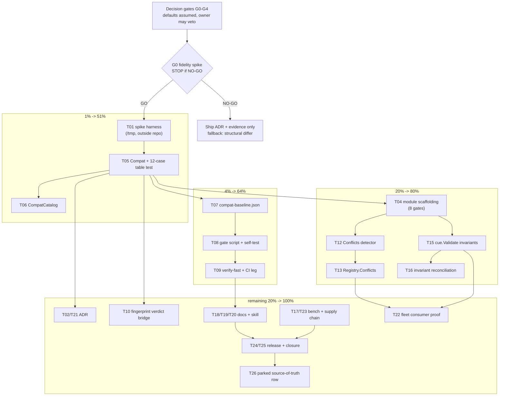

# SUPERB Plan: catalog × CUE — executable compatibility policy, unification, declarative invariants

> **Status (2026-11-02, executed): G0 came back NO-GO, the recorded fallback shipped, everything CUE-specific did not.**
> Current truth lives in [ADR-0163](../adr/0163-schema-compatibility-structural-differ-over-cue.md),
> [`docs/evidence/2026-11-02_cue-subsume-spike.md`](../evidence/2026-11-02_cue-subsume-spike.md), and
> `catalog/compat/`. This document is the dated record of what was intended; §"Execution addendum"
> at the end records per-task what actually happened, with evidence. The original text below is
> unchanged, including the parts that turned out to be wrong.

**Date:** 2026-11-02 05:31
**Trigger:** owner question "How could `catalog/` benefit from https://cuelang.org/?"
**Goal:** Turn the repo's *prose* schema-compatibility policy into a *mechanical classifier*, add unification-based conflict detection for catalog merges, and offer a declarative cross-resource catalog validator. All of it optional, isolated, and never a second source of truth.
**Verdict up front:** CUE is worth adopting **only** for those three capabilities. It is **not** an upgrade for the exporters, not a JSON Schema replacement, and not a schema authoring language for this repo. If G0 fails, the plan stops after the ADR and the spike artifact.

---

## Step 0 — Errata and backlog cross-check (done before ranking)

Verified by reading source, `TODO_LIST.md`, `CHANGELOG.md`, and the two most recent planning docs. Corrections that change the plan:

| Check | Finding | Consequence |
| --- | --- | --- |
| Any existing CUE usage? | No. `grep -ril 'cuelang\|CUE'` finds only two false positives in `cmd/cqrs-lint` ("CUE" inside unrelated prose). | Nothing to reconcile, no parallel work to merge. |
| Does a compatibility policy already exist? | **Yes.** [`docs/SCHEMA-COMPATIBILITY.md`](../SCHEMA-COMPATIBILITY.md) is a written policy (additive / version-bump / never) enforced *socially* plus statically by cqrs-lint **E021/E022** (ladder gaps). | **This reframes the whole plan.** CUE's job is not "add a compat policy"; it is "make the existing policy executable". A new policy doc would be a split brain. |
| Is there drift *detection* already? | **Yes.** `schema.EventSchema.Fingerprint()`, `FingerprintStamp`, `FingerprintDrift`/`FingerprintDriftHard` (`schema/fingerprint*.go`), plus `LayoutPlan.Fingerprint` for read models. | A fingerprint answers "did the shape change?". It cannot answer "was that change additive or breaking?". That gap is the actual product. |
| Is the catalog hand-maintained? | **Partially, already fixed.** `catalog.FromTypedSchema` renders `schema.EventSchema` into catalog messages (single declaration drives upcasting *and* governance export). | Do not build a second declaration path. CUE consumes rendered output. |
| Does `catalog.Validate()` overlap? | It is 311 lines of field-level and ID-uniqueness checks; `coeffects.go` does producer/consumer derivation. | `cue.Validate` must be *additive*: cross-resource invariants only, never a replacement. |
| Prior catalog plan overlap? | [`2026-10-26_11-21_SUPERB-catalog-truth-derivation-pareto-plan.md`](2026-10-26_11-21_SUPERB-catalog-truth-derivation-pareto-plan.md) ships `FromDomainConfig`, `AssertInventory`, fleet migration. | Orthogonal, no serialization needed. |
| Prior schema plan overlap? | [`2026-10-09_v5-declarative-schema-evolution.md`](2026-10-09_v5-declarative-schema-evolution.md) + [execution plan](2026-10-09_18-02_SUPERB-v5-schema-evolution-execution-plan.md) shipped T1–T6. | Its `T6 compat policy` row is DONE as *documentation*. This plan is explicitly its mechanical successor, not a re-dispatch. |
| Library policy | `cuelang.org/go` is not on the banned list (`how-to-golang/references/banned-libraries.md`). | Allowed, but must be dependency-isolated. |
| Facts verified against upstream | CUE **v0.17.1** (published 2026-07-16, Apache-2.0). `cue.Value.Subsume(w, opts...)`, `cue.Value.Unify(w)`, `cue.Context.Encode`, `encoding/jsonschema.Extract(data, cfg) (*ast.File, error)` ("guaranteed to deem valid any value that is a valid instance of the source JSON schema" — an *over-approximation* guarantee, which is exactly the direction compat checking needs), `encoding/jsonschema.Generate` is **experimental** ("the form may, and probably will, change from release to release"). | The **JSON Schema → CUE** direction is the safe one. The **CUE → JSON Schema** direction is experimental, which independently kills "CUE as the schema source of truth" for now. |

---

## Non-goals and verschlimmbessern guard

Rules this plan will not break:

1. **No second source of truth.** Schemas stay as Go types rendered by `catalog/schema`; declarations stay in `schema.EventSchema`. CUE *reads* them.
2. **No replacement of `catalog.Validate()`** and no removal of any check it performs today.
3. **No change to `Registry.AddService` merge semantics.** Conflict detection is an *additional* method.
4. **No new dependency inside `catalog/`, `schema/`, or any existing module.** CUE lives in a new sibling module `catalog/cue` with its own dep budget row, exactly like `metaengine/*engine` isolates dialect deps.
5. **Every phase ends green** (`nix run .#verify-fast` for library work) and every gate script ships a `--self-test`.
6. **Nothing ships on an unproven primitive.** G0 is a real stop/go, and its negative result is a legitimate, shippable outcome.

---

## Decision gates

| Gate | Question | Default if unanswered | Blocks |
| --- | --- | --- | --- |
| **G0** | Does `jsonschema.Extract` + `Value.Subsume` classify the 3 policy classes (additive / bump-required / breaking) **correctly on all 12 fixtures**, including the open-struct cases? | **NO-GO.** Ship the ADR + spike artifact, stop. Fallback design recorded: hand-rolled structural differ behind the same `Compat` signature. | **T04–T26** |
| *G0 outcome (2026-11-02)* | **NO-GO, for a different reason than anticipated.** The primitive is stronger than feared — 22/24 on 24 fixtures with `Config{}` + `cue.Raw()`, and every additive row correct. It fails on soundness instead: the two residual misses (`format` swap, newly constrained array `items`) are false *compatible*, the unsafe direction. See [evidence](../evidence/2026-11-02_cue-subsume-spike.md). | Fallback taken, as recorded | closed |
| **G1** | Home: `catalog/cue` or `schema/cue`? | **`catalog/cue`** (Layer 7 tooling). `schema/` is Tier 2 and must stay dependency-light; `catalog` already imports `schema`. | T18, T21 |
| *G1 outcome (2026-11-02)* | **Superseded.** No new module: the package is `catalog/compat` **inside** the existing `catalog` module, because G0 removed the only reason to isolate it (there is no CUE dependency to quarantine). A new module would have bought eight gate registrations and zero consumer benefit. | — | closed |
| **G2** | Baseline artifact: committed JSON vs derive from the last git tag? | **Committed `catalog/compat-baseline.json` + `--update-baseline`**, matching every other baseline in this repo (coverage, file-size, fuzz targets). | T07, T08 |
| *G2 outcome (2026-11-02)* | **Mechanism DONE, artifact NOT SHIPPED.** `Baseline`/`NewBaseline`/`CompareBaseline`/`WriteFile`/`ParseBaseline` and the `--update-baseline` CLI exist (`catalog/compat/baseline.go`); no `compat-baseline.json` is committed because the repo has no catalog of its own to gate — see the open owner question. | Partial | T07 |
| **G3** | Merge ambition: detector-only unification, or full `Catalog` round-trip merge? | **Detector-only.** `Unify` produces conflict paths; the Go-side merge stays untouched. A decode-merge is a lossy round-trip risk (custom ID types, `Parameters json:"-"`, derived `Kind`). | T12, T13 |
| *G3 outcome (2026-11-02)* | **DONE, re-scoped.** `Conflicts(a, b)` shipped (`catalog/compat/conflicts.go`). `Registry.Conflicts()` was **dropped deliberately**: global duplicate-ID detection already exists in `Catalog.Validate` (`seenMsgIDs`), so a second detector would be the split brain this plan exists to avoid. There is also no CUE `Unify` step — the detection is structural. | Done | T12, T13 |
| **G4** | Is a pre-v1 (v0.x) dependency acceptable at all? | **Yes, isolated.** Pin exactly, document upgrade cadence, keep the public surface CUE-free (plain structs + errors). | T23 |
| *G4 outcome (2026-11-02)* | **Moot.** No v0.x dependency entered the tree. CUE was measured in a scratch module and never linked by any shipped package, so the supply-chain question never arose. | Moot | closed |

---

## Step 1 — Pareto breakdown

### The 1% that delivers 51%: `catalog/cue.Compat`

One function answers a question the repo has answered with prose for a year:

```go
package cue

import "github.com/larsartmann/go-cqrs-lite/catalog/schema"

// Compat classifies the change from oldSchema to newSchema using the
// classification rules already written in docs/SCHEMA-COMPATIBILITY.md.
func Compat(oldSchema, newSchema *schema.Schema) (Report, error)
```

`Report` carries `Class` (Additive / NeedsVersionBump / Breaking / Incomparable) plus path-level `Findings`. Pipeline: `catalog/schema.ToAny` → `cuecontext.Encode` → `jsonschema.Extract` → `Value.Subsume` in both directions. This is the only capability in the ecosystem that gives subtype checks over JSON Schema without hand-writing a rule engine, and it converts an existing human policy into a build failure.

### The 4% that delivers 64%: `Compat` + baseline + gate + one honest proof

+ `catalog/compat-baseline.json` (rendered schemas at the last release) + `scripts/check-schema-compat.sh` (with `--self-test`) + the flake app `#check-schema-compat` + the G0 spike artifact that proves the classifier does not lie. Now "the shape moved and nobody wrote an op" fails in CI instead of in production replay.

### The 20% that delivers 80%: + unification conflicts + declarative invariants + the module ritual

+ `catalog/cue.Conflicts(a, b)` (unification as a *detector*) + `Registry.Conflicts()` + `catalog/cue.Validate(cat)` with embedded `.cue` constraints for the four cross-resource rules that `catalog.Validate()` cannot express ergonomically + the 8-gate module registration + api-stability golden. This is where a consumer would feel the module exists.

### The remaining 20% (to 100%): docs, skill, supply chain, release, proofs

`catalog/README.md` + `catalog/AGENTS.md` + `references/modules.md` + `SKILL.md` + CHANGELOG/FEATURES/module-map + recipes entry + ADR finalize + `check-adr-numbering` + benchmark numbers + one fleet consumer receipt + CUE pin/nix/vulncheck/binary-size delta + release prep + plan closure + the parked "CUE as source of truth" row with explicit triggers.

---

## Execution graph



---

## Step 2 — Comprehensive plan (medium tasks, 30–100 min each)

Sorted by tier, then by dependency order. Effort is the honest estimate.

| # | Task | Tier | Impact | Effort | Customer value |
| --- | --- | --- | --- | --- | --- |
| T01 | **G0 spike harness** in `/tmp` (never in the repo): 12 fixture schema pairs taken from the policy table, extract → subsume matrix, false-positive hunt. Artifact: `docs/evidence/2026-11-02_cue-subsume-spike.md` | 1% | Critical | 75m | Unblocks or kills the whole plan honestly |
| T02 | **ADR draft**: CUE as an optional, isolated compatibility and unification engine; records verdict, alternatives, guardrails | 1% | High | 45m | Future readers see why, and why not more |
| T03 | **Gate record**: write the G0 verdict + chosen fallback + stop/go into this plan and the ADR | 1% | Critical | 30m | One place that says "go" or "stop" |
| T04 | **Module scaffolding `catalog/cue`**: go.mod, go.work, testModules, api-stability, layers + budget, module catalog meta-test, module-map row | 1% | High | 60m | Module can be built and gated |
| T05 | **`Compat`**: `Verdict`/`Finding`/`Report`, schema→CUE pipeline, bidirectional subsume, 12-case table test, error taxonomy codes | 1% | Critical | 90m | The 51% capability |
| T06 | **`CompatCatalog`**: per-message comparison across two catalogs, deterministic order, `Violation`-style paths | 1% | High | 45m | Works at catalog granularity, not just one schema |
| T07 | **Baseline artifact**: `catalog/compat-baseline.json` renderer + `--update-baseline` + stale/missing-ID policy | 4% | High | 60m | Compares against the last shipped truth |
| T08 | **Gate script** `scripts/check-schema-compat.sh` + 4 `--self-test` mutation legs + flake app `#check-schema-compat` | 4% | Critical | 75m | Drift becomes a build failure |
| T09 | **Wire the gate**: `#verify-fast`, `ci.yml` leg, runbook row | 4% | High | 30m | Actually enforced, not decorative |
| T10 | **Fingerprint bridge**: `DriftReport` gains an optional compat verdict (additive field, absent = old behavior) | 20% | High | 45m | "shape changed" becomes "shape changed, compatibly" |
| T11 | **api-stability + godoc pass**: regenerate golden, examples for every export, doc-check green | 20% | Medium | 45m | Consumer trust |
| T12 | **`Conflicts(a, b)`**: encode both catalogs, `Unify`, map unification errors to structured conflicts (duplicate ID, conflicting version, conflicting ownership) | 20% | High | 90m | Hub merges stop being append-only lies |
| T13 | **`Registry.Conflicts()`** additive method + hub export path uses it; `AddService` semantics untouched | 20% | High | 60m | Real merge safety with zero behavior change |
| T14 | **Property/fuzz tests**: conflict-detector symmetry, rendered-schema round-trip stability, 200-message catalog | 20% | Medium | 45m | No silent regressions |
| T15 | **`cue.Validate`**: embedded `.cue` constraints for the 4 cross-resource invariants (unique IDs, direction legality, ref resolvability, consumed event has a producer) | 20% | Medium | 75m | Catalogue-wide rules made declarative |
| T16 | **Invariant reconciliation**: table mapping `catalog.Validate()` checks, coeffect derivation, and `cue.Validate`; meta-test that no rule contradicts another | 20% | High | 45m | Prevents the split brain this plan exists to avoid |
| T17 | **Benchmarks**: `Compat` at 1/100/1000 messages, `cue.Validate` vs `Validate`, memory per catalog; numbers committed | 20% | Medium | 60m | Honest cost, or the module is a liability |
| T18 | **Docs**: `catalog/README.md` "Optional CUE lane", `catalog/AGENTS.md` contract bullet, `references/modules.md` row, `SKILL.md` paragraph | rest | High | 60m | Discoverable, correctly scoped |
| T19 | **Recipes**: fence with `// skip-validate` + catalog entry reason, or a compiled scaffold if the harness can afford the dep | rest | Low | 45m | Docs stay gate-clean |
| T20 | **Inventory sync**: CHANGELOG `[Unreleased]` with cited symbols, FEATURES row, module-map census row, `check-canonical-facts` green | rest | Medium | 40m | No drift class 1 |
| T21 | **ADR finalize**: numbering, index lockstep, `check-adr-numbering` | rest | Medium | 45m | Gate green |
| T22 | **One fleet consumer proof**: a repo with ≥2 declared versions runs the gate; findings fixed or explicitly waived; receipt recorded | rest | High | 90m | Evidence it works outside the lab |
| T23 | **Supply chain**: exact CUE pin, nix `cue` toolchain for scripts, `vulncheck`, binary-size and memory delta, upgrade policy note | rest | Medium | 60m | A v0.x dep held with discipline |
| T24 | **Release prep**: per-module `GOWORK=off` sweeps, batch-release inclusion, tag checklist row | rest | Medium | 45m | Ships without a red wave |
| T25 | **Plan closure**: harvest leftovers into `TODO_LIST.md`, docs-health pass, annotate this plan | rest | Low | 30m | Nothing entombed |
| T26 | **Parked row**: "CUE as schema source of truth" with explicit triggers (named consumer ask AND `jsonschema.Generate` out of experimental), plus the rejected-alternatives rationale | rest | Low | 45m | Kills the re-litigation class |

**Total medium effort:** ~24 h of focused work. Only T01–T03 are unconditional.

---

## Step 3 — Fine breakdown (each ≤12 min)

Ordered by priority (P0 = blocks the go/no-go, P1 = 1%/4% path, P2 = 20% path, P3 = tail). Grouped by parent task.

### G0 spike (T01)

| # | Task | Pri | Min |
| --- | --- | --- | --- |
| F01 | Read [`docs/SCHEMA-COMPATIBILITY.md`](../SCHEMA-COMPATIBILITY.md) end to end; extract every row into a fixture list (5 additive, 5 bump, 4 breaking) | P0 | 12 |
| F02 | Create `/tmp/cue-spike/main.go`, `cuecontext.New()`, encode one hand-written JSON Schema map | P0 | 10 |
| F03 | Add `extract()`: `jsonschema.Extract(v, &jsonschema.Config{})` → `ctx.BuildFile` → `Value` | P0 | 12 |
| F04 | Add `subsumes(a, b)` helper printing nil vs error for both directions | P0 | 10 |
| F05 | Encode all 12 fixture pairs as maps that match `catalog/schema` output exactly (same keys, no `$schema`) | P0 | 12 |
| F06 | Run the matrix; record correct/inverted/undecidable per row | P0 | 12 |
| F07 | Add the open-struct cases: `additionalProperties` absent vs `false`, and "removed optional field" | P0 | 12 |
| F08 | Add enum narrowing vs widening, and `format`/`pattern` changes | P0 | 12 |
| F09 | Add nested object and array-of-object changes | P0 | 12 |
| F10 | Add the "changed op body" and "removed op" rows; mark them explicitly N/A (not schema-shape questions) | P0 | 8 |
| F11 | Write `docs/evidence/2026-11-02_cue-subsume-spike.md`: matrix, false-positive list, verdict paragraph | P0 | 12 |
| F12 | Record G0 go/no-go in the gate table; if NO-GO, stop after F12 and revert nothing | P0 | 8 |

### ADR (T02, T03, T21)

| # | Task | Pri | Min |
| --- | --- | --- | --- |
| F13 | Pick the ADR number (run `check-adr-numbering` first, parallel sessions collide) | P1 | 8 |
| F14 | ADR Context: the policy is prose; fingerprints cannot classify; lint only checks ladder continuity | P1 | 12 |
| F15 | ADR Decision: `catalog/cue`, subsume-based, optional, baseline-gated | P1 | 12 |
| F16 | ADR Guardrails: no second source of truth, no `catalog`/`schema` dep, public surface CUE-free | P1 | 12 |
| F17 | ADR Alternatives: CUE-as-IR, CUE-as-source-of-truth, hand-rolled differ, do nothing | P1 | 10 |
| F18 | ADR Consequences: v0.x risk, ~MB binary, upgrade cadence, G0 evidence link | P1 | 10 |
| F19 | Add ADR to the index; run `check-adr-numbering` | P1 | 10 |

### Module scaffolding (T04)

| # | Task | Pri | Min |
| --- | --- | --- | --- |
| F20 | `mkdir catalog/cue`; `go.mod` with module path `.../catalog/cue/v4` and the sibling `go` directive | P1 | 10 |
| F21 | Sibling `replace` for `schema/v4` and `catalog/v4` (dev-time, stripped at tag time) | P1 | 10 |
| F22 | `go.work`: add `./catalog/cue` | P1 | 8 |
| F23 | `flake.nix` `testModules`: add `"catalog/cue"` | P1 | 8 |
| F24 | `scripts/check-module-layers.sh`: `LAYER[catalog/cue]=7` + rationale comment | P1 | 10 |
| F25 | Same script: `DEP_BUDGET[catalog/cue]` row + rationale (catalog + schema + errorfamily + cuelang) | P1 | 10 |
| F26 | `cmd/api-stability/main.go` modules slice: append the path | P1 | 8 |
| F27 | `cmd/cqrs-lint/.../module_catalog_test.go`: add the module | P1 | 10 |
| F28 | `docs/agents/module-map.md`: row with tier + one-liner | P1 | 10 |
| F29 | `go build ./...` (module-local, `GOWORK=off`) + workspace build; `check-arch` | P1 | 12 |
| F30 | `check-file-size` on the new files (≤350 lines each, ≤30 lines/function) | P1 | 8 |

### Compat (T05, T06)

| # | Task | Pri | Min |
| --- | --- | --- | --- |
| F31 | `compat.go`: `Class` constants + `Finding` + `Report` with godoc | P1 | 12 |
| F32 | `schemaValue()` pipeline helper; one `cue.Context` per call, documented | P1 | 12 |
| F33 | `Compat(old, new)` implementation, both subsume directions, class decision table | P1 | 12 |
| F34 | Error taxonomy codes (`catalog.cue.1`…), rows in `docs/error-taxonomy.md` | P1 | 10 |
| F35 | Table test: 12 policy rows as cases with expected class | P1 | 12 |
| F36 | Regression cases from the spike's false positives (if any) | P1 | 10 |
| F37 | `CompatCatalog`: group messages by ID, compare, deterministic sort | P1 | 12 |
| F38 | Path style test matching `Violation.Path` conventions | P1 | 8 |
| F39 | `example_test.go`: one runnable example per export | P1 | 12 |
| F40 | `cd cmd/api-stability && GOWORK=off go run . --update` | P1 | 10 |
| F41 | `GOWORK=off go test ./... -count=1` + `-race` in the module | P1 | 12 |
| F42 | Coverage + test-runtime baselines: `--update` for the new module and package | P1 | 12 |

### Baseline + gate (T07, T08, T09)

| # | Task | Pri | Min |
| --- | --- | --- | --- |
| F43 | `baseline.go`: `Baseline` struct, deterministic JSON, version field | P1 | 12 |
| F44 | Renderer: catalog → baseline (sorted messages, schema payload verbatim) | P1 | 12 |
| F45 | Loader: missing file → clear actionable error (path, how to create it) | P1 | 10 |
| F46 | Comparator: message added (info), removed (warn), changed (Compat) | P1 | 12 |
| F47 | Test: added message never fails the gate | P1 | 8 |
| F48 | Test: removed message warns with the ID, does not fail (deletion is a domain decision) | P1 | 10 |
| F49 | `check-schema-compat.sh`: args, baseline path, human output, exit codes (0/1/2) | P1 | 12 |
| F50 | `--self-test` leg 1: breaking change caught | P1 | 12 |
| F51 | `--self-test` leg 2: additive change passes | P1 | 10 |
| F52 | `--self-test` leg 3: missing baseline fails with the actionable message | P1 | 10 |
| F53 | `--self-test` leg 4: `--update-baseline` then re-run is green (mutation-tested golden) | P1 | 12 |
| F54 | Flake app `#check-schema-compat` | P1 | 10 |
| F55 | `#verify-fast` wiring + `ci.yml` leg + `check-release-scripts` coverage | P1 | 12 |

### Fingerprint bridge (T10)

| # | Task | Pri | Min |
| --- | --- | --- | --- |
| F56 | Add optional verdict field to the drift report type (additive, zero-value = absent) | P2 | 12 |
| F57 | Hook: when a verdict is available, attach it; never change drift detection itself | P2 | 12 |
| F58 | Tests: absent stays absent; present renders; hard mode unchanged | P2 | 12 |

### Unification (T12, T13, T14)

| # | Task | Pri | Min |
| --- | --- | --- | --- |
| F59 | `conflicts.go`: encode both catalogs to one context, `Unify` | P2 | 12 |
| F60 | Map `cue/errors` list to `Conflict{Path, Kind, Detail}` | P2 | 12 |
| F61 | Fixtures: duplicate message ID, conflicting version, conflicting owners, conflicting badges (union expected) | P2 | 12 |
| F62 | `Registry.Conflicts()` additive method + doc note that `AddService` is unchanged | P2 | 12 |
| F63 | Hub export path: run conflict detection, emit warnings (never block v4 behavior) | P2 | 10 |
| F64 | Symmetry/idempotence property test | P2 | 10 |
| F65 | 200-message catalog round-trip stability test | P2 | 12 |

### Declarative invariants (T15, T16)

| # | Task | Pri | Min |
| --- | --- | --- | --- |
| F66 | `validate.cue`: unique message IDs + legal direction per kind | P2 | 12 |
| F67 | `validate.cue`: every reference resolves to a declared resource | P2 | 12 |
| F68 | `validate.cue`: every consumed event has at least one producing service | P2 | 12 |
| F69 | `cue.Validate(cat)` + `embed` wiring + `Violation` mapping | P2 | 12 |
| F70 | Six invalid fixture catalogs, one test each | P2 | 12 |
| F71 | Reconciliation table in `catalog/AGENTS.md` (which rule lives where) | P2 | 12 |
| F72 | Meta-test: coeffect rule flags exactly what `DeriveProducersConsumers` implies | P2 | 12 |
| F73 | Bench: `cue.Validate` vs `Validate` at 50/500/2000 messages | P2 | 12 |

### Docs, inventory, evidence, release

| # | Task | Pri | Min |
| --- | --- | --- | --- |
| F74 | `catalog/README.md` "Optional CUE lane" (what it is NOT, first) | P3 | 12 |
| F75 | `catalog/AGENTS.md` module-contract bullet + gate row | P3 | 12 |
| F76 | `.agents/skills/go-cqrs-lite/references/modules.md` row | P3 | 10 |
| F77 | `SKILL.md` paragraph + `cmd/doc-check` | P3 | 10 |
| F78 | Recipes fence with `// skip-validate` + catalog entry reason | P3 | 12 |
| F79 | CHANGELOG `[Unreleased]` citing the exported symbols | P3 | 10 |
| F80 | FEATURES.md row + status honesty (experimental/optional) | P3 | 8 |
| F81 | `check-canonical-facts`, `check-doc-links`, `check-md-go` green | P3 | 10 |
| F82 | Fleet consumer: run the gate, fix or waive findings, record the receipt | P3 | 12 |
| F83 | CUE pin + `nix` toolchain + `vulncheck` + binary/memory delta note | P3 | 12 |
| F84 | Per-module `GOWORK=off` sweep + release checklist row | P3 | 12 |
| F85 | Harvest into `TODO_LIST.md`, annotate this plan, docs-health pass | P3 | 12 |
| F86 | Parked row: source-of-truth triggers (consumer ask + `Generate` stability) | P3 | 8 |

**Fine total:** 86 tasks, all ≤12 min.

---

## Gate tax: what a new module must register (checklist)

Miss any one of these and the failure appears only inside an expensive `#verify`.

| Gate / artifact | Action | Verified in plan by |
| --- | --- | --- |
| `go.work` | add `./catalog/cue` | F22 |
| `flake.nix` `testModules` | add `"catalog/cue"` (feeds `#test`, `#test-race`, `lintModules`) | F23 |
| `scripts/check-module-layers.sh` | `LAYER[...]` + `DEP_BUDGET[...]` + rationale | F24, F25 |
| `cmd/api-stability/main.go` | modules slice + golden regen | F26, F40 |
| `cmd/cqrs-lint` module catalog meta-test | add module | F27 |
| `docs/agents/module-map.md` | row (census gate) | F28 |
| `scripts/coverage-baseline.txt` + `coverage-package-baseline.txt` | row per module **and** per package | F42 |
| `scripts/test-runtime-baseline.txt` | row per package (unbudgeted package fails) | F42 |
| `check-file-size` | new files ≤350 lines, functions ≤30 | F30 |
| `check-untested-exports` | every export named by a test | F41 |
| `check-package-surface` | ≤150 symbols, ≤40 files for a new package | F30 |
| `check-duplication` | no novel clone shapes; annotate intentional ones | reviewed at T04 |
| `check-error-taxonomy` (+ `-tests`) | new codes documented and tested | F34 |
| `check-md-go` | docs fences parse or carry `// skip-validate` | F78, F81 |
| `check-adr-numbering` | ADR file + index lockstep | F19 |
| `scripts/check-versions-manifest.sh` | only after the first tag (manifest is tag truth) | F84 |

---

## Verification plan

| Phase | Command | Expectation |
| --- | --- | --- |
| G0 | `/tmp` harness + recorded matrix | 12/12 rows classified correctly, or documented NO-GO |
| Module skeleton | `cd catalog/cue && GOWORK=off go build ./...`, then `nix run .#check-arch` | green, budget respected |
| Compat core | `GOWORK=off go test ./... -count=1 -race` in `catalog/cue` | green, 12-case table passes |
| Gate | `nix run .#check-release-scripts` + the app itself with `--self-test` | 4 mutation legs pass |
| Library-wide | `nix run .#verify-fast` (never concurrent with integration suites) | green |
| Docs | `cd cmd/doc-check && GOWORK=off go run . ../../SKILL.md ../../.agents/skills/go-cqrs-lite/references/*.md ../../AGENTS.md` | zero warnings |
| Baselines | `nix run .#check-coverage`, `.#check-test-runtime`, `.#check-file-size`, `.#check-untested-exports` | no regression |
| Release | per-module `GOWORK=off go test -count=1 ./...` over the changed set | green before any tag |

---

## Risks and mitigations

| Risk | Mitigation |
| --- | --- |
| Subsume classification is subtly wrong (the worst outcome: a green gate that lies) | G0 matrix with 12 real policy rows including open-struct and nested cases; false-positive cases become permanent regression tests (F36) |
| CUE over-approximates on extract and reports breaking changes as additive | Test the direction explicitly: `old.Subsume(new)` = "new is a subtype"; the spike records the direction semantics, the ADR pins them |
| Dependency weight (`cuelang.org/go` pulls ~40 imports) | Isolated module with its own budget row; measured binary/memory delta (F83); `catalog` and `schema` stay untouched |
| v0.x API churn breaks the build | Exact pin, public surface has no CUE types, upgrade note, `vulncheck` in the release checklist |
| Second source of truth creeps in ("let's just author in CUE") | Non-goals section + ADR rejected-alternatives + parked row with explicit triggers (F86) |
| Plan accumulates while gates rot | Every fine task ends in a command whose output is either green or an explicit documented waiver |

---

## Success criteria

1. A breaking payload change with no declared op fails `#check-schema-compat` with a path-level message, and the message names the policy row it violates.
2. An additive change passes with no baseline update.
3. `catalog.Validate()`, `Registry.AddService`, and every exporter behave byte-identically to today (no golden churn outside the new module).
4. `catalog/` and `schema/` `go.mod` files are unchanged.
5. Every new export is named by a test; every new gate has a `--self-test`.
6. `nix run .#verify-fast` and `nix run .#check-release-scripts` are green.

---

## Parked (explicitly not now)

| Idea | Why parked | Reopen trigger |
| --- | --- | --- |
| CUE as the schema authoring language (`cue exp gen` → Go types) | Inverts this repo's "Go types are the declaration" design; `jsonschema.Generate` (CUE → JSON Schema) is documented experimental | A named consumer asks for contract-first authoring AND `Generate` leaves experimental |
| CUE as the exporter IR | Additive conversion layer, lossy for Go-native details, no capability gain over typed structs | Never, unless exporters need to consume externally authored CUE |
| Replacing `catalog.Validate()` with CUE constraints | Field-level emptiness checks are cheaper and clearer in Go; replacement risks behavior drift | Only if the CUE validator demonstrably covers a superset with identical messages |
| Structural JSON Schema differ instead of CUE | Viable fallback, but ~300 lines of rule code to maintain and easy to get subtly wrong for nested/enum cases | G0 NO-GO |

---

## Addenda (appended as work lands)

- **2026-11-02:** plan authored. No code changed. G0 not yet run.

---

## Execution addendum — 2026-11-02 (session result)

Per-task outcome. Statuses are DONE / DIFFERENT / PARTIAL / NOT SHIPPED, with evidence paths so a
later reader can check the claim instead of trusting it.

| Task | Status | What actually happened |
| --- | --- | --- |
| T01 G0 spike | **DONE** | 24 fixtures × 6 configurations, `cuelang.org/go v0.17.1`. Best `Config{}` + `cue.Raw()` = 22/24, all misses false `compatible`. `cue.Final()` = 16/24. Artifact: [`docs/evidence/2026-11-02_cue-subsume-spike.md`](../evidence/2026-11-02_cue-subsume-spike.md). |
| T02 ADR | **DONE** | [ADR-0163](../adr/0163-schema-compatibility-structural-differ-over-cue.md), Accepted. |
| T03 Gate record | **DONE** | Gate table above carries a dated outcome row per gate. |
| T04 Module scaffold | **DIFFERENT** | No `catalog/cue` module. Package lives at `catalog/compat` in the existing `catalog` module, so zero go.work / `testModules` / layer-map / api-stability registration work was needed. |
| T05 `Compat` | **DONE, CUE-free** | `catalog/compat/{class,finding,diff,diff_fields,diff_values,paths}.go`. 19 `Kind` constants, 4 `Op` constants, `Report.Blocking()/OK()`. |
| T06 `CompatCatalog` | **DONE** | `catalog/compat/catalog.go`. Blocking rule is exactly one: `KindVersionNotBumped` (breaking shape change with the message version unchanged). A breaking change *with* a bump passes — whether the owed op exists is `schema.EventSchema`'s job and cqrs-lint E021/E022's enforcement. |
| T07 Baseline | **PARTIAL** | `baseline.go` (format v1, deterministic marshal, compare, `--update-baseline`) + CLI subcommand shipped. No committed `compat-baseline.json`: this repo owns no catalog, so the gate currently runs on fixtures and `--self-test` only. Open owner question: gate a real consumer catalog, or stay self-test-only. |
| T08 Gate script | **DONE** | `scripts/check-schema-compat.sh` + 4 JSON fixtures + **6** `--self-test` mutation legs (breaking caught and named, additive passes, missing baseline exits 2 naming the file, refreshed baseline green, clean validates, dangling channel rejected by name). Planned 4 legs; 6 landed. |
| T09 Wire the gate | **DONE** | flake `#check-schema-compat`; `-- --self-test` added to `#verify` and `#verify-fast`; `ci.yml` leg after the error-taxonomy gate. |
| T10 Fingerprint bridge | **NOT SHIPPED (parked)** | `schema/` cannot import `catalog/` (tier direction), so a `DriftReport` compat verdict needs the dependency inverted or the verdict computed in `catalog`. Parked with that trigger; see `TODO_LIST.md`. |
| T11 api-stability | **DONE** | Golden regenerated (6,367 → 6,421 exports). |
| T12 `Conflicts(a, b)` | **DONE, structural** | `conflicts.go`: version / schema / kind / service mismatches. No CUE `Unify` step, since there is no CUE. |
| T13 `Registry.Conflicts()` | **DROPPED deliberately** | Global duplicate-ID detection already exists in `Catalog.Validate` (`seenMsgIDs`). A second detector is the split brain this plan exists to prevent. |
| T14 Property/fuzz tests | **PARTIAL** | Determinism, idempotent-union and schema-equality pins landed (`baseline_test.go`, `conflicts_test.go`). Symmetry fuzz and the 200-message round-trip did not. |
| T15 `cue.Validate` | **DONE, structural** | `invariants.go`: `Validate(c)` delegates to `Catalog.ValidateCoeffects` verbatim (it already existed — discovered mid-session and the design was changed to compose rather than duplicate) and adds three cross-resource rules: unique message IDs, direction legality, channel/data-store reference resolvability. |
| T16 Invariant reconciliation | **DONE** | `TestValidateDelegatesCoeffects` + `TestValidateDoesNotDuplicateCatalogValidate` pin the composition and assert no rule is re-implemented. |
| T17 Benchmarks | **NOT SHIPPED** | No `Compat` benchmarks committed. |
| T18 Docs | **PARTIAL** | `catalog/compat/doc.go` records why-not-CUE with the real numbers; the four-doc trail (catalog README/AGENTS, `references/modules.md`, `SKILL.md`) is not yet updated. |
| T19 Recipes | **NOT SHIPPED** | No recipes.md fence. |
| T20 Inventory sync | **PARTIAL** | api-stability and the coverage baselines are updated; CHANGELOG / FEATURES rows pending. |
| T21 ADR finalize | **DONE** | `check-adr-numbering` green before and after (161 ADRs, index in lockstep). |
| T22 Fleet-consumer proof | **NOT SHIPPED** | No consumer catalog was gated. |
| T23 Supply chain | **MOOT** | No CUE dependency entered the tree. The 24 MB binary and eleven indirect deps stayed in `/tmp`. |
| T24 Release prep | **NOT SHIPPED** | Not a release session. |
| T25 Plan closure | **DONE** | This addendum + `TODO_LIST.md` harvest. |
| T26 Parked row | **DONE** | `TODO_LIST.md` carries "CUE as schema source of truth" with the three reopen triggers. |

### Corrections to the plan's own reasoning (recorded, not silently rewritten)

1. **The G0 hypothesis was pessimistic in the wrong direction.** The plan expected CUE to be
   *inaccurate*. It is accurate on additive rows and on most breaking rows; it fails by being
   *unsound* on two specific rows. The NO-GO survives, but the argument changed from "it cannot
   classify" to "it can classify, and where it cannot it says yes".
2. **`Catalog.ValidateCoeffects` already existed.** The plan assumed coeffect validation had to be
   built. Composing it turned T15 from "implement four invariants" into "delegate one, add three".
3. **A new module was never justified.** Noticing that the only dependency to quarantine was the one
   G0 rejected collapsed T04 to zero registrations.
4. **The differ had a real bug the spike surfaced.** `int32` → `int64` (a policy-additive row) was
   reported as needing an op because every `Format` change was treated generically. Fixed in
   `diffFormat`; pinned by `spike_parity_test.go`.

