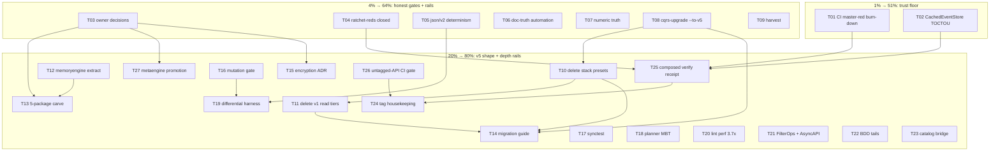

# SUPERB Full-Backlog Pareto Plan — 2026-11-03

**Date:** 2026-11-03 18:52 CET · **Author:** planning session (pareto-planning skill) · **Inputs:** `TODO_LIST.md` (211 unchecked rows across 25 sections, census this session), both 2026-11-03 status reports' §f (18+18 items), ROADMAP.md glance, fleet census 2026-10-24, the 2026-10-25/11-02 plans' open tails · **Parallel-session warning:** a foreign session is editing `system/projection_builder.go`, `system/README.md`, and skill refs RIGHT NOW — every task below starts with a freshness check before touching files it overlaps.

## Errata / verify-open corrections (Step 0 of the skill)

- **ROADMAP.md cites "104 `go.mod` files (2026-10-11 recount)"** — actual is **103** (derived this session; backticked form is invisible to the count gate). Routed to T07.
- **`system.CachedEventStore` TOCTOU** (TODO_LIST:3114) — still open, has a fix sketch + failing receipt (`got 4 events, want 5` under load). Confirmed NOT shipped.
- **Sweep at system-promotion time** confirmed zero stale system-experimental labels; the label tasks below are metaengine/systemscenario only.
- TODO_LIST's 114 `[x]` rows were excluded after census; the 211 `[ ]` rows are ALL routed in Appendix A.

## The Pareto ladder

**The 1% that delivers 51% — the trust floor.** Without a green master and a correct promoted module, every other investment compounds on sand: waves ship through red suites (the 10-06 lesson: 90/90 verify=ok over red tests), promotions lose receipts, and consumers inherit defects.

**The 4% that delivers 64% — honest gates + the rails.** The repo's recurring rot class is *documented-vs-actual drift* (counts, labels, statuses, "known issues" that shipped). Four cheap automation fixes make the drift self-healing, and `cqrs-upgrade --to-v5` turns the v5 cliff into a ramp.

**The 20% that delivers 80% — the v5 shape + the safety rails under it.** The deletions (already deprecated, fleet-census-cleared), the metaengine split (pre-v5 structure), the migration guide, and the four testing rails (mutation, synctest, planner MBT, differential harness) that make v5 cuts *provably* safe.

**The other 20% (to 100%) — parked/blocked/upstream.** DuckLake, turso-matview upstream flips, upstream filings, CI-infra polish, docs tail, owner-gated items. Tracked in Appendix B; do NOT verschlimmbessern by starting these before their gates open.

---

## Medium plan — 27 tasks, 30–100 min each (sorted by impact ↓)

| ID | Task | Tier | Impact | Effort | Value rationale |
|----|------|------|--------|--------|-----------------|
| T01 | CI master-red triage & burn-down (fresh `gh run list` → classify → fix/annotate each red; includes the exhaustruct-22 lint blockage from 11-02) | 1% | Critical | M | Green master is the precondition for every receipt below |
| T02 | Fix `system.CachedEventStore` TOCTOU (one critical section gen-check+Set / Invalidate+write; deterministic regression test w/ hook between check and Set; un-forced `#verify` receipt) | 1% | Critical | S | Real product defect in the JUST-promoted Production module |
| T03 | Owner-decision session (30–60 min): metaengine promotion scope; systemscenario; kv durable backing; authored-commit policy; deployed-DB census (keycodec A9) | 4% | Critical | S | 5 stuck streams unblocked by decisions only the owner can make |
| T04 | Ratchet-red closure wave: file-size 3 new offenders (scheduling/sqlstore/store.go et al.) + `#check-md-go` pinned-binary un-runnable + duplication verify tail + ROADMAP 104→103 | 4% | High | M | Every red ratchet is a blinded gate; all three are cheap |
| T05 | json/v2 map-key determinism: `Deterministic(true)` on the affected read-model write paths + storage-key map-typing pin (the 2026-10-25 🔥 pair) | 4% | High | M | Silent data-nondeterminism class — persisted bytes differ run-to-run |
| T06 | Doc-truth automation: `readme_compile_test.go` (pins README quick-start fences) + teach `check-canonical-facts` to strip backticks before count-match | 4% | High | M | Kills the two drift classes this session found by hand |
| T07 | Numeric/label truth reconciliation: 6,421-vs-6,422 symbols + errtax 546 via gate outputs; index the 2 foreign status reports; module-map census scratch row; FEATURES re-verify date | 4% | High | S | Canonical-facts to fully green |
| T08 | `cqrs-upgrade --to-v5` slice 1: import rewrite `/v4` → `core/v5/...` + strict-gate integration (design exists: arch-review P1) | 4% | Critical | M→L | The single highest-leverage v5 item — turns migration into a command |
| T09 | Harvest + TODO_LIST routing of this plan (docs-health HARVEST) + companion commit-history hygiene rule | 4% | High | S | Plans that don't harvest die entombed (07-37 lesson) |
| T10 | v5 deletion wave A: `stack.Bundle` + all 8 `stack/*` presets (fleet-census guard first: stack/sqlite has 4 direct consumers → migration notes in release) | 20% | High | M | Deprecated since 08-17; deletion completes ADR-0123 |
| T11 | v5 deletion wave B: `stack.Materialize` + `storage.RelationalProjection`/`SQLViewStore` + `graph.GraphProjection` + tombstone metadata API + ADR-0126 compat shells + `BuildWhereClause` + `record.NewStreamRef` validation | 20% | High | M | The v1 read-model tiers die; auto-projection replaces them |
| T12 | metaengine split 1: extract `metaengine/memoryengine` (8 files, 1,382 LOC) behind the same API | 20% | High | M | Arch-review P1; pre-v5 structure |
| T13 | metaengine split 2: five-package carve (`engine` SPI / planner / runtime / adt / support) per arch-review P1 — gated on T03 ruling | 20% | High | L | The v5 module topology |
| T14 | V5-MIGRATION-GUIDE expansion: before/after examples per removed v1 tier (Materialize→Evolve, SQLViewStore→planned tables, presets→DeploymentConfig) | 20% | High | M | Consumer-facing v5 on-ramp |
| T15 | v5 encryption-at-rest ADR completion (skeleton shipped; finish design + ruling) | 20% | Medium | M | Last open v5 design gap |
| T16 | Testing rail T10: mutation-verify gate (a test that can't go red under mutation fails CI) | 20% | High | M | Makes every future test honest |
| T17 | Testing rail T13: `synctest` migration wave 1 (scheduling ticker + 2 more) | 20% | Medium | M | Real-time elimination in tests |
| T18 | Testing rail T14: planner model-based test (randomized capability sets via rapid) | 20% | Medium | M | Planner correctness under composition |
| T19 | Testing rail T15: differential engine harness (one op-script across all engines, pairwise compare) | 20% | High | L | Cross-engine parity becomes provable |
| T20 | cqrs-lint analysis-time regression 2.0s→7.4s (profile → fix; consumer deep-dive ask) | 20% | High | S/M | Directly felt by every consumer CI run |
| T21 | Consumer features: `FilterContains`/`FilterPrefix` FilterOps (CV ask) + AsyncAPI response schemas | 20% | High | M | Named consumer asks with Fleet evidence |
| T22 | BDD adoption tails: cqrs-htmx sqlite-lifecycle harness tests + `scenario/v4` testing.TB refactor + `TimeAdvancesTo` sugar | 20% | Medium | M | Harness adoption completion |
| T23 | Catalog Registry from booted `DomainConfig` (`systemcatalog` bridge exists — wire it) + `scenario` version-carrying `Given` decide funcs | 20% | Medium | M | Consumer deep-dive asks 2026-10-24 |
| T24 | Tag-wave housekeeping: cut the train carrying `catalog.Registry.MarkDemo` (untagged-API incident), root-README manifest row for graph-native (blocked), `#26` retract watch | 20% | Medium | S | Unshipped-API debt |
| T25 | Composed `#verify` green receipt in a quiet window (post T01/T02/T04) + record S04 | 20% | Critical | M | The receipt that closes the trust floor |
| T26 | Untagged-API gate: build `examplePaths` with `GOWORK=off` against pinned tags in CI (kills the MarkDemo class) | 20% | High | S | Gate the incident class |
| T27 | Metaengine promotion wave (if T03 rules yes): per-module evidence audit → stamp flips → FEATURES/SKILL/matrix → api-stability regen (17 doc.go files) | 20% | High | M | Closes the last big split brain |

**Sorting key:** Critical-before-High; within band, effort S < M < L; customer-value tiebreak (fleet-consumer-facing wins).

---

## Fine plan — every task ≤ 12 min (grouped by medium ID; sorted same order)

| Fine ID | Slice (each independently verifiable) | min | Depends |
|---------|----------------------------------------|-----|---------|
| T01.1 | `gh run list --limit 30` + classify every red job (real vs flake vs billing) into a table | 10 | — |
| T01.2 | Re-run the exhaustruct-22 lint config fix attempt; if auto-configure reverts again, pin via post-hook script | 12 | T01.1 |
| T01.3 | Fix/annotate first 3 red jobs (most-recent-first) | 12×3 | T01.2 |
| T01.4 | Fix/annotate next 3 red jobs | 12×3 | T01.3 |
| T01.5 | Re-run affected workflows; confirm green run exists; record S-number in CHANGELOG if it's the first since S03 | 10 | T01.4 |
| T02.1 | Read `system/cache.go` fresh (foreign session active!) + confirm defect window still present | 8 | — |
| T02.2 | Merge gen-check + `Set` into one critical section under `c.mu` | 12 | T02.1 |
| T02.3 | Merge write-path `Invalidate` into the write critical section | 10 | T02.2 |
| T02.4 | Deterministic regression test: hook between check and Set forcing the interleave | 12 | T02.3 |
| T02.5 | `GOWORK=off go test ./... -count=1 -race` in system; then un-forced `#verify` race leg | 12 | T02.4 |
| T03.1 | Prepare 1-page evidence brief per decision (metaengine census, systemscenario adoption, kv origin, commit-policy history) | 12 | — |
| T03.2 | Owner session; record rulings as dated TODO rows + ADR amendments where needed | 30 (session) | T03.1 |
| T04.1 | File-size: split `scheduling/sqlstore/store.go` (or `//art-dupl`-style baseline entry w/ reason) | 12 | — |
| T04.2 | File-size: handle remaining 2 offenders; `#check-file-size` green | 12 | T04.1 |
| T04.3 | `#check-md-go`: diagnose pinned-binary un-runnability; repin or vendor fix; gate green | 12 | — |
| T04.4 | Duplication verify tail: run `#check-duplication`; annotate/re-pin per AGENTS contract 14 rules | 12 | — |
| T04.5 | ROADMAP 104→103 + FEATURES re-verify date refresh | 5 | — |
| T05.1 | Write failing pin: encode same map-typed value twice → byte-compare (RED) | 10 | — |
| T05.2 | Apply `json.Deterministic(true)` (v2 option) at the write paths; pin green | 12 | T05.1 |
| T05.3 | Storage-key map-typing: same treatment for map-typed KEYS + `adttest` cross-engine row | 12 | T05.2 |
| T05.4 | `GOWORK=off go test` changed modules + lint | 10 | T05.3 |
| T06.1 | Create `example/getting-started/readme_compile_test.go` from this session's verified snippets | 12 | — |
| T06.2 | Mark fences with a stable marker comment contract doc (which fences the pin covers) | 8 | T06.1 |
| T06.3 | `check-canonical-facts.sh`: strip backticks before the `N go.mod` regex match + self-test leg | 12 | — |
| T06.4 | Convert known backticked counts (ROADMAP done in T04.5; sweep remaining DOC_SET files) | 10 | T06.3 |
| T07.1 | Run `#check-untested-exports` + `#check-error-taxonomy-tests`; read printed totals; fix AGENTS 6,422/546 if off | 12 | — |
| T07.2 | Read + index the two foreign status reports (16-22, 16-55) — after T03 ownership ruling | 12 | T03.2 |
| T07.3 | module-map census: row `scratch/counterkey` (or move scratch/ out of tree per owner) | 8 | — |
| T07.4 | `check-canonical-facts` full green run + record | 6 | T07.1–3 |
| T08.1 | Read existing cqrs-upgrade code + arch-review P1 design; write the rewrite table (v4 path → v5 path) | 12 | — |
| T08.2 | Implement import-rewrite pass (AST-based, not regex) + unit tests | 12×4 | T08.1 |
| T08.3 | Strict-gate integration: `--to-v5` mode runs v5-removed-API scan output as the plan | 12 | T08.2 |
| T08.4 | Dry-run on 3 fleet repos (cqrs-htmx, go-appkit, bank-sync); diff report per repo | 12 | T08.3 |
| T09.1 | docs-health HARVEST: both 2026-11-03 reports' §f + this plan → TODO_LIST upserts | 12 | — |
| T09.2 | De-dupe harvested rows vs existing TODO rows (this plan's errata applied) | 12 | T09.1 |
| T10.1 | Fleet census re-run: `census-fleet.sh --zero-consumers` scoped to stack/* | 10 | — |
| T10.2 | Write migration notes for stack/sqlite's 4 direct consumers (Code-To-CV-Agent, github-local-sync, crm, .crm-stage-dedup2) | 12 | T10.1 |
| T10.3 | Delete `stack` + 8 presets: remove modules, go.work, flake testModules, api-stability slice, module-map, FEATURES rows | 12×4 | T10.2 |
| T10.4 | Update V5-MIGRATION-GUIDE + FAQ removal list; doc-check + verify-fast | 12 | T10.3 |
| T11.1 | Delete `stack.Materialize` + its tests; golden regen | 12 | — |
| T11.2 | Delete `storage.RelationalProjection` + `storage/view`; golden + doc trail | 12 | — |
| T11.3 | Delete `graph.GraphProjection`; graph-native example check | 10 | — |
| T11.4 | Delete tombstone metadata API (`DetectTombstone`/`MarkTombstone`) — ADR-0114 completion | 12 | — |
| T11.5 | Delete ADR-0126 compat shells + `BuildWhereClause` + add `NewStreamRef` validation | 12 | — |
| T11.6 | Full doc trail: CHANGELOG, SKILL refs, FAQ, recipes fences; doc-check + verify-fast | 12 | T11.1–5 |
| T12.1 | Extract `memoryengine` package from `metaengine/memory_*.go` (keep API-compat re-export window) | 12×4 | T03.2 (scope) |
| T12.2 | Move engine tests; register.go for memory driver; golden regen | 12×2 | T12.1 |
| T13.1 | Five-package carve plan → ADR (gated on T03 ruling; else park) | 12×3 | T12 |
| T14.1 | Materialize→Evolve before/after section | 12 | T10 |
| T14.2 | SQLViewStore→planned-tables + presets→DeploymentConfig sections | 12×2 | T11 |
| T14.3 | md-go gate the new fences; doc-check | 8 | T14.2 |
| T15.1 | ADR-0139 completion: config surface design + engine keyprovider seam; owner ruling | 12×3 | T03.2 |
| T16.1 | Mutation tool pick (go-mutesting vs custom) + harness design on 3 pilot tests | 12 | — |
| T16.2 | Implement mutation-verify gate for NEW tests (ratchet, not whole-suite) | 12×3 | T16.1 |
| T16.3 | Wire into CI + self-test | 12 | T16.2 |
| T17.1 | Convert scheduling ticker tests to `synctest` (Go 1.27) pilot | 12 | — |
| T17.2 | Convert next 2 candidates; record the pattern in gotchas-testing | 12 | T17.1 |
| T18.1 | rapid-based capability-set generator + oracle; first 20 seeds | 12 | — |
| T18.2 | Fuzz the planner invariants (no unsupported routing, cost monotonicity) | 12×2 | T18.1 |
| T19.1 | Op-script DSL (CRUD+scan+vector ops); run on memory + sqlite first | 12×3 | — |
| T19.2 | Extend to pebble/bbolt/badger; pairwise diff report harness | 12×3 | T19.1 |
| T19.3 | Wire as `#test-engine-diff` nightly | 12 | T19.2 |
| T20.1 | Profile cqrs-lint on a fleet repo (cpuprofile); locate the 3.7× | 12 | — |
| T20.2 | Fix (cache/visit-order); pin with a bench + regression test | 12×2 | T20.1 |
| T21.1 | `FilterContains`/`FilterPrefix` FilterOps: planner + memory + SQL engines + adttest row | 12×4 | — |
| T21.2 | AsyncAPI response schemas for query replies (catalog exporter) | 12×2 | — |
| T21.3 | Protocol bindings + security schemes (watermill/nats) | 12×2 | T21.2 |
| T22.1 | cqrs-htmx sqlite-lifecycle tests through systemscenario (`sqliteDeployment` variant) | 12×3 | — |
| T22.2 | `scenario/v4` testing.TB refactor | 12 | — |
| T22.3 | `TimeAdvancesTo(t)` sugar + tests | 10 | — |
| T23.1 | Wire `systemcatalog.FromSystem` into catalog Registry derivation; drift test | 12×2 | — |
| T23.2 | scenario version-carrying `Given` decide funcs | 12 | — |
| T24.1 | Cut catalog train w/ `Registry.MarkDemo` (tag-release.sh flow) | 12 | T26 |
| T24.2 | README manifest graph-native row unblock check (`check-versions-manifest --update`) | 6 | — |
| T24.3 | `#26` retract-watch: confirm directive shipped in next stack/postgres train | 8 | — |
| T25.1 | Quiet-window composed `#verify` (via verify-chain.sh); triage any failure to owning task | 12×3 | T01,T02,T04 |
| T25.2 | Record S04 receipt in CHANGELOG + status report row | 10 | T25.1 |
| T26.1 | CI job: `GOWORK=off go build ./...` examplePaths against PINNED module tags (not workspace) | 12 | — |
| T26.2 | Self-test with a deliberately untagged symbol | 10 | T26.1 |
| T27.1 | Per-module evidence table for the 17 metaengine-family stamps (census consumers, suite status, caveats) | 12×2 | T03.2 |
| T27.2 | Flip stamps + FEATURES/SKILL/matrix per ruling; api-stability regen; doc-check | 12×4 | T27.1 |

Count: ~135 fine slices (several marked 12×N = repeated 12-min slices within budget). All ≤ 12 min.

---

## Execution graph (mermaid)

## Appendix A — routing of ALL 211 open TODO rows (+ session items)

| TODO_LIST section (rows) | Routed to |
|--------------------------|-----------|
| Disk-truth residue (6: keycodec A9, DB census, journal dump⇄load, test-isolation doc) | T03 (decisions), parked (A9 post-ruling) |
| Architecture reference export (6: composed proof, EventCatalog 5.2, lint lessons, errata, adoptions) | T25 (proof), parked (custom exports) |
| GitHub issue backlog (3: W2/W3 tails, #27 ask-3 CI annotation) | T26, parked |
| EventCatalog cluster (11 across 3 sections) | parked (upstream) + T24 |
| Metaengine substrate (7: scheduler demo replace, DueClaimer-v2 revisit, kv decision, recipes §2.26, T19-21 v5-gated, M06 cursor) | T03, T27, parked |
| DuckLake driver (4: T01-T24 sub-waves) | parked (proposed; gate on named consumer) |
| V5 schema evolution tail (1: bank-sync patch) | parked (consumer op) |
| Catalog × CUE (4: gate subject, T10 bridge, tail, parked CUE) | T03, parked |
| BDD adoption (7) + depth-spec (1) | T22, T03 |
| Command-side depth (1: ADR-0138 blocked) | parked |
| ResetProjection contention (2 test-stability rows) | T01 (flake triage) |
| Turso matviews (3: upstream flip, v2 surface, routing) | parked (upstream) |
| cqrs-lint (19: M10/M11 drafts, F024/25, cookbook, load-scope, F005, B005, journal-side, #79 ×2, #71, #83 ×2, audit, rulings, 350-line reds, --show-suppressed) | T20, T04 (file-size), parked (ruled/drafts) |
| Release/Tagging (2: #26 watch, graph-native row) | T24 |
| Metaengine follow-ups (22: envelope spike, codec scope, markers, EncodedPayload, fleet bench, json/v2 ×2 🔥, #72 ×4, idempotency ADR, tag wave, calibration, rulings, conformance, sqlstore tail) | T05 (🔥 pair), T24 (tag wave), parked (rest) |
| CI/Infrastructure (22: md-go 🔥, ratchet guards, verify-serial, tursogo ×2, gci guard, owner reviews, F153, watch, billing, self-lint creds, CV bump, pre-commit, AsyncAPI ×2, master-red 🔥, mysql legs, verify re-record, mirror-lag, lint-config ×2, shfmt, dup jobs, dupe-signal, gofumpt, nightly check, triage row) | T01, T04, T21, parked (owner/billing) |
| Code Quality (14: taxonomy script, core/v5 arch-lint, dupe analyzer, templ watch, dedup tail 🔥, >350 files, macOS, nspawn, shuffle eval, contention backport, dgraph/redis watch) | T04, parked |
| v5 Phase 8 (20: ratifications, deletions ×7, sweep tails, migration guide, cut) | T10, T11, T14, T15, parked (cut itself post-tasks) |
| Docs truth (6: README deep-read, M13 stamps, docs-health, bench mention, ADT recipes, COOKBOOK fences) | T06, T07, parked |
| benchkit tail (1 blocked) | parked |
| CV follow-ups (5) | T21, parked |
| Goal-closure (3: ruling done, scan default ruled, FEATURES flip) | T27 (flip rides promotion) |
| Temporal cells (2: GCP validation, bigtable soak) | parked |
| md-go upstream (1) | parked |
| go-graph-rag (3 ruled) | parked |
| 92-tag tails (4) | T24, parked |
| skill evals (1 🔥) | parked (tooling) |
| Architecture review harvest (10: file-size P0, fix-only P0, splits P1 ×4, tooling P2 ×3, P3 hygiene) | T04, T08, T12, T13, parked (P2 tooling split, preset retire = T10) |
| CRM Graph-ADT (2) | parked (recipes → T14 adjacent) |
| wave-C delta (2) | parked |
| Consumer deep-dive (4: catalog Registry, scenario Given, lint perf, census invites) | T23, T20, parked |
| Untagged-API incident (2) | T24, T26 |
| Testing improvements T10-T25 (13) | T16-T19 (+ parked: T18 lat matrix, T19 budgets, T20 crash, T22 broker, T24/T25 partial tails) |
| Session 2026-11-03 §f (36 items, two reports) | T02-T09, T24, T25, T27 + errata applied |

## Appendix B — parked / blocked / owner-gated (the other 20%)

DuckLake driver (4 waves) · turso matview upstream flip + v2 · tursogo SEGFAULT + loader-cache filings · EventCatalog upstream asks · GitHub Actions **billing** (every paid job fails — owner account action!) · macOS/nspawn verifications · pre-v4.9.0 tag-wave · calibration protocol · skill evals execution · cqrs-lint M10/M11 upstream drafts · ADR-0138 · goal-shaped postgres e2e · CV single-writer lease · 92-tag release polish · >350-line historical shrink (~54 files, ratchet already enforces) · md-go-validator upstream · Graph-ADT recipes + dgraph integration · wave-C seed · census invites · testing T18/T19/T20/T22/T24/T25 tails · v5.0.0 cut itself (after T10-T15) · shfmt authority · lint-config systemd timer (owner, one command).

## Verschlimmbesserung guards

1. Every deletion task (T10/T11) is gated on a fresh fleet census + cqrs-upgrade dry-run — no delete-at-zero surprises.
2. Every task starts with a freshness re-check (foreign session active in system/ + skill refs).
3. No speculative rewrites: T13/T15/T27 are explicitly gated on T03 rulings; parked items stay parked until their gate opens.
4. Receipts over claims: T25 exists precisely so the wave ends with an un-forced composed green, not a belief.
