# SUPERB Pareto Plan — Red-to-Green Trust, Pending Trains, Debt Waves (2026-11-03 20:04 CET)

> **Source of truth:** [TODO_LIST.md](../../TODO_LIST.md) — **218 open rows across ~40
> sections**, inventoried 2026-11-03 19:57 (immediately after the same-day done-row
> sweep removed 114 completed rows; every row below was re-read from the live list,
> not from memory). This plan is a point-in-time Pareto sequencing of that list.
> **Predecessors:**
> [`2026-10-11_20-16_SUPERB-trust-green-tags-to-v5-cut-pareto-plan.md`](2026-10-11_20-16_SUPERB-trust-green-tags-to-v5-cut-pareto-plan.md)
> (1%/4% mostly executed: trust waves I–II tagged, #62–#64 closed, E021/E022 shipped;
> its v5-cut-readiness checklist remains the cut-order authority),
> [`2026-10-25_04-21_SUPERB-testing-improvements-pareto-plan.md`](2026-10-25_04-21_SUPERB-testing-improvements-pareto-plan.md)
> (17 of 27 tasks DONE; T10/T13–T15/T17–T20/T22/T24/T25 tail folded in below).
> **Anti-Verschlimmbesserung clause:** every task touches what EXISTS; no speculative
> rewrites; no growing v4 core interfaces (contract 21g); no tag without the
> changed-set test proof (2026-10-06 lesson); no quiet-window work under load ≥5;
> no foreign-module fix-forward during a live concurrent session (ROADMAP OQ17);
> no mid-campaign full `art-dupl baseline` re-pin (186→351 precedent); every row
> this plan claims was verified open TODAY.

---

## Step 1 — Pareto breakdown

### The 1% that delivers 51%: **Fix the correctness defect, green the red gates, cut the two trains consumers are waiting on**

The repo's trust state is RED in four independent places, and two shipped features
are invisible or broken to consumers: (1) `system.CachedEventStore` has a verified
**stale-read TOCTOU race** (serves pre-save snapshots under contention — a correctness
defect, found by the un-forced `#verify` race leg); (2) the **file-size ratchet is
gate-RED** on 3+ new offenders (so `#verify`/CI are red for non-feature reasons);
(3) **E023 `satellite-owned-sql` shipped 10-24 but NO tag carries it** — bank-sync,
the heaviest satellite-SQL consumer, structurally cannot see it; (4) **`Registry.MarkDemo`
landed untagged while `example/mesh-demo` already calls it** — the example fails
`GOWORK=off` builds against the proxy. Four tasks, all ≤100 min: fix the race, split
the offenders, cut `cqrs-lint v4.19.0`, cut the catalog train. **Customer value:
a real race closed, green gates, and two consumer-visible releases.**

### The 4% that delivers 64%: **1% + the proof chain + the hygiene infrastructure**

Three 🔴 rows converge on ONE act (the composed `#verify` re-record — L199, L1330,
L1659 all describe the same quiet-window run). The doc gate `#check-md-go` is
**un-runnable** (broken vendored FOD — every doc change since 10-24 unvalidated).
The duplication gate is RED with **190 novel groups** (~180 ADR-0152 mirror twins
awaiting one campaign decision). The lint config has suffered **three gci re-add
strikes** and one settings-loss regression with no durable guard on
`.buildflow.yml`. The go.sum fleet test fails for ~ALL modules. And this very
session proved TODO_LIST needs a hygiene gate (114 stale done rows accumulated, a
byte-identical duplicate block survived three docs-health passes, two dangling
pointers were created and fixed by hand). These seven tasks convert "individually
green" into "provably green, durably green".

### The 20% that delivers 80%: **4% + the correctness waves + the consumer-facing debt**

Two 2026-10-25 findings are a **data-corruption class**: `encoding/json/v2`
non-deterministic map iteration means persisted VALUES lose byte-identity and —
far worse — map-typed STORAGE KEYS can split reads/uniqueness across replicas
(keys first). The idempotency-retirement ADR (verdict exists, artifact owed),
the A9 keycodec-v2 engine migration (owner-confirmed scope), the Wave-III
delta-audit tag trains (middleware/command/query/otel/id/scheduling), the
cqrs-lint consumer-facing fix pack (#79 typed-load fixture, `--show-suppressed`
parseability break, #83 baseline hardening, the 2.0s→7.4s perf regression), the
compound-cursor issuance protocol, the error-taxonomy generator's sentinel
attribution drift, and the docs/recipes truth pack. These make the library
*correct and honest*, not just green.

### The remaining 80% (→100%): **programs, demand-gated spikes, owner rulings, and the v5 cut**

Everything else in the inventory: the v5 program (deletion cascade, cut, migration
guide, `cqrs-upgrade --to-v5`, RawQuery rename), the architecture-review P1/P2
programs (metaengine five-package split, tooling split, golden tiering), the
demand-gated spikes (DuckLake driver, journal dump⇄load, AsyncAPI response
schemas), the calibration/quiet-window batch (four rows, one window), the
EventCatalog tail pack, the consumer-ask pack, the BDD/graph tails, and the
BLOCKED rows (billing, F153, evals, GCP, macOS, nspawn) that stay parked until
their blockers move. **Nothing is dropped; everything is sequenced or explicitly
blocked.**

---

## Step 2 — Comprehensive plan (medium granularity, 30–100 min each, 27 tasks, ALL 218 rows mapped)

| # | Task | What & why (rows claimed) | Effort | Tier |
|---|------|---------------------------|--------|------|
| **M01** | **Fix the `CachedEventStore` TOCTOU** | Gen-check + `cache.Set` and the write path's `Invalidate` must be one critical section (`system/cache.go:87,103-107,119-123`); add a deterministic regression test (hook between check and Set); re-run `#verify` race leg un-forced. A verified stale-read race is the single worst correctness item in the list. (L2444) | 60–90m | 1% |
| **M02** | **Green the file-size ratchet** | Run `check-file-size`, split every NEW offender to ≤350 (known: `scheduling/sqlstore/store.go` 382, `system/adapter_event.go` 351, `metaengine/layout.go` 360; plus any of the 10 sibling-grown ones still open: cqrs-lint ×4, system ×2, metaengine ×4) — per the RATIFIED policy: split at file-touch, never re-pin the baseline for NEW offenders; harness-dir exemption only for `adttest/enginetest`. (L2145, L810, L794, L1538) | 60–90m | 1% |
| **M03** | **Cut `cmd/cqrs-lint` v4.19.0 carrying E023** | Rel-tests + `check-example-standalone` first; tag; proxy-smoke; CHANGELOG wave section (move the `[Unreleased]` E023 entry); then the bank-sync pin bump + `cqrs-lint-disable-audit` re-verification is the CONSUMER-side half (separate repo, rides M03's tag). (L468) | 60m | 1% |
| **M04** | **Cut the catalog train containing `Registry.MarkDemo` + heal mesh-demo** | Tag catalog (v4.11.x has systemcatalog content — check what's pending on the train), bump `example/mesh-demo`'s pin, verify `GOWORK=off go build` green in that example. (L2408) | 60m | 1% |
| **M05** | **Build the `check-todo-list-hygiene` gate** | Fail on: any `- [x]`/`> - [x]`; byte-identical duplicate blocks (hash normalized text); dangling `above/below` receipt pointers within N lines; plus a `--self-test` fault-injection set. Encodes this session's exact debt class (114 stale rows, 1 duplicate, 2 broken pointers, 1 blockquote survivor). NEW — add row to TODO_LIST. | 90m | 4% |
| **M06** | **Duplication-campaign decision + execution** | ONE decision per the row: ~180 trailing `//art-dupl:accept ADR-0152 copy-forward twin` directives (mechanical, per-twin) vs ONE end-of-campaign re-pin — never mid-campaign full re-pin. Handle the ~10 non-mirror stragglers individually (watermill ×2, engine pairs ×5, iroh ×1, cqrs-lint ×2, chaos self-pair; templ ×2 + pebble sort_index stay baseline-only). (L179, L2195) | 90m | 4% |
| **M07** | **Repair `#check-md-go` + extend the nix-hash guard** | Bump/refresh `md-go-validator`'s `vendorHash`/proxy FOD (missing pprof zip via go-finding.test→ginkgo); then implement the L1137 guards: flake.lock-coherence check + extend `check-nix-hashes.sh` beyond `flake.nix` to every tracked `*.nix`. Every doc change since 10-24 is currently unvalidated. (L1129, L1137) | 60m | 4% |
| **M08** | **Durable lint-config guards** | `.buildflow.yml` hash-golden tripwire (proven mechanism from `.golangci.yml`); settings-key-set canaries in `#check-lint-config` (`cyclop.max-complexity` + `errcheck.exclude-functions` presence). Third gci strike + one depguard-strip incident prove the class. (L1182, L1408) | 60m | 4% |
| **M09** | **Fleet go.sum tidy sweep** | `TestEveryModuleGoSumIsTidy` fails ~ALL modules (root cause candidate: authored re-pin `78ae14659` wrote go.sums `go mod tidy` prunes); merged with the 08-02 plan's task 45 (do NOT run both). Also the BuildFlow pseudo-version hygiene item (sqliteengine pin form). (L1459 items 1+3, L244b, L546e) | 90m | 4% |
| **M10** | **Composed `#verify` re-record + `#verify-serial` tier** | THREE rows describe this one act (L199, L1330, L1659) + the dedup-campaign tail (L1526a). First ship the `#verify-serial` fallback tier (same gate list, `-p 1`, per-gate timeouts, no aggregate precondition) so the proof is possible on this loud shared box; then one clean run records the receipt on ALL THREE rows. (L199, L1330, L1659, L1146, L1526) | 100m | 4% |
| **M11** | **Stale-premise sweep + adoption tail** | Fix the known stale row (L512: "blocked on next schema/decider/snapshot wave" — those tags shipped 10-12: schema v4.7.0, snapshot v4.7.0, decider v4.8.0); run cqrs-htmx battery vs system/v4.15.4 (L137); mechanize: a script checking "blocked on tag X" rows against `versions.json`/`git tag`. NEW detector — add row to TODO_LIST. (L512, L137) | 60m | 4% |
| **M12** | **json/v2 determinism wave — KEYS first** | Pin the map-typed STORAGE KEY nondeterminism risk (L968: same logical key → different storage keys = split reads/broken uniqueness/orphans); then `json.Deterministic(true)` in key encoders + value encoders (`keycodec.EncodeJSONErr`, `encodeKey`, `sqliteengine.encodeValue`, `EncodeStreamValueErr`-backed) + byte-expectation test migration. Keys corrupt state; values only byte-identity — keys ship first. (L956, L968) | 90–100m | 20% |
| **M13** | **Idempotency-retirement ADR + routing** | The 10-11 session ended with a verdict and NO artifact: write the ADR (`check-adr-numbering` before AND after), the decision-queue entry, the ADR-0152 ghost-verdict addendum for `idempotency/kvstore`; design pre-enumerated (facade shape, collection/now args, return shape). Also resolves the `Forever`-mapping row's fate. (L1013, L1893) | 60m | 20% |
| **M14** | **cqrs-lint consumer-fix pack** | (a) #79 typed-load fixture (real versioned module, full type info) + fragment-by-hand audit; (b) `--show-suppressed` structured-format parseability fix + regression test; (c) #83 baseline hardening (`--fail-on-stale-baseline`, e2e baseline test, CI recipe) + health-score intent doc; (d) profile the 2.0s→7.4s analysis regression cold+warm on a mid-size consumer repo. (L733, L740, L831, L750, L756, L2395) | 100m | 20% |
| **M15** | **Wave III delta-audit tag trains** | Inspect the ≥5-file content deltas (middleware 28, command 14, query 13, otel 7, id 6, scheduling 5): separate real API from errorfamily regrouping; one minor/patch sweep in dependency order; blanket patch for the 1–3-file rows. Pre-tag: changed-set `GOWORK=off go test -count=1`. (L2355) | 90m | 20% |
| **M16** | **Architecture P0/P1 quick wins** | Record "rule v4 is fix-only" (P0 decision → AGENTS/ADR note); extract `metaengine/memoryengine` (8 files, 1,382 LOC — symmetry with the other 11 drivers); file the per-family dialect-seam notes + the two "engine" meanings into DOMAIN_LANGUAGE (P3's cheap half). The five-package split itself stays a program (v5-gated). (L2152, L2165, L2195, L2157) | 90m | 20% |
| **M17** | **A9 keycodec-v2 migration wave — pebble reference leg** | Swap `metaengine/pebbleengine` to V2 builders: `getAny(v2,v1)` fallback on exact-key reads, dual concatenated prefix scans, `seq_seeding.go` both tags, `reset.go` both ranges, escaped v2 for the `sortIndexKey` grammar; legacy v1 fixture (pre-v2 bytes readable post-upgrade). The badger/bbolt twins + legacy storage/pebble & bbolt legs are the follow-up waves. (L136) | 100m | 20% |
| **M18** | **Calibration/quiet-window batch** | ONE quiet window serves four rows: (a) SearchQuery count=5 re-run + benchmark-baseline re-pin + dgraph-constant re-anchor (L1048); (b) MySQL-VM shuffled seed replay (L1315); (c) real `#integration-mysql-vm` leg through hardened `vm-mysql.sh` (L1324); (d) supersede-note on the 09-19 noisy capture (L1847); plus the dgraph/redis CI-watch ledger (L1565). Gate: `calibration-gate.sh` PASS. (L1048, L1315, L1324, L1847, L1565) | 100m | 20% |
| **M19** | **Generator + arch-lint truth fixes** | Fix `generate-error-taxonomy.sh` sentinel attribution (AST/grep-verify before writing `-`, or golden-pin the column); write `core/v5/.go-arch-lint.yml` (coordinate with v5 sessions — encodes layering); record the `catalog` arch-lint 40+14 root cause (`core: { in: . }`) as the v4↔v5 campaign's item. (L1483, L1494, L291c) | 60m | 20% |
| **M20** | **Compound-cursor issuance protocol** | Engines fill `ScanResult.NextCursor` (they hold the pair keys), `ScanPage` prefers it over reflection, `ParseCursor` normalizes the JSON round-trip; wire-format change → golden pins required (`TestCursorWireFormatGolden` family). (L477) | 90m | 20% |
| **M21** | **Docs/recipes truth pack** | (a) 5 ADT recipe waivers closed (ADTSet/ADTLog/ADTStreamLog/ADTSortedMap/ADTMultimap — write recipe or renew waiver); (b) add `metaengine/COOKBOOK.md` to the md-go walk (parse-level); (c) consumer test-isolation strategy doc (4 strategies + reset-by-replay differentiator); (d) recipes §2.26 sqlstore deprecation note; (e) recipes §graph end-to-end pattern (CRM debut). (L1816, L1825, L154, L470, L2334) | 100m | 20% |
| **M22** | **EventCatalog tail pack** | Warn-budget hardening (assert the KNOWN 4-warn signature); config-with-changelogs golden; ROADMAP `[Unreleased]` wave prose; pin-bump baseline numbers into catalog/AGENTS.md; `-race` pass for catalog/eventcatalog. Upstream filings (L441) stay in the T25 pack (verify-before-filing). (L430, L436, L446, L449, L453) | 60m | 20% |
| **M23** | **Consumer-ask pack** | `scenario` version-carrying decide funcs in `Given` (delete the wrapper class); fleet-census case-study invites (one ask per project); hub T15.2/T18 responses (draft now, send when issues arrive); #58 owner verdict row (draft both shapes for the owner); flows id collision rename (`order-lifecycle-flow`) next mesh-demo touch. (L2389, L2400, L424, L2365, L404) | 60m | 20% |
| **M24** | **Metaengine capability tails pack** | Custom/encrypted codec scope decision (L941); ingress marker unification design (L944); `EncodedPayload` export stays demand-gated (L949, confirm zero asks); fleet ingress benchmark per engine (L952); #72 cap cluster (coverage on SQL+temporal engines, trim cost bench, timer-wiring ruling, `WithCapOnWrite` verdict) (L998–L1012); CapabilityGaps→Doctor threading (L1098); turso STRICT DSN posture (L1074). (L941, L944, L949, L952, L998, L1002, L1006, L1009, L1098, L1074) | 100m | 20% |
| **M25** | **BDD harness + graph tails** | cqrs-htmx sqlite-lifecycle through the harness (companion repo); `TimeAdvancesTo(t)` sugar + bus delivery-mode knobs; observational-equivalence port; `scenario/v4` TB refactor; catalog counts test bump; go-appkit GracefulClose re-check; `example/graph-native --dgraph` integration leg vs the ephemeral harness. (L532, L535, L538, L541, L554, L2345) | 90m | 20% |
| **M26** | **Demand-gated spike kickoffs** | (a) DuckLake T01–T06: pin external claims + extension-channel/expiry/vacuum spike gates (L501); (b) journal dump⇄load DESIGN (typed envelope format, guard/opt-out pattern, watermark skip — the testfixtures-inspired 🔥 row) (L144); (c) AsyncAPI response-schema design pass (pair with openapi exporter, one `catalog.Message` surface) (L1254). T07+ implementation waves only on consumer demand per fleet-first. (L501, L144, L1254, L1263) | 100m | 20% |
| **M27** | **v5 program kickoff** | Ratify delete-at-zero for `metaengine/graphadapter` + `otel/otlp` (owner; full §4 cascade) (L1648); add the missing deriver-ABSORB Phase-A row (L1655); draft the `RawQuery→DeclaredQuery` rename + typed `QueryDecl` change-list for the v5 cut (L691); scaffold `cqrs-upgrade --to-v5` awareness (L2169). THE CUT itself stays sequenced by the v5-cut-readiness checklist. (L1648, L1655, L691, L2169) | 100m | 80% |

**Owner-blocked rows (no task — stay parked until the blocker moves):** billing
(L1227 → unblocks F040 branch protection L788, remote legs L2043d-f, self-lint
L1230, postgres e2e leg L2021), F153 license (L1214), evals CLI (L2130), real-GCP
bigtable (L1979), macOS ephemeral-pg (L1547), mysql-nspawn root (L1551), CV lease
ratification (L1875), `catalog.BaseConfig` custom-property concept (L210 remainder),
command sourcing (L630), md-go-validator upstream (L2000), branching-flow upstream
(L1504), BuildFlow templ cwd (L2106), tursogo segfixed release (L1152) + loader
flock (L1166 upstream filing owed), census automation artifact owners (L1667),
shfmt authority (L1425), check-job slimming (L1435), `dupe-signal --keep-v5`
policy (L1445), gofumpt exit-2 root cause (L1451), go-graph-rag comms send
(L2014, approved), goal-shaped-app pg leg (L2021, billing), `#test-examples`
changed-set join (L2027), scan-default v5 flip (L1935, v5-branch), G-T25 FEATURES
flip (L1946, gates A–D), wire-vocabulary §4 remainder (L1710, v5.x expand-contract),
encryption ADR ruling (L1724), T19–T21 universal fold (L472, v5-gated), all v5
deletion rows (L1676–L1737), Cut v5.0.0 (L1767), migration-guide expansion (L1760),
stack-preset retirement (L2188), tooling split (L2178), golden tiering (L2183),
metaengine five-package split (L2157, L), eventtest fork chain (L1390, L),
AggregateOn/routing v1 implementation (L649+L1051, ratification → T11 slot),
matview v2 surface (L647, consumer-gated), ResetProjection observes (L634, L636 —
observe-only), DuckLake T07+ (L502–L504), AsyncAPI bindings (L1263), journal
dump/load implementation (L144 post-design), CV bump (L1238), journal-side
adoption (L724, tag-gated), FILTER ops (L1887, v5 FilterOp window), benchkit
parity/tuned-tier (L1904, L1908), pre-commit scoping (L1243), doc stamps/counters
(L1787, L1797), bench-gate single-mention tail (L1806), release-tooling polish
tail (L2090), README/maturity/doc tails already struck-in-place (L1777, L1797,
L231, L244, L318, L330), snapshot-migration mysql leg (L1738, nspawn-gated),
scheduling/sqlstore RenewLease tokens (L1116 — fold into the M13 retirement ADR),
post-v4.9.0 wave mysql leg (L1025 → L1315), FluentCount/`scan default` add-ons
(landed), graph-native README manifest row (L918, tagging-gated), versioned-cells
stretch (L504).

---

## Step 3 — Fine breakdown (≤12 min each, ALL rows covered via their parent task's row set)

**Tier 1% — the four trust tasks**

| # | Fine task | ≤12m | Parent |
|---|-----------|------|--------|
| F01 | Reproduce the TOCTOU deterministically: add the between-check-and-Set hook to `CachedEventStore` | 12m | M01 |
| F02 | Move gen-check+`Set` into one critical section; same for write-path `Invalidate` | 12m | M01 |
| F03 | Deterministic regression test (`got 4 want 5` shape, hook-forced) | 12m | M01 |
| F04 | `go test -race ./system/...` green ×3; api golden if surface moved; CHANGELOG `[Unreleased]` Fixed row | 12m | M01 |
| F05 | Run `bash scripts/check-file-size.sh`; capture the exact NEW-offender list | 6m | M02 |
| F06 | Split `scheduling/sqlstore/store.go` (382) by responsibility | 12m | M02 |
| F07 | Split `system/adapter_event.go` (351) | 12m | M02 |
| F08 | Split `metaengine/layout.go` (360) | 12m | M02 |
| F09 | Split any remaining NEW offenders from F05's list (cqrs-lint ×4, system/constructor.go, metaengine ×3) | 12m | M02 |
| F10 | Harness-dir exemption decision for `adttest/pagination_conformance.go` (owners' call, row says baseline candidate) | 6m | M02 |
| F11 | `check-file-size` green; module lint on each split file; commit per module | 12m | M02 |
| F12 | Pre-tag: `GOWORK=off go test -count=1 ./...` in cmd/cqrs-lint (changed-set proof) | 12m | M03 |
| F13 | `nix run .#check-release-scripts` (rel-tests) + `check-example-standalone --build` | 12m | M03 |
| F14 | Cut + push `cmd/cqrs-lint/v4.19.0`; proxy smoke | 12m | M03 |
| F15 | Move the E023 entry from `[Unreleased]` into the dated wave section; `check-changelog-symbols` green | 12m | M03 |
| F16 | bank-sync: bump pin, re-verify disable list, run its lint leg (companion repo; may split off) | 12m | M03 |
| F17 | Inventory the pending catalog train content (systemcatalog wave tail? MarkDemo only?) | 6m | M04 |
| F18 | Pre-tag catalog suite green (`GOWORK=off go test -count=1 ./catalog/...`) | 12m | M04 |
| F19 | Cut + push catalog tag; bump `example/mesh-demo` pin; goldens if any | 12m | M04 |
| F20 | `GOWORK=off go build ./...` green in example/mesh-demo — the incident's exact repro closes | 6m | M04 |
| F21 | Report-back: 1% receipt table (race fixed, gates green, 2 tags proxy-served) | 6m | M01–M04 |

**Tier 4% — proof chain + hygiene**

| # | Fine task | ≤12m | Parent |
|---|-----------|------|--------|
| F22 | Sketch `scripts/check-todo-list-hygiene.sh`: checkbox scan (both forms) + duplicate-block hash + pointer scan | 12m | M05 |
| F23 | `--self-test`: fault-inject a planted `[x]`, a planted duplicate, a planted dangling pointer | 12m | M05 |
| F24 | Wire as flake app + `#verify`/`#verify-fast` leg + CI step; AGENTS quick-ref row | 12m | M05 |
| F25 | Add the two NEW rows to TODO_LIST (hygiene gate, stale-premise detector) + plan link in header | 12m | M05/M11 |
| F26 | Survey the ~190 groups: classify mirror-twins vs the ~10 stragglers; pick directives-vs-repin | 12m | M06 |
| F27 | If directives: batch-apply the trailing form to the first mirror-family (event, command, query) | 12m | M06 |
| F28 | Continue per-family until "0 new clone groups"; re-run after each family (iterative unmasking) | 12m | M06 |
| F29 | Stragglers: per-site verdicts (accept directive / extraction / baseline-only for templ+sort_index) | 12m | M06 |
| F30 | `#check-duplication` green; mutation-verify one planted clone still flags | 12m | M06 |
| F31 | Reproduce the md-go FOD failure; read the missing-FOD error; identify the input to bump | 12m | M07 |
| F32 | Bump `md-go-validator` input/vendorHash; `nix run .#check-md-go` green on the current tree | 12m | M07 |
| F33 | Implement the flake.lock coherence check (bumped input ⇒ same-commit hash re-pin) | 12m | M07 |
| F34 | Extend `check-nix-hashes.sh` to all tracked `*.nix`; self-test both new legs | 12m | M07 |
| F35 | Write the `.buildflow.yml` hash-golden (mirror the `.golangci.yml` pattern) + tripwire | 12m | M08 |
| F36 | Add settings-key-set canaries to `check-lint-config.sh` (cyclop + errcheck keys) | 12m | M08 |
| F37 | Self-test both guards (corrupt → red → restore → green) | 12m | M08 |
| F38 | Run `TestEveryModuleGoSumIsTidy` list; tidy in dependency batches; verify cold-cache | 12m | M09 |
| F39 | Finish the fleet sweep; fix the sqliteengine pseudo-version pin form | 12m | M09 |
| F40 | Write `#verify-serial` tier: same gate list, `-p 1`, per-gate timeouts, no load precondition | 12m | M10 |
| F41 | Self-test the serial tier on a deliberately loud box; document the fallback contract | 12m | M10 |
| F42 | Arm + run the composed/serial chain in the least-bad window; capture the log | 100m→waiting | M10 |
| F43 | Record dated receipts on L199, L1330, L1659 AND strike L1526's (a) leg | 12m | M10 |
| F44 | Fix L512's stale premise inline (tags shipped 10-12; cite wave section) | 6m | M11 |
| F45 | Run the cqrs-htmx battery vs workspace tree; receipt on L137 | 12m | M11 |
| F46 | Write the stale-premise detector: parse "blocked on/blocked ONLY on …tag" rows vs versions.json + `git tag` | 12m | M11 |
| F47 | Run the detector; triage its findings into row fixes | 12m | M11 |

**Tier 20% — correctness + consumer debt**

| # | Fine task | ≤12m | Parent |
|---|-----------|------|--------|
| F48 | Pin the key nondeterminism: write the failing test (same logical map key → two storage keys) | 12m | M12 |
| F49 | `json.Deterministic(true)` in `EncodeKeyStr`/`encodeKey`; key test green | 12m | M12 |
| F50 | Byte-pin sweep: enumerate byte-expectation tests over keys/values; classify breakage | 12m | M12 |
| F51 | Value encoders: `Deterministic(true)` in `EncodeJSONErr`, `encodeValue`, `EncodeStreamValueErr` paths | 12m | M12 |
| F52 | adttest cross-engine pin (`AssertValueEncodeRejection` family or new determinism assert); engines green | 12m | M12 |
| F53 | CHANGELOG Changed row (keys-first framing) + gotchas entry; `#verify-fast` on touched modules | 12m | M12 |
| F54 | ADR skeleton: verdict from the 10-11 report §f1–f4; run `check-adr-numbering` before | 12m | M13 |
| F55 | Write ADR (facade shape, collection/now args, return shape); ghost-verdict addendum | 12m | M13 |
| F56 | Decision-queue/TODO routing entries; `check-adr-numbering` after; index title lockstep | 12m | M13 |
| F57 | Fold the `Forever`-mapping row's fate into the ADR (drop if v5 deletion lands first) | 6m | M13 |
| F58 | #79 fixture: load a real versioned module on disk with full type info in a rule test | 12m | M14 |
| F59 | #79 audit: grep every hand-built import fragment; fix or pin each | 12m | M14 |
| F60 | `--show-suppressed`: route suppressed findings into the JSON/SARIF payload (or stderr); parseability test | 12m | M14 |
| F61 | #83: `--fail-on-stale-baseline` flag + fixture e2e (new finding → exit 1 → `--update-baseline` → 0) | 12m | M14 |
| F62 | #83: README CI recipe; health-score intent documented (rule: baselined still counts) | 12m | M14 |
| F63 | Perf regression: profile cold+warm on a mid-size consumer repo; attribute or rule out rules | 12m | M14 |
| F64 | cqrs-lint suite green; README rule counts + goldens where surfaces moved | 12m | M14 |
| F65 | Wave III: run the delta audit's classification for middleware+command (28+14 files) | 12m | M15 |
| F66 | Continue: query+storage root+otel+id+scheduling; produce the per-module real-vs-regrouping table | 12m | M15 |
| F67 | Blanket patch sweep for the 1–3-file rows (record, metadata, prometheus, commandlifecycle, signing, scenario, projection, listing, kv, dedup) | 12m | M15 |
| F68 | Dependency-order minor/patch wave: pre-tag changed-set tests, cut, push, pin-sweep | 12m | M15 |
| F69 | P0: record "v4 fix-only" in AGENTS.md + the review addendum (decision, one paragraph) | 6m | M16 |
| F70 | `metaengine/memoryengine` extraction: move `memory_*.go` (8 files) to the new driver module | 12m | M16 |
| F71 | Register the module in the six gates (go.work, flake testModules, layer script, api exclusions, cqrs-lint catalog, golden) | 12m | M16 |
| F72 | Driver suite green; `#check-arch` budget row with rationale | 12m | M16 |
| F73 | P3: per-family dialect-seam notes + DOMAIN_LANGUAGE "engine" disambiguation | 12m | M16 |
| F74 | A9/pebble: alias block → V2; `getAny(v2,v1)` fallback on exact-key reads | 12m | M17 |
| F75 | Dual concatenated prefix scans (v1 range first); `seq_seeding.go` scans both tags | 12m | M17 |
| F76 | `reset.go` resetTagPrefixes both ranges; escaped v2 for `sortIndexKey` grammar | 12m | M17 |
| F77 | Legacy fixture: pre-v2 bytes readable post-upgrade (scratch-DB legacy pin pattern) | 12m | M17 |
| F78 | Pebble conformance + full suite green; document the migration notes (README G3 note) | 12m | M17 |
| F79 | Quiet-window batch: wait for `calibration-gate.sh` PASS; run SearchQuery count=5 | (window) | M18 |
| F80 | Supersede medians if >5% moved; re-pin `benchmark-baseline.txt` with provenance header | 12m | M18 |
| F81 | Re-anchor dgraph constants; per-ADT O(1) bench notes for the incremental ruling | 12m | M18 |
| F82 | MySQL-VM shuffled seed replay from `build/shuffle-seeds.log` (mysql-manual labels) | (window) | M18 |
| F83 | Real `#integration-mysql-vm` leg through hardened `vm-mysql.sh`; update F52 AGENTS rows | (window) | M18 |
| F84 | Annotate the 09-19 noisy capture as superseded (keep as the what-noisy-looks-like example) | 6m | M18 |
| F85 | dgraph+redis CI watch: record any failing seed in the ledger row | 6m | M18 |
| F86 | Fix the taxonomy generator: AST/grep-verify sentinels before writing `-`; regenerate; diff review | 12m | M19 |
| F87 | Golden-pin the sentinel column (or accept generator fix as sufficient; document choice) | 12m | M19 |
| F88 | `core/v5/.go-arch-lint.yml`: coordinate with v5 sessions; encode the dependency rule | 12m | M19 |
| F89 | Record catalog arch-lint 40+14 root cause on the campaign's row (`core: { in: . }`) | 6m | M19 |
| F90 | Cursor protocol: `ScanResult.NextCursor` on the shared `SortPaginate` core | 12m | M20 |
| F91 | Engine `MapScan` issuance per family (memory → SQL → KV engines) | 12m | M20 |
| F92 | `TypedReader.ScanPage` prefers `NextCursor`; `ParseCursor` JSON round-trip | 12m | M20 |
| F93 | Golden pins (`TestCursorWireFormatGolden` extension) + per-engine keyset tests mutation-verified | 12m | M20 |
| F94 | ADT recipes: ADTSet + ADTLog fences (compile-classified) | 12m | M21 |
| F95 | ADT recipes: ADTStreamLog + ADTSortedMap + ADTMultimap (or waiver renewal with reasons) | 12m | M21 |
| F96 | Add `metaengine/COOKBOOK.md` to the md-go walk; fix any parse failures it surfaces | 12m | M21 |
| F97 | Test-isolation strategy doc: recipes/testing section, 4 strategies + reset-by-replay | 12m | M21 |
| F98 | recipes §2.26 deprecation pointer (or fence conversion); TestRecipes green | 12m | M21 |
| F99 | recipes §graph: the CRM pattern (dual collections, EdgeRemoval payload, Undirected contract) | 12m | M21 |
| F100 | EventCatalog: warn-budget signature assert in `check-eventcatalog` | 12m | M22 |
| F101 | config-with-changelogs golden fixture | 12m | M22 |
| F102 | ROADMAP `[Unreleased]` wave prose; pin-bump baseline numbers into catalog/AGENTS.md | 12m | M22 |
| F103 | `-race` pass: catalog + eventcatalog suites | 12m | M22 |
| F104 | `scenario.WhenVersionedDecide`-shaped variant (or the row's named shape) + fixture | 12m | M23 |
| F105 | Census case-study invites drafted (github-voice), one per auditor project | 12m | M23 |
| F106 | Hub T15.2/T18 response drafts staged (send on issue arrival) | 6m | M23 |
| F107 | #58 verdict row drafted (two shapes + recommendation) for the owner | 6m | M23 |
| F108 | mesh-demo flow-id rename (`order-lifecycle-flow`) + goldens + hub-render sanity | 12m | M23 |
| F109 | Codec scope decision recorded (engine values JSON/CBOR-only forever? — owner note) | 6m | M24 |
| F110 | Ingress marker unification: design note (one carrier story for `Payload any`) | 12m | M24 |
| F111 | Fleet ingress benchmark harness: per-engine repeat of the encoded-funnel bench | 12m | M24 |
| F112 | #72 coverage: cap test on one SQL engine + one temporal engine | 12m | M24 |
| F113 | #72: `EnforceCap` bench at 10k/100k → COOKBOOK numbers | 12m | M24 |
| F114 | #72: timer-wiring + `WithCapOnWrite` rulings drafted for the owner | 6m | M24 |
| F115 | CapabilityGaps → Doctor threading (nil→gaps) + test | 12m | M24 |
| F116 | Turso STRICT DSN: typed Rejection on unknown `*encrypt*`/`*key*` params + close-match hint | 12m | M24 |
| F117 | BDD: cqrs-htmx sqlite-lifecycle harness variant (companion repo) | 12m | M25 |
| F118 | `TimeAdvancesTo(t)` sugar + bus delivery-mode knob | 12m | M25 |
| F119 | Observational-equivalence port + store-conformance reuse design note | 12m | M25 |
| F120 | `scenario/v4` TB refactor (mechanical constructors pass) | 12m | M25 |
| F121 | Catalog-counts test bump; go-appkit GracefulClose tripwire re-check | 6m | M25 |
| F122 | `example/graph-native --dgraph` leg vs ephemeral Dgraph | 12m | M25 |
| F123 | DuckLake T01–T06: claim pins (extension channel, expiry, vacuum) + spike gates | 12m | M26 |
| F124 | Journal dump⇄load DESIGN: envelope format, guards, watermark skip (no code) | 12m | M26 |
| F125 | AsyncAPI response-schema design pass (with openapi side, one surface) | 12m | M26 |
| F126 | graphadapter/otlp delete-at-zero ratification memo → owner | 6m | M27 |
| F127 | Add the deriver-ABSORB Phase-A row to the 10-17 plan table | 6m | M27 |
| F128 | RawQuery→DeclaredQuery draft change-list (rename + typed decl + consumer grep) | 12m | M27 |
| F129 | `cqrs-upgrade --to-v5` scaffold: core/v5 import-map table + no-op mode | 12m | M27 |

**Tier remaining-80% — standing/blocked universe (fine tasks exist inside their rows; the plan's job is sequencing, not re-breaking)**

| # | Cluster | Rows |
|---|---------|------|
| F130 | v5 deletion cascade slices (per the §4 playbook, each a session): stack presets, RelationalProjection/view, GraphProjection, compat shells, BuildWhereClause, tombstone metadata API, `NewStreamRef` validation, sweep §4 renames | L1676–L1737, L1699, L1710 |
| F131 | v5 cut chain: migration-guide expansion → cut v5.0.0 → post-landing sweep → golden/meta-tests | L1760, L1767, L1757 |
| F132 | Architecture programs: metaengine five-package split; tooling split; golden tiering; preset retirement | L2157, L2178, L2183, L2188 |
| F133 | eventtest fork chain (~20K lines, L): storage-core → memory → snapshot → eventtest | L1390 |
| F134 | AggregateOn + routing v1 implementation (ratified; T11 slot before v5 freeze) | L649, L1051 |
| F135 | Upstream filings pack (approved; verify-before-filing each): turso ×2+loader flock, exhaustruct panic, go/types race, md-go-validator, branching-flow nolint, BuildFlow templ | L2066, L1166, L2000, L1504, L2106 |
| F136 | Owner-decision batch: #58 verdict, codec scope, #72 rulings, shfmt authority, check-job slimming, `--keep-v5` policy, F153, evals, billing, F040-on-billing | L354/L355, L2365, L1214, L2130, L1227, L788, L1425, L1435, L1445 |
| F137 | Blocked-environment legs: real-GCP bigtable + soak; macOS ephemeral-pg; mysql-nspawn; CV bump; CV lease; DuckLake T07+; AsyncAPI bindings; command sourcing | L1979, L1987, L1547, L1551, L1238, L1875, L502, L1263, L630 |
| F138 | Docs-health/meta tails: M13 stamps; canonical-facts extensions; docs-health cadence; bench-gate single-mention tail; release-tooling polish tail; watch-legs (CI first runs, nightly load-sweep) | L1787, L1797, L1806, L2090, L1222, L1456 |
| F139 | Observe-only rows: CatchUp load-sensitivity; checkpoint exact-count flake; templ clone watch; dgraph/redis watch ledger | L634, L636, L1511, L1565 |

---

## Step 4 — Execution graph

```mermaid
flowchart TD
    subgraph T1["1% — 51%: trust + trains"]
        M01[M01 TOCTOU fix]
        M02[M02 file-size green]
        M03[M03 cqrs-lint v4.19.0 + bank-sync]
        M04[M04 catalog train + mesh-demo]
    end
    subgraph T4["4% — 64%: proof + hygiene"]
        M05[M05 hygiene gate]
        M06[M06 duplication campaign]
        M07[M07 md-go FOD + nix guards]
        M08[M08 lint-config guards]
        M09[M09 fleet go.sum]
        M10[M10 verify re-record + serial tier]
        M11[M11 stale-premise sweep]
    end
    subgraph T20["20% — 80%: correctness + debt"]
        M12[M12 json/v2 determinism KEYS first]
        M13[M13 idempotency ADR]
        M14[M14 cqrs-lint fix pack]
        M15[M15 Wave III trains]
        M16[M16 arch P0/P1 quick wins]
        M17[M17 A9 keycodec pebble]
        M18[M18 quiet-window batch]
        M19[M19 generator + arch-lint]
        M20[M20 cursor issuance]
        M21[M21 docs/recipes truth]
    end
    subgraph T80["remaining 80% — programs + gated"]
        M22[M22 EventCatalog pack]
        M23[M23 consumer asks]
        M24[M24 metaengine tails]
        M25[M25 BDD/graph tails]
        M26[M26 spike kickoffs]
        M27[M27 v5 kickoff]
        V5[v5 program: cascade → cut]
        BL[owner-blocked park]
    end
    M01 --> M10
    M02 --> M10
    M03 --> M15
    M04 --> M15
    T1 --> T4
    M05 --> M11
    M06 --> M10
    M07 --> M10
    M08 --> M10
    M09 --> M10
    T4 --> T20
    M13 --> M27
    M16 --> M27
    M17 --> V5
    M18 --> BL
    T20 --> T80
    M27 --> V5
    BL -.->|billing fix| M03
    BL -.->|billing fix| M15
```

**Sequencing rules:** (1) M01–M04 are the only tasks allowed before anything else —
a correctness race and two broken consumer surfaces outrank all debt. (2) M10
(the composed proof) is the LAST act of the 4%: it proves M01/M02/M05–M09
together. (3) M12 touches every engine's write path — it does NOT run
concurrent with M15's tag trains. (4) M18 consumes a quiet window exclusively.
(5) Everything in F130–F139 inherits its blocker; this plan does not re-break
the v5-cut-readiness checklist's authority.

---

## Errata (stale rows found during THIS planning pass, verified today)

1. **L512 "Post-tag adoption tail" is stale**: "blocked ONLY on the next
   schema/decider/snapshot tag wave" — those tags shipped in the 2026-10-12
   trust wave II (schema v4.7.0, snapshot v4.7.0, decider v4.8.0, CHANGELOG
   section at CHANGELOG.md:244). The three adoption legs are UNBLOCKED now →
   M11/F44 fixes the row inline.
2. **L1025 "Post-v4.9.0 metaengine tag wave"** is effectively DONE by its own
   receipts (42-tag train 2026-10-08); only the G-T13 mysql-VM leg remains,
   already tracked at L1315 → M18. Fold the row into L1315 at next touch.
3. **L2389 "scenario: version-carrying decide funcs"** — partially superseded:
   `scenario.WhenVersioned` + `VersionedDecideFunc` SHIPPED (trust wave II,
   CHANGELOG `[Unreleased]` Added, "version-aware decides via
   `scenario.WhenVersioned`"). M23/F104 must re-check what remainder (if any)
   the InboxClean audit ask still has before writing code.
4. **L794's "IMMEDIATE OBLIGATION" offender set has drifted twice** (catalog
   three → L810's ten → L2145's three): M02/F05 always re-derives the set
   from the gate, never from any row's list.
5. **This plan's own provenance**: TODO_LIST gained two NEW rows from this
   plan (hygiene gate, stale-premise detector) per the docs-health rule that
   plans surface new work into the living list, not the snapshot.
