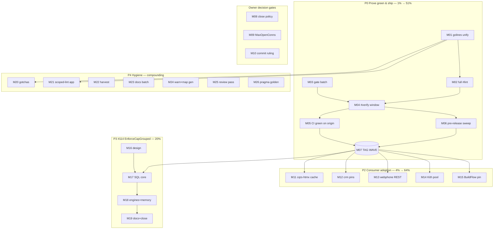

# SUPERB — Post-Sweep Release & Adoption Pareto Plan (2026-11-05 01:48 CET)

**Mission:** Convert the 2026-11-04 open-issues sweep (24 issues triaged, 20 fixed, all commented; lint/file-size/package-surface made green) into **shipped consumer value** — prove master green, tag the wave, drive fleet adoption — then land the #114 feature and the hygiene tail. Do not verschlimmbessern: every task below is verifiable and leaves the repo no worse.

**Scope line.** Inputs VERIFIED this session: the two freshest status reports (`docs/status/2026-11-04_23-17_*`, `docs/status/2026-11-05_01-14_*`), the live TODO_LIST (247 open rows read and dispositioned), the executing 2026-11-03 plan wave (T01.5/T10–T27), git state (master ahead of origin by 1), and TODO_LIST:294 (the golines ≤100 lesson — see Errata). NOT re-verified: consumer-repo internals (cqrs-htmx/crm/webphone/Kith/BuildFlow — their tasks carry their own first step "read current state"), and upstream tag states (turso matview flip stays blocked).

---

## 1) Pareto Breakdown

### The 1% that delivers 51% — **Prove green, tag the wave**
The sweep's entire output (20+ fixes across catalog/kv/id/metaengine/sqliteengine/cqrs-lint) is **unreleased**, and master CI was red before this session's fixes. One thread — `golines unify → full #lint → #verify → CI green → tag wave` — turns 24 issues of work into importable versions for the fleet. Nothing else in the backlog matters until trust in master is restored.

### The 4% that delivers 64% — **Consumer adoption of the wave**
Tags alone deliver nothing. Four consumer repos have specific, already-scoped adoptions waiting (cqrs-htmx cache adapter deletion, crm pin/waiver cleanup, webphone REST-contract options, Kith pool ceiling) plus the BuildFlow pin bump. This is where the library work becomes user-visible.

### The 20% that delivers 80% — **The #114 feature + repo-hygiene compounding**
`EnforceCapGrouped` (per-owner caps) kills webphone's last hand-rolled trim loops and completes the #72 arc. The hygiene block (scoped-lint app, gotchas encoding, TODO_LIST harvest, docs residues, waiver-map generation) compounds: each item prevents a class of future wasted sessions.

### The other 20% to reach 100% — **Long-horizon streams (routed, not scheduled)**
A9 keycodec-v2 engine migration wave (owner-confirmed scheduling pending), DuckLake T01–T06 gate+spike, the executing T10–T27 wave (v5 deletions, metaengine carve, cqrs-upgrade slice 2), upstream-blocked items (turso matview flip, `#26 retract` watch), v5-gated API work, and observe-only flake items. Dispositions in §6.

---

## 2) Comprehensive Plan — Medium granularity (30–100 min, sorted by importance/impact/effort/customer-value)

| # | Task | Why (customer value) | Impact | Effort | Depends |
|---|------|----------------------|--------|--------|---------|
| M01 | Unify golines threshold: flake.nix treefmt `golines max-len = 120` + full `nix fmt` + scoped lint re-prove | Kills the formatter war that bleeds every session (5 rounds this week) | Critical | 40m | — |
| M02 | Full `nix run .#lint` (89 modules) + fix stragglers | Proves master lint-green end-to-end; only 8 modules proven so far | Critical | 70m | M01 |
| M03 | Gate batch: untested-exports, duplication, gosec, test-sleeps, test-skips, md-go, changelog-symbols | Clears every ratchet the sweep touched but never re-ran | Critical | 60m | — |
| M04 | `nix run .#verify` in exclusivity window + triage/fix | The composite trust gate before any tag | Critical | 100m | M01–M03 |
| M05 | CI green confirmation on origin/master; close the T01.5/jobs-diagnosis loop | Ends the red-CI era; unblocks everything downstream | Critical | 35m | M04, push |
| M06 | Pre-release ritual: changed-set per-module `GOWORK=off go test` + fleet census | The 2026-10-06 lesson — never tag on build-only verification | Critical | 45m | M04 |
| M07 | **Tag wave**: catalog, kv, id, metaengine, sqliteengine, cqrs-lint (+ versions-manifest/README gates) | THE release — 24 issues of work reaches consumers | Critical | 75m | M05, M06 |
| M08 | Owner gate: close-policy ruling → close the 23 commented issues | Issue hygiene; stops per-sweep re-asking | High | 25m | — |
| M09 | Owner gate: `WithMaxOpenConns` ruling → build if approved | Kith-class consumers' pool escape hatch | Medium | 70m | — |
| M10 | Owner gate: hand-commit ruling → boundary commit if approved | History legibility of the wave | Medium | 20m | — |
| M11 | cqrs-htmx: delete `usermgmt/view_cache.go` adapter → `kv.NewCacheForViewStore` | #113's motivating consumer; deletes hand-rolled code | High | 75m | M07 |
| M12 | crm: drop 7 waiver-duplicated baseline entries + `scorecard.modules` projectionhost pin | Exercises #101/#110 as designed; shrinks baseline | High | 45m | M07 |
| M13 | webphone: `WithResponseHeader` (Retry-After), multipart transcribe, `WithTypedParam` pagination, drop `WithServer` suppression | Adopts #91/#95/#93/#94 in the flagship consumer | High | 90m | M07 |
| M14 | Kith CRM: raise `MaxOpenConns` via returned handle + re-measure read storm | Real perf fix documented by #112 | Medium | 45m | M07 |
| M15 | BuildFlow: cqrs-lint pin bump to the wave tag | Keeps the fleet's meta-linter current (T009 visibility) | Medium | 25m | M07 |
| M16 | #114 design: capability-split + API shape + dialect matrix (ADR-lite) | Prevents a wrong-shaped rush implementation | High | 55m | — |
| M17 | #114 core: SQL window-function enforcement (sqlite/turso) + tests | The 90% engine case (single-writer SQLite consumers) | High | 100m | M16 |
| M18 | #114 breadth: memory Go-path + duckdb/pg + adttest pins | Contract holds across engines | High | 100m | M17 |
| M19 | #114 ship: capabilities regen, recipes fence, CHANGELOG/FEATURES, comment+close | Feature complete and documented | High | 40m | M18 |
| M20 | Gotchas encode: nolint-placement rule + count-reconciliation rule (+ link TODO_LIST:294) | Prevents the two failure classes this session hit | Medium | 30m | — |
| M21 | Scoped-lint flake app (`GT_LINT_MODULES`) + self-test | Sessions stop hand-replicating the lint loop | Medium | 55m | M01 |
| M22 | TODO_LIST harvest: both status reports §f + this plan | Nothing entombed; living backlog stays true | Medium | 40m | — |
| M23 | Docs batch: metaengine README `SeqSeekableStreamLog` + enginetest deprecated-pin note + capabilities regen check | #112 doc residue | Low | 30m | — |
| M24 | `baseline.go` warn de-explosion + `waiverAdoptionRules` generation from catalog | Cosmetic debt + kills a hand-map split brain | Low | 65m | M03 |
| M25 | Review pass: `.golangci.yml` new exclusion comments vs compat source + daemon-committed drafts spot-check + FEATURES display-name row | Verifies my own inferences (d4 of status report) | Medium | 30m | — |
| M26 | Golden test: `NewSQLiteEngineFromDSNWith` caller-pragma-override-wins | Pins #111's last-write-wins contract | Low | 30m | M07 |

---

## 3) Fine Breakdown — ≤12 min each (sorted by importance/impact/effort/customer-value)

| # | Micro-task | Belongs | Est | Depends |
|---|-----------|---------|-----|---------|
| F01 | Edit flake.nix: treefmt golines `max-len = 120` | M01 | 5m | — |
| F02 | Full `nix fmt` walk; review diff (only expected re-joins) | M01 | 10m | F01 |
| F03 | Scoped golangci re-run over the 8 changed modules | M01 | 10m | F02 |
| F04 | `nix fmt` idempotence ×2 + record in plan | M01 | 5m | F03 |
| F05 | Launch full `#lint` (background, ~15m) | M02 | 10m | F01 |
| F06 | Triage + fix lint stragglers batch 1 | M02 | 12m | F05 |
| F07 | Triage + fix lint stragglers batch 2 | M02 | 12m | F06 |
| F08 | Re-run `#lint` to 89/89 green; record | M02 | 10m | F07 |
| F09 | `check-untested-exports` + fix/test-name new exports | M03 | 12m | — |
| F10 | `check-duplication` (art-dupl check; annotate or fix) | M03 | 12m | — |
| F11 | `check-gosec` over changed trees | M03 | 12m | — |
| F12 | `check-test-sleeps` + `check-test-skips` | M03 | 12m | — |
| F13 | `check-md-go` + `check-changelog-symbols` | M03 | 12m | — |
| F14 | Pre-verify: `check-nix-hashes` + tree clean | M04 | 5m | F08 |
| F15 | Launch `#verify` in quiet window (background) | M04 | 10m | F14 |
| F16 | Triage verify output; classify each finding | M04 | 12m | F15 |
| F17 | Fix batch A (build/vet/lint class) | M04 | 12m | F16 |
| F18 | Fix batch B (coverage/test-runtime class) | M04 | 12m | F17 |
| F19 | Confirm daemon pushed; locate newest ci.yml run | M05 | 10m | F18 |
| F20 | Watch run to conclusion; extract jobs table | M05 | 12m | F19 |
| F21 | If red: pull failing job log; root-cause | M05 | 12m | F20 |
| F22 | Record verdict; tick TODO_LIST T01.5 | M05 | 10m | F20 |
| F23 | Changed-set tests: catalog+kv+id (`GOWORK=off`) | M06 | 12m | F18 |
| F24 | Changed-set tests: metaengine+sqliteengine | M06 | 12m | F23 |
| F25 | Changed-set tests: cqrs-lint+system+systemscenario | M06 | 12m | F24 |
| F26 | Fleet census run + read zero-consumer report | M06 | 12m | F25 |
| F27 | Final api-golden/CHANGELOG/FEATURES coherence check | M07 | 12m | F26 |
| F28 | Tag catalog + kv + id (annotated tags) | M07 | 12m | F27 |
| F29 | Tag metaengine + sqliteengine + cqrs-lint | M07 | 12m | F28 |
| F30 | Versions-manifest + README gates + push tags | M07 | 12m | F29 |
| F31 | Post-tag `go get` smoke per tagged module | M07 | 12m | F30 |
| F32 | Present close-policy ask (3 options + standing-rule text) | M08 | 5m | — |
| F33 | Close the 23 issues via gh (if approved) | M08 | 12m | F32 |
| F34 | Annotate status report + TODO_LIST with policy | M08 | 8m | F33 |
| F35 | Present `WithMaxOpenConns` ask (build vs doc-only) | M09 | 5m | — |
| F36 | Implement `WithMaxOpenConns(n)` + tests (if approved) | M09 | 12m | F35 |
| F37 | Wire into DSN constructor + golden + CHANGELOG | M09 | 12m | F36 |
| F38 | Present hand-commit ruling ask | M10 | 5m | — |
| F39 | Compose boundary commit (if approved) | M10 | 12m | F38 |
| F40 | AGENTS.md policy note (if rule changes) | M10 | 8m | F39 |
| F41 | Read cqrs-htmx `usermgmt/view_cache.go` current state | M11 | 12m | M07 |
| F42 | Replace adapter with `kv.NewCacheForViewStore` (+copyFn choice) | M11 | 12m | F41 |
| F43 | cqrs-htmx tests green | M11 | 12m | F42 |
| F44 | cqrs-htmx self-lint + hand-commit (boundary rule) | M11 | 12m | F43 |
| F45 | Read crm baseline + `.cqrs-lint.json` | M12 | 12m | M07 |
| F46 | Drop 7 waiver-dup entries + add projectionhost pin | M12 | 12m | F45 |
| F47 | Run cqrs-lint verify + commit crm | M12 | 12m | F46 |
| F48 | webphone: Retry-After → `WithResponseHeader` | M13 | 12m | M07 |
| F49 | webphone: multipart `/api/transcribe` declaration | M13 | 12m | F48 |
| F50 | webphone: pagination → `WithTypedParam` | M13 | 12m | F49 |
| F51 | webphone: drop `WithServer(...,"","")` suppression | M13 | 8m | F50 |
| F52 | webphone: export diff review + tests + commit | M13 | 12m | F51 |
| F53 | Kith: read read-storm measurement context | M14 | 10m | M07 |
| F54 | Kith: raise `MaxOpenConns` via returned handle | M14 | 10m | F53 |
| F55 | Kith: re-measure + record comparison | M14 | 12m | F54 |
| F56 | BuildFlow: `go get` cqrs-lint @ wave tag (3 modules) | M15 | 10m | M07 |
| F57 | BuildFlow: CI/build green check | M15 | 10m | F56 |
| F58 | Survey window-function support per engine (table) | M16 | 12m | — |
| F59 | Decide API shape (`EnforceCapGrouped`/`WithCapPerGroup`) | M16 | 12m | F58 |
| F60 | Capability-interface design note (ADR-lite) | M16 | 12m | F59 |
| F61 | Comment design on #114; owner sanity-check | M16 | 12m | F60 |
| F62 | Core skeleton + grouped-cap config validation | M17 | 12m | F60 |
| F63 | SQL template: `ROW_NUMBER() OVER (PARTITION BY ...)` | M17 | 12m | F62 |
| F64 | sqliteengine integration | M17 | 12m | F63 |
| F65 | turso delegation test | M17 | 12m | F64 |
| F66 | Multi-group trim correctness tests | M17 | 12m | F64 |
| F67 | Order-by/injection edge tests | M17 | 12m | F66 |
| F68 | Memory engine Go grouping path | M18 | 12m | F64 |
| F69 | duckdb engine (fixed `FLOAT[n]`-style dimension care N/A; plain window fn) | M18 | 12m | F68 |
| F70 | pg engine | M18 | 12m | F69 |
| F71 | adttest grouped-cap assertion pin | M18 | 12m | F70 |
| F72 | Capability doctor/report row | M18 | 12m | F71 |
| F73 | `engine-capabilities.md --update` regen | M19 | 10m | F72 |
| F74 | recipes.md fence + doc-check | M19 | 12m | F73 |
| F75 | CHANGELOG + FEATURES rows | M19 | 12m | F74 |
| F76 | Comment + close #114 | M19 | 10m | F75 |
| F77 | Write gotcha: nolint-opening-line + golines threshold rule | M20 | 12m | F04 |
| F78 | Write gotcha: plan-vs-reality count reconciliation rule | M20 | 8m | F77 |
| F79 | Flake app skeleton reading `GT_LINT_MODULES` | M21 | 12m | F01 |
| F80 | Wire loop + failure summary shape | M21 | 12m | F79 |
| F81 | Self-test + AGENTS quick-ref row | M21 | 12m | F80 |
| F82 | Collect §f items from both status reports | M22 | 12m | — |
| F83 | Write TODO_LIST rows (routed, deduped) | M22 | 12m | F82 |
| F84 | Tick already-shipped rows; errata note | M22 | 12m | F83 |
| F85 | metaengine README `SeqSeekableStreamLog` section | M23 | 10m | — |
| F86 | enginetest deprecated-pin doc note | M23 | 8m | F85 |
| F87 | Capabilities regen no-op check | M23 | 10m | F86 |
| F88 | `baseline.go` warn → string-concat form | M24 | 10m | M03 |
| F89 | `waiverAdoptionRules` source survey (catalog-derived?) | M24 | 12m | F88 |
| F90 | Generator OR documented hand-map policy | M24 | 12m | F89 |
| F91 | Re-read my 2 `.golangci.yml` comments vs compat source | M25 | 12m | — |
| F92 | Spot-check daemon-committed drafts/addendum in git | M25 | 8m | F91 |
| F93 | Verify FEATURES display-name row covers display_name.go | M25 | 8m | F92 |
| F94 | Write pragma-override golden test | M26 | 12m | M07 |
| F95 | Run + pin golden | M26 | 8m | F94 |

---

## 4) Execution Graph

**Parallelism:** P0 is strictly sequential (trust chain). Decisions (DEC) can run any time. P2 tasks are independent of each other after M07. P3 design (M16) can start immediately; only M17 needs the tag wave. P4 is fully parallel.

---

## 5) Errata & lessons feeding this plan

1. **TODO_LIST:294 already documented the treefmt-golines ≤100 vs golangci-120 conflict** (2026-10-25 lesson) — the 2026-11-04/05 sweep session re-derived it in 5 painful lint/fmt rounds because it read `.golangci.yml` but not the TODO_LIST lesson row before fighting. M01 is the CURE the lesson row never got; M20 encodes the rule so it cannot recur.
2. The prior plan's T01.5 (CI-green confirmation) is still open and merges into M05 here — the sweep session left the jobs-level diagnosis inconclusive (GitHub API 502s).
3. Handoff count drift ("25 open issues" vs the real 23+1) cost the sweep a near-miss on #114; F78's count-reconciliation rule is the systemic fix.

## 6) Not scheduled — routed dispositions (the other 20% to 100%)

| Stream | Disposition |
|--------|-------------|
| A9 keycodec-v2 engine migration (pebble→badger→bbolt + legacy stores) | Own migration wave; owner confirmation still open (TODO_LIST:199) |
| DuckLake T01–T06 gate+spike | Next independent feature gate after #114; kill-fast criteria defined |
| Executing T10–T27 wave (stack deletions, v5 read-tier deletions, metaengine carve, cqrs-upgrade slice 2, untagged-API gate) | Own track; this plan's M07 tags unblock several of its census steps |
| Turso matview flip | BLOCKED upstream (turso-go tag); runbook ready (TODO_LIST:707) |
| `#26 retract` publish watch | Rides the next catalog tag (M07) |
| v5-gated API work (RawQuery rename, capability interfaces) | v5 train only |
| ActorID UTF-8 hole, `scratch/` disposition, journal-side adoption, cmdguard filings, F024/F025, matview v2 surface | Owner-gated or consumer-gated; rowed in TODO_LIST, not this plan |
| Observe-only flakes (projectionhost checkpoint, TestEngineHealth) | Revisit only on recurrence |
| EventCatalog upstream v5 licence shift + custom-export tail | External; watch |

## 7) Verification receipts required (per task class)

- Gate tasks (M01–M06): command output quoted in session log; failures fixed before proceeding.
- Release (M07): `git tag -l` + `go get` smoke output per module; versions-manifest gate green.
- Consumer tasks (M11–M15): the consumer repo's own test suite green + hand-commit at its boundary.
- Feature (M16–M19): per-engine tests + adttest pin + capabilities regen diff.
- Every task: leaves build green — verschlimmbesserung is grounds to revert immediately.

*Plan snapshot; living truth stays in TODO_LIST.md (M22 harvests this file's §f back there).*
