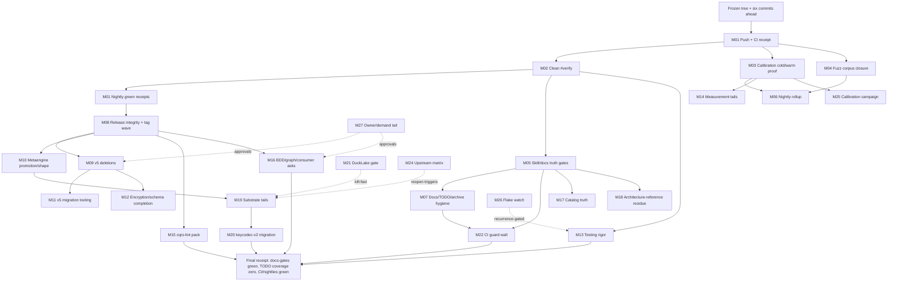

# SUPERB — Full-Backlog Trust-to-v5 Pareto Plan (2026-11-08 12:28 CET)

**Mission:** turn the current state — six authored/daemon commits ahead of origin with three locally fixed nightly failure classes, a verified 266-row live backlog, and a commissioned v5 transition — into **provably green CI, durable gates instead of repeated incident reports, released consumer value, and a safely sequenced v5 cut**. This plan sequences the entire live backlog without adding speculative architecture.

**Anti-Verschlimmbesserung contract**

- No new v4 core interfaces, production dependencies, or exported API except where an existing row explicitly commissions it.
- No edits to tracked files while an exclusive gate runs; kill the gate first.
- No module deletion without a fresh fleet census and the ADR-0152 zero-consumer rule.
- No full duplication-baseline or coverage-baseline re-pin to make a gate quiet; fix the finding or annotate the intentional clone with a reason.
- No foreign-repo fix-forward while another session is active there.
- No release tag on build-only verification: changed-set tests, release-script checks, and smoke probes are mandatory.
- Every task must leave the repo no worse: tests/gates green or the task is not done.

---

## 0) Scope line

**Verified while building this plan**

- `date`: 2026-11-08 12:28:53 CET.
- `git status --short --branch`: clean working tree before this plan; `master...origin/master [ahead 6]`.
- Live backlog inventoried mechanically from `TODO_LIST.md`: **266 open checkbox rows across 40 sections** after:
  - harvesting eight new **Brutal-audit follow-up A1–A8** rows from `docs/status/2026-11-08_08-52_brutal-audit-ci-fuzz-doc-drift-status.md`;
  - deleting nine stale rows whose own receipts proved them done (`b1e0f67b1`).
- `docs-gates freshness .`: **FRESH / 0 unharvested** after commit `749b11874` plus the two explicit generic-token routing annotations.
- Prior plan/report inputs actually read: the 2026-11-05 post-sweep Pareto plan, the 2026-11-03 red-to-green plan, the 2026-11-08 brutal-audit report, the 2026-11-07 Datastar research report, and the 2026-11-07 post-park CI stabilization report.
- Current workflow state via `gh run list`: Weekly Soaks and the latest Autoretry runs are green, while Nightly Gates (`42445543709`), Fuzz Nightly (`42443401875`), and Benchmarks (`42441847588`) remain red at planning time.
- The six unpushed commits include the local fixes for all three nightly failure classes plus the TODO harvest/cleanup.

**Not verified for this plan**

- No new full `#verify` was run while planning; the 2026-11-08 background attempt was invalidated by mid-run edits and killed.
- The repaired benchmark workflow has not run in GitHub Actions.
- Consumer-repo internals (cqrs-htmx, crm, webphone, Kith, BuildFlow, bank-sync) are planned from their TODO rows, not freshly audited here.
- External/upstream availability (Turso tags, EventCatalog issues, GitHub billing/evals access) is not checked from this repo.

**Row identifiers.** `R001`–`R266` below are the sequential open-row IDs assigned by the 2026-11-08 12:39 CET inventory (derived directly from `TODO_LIST.md`, in document order). Appendix A maps every section and therefore every row to exactly one medium task.

---

## 1) Pareto breakdown

### The 1% that delivers 51% — **prove the repairs on origin and make all scheduled workflows green**

The local repairs for the canonical-facts, fuzz-contract, and calibration-baseline failures are already committed, but origin still shows three red nightly workflows. One small, sequential thread — push the six commits, run a clean composed verification, watch CI, dispatch the benchmark workflow cold/warm, and watch the next fuzz shards — converts the entire brutal-audit arc from “fixed locally” into “fixed where consumers and nightly trust are formed.” Nothing else should run concurrently with the exclusive verification leg.

### The 4% that delivers 64% — **turn incident fixes into gates that cannot silently rot**

The same small set of durable controls prevents recurrence of every failure found this week:

1. calibration cold/warm baseline self-tests plus a real uploaded drift log;
2. fuzz corpus adoption plus a parser-contract/harness/seed same-edit rule;
3. a skill importable-module existence gate;
4. deleted-transport residue cleanup and alias-warning policy reconciliation;
5. a nightly-red rollup signal;
6. docs-gates routing/cadence repair and the TODO/archive hygiene wave.

These are cheap compared with another week of false-red or false-green CI.

### The 20% that delivers 80% — **release integrity, durable storage truth, and the v5 runway**

With trust restored, four programs deliver most remaining library value:

- **Release integrity:** untagged-backlog sweep, dependency-ordered tag wave, untagged-API CI gate, and release-script verification.
- **Storage correctness:** keycodec-v2 dual-read migration, metaengine substrate tails, calibration provenance, and engine conformance.
- **Consumer leverage:** cqrs-lint quality/performance pack, BDD/graph/consumer asks, catalog truth, and example/taskmanager cleanup.
- **v5 runway:** stack/read-tier deletions, metaengine promotion and package-shape work, `cqrs-upgrade --to-v5` slice 2, migration guide, and the cut checklist.

### The other 20% needed to reach 100% — **routed long-horizon, demand-gated, owner-gated, and blocked streams**

DuckLake implementation, matview v2, command sourcing, evals, real-GCP/bigtable, macOS/nspawn verification, Turso upstream releases, EventCatalog upstream asks, external owner actions, journal-side adoption, and observe-only flakes are **not dropped**. They are routed in M21, M24, M26, and M27 with explicit reopen triggers; they must not consume the trust/release window.

---

## 2) Comprehensive plan — medium tasks (30–100 minutes each; all 266 rows mapped)

Sorted by importance, customer impact, effort, and leverage. “Rows” refers to Appendix A’s R001–R266 inventory.

| # | Medium task | Customer value / why it matters | Rows claimed | Impact | Effort | Tier | Depends on |
|---|-------------|---------------------------------|--------------|--------|--------|------|------------|
| M01 | **Push + origin trust receipts** — push the six commits, confirm CI, watch Nightly Gates/Benchmarks/Fuzz to explicit green receipts | Consumers and nightly jobs see the fixes; ends the false “green Autoretry, red nightlies” state | R001, R027, R037, R043 | Critical | 45m | 1% | — |
| M02 | **Clean composed verification + serial fallback discipline** — preflight, quiet-window `#verify`, triage/fix, record receipts; finish `#verify-serial`/launcher rows | One honest proof that build, tests, race, lint, docs, and ratchets agree | R016, R027, R038–R040, R145, R163 | Critical | 100m | 1% | M01 |
| M03 | **Calibration baseline workflow proof** — cold/warm dispatch, cache sharing, artifact upload, freeze-on-fail; add self-tests and provenance note | Prevents two-night false-red benchmark classes and preserves real regression evidence | R028, R135, R216 | Critical | 70m | 1% | M01 |
| M04 | **Fuzz-contract closure** — download failed corpus, commit minimized seeds, fuzz all affected id/event targets, add same-edit contract rule | Keeps the nightly fuzzer a detector rather than a stale-contract alarm | R029, R255 tail | Critical | 60m | 1% | M01 |
| M05 | **Canonical skill/docs truth gates** — module-existence gate, deleted-transport residue sweep, alias-warning policy, Go-directive/BuildFlow prose truth | Stops fleet-wide agents from being taught deleted or contradictory API | R030–R032, R034, R210–R215 | Critical | 90m | 4% | — |
| M06 | **Nightly-red rollup signal** — aggregate CI/Nightly/Fuzz/Benchmark/Soak status and fail visibly when any required workflow is red | Prevents green recency from hiding three failed gates again | R033, R151, R171 | High | 60m | 4% | M01 |
| M07 | **Docs/TODO/archive hygiene wave** — route docs-gates findings, purge done checkboxes, annotate/archive 170 overdue reports, fix index/header dates, owner decision sheet | Keeps the next plan based on truth instead of stale obligations | R026, R035–R036, R052–R053, R210–R215 | High | 100m | 4% | M05 |
| M08 | **Release integrity + untagged-backlog wave** — re-derive tag deltas, changed-set tests, dependency-ordered batch release, manifest/README/smoke checks, release-script tail | Turns accumulated fixes into importable consumer versions safely | R015, R042–R043, R125–R126, R254, R231 tail | Critical | 100m | 20% | M01, M02 |
| M09 | **v5 deletion/cut program** — stack/read-tier/compat/tombstone deletions, wire-vocabulary tail, migration verification, v5.0.0 cut checklist | Removes legacy surface and makes the v5 migration real | R002–R003, R189–R209 | Critical | 100m | 20% | M08 |
| M10 | **Metaengine promotion + architecture shape** — 16-engine evidence table/stamp flips, memoryengine extraction, five-package ADR, tooling/golden tiering decisions | Stabilizes the strategic substrate and shrinks the largest package | R004, R018, R236–R245 | High | 100m | 20% | M08 |
| M11 | **v5 migration tooling + guide** — `cqrs-upgrade` slice 2, core/v5 tag prerequisite, migration-guide before/after, mirror-lag burn-down | Makes consumer migration mechanical instead of exploratory | R005, R021–R022, R164 | High | 90m | 20% | M09 |
| M12 | **Encryption/schema v5 completion** — ADR-0139 config/keyprovider design, schema adoption tail, fingerprint bridge decision | Closes two designed-but-unfinished safety/evolution surfaces | R006, R081, R086, R088 | Medium | 70m | 20% | M09 |
| M13 | **Testing-rigor program** — mutation gate, synctest pilots, planner MBT, differential engine harness, budgets/crash/broker/context matrices, executable examples | Converts “tests exist” into “tests can fail for the right reason” | R007–R010, R255–R266 | Critical | 100m | 20% | M02 |
| M14 | **Performance/correctness measurement tails** — tail-latency matrix, heap/goroutine/disk budgets, benchmark parity/tuned tier, load-sweep receipts | Keeps performance claims measurable across engines and tiers | R013, R216–R217, R222–R223 | High | 100m | 20% | M03 |
| M15 | **cqrs-lint quality/perf/consumer pack** — perf regression, #79/#83 tails, F024/F025, scope widening, doctor semantics, journal-side adoption gate | The fleet’s primary adoption/quality surface must stay fast and truthful | R011, R024, R107–R124, R247 | High | 100m | 20% | M08 |
| M16 | **BDD/graph/consumer-ask pack** — harness tails, TimeAdvancesTo, equivalence port, graph recipe/example, consumer deep-dive asks | Improves the consumer path from declaration to verified behavior | R012–R014, R091–R099, R246–R253 | High | 100m | 20% | M08 |
| M17 | **Catalog/EventCatalog truth + export tails** — hub asks, warn budget, goldens, CUE-fallback tail, docs/recipes truth pack | Keeps generated API governance trustworthy for consumers | R065–R072, R087–R090, R210–R215 | Medium | 100m | 20% | M05 |
| M18 | **Architecture-reference residue** — custom exports, lint lessons, errata, downstream owner actions, pre-existing-red dispositions | Closes the 2026-10-17 export program without losing owner decisions | R054–R060 | Medium | 70m | 20% | M05 |
| M19 | **Metaengine substrate/capability tails** — envelope spike, codec scope, ingress markers, caps cluster, routing, observability, DSN policy, live-server conformance | Completes engine behavior contracts and planner evidence | R073–R081, R127–R147 | Critical | 100m | 20% | M10 |
| M20 | **Keycodec-v2 dual-read migration** — pebble reference leg, badger/bbolt twins, legacy stores, fixtures/docs, scheduling confirmation | Eliminates the colon-injection/split-key disk-truth class safely | R049–R051 | Critical | 100m | 20% | M19 design |
| M21 | **DuckLake gate/spike only** — external-claim pinning, hermetic extension spike, ADR-0162 draft, kill-fast criteria; T07+ only on GO | Decides weeks vs months before any driver investment | R082–R085 | Medium | 60m | Other 20% | — |
| M22 | **CI/infra guard wall** — md-go FOD repair, ratchet guards, TODO detector, lint-config guards, timers, check-job policy, turso CI blockers, pre-commit scoping | Stops recurring config/tool drift from burning release windows | R148–R177, R227, R231–R234 | Critical | 100m | 4% | M05 |
| M23 | **Code-quality/duplication/file-size wave** — 190-group disposition, file-size offenders, branching-flow triage, panic/ignored-error/OTel scans, arch-lint truth | Prevents structural decay while the v5 cut approaches | R034, R178–R188 | High | 100m | 4% | M02 |
| M24 | **Upstream/blocked matrix** — Turso matview flip/runbook, tursogo loader/SEGSET asks, md-go upstream, EventCatalog issues, go-graph-rag comms | Keeps external blockers explicit with reopen triggers instead of stale hope | R064–R066, R103–R105, R138–R139, R227–R230 | Medium | 80m | Other 20% | — |
| M25 | **Calibration/quiet-window/bench campaign** — SearchQuery count=5, dgraph re-anchor, MySQL VM/seed replay, supersede notes, provenance | Restores honest planner costs and validates load-sensitive suites | R135, R161–R162, R211, R216–R217 | High | 100m | 20% | M03 |
| M26 | **Flake/observability watch** — SSE recurrence instrumentation, projectionhost checkpoint, engine-health contention, temporal soaks, observe-only rows | Distinguishes real regressions from load noise without masking either | R041, R101–R102, R225–R226 | High | 90m | Other 20% | M02 |
| M27 | **Owner/demand-gated long tail** — decision sheet, scratch disposition, ActorID design, command sourcing, evals, billing/GCP/macOS/nspawn, journal-side and remaining external asks | Preserves every legitimate backlog item without scheduling unowned work | R019–R020, R035–R036, R055–R058, R061–R064, R068–R070, R095, R100, R150–R154, R212, R224, R230, R235 | Medium | 60m | Other 20% | Owner |

---

## 3) Fine breakdown — exactly 150 tasks, each ≤12 minutes

Sorted within the execution tiers. Every row is independently stoppable; no micro-task may “improve” a gate by weakening it.

### Tier 1% — restore origin trust (F001–F020)

| # | Micro-task | Parent | Est | Depends |
|---|-------------|--------|-----|---------|
| F001 | Confirm clean tree, review the six ahead commits, and check no exclusive gate is running | M01 | 6m | — |
| F002 | Push `master` to origin (explicit user authorization received in task text) | M01 | 6m | F001 |
| F003 | Open the newest push CI run and record its job matrix | M01 | 10m | F002 |
| F004 | Triage any red push-CI leg from its log; fix only the owning defect | M01 | 12m | F003 |
| F005 | Run the cheap verify preflight (canonical facts, ADR numbering, changelog symbols, templ, tidy test) | M02 | 12m | F001 |
| F006 | Confirm load/calibration gate allows a composed run | M02 | 6m | F005 |
| F007 | Launch `#verify` with a frozen tree and durable log | M02 | 10m | F006 |
| F008 | Triage verify output without editing while it runs | M02 | 12m | F007 |
| F009 | If red: stop, fix the smallest owning defect, rerun affected cheap gates | M02 | 12m | F008 |
| F010 | Record full `#verify` receipt and close R027/R016 | M02 | 8m | F008 |
| F011 | Dispatch `benchmarks.yml` cold run and verify baseline-establishment log | M03 | 12m | F002 |
| F012 | Dispatch warm run and verify runner-class comparison + uploaded non-empty drift log | M03 | 12m | F011 |
| F013 | Prove drift failure freezes the old baseline (fixture/self-test) | M03 | 12m | F012 |
| F014 | Add cold-run and freeze self-tests to calibration scripts/workflow tests | M03 | 12m | F013 |
| F015 | Record false-failure runs `42332942484`/`42441847588` in calibration provenance | M03 | 8m | F014 |
| F016 | Download failed fuzz corpus artifacts and inventory minimized inputs | M04 | 12m | F002 |
| F017 | Commit minimized regression seeds beside the existing invalid-UTF-8 seeds | M04 | 10m | F016 |
| F018 | Run affected id/event targets in actual fuzz mode | M04 | 12m | F017 |
| F019 | Add parser-contract → matching fuzz harness + rejecting seed same-edit rule | M04 | 12m | F018 |
| F020 | Watch Nightly Gates + next fuzz shards; record explicit green receipts | M01 | 12m | F002 |

### Tier 4% — durable gates and documentation truth (F021–F060)

| # | Micro-task | Parent | Est | Depends |
|---|-------------|--------|-----|---------|
| F021 | Extract module paths claimed live from `SKILL.md` and references | M05 | 10m | — |
| F022 | Compare claimed paths against `go.work`; classify miss as live/deleted/external | M05 | 10m | F021 |
| F023 | Implement module-existence checker with `--self-test` deleted-module fixture | M05 | 12m | F022 |
| F024 | Wire checker into docs/verify-fast gate; regenerate any affected docs | M05 | 12m | F023 |
| F025 | Sweep taskmanager comments for deleted transport references | M05 | 8m | — |
| F026 | Sweep metaengine SSE code/README references | M05 | 8m | F025 |
| F027 | Sweep watermill catch-up and DOMAIN_LANGUAGE references | M05 | 10m | F026 |
| F028 | Classify MIGRATION-GUIDE as historical or live; banner/fix accordingly | M05 | 10m | F027 |
| F029 | Reproduce six ambiguous v4/core alias warnings in doc-check | M05 | 8m | — |
| F030 | Choose policy: scope imports, explicit allow-list, or fail-on-warning | M05 | 10m | F029 |
| F031 | Implement alias-warning policy and update AGENTS contract text | M05 | 12m | F030 |
| F032 | Add doc-check regression for the chosen policy | M05 | 10m | F031 |
| F033 | Reconcile AGENTS go-directive prose with uniform `go 1.27.2` | M05 | 8m | — |
| F034 | Reconcile AGENTS/BuildFlow go-version-auto-configure skip state | M05 | 10m | F033 |
| F035 | Extend canonical-facts with lockstep directive/contract leg + self-test | M05 | 12m | F034 |
| F036 | Design nightly rollup data source (gh run list or workflow-runs API) | M06 | 10m | — |
| F037 | Implement aggregate status script with explicit required-workflow list | M06 | 12m | F036 |
| F038 | Add scheduled rollup job/README badge; failure names owning workflow | M06 | 12m | F037 |
| F039 | Add rollup self-test with planted red/green fixtures | M06 | 10m | F038 |
| F040 | Run docs-gates routing and list every unrouted historical row | M07 | 12m | — |
| F041 | Route nine currently unrouted metaengine codec report rows | M07 | 12m | F040 |
| F042 | Purge 15 done-checkbox TODO rows via docs-strike/CHANGELOG | M07 | 12m | F041 |
| F043 | Fix 18 unwrapped DONE rows or convert to explicit verdicts | M07 | 12m | F042 |
| F044 | Identify reports eligible for archive from 170 unarchived files | M07 | 12m | F043 |
| F045 | Verify every item in first archive batch is struck/routed/skipped | M07 | 12m | F044 |
| F046 | `git mv` first archive batch + Live remainder banner | M07 | 12m | F045 |
| F047 | Repeat archive batches until cadence threshold is green | M07 | 12m | F046 |
| F048 | Update status README header date and report-write checklist | M07 | 8m | F047 |
| F049 | Add same-edit status-index insertion preflight/check | M07 | 10m | F048 |
| F050 | Build one-page owner decision sheet from fleet-audit leftovers | M07 | 12m | — |
| F051 | Add TODO hygiene detector duplicate/pointer/checkbox self-test | M22 | 12m | F042 |
| F052 | Wire TODO hygiene detector into cheap gate | M22 | 10m | F051 |
| F053 | Add stale-premise detector against versions.json/tags | M22 | 12m | F052 |
| F054 | Run stale-premise detector and fix findings | M22 | 10m | F053 |
| F055 | Add “kill exclusive gate before edit” AGENTS/gotcha rule | M02 | 6m | — |
| F056 | Add subagent provider preflight rule | M02 | 6m | F055 |
| F057 | Add phase-boundary hand-commit reminder to plan execution checklist | M02 | 6m | F056 |
| F058 | Add root-artifact transcript refusal patterns to daemon/hook proposal | M05 | 12m | — |
| F059 | Identify literal `--help/` catalog generator and fix output-dir handling | M05 | 12m | F058 |
| F060 | Add generated/research artifact index gate decision row and implementation | M05 | 12m | F059 |

### Tier 20% — releases, substrate, consumer value, v5 (F061–F135)

| # | Micro-task | Parent | Est | Depends |
|---|-------------|--------|-----|---------|
| F061 | Re-derive untagged production drift per module from last tag..HEAD | M08 | 12m | M01 |
| F062 | Classify deprecated-module final-tag policy | M08 | 10m | F061 |
| F063 | Derive semver for each untagged module from api golden diff | M08 | 12m | F062 |
| F064 | Build dependency-ordered batch-release plan | M08 | 12m | F063 |
| F065 | Run changed-set tests batch 1 (core/id/event/record) | M08 | 12m | F064 |
| F066 | Run changed-set tests batch 2 (storage/queue/scheduling) | M08 | 12m | F065 |
| F067 | Run changed-set tests batch 3 (middleware/query/listing/system) | M08 | 12m | F066 |
| F068 | Run release-script self-tests and example-standalone gate | M08 | 12m | F067 |
| F069 | Cut leaf tag batch; push and smoke from clean dir | M08 | 12m | F068 |
| F070 | Cut dependent tag batches in dependency order; smoke each | M08 | 12m | F069 |
| F071 | Refresh versions manifest/README; run check gate | M08 | 10m | F070 |
| F072 | Add examplePaths-vs-published-pins untagged-API CI gate | M08 | 12m | F071 |
| F073 | Mutation-test untagged-API gate with planted untagged export | M08 | 12m | F072 |
| F074 | Complete release-tooling polish slice (smoke timing, templ summary, dogfood sentinel) | M08 | 12m | F073 |
| F075 | Inventory stack/* direct consumers for deletion wave | M09 | 10m | M08 |
| F076 | Write stack deletion migration notes | M09 | 12m | F075 |
| F077 | Remove stack presets through six registration gates | M09 | 12m | F076 |
| F078 | Remove Materialize/RelationalProjection/view/GraphProjection surfaces | M09 | 12m | F077 |
| F079 | Remove ADR-0126 compatibility shells and BuildWhereClause | M09 | 12m | F078 |
| F080 | Complete tombstone metadata API deletion with ADR-0114 status | M09 | 12m | F079 |
| F081 | Apply remaining wire-vocabulary renames and validation changes | M09 | 12m | F080 |
| F082 | Regenerate api golden/capabilities/catalog after deletions | M09 | 12m | F081 |
| F083 | Update V5 migration guide with before/after sections | M11 | 12m | F082 |
| F084 | Tag first core/v5.x.y prerequisite release | M11 | 12m | F082 |
| F085 | Implement cqrs-upgrade go.mod require rewrite | M11 | 12m | F084 |
| F086 | Add apply-mode tidy/build verification and JSON v5 output | M11 | 12m | F085 |
| F087 | Decide eventtest fold-or-exclude in v5 core | M11 | 10m | F086 |
| F088 | Build 16-engine promotion evidence table | M10 | 12m | M08 |
| F089 | Flip Experimental doc.go stamps and family parent | M10 | 12m | F088 |
| F090 | Align FEATURES/SKILL/matrix with promotion evidence | M10 | 12m | F089 |
| F091 | Regenerate api golden for 17 doc.go changes | M10 | 10m | F090 |
| F092 | Extract memoryengine package behind unchanged API | M10 | 12m | F091 |
| F093 | Write five-package carve ADR with dependency rules | M10 | 12m | F092 |
| F094 | Add core/v5 arch-lint config and fix findings | M10 | 12m | F093 |
| F095 | Tier api golden by stability/product line decision | M10 | 12m | F094 |
| F096 | Decide tooling split scope (cqrs-lint product line) | M10 | 12m | F095 |
| F097 | Draft ADR-0139 config/keyprovider seam | M12 | 12m | M09 |
| F098 | Design schema-event adoption tail for bank-sync/cqrs-htmx | M12 | 12m | F097 |
| F099 | Decide compat gate subject (fixture catalog vs consumer-owned) | M17 | 10m | — |
| F100 | Ship compat benchmarks/recipes/CHANGELOG tail | M17 | 12m | F099 |
| F101 | Add mutation-verify pilot harness and run on three tests | M13 | 12m | M02 |
| F102 | Wire mutation ratchet for NEW tests | M13 | 12m | F101 |
| F103 | Convert scheduling ticker tests to synctest | M13 | 12m | F102 |
| F104 | Convert two more test pilots to synctest | M13 | 12m | F103 |
| F105 | Build rapid planner capability-set MBT | M13 | 12m | F104 |
| F106 | Add invariant fuzzing to planner MBT | M13 | 12m | F105 |
| F107 | Define differential engine op-script DSL | M13 | 12m | F106 |
| F108 | Run differential memory+sqlite matrix | M13 | 12m | F107 |
| F109 | Extend differential harness to LSM engines | M13 | 12m | F108 |
| F110 | Add heap/goroutine/disk budget tests | M13 | 12m | F109 |
| F111 | Add crash-consistency kill-9 matrix | M13 | 12m | F110 |
| F112 | Add broker partition/redelivery/DLQ/outbox matrix | M13 | 12m | F111 |
| F113 | Decide canceled-context write behavior and tamper family | M13 | 12m | F112 |
| F114 | Profile cqrs-lint 2.0s→7.4s regression | M15 | 12m | — |
| F115 | Fix cqrs-lint hot path and bench-pin | M15 | 12m | F114 |
| F116 | Add #79 typed-load fixture and fragment audit | M15 | 12m | F115 |
| F117 | Add #83 stale-baseline hardening and health ruling | M15 | 12m | F116 |
| F118 | Implement F024/F025 utilization variants or reasoned refusal | M15 | 12m | F117 |
| F119 | Add pushdown cookbook recipe | M15 | 10m | F118 |
| F120 | Add cqrs-htmx sqlite-lifecycle systemscenario variant | M16 | 12m | — |
| F121 | Add TimeAdvancesTo sugar and TB refactor | M16 | 12m | F120 |
| F122 | Port observational equivalence/store conformance reuse | M16 | 12m | F121 |
| F123 | Write Graph ADT end-to-end CRM recipe | M16 | 12m | F122 |
| F124 | Add graph-native Dgraph integration leg | M16 | 12m | F123 |
| F125 | Wire systemcatalog Registry bridge + drift test | M16 | 12m | F124 |
| F126 | Add AsyncAPI response schemas/protocol bindings | M15 | 12m | F125 |
| F127 | Build engine-value envelope spike decision | M19 | 12m | M10 |
| F128 | Decide custom/encrypted read-model codec scope | M19 | 12m | F127 |
| F129 | Unify ingress markers or document split | M19 | 12m | F128 |
| F130 | Add encoded-ingress fleet benchmark | M19 | 12m | F129 |
| F131 | Complete #72 cap coverage/cost/timer/write variants | M19 | 12m | F130 |
| F132 | Implement keycodec pebble dual-read reference leg | M20 | 12m | F131 |
| F133 | Add pebble legacy v1 fixture and dual scans | M20 | 12m | F132 |
| F134 | Replicate keycodec migration to badger/bbolt | M20 | 12m | F133 |
| F135 | Migrate legacy storage/pebble+bbolt keys and document dual-read window | M20 | 12m | F134 |

### Other 20% — routed, gated, and long-horizon streams (F136–F150)

| # | Micro-task | Parent | Est | Depends |
|---|-------------|--------|-----|---------|
| F136 | Pin DuckLake external claims (extension channel/version) | M21 | 12m | — |
| F137 | Run hermetic vendored-extension LOAD/ATTACH spike | M21 | 12m | F136 |
| F138 | Write ADR-0162 go/no-go with kill-fast criteria | M21 | 12m | F137 |
| F139 | Check latest Turso tag for #10129 rewrite | M24 | 6m | — |
| F140 | If tagged: execute matview flip runbook steps 1–6 | M24 | 12m | F139 |
| F141 | File/advance approved upstream asks (turso, md-go, EventCatalog) | M24 | 12m | — |
| F142 | Instrument SSE ring drop counter in ordering test | M26 | 12m | — |
| F143 | Reproduce SSE slow-consumer miss under taskset throttling | M26 | 12m | F142 |
| F144 | Add projection checkpoint cadence property or clock seam if recurrence fires | M26 | 12m | F143 |
| F145 | Run SearchQuery count=5 quiet-window recalibration | M25 | 12m | M03 |
| F146 | Re-anchor dgraph constants in one gate-passing window | M25 | 12m | F145 |
| F147 | Run MySQL VM shuffled replay + integration leg | M25 | 12m | F146 |
| F148 | Present owner decision sheet (scratch, ActorID, evals, billing, licensing) | M27 | 12m | F050 |
| F149 | Execute approved owner decisions only; record verdicts in TODO/ADR | M27 | 12m | F148 |
| F150 | Re-run docs-gates + TODO inventory and reconcile this plan’s coverage to zero unmapped rows | M07 | 12m | F149 |

---

## 4) Execution graph

**Parallelism rules**

- M01/M02 are strictly sequential and exclusive.
- M03 and M04 can run after push but must not overlap the composed verification leg.
- M05–M07 and M22 are parallel documentation/tooling tracks.
- M08 is the release gate; M09–M20 follow its tags/census outputs.
- M21/M24/M26/M27 are gated/watch streams and must not preempt the trust/release window.

---

## 5) Verification receipts required

| Class | Required proof |
|------|----------------|
| Push/CI | `git status` clean, push output, run IDs and final conclusions for push CI, Nightly Gates, Fuzz Nightly, Benchmarks |
| Composed verification | Full log path, exit code, load provenance, no tree edits during run |
| Calibration | Cold/warm run IDs, non-empty artifact hash/size, freeze-on-fail self-test output |
| Fuzz | Downloaded artifact names, committed seed paths, fuzz-mode target outputs |
| Docs gates | `docs-gates freshness/routing/cadence` outputs; archive `git mv` receipts |
| Release | Changed-set test outputs, dependency-ordered tag list, clean-dir `go get` smokes, versions-manifest gate |
| Deletions/v5 | Fleet census, gate de-registration checklist, api golden diff, migration-guide compile checks |
| Every task | No weakened gate, no new unexplained baseline, no build regression |

---

## 6) Errata and corrections discovered while planning

1. Nine open TODO rows were already superseded by their own receipts (2026-11-04 tag/doc/upgrade work and the executed 2026-11-05 post-sweep M-arc). They were deleted in `b1e0f67b1`; without this cleanup the plan would have re-dispatched completed work.
2. Two report items (“run clean verify” and “calibration refresh self-test”) contain only generic tokens and cannot be matched by `docs-gates freshness` without accidental historical drift. They are explicitly routed via `<!-- fresh:skip -->` annotations to A1/A2 rather than duplicated as new rows.
3. The previous 2026-11-05 plan correctly executed most release/adoption work, but its stale open rows survived until this plan’s inventory cleanup — evidence that M07/M22’s TODO hygiene detector is necessary, not cosmetic.
4. Current AGENTS/BuildFlow prose disagrees with the uniform `go 1.27.2` directive state. This is planned in M05/F033–F035 rather than silently edited during planning.

---

## Appendix A — complete 266-row coverage matrix

Row IDs are sequential open rows in the current TODO document. Every range is fully covered by the named medium tasks; no row is omitted.

| TODO section | Rows | Count | Owning medium tasks |
|---|---|---:|---|
| Full-backlog Pareto plan | R001–R026 | 26 | M01, M07–M17, M19–M23, M25–M27 |
| Brutal-audit follow-ups | R027–R034 | 8 | M01–M07, M22–M23, M26–M27 |
| Fleet-audit follow-up tail | R035–R036 | 2 | M07, M27 |
| Post-sweep execution | R037–R048 | 12 | M01–M03, M08, M22, M25–M26 |
| Disk-truth residue | R049–R053 | 5 | M20, M07, M27, M17 |
| Architecture reference export | R054–R060 | 7 | M18, M27 |
| GitHub issue backlog | R061–R064 | 4 | M27, M24 |
| EventCatalog hub asks | R065–R066 | 2 | M17, M24 |
| EventCatalog v5 follow-ups | R067–R072 | 6 | M17 |
| Metaengine substrate proposal | R073–R081 | 9 | M19, M08, M12, M15, M27 |
| DuckLake driver | R082–R085 | 4 | M21 |
| V5 schema evolution | R086 | 1 | M12 |
| Catalog × CUE fallback | R087–R090 | 4 | M17, M12 |
| BDD harness wave | R091–R098 | 8 | M16 |
| BDD depth follow-up | R099 | 1 | M16 |
| Command-side depth | R100 | 1 | M27 |
| ResetProjection/contention watch | R101–R102 | 2 | M26 |
| Turso matviews | R103–R105 | 3 | M24 |
| Cordis follow-up | R106 | 1 | M09 |
| cqrs-lint | R107–R124 | 18 | M15, M22, M27 |
| Release / Tagging | R125–R126 | 2 | M08 |
| Metaengine follow-ups | R127–R147 | 21 | M19, M14, M25 |
| CI / Infrastructure | R148–R177 | 30 | M22, M02, M06, M24 |
| Code Quality | R178–R188 | 11 | M23, M07 |
| v5 Unification | R189–R209 | 21 | M09, M11–M12 |
| Docs/consumer truth | R210–R215 | 6 | M05, M07, M17 |
| benchkit rigor tail | R216 | 1 | M14, M25 |
| CV verdict follow-ups | R217–R221 | 5 | M14, M15, M27 |
| Metaengine goal closure | R222–R224 | 3 | M14, M27 |
| Temporal cells | R225–R226 | 2 | M26 |
| md-go-validator integration | R227 | 1 | M22, M24 |
| go-graph-rag follow-ups | R228–R230 | 3 | M24, M27 |
| 92-tag release tail | R231–R234 | 4 | M08, M22 |
| Skill hard-block refocus | R235 | 1 | M27 |
| Architecture review | R236–R245 | 10 | M10, M23 |
| CRM Graph-ADT debut | R246–R247 | 2 | M16 |
| Wave-C delta audit | R248–R249 | 2 | M08, M27 |
| Consumer deep-dive asks | R250–R253 | 4 | M16 |
| Untagged-API incident | R254 | 1 | M08 |
| Testing improvements | R255–R266 | 12 | M13, M04, M26 |
| **Total** | **R001–R266** | **266** | **All mapped** |

---

*Living truth remains in `TODO_LIST.md`; this snapshot is the execution sequencing authority until superseded. No work beyond planning, harvesting, stale-row cleanup, and verification was started.*
