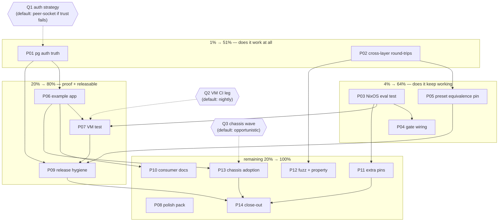

# SUPERB — ADR-0165 Standard-Topology Completion Pareto Plan (2026-11-08 16:11 CET)

**Scope:** close out the ADR-0165 arc opened this session (`docs/status/2026-11-08_16-06_standard-topology-nixos-cue-adr0165-status.md` §f + TODO_LIST §"Standard deployment topology & NixOS" harvest, 2026-11-08). NOT the full 266-row backlog — that is owned by [`2026-11-08_12-28_SUPERB-full-backlog-trust-to-v5-pareto-plan.md`](2026-11-08_12-28_SUPERB-full-backlog-trust-to-v5-pareto-plan.md) (written before these rows existed; verified no overlap — its only "CUE" rows are the catalog arc, M17).

**Shipped already (do not re-plan):** `system.Standard` + tests, LoadConfig JSON branch, `system/config.cue` + golden + `#check-cue-config` gate (+self-test), `nixosModules.cqrs` (eval-proven), ADR-0165 + both indexes, CHANGELOG/FEATURES/TODO/skill/README docs, api golden, scoped gates green.

**Known risks driving priority:** (1) auto-provisioned postgres DSNs assume nixpkgs localhost TRUST auth — unverified; (2) zero automated protection on the NixOS module; (3) no cross-layer round-trip (Nix/CUE output → LoadConfig) — each layer tested only against hand-written fixtures; (4) three preset twins (Go/CUE/Nix) with no semantic equivalence pin.

## 1) Pareto breakdown

| Tier | What | Why it dominates |
| --- | --- | --- |
| **1% → 51%** | **P01 verify pg auth** + **P02 cross-layer round-trips** | These decide whether the shipped feature WORKS AT ALL on real hardware. Everything else amplifies a feature whose core loop is unproven. |
| **4% → 64%** | **P03 committed NixOS eval test** + **P04 CI/verify wiring** + **P05 preset equivalence pin** | Regression protection — makes it KEEP working. P05 kills the Go/CUE/Nix split brain. |
| **20% → 80%** | **P06 example app** + **P07 VM test** + **P09 release hygiene** | Runnable proof + first `hardenedService` consumer + a releasable v4.18.0 wave. |
| **Remaining 20% → 100%** | P08 fence/DSN/mdDoc polish, P10 recipes+FAQ, P11 extra pins, P12 fuzz/property, P13 chassis adoption (Q3-gated), P14 addendum+close-out | Polish, docs, defense-in-depth, fleet adoption. |

## 2) Comprehensive plan — medium tasks (30–100 min each; all arc TODOs mapped)

| ID | Task | Impact | Effort | Pareto | Depends on |
| --- | --- | --- | --- | --- | --- |
| P01 | **Postgres auth truth + strategy**: read nixpkgs pg module source for the 127.0.0.1 default; check `ensureDBOwnership` PG floor; pick peer-socket vs documented-trust (owner Q1 default: peer-socket if trust fails, else document loudly) | Correctness of shipped auto-provision | 30–60m | 1% | — |
| P02 | **Cross-layer round-trip tests**: Nix-rendered JSON → `LoadConfig`; committed `cue export --out json` artifact → `LoadConfig` | Closes the "layers tested against hand-written fixtures" hole | 30m | 1% | — |
| P03 | **Committed NixOS eval test** (flake checks leg): render demo deployment, assert JSON + `ensureDatabases/ensureUsers` + `hardenedService`; `nix flake check` scoped pass | First automated protection for a public flake output | 45m | 4% | — |
| P04 | **Gate wiring**: CI job for `#check-cue-config`; wire into `#verify`/`#verify-fast` | An unwired gate is a suggestion | 30m | 4% | P03 (checks leg exists) |
| P05 | **Preset cross-equivalence pin**: one shared expected-instance fixture asserted by Go test + CUE golden + Nix eval test | Kills the Go/CUE/Nix semantic split brain | 60m | 4% | P02 |
| P06 | **`example/standard-topology/`**: runnable app (commands+events+projection on sqlite via `system.Standard`), 6-gate registration ritual (examplePaths, api-stability, module-layers, cqrs-lint catalog), README with NixOS usage | Proof + the demo every consumer copies | 90m | 20% | P01 (DSN form settled) |
| P07 | **`vm-test.nix`**: boot NixOS VM → assert config file + pg DB provisioned + real binary boots through `hardenedService`; CI leg decision (owner Q2 default: nightly, not push) | End-to-end provisioning proof | 90m | 20% | P03, P06 |
| P08 | **Polish pack**: compile-verify module-README fences; unify sqlite `file:` DSN form; `lib.mdDoc` pass on module options | Docs that can't lie | 30m | rest | — |
| P09 | **Release hygiene**: `#verify-fast` + full `#verify` triage; `#check-coverage`; system v4.18.0 minor-bump decision + CHANGELOG cut (`Standard` = new export ⇒ minor) | A releasable wave | 60m | 20% | P01–P05 green |
| P10 | **Consumer docs**: recipes.md ladder section (Go/CUE/NixOS side-by-side); FAQ "move the query audit log to its own engine" | Adoption surface | 30m | rest | P06 (names to reference) |
| P11 | **Extra pins**: `standardTopology=false` eval test; explicit-DSN-wins eval test; CUE `deployment`-entry golden; aarch64 eval; `nixosModules.default` alias test; module meta docs | Defense-in-depth | 45m | rest | P03 |
| P12 | **Fuzz + property**: `LoadConfig` `.json` fuzz seeds; rapid property test — `Standard` idempotent + engine-name permutation invariant | Cheap deep coverage | 30m | rest | P02 |
| P13 | **Chassis adoption (owner Q3-gated)**: cqrs-htmx + go-appkit switch to `system.Standard`, simplify 3-instance configs to engines-only; cross-repo suites | 73% of fleet's indirect edges ride the chassis | 60m | rest | P06 proven |
| P14 | **Close-out**: ADR-0165 auth-facts addendum + plan reconcile banner; final status report + docs-health HARVEST | Truth trail | 20m | rest | all |

## 3) Fine breakdown — 46 tasks, each ≤12 min

| # | Task (≤12m) | Parent | Impact |
| --- | --- | --- | --- |
| F01 | Read nixpkgs postgresql module `authentication` default for 127.0.0.1 (source, not docs) | P01 | 🔥 |
| F02 | Check `ensureDBOwnership` PG version floor (module option docs/source) | P01 | 🔥 |
| F03 | Record decision: peer-socket DSN vs documented-trust; if peer → service-User==DB-user contract written into module docstring | P01 | 🔥 |
| F04 | If strategy ≠ current: fix `resolveDSN` + module comment + re-eval demo config | P01 | 🔥 |
| F05 | Go test: embed the Nix module's rendered demo JSON (from eval proof) → `system.LoadConfig`, assert engines+instances | P02 | 🔥 |
| F06 | Commit `cue export --out json` artifact under `system/testdata/` + test loads it via `LoadConfig` | P02 | 🔥 |
| F07 | Write `nix/nixos/eval-test.nix` (nixosSystem eval over the module) | P03 | 🔥 |
| F08 | Eval test: demo deployment JSON matches expected shape | P03 | 🔥 |
| F09 | Eval test: pg `ensureDatabases`/`ensureUsers` + `hardenedService` fragment | P03 | high |
| F10 | Register eval test in flake checks; run scoped `nix flake check` on new outputs | P03 | high |
| F11 | CI workflow job for `#check-cue-config` (ci.yml) | P04 | high |
| F12 | Decide verify-chain wiring (fast-only vs both); edit flake verify app accordingly | P04 | high |
| F13 | Extract shared expected instance-triple fixture (Go testdata JSON) | P05 | high |
| F14 | Go test: `system.Standard` output == fixture triple | P05 | high |
| F15 | CUE: golden-assert `standard` eval == fixture triple (extend check-cue-config) | P05 | high |
| F16 | Nix eval test: rendered `instances` == fixture triple | P05 | high |
| F17 | `example/standard-topology/` go.mod + main.go skeleton (module path ritual step 1–2) | P06 | high |
| F18 | Example domain: one command, one event, one Lookup projection | P06 | high |
| F19 | Wire `system.Standard` + sqlite engine import; boots and dispatches | P06 | high |
| F20 | 6-gate registration: examplePaths, api-stability modules slice + exclusion maps, module-layers LAYER, cqrs-lint catalog meta-test | P06 | high |
| F21 | Example README: Go/CUE/NixOS three-step usage incl. `hardenedService` | P06 | med |
| F22 | `vm-test.nix` skeleton (nixosTest shape, imports module) | P07 | high |
| F23 | VM asserts: `/etc/cqrs/demo/deployment.json` exists + pg DB live | P07 | high |
| F24 | VM asserts: example binary boots via `hardenedService` fragment + dispatch works | P07 | high |
| F25 | CI leg decision (Q2 default: nightly) + workflow edit | P07 | med |
| F26 | Extend `readme_quickstart_verify_test` to extract+compile README fences (or add md-go-style pass) | P08 | med |
| F27 | Unify sqlite DSN `file:` prefix across LoadConfig docs, CUE fixture, example | P08 | low |
| F28 | `lib.mdDoc` pass on cqrs.nix option descriptions | P08 | low |
| F29 | Run `#verify-fast`; triage failures to zero | P09 | high |
| F30 | Run full `#verify` (quiet window; storm-ride via verify-chain.sh if load-guarded) | P09 | high |
| F31 | `#check-coverage` run; fix any system-module drift | P09 | med |
| F32 | Version decision: system v4.18.0 minor (new export) — CHANGELOG cut prep (NO tag without owner) | P09 | med |
| F33 | recipes.md ladder section (§2.50) | P10 | med |
| F34 | FAQ entry: move query audit log to its own engine | P10 | low |
| F35 | Eval test: `standardTopology = false` renders empty instances | P11 | med |
| F36 | Eval test: explicit `dsn` suppresses provisioning | P11 | med |
| F37 | CUE golden for schema-only `deployment` entry with explicit instances | P11 | low |
| F38 | aarch64-linux eval of the module (flake systems matrix or eval expr) | P11 | low |
| F39 | `nixosModules.default` alias eval test | P11 | low |
| F40 | Module meta/maintainers docs | P11 | low |
| F41 | Fuzz seeds for `LoadConfig` `.json` (malformed/unicode/huge) | P12 | med |
| F42 | rapid property: `Standard` idempotent + invariant over engine-name permutations | P12 | med |
| F43 | cqrs-htmx systemadapter → `system.Standard` (simplify to engines-only) — Q3 gate | P13 | high |
| F44 | go-appkit same switch | P13 | high |
| F45 | Run both chassis suites (cross-repo `GOWORK=off go test`) | P13 | high |
| F46 | ADR-0165 addendum (auth facts, eval-test receipts) + final status report + HARVEST | P14 | med |

## 4) Execution graph

## 5) Verification receipts required

- P01: nixpkgs source citation (file + lines) in the ADR-0165 addendum; re-evaled demo config if DSN changed.
- P02/P05: green `system` tests naming the round-trip fixtures; `#check-cue-config` golden diff if the CUE golden moved.
- P03: `nix flake check` output for the new checks leg (scoped run acceptable).
- P07: VM test log (config file + pg + binary boot asserts).
- P09: `#verify` receipt log path (`build/verify-chain-<ts>.log` if storm-ridden).
- P13: both chassis repos' suite receipts.

## 6) Errata and corrections discovered while planning

- None of the 46 tasks duplicate the 12-28 full-backlog plan (verified: its CUE rows are the catalog arc, M17; its fine table predates the 16:10 harvest).
- TODO_LIST already carries the top-5 harvested rows; P08/P10–P14 residue rowed alongside this plan (docs/lint pack, extra pins, fuzz/property, chassis-gated, release wave) — the plan is the snapshot, TODO_LIST is the living source.
- Q1/Q2/Q3 from the status report remain unanswered; this plan ships safe defaults (peer-socket-if-needed / nightly / opportunistic) so no task blocks on them, and each is recorded as a decision gate in the graph.
