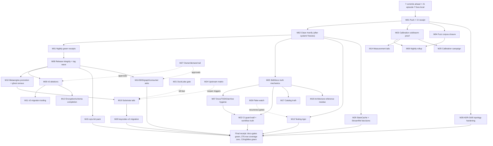

# SUPERB — Episode-7 Follow-Through: Origin Trust to v5 Pareto Plan (2026-11-08 16:12 CET)

**Mission:** turn the post-episode-7 state — seven authored/daemon commits ahead of origin carrying 21 verified gate-green fixes (SQL-injection whitelist, OTel contract restoration, release-script poison-tag guards, calibration workflow repair, four doc-lie corrections), a mechanically re-inventoried **275-row live backlog**, and the commissioned v5 transition — into **provably green CI on origin, decisions on the ten open audit defects, released consumer value, and a safely sequenced v5 cut**. This plan supersedes the 2026-11-08 12:28 plan: it re-maps the grown backlog (266 → 275 rows), folds in the episode-7 audit findings, and carries forward every still-valid thread.

**Anti-Verschlimmbesserung contract**

- No new v4 core interfaces, production dependencies, or exported API except where an existing row explicitly commissions it (today's `otel.AttrBool` + `RejectInvalidAggregateFn` set is the reviewed precedent shape).
- No edits to tracked files while an exclusive gate runs; kill the gate first.
- No module deletion without a fresh fleet census and the ADR-0152 zero-consumer rule.
- No full duplication-baseline or coverage-baseline re-pin to quiet a gate; fix the finding or annotate with a reason. Ratchet re-pins are session-scoped and must NOT absorb a parallel session's in-flight work (the 2026-11-08 package-surface incident is the cautionary precedent).
- No foreign-repo fix-forward while another session is active there — including the sibling session currently landing ADR-0165 in `system/` (M28 coordinates with it, never edits over it).
- No release tag on build-only verification: changed-set tests, release-script checks, and smoke probes are mandatory (the 90-red-tags lesson).
- No new gate without a mutation test or self-test proving it can fail (the verify-docs "58" catch is the standard).
- Every task must leave the repo no worse: tests/gates green or the task is not done.

---

## 0) Scope line

**Verified while building this plan**

- `date`: 2026-11-08 16:12 CET.
- Live backlog inventoried mechanically from `TODO_LIST.md` at 16:10 CET: **275 open checkbox rows across 41 sections** (`- [ ]` regex count; the delta vs the 12:28 plan's 266 = +3 episode-7 B-rows +6 open ADR-0165 rows).
- Episode-7 receipts (session 12:50–16:00): 21 fixes gate-green — pin-sweep, both taxonomy gates, 11 module test suites, module-layers, replace-directives, release-scripts, actionlint, changelog symbols (13 citations), canonical-facts, docs-gates FRESH, package-surface (one reviewed re-pin), hostile-fn pin verbose PASS. Full findings: `docs/reviews/2026-11-08_13-20_brutal-self-review.html` (32 findings / 21 fixed / 10 open / 6 false leads) + `docs/status/2026-11-08_16-00_brutal-episode7-oteli-injection-gate-repairs-status.md`.
- CI state at planning time: Autoretry green ×2 (the masking workflow), Benchmarks push-run `42488670692` green (calibration correctly skipped on push), push CI in progress; the **calibration cold run `42477839931` FAILED** and was root-caused to a bare-value `$GITHUB_OUTPUT` write — fixed locally, proof owed on origin (M03/F011).
- `git status`: clean tree; `master...origin/master [ahead 7]` (all daemon-absorbed episode-7 work + the 16:00 status report + TODO harvest).

**Not verified for this plan**

- No composed `#verify`: the parallel session is actively landing ADR-0165 in `system/`; the tree cannot stay frozen (M02 waits for their landing).
- Nothing from the episode-7 batch is proven on origin yet (the 7 commits carry it); the calibration date-fix specifically needs a post-push dispatch.
- pg/duck hostile-fn matrix legs skip locally (no PG server / memory engine lacks `AggregateReader`) — CI integration legs must prove them.
- The 879 branching-flow findings remain un-adjudicated beyond the panic-analyzer implausibility ruling.
- The `_` dead-sentinel row in the regenerated error-taxonomy region is unexplained.

**Row identifiers.** `R001`–`R275` are the sequential open-row IDs assigned by the 2026-11-08 16:10 CET inventory (document order). Appendix A maps every section to exactly one set of medium tasks.

---

## 1) Pareto breakdown

### The 1% that delivers 51% — **convert 21 local fixes into origin trust, and prove the repaired workflow**

Seven commits sit unpushed carrying the entire episode-7 arc. One sequential thread — push, watch push-CI, dispatch the benchmark workflow cold then warm (proving the fixed date-step), watch Nightly Gates + the next fuzz shards, and run the composed `#verify` the moment the sibling session freezes `system/` — converts "fixed locally" into "fixed where consumers and nightly trust are formed." Nothing runs concurrently with the exclusive verification leg.

### The 4% that delivers 64% — **turn the audit's open defects and gate lies into durable controls**

1. **decider.StateCache race** (the audit's top open defect) — owner A/B, then fix + race pin.
2. **Concurrency guards** on the five unguarded scheduled workflows + the **nightly-red rollup** so green Autoretry can never again mask red nightlies.
3. **Workflow truth wall**: false SHA-version annotations, dead FUZZ_SECONDS knob, the echo-gate detector class, the branching-flow panic-analyzer exemption audit.
4. **Skill/docs truth mechanics**: importable-module existence gate, deleted-transport residue sweeps, alias-warning policy, directive/BuildFlow lockstep leg (prose already fixed today).
5. **Docs/TODO/archive hygiene wave** so the next plan inventories truth, not stale obligations.

### The 20% that delivers 80% — **release integrity, substrate truth, consumer value, v5 runway**

- **Release integrity:** untagged-backlog sweep, dependency-ordered tag wave, untagged-API CI gate (mutation-tested).
- **Storage correctness:** keycodec-v2 dual-read migration, metaengine substrate tails, calibration provenance, engine conformance, **ghost-engine census** (bigtable/iroh: boot-or-delete).
- **Consumer leverage:** cqrs-lint quality/perf pack, BDD/graph/consumer asks, catalog truth, example/taskmanager cleanup.
- **v5 runway:** stack/read-tier deletions, metaengine promotion and package shape, `cqrs-upgrade --to-v5` slice 2, migration guide, cut checklist, **StreamRef dual-definition ADR** (episode-7 finding).

### The other 20% needed to reach 100% — **routed long-horizon, demand-gated, owner-gated, and blocked streams**

DuckLake, matview v2, command sourcing, evals, real-GCP/bigtable, macOS/nspawn verification, Turso upstream releases, EventCatalog upstream asks, external owner actions, journal-side adoption, observe-only flakes, and the **ADR-0165 topology hardening tail** are routed in M21, M24, M26, M27, and M28 with explicit reopen triggers; they must not consume the trust/release window.

---

## 2) Comprehensive plan — medium tasks (30–100 minutes each; all 275 rows mapped)

Sorted by importance, customer impact, effort, and leverage. "Rows" refers to Appendix A's R001–R275 inventory.

| # | Medium task | Customer value / why it matters | Rows claimed | Impact | Effort | Tier | Depends on |
|---|-------------|---------------------------------|--------------|--------|--------|------|------------|
| M01 | **Push + origin trust receipts** — push the 7 commits, record push-CI conclusion, watch Nightly Gates/Benchmarks cold/Fuzz to explicit green receipts (the calibration date-fix proof is here) | Consumers and nightly jobs see the fixes; ends "green Autoretry, red nightlies" | R001, R046–R048, R054, R027 | Critical | 45m | 1% | — |
| M02 | **Clean composed verification + serial fallback discipline** — preflight, quiet-window `#verify` once `system/` freezes, triage/fix, receipts | One honest proof that build, tests, race, lint, docs, and ratchets agree | R016, R027, R047, R049–R051, R163 | Critical | 100m | 1% | M01 + sibling session landing |
| M03 | **Calibration baseline proof** — cold/warm dispatches, cache sharing, artifact upload, freeze-on-fail self-tests, provenance note incl. failed runs `42332942484`/`42441847588`/`42477839931` | Prevents the two false-red nightly classes from returning | R028, R140, R225 | Critical | 70m | 1% | M01 |
| M04 | **Fuzz-contract closure** — corpus download, minimized seeds, fuzz-mode runs, parser-contract same-edit rule | Keeps the nightly fuzzer a detector, not a stale-contract alarm | R029, R266 tail | Critical | 60m | 1% | M01 |
| M05 | **Canonical skill/docs truth mechanics** — module-existence gate, deleted-transport residue sweeps, alias-warning policy, directive/BuildFlow lockstep leg, **AGENTS.md §2.11 cross-ref fix (B2)** | Stops fleet agents being taught deleted or contradictory API | R030–R032, R036, R224–R229 | Critical | 90m | 4% | — |
| M06 | **Nightly-red rollup signal** — aggregate CI/Nightly/Fuzz/Benchmark/Soak status; fail visibly, name the owning workflow | Green Autoretry must never mask three red gates again | R033, R164, R182 | High | 60m | 4% | M01 |
| M07 | **Docs/TODO/archive hygiene wave** — route docs-gates findings, purge done-checkbox rows, archive batches toward cadence green, index/header truth, owner sheet | Next plan inventories truth instead of stale obligations | R026, R044–R045, R052–R053, R224–R229 | High | 100m | 4% | M05 |
| M08 | **Release integrity + untagged-backlog wave** — re-derive deltas, changed-set tests, dependency-ordered tags, manifest/README/smoke checks, untagged-API gate (mutation-tested) | Accumulated fixes become importable consumer versions safely | R015, R055, R134–R135, R240–R243, R263, R258 | Critical | 100m | 20% | M01, M02 |
| M09 | **v5 deletion/cut program** — stack/read-tier/compat/tombstone deletions, wire-vocabulary tail, Cordis closure, cut checklist | Removes legacy surface; makes the v5 migration real | R002–R003, R115, R198–R218 | Critical | 100m | 20% | M08 |
| M10 | **Metaengine promotion + shape + ghost census** — 16-engine evidence table, stamp flips, memoryengine extraction, five-package ADR, **bigtable/iroh fleet census → boot-or-delete verdict** | Stabilizes the strategic substrate; kills ghost engines honestly | R004, R018, R245–R254, ghost-census (no row — episode-7 finding, tracked via M10) | High | 100m | 20% | M08 |
| M11 | **v5 migration tooling + guide** — `cqrs-upgrade` slice 2, core/v5 prerequisite tag, migration guide, mirror-lag burn-down | Consumer migration becomes mechanical | R005, R021–R022 | High | 90m | 20% | M09 |
| M12 | **Encryption/schema v5 completion** — ADR-0139 seam, schema adoption tail, fingerprint bridge, declarative schema row | Closes designed-but-unfinished safety/evolution surfaces | R006, R090, R095–R096 | Medium | 70m | 20% | M09 |
| M13 | **Testing-rigor program** — mutation gate, synctest pilots, planner MBT, differential harness, budgets/crash/broker/context matrices | "Tests exist" becomes "tests can fail for the right reason" | R007–R010, R264–R275 | Critical | 100m | 20% | M02 |
| M14 | **Performance/correctness tails** — tail-latency matrix, budgets, benchmark parity, load-sweep receipts, benchkit rigor, CV verdicts | Performance claims stay measurable across engines | R013, R225–R226, R231–R233, R139–R141 | High | 100m | 20% | M03 |
| M15 | **cqrs-lint quality/perf/consumer pack** — perf regression, #79/#83 tails, utilization variants, scope widening, doctor semantics | The fleet's adoption surface stays fast and truthful | R011, R024, R116–R133, R247 | High | 100m | 20% | M08 |
| M16 | **BDD/graph/consumer-ask pack** — harness tails, TimeAdvancesTo, equivalence port, graph recipe/example, consumer deep-dives, CRM asks | The consumer path from declaration to verified behavior improves | R012–R014, R100–R108, R255–R256, R259–R262 | High | 100m | 20% | M08 |
| M17 | **Catalog/EventCatalog truth + export tails** — hub asks, warn budget, goldens, CUE fallback tail, docs/recipes truth | Generated API governance stays trustworthy | R074–R081, R096–R099, R219–R224 (shared) | Medium | 100m | 20% | M05 |
| M18 | **Architecture-reference residue** — custom exports, lint lessons, errata, downstream owner actions | Closes the 2026-10-17 export program without losing owner decisions | R063–R069 | Medium | 70m | 20% | M05 |
| M19 | **Metaengine substrate/capability tails** — envelope spike, codec scope, ingress markers, caps cluster, routing, observability, DSN policy, conformance | Engine behavior contracts and planner evidence complete | R082–R090, R136–R156 | Critical | 100m | 20% | M10 |
| M20 | **keycodec-v2 dual-read migration** — pebble reference leg, badger/bbolt twins, legacy stores, fixtures/docs | Eliminates the colon-injection disk-truth class safely | R058–R060 | Critical | 100m | 20% | M19 design |
| M21 | **DuckLake gate/spike only** — external-claim pinning, hermetic spike, ADR-0162, kill-fast criteria | Decides weeks vs months before any driver investment | R091–R094 | Medium | 60m | Other 20% | — |
| M22 | **CI guard wall + workflow truth** — md-go FOD repair, ratchet guards, TODO detectors, lint-config guards, **concurrency guards ×5, SHA-annotation truth sweep, fuzz.yml knob, echo-gate detector, panic-analyzer audit, provider-preflight script** | Stops config/tool drift and false-green gates from burning release windows | R157–R186, R236, R240–R243 slice | Critical | 100m | 4% | M05 |
| M23 | **Code-quality/duplication/file-size wave** — 190-group disposition, file-size offenders, branching-flow triage, panic/sleep/OTel scan closures, arch-lint truth | Structural decay stops while the v5 cut approaches | R187–R197, R245–R254 slice | High | 100m | 4% | M02 |
| M24 | **Upstream/blocked matrix** — Turso matview flip, tursogo asks, md-go upstream, EventCatalog issues, go-graph-rag comms | External blockers stay explicit with reopen triggers | R074–R075, R112–R114, R148–R149, R237–R239 | Medium | 80m | Other 20% | — |
| M25 | **Calibration/quiet-window/bench campaign** — SearchQuery count=5, dgraph re-anchor, MySQL replay, provenance | Honest planner costs; load-sensitive suites validated | R140–R141, R161–R162, R225 | High | 100m | 20% | M03 |
| M26 | **Flake/observability watch** — SSE recurrence instrumentation, projectionhost checkpoint, engine-health contention, temporal soaks | Real regressions distinguished from load noise | R041, R110–R111, R234–R235, R264–R275 slice | High | 90m | Other 20% | M02 |
| M27 | **Owner/demand-gated long tail** — decision sheet, scratch, ActorID, command sourcing, evals, billing/GCP/macOS/nspawn, journal-side, external asks, skill refocus, CV leftovers | Every legitimate backlog item preserved without scheduling unowned work | R019–R020, R044–R045, R070–R073, R109, R150, R231–R233, R244, R257–R258, R262 | Medium | 60m | Other 20% | Owner |
| M28 | **ADR-0165 topology hardening** (NEW) — VM test/example, nixpkgs postgres auth verification, cross-layer round-trip tests, committed eval test, preset cross-equivalence pin, CI wiring + DSN unify — coordinated with the sibling session, never edited over | The fresh operator surface gets regression protection before consumers touch it | R038–R043 | High | 100m | Other 20% | sibling session landing |
| M29 | **Episode-7 type-model decisions** (NEW) — decider.StateCache A/B (codec-cloned Get vs StateCloner option, cache-off default) + implement + race pin; StreamRef dual-definition ADR draft (record vs id) | Closes the audit's top open defect and the v5 identity split brain | R035, R037 | Critical | 100m | 20% | M02 for the race pin's CI proof |

---

## 3) Fine breakdown — 188 tasks, each ≤12 minutes

Sorted within execution tiers. Every row is independently stoppable; no micro-task may "improve" a gate by weakening it.

### Tier 1% — restore origin trust (F001–F021)

| # | Micro-task | Parent | Est | Depends |
|---|-------------|--------|-----|---------|
| F001 | Confirm clean tree, review the seven ahead commits, check no exclusive gate is running | M01 | 6m | — |
| F002 | Push `master` to origin (commissioning message grants push) | M01 | 6m | F001 |
| F003 | Open the newest push CI run; record job matrix + final conclusion | M01 | 10m | F002 |
| F004 | Triage any red push-CI leg from its log; fix only the owning defect | M01 | 12m | F003 |
| F005 | Run the cheap preflight battery (canonical facts, ADR numbering, changelog symbols, templ, tidy test) | M02 | 12m | F001 |
| F006 | Confirm load/calibration gate allows a composed run | M02 | 6m | F005 |
| F007 | Launch `#verify` with a frozen tree and durable log (only after `system/` freezes) | M02 | 10m | F006 |
| F008 | Triage verify output without editing while it runs | M02 | 12m | F007 |
| F009 | If red: stop, fix the smallest owning defect, rerun affected cheap gates | M02 | 12m | F008 |
| F010 | Record the full `#verify` receipt; close R027/A1 | M02 | 8m | F008 |
| F011 | Dispatch `benchmarks.yml` cold run; verify baseline-establishment log proves the date fix | M03 | 12m | F002 |
| F012 | Dispatch warm run; verify runner-class comparison + uploaded non-empty drift log | M03 | 12m | F011 |
| F013 | Prove drift failure freezes the old baseline (fixture/self-test) | M03 | 12m | F012 |
| F014 | Add cold-run + freeze self-tests to calibration gates | M03 | 12m | F013 |
| F015 | Record failed runs `42332942484`/`42441847588`/`42477839931` in calibration provenance | M03 | 8m | F014 |
| F016 | Download failed fuzz corpus artifacts; inventory minimized inputs | M04 | 12m | F002 |
| F017 | Commit minimized regression seeds beside the invalid-UTF-8 seeds | M04 | 10m | F016 |
| F018 | Run affected id/event targets in actual fuzz mode | M04 | 12m | F017 |
| F019 | Add parser-contract → matching fuzz harness + rejecting seed same-edit rule | M04 | 12m | F018 |
| F020 | Watch Nightly Gates + next fuzz shards; record explicit green receipts | M01 | 12m | F002 |
| F021 | Verify the sibling session's ADR-0165 CI receipts are green on the same push | M28 | 10m | F002 |

### Tier 4% — durable gates and documentation truth (F022–F068)

| # | Micro-task | Parent | Est | Depends |
|---|-------------|--------|-----|---------|
| F022 | Extract module paths claimed live from `SKILL.md` and references | M05 | 10m | — |
| F023 | Compare claimed paths against `go.work`; classify miss as live/deleted/external | M05 | 10m | F022 |
| F024 | Implement module-existence checker with `--self-test` deleted-module fixture | M05 | 12m | F023 |
| F025 | Wire checker into docs/verify-fast gate; regenerate affected docs | M05 | 12m | F024 |
| F026 | Sweep taskmanager comments for deleted transport references | M05 | 8m | — |
| F027 | Sweep metaengine SSE code/README references | M05 | 8m | F026 |
| F028 | Sweep watermill catch-up and DOMAIN_LANGUAGE references | M05 | 10m | F027 |
| F029 | Classify MIGRATION-GUIDE as historical or live; banner/fix accordingly | M05 | 10m | F028 |
| F030 | Reproduce the six ambiguous v4/core alias warnings in doc-check | M05 | 8m | — |
| F031 | Choose policy: scope imports, explicit allow-list, or fail-on-warning | M05 | 10m | F030 |
| F032 | Implement alias-warning policy; update AGENTS contract text | M05 | 12m | F031 |
| F033 | Add doc-check regression for the chosen policy | M05 | 10m | F032 |
| F034 | Fix the broken `§2.11` cross-ref at AGENTS.md:367; doc-check green on AGENTS.md alone (B2) | M05 | 8m | — |
| F035 | Design nightly rollup data source (gh run list or workflow-runs API) | M06 | 10m | — |
| F036 | Implement aggregate status script with explicit required-workflow list | M06 | 12m | F035 |
| F037 | Add scheduled rollup job/README badge; failure names the owning workflow | M06 | 12m | F036 |
| F038 | Add rollup self-test with planted red/green fixtures | M06 | 10m | F037 |
| F039 | Run docs-gates routing; list every unrouted historical row | M07 | 12m | — |
| F040 | Route the nine unrouted metaengine codec report rows | M07 | 12m | F039 |
| F041 | Purge the 15 done-checkbox TODO rows via docs-strike/CHANGELOG | M07 | 12m | F040 |
| F042 | Fix 18 unwrapped DONE rows or convert to explicit verdicts | M07 | 12m | F041 |
| F043 | Identify reports eligible for archive from the 170 unarchived files | M07 | 12m | F042 |
| F044 | Verify every item in the first archive batch is struck/routed/skipped | M07 | 12m | F043 |
| F045 | `git mv` the first archive batch + Live-remainder banner | M07 | 12m | F044 |
| F046 | Repeat archive batches until the cadence threshold is green | M07 | 12m | F045 |
| F047 | Update status README header date + report-write checklist | M07 | 8m | F046 |
| F048 | Add same-edit status-index insertion preflight/check | M07 | 10m | F047 |
| F049 | Build the one-page owner decision sheet from fleet-audit leftovers | M07 | 12m | — |
| F050 | Add TODO hygiene detector (duplicate/pointer/checkbox) with self-test | M22 | 12m | F041 |
| F051 | Wire the TODO hygiene detector into a cheap gate | M22 | 10m | F050 |
| F052 | Add stale-premise detector against versions.json/tags | M22 | 12m | F051 |
| F053 | Run the stale-premise detector; fix findings | M22 | 10m | F052 |
| F054 | Add "kill exclusive gate before edit" AGENTS/gotcha rule | M02 | 6m | — |
| F055 | Add the subagent provider preflight rule (credits + rate limits) | M02 | 6m | F054 |
| F056 | Add phase-boundary hand-commit reminder to the execution checklist | M02 | 6m | F055 |
| F057 | Add root-artifact transcript refusal patterns to the daemon/hook proposal | M05 | 12m | — |
| F058 | Hunt the literal `--help/` catalog generator; fix output-dir handling | M05 | 12m | F057 |
| F059 | Decide + implement the generated/research artifact index gate | M05 | 12m | F058 |
| F060 | Add `concurrency:` guards to benchmarks/fuzz/sentinel/canary/autoretry workflows | M22 | 12m | — |
| F061 | actionlint + review the guard cancel semantics (cancel-in-progress choice) | M22 | 10m | F060 |
| F062 | Truth-sweep the SHA-version annotations in nightly-gates.yml + go-finding-canary.yml | M22 | 12m | — |
| F063 | Fix the dead FUZZ_SECONDS dispatch input in fuzz.yml (define or drop) | M22 | 8m | — |
| F064 | Prototype the echo-gate detector: computed-but-unused check variables in scripts/ | M22 | 12m | — |
| F065 | Turn the detector into a script with `--self-test` (verify-docs is the reference catch) | M22 | 12m | F064 |
| F066 | Wire the echo-gate detector into the cheap gate set | M22 | 10m | F065 |
| F067 | Audit the branching-flow panic-analyzer exemption logic (61 panics vs reported 0) | M22 | 12m | — |
| F068 | Record the exemption findings; either justify or open a tool defect row | M22 | 10m | F067 |

### Tier 20% — releases, substrate, consumer value, v5 (F069–F167)

| # | Micro-task | Parent | Est | Depends |
|---|-------------|--------|-----|---------|
| F069 | Re-derive untagged production drift per module from last tag..HEAD | M08 | 12m | M01 |
| F070 | Classify the deprecated-module final-tag policy | M08 | 10m | F069 |
| F071 | Derive semver per untagged module from the api golden diff | M08 | 12m | F070 |
| F072 | Build the dependency-ordered batch-release plan | M08 | 12m | F071 |
| F073 | Changed-set tests batch 1 (core/id/event/record) | M08 | 12m | F072 |
| F074 | Changed-set tests batch 2 (storage/queue/scheduling) | M08 | 12m | F073 |
| F075 | Changed-set tests batch 3 (middleware/query/listing/system) | M08 | 12m | F074 |
| F076 | Release-script self-tests + example-standalone gate | M08 | 12m | F075 |
| F077 | Cut the leaf tag batch; push; smoke from a clean dir | M08 | 12m | F076 |
| F078 | Cut dependent tag batches in dependency order; smoke each | M08 | 12m | F077 |
| F079 | Refresh versions manifest/README; run the check gate | M08 | 10m | F078 |
| F080 | Add the examplePaths-vs-published-pins untagged-API CI gate | M08 | 12m | F079 |
| F081 | Mutation-test the untagged-API gate with a planted untagged export | M08 | 12m | F080 |
| F082 | Release-tooling polish slice (smoke timing, templ summary, dogfood sentinel) | M08 | 12m | F081 |
| F083 | Inventory stack/* direct consumers for the deletion wave | M09 | 10m | M08 |
| F084 | Write stack deletion migration notes | M09 | 12m | F083 |
| F085 | Remove stack presets through the six registration gates | M09 | 12m | F084 |
| F086 | Remove Materialize/RelationalProjection/view/GraphProjection surfaces | M09 | 12m | F085 |
| F087 | Remove ADR-0126 compat shells + BuildWhereClause | M09 | 12m | F086 |
| F088 | Complete the tombstone metadata API deletion with ADR-0114 status | M09 | 12m | F087 |
| F089 | Apply remaining wire-vocabulary renames + validation changes | M09 | 12m | F088 |
| F090 | Regenerate api golden/capabilities/catalog after deletions | M09 | 12m | F089 |
| F091 | Update the v5 migration guide with before/after sections | M11 | 12m | F090 |
| F092 | Tag the first core/v5.x.y prerequisite release | M11 | 12m | F090 |
| F093 | Implement cqrs-upgrade go.mod require rewrite | M11 | 12m | F092 |
| F094 | Add apply-mode tidy/build verification + JSON v5 output | M11 | 12m | F093 |
| F095 | Decide eventtest fold-or-exclude in v5 core | M11 | 10m | F094 |
| F096 | Build the 16-engine promotion evidence table | M10 | 12m | M08 |
| F097 | Flip Experimental doc.go stamps + family parent | M10 | 12m | F096 |
| F098 | Align FEATURES/SKILL/matrix with promotion evidence | M10 | 12m | F097 |
| F099 | Regenerate the api golden for the doc.go changes | M10 | 10m | F098 |
| F100 | Extract the memoryengine package behind the unchanged API | M10 | 12m | F099 |
| F101 | Write the five-package carve ADR with dependency rules | M10 | 12m | F100 |
| F102 | Add core/v5 arch-lint config; fix findings | M10 | 12m | F101 |
| F103 | Tier the api golden by stability/product-line decision | M10 | 12m | F102 |
| F104 | Decide the tooling split scope (cqrs-lint product line) | M10 | 12m | F103 |
| F105 | Run the fleet census scoped to bigtableengine + irohengine | M10 | 12m | — |
| F106 | Record the boot-or-delete verdict (ADR-0152 rule) in TODO/ADR | M10 | 10m | F105 |
| F107 | Draft the ADR-0139 config/keyprovider seam | M12 | 12m | M09 |
| F108 | Design the schema-event adoption tail for bank-sync/cqrs-htmx | M12 | 12m | F107 |
| F109 | Add the mutation-verify pilot harness; run on three tests | M13 | 12m | M02 |
| F110 | Wire the mutation ratchet for NEW tests | M13 | 12m | F109 |
| F111 | Convert the scheduling ticker tests to synctest | M13 | 12m | F110 |
| F112 | Convert two more test pilots to synctest | M13 | 12m | F111 |
| F113 | Build the rapid planner capability-set MBT | M13 | 12m | F112 |
| F114 | Add invariant fuzzing to the planner MBT | M13 | 12m | F113 |
| F115 | Define the differential engine op-script DSL | M13 | 12m | F114 |
| F116 | Run the differential memory+sqlite matrix | M13 | 12m | F115 |
| F117 | Extend the differential harness to LSM engines | M13 | 12m | F116 |
| F118 | Add heap/goroutine/disk budget tests | M13 | 12m | F117 |
| F119 | Add the crash-consistency kill-9 matrix | M13 | 12m | F118 |
| F120 | Add the broker partition/redelivery/DLQ/outbox matrix | M13 | 12m | F119 |
| F121 | Decide canceled-context write behavior + tamper family | M13 | 12m | F120 |
| F122 | Build the tail-latency matrix across engines | M14 | 12m | M03 |
| F123 | Benchmark parity/tuned-tier reconciliation | M14 | 12m | F122 |
| F124 | Load-sweep receipts for timing paths | M14 | 12m | F123 |
| F125 | Profile the cqrs-lint 2.0s→7.4s regression | M15 | 12m | — |
| F126 | Fix the cqrs-lint hot path; bench-pin | M15 | 12m | F125 |
| F127 | Add the #79 typed-load fixture + fragment audit | M15 | 12m | F126 |
| F128 | Add the #83 stale-baseline hardening + health ruling | M15 | 12m | F127 |
| F129 | Implement F024/F025 utilization variants or reasoned refusal | M15 | 12m | F128 |
| F130 | Add the pushdown cookbook recipe | M15 | 10m | F129 |
| F131 | Add the cqrs-htmx sqlite-lifecycle systemscenario variant | M16 | 12m | — |
| F132 | Add TimeAdvancesTo sugar + TB refactor | M16 | 12m | F131 |
| F133 | Port observational equivalence/store conformance reuse | M16 | 12m | F132 |
| F134 | Write the Graph ADT end-to-end CRM recipe | M16 | 12m | F133 |
| F135 | Add the graph-native Dgraph integration leg | M16 | 12m | F134 |
| F136 | Wire the systemcatalog Registry bridge + drift test | M16 | 12m | F135 |
| F137 | Add AsyncAPI response schemas/protocol bindings | M15 | 12m | F136 |
| F138 | Decide the compat-gate subject (fixture catalog vs consumer-owned) | M17 | 10m | — |
| F139 | Ship the compat benchmarks/recipes/CHANGELOG tail | M17 | 12m | F138 |
| F140 | Catalog warn budget + goldens | M17 | 12m | F139 |
| F141 | CUE-fallback tail + docs/recipes truth pack | M17 | 12m | F140 |
| F142 | Architecture-reference custom exports + lint lessons | M18 | 12m | M05 |
| F143 | Architecture-reference errata + downstream owner actions | M18 | 12m | F142 |
| F144 | Metaengine envelope spike decision | M19 | 12m | M10 |
| F145 | Custom/encrypted read-model codec scope decision | M19 | 12m | F144 |
| F146 | Unify ingress markers or document the split | M19 | 12m | F145 |
| F147 | Add the encoded-ingress fleet benchmark | M19 | 12m | F146 |
| F148 | Complete the #72 cap coverage/cost/timer/write variants | M19 | 12m | F147 |
| F149 | Routing/observability/DSN-policy tails | M19 | 12m | F148 |
| F150 | Implement keycodec pebble dual-read reference leg | M20 | 12m | F148 |
| F151 | Add the pebble legacy v1 fixture + dual scans | M20 | 12m | F150 |
| F152 | Replicate the keycodec migration to badger/bbolt | M20 | 12m | F151 |
| F153 | Migrate legacy storage keys; document the dual-read window | M20 | 12m | F152 |
| F154 | StateCache decision: codec-cloned Get vs StateCloner option (owner A/B) | M29 | 12m | — |
| F155 | Implement the chosen StateCache shape | M29 | 12m | F154 |
| F156 | Pin with a concurrent LoadRef/ExecuteRef race test (-race) | M29 | 12m | F155 |
| F157 | StateCache docs + CHANGELOG + decider suite green | M29 | 12m | F156 |
| F158 | Draft the StreamRef dual-definition ADR (record vs id) | M29 | 12m | — |
| F159 | Record the StreamRef decision + v5 window note | M29 | 10m | F158 |
| F160 | Wrap event Version.Decrement/Sub with errorfamily; keep the code | M23 | 12m | — |
| F161 | Move ErrVersionUnderflow to errors.go; fix ParseVersion's dead error channel | M23 | 10m | F160 |
| F162 | Refactor badger pagination onto PairsToScanResult/LastPairCursor | M23 | 12m | — |
| F163 | Add the badger/bbolt NextCursor parity test | M23 | 12m | F162 |
| F164 | Document or unify the sanitizeIndexName extraAllowed divergence | M23 | 8m | — |
| F165 | Write the ApplyOptions enrichment-epoch design note (v5 window) | M09 | 12m | — |
| F166 | Write the projections.All sealed-interface design note | M09 | 10m | — |
| F167 | Pin the query.Handler any-path decision in its package doc | M23 | 8m | — |

### Other 20% — routed, gated, and long-horizon streams (F168–F188)

| # | Micro-task | Parent | Est | Depends |
|---|-------------|--------|-----|---------|
| F168 | Pin DuckLake external claims (extension channel/version) | M21 | 12m | — |
| F169 | Run the hermetic vendored-extension LOAD/ATTACH spike | M21 | 12m | F168 |
| F170 | Write ADR-0162 go/no-go with kill-fast criteria | M21 | 12m | F169 |
| F171 | Check the latest Turso tag for the #10129 rewrite | M24 | 6m | — |
| F172 | If tagged: execute the matview flip runbook steps 1–6 | M24 | 12m | F171 |
| F173 | File/advance approved upstream asks (turso, md-go, EventCatalog) | M24 | 12m | — |
| F174 | Instrument the SSE ring drop counter in the ordering test | M26 | 12m | — |
| F175 | Reproduce the SSE slow-consumer miss under taskset throttling | M26 | 12m | F174 |
| F176 | Add the projection checkpoint cadence property or clock seam | M26 | 12m | F175 |
| F177 | Run the SearchQuery count=5 quiet-window recalibration | M25 | 12m | M03 |
| F178 | Re-anchor dgraph constants in one gate-passing window | M25 | 12m | F177 |
| F179 | Run the MySQL VM shuffled replay + integration leg | M25 | 12m | F178 |
| F180 | Build `example/standard-topology/` + VM test (R038) | M28 | 12m | sibling landing |
| F181 | Verify the nixpkgs postgres localhost auth default (R039) | M28 | 12m | F180 |
| F182 | Cross-layer round-trip tests: NixOS JSON + `cue export` through LoadConfig (R040) | M28 | 12m | F181 |
| F183 | Committed eval test for `nixosModules.cqrs` in flake checks (R041) | M28 | 12m | F182 |
| F184 | Preset cross-equivalence pin: Go == CUE == Nix instances (R042) | M28 | 12m | F183 |
| F185 | CI/verify wiring for `#check-cue-config` + README fence compile + DSN unify (R043) | M28 | 12m | F184 |
| F186 | Present the owner decision sheet (scratch, ActorID, evals, billing, licensing) | M27 | 12m | F049 |
| F187 | Execute approved owner decisions only; record verdicts in TODO/ADR | M27 | 12m | F186 |
| F188 | Re-run docs-gates + TODO inventory; reconcile this plan's coverage to zero unmapped rows | M07 | 12m | F187 |

---

## 4) Execution graph

**Parallelism rules**

- M01 is first and exclusive-with-nothing; M02 is strictly sequential and exclusive (frozen tree).
- M03/M04 run after push but never overlap the composed verification leg.
- M05–M07, M22, M28 are parallel documentation/tooling tracks (M28 coordinates with the sibling session).
- M08 is the release gate; M09–M20 follow its tags/census outputs.
- M29's decision leg can run anytime; its race-pin proof needs M02's CI.
- M21/M24/M26/M27 are gated/watch streams and must not preempt the trust/release window.

---

## 5) Verification receipts required

| Class | Required proof |
|------|----------------|
| Push/CI | Clean `git status`, push output, run IDs + final conclusions for push CI, Nightly Gates, Fuzz Nightly, Benchmarks cold AND warm |
| Composed verification | Full log path, exit code, load provenance, no tree edits during the run |
| Calibration | Cold/warm run IDs, non-empty artifact hash/size, freeze-on-fail self-test output, the date-fix proven |
| Fuzz | Downloaded artifact names, committed seed paths, fuzz-mode target outputs |
| Docs gates | `docs-gates freshness/routing/cadence` outputs; archive `git mv` receipts |
| Release | Changed-set test outputs, dependency-ordered tag list, clean-dir `go get` smokes, versions-manifest gate |
| Deletions/v5 | Fleet census, gate de-registration checklist, api golden diff, migration-guide compile checks |
| Every task | No weakened gate, no new unexplained baseline, no build regression; new gates carry mutation tests or self-tests |

---

## 6) Errata and corrections discovered while planning

1. The 12:28 plan's 266-row inventory grew by exactly 9 rows since 12:28 (+3 episode-7 B-rows, +6 open ADR-0165 rows from the sibling session) — 275 verified by regex count at 16:10 CET; the ADR-0165 section also shows 4 `[x]` rows the sibling session already completed.
2. The 12:28 plan's F033/F034 (AGENTS directive prose, BuildFlow-skip prose) were completed by the episode-7 session — this plan's M05 keeps only the mechanical lockstep leg (new F035-slot work), and the fresh F034-slot is the AGENTS.md §2.11 fix.
3. The calibration workflow repair shipped in the earlier arc was itself defective (bare `$GITHUB_OUTPUT` write, failed cold run `42477839931` in 12s) — fixed today; M03's fine tasks prove it on origin and add the self-tests that would have caught it locally.
4. The panic-analyzer-zero claim from the branching-flow run is recorded as implausible (61 real production panics, 6 suppressions) — the exemption audit is F067, not silently trusted.
5. Current AGENTS.md Quick Reference and BuildFlow prose were corrected by the episode-7 session (uniform `go 1.27.2` verified by count; `.buildflow.yml` UNSKIPPED since 2026-10-07) — no prose drift rows remain, but the mechanical lockstep gate does not exist yet (M05).

---

## Appendix A — complete 275-row coverage matrix

Row IDs are sequential open rows in the current TODO document (16:10 CET inventory). Every range is fully covered by the named medium tasks; no row is omitted.

| TODO section | Rows | Count | Owning medium tasks |
|---|---|---:|---|
| Full-backlog Pareto plan | R001–R026 | 26 | M01, M07–M17, M19–M23, M25–M27 |
| Brutal-audit follow-ups | R027–R034 | 8 | M01–M07, M22, M23, M26, M27 |
| Brutal-episode7 follow-ups | R035–R037 | 3 | M29 (B1, B3), M05 (B2) |
| Standard deployment topology & NixOS (ADR-0165) | R038–R043 | 6 | M28 |
| Fleet-audit follow-up tail | R044–R045 | 2 | M07, M27 |
| Post-sweep execution | R046–R057 | 12 | M01–M03, M08, M22, M25, M26 |
| Disk-truth residue | R058–R062 | 5 | M20, M07, M27, M17 |
| Architecture reference export | R063–R069 | 7 | M18, M27 |
| GitHub issue backlog | R070–R073 | 4 | M27, M24 |
| Upstream asks from eventcatalog-hub | R074–R075 | 2 | M17, M24 |
| EventCatalog v5 bump follow-ups | R076–R081 | 6 | M17 |
| Metaengine Universal Storage Substrate | R082–R090 | 9 | M19, M08, M12, M15, M27 |
| DuckLake engine driver | R091–R094 | 4 | M21 |
| V5 declarative schema evolution | R095 | 1 | M12 |
| Catalog × CUE | R096–R099 | 4 | M17, M12 |
| BDD harness adoption wave | R100–R107 | 8 | M16 |
| BDD depth-spec follow-ups | R108 | 1 | M16 |
| Command-side domain depth | R109 | 1 | M27 |
| ResetProjection contention watch | R110–R111 | 2 | M26 |
| Turso materialized views | R112–R114 | 3 | M24 |
| Cordis follow-ups | R115 | 1 | M09 |
| cqrs-lint | R116–R133 | 18 | M15, M22, M27 |
| Release / Tagging | R134–R135 | 2 | M08 |
| Metaengine — follow-ups | R136–R156 | 21 | M19, M14, M25 |
| CI / Infrastructure | R157–R186 | 30 | M22, M02, M06, M24 |
| Code Quality | R187–R197 | 11 | M23, M07 |
| v5 Unification | R198–R218 | 21 | M09, M11, M12 |
| Docs / consumer-surface truth | R219–R224 | 6 | M05, M07, M17 |
| benchkit statistical-rigor tail | R225 | 1 | M14, M25 |
| CV consumer-verdict follow-ups | R226–R230 | 5 | M14, M15, M27 |
| metaengine Goal-closure follow-ups | R231–R233 | 3 | M14, M27 |
| Temporal versioned cells | R234–R235 | 2 | M26 |
| md-go-validator CI integration | R236 | 1 | M22, M24 |
| go-graph-rag follow-ups | R237–R239 | 3 | M24, M27 |
| 92-tag release-train tail | R240–R243 | 4 | M08, M22 |
| Skill hard-block refocus | R244 | 1 | M27 |
| Architecture review | R245–R254 | 10 | M10, M23 |
| CRM Graph-ADT debut | R255–R256 | 2 | M16 |
| Wave-C delta audit | R257–R258 | 2 | M08, M27 |
| Consumer deep-dive asks | R259–R262 | 4 | M16 |
| Untagged-API incident | R263 | 1 | M08 |
| Testing improvements | R264–R275 | 12 | M13, M04, M26 |
| **Total** | **R001–R275** | **275** | **All mapped** |

---

*Living truth remains in `TODO_LIST.md`; this snapshot supersedes the 2026-11-08 12:28 plan as the execution sequencing authority. Planning, harvest verification, and this document were the only work performed in this session-arc; no plan tasks were started.*
