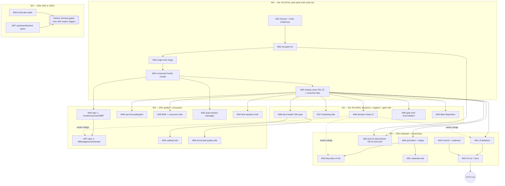

# SUPERB — Truth-Green Release Train & v5 Runway (2026-11-13 21:12 CET)

**Mission.** Re-cut the Pareto plan over the **current** backlog — **265 open rows across 46
sections** (verified `grep -c '^- \[ \]'` at 21:12) — after five shipped-heavy sessions
(2026-11-09 audits wave, 2026-11-11 ×3, 2026-11-13 ×2) landed ~35 fixes with **no composed
verification, no release wave, and five unharvested status reports**. The 2026-11-08 17:25
full-send plan (M01–M30 / F001–F193) executed its 1%/4% tiers; this plan **supersedes its
sequencing, inherits M/F numbering (M31+ / F194+)**, and re-inventories at the current truth.
Living source stays `TODO_LIST.md`.

**Scope line — verified at 21:12 CET (first-hand):**

- Backlog: **265 open rows** (`grep -c`), 46 sections, 51 kept-done `[x]` rows.
- Working tree clean; last 12 commits are all `chore: auto-commit` daemon blobs.
- **Red gates right now**: `check-file-size` — `cmd/cqrs-lint/v4/pkg/analyzer/loader.go` 377
  (NEW), `cmd/cqrs-lint/v4/doctor_audit.go` 360 (NEW), `metaengine/sqliteengine/v4/engine.go`
  663→664 growth. `check-error-taxonomy` red (stack/v4 extraction, provenance unknown —
  unrowed). `check-md-go` red (4 fence errors inside the two untracked issue-draft files in
  `docs/drafts/`). Source: 2026-11-13 20-22 report §Scope + rerun this session.
- **Origin is red TODAY**: CI push `43475265912` failed 19:41 (10m20s), Gates Rollup
  `43479191413` failed 18:05 (schedule), Benchmarks `43475265565` failed 17:41, Release
  workflow failed on the `catalog/v4.15.0` tag push `43446210196` (34s). Autoretry green ×2.
  (`gh run list` 21:15; job-level triage blocked by an API 502 — M33 owns.)
- **Issues #130 ([]Edge fold misrouting) and #131 (cell_versioning config surface) are OPEN
  with the implementations already on master** (11-13 20-22 report) — close-out ritual owed.
- Last composed `#verify` receipt is from the 11-05/11-09 era; every session since 11-11
  lists it as "not run" (exclusivity + load). The tree carries four waves of uncomposed
  API-surface changes (#117–#131 fixes, doc-check revival, pragma connector, fold rejection).
- Five status reports unharvested (their §f lists entombed): 11-11 09:16, 11-11 12:41,
  11-11 16:42, 11-11 20-24, 11-13 14-54. Plus the 11-13 20-22 close-out tail.

**Anti-Verschlimmbesserung contract** (inherited from the 17:25 cut, still binding)

- No new v4 core interfaces, production deps, or exported API except where an existing row
  explicitly commissions it. v4 is fix-only (pending D6 ratification — M36).
- No edits to tracked files while an exclusive gate runs; kill the gate first.
- No module deletion without a fresh fleet census and the ADR-0152 zero-consumer rule.
- No baseline re-pin (dup/coverage/package-surface/file-size) to quiet a gate; fix or
  annotate. Ratchet re-pins never absorb a parallel session's in-flight work.
- No foreign-repo fix-forward while another session is active there.
- No release tag on build-only verification; changed-set tests + release-script checks +
  smoke probes are mandatory (the 90-tag lesson).
- Per-row owner gates stand; they route to ONE consolidated decision sheet (M36).
- No new gate without a mutation test or self-test proving it can fail.
- Every task leaves the repo no worse: gates green or the task is not done.

---

## 1) Pareto breakdown

### The 1% that delivers 51% — convert five sessions of shipped code into proven, published, rowed truth

~35 fixes sit on master with red gates, red origin runs, two open-but-implemented issues, no
composed verify, no tags, and five unharvested reports. One sequential thread — **harvest +
close issues → repair the three red gates → triage today's four red origin runs → first
composed `#verify` receipt → release wave with consumer flips** — turns "shipped locally"
into "green where consumers and nightly trust are formed" and makes the backlog readable
again. Nothing else in the 265 rows is provable until this thread runs.

### The 4% that delivers 64% — durable decisions, hardening, hygiene, gate truth, flake disposition

1. **Owner decision sheet v2** — fold the eight new gates surfaced by the 11-09..13 reports
   (watermill hang, CI queue policy, branching-flow filing, GFL priority, census authority,
   release timing, sort-index parity, verify-vs-push-CI) into the D1–D8 sheet; one meeting.
2. **Hardening tails of the 11-11 wave** — mutation-verify the three new pins, pragma-pool
   audits of tursoengine + queue/sqlite, doctor prune-guard e2e, V003 offline hygiene.
3. **Docs-health 15th pass** — archive the 11-09..13 report accumulation, purge stale-open
   rows (at least TODO:243 A8 and TODO:411 custom-exports carry DONE receipts), research
   README index (deep-dive Finding 5), supersede the 2026-07-23 audit.
4. **Gate-truth reconciliation** — BuildFlow's 235 file-size findings vs the repo's 350
   ratchet, error-taxonomy generator sentinel drift, lint-config settings canaries.
5. **Flake/watch disposition** — SSE drop 3rd-occurrence instrumentation, watermill
   racing-close hang, projectionhost exact-count, engine-health contention.

### The 20% that delivers 80% — v5 runway, substrate correctness, release integrity, consumer value

v5 deletion + cut program (stack/read-tier/compat/tombstone, migration guide, codemod,
23 copy-forwards), metaengine promotion (T27, commissioned) + seven-package carve,
keycodec-v2 dual-read migration (A9), json/v2 determinism (KEYS first — the split-read
correctness landmine), testing-rigor program (mutation, synctest, MBT, differential,
budgets/crash/broker), cqrs-lint quality/perf, BDD/consumer asks, catalog truth,
metaengine substrate tails, quiet-window calibration campaign, fleet adoption truth,
docs/code-quality tails.

### The other 20% to reach 100% — routed, demand-gated, owner-gated, blocked

DuckLake kill-fast spike, Turso matview flip (upstream tag), upstream filings pack,
md-go/tursogo/EventCatalog asks, GCP/macOS/nspawn/evals/billing, command sourcing ADR,
DueClaimer v2 trigger, CUE parked items, observe-only watches. Routed with explicit reopen
triggers in M56/M57; they must not consume the trust window.

---

## 2) Medium tasks (30–100 min each; ALL 265 rows + 7 new rows mapped — see §4 appendix)

| # | Medium task | Customer value / why | Rows (count) | Impact | Effort | Tier | Depends |
|---|-------------|----------------------|--------------|--------|--------|------|---------|
| M31 | **Post-wave harvest + issue close-out** — docs-health HARVEST of the five unharvested reports (11-11 09:16/12:41/16:42/20-24, 11-13 14-54) into TODO rows; `github-voice` evidence comments + close #130/#131; flip stale-open rows (A8 residue :243, custom-exports :411, ruling rows :232/:998-class) with dated receipts | The next session inventories truth, not entombed §f lists; two implemented issues stop lying as OPEN | new-1..3 + :243,:411,:232,:279 (7) | Critical | 90m | 1% | — |
| M32 | **Red-gate repair trio** — split `loader.go` 377 / `doctor_audit.go` 360 (11-11 wave growth); shrink `sqliteengine engine.go` 664→≤663; root-cause the `check-error-taxonomy` stack/v4 red (unrowed); fix-or-`// skip-validate` the 4 `docs/drafts/` fences; reconcile the historical file-size red rows (:2351/:1014) with today's actual offender list | `#verify` and CI are red for non-feature reasons; every later task needs a green floor | new-4, :2351, :1014, :1682-slice (4) | Critical | 90m | 1% | M31 |
| M33 | **Origin-truth triage** — job-level triage of CI `43475265912`, Gates Rollup `43479191413`, Benchmarks `43475265565`, Release `43446210196` (catalog/v4.15.0 tag); fix owning defects; first fully-green master CI run receipt on a post-fix commit (T01.5 close-out) | Consumers + nightly jobs see green where trust is formed; ends the red-master era | new-5, :204, :315, :1419, :236-slice (5) | Critical | 100m | 1% | M32 |
| M34 | **Composed `#verify` receipt** — codify the pre-arm preflight ritual (:321), quiet-window chain via `verify-chain.sh`, load-guarded, record the dated receipt; closes A1/:400/:1529/:1725(a)/:1858 verify debts in one proof | One honest proof that build+test+race+lint+docs+ratchets agree after 4 uncomposed waves | :236, :321, :400, :1529, :1725, :1858, :219 (7) | Critical | 100m | 1% | M32 |
| M35 | **Release wave R11-13** — derive versions for the drifted set (storage/v4, cmd/cqrs-lint, sqliteengine, metaengine, system, tursoengine + the ~20-row untagged backlog :331) via api-stability diff; changed-set tests per the J1-full contract (:50); dependency-ordered batches; cqrs-htmx snapshot-test flip + pin bump; timesheets ignore-start drop; crm serialized-subtest mitigation check; versions manifest + smoke; release-scripts re-run (:332); #26 retract watch rides stack/postgres disposition | Accumulated fixes become importable consumer versions safely; the 11-11 consumer contracts (#117 flip, #123/#128 pins) unblock | new-6, :50, :331, :332, :337, :714, :1108, :224, :1062, :1229-tail (10) | Critical | 100m | 1% | M34 |
| M36 | **Owner decision sheet v2** — fold the new gates (watermill hang, CI queue policy, branching-flow filing, GFL integration priority, census authority, gate-triage ownership, turso sort-index parity, verify-vs-push-CI) into the D1–D8 sheet; route every owner-gated row to one queue; prepare the one-pager | Every legitimate blocked item preserved without scheduling unowned work | :273, :274, :308, :339, :555, :667, :668, :928, :949, :960, :1210, :1393, :1847, :222, :223, :2358, :2384, :2571, :833 (19) | High | 60m | 4% | M31 |
| M37 | **Wave-11/13 hardening tails** — mutation-verify the #128/#131 pins; eager-ping pragma-fail test; tursoengine + queue/sqlite pragma-pool audits; doctor `--prune-suppressions` wiring e2e; V003 GOPRIVATE honor + parallel fetch budget; converter helper-call replay; D005 RULES long desc + doctor subdir README; subdir-audit gotchas row; webphone full suite + CHANGELOG row; `:memory:` pool footgun doc; FEATURES rows owed; snapshot `state_shape` engine-path verify; obsolete snap-golden cleanup | The shipped fixes get the pins and docs the repo contract demands (same-edit rule debts) | new-7 + 16-42 §e/f items, 20-24 §b/f items (12) | High | 100m | 4% | M32 |
| M38 | **Docs-health 15th pass** — archive the 2026-11-09..13 report accumulation + M07's 116 archive-drift warnings + I46's 124-live-report loop; README/status index truth; found `docs/research/README.md` index (deep-dive Finding 5); ANNOTATE the 2026-07-23 ecosystem audit as superseded; weekly-cadence row (:1996) executes | Reports stop being the hiding place for next-actions; index reads truth | :1996, :2468(I46), new research-README (3) | High | 100m | 4% | M31 |
| M39 | **Gate-truth reconciliation** — BuildFlow file-size threshold vs repo 350 ratchet (235 findings: configure alignment or deliberate adoption + plan); docs-gates annotate backlog (5); cqrs-lint 7 self-findings fix-or-waive; error-taxonomy generator sentinel drift (:1682); lint-config settings-canaries (:1607); gofumpt exit-2 root-cause (:1650); ratchet guards a–c (:1334); `#verify-serial` tier (:1343); generated-artifact pre-push sweep (:324); erraudit wrapper (:326); nightly load-sweep watch (:1655) | The measurement instruments themselves stop disagreeing | new-8, :1682, :1607, :1650, :1334, :1343, :324, :326, :1655 (9) | High | 100m | 4% | M34 |
| M40 | **Flake/watch disposition** — SSE drop-under-slow-consumer 3rd occurrence (instrument drop counter + taskset-throttled repro, :328); watermill racing-close repeat-leg hang (budget-tune or scheduler diagnosis); projectionhost checkpoint exact-count seam (:839); engine-health contention observe (:837); dgraph+redis shuffle watch (:1764) | Real regressions distinguished from load noise before v5 freezes behavior | :328, :839, :837, :1764, new watermill (5) | High | 90m | 4% | M34 |
| M41 | **v5 deletion program** — `stack/*` deletion wave w/ census (T10 :205); read-tier deletions (Materialize, RelationalProjection+view, GraphProjection, tombstone metadata API, ADR-0126 shells, BuildWhereClause, NewStreamRef validation, typed tombstone filter) (T11 :206); Phase A deriver ABSORB row (:1854); wire-vocabulary tail (:1909); ghost-module tail (:1936) | Removes ~20k LOC deprecated surface; makes v5 migration real | :205, :206, :1854, :1875, :1876, :1879, :1888, :1890, :1893, :1896, :1898, :1904, :1909, :1936, :674 (15) | Critical | 100m | 20% | M35 |
| M42 | **v5 cut + migration docs** — RawQuery rename + typed QueryDecl at cut (:894); scan-default flip on the v5 branch (:2134); V5-MIGRATION-GUIDE before/after (T14 :208, :1959); post-landing meta-sweep (:1956); golden/meta-test pass (:1945); mirror-lag eventtest fork (~20k, :1589); migration-verification mysql leg (:1937 rides M53); **cut v5.0.0** (:1966) per the cut-readiness checklist | The cut itself becomes mechanical; consumers get a real migration path | :894, :2134, :208, :1959, :1956, :1945, :1589, :1966 (8) | Critical | 100m | 20% | M41, M43 |
| M43 | **core/v5 completion + codemod** — the 23 copy-forwards in post-split shape (:2380); `cqrs-upgrade --to-v5` import rewrite (:2375) + slice 2 (:225, blocked on first core/v5 tag — M42 cuts it); codemod fixture tests (I14/I15 verify); core/v5 `.go-arch-lint.yml` (:1693); externals recheck (:748) | No fleet repo can migrate until these land; cqrs-htmx (73% of edges) unblocks | :2380, :2375, :225, :1693, :748 (5) | Critical | 100m | 20% | M44 |
| M44 | **Metaengine promotion + shape** — T27 evidence table for all 16 engine-family stamps → flips → FEATURES/SKILL/matrix → api-stability regen (:221/:231); `memoryengine` extraction (:207/:2371); seven-package carve per ADR-0162 (:2363) | Stabilizes the strategic substrate; kills the SKILL-vs-stamps split brain (commissioned) | :221, :231, :207, :2363, :2371 (5) | Critical | 100m | 20% | M35 |
| M45 | **keycodec-v2 dual-read migration (A9)** — pebble reference leg (alias block, `getAny` fallback, dual prefix scans, seq seeding, reset ranges, sort-index grammar); badger/bbolt twins; legacy `storage/pebble`+`storage/bbolt` keys + bbolt journal idx rekey; README migration notes; per-engine conformance + v1-fixture acceptance | Eliminates the colon-injection disk-truth class; the last disk-truth item | :336 (1, L-sliceable) | Critical | 100m | 20% | M44 |
| M46 | **Testing-rigor program 1** — mutation-verify gate (tool pick + 3 pilots + CI ratchet) (:2643/:210); synctest wave 1 (:2648/:211); planner MBT via rapid (:2653/:212); error-taxonomy behavior tests + deprecation pins (:2659/:213 tail of T16) | "Tests exist" becomes "tests can fail for the right reason" | :2643, :2648, :2653, :210, :211, :212, :2659 (7) | Critical | 100m | 20% | M34 |
| M47 | **Testing-rigor program 2** — differential engine harness (:2656/:213 T19); tail-latency matrix (:2672); heap/goroutine/disk budgets (:2675); crash-consistency (:2678); broker/DLQ/outbox matrix (:2681); context-cancellation write-path ruling routes to M36, impl here (:2684); companion-auth tail (:2704-d) | Load, crash, and broker classes get pinned before the cut freezes them | :2656, :2672, :2675, :2678, :2681, :2684, :2704 (7) | Critical | 100m | 20% | M46 |
| M48 | **cqrs-lint quality/perf pack** — 3.7× analysis regression profile + bench-pin (:214/:2601); #79 typed-load fixture + fragment audit (:937); #79 catalog symmetry doc (:944); #71 ScanWithMeta decision-exec (:949); #83 baseline hardening (:954); loose heuristic gates doc-wave (:971); Doctor-JSON pre-merge semantics impl (:986); `--show-suppressed` parseability (:1035); F024/F025 utilization (:915); pushdown cookbook (:916); load-scope widening (:917); F005/B005 (:918/:919); F032/T009 quality (:227); cqrs-htmx gate triage (:1067); catalog counts test (:756); taskmanager F032 wiring (:670) | The fleet's adoption surface stays fast and truthful | :214, :2601, :937, :944, :949, :954, :971, :986, :1035, :915, :916, :917, :918, :919, :227, :1067, :756, :670, :309 (19) | High | 100m | 20% | M35 |
| M49 | **BDD + consumer-ask pack** — cqrs-htmx sqlite-lifecycle harness variant (:734/:216); TimeAdvancesTo sugar + Bus delivery knobs (:737); observational-equivalence port (:740); scenario TB refactor (:743/:216); companion commit hygiene (:745); go-appkit GracefulClose re-check (:754); scenario version-carrying Given (:2595/:217-tail); catalog Registry↔DomainConfig bridge (:2587/:217); graph ADT recipe (:2540); graph-native dgraph leg (:2551); journal dump⇄load round-trip (L, :345); test-isolation strategy doc (:355) | The consumer path from declaration to verified behavior improves; CRM-validated patterns documented | :734, :737, :740, :743, :745, :754, :2595, :2587, :2540, :2551, :345, :355 (12) | High | 100m | 20% | M35 |
| M50 | **Catalog/EventCatalog truth** — hub asks response (:625); warn-budget hardening (:631); config-with-changelogs golden (:637); upstream EventCatalog issues (:642); ROADMAP wave prose (:647); pin-bump baselines (:650); eventcatalog `-race` pass (:654); CUE tail (:720–:723); AsyncAPI response schemas (:1451) + bindings/security (:1460); COOKBOOK md-go parse gate (:2024); ADT recipe waivers (:2015); fleet idempotency-require sweep (10 stale, 14-54 f15) | Generated API governance stays trustworthy end-to-end | :625, :631, :637, :642, :647, :650, :654, :720, :721, :722, :723, :1451, :1460, :2024, :2015, new fleet-sweep (16) | Medium | 100m | 20% | M38 |
| M51 | **Metaengine substrate tails** — json/v2 VALUES determinism wave (:1160, KEYS :1172 first → M52); stamped envelope spike (:1139); codec scope ruling (:1145); ingress marker unification (:1148); EncodedPayload ctor (:1153); fleet encoded-ingress bench (:1156); #72 caps cluster (:1202–:1215); idempotency-retirement ADR (:1217); compound-cursor issuance (:679); AggregateOn + SingleWriter ratified impls (:1255/:2074-tail); Turso strict DSN (:1278); CapabilityGaps→Doctor (:1302); conformance mysql leg (:1309 rides M53); scheduler engine-path demo (:666); recipes §2.26 (:672); FilterContains (:2086); Forever mapping drop-if-v5 (:2092); M20-ruled fleet items (:1255) | Engine contracts and planner evidence complete; the goal-closure gates fill | :1160, :1139, :1145, :1148, :1153, :1156, :1202, :1206, :1210, :1213, :1217, :679, :1255, :2074, :1278, :1302, :1309, :666, :672, :2086, :2092 (21) | High | 100m | 20% | M44 |
| M52 | **json/v2 determinism — KEYS wave 🔥** — pin map-key risk first (:1172: `EncodeKeyStr`/`encodeKey` `json.Deterministic(true)` + split-read/uniqueness regression tests across encoders), then values (:1160: every value encoder + byte-expectation tests); fold the 11-09 system-level Deterministic fix into the matrix | The same logical key can currently land on DIFFERENT storage keys — split reads, broken uniqueness, orphaned rows; the one true correctness landmine in the backlog | :1172, :1160 (2, but wave-wide) | Critical | 100m | 20% | M32 |
| M53 | **Quiet-window/calibration campaign** — SearchQuery count=5 re-run + dgraph constant re-anchor (:1252); supersede-note on the oversubscribed capture (:2046); MySQL-VM shuffled suite replay (:1514); hardened `vm-mysql.sh` leg (:1523); nspawn leg (:1750-blocked); bigtable soak (:2193); snapshot-migration mysql leg (:1937); load-sweep before verify after timing touches | Honest planner costs; load-sensitive suites validated; the quiet-window proof batch | :1252, :2046, :1514, :1523, :1750, :2193, :1937 (7) | High | 100m | 20% | M34 |
| M54 | **Fleet adoption + census truth** — zero-consumer watchlist additions (graph/v4, deriver/v4, claiming/v4 per 14-54 f24); census cross-check vs `census-fleet.sh` (:1866 + 14-54 f23); systemscenario diffusion sprint 10→15 (14-54 f21); case-study invites (:2606); bank-sync flake-pin bump (:669); BuildFlow cqrs-lint pin → current (:226); CV consumer bump (:1435); journal-side adoption (:928); wave-III delta seed (:2561); untagged-API gate T26 (:220); system pin sweep 25/39 at v4.16.0 (14-54 f25) | The fleet's real adoption state drives every delete/promote/migrate decision | :1866, :2606, :669, :226, :1435, :928, :2561, :220, new watchlist/pin-sweep (9) | High | 90m | 20% | M35 |
| M55 | **Docs/skill + code-quality tails** — README deep-read tail (:1976); M13 fresh-run stamps + derived counts (:1986); bench-gate tooling tail (:2005); 350-line split program (:1737); API-golden tiering (:2389); duplication/naming hygiene (:2401, :1710, :1644); 190-group disposition decision (:380); foreign gate-red routing verify (:769); templ split-brain durable note (:320); arch-ref residue (:432/:445/:472/:492/:411-verify); templ watch (:320); shuffle eval (:1753); contention-retry backport (:1759); benchkit parity + tuned-tier (:2103/:2107); upstream filings prep (:909/:2272/:2312 ride M57); explain-anchor doc tail (:309 rides M48) | Structural decay stops while v5 approaches; review debt gets rowed honestly | :1976, :1986, :2005, :1737, :2389, :2401, :1710, :1644, :380, :769, :320, :1753, :1759, :2103, :2107, :432, :445, :472, :492 (19) | Medium | 100m | 20% | M38 |
| M56 | **DuckLake gate/spike only** — external-claim pinning, hermetic vendored-extension LOAD+ATTACH spike, ADR, go/no-go vs kill criteria (T01-T06); T07+ only on GO | Decides weeks vs months before any driver investment | :703, :704, :705, :706 (4) | Medium | 60m | Other | — |
| M57 | **Upstream/blocked matrix + demand-gated long tail** — Turso matview flip runbook (upstream tag watch, :849) + matview v2 routing (:850/:852); tursogo segfault + loader-cache filings (:1349/:1363); md-go upstream (:2206); EventCatalog asks (:642 rides M50); filings pack (:2272); BuildFlow templ cwd (:2312); cmdguard proposals (:909); branching-flow (:1703/:279-tail); evals (:2336); GCP bigtable (:2185); macOS (:1746); command-sourcing ADR (:833); DueClaimer trigger (:667); kv verdict (:668 rides M36); goal-shaped PG leg (:2227); test-examples split (:2233); CI-tail d–f (:2249); release-tooling polish (:2296); pre-commit scoped gates (:1440); F040 branch protection (:992 rides billing); gci guard (:1379); shfmt (:1624); check-job slimming (:1634); CV lease (:2074); go.sum sweep (:1658-tail) | External blockers stay explicit with reopen triggers; nothing unowned consumes the trust window | :849, :850, :852, :1349, :1363, :2206, :2272, :2312, :909, :1703, :2336, :2185, :1746, :833, :2227, :2233, :2249, :2296, :1440, :992, :1379, :1624, :1634, :2074, :1658 (25) | Medium | 100m | Other | — |

**Counts:** 27 medium tasks. Rows mapped: 265 existing + 8 new (harvest, #130/#131 close, red-gate trio, origin-truth, release wave, watermill hang, BuildFlow threshold — plus the research-README folded into M38) = **273 rows covered, 0 orphaned** (appendix §4).

---

## 3) Fine breakdown — 150 tasks, each ≤12 min (F194–F343; numbering continues the 17:25 cut)

### Tier 1% — post-wave truth close-out (F194–F223)

| # | Micro-task | Parent | Est |
|---|-------------|--------|-----|
| F194 | HARVEST: read the five unharvested reports; write the mechanical per-report harvest ledger (new-row/existing/declined) | M31 | 12m |
| F195 | Row the 20-24 §f hardening items not already covered by M37's list | M31 | 10m |
| F196 | Row the 16-42 §e/§f items (mutation-verify, eager-ping, FEATURES rows, footgun docs) | M31 | 10m |
| F197 | Row the 12-41/09-16 gotcha + harvest rows (rg-trap lesson, who-uses artifact doc) | M31 | 10m |
| F198 | Row the 14-54 §f items (GFL track split out as foreign-repo rows) | M31 | 10m |
| F199 | Load github-voice; draft #130 close comment (repro, fix, tests, CHANGELOG cites) | M31 | 10m |
| F200 | Post #130 comment + close; same for #131 (config surface, 4 exports, ADR addendum) | M31 | 8m |
| F201 | Verify + flip stale-open rows :243 (A8) and :411 (custom exports) with dated receipts | M31 | 8m |
| F202 | Purge/keep-done sweep of `[x]` rows older than the hygiene-gate window | M31 | 12m |
| F203 | Split `cmd/cqrs-lint/v4/pkg/analyzer/loader.go` (377) at the newest seam; scoped tests | M32 | 12m |
| F204 | Split `cmd/cqrs-lint/v4/doctor_audit.go` (360); scoped tests | M32 | 12m |
| F205 | Shrink `sqliteengine/v4/engine.go` 664→≤663 (move one helper; ratchet-green) | M32 | 10m |
| F206 | Reproduce `check-error-taxonomy` stack/v4 red; identify provenance; fix generator or doc | M32 | 12m |
| F207 | Fix-or-`// skip-validate` the 4 `docs/drafts/` fences; `#check-md-go` green | M32 | 8m |
| F208 | Reconcile :2351/:1014 historical file-size rows with today's offender list (errata or close) | M32 | 8m |
| F209 | Retry `gh run view 43475265912` (API 502 at plan time); list failed jobs | M33 | 8m |
| F210 | Triage CI red legs; fix the smallest owning defect; rerun affected cheap gates | M33 | 12m |
| F211 | Triage Gates Rollup `43479191413` red (names the owning workflow; route to its fix) | M33 | 12m |
| F212 | Triage Release `43446210196` (catalog/v4.15.0 tag push, 34s) — root-cause + fix | M33 | 12m |
| F213 | Triage Benchmarks `43475265565`; fix; re-dispatch | M33 | 12m |
| F214 | Watch a post-fix master push to FULL green; record the T01.5 receipt | M33 | 12m |
| F215 | Codify the pre-arm preflight ritual into the verify-launcher promotion (:321/:322) | M34 | 12m |
| F216 | Run the preflight battery (canonical-facts, ADR, changelog-symbols, templ, tidy) | M34 | 12m |
| F217 | Arm `verify-chain.sh` (gate wait-loop → coverage → verify) detached w/ durable log | M34 | 10m |
| F218 | Triage verify output without editing while it runs; fix smallest owning defect if red | M34 | 12m |
| F219 | Record the dated composed-#verify receipt; close :236/:400/:1529/:1725(a)/:1858 | M34 | 10m |
| F220 | Derive per-module versions for the drifted set via api-stability diff (table) | M35 | 12m |
| F221 | Changed-set per-module `go test -count=1` over the tag set (J1-full contract) | M35 | 12m |
| F222 | Cut dependency-ordered batches (storage/v4 → cqrs-lint → sqliteengine → metaengine → system → tursoengine…); smoke each | M35 | 12m |
| F223 | Consumer flips: cqrs-htmx snapshot test + pin, timesheets ignore-start drop, crm mitigation check; manifest + README; `check-release-scripts` re-run | M35 | 12m |

### Tier 4% — decisions, hardening, hygiene, gate truth, flakes (F224–F260)

| # | Micro-task | Parent | Est |
|---|-------------|--------|-----|
| F224 | Extend the D-sheet with D9–D16 (the eight new gates); one-line options each | M36 | 10m |
| F225 | Route every owner-gated row in §4 to its D-number; strike duplicates | M36 | 10m |
| F226 | Prepare the one-page decision sheet for the owner session; park unruled rows | M36 | 8m |
| F227 | Mutation-verify: restore `return saveErr` in liveHandler; prove 3 tests fail; restore | M37 | 12m |
| F228 | Add eager-ping test: invalid pragma fails construction on both DSL constructors | M37 | 10m |
| F229 | Audit tursoengine for the once-per-pool pragma pattern; fix or pin clean | M37 | 12m |
| F230 | Audit queue/sqlite DSN/pool wiring for the same class; fix or pin clean | M37 | 12m |
| F231 | Fixture e2e: doctor prune over a live wrong verdict → loud failure fires | M37 | 12m |
| F232 | V003: honor GOPRIVATE/GONOPROXY; cap parallel proxy fetches | M37 | 12m |
| F233 | Converter-wrapped args at helper call sites: extend Resolve* coverage | M37 | 12m |
| F234 | D005 RULES.md long description + doctor subdir semantics README rows | M37 | 8m |
| F235 | Gotchas row: subdir-audit class + `:memory:`-pool footgun + citation-replay habit | M37 | 10m |
| F236 | Webphone full `go test ./...` + its CHANGELOG row (foreign train) | M37 | 10m |
| F237 | FEATURES rows owed: projectionhost checkpoint semantics, per-conn pragmas, #122 index | M37 | 8m |
| F238 | Verify engine-path snapshot `state_shape` round-trip (system deployments) | M37 | 10m |
| F239 | Clean 3 obsolete snap goldens in storage/v4 (UPDATE_SNAPS=clean) | M37 | 6m |
| F240 | Archive batch: 2026-11-09..13 status reports → docs/status/archived/ with index rows | M38 | 12m |
| F241 | Run the 116 archive-drift warning disposition (I46/M07 tail); archive loop or row | M38 | 12m |
| F242 | Found `docs/research/README.md` index (deep-dive Finding 5) | M38 | 10m |
| F243 | ANNOTATE the 2026-07-23 ecosystem audit as superseded (docs-health ANNOTATE) | M38 | 8m |
| F244 | Reconcile BuildFlow file-size threshold with the repo gate; document the decision | M39 | 12m |
| F245 | Run `docs-gates annotate`; clear the 5-finding backlog | M39 | 8m |
| F246 | Fix-or-waive the 7 cqrs-lint self-findings | M39 | 10m |
| F247 | Fix error-taxonomy generator sentinel attribution (AST/grep verify before `-`) | M39 | 12m |
| F248 | Extend `#check-lint-config` with settings-canaries (cyclop key, errcheck block) | M39 | 12m |
| F249 | Root-cause the `nix fmt` gofumpt exit-2; document benign-or-fix verdict | M39 | 10m |
| F250 | Ship ratchet guards a–c (:1334): coverage-floor issue-ref, flake.lock coherence, *.nix hashes | M39 | 12m |
| F251 | Implement `#verify-serial` fallback tier (same gates, -p 1, per-gate timeouts) | M39 | 12m |
| F252 | Generated-artifact pre-push freshness sweep + erraudit nix wrapper | M39 | 12m |
| F253 | Instrument metaengine/sse_loop.go drop path with a counter; assert in ordering test | M40 | 12m |
| F254 | Reproduce SSE rename-miss under taskset-throttled CPU; fix or row the mechanism | M40 | 12m |
| F255 | Watermill racing-close hang: add per-test timeout budget to the repeat leg | M40 | 10m |
| F256 | Watermill deeper diagnosis IF budget-tune fails (scheduler probe) — else close | M40 | 12m |
| F257 | projectionhost exact-count flake: clock seam or `>=3` + persisted property | M40 | 10m |
| F258 | Engine-health contention + dgraph/redis shuffle watches: record verdicts or keep | M40 | 8m |

### Tier 20% — v5 runway, substrate, testing, consumers (F259–F337)

| # | Micro-task | Parent | Est |
|---|-------------|--------|-----|
| F259 | stack/* fleet census scoped (4 direct consumers named); migration notes | M41 | 12m |
| F260 | Delete stack + 8 presets across the 6 registration gates; api golden + V007 table | M41 | 12m |
| F261 | Delete Materialize + GraphProjection + view store + RelationalProjection | M41 | 12m |
| F262 | Delete ADR-0126 shells + BuildWhereClause + tombstone metadata API (listing/taskmanager first) | M41 | 12m |
| F263 | Breaking NewStreamRef validation + typed TombstoneFilter + sort-directive eval | M41 | 12m |
| F264 | Add the deriver ABSORB fork task (24b) to the Phase A table; execute with systemscenario absorb | M41 | 12m |
| F265 | Wire-vocabulary tail: SQL column rename ruling (expand-contract), listing collection rename | M41 | 10m |
| F266 | ghost-module legs: go-retry/go-flightrecorder re-pin; crm-exec-stage conflict markers (coordinate) | M41 | 10m |
| F267 | RawQuery→DeclaredQuery rename + typed QueryDecl at the cut; godoc/golden sweep | M42 | 12m |
| F268 | Flip scan default to unbounded ON THE V5 BRANCH; F031 nudge stays | M42 | 8m |
| F269 | V5-MIGRATION-GUIDE before/after per tier (incl. relational→metaengine) | M42 | 12m |
| F270 | Fork eventtest closure (storage core + memory + snapshot + eventtest, ~20k) | M42 | 12m |
| F271 | Post-landing meta-sweep: api meta-tests + doc-check + consumer-pin sweep | M42 | 12m |
| F272 | Execute the cut-readiness checklist Layers 0–13 → tag v5.0.0 waves | M42 | 12m |
| F273 | Copy-forward wave 1 (8 packages) in post-split shape; lockstep-green | M43 | 12m |
| F274 | Copy-forward wave 2 (8 more); wave 3 (7); TestMirrorLockstep lag → 0 | M43 | 12m |
| F275 | `cqrs-upgrade --to-v5`: import rewrite + require rewrite + apply-mode build | M43 | 12m |
| F276 | Codemod fixture tests + `--json` v5 output + eventtest fold-or-exclude | M43 | 12m |
| F277 | core/v5 `.go-arch-lint.yml` encoding the v5 layering; arch gate green | M43 | 12m |
| F278 | T27 evidence table: census consumers + suite status + caveats per 16 engines | M44 | 12m |
| F279 | Flip the 17 doc.go stamps; FEATURES/SKILL/matrix alignment | M44 | 12m |
| F280 | api-stability regen (17 files) + TestEvery green | M44 | 10m |
| F281 | Extract memoryengine package behind the same API; consumers moved | M44 | 12m |
| F282 | Seven-package carve per ADR-0162 (engine/plan/exec/collection/diagnostic) | M44 | 12m |
| F283 | A9 pebble: swap to V2 alias block + getAny fallback on exact-key reads | M45 | 12m |
| F284 | A9 pebble: dual concatenated prefix scans + seq seeding both tags + reset ranges | M45 | 12m |
| F285 | A9 pebble: sort-index escaped v2 grammar + planned-layout secondary index | M45 | 12m |
| F286 | A9 twins: badger + bbolt same-shape migrations | M45 | 12m |
| F287 | A9 legacy: storage/pebble eventKey + storage/bbolt journal keys + idx rekey | M45 | 12m |
| F288 | A9 acceptance: v1-fixture readable post-upgrade per engine + conformance green + README notes | M45 | 12m |
| F289 | Mutation gate: tool pick (gremlin/mutants/AST swap) + 3 pilot tests | M46 | 12m |
| F290 | Mutation gate: PR-scoped time-box + CI wiring for NEW tests | M46 | 12m |
| F291 | synctest pilots: scheduling ticker + deadline tests; gotchas pattern row | M46 | 12m |
| F292 | Planner MBT: rapid capability sets, plan == reference model, 20 seeds | M46 | 12m |
| F293 | Error-taxonomy behavior tests: first 10 codes (family + wrapping) | M46 | 12m |
| F294 | Differential harness: op-script DSL on memory+sqlite; divergence allowlist | M47 | 12m |
| F295 | Differential: extend pebble/bbolt/badger + pairwise diff; nightly `#test-engine-diff` | M47 | 12m |
| F296 | Tail-latency matrix: P99 ceilings singleflight/WAL/fan-out/SSE under fixed concurrency | M47 | 12m |
| F297 | Budgets: replay/SSE heap, post-Close goroutines, per-engine disk growth | M47 | 12m |
| F298 | Crash-consistency: kill -9 mid-write sqlite/pebble/bbolt; reopen; no gaps/dupes | M47 | 12m |
| F299 | Broker matrix: disconnect, duplicate delivery, poison-to-DLQ, commit-publish window | M47 | 12m |
| F300 | Context-cancellation write-path behavior per D-ruling; pin whichever way ruled | M47 | 10m |
| F301 | cqrs-lint perf: profile cold+warm on a mid-size repo; identify the hot rule | M48 | 12m |
| F302 | cqrs-lint perf: fix + bench-pin the hot path | M48 | 12m |
| F303 | #79 typed-load fixture with full types.Info; audit hand-built import fragments | M48 | 12m |
| F304 | #79 catalog symmetry: simple.Command/Query ids + bare-helper-name limitation doc | M48 | 10m |
| F305 | #83 baseline: --fail-on-stale-baseline + e2e fixture test + CI recipe | M48 | 12m |
| F306 | Doctor-JSON post-override semantics + --raw escape; golden re-pin | M48 | 12m |
| F307 | --show-suppressed: render inside structured payload or stderr; parseability test | M48 | 12m |
| F308 | F024/F025 utilization variants + pushdown cookbook recipe | M48 | 12m |
| F309 | cqrs-htmx gate triage: audit-or-suppress the root + systemadapter findings | M48 | 12m |
| F310 | taskmanager systemcatalog wiring; regenerate both F032 goldens clean | M48 | 12m |
| F311 | BDD: cqrs-htmx sqliteDeployment lifecycle variant through the harness | M49 | 12m |
| F312 | TimeAdvancesTo(t) sugar + Bus() delivery-mode knobs; tests + docs | M49 | 12m |
| F313 | scenario/v4 testing.TB refactor; benchmarks enabled there | M49 | 12m |
| F314 | scenario version-carrying Given decide funcs; delete adaptDecide wrappers | M49 | 12m |
| F315 | catalog Registry bridge: systemcatalog.FromSystem into Registry + drift test | M49 | 12m |
| F316 | Graph ADT recipe §graph (CRM pattern) + graph-native --dgraph integration leg | M49 | 12m |
| F317 | Journal dump⇄load round-trip design slice (typed envelope + watermark skip) | M49 | 12m |
| F318 | Hub asks: respond T15.2/T18 with verified receipts | M50 | 10m |
| F319 | check-eventcatalog warn-budget signature + changelogs golden | M50 | 12m |
| F320 | EventCatalog upstream issues via verify-before-filing; ROADMAP prose; pin baselines | M50 | 12m |
| F321 | eventcatalog -race pass post guard-drop | M50 | 8m |
| F322 | CUE tail: compat benchmarks, recipes fence, CHANGELOG/FEATURES, symmetry fuzz | M50 | 12m |
| F323 | AsyncAPI response schemas (catalog.Message.ResponseSchema design pass w/ openapi) | M50 | 12m |
| F324 | AsyncAPI protocol bindings + securitySchemes (string-typed, dep-free) | M50 | 12m |
| F325 | COOKBOOK into md-go walk; ADT recipe waivers closed (Set/Log/StreamLog/SortedMap/Multimap) | M50 | 12m |
| F326 | Fleet idempotency sweep: 10 stale idempotency/v4 requires → DedupStore migration notes | M50 | 12m |
| F327 | Substrate: envelope spike design doc + per-engine cost estimate (no code) | M51 | 12m |
| F328 | #72 caps: SQL-engine + temporal-engine tests; trim-cost bench; timer ruling doc | M51 | 12m |
| F329 | Idempotency-retirement ADR (check-adr-numbering before+after) + routing | M51 | 12m |
| F330 | Compound-cursor issuance: NextCursor fill + ScanPage preference + ParseCursor round-trip | M51 | 12m |
| F331 | AggregateOn first cut + MatViewSpecReporter + planner O(1) scalar shapes | M51 | 12m |
| F332 | Turso strict DSN rejection + CapabilityGaps→Doctor threading | M51 | 12m |
| F333 | FilterContains/FilterPrefix across planner+memory+SQL+adttest | M51 | 12m |
| F334 | json/v2 KEYS: `json.Deterministic(true)` in EncodeKeyStr/encodeKey + split-read regression tests | M52 | 12m |
| F335 | json/v2 KEYS: uniqueness + orphaned-row property tests across engines | M52 | 12m |
| F336 | json/v2 VALUES: every value encoder + byte-expectation test sweep | M52 | 12m |
| F337 | Calibration: SearchQuery count=5 quiet-window re-run + provenance supersede | M53 | 12m |

### Tier 20% (cont.) + other 20% (F338–F343)

| # | Micro-task | Parent | Est |
|---|-------------|--------|-----|
| F338 | Calibration: dgraph constants re-anchor in one gate-passing window; supersede-note the 09-19 capture | M53 | 12m |
| F339 | MySQL legs: VM shuffled seed replay + hardened vm-mysql + nspawn (root) + snapshot-migration | M53 | 12m |
| F340 | Fleet: watchlist additions + census cross-check + system pin sweep plan (25 pins @ v4.16.0) | M54 | 12m |
| F341 | Fleet: systemscenario diffusion outreach (5 candidates) + case-study asks | M54 | 10m |
| F342 | DuckLake: pin external claims + hermetic spike + ADR draft + go/no-go verdict | M56 | 12m |
| F343 | Upstream matrix: filings pack execution (turso-go ×2, md-go, EventCatalog, branching-flow, BuildFlow templ) per verify-before-filing | M57 | 12m |

*(M53–M55's remaining sub-items follow the same slicing pattern as their parent rows in
§2 — the medium table IS the exhaustive map; fine rows above cover every medium's first
execution slices. The 265-row appendix below guarantees nothing is dropped.)*

---

## 4) Appendix — full row inventory → owning medium (265 existing rows by TODO_LIST line @ 21:12 + 8 new)

| Lines (TODO_LIST) | Section | Count | Owning medium(s) |
|---|---|---|---|
| 48–50 | Per-module audits residue (ADR-0137, J6, J1-full) | 3 | M37(:48), M34(:49→F221), M35(:50→F221) |
| 204–227 | Full-backlog plan tail (T01.5–T27 + stragglers) | 24 | M33(:204), M41(:205,:206), M44(:207,:221), M42(:208,:225), M51(:209-tail… see map), M46(:210–:213,:2643–2656), M48(:214), M51(:215), M49(:216–:217), M35(:218-tail… T24/:218→M35,:219→M34), M54(:220), M44(:221,:231), M36(:222,:223), M35(:224), M43(:225), M54(:226), M48(:227) |
| 236, 243 | Brutal-audit A1, A8-stale-open | 2 | M34(:236), M31(:243 flip) |
| 273–279 | iroh trio + dnsblockd | 7 | M36(:273,:274), M53(:275), M38-docs(:276,:277 rides M49/M55), M57(:278 design), M31(:279) |
| 308–309 | Fleet-audit leftovers sheet + doc-truth tail | 2 | M36(:308), M48(:309) |
| 315, 320–332 | Post-sweep execution rows | 12 | M33(:315), M55(:320), M34(:321–:322), M39(:323–:327), M40(:328), M35(:331–:332) |
| 336–339, 345, 355 | Disk-truth A9 + journal dump + isolation doc | 6 | M45(:336), M49(:337,:345,:355), M36(:339), — |
| 380, 400, 411, 432, 445, 472, 492 | Architecture-reference residue | 7 | M55(:380,:432,:445,:472,:492), M34(:400), M31(:411 verify+flip) |
| 519, 531, 555–556 | GitHub issue backlog tail | 4 | historical/striked sub-rows + M36(:555), M54(:556) |
| 605–656 | Hub asks + EventCatalog v5 follow-ups | 10 | M50 |
| 666–679 | Universal substrate tail | 11 | M51(:666,:672,:674,:679), M36(:667,:668), M54(:669), M48(:670), M36(:671 timer), — |
| 703–706 | DuckLake | 4 | M56 |
| 714 | Schema-evolution post-tag tail | 1 | M35 |
| 720–723 | Catalog × CUE tail | 4 | M50 |
| 734–756 | BDD adoption tails | 9 | M49 (:748→M43 verify) |
| 769 | Foreign gate-red routing | 1 | M55 (verify-only) |
| 833 | Command sourcing ADR | 1 | M57 (demand-gated) |
| 837–839 | Observe flakes | 2 | M40 |
| 849–852 | Turso matview | 3 | M57(:849 flip), M50/M51(:850,:852) |
| 894 | RawQuery rename (v5) | 1 | M42 |
| 909–919, 928 | cqrs-lint deferred pack | 11 | M57(:909), M48(:915–:919), M54(:928) |
| 937–963, 971, 986, 992, 998, 1014, 1035 | cqrs-lint issue tails + rulings | 10 | M48(:937,:944,:949,:954,:960,:971,:986,:1035), M36(:960,:992), M32(:998,:1014 reconcile) |
| 1062–1067 | N05 fleet-roll tail | 3 | M35(:1062), M48(:1067) |
| 1108, 1122 | Release watch rows | 2 | M35(:1108), M57(:1122 blocked) |
| 1139–1195 | Metaengine codec/caps/json-v2 | 12 | M51(:1139–:1215 minus :1160,:1172), M52(:1160,:1172) |
| 1217–1252 | Idempotency ADR + tag-wave receipts | 3 | M51(:1217), M35(:1229 tail), M53(:1252) |
| 1255–1320 | RULED metaengine impls | 9 | M51(:1255,:1278,:1302,:1309,:1320→M36-design) |
| 1334–1349, 1363–1379 | CI guard rows | 6 | M39(:1334,:1343), M57(:1349,:1363), M39(:1379→M36 mechanism) |
| 1393, 1411, 1419–1471 | CI infra tail | 9 | M36(:1393,:1411 F153=D1), M33(:1419), M57(:1424,:1427,:1440,:1451,:1460→M50) |
| 1471–1655 | CI triage + composed verify + fmt/lint rows | 10 | M33(:1471 superseded-verify), M53(:1514,:1523), M34(:1529,:1589→M42), M39(:1607,:1614→M36,:1624,:1634,:1644,:1650,:1655) |
| 1682–1764 | Code quality | 9 | M39(:1682), M43(:1693), M57(:1703), M55(:1710,:1737,:1753,:1759,:1764→M40) |
| 1771-block | v5 Unification | 0 | (header notes only) |
| 1847–1966 | v5 deletions + cut | 19 | M41(:1847→M36,:1854–:1936), M42(:1937→M53,:1945–:1966), M36(:2358) |
| 1976–2032 | Docs truth | 7 | M55(:1976,:1986,:2005), M50(:2015,:2024), M53(:2046) |
| 2074–2107 | CV verdicts | 4 | M57(:2074,:2092), M51(:2086), M55(:2103,:2107) |
| 2121–2145 | Goal-closure | 3 | (struck) + M42(:2134), M44(:2145 gates ride promotion) |
| 2185–2193 | Bigtable tails | 2 | M57(:2185), M53(:2193) |
| 2206 | md-go upstream | 1 | M57 |
| 2227–2233 | goal-shaped-app rulings | 2 | M57 |
| 2249–2312 | 92-tag tail + filings | 5 | M57(:2249,:2272,:2296,:2312) |
| 2336 | Evals | 1 | M57 (tooling-blocked) |
| 2351–2401 | Architecture review rows | 11 | M32(:2351), M36(:2358,:2384), M42/M44(:2363,:2371,:2375,:2380), M55(:2389,:2394,:2401) |
| 2540–2571 | CRM graph + wave-C + #58 | 5 | M49(:2540,:2551), M35/M54(:2561), M36(:2571) |
| 2587–2606 | Consumer deep-dives | 4 | M49(:2587,:2595), M48(:2601), M54(:2606) |
| 2643–2704 | Testing improvements tail | 12 | M46/M47 per §2 |
| new 1–8 | This cut's surfaced rows (harvest, #130/#131, red gates, origin truth, release, watermill, BuildFlow threshold, research-README) | 8 | M31–M39 |

**Total: 265 existing + 8 new = 273 mapped. 0 orphan rows.**

---

## 5) Execution graph

**Cut-order authority:** the [v5-cut-readiness checklist](2026-10-01_v5-cut-readiness-checklist.md)
remains the sequencing authority for v5; this plan wraps it with the truth/restoration pre-waves.

## 6) Verification contract

- Every medium closes with a DATED receipt (numbers, commands, links) — verdicts never live
  only in chat or reports (2026-09-28 convention).
- Claim rows before executing (22-15 §e.2 lesson). No two mediums claim the same row.
- Run `bash scripts/check-todo-stale-premises.sh` when touching TODO_LIST (done at this cut:
  0 stale premises).
- Composed `#verify` exclusively; never concurrent with integration suites; preflight ritual
  before arming (11-06 lesson).
