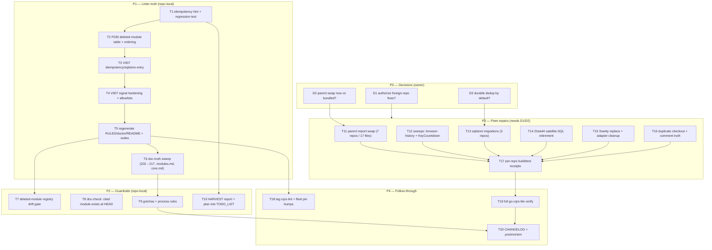

# SUPERB plan — cqrs-lint truth fixes + idempotency debt retirement

**Date:** 2026-11-17 13:33 CET
**Status (as written 2026-11-17):** PROPOSED — Phase 1/2 are repo-local and ready to execute; Phase 3 is gated on owner decisions (D1–D3)
**Trigger:** session review of `idempotency` / `idempotency/sqlstore` usage, which exposed three cqrs-lint detection defects and one doc-count lie. Everything below is derived from commands run in this session, not from memory.

> ## Status banner — 2026-11-18
>
> **This plan is EXECUTED IN PART and SUPERSEDED as the working plan** by
> [`2026-11-18_06-41_SUPERB-idempotency-fleet-repair-and-linter-follow-through.md`](2026-11-18_06-41_SUPERB-idempotency-fleet-repair-and-linter-follow-through.md).
> Its design intent below is unchanged and remains readable as written; this banner and the
> addendum in §0.1 are the only reconciliation.
>
> - **P1 (T1–T6) — SHIPPED.** Commits `006262476`, `a00ff3a06`, `34973524b`, `2bb70ab84`.
> - **P2 — PARTIAL.** T7's existence tests landed; T8 and T9 are open (now C27 and C10).
> - **P3 (T11–T17) — NOT STARTED.** D1 was granted 2026-11-18; the work is re-cut into C13/C15–C26.
> - **P4 — PARTIAL.** T20's status report landed; CHANGELOG and postmortem are now C3 and C4.
> - **D1–D3 — ANSWERED / SUPERSEDED.** D1 granted (fleet edits authorized). The blank D2/D3 rows
>   in §8 are replaced by the named decisions **D28** (parent-shim swap timing) and **D29**
>   (dedup durability default) on `TODO_LIST.md`'s owner decision sheet, because the bare labels
>   were colliding with decision rows minted in later sessions.
>
> **Current truth for every task below lives in the successor plan's §5 micro-task tables.**
> Do not execute T11–T20 from this document; the successor re-cut them with the survey evidence.

### §0.1 Per-task addendum (2026-11-18)

| Task                                    | State                    | Evidence                                                                                                                                                                                                                                                   |
| --------------------------------------- | ------------------------ | ---------------------------------------------------------------------------------------------------------------------------------------------------------------------------------------------------------------------------------------------------------- |
| T1 idempotency hint + regression test   | **DONE**                 | `cmd/cqrs-lint/v4/pkg/analyzer/module_catalog_data.go:135-147`; `module_detect_test.go` parent-only case; live scorecard flipped `missing`→`used` on games/SEC, InboxClean, github-local-sync                                                              |
| T2 F030 deleted-module table + ordering | **DONE (as a registry)** | `cmd/cqrs-lint/v4/pkg/rules/adoption/f030.go` — 7 entries, longest-fragment match, `presentModuleFragments` guard so `idempotency/sqlstore` is never reported as the deleted parent; 7 fixtures                                                            |
| T3 V007 `idempotency/sqlstore` entry    | **DONE**                 | `cmd/cqrs-lint/v4/pkg/rules/version/v007_tables.go:36-41`; verified live on games/KeyCountdown `internal/container/packages/cqrs.go:55`                                                                                                                    |
| T4 V007 signal hardening                | **DONE**                 | `v007_drift_scan_test.go` — `no v5 successor`, `adr-0158`, `adr-0167` phrases + 2 regression tests                                                                                                                                                         |
| T5 artifact regen + suites              | **PARTIAL**              | `RULES.md` regenerated (2-line diff), full `cmd/cqrs-lint/v4` suite green, doc-check green, `check-canonical-facts.sh` green. **`#lint-scope` and `#verify` were never run** → successor task **C5**                                                       |
| T6 doc-truth sweep                      | **DONE**                 | `docs/DOMAIN_LANGUAGE.md:345` 202→217; `references/modules.md` idempotency rows; `references/core.md:204` dedup routing                                                                                                                                    |
| T7 deleted-module registry drift gate   | **PARTIAL**              | Reverse direction shipped (`f030_internal_test.go`: `TestDeletedModuleRegistry_EntriesAreActuallyDeleted` asserts the module is really gone; `TestPresentModuleFragments_StillExist`). The FORWARD gate (every ADR-0128/0152 deletion has a row) is **C6** |
| T8 doc-check module existence           | **NOT STARTED**          | → **C27**                                                                                                                                                                                                                                                  |
| T9 gotchas + process rules              | **NOT STARTED**          | → **C10**                                                                                                                                                                                                                                                  |
| T10 HARVEST                             | **DONE**                 | `8520f6c82` — 10 fleet rows, D28/D29, ROADMAP q23/q24                                                                                                                                                                                                      |
| T11 parent import swap                  | **NOT STARTED**          | Re-cut as **C15/C16** (four pure swaps) + **C18–C21** (store-changing apps)                                                                                                                                                                                |
| T12 sweeps                              | **NOT STARTED**          | → **C24**                                                                                                                                                                                                                                                  |
| T13 sqlstore migrations                 | **NOT STARTED**          | → **C18/C19/C20**, gated on D28/D29                                                                                                                                                                                                                        |
| T14 Zlota44 port                        | **NOT STARTED**          | → **C21**                                                                                                                                                                                                                                                  |
| T15 Swetty cleanup                      | **NOT STARTED**          | → **C16**                                                                                                                                                                                                                                                  |
| T16 checkout + comment truth            | **NOT STARTED**          | → **C25** (checkout, D31) and **C22** (comments)                                                                                                                                                                                                           |
| T17 receipts                            | **NOT STARTED**          | → **C13** (baseline before), **C17/C26** (after)                                                                                                                                                                                                           |
| T18 release                             | **NOT STARTED**          | → **C12**, gated on D30                                                                                                                                                                                                                                    |
| T19 full verify                         | **NOT STARTED**          | → **C5**                                                                                                                                                                                                                                                   |
| T20 CHANGELOG + postmortem              | **PARTIAL**              | Status report `docs/status/2026-11-17_22-38_…` landed; CHANGELOG → **C3**, postmortem → **C4**                                                                                                                                                             |

---

## 0. TL;DR — the answer to the question

**Should we improve cqrs-lint?** Yes. Three reproducible defects, each with fresh evidence:

1. **False MISSING rows (credibility bug).** The module catalog's `idempotency` entry matches only `go-idempotency` and `go-cqrs-lite/idempotency/sqlstore`. A consumer importing `go-cqrs-lite/idempotency/v4` matches neither (`pathBoundaryMatch` is substring + `/` boundary), so the scorecard reports **Idempotency: missing** for apps that genuinely use it. Proven on `InboxClean`, `github-local-sync`, and `games/SEC` (SEC's `app.go:14` imports the module; scorecard still says missing). `Zlota44` is the control: it requires `go-idempotency` directly and scores **used**. 5 of the 7 parent importers are exposed to this false negative.
2. **Silence on deleted modules.** `F030` covers deleted `transport/*` only. `idempotency/v4` (source deleted 2026-08-15) and `idempotency/kvstore/v4` (deleted 2026-10-17) have no rule, so a consumer on a module that no longer exists gets no warning (`cqrs-lint /home/lars/projects/games/SEC` → zero idempotency findings beyond an unrelated TTL-constant hint).
3. **Silence on the deprecated satellite.** `idempotency/sqlstore/v4` is deprecated toward v5 (ADR-0158/0167) but is absent from `deprecatedV5Modules`; its `// Deprecated:` text says "No v5 successor" and cites ADR-0142, neither of which the V007 drift scanner's phrase list recognizes. `cqrs-lint` on `games/KeyCountdown` (a sqlstore consumer) produces **zero** sqlstore findings.

**Should we fix things ourselves?** Yes — the linter fixes, doc-truth fixes, and guardrail tests are repo-local and low-risk. The fleet repairs (17-file import swap, two missing sweeps, Zlota44's satellite-SQL store, Swetty's dangling replace) are real but live in other repos and stay gated on D1.

**Blast-radius guardrail (no Verschlimmbessern):** keep rule IDs stable. Extend `F030`'s table and `V007`'s tables; do **not** mint a new rule ID, so the count stays 217, suppressions keep working, and the README/meta pins do not churn.

---

## 1. Pareto cut

### The 1% that delivers 51% — one line + one test

Add `go-cqrs-lite/idempotency` to the `idempotency` entry's `ImportHints` in `cmd/cqrs-lint/v4/pkg/analyzer/module_catalog_data.go:135-142`, plus a `module_detect` regression test.

- Why it dominates: a lying MISSING row licenses dismissing the entire scorecard (AGENTS contract 28). This single change converts 3 verified false negatives (and up to 5 fleet repos) into truthful rows, and it is the only defect that misreports **good** behavior rather than missing **bad** behavior.
- Cost: ~10 lines including the test.

### The 4% that delivers 64% — teach the two migrations we just did by hand

- `F030`: add deleted-module entries for `go-cqrs-lite/idempotency` (parent shim) and `go-cqrs-lite/idempotency/kvstore` (optionally `codec`, `retry`, `flightrecorder` from ADR-0128 — zero real fleet consumers today, but the registry should be complete).
- `V007`: add `{fragment: "idempotency/sqlstore", replacement: "system.Dedup() over metaengine.DedupStore (ADR-0158/0167)"}`.

Together these two tables make the linter produce the exact advice this session delivered manually.

### The 20% that delivers 80% — the two tables plus their guardrails

- Harden the V007 drift signal so a future "No v5 successor" / ADR-0158 deprecation cannot be invisible (phrase list + allowlist entries).
- Order F030's table by fragment length descending so `idempotency/sqlstore` is never mistaken for the deleted parent `idempotency` (specific-first wins).
- Regenerate `RULES.md`, the doctor JSON golden, README counts; run the full cqrs-lint suite.
- Fix doc truth: `docs/DOMAIN_LANGUAGE.md:345` still says **202 rules**; the code, README, and `meta_test.go` pin **217**.
- Add the missing-module registry drift test so a deleted directory without a rule entry fails CI.

### The other 20% — to reach 100%

- Fleet repairs (gated): 7 parent import swaps (17 files), sweeps for browser-history + KeyCountdown, Zlota44's 172-line hand-rolled store, Swetty's dangling `replace`, the `DiscordSync`/`discordsync` duplicate checkout, the browser-history "native TTL" lie.
- Release the improved linter (tag + fleet pin bumps) and harvest this plan into the backlog.
- Optional hardening: lifecycle advisory for unswept stores, deleted-module doc-check rule, `explain` anchors.

---

## 2. Evidence appendix (all run in this session)

| Evidence                                                                       | Result                                                                                                |
| ------------------------------------------------------------------------------ | ----------------------------------------------------------------------------------------------------- |
| `project-dependency-graph who-uses …/idempotency --direct-only=false`          | 7 consumers, all `v4.4.0`                                                                             |
| `project-dependency-graph who-uses …/idempotency/sqlstore --direct-only=false` | 3 consumers, all `v4.4.3`                                                                             |
| `ls idempotency/`                                                              | only `sqlstore/`; parent module dir gone                                                              |
| `git log --diff-filter=D -- idempotency/go.mod`                                | deleted `875bb689b` (2026-08-15)                                                                      |
| `git for-each-ref refs/tags/idempotency/v4.4.0`                                | tag created 2026-08-12 (predates deletion)                                                            |
| `cqrs-lint scorecard --path …/InboxClean -o markdown`                          | `Idempotency … missing` (false)                                                                       |
| `cqrs-lint scorecard --path …/github-local-sync`                               | `Idempotency … missing` (false)                                                                       |
| `cqrs-lint scorecard --path …/games/SEC`                                       | `Idempotency … missing` (false)                                                                       |
| `cqrs-lint scorecard --path …/Zlota44`                                         | `Idempotency … used` (control: direct `go-idempotency`)                                               |
| `cqrs-lint …/games/SEC`                                                        | no deleted-module finding                                                                             |
| `cqrs-lint …/games/KeyCountdown`                                               | no sqlstore/V007 finding                                                                              |
| `go test ./pkg/rules/version/ -run TestV007`                                   | green (so the omission is a signal/table gap, not a red gate)                                         |
| `cmd/cqrs-lint/v4/pkg/rules/catalog_*.go` ID census                            | 217 rule IDs; `meta_test.go:26` pins 217; README:385 says 217; `DOMAIN_LANGUAGE.md:345` says 202      |
| `f030.go` table                                                                | `transport/http`, `transport/grpc` only                                                               |
| `v007_tables.go`                                                               | `stack/*`, `storage/relational`, `storage/view`, `scheduling/sqlstore` — no `idempotency/sqlstore`    |
| `v007_drift_scan_test.go` signal list                                          | `removed in/at v5`, `removal at v5`, ADR-0114/0123/0126/0127 — no ADR-0158/0167, no "No v5 successor" |
| `grep "No v5 successor"`                                                       | 16 hits, all in `idempotency/sqlstore/v4/{store,engine}.go`                                           |
| `pathBoundaryMatch` (`module_detect.go:160`)                                   | substring + `/` boundary; parent path matches neither hint                                            |
| `module_catalog_data.go:135`                                                   | hints = `go-idempotency`, `go-cqrs-lite/idempotency/sqlstore`                                         |

---

## 3. Execution graph

**Critical path:** T1 → T2 → T3 → T4 → T5 → T7 → T18 → T19. Phase 3 can run in parallel once D1/D2 land.

---

## 4. Comprehensive plan — coarse tasks (30–100 min)

Sorted by impact, then effort, then customer value.

| ID  | Task                                                                                                                                           | Impact   | Effort | Customer value                                | Phase      |
| --- | ---------------------------------------------------------------------------------------------------------------------------------------------- | -------- | ------ | --------------------------------------------- | ---------- |
| T1  | Add `go-cqrs-lite/idempotency` to the `idempotency` ImportHints + regression test proving parent-only import ⇒ used                            | Critical | 45m    | High — kills false MISSING rows               | P1         |
| T2  | Extend `F030` with deleted `idempotency` + `idempotency/kvstore` entries; order table specific-first; add fixtures                             | High     | 60m    | High — warns on dead imports                  | P1         |
| T3  | Add `idempotency/sqlstore` to `deprecatedV5Modules` with replacement text + fixture                                                            | High     | 75m    | High — coaches the retirement                 | P1         |
| T4  | Harden V007 signal list (`No v5 successor`, ADR-0158/0167) and add allowlist reasons where needed                                              | High     | 60m    | Medium — prevents the next silent deprecation | P1         |
| T5  | Regenerate `RULES.md`, doctor JSON golden, README counts; run analyzer/adoption/version/root suites; `check-md-go`                             | High     | 50m    | High — no drift                               | P1         |
| T6  | Doc-truth sweep: `DOMAIN_LANGUAGE.md:345` 202→217; `modules.md` parent row; `core.md:204` dedup routing; deleted/tag-only tombstone convention | Medium   | 40m    | Medium                                        | P1         |
| T7  | Drift gate: every deleted module dir (or ADR-0128/0152 deletion) must have an F030/V007 entry; add `check-canonical-facts` row                 | High     | 90m    | High — prevents recurrence                    | P2         |
| T8  | doc-check rule: module paths cited in SKILL/AGENTS must exist at HEAD or carry a deleted marker                                                | Medium   | 90m    | Medium                                        | P2         |
| T9  | Record tag-vs-source rule + foreign-dirty-file hygiene + module-review procedure in gotchas/AGENTS                                             | Medium   | 30m    | Medium                                        | P2         |
| T10 | HARVEST status report §f (50 items) + this plan into `TODO_LIST.md` / `ROADMAP.md` with owning repos                                           | High     | 60m    | High — nothing dies in a timestamped file     | P2         |
| T11 | Swap parent import to `go-idempotency` across 7 repos (17 files); per-repo build/test                                                          | Critical | 100m   | High                                          | P3 (D2)    |
| T12 | Schedule sweeps: browser-history/api + games/KeyCountdown (mirror DiscordSync's sweeper); document cadence                                     | High     | 60m    | High — bounds table growth                    | P3 (D1)    |
| T13 | Migrate 3 sqlstore consumers to engine dedup (`system.Dedup()` / `DedupStore` + `DedupSweep`)                                                  | High     | 100m   | High                                          | P3 (D1/D3) |
| T14 | Port Zlota44's 172-line hand-rolled SQLite store to `metaengine.DedupStore` (keep contract suite)                                              | High     | 100m   | High                                          | P3 (D1)    |
| T15 | Swetty: delete dangling `replace`, replace local adapter with `NewFromEngine`/`system.Dedup()`                                                 | Medium   | 30m    | Medium                                        | P3 (D1)    |
| T16 | Resolve `DiscordSync`/`discordsync` duplicate checkout; fix browser-history "native TTL" comment (+ precheck copy)                             | Medium   | 30m    | Low-Med                                       | P3 (D1)    |
| T17 | Per-repo receipts: build + tests + `cqrs-lint scorecard` after each fleet change                                                               | High     | 90m    | High                                          | P3         |
| T18 | Cut a cqrs-lint minor tag carrying T1–T5; bump fleet/CI pins; proxy smoke                                                                      | Medium   | 60m    | Medium                                        | P4         |
| T19 | Full `nix run .#verify` + coverage/untested-exports/dup gates on go-cqrs-lite                                                                  | High     | 40m    | High                                          | P4         |
| T20 | CHANGELOG `[Unreleased]` entries (symbol-cited) + short postmortem of the first-turn miss                                                      | Low      | 30m    | Low                                           | P4         |

**Total:** ~20 tasks, ~23 h of focused work; the 80% value (T1–T6) is ~5.5 h.

---

## 5. Micro-task breakdown (each ≤12 min)

### T1 — hint fix (45m)

| #   | Micro-task                                                                     | Min |
| --- | ------------------------------------------------------------------------------ | --- |
| 1.1 | Add `"go-cqrs-lite/idempotency"` to the idempotency `ImportHints`              | 2   |
| 1.2 | Run `TestCatalogImportHintsUnique` + `TestCatalogEveryGoWorkModuleCovered`     | 4   |
| 1.3 | Add table-driven `module_detect_test` case: parent import ⇒ `UsageImported`    | 10  |
| 1.4 | Add negative case: unrelated path ⇒ absent                                     | 6   |
| 1.5 | Run `go test ./pkg/analyzer/ -count=1`                                         | 8   |
| 1.6 | Re-run scorecard on SEC / InboxClean / github-local-sync; capture before/after | 10  |
| 1.7 | Regenerate doctor golden if fixture detection changed (`UPDATE_GOLDEN=1`)      | 10  |

### T2 — F030 deleted-module table (60m)

| #   | Micro-task                                                                                      | Min |
| --- | ----------------------------------------------------------------------------------------------- | --- |
| 2.1 | Read `firstImportPosIn` and confirm match semantics per entry                                   | 8   |
| 2.2 | Add parent `go-cqrs-lite/idempotency` entry with `go-idempotency` replacement                   | 6   |
| 2.3 | Add `go-cqrs-lite/idempotency/kvstore` entry with `metaengine.DedupStore` replacement           | 6   |
| 2.4 | Add optional `codec`/`retry`/`flightrecorder` entries (ADR-0128), or document exclusion         | 8   |
| 2.5 | Sort table specific-first (longest fragment) and add an ordering test                           | 10  |
| 2.6 | Add fixtures: parent import, kvstore import, sqlstore import (must NOT get the deleted message) | 12  |
| 2.7 | Run adoption suite                                                                              | 10  |

### T3 — V007 sqlstore coverage (75m)

| #   | Micro-task                                                                        | Min |
| --- | --------------------------------------------------------------------------------- | --- |
| 3.1 | Add `{fragment: "idempotency/sqlstore", replacement: …}` to `deprecatedV5Modules` | 4   |
| 3.2 | Run `TestV007_FragmentSpaceMatchesDetector`                                       | 6   |
| 3.3 | Add detector fixture: consumer calling `sqlstore.NewSQLiteStore` ⇒ finding        | 12  |
| 3.4 | Add fixture: `go-idempotency` import ⇒ no finding                                 | 8   |
| 3.5 | Confirm `matchesModule` path normalization strips `/v4`                           | 8   |
| 3.6 | Add matching case at `TestV007` table tests                                       | 10  |
| 3.7 | Run version suite (`-count=1`)                                                    | 10  |
| 3.8 | Re-run `cqrs-lint` on KeyCountdown; confirm the finding appears                   | 10  |

### T4 — V007 signal hardening (60m)

| #   | Micro-task                                                                      | Minute |
| --- | ------------------------------------------------------------------------------- | ------ |
| 4.1 | Add `adr-0158`, `adr-0167`, `no v5 successor` to `v5DocSignal` phrases          | 5      |
| 4.2 | Run drift coverage test; capture newly uncovered markers                        | 8      |
| 4.3 | Confirm all 16 sqlstore markers resolve via the new module entry                | 8      |
| 4.4 | Add allowlist entries only where a marker legitimately needs one (with reasons) | 10     |
| 4.5 | Add a regression test for the new phrase (fixture marker)                       | 10     |
| 4.6 | Run drift + scan tests                                                          | 10     |

### T5 — artifact regen + suites (50m)

| #   | Micro-task                                                                         | Min |
| --- | ---------------------------------------------------------------------------------- | --- |
| 5.1 | `go run . rules --markdown > RULES.md`                                             | 4   |
| 5.2 | Verify RULES.md diff is additive/reworded only (no ID churn)                       | 6   |
| 5.3 | Run `UPDATE_GOLDEN=1 go test -run TestDoctorJSONReport_Golden`                     | 6   |
| 5.4 | Run `go test ./... -count=1` in cmd/cqrs-lint/v4                                   | 12  |
| 5.5 | Run `cd cmd/api-stability && GOWORK=off go run . --update` (only if exports moved) | 8   |
| 5.6 | Run `nix run .#check-md-go` for touched docs                                       | 8   |
| 5.7 | Verify README/meta counts still 217                                                | 4   |

### T6 — doc truth (40m)

| #   | Micro-task                                                                                  | Min |
| --- | ------------------------------------------------------------------------------------------- | --- |
| 6.1 | `DOMAIN_LANGUAGE.md:345` 202→217 (grep for other "202 rules")                               | 5   |
| 6.2 | `modules.md:63` parent row: drop `KVStore`, mark tag-only shim                              | 8   |
| 6.3 | `core.md:204` route dedup to `system.Dedup()`/`metaengine.DedupStore`                       | 8   |
| 6.4 | Add deleted/tag-only tombstone row convention to module tables                              | 8   |
| 6.5 | Refresh the 2026-11-13 deep-dive's "removed idempotency/v4" count with 7 modules / 17 files | 6   |
| 6.6 | Run doc-check                                                                               | 5   |

### T7 — deleted-module drift gate (90m)

| #   | Micro-task                                                          | Min |
| --- | ------------------------------------------------------------------- | --- |
| 7.1 | Decide registry shape (single table shared by F030 + drift test)    | 10  |
| 7.2 | Extract the table into one file in the adoption package             | 10  |
| 7.3 | Refactor F030 to consume it (behavior unchanged)                    | 10  |
| 7.4 | Add drift test: every deleted dir/ADR entry has a table row         | 12  |
| 7.5 | Add reverse test: every row maps to a real deletion (no ghosts)     | 12  |
| 7.6 | Add `check-canonical-facts.sh` row for deleted-but-required modules | 12  |
| 7.7 | Add fixture pinning ADR-0167's consumer counts                      | 12  |
| 7.8 | Run gates (`check-canonical-facts`, adoption suite)                 | 10  |

### T8 — doc-check module existence (90m)

| #   | Micro-task                                                             | Min |
| --- | ---------------------------------------------------------------------- | --- |
| 8.1 | Locate doc-check's module-path resolution (`resolve.go`)               | 8   |
| 8.2 | Define "deleted marker" syntax (e.g. `_(deleted)_` row or inline note) | 8   |
| 8.3 | Implement: cited path absent at HEAD + no marker ⇒ failure             | 12  |
| 8.4 | Baseline existing exceptions (ADRs/examples)                           | 12  |
| 8.5 | Wire into the default scan set                                         | 10  |
| 8.6 | Add self-test fault injection                                          | 12  |
| 8.7 | Run doc-check on SKILL/AGENTS/references                               | 8   |

### T9 — process rules + gotchas (30m)

| #   | Micro-task                                                                    | Min |
| --- | ----------------------------------------------------------------------------- | --- |
| 9.1 | Add "tag exists ≠ source exists" entry to gotchas-module-management           | 8   |
| 9.2 | Add "use `who-uses` before manual fleet greps" to the module-review procedure | 6   |
| 9.3 | Add foreign-dirty-file hygiene note (daemon mixing)                           | 6   |
| 9.4 | Add the frozen-shim migration recipe pointer                                  | 6   |

### T10 — HARVEST (60m)

| #    | Micro-task                                                             | Min |
| ---- | ---------------------------------------------------------------------- | --- |
| 10.1 | Route status-report items 1–50 into TODO_LIST/ROADMAP with owning repo | 12  |
| 10.2 | Add rows for T1–T20 with phase gates                                   | 12  |
| 10.3 | Add cross-repo defect rows (Swetty, Zlota44, duplicates, sweeps)       | 10  |
| 10.4 | Add v5 deletion checklist rows (sqlstore, frozen parent docs surface)  | 8   |
| 10.5 | Cross-check TODO_LIST for duplicates; link this plan                   | 8   |
| 10.6 | Run `check-canonical-facts` if counts changed                          | 6   |

### T11 — parent import swap (100m)

| #    | Micro-task                                   | Min |
| ---- | -------------------------------------------- | --- |
| 11.1 | InboxClean swap + build                      | 10  |
| 11.2 | github-local-sync swap + build               | 10  |
| 11.3 | games/SEC swap (prod + test) + build         | 10  |
| 11.4 | KeyCountdown swap + build                    | 12  |
| 11.5 | browser-history swap + build                 | 12  |
| 11.6 | SwettySwipperWeb swap + build                | 12  |
| 11.7 | Zlota44 swap + build                         | 12  |
| 11.8 | Confirm go.mod requires/tidy clean per repo  | 12  |
| 11.9 | Run each repo's test suite (or scoped suite) | 10  |

### T12 — sweeps (60m)

| #    | Micro-task                                                                  | Min |
| ---- | --------------------------------------------------------------------------- | --- |
| 12.1 | Port DiscordSync's sweeper shape (nil/typed-nil guard) into browser-history | 12  |
| 12.2 | Wire browser-history lifecycle stop                                         | 10  |
| 12.3 | Add KeyCountdown sweeper via `samber/do` package                            | 12  |
| 12.4 | Add tests: expired rows deleted, live rows kept                             | 12  |
| 12.5 | Document cadence + reason at both wiring sites                              | 6   |
| 12.6 | Build/test both repos                                                       | 8   |

### T13 — sqlstore migrations (100m)

| #    | Micro-task                                                | Min |
| ---- | --------------------------------------------------------- | --- |
| 13.1 | DiscordSync: engine dedup + sweep, delete sqlstore wiring | 12  |
| 13.2 | DiscordSync: event-capture dedup semantics test           | 10  |
| 13.3 | KeyCountdown: engine dedup via `system.Dedup()`/DI        | 12  |
| 13.4 | KeyCountdown: remove `NewIdempotencyStore` DI function    | 8   |
| 13.5 | browser-history: engine dedup + collapse dual branch      | 12  |
| 13.6 | browser-history: lifecycle/close updates                  | 8   |
| 13.7 | Remove `// indirect` go.mod residue                       | 6   |
| 13.8 | Build/test all three                                      | 12  |

### T14 — Zlota44 port (100m)

| #    | Micro-task                                                      | Min |
| ---- | --------------------------------------------------------------- | --- |
| 14.1 | Inventory store methods used (Record/Seen/CheckAndRecord)       | 8   |
| 14.2 | Build adapter over `metaengine.DedupStore` (or `NewFromEngine`) | 12  |
| 14.3 | Replace `NewSQLiteIdempotencyStore` wiring                      | 10  |
| 14.4 | Keep upstream contract suite green                              | 12  |
| 14.5 | Delete the 172-line store + its schema/SQL                      | 10  |
| 14.6 | Re-run sweep/discover tests                                     | 12  |
| 14.7 | Build/test Zlota44                                              | 10  |

### T15 — Swetty cleanup (30m)

| #    | Micro-task                                         | Min |
| ---- | -------------------------------------------------- | --- |
| 15.1 | Delete dangling `replace` line                     | 3   |
| 15.2 | Decide adapter vs `NewFromEngine`/`system.Dedup()` | 6   |
| 15.3 | Implement chosen simplification                    | 10  |
| 15.4 | Run idempotency integration tests                  | 8   |

### T16 — checkout + comments (30m)

| #    | Micro-task                                                | Min |
| ---- | --------------------------------------------------------- | --- |
| 16.1 | Compare `DiscordSync`/`discordsync` git state and remotes | 6   |
| 16.2 | Pick canonical checkout; archive/trash the twin           | 6   |
| 16.3 | Fix browser-history "native TTL" comment                  | 4   |
| 16.4 | Apply the same fixes to `browser-history-precheck`        | 8   |

### T17 — receipts (90m)

| #    | Micro-task                                          | Min |
| ---- | --------------------------------------------------- | --- |
| 17.1 | Per-repo build receipts                             | 12  |
| 17.2 | Per-repo test receipts                              | 12  |
| 17.3 | Scorecard before/after for idempotency rows         | 10  |
| 17.4 | Re-run fleet `who-uses` counts                      | 8   |
| 17.5 | Re-run `census-fleet.sh` and diff ADR-0167 addendum | 12  |
| 17.6 | Re-run `check-versions-manifest --check`            | 6   |

### T18 — release (60m)

| #    | Micro-task                                               | Min |
| ---- | -------------------------------------------------------- | --- |
| 18.1 | CHANGELOG `[Unreleased]` entries with `pkg.Symbol` cites | 10  |
| 18.2 | `scripts/check-changelog-symbols.sh`                     | 6   |
| 18.3 | Cut `cmd/cqrs-lint` minor tag (clean tree first)         | 10  |
| 18.4 | Push + proxy smoke (`go install` clean dir)              | 10  |
| 18.5 | Bump fleet/CI pins (BuildFlow, bank-sync quiet window)   | 12  |
| 18.6 | `check-versions-manifest --update` + README manifest     | 8   |

### T19 — full verify (40m)

| #    | Micro-task                         | Min |
| ---- | ---------------------------------- | --- |
| 19.1 | `nix run .#verify`                 | 12  |
| 19.2 | `nix run .#check-coverage`         | 6   |
| 19.3 | `nix run .#check-untested-exports` | 6   |
| 19.4 | `nix run .#check-duplication`      | 6   |
| 19.5 | Triage + record any failures       | 10  |

### T20 — close-out (30m)

| #    | Micro-task                                         | Min |
| ---- | -------------------------------------------------- | --- |
| 20.1 | CHANGELOG warnings/notes for cross-repo gate       | 6   |
| 20.2 | Postmortem: first-turn miss (kvstore-only framing) | 8   |
| 20.3 | Link receipts in TODO_LIST                         | 8   |
| 20.4 | Final status update                                | 8   |

---

## 6. Coverage matrix — the 50 status-report items

| Status-report item(s)                             | Plan task                        |
| ------------------------------------------------- | -------------------------------- |
| 1–7 (parent swaps per repo)                       | T11                              |
| 8 (cqrs-upgrade codemod rule)                     | T18 (release), TODO row in T10   |
| 9 (deleted-module gate)                           | T7                               |
| 10–11 (sweeps)                                    | T12                              |
| 12–14 (sqlstore migrations)                       | T13                              |
| 15 (Zlota44)                                      | T14                              |
| 16 (HARVEST)                                      | T10                              |
| 17 (run verify)                                   | T19                              |
| 18 (ADR count gate)                               | T7                               |
| 19–20 (Swetty)                                    | T15                              |
| 21 (browser-history comment)                      | T16                              |
| 22 (duplicate checkout)                           | T16                              |
| 23 (census dedupe)                                | T16/T17                          |
| 24–26 (core.md, modules.md, tombstone convention) | T6                               |
| 27 (md-go)                                        | T5                               |
| 28 (restart-loses-keys docs)                      | T9 (gated fleet docs in T11/T13) |
| 29 (SEC sweep interval)                           | T12                              |
| 30–31 (sqlstore godoc + semantics pin)            | T3/T6                            |
| 32–33 (TODO rows, ROADMAP)                        | T10                              |
| 34 (deep-dive refresh)                            | T6                               |
| 35 (DiscordSync command dedup)                    | D3 decision; T13                 |
| 36–37 (v5 deletion entries)                       | T6/T10                           |
| 38 (canonical-facts row)                          | T7                               |
| 39–40 (lint rule, fixture pin)                    | T7                               |
| 41–45 (process rules, postmortem, hygiene)        | T9/T20                           |
| 46 (doc-check module existence)                   | T8                               |
| 47 (migration cookbook)                           | T6/T9                            |
| 48 (per-repo smoke)                               | T17                              |
| 49 (module-map/SPAN sweep)                        | T6                               |
| 50 (census re-run)                                | T17                              |

---

## 7. Risks and guardrails

| Risk                                                                                                            | Mitigation                                                                                                                |
| --------------------------------------------------------------------------------------------------------------- | ------------------------------------------------------------------------------------------------------------------------- |
| F030 ordering bug: parent fragment swallows `idempotency/sqlstore` imports and emits the wrong (deleted) advice | Sort the table specific-first and pin with fixtures (T2.5/T2.6)                                                           |
| Hint change inflates feature profile and flips doctor goldens in unrelated fixtures                             | Run doctor golden regeneration, inspect the diff per fixture, keep evidence import path deterministic                     |
| V007 signal hardening unmasks dozens of uncovered markers                                                       | Run the coverage test FIRST, then add module entries/allowlist reasons; the drift tests already enumerate what is missing |
| Renaming F030 (name string) breaks docs/tests/consumers who match on names                                      | Keep the ID stable; if the name changes, update catalog + RULES + README in the same commit, no ID churn                  |
| Foreign-repo edits collide with parallel sessions/auto-commit                                                   | Gate on D1; check each repo's tree is clean and no concurrent owner edits                                                 |
| Parent swap touches 17 files across 7 repos; a partial sweep leaves mixed imports                               | One repo per commit; build+test after each; keep a receipt table                                                          |
| Release tag poisoning / dirty tree                                                                              | Wait for the daemon, verify clean tree, use the release script, proxy smoke per tag                                       |
| This plan itself becomes entombed                                                                               | T10 HARVEST is mandatory before any implementation starts                                                                 |

---

## 8. Owner decisions required

> **Reconciled 2026-11-18:** all three are answered. D2 and D3 are re-minted as **D28** and **D29**
> on `TODO_LIST.md`'s owner decision sheet (the bare D-numbers had drifted into collisions with
> decisions minted in later sessions). Original wording is preserved below.

- **D1 — foreign-repo authorization:** may I edit the 7 consumer repos (swaps, sweeps, Zlota44, Swetty, duplicate checkout), or should those stay as TODO rows owned by their projects? Blocks all of Phase 3.
  **ANSWERED 2026-11-17: GRANTED** — fleet edits authorized (recorded in `TODO_LIST.md`).
- **D2 — migration timing:** parent shim swap as a standalone mechanical sweep now, or bundled with the engine-backed dedup migration so each app is touched once? Changes T11 vs T13 ordering.
  **SUPERSEDED → D28** (still open as of 2026-11-18).
- **D3 — durability intent:** is restart-forgetting acceptable for the 5 memory-store dedup paths, or should dedup become durable-by-default? Determines whether T13 is a bug fix or a product change.
  **SUPERSEDED → D29** (still open as of 2026-11-18); the survey evidence that D29 needs is
  `docs/evidence/2026-11-17_idempotency-fleet-wiring-survey.md`.

---

## 9. Definition of done

- `cqrs-lint scorecard` reports **Idempotency: used** for every repo that imports `go-cqrs-lite/idempotency/v4` (verified on SEC, InboxClean, github-local-sync).
- `cqrs-lint` emits a deleted-module finding for imports of `idempotency/v4` and `idempotency/kvstore/v4`, and a V007 finding for `idempotency/sqlstore/v4`.
- Rule count stays 217 everywhere; `RULES.md`, README, doctor golden, and DOMAIN_LANGUAGE agree.
- Every deleted module directory or ADR-recorded deletion has a rule-registry entry, enforced by a drift test.
- Phase 3 complete only when each touched repo builds, tests green, and its scorecard row is truthful.
- `nix run .#verify` green on `go-cqrs-lite`.
