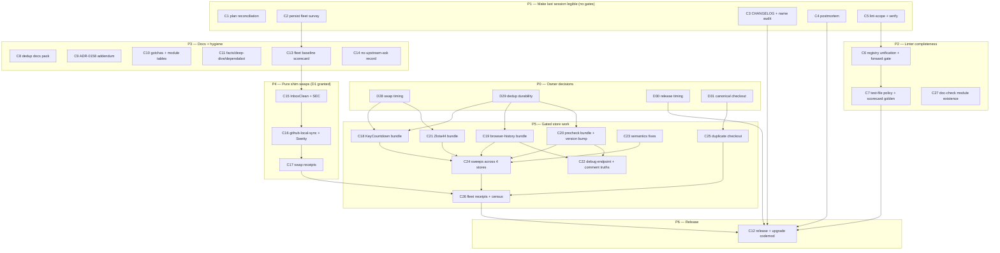

# SUPERB plan — idempotency fleet repair + cqrs-lint follow-through

**Date:** 2026-11-18 06:41 CET
**Status:** PROPOSED — C1–C14 and C27 are repo-local and start now; C15–C17 are unblocked (D1 granted);
C18–C26 gate on D28/D29 (migration timing, dedup durability) and on the two new decisions D30/D31.
**Update 2026-11-20:** C1–C4, C6, C8–C10 executed 2026-11-17/18; survey corrections reshaped C22/C23/C24 —
see "Execution corrections (2026-11-20)" below the task table. New task C6b added (registry completeness gate).
**Trigger:** execution of the 2026-11-17 plan's P1/P2 exposed a further 50 follow-ups (status report
`docs/status/2026-11-17_22-38_…` §f). This plan routes every one of them.
**Guardrail (Verschlimmbessern):** rule count stays 217, no rule ID may move, ADR bodies are extended only
with dated addenda, and every fleet repo is touched ONE repo per commit with build+test receipts.

---

## 0. What this plan is actually fixing (and what it refuses to touch)

Three defects were fixed last session, and fixing them created obligations: an unauditable commit history,
an evidence base that exists only in a chat transcript, a renamed consumer-facing rule with no CHANGELOG
entry, and a plan file that went stale the moment its tasks completed. Beyond that, ten concrete fleet
repairs are catalogued and authorized but untouched.

**Explicitly out of scope (do not "improve"):**

- No new lint rule IDs, no renumbering, no rule-count churn (217 is pinned in four places).
- No rewriting of ADR decisions; addenda only.
- No library API growth in v4: the durability question (D29) lands as per-app wiring, not as a changed
  `system.Dedup` default, until a third app asks.
- No `replace` chasing across repos; no vendor edits by hand.
- No `#verify` while any integration suite or heavy build runs (repo rule 3).

---

## 1. Pareto cut

### The 1% that delivers 51% — make the last session's work legible and safe

Two items, ~75 minutes total:

1. **Persist the fleet survey** (`C2`). Every claim about which app dedups in memory, which table grows
   without a sweep, and which middleware order is inverted currently lives in a chat message. Without it,
   D3's matrix is unverifiable, and the next session re-runs a 10-repo investigation.
2. **Lint + verify the linter changes** (`C5`). "Unit suites green" was honestly qualified, but the new
   `f030.go` (three new functions, one nested loop) has never met `golangci-lint`. One lint run converts a
   caveat into a receipt — or catches a real finding before it reaches a tag.

Why these dominate: a session that cannot be re-read and a change that cannot be trusted are the two ways
this work gets thrown away.

### The 4% that delivers 64% — close the audit trail around the fixes

1. **Plan reconciliation** (`C1`): the 13-33 plan still says PROPOSED with T1–T20 open; T1–T6 are done.
2. **CHANGELOG + rule-name ratification** (`C3`): F030's human name changed; IDs were kept, and
   `rg` over the fleet's tracked configs found **zero** references to the old name — so this is a
   documentation obligation, not a compatibility risk.
3. **Postmortem** (`C4`): write down the "tag exists ≠ module exists" miss AND the commit-hygiene failure,
   so the next session does not repeat either.

Cost ~1h50m; converts "I believe it works" into "here is the record".

### The 20% that delivers 80% — the four pure shim swaps

`C15`–`C17` (~2h45m): InboxClean, SEC, github-local-sync, SwettySwipperWeb stop importing a module whose
source was deleted in 2026-08. Every symbol they use is exported by `go-idempotency`, so this is mechanical;
their F030 findings disappear, their `go.mod` stops requiring a ghost, and the fleet baseline scorecard
becomes truthful for the first time.

Deliberately excluded from this tranche: the four apps whose store ALSO changes (KeyCountdown,
browser-history, precheck, Zlota44) — they wait for D28 so they are touched once.

### The other 20% — to reach 100%

- Store migrations and sweeps for the four remaining apps (`C18`–`C22`, `C24`) — gated on D28/D29.
- Semantics bugs found during the survey: retry-outside-idempotency inversion, leaked MemoryStore sweeper,
  non-atomic peek-then-record (`C23`).
- The duplicate checkout (`C25`), fleet receipts/census/manifest (`C26`).
- Linter completeness (`C6`, `C7`, `C27`), dedup docs (`C8`, `C9`), hygiene pack (`C10`, `C11`),
  release (`C12`), baseline (`C13`).

---

## 2. Decisions this plan needs (P0)

| #             | Decision                                                               | Why it blocks                                                                    | Where recorded   |
| ------------- | ---------------------------------------------------------------------- | -------------------------------------------------------------------------------- | ---------------- |
| D28           | Parent-shim swap standalone vs bundled with the engine-dedup migration | Orders `C18`–`C21`; the four pure swaps are already split out                    | TODO_LIST D28    |
| D29           | Dedup durability default (memory vs engine-backed)                     | Decides whether `browser-history`/`precheck` change store or only gain a sweeper | TODO_LIST D29    |
| **D30 (new)** | Release timing: cut `cmd/cqrs-lint` now vs batch with the next wave    | `C12` cannot tag without it                                                      | mint row in `C3` |
| **D31 (new)** | Which `DiscordSync` checkout is authoritative                          | `C25` cannot trash the twin without it                                           | mint row in `C3` |

**Decision-free work does not wait:** `C1`–`C14` + `C27` + `C15`–`C17` proceed regardless.

---

## 3. Execution graph

**Critical path:** `C2 → C13 → C15 → C16 → C17 → C26 → C12`. The gated branch (`C18`–`C24`) can run in
parallel with P1/P2 once D28/D29 land, but never in the same working tree at the same time as another
repo's build (keep one repo active per agent).

---

## 4. Coarse task table (30–100 min each)

Sorted by impact, then effort, then customer value. "Covers" cites the status-report §f item numbers.

| ID  | Task                                                                                                                                                                                                                               | Covers         | Impact   | Effort | Customer value                         | Phase        |
| --- | ---------------------------------------------------------------------------------------------------------------------------------------------------------------------------------------------------------------------------------- | -------------- | -------- | ------ | -------------------------------------- | ------------ |
| C2  | Persist the 10-checkout wiring survey as `docs/evidence/2026-11-17_idempotency-fleet-wiring-survey.md` (per-app store, TTL, sweeper, restart survival, middleware order, lying comments, swap file lists)                          | 2              | Critical | 35m    | High — makes D29 verifiable            | P1           |
| C5  | Run `GT_LINT_MODULES=cmd/cqrs-lint nix run .#lint-scope`, then `nix run .#verify`; triage findings                                                                                                                                 | 5,6            | Critical | 100m   | High — converts caveat into receipt    | P1           |
| C1  | Reconcile the 13-33 plan: dated status banner + per-task addendum (T1–T6 done, T7 partial, T8–T20 open, P3 gated)                                                                                                                  | 1              | High     | 40m    | Medium                                 | P1           |
| C3  | CHANGELOG `[Unreleased]` rows (F030 rename + ID note, V007 sqlstore, drift-signal widening); record the zero-hit consumer-config audit as the rename's justification; mint D30/D31 rows                                            | 3,4            | High     | 45m    | High                                   | P1           |
| C4  | Postmortem: "tag exists ≠ module exists" framing miss + daemon commit-hygiene failure + the two self-inflicted red test iterations                                                                                                 | 15             | Medium   | 30m    | Medium                                 | P1           |
| C6  | Merge `deletedModuleImports` + `presentModuleFragments` into ONE table with a `state` field (behavior identical, all existing tests must pass unchanged); add the FORWARD gate (every ADR-0128/0152-documented deletion has a row) | 7,8            | High     | 100m   | High — kills the drift class           | P2           |
| C7  | Decide + implement F030's `_test.go` posture; add a scorecard golden pinning `Idempotency: used` for a shim importer                                                                                                               | 9,10           | Medium   | 60m    | High                                   | P2           |
| C27 | doc-check rule: a module path cited in SKILL/AGENTS/references must exist at HEAD or carry a deleted marker (T8)                                                                                                                   | 37             | Medium   | 90m    | Medium                                 | P2           |
| C8  | Dedup docs pack: `system.Dedup` godoc states retention is the caller's job (schedule `DedupSweep`); verify the V007 replacement names an exported symbol; add the durability+sweep recipe to the skill                             | 11,12,13,48    | Medium   | 60m    | High — prevents the next unswept table | P3           |
| C9  | ADR-0158 dated addendum: the retirement is now linter-enforced (F030 for the deleted shims, V007 for sqlstore)                                                                                                                     | 14             | Low-Med  | 30m    | Low                                    | P3           |
| C10 | Gotchas + tables: "tag exists ≠ source exists", `who-uses`-before-greps, daemon-blends-foreign-files (with `2bb70ab84` as evidence), deleted/tag-only row convention in `references/modules.md`                                    | 38,39,40       | Medium   | 60m    | Medium                                 | P3           |
| C11 | Facts + docs hygiene: canonical-facts coverage for the registry, deep-dive stale fleet count refresh, `docs/planning` doc-check corpus decision, dependabot triage (2 moderate), and the explicit "no upstream ask" record         | 43,44,45,46,50 | Low-Med  | 70m    | Low                                    | P3           |
| C13 | Fleet baseline: run `cqrs-lint scorecard` on all 8 consumers, save as `docs/evidence/2026-11-18_fleet-idempotency-baseline.md` (before any repair)                                                                                 | 49             | High     | 40m    | High — before/after proof              | P3           |
| C15 | Pure swaps: InboxClean (`internal/emailcqrs/setup.go`), SEC (`internal/cqrs/app/app.go` + test)                                                                                                                                    | 16,17,20       | High     | 60m    | High                                   | P4           |
| C16 | Pure swaps: github-local-sync (`internal/branch/service.go`), SwettySwipperWeb (3 files + delete dangling `replace`)                                                                                                               | 18,19,20       | High     | 60m    | High                                   | P4           |
| C17 | Swap receipts: per repo build + test + scorecard after; confirm `go mod tidy` leaves a DIRECT require and no shim line                                                                                                             | 34             | High     | 45m    | High                                   | P4           |
| C18 | KeyCountdown bundle: swap + sqlstore → engine dedup + `DedupSweep` + remove the DI constructor                                                                                                                                     | 21             | High     | 80m    | High                                   | P5 (D28/D29) |
| C19 | browser-history bundle: swap + engine dedup, collapse the memory/sqlite branch                                                                                                                                                     | 22             | High     | 90m    | High                                   | P5 (D28/D29) |
| C20 | precheck bundle: swap + engine dedup + stop discarding a `MemoryStore` (leaked ticker) + bump indirect 0.3.1→0.3.2                                                                                                                 | 23,32          | High     | 80m    | High                                   | P5 (D28/D29) |
| C21 | Zlota44 bundle: swap 5 files + `go mod tidy && go mod vendor` + retire the 172-line store and its false "bounded" comment                                                                                                          | 24,25          | High     | 100m   | High                                   | P5 (D28/D29) |
| C22 | Truth fixes: `/debug/idempotency` (`SweepEnabled`, hardcoded `DedupLayers`) in both browser-history trees; the "native TTL" comment                                                                                                | 26,27          | Medium   | 45m    | Medium                                 | P5           |
| C23 | Semantics fixes: github-local-sync retry/idempotency order, InboxClean `MemoryStore` close, DiscordSync `CheckAndRecord`                                                                                                           | 28,29,30       | High     | 75m    | High                                   | P5           |
| C24 | Sweeps: browser-history, precheck, KeyCountdown, Swetty (`DedupSweep` currently has zero callers)                                                                                                                                  | 31             | High     | 90m    | High                                   | P5           |
| C25 | Execute the checkout decision: pick canonical, archive the twin, verify nothing references it                                                                                                                                      | 33             | Medium   | 30m    | Low-Med                                | P5 (D31)     |
| C26 | Fleet receipts: build/test/scorecard per touched repo; `census-fleet.sh` re-run vs ADR-0167; `check-versions-manifest --check`                                                                                                     | 34,35,36       | High     | 90m    | High                                   | P5           |
| C12 | Release + codemod: `cmd/cqrs-upgrade` rule for the shim swap; cut `cmd/cqrs-lint`; bump fleet/CI pins                                                                                                                              | 41,42,47       | Medium   | 100m   | Medium                                 | P6 (D30)     |

**Totals:** 27 tasks, ≈27 h of focused work. The 80 % value (`C2`, `C5`, `C1`, `C3`, `C4`, `C13`, `C15`–`C17`)
is **≈7 h**, and the 51 % value (`C2`, `C5`) is **≈2 h15m**.

### Execution corrections (2026-11-20)

Recorded before resuming P4+, after the wiring survey's second pass verified library facts in source.
Original rows above are preserved; these corrections govern execution from here on.

1. **C24's four-sweeper premise is WRONG.** Verified in library source: `idempotency/sqlstore` already
   runs its own TTL sweep whenever TTL ≠ 0, and `go-idempotency.MemoryStore` sweeps on its interval.
   So browser-history, precheck, and KeyCountdown on the sqlite path need **no new sweeper** — C24
   shrinks to the consumers whose dedup is a `metaengine.DedupStore` engine collection (explicit
   `DedupSweep`, zero auto-sweep; Swetty's `wanted_ids` today) plus any TTL=0 growth case. Re-derive
   per wiring site: store type × TTL decides, never "every app gets a sweeper".
2. **MemoryStore sweep constraint:** the sweep is oldest-first and blind — `sweepInterval < ttl` evicts
   LIVE keys. Any MemoryStore wiring must keep `sweepInterval >= ttl`; verify at every site touched.
3. **C5 preflight:** run `nix run .#can-run-composed-gate` FIRST; on load-guard refusal (rc=12), run the
   gate apps individually and record each — `#verify` is confirmation, not discovery. C5 stays blocked
   on owner Q1 regardless.
4. **C6 deviation + residual gap:** C6 shipped with presence = `go.mod` at HEAD (root or `/vN`), not the
   ADR-0128/0152 doc-list derivation of micro-tasks 6.6–6.7 (a deleted module's directory survives as a
   container — `idempotency/` still holds `sqlstore/`; tags are proxy-served forever per ADR-0152, so
   neither directory nor tag proves presence). The residual completeness gap is tracked as **C6b**
   (~40m), landed 2026-11-20 as `TestTagDerivedDeletedModules_RegistryIsComplete` — NOT set equality:
   the tag universe yields 16 deleted paths, 9 of them pre-v4-layout relics (memory, pebble, turso,
   saga, sync, testing, testhelpers, event/v3/eventtest, cqrs-lite) that predate the commissioned
   ADR-0128/0152 scope. The gate is three-directional instead: tracked rows must be tag-derived,
   untracked tag-derived paths must be acknowledged with a successor note
   (`acknowledgedTagOnlyModules`), and acknowledgments must stay fresh. Mutation-verified all three.
5. **C22 premise correction:** browser-history's "native TTL" comment is ACCURATE (survey verified);
   micro-task 22.5 ("fix the comment") is VOID. The real lies are the endpoint fields:
   `SweepEnabled = TTL > 0` and hardcoded `DedupLayers = 3`. Zlota44's false comment ("no sweeper
   needed / growth bounded") stays inside C21 (D28/D29-gated).
6. **C23 gating split:** 23.1/23.2 (github-local-sync middleware order) wait on the open
   replay-vs-dedup intent question (owner); 23.3/23.4 (InboxClean `MemoryStore` Close hygiene) are
   unblocked; 23.5/23.6 (DiscordSync) wait on D31.
7. **C11 canonical-facts decision:** SKIP adding a registry count row to `check-canonical-facts.sh` —
   C6's bidirectional state gate is strictly stronger (a count cannot tell you the state is wrong).
   Recording the skip here satisfies §f 43.
8. **C7 order note:** confirm FIRST whether `analyzer.TestDetectUsedModules_ParentIdempotencyShimImport`
   (`module_detect_test.go`) already pins `Idempotency: used` + evidence for the deleted shim — if yes,
   record the confirmation instead of adding a parallel golden (7.4/7.5).
9. **C13 filename:** the baseline evidence file is dated at EXECUTION time (honest dating), not the
   plan's drafting date.
10. **C11 verdicts (2026-11-20):** (a) §f 43 deep-dive count — already satisfied by the report's
    dated 2026-11-18 correction callout. (b) §f 44 canonical-facts — SKIP, see #7. (c) §f 45
    dependabot — both moderate alerts are the same otel CVE patched by v1.47.0; all 96 otel pins on
    the default branch ARE v1.47.0, so the alerts are stale against a patched graph; manual
    dismissal rejected (GitHub offers no truthful "fixed" reason) — they close on graph rescan.
    (d) §f 46 planning corpus — stays OUT of doc-check's default corpus (parse-level `#check-md-go`
    + the reconcile procedure are the right bars; compile-verifying dated records is the wrong one).
11. **C14 no-upstream-ask record (2026-11-20): NONE.** Zero genuine upstream asks surfaced;
    `go-idempotency` is first-party (its sweep fix is in-repo work). Recorded as "none" in the
    2026-11-18_08-27 report's receipts appendix. Nothing in this plan implies an external filing.

---

## 5. Micro-task breakdown (each ≤12 min)

### C2 — persist the survey (35m) · covers §f 2

| #   | Micro-task                                                                  | Min |
| --- | --------------------------------------------------------------------------- | --- |
| 2.1 | Create `docs/evidence/` entry with header: scope, date, method, HEAD        | 4   |
| 2.2 | Write the 10-checkout table (a)–(f) from the survey verbatim                | 12  |
| 2.3 | Write Q1/Q2/Q3 sections (durability impact, growth tables, swap file lists) | 12  |
| 2.4 | Cross-link from `docs/status/2026-11-17_22-38_…` §a16 and ADR-0167 addendum | 7   |

### C5 — lint + verify (100m) · covers §f 5,6

> **2026-11-20:** preflight added (correction #3); blocked on owner Q1.

| #   | Micro-task                                                                         | Min |
| --- | ---------------------------------------------------------------------------------- | --- |
| 5.0 | Preflight: `nix run .#can-run-composed-gate`; if rc=12, run gate apps individually | 10  |
| 5.1 | `GT_LINT_MODULES=cmd/cqrs-lint nix run .#lint-scope`                               | 12  |
| 5.2 | Fix any finding in `f030*.go` (complexity/line-length/wrap)                        | 12  |
| 5.3 | Re-run lint-scope to green                                                         | 8   |
| 5.4 | `nix run .#verify` (single run, nothing else concurrent)                           | 12  |
| 5.5 | If verify is long-running, keep working; collect the tail                          | 10  |
| 5.6 | Triage each failing leg; fix linter-owned ones                                     | 12  |
| 5.7 | Re-run only the failed legs                                                        | 12  |
| 5.8 | Record receipts in the session note                                                | 6   |
| 5.9 | Update TODO_LIST row if a foreign leg is red                                       | 8   |

### C1 — plan reconciliation (40m) · covers §f 1

| #   | Micro-task                                                                                 | Min |
| --- | ------------------------------------------------------------------------------------------ | --- |
| 1.1 | Read the 13-33 plan's task list                                                            | 6   |
| 1.2 | Add dated status banner under the title (P1 shipped / P2 partial / P3 gated / D1 answered) | 8   |
| 1.3 | Add per-task addendum table T1–T20 with DONE/PARTIAL/NOT-STARTED + file:line evidence      | 12  |
| 1.4 | Mark the stale D1–D3 block as answered/superseded (D28/D29 naming)                         | 6   |
| 1.5 | Link the new plan as the successor                                                         | 4   |

### C3 — CHANGELOG + name audit (45m) · covers §f 3,4

| #   | Micro-task                                                                                   | Min |
| --- | -------------------------------------------------------------------------------------------- | --- |
| 3.1 | Re-run `rg "deprecated-transport-import" ~/projects -g '!go-cqrs-lite'` to confirm zero hits | 5   |
| 3.2 | CHANGELOG `[Unreleased]` Changed: F030 name → `deleted-module-import` (ID unchanged)         | 8   |
| 3.3 | CHANGELOG Added: F030 deleted-module registry entries (7)                                    | 6   |
| 3.4 | CHANGELOG Added: V007 `idempotency/sqlstore` + drift phrase widening                         | 6   |
| 3.5 | Mint D30 (release timing) row                                                                | 6   |
| 3.6 | Mint D31 (canonical checkout) row                                                            | 6   |
| 3.7 | `bash scripts/check-changelog-symbols.sh`                                                    | 8   |

### C4 — postmortem (30m) · covers §f 15

| #   | Micro-task                                                                          | Min |
| --- | ----------------------------------------------------------------------------------- | --- |
| 4.1 | Outline three failure classes                                                       | 4   |
| 4.2 | Write the framing miss (tag ≠ source) with dates and the wrong conclusion           | 8   |
| 4.3 | Write the commit-hygiene failure with the six commits and the `2bb70ab84` blend     | 8   |
| 4.4 | Write the two red test iterations + the overclaim, each with the concrete habit fix | 8   |
| 4.5 | Link from the status report's d-section                                             | 2   |

### C6 — registry unification + forward gate (100m) · covers §f 7,8

| #    | Micro-task                                                                           | Min |
| ---- | ------------------------------------------------------------------------------------ | --- |
| 6.1  | List every current registry entry + its live/present state                           | 6   |
| 6.2  | Define `state` values and matching precedence on paper                               | 8   |
| 6.3  | Rewrite the table with `state`; keep fragments/removal/ADR/replacement               | 12  |
| 6.4  | Collapse `longestDeletedModuleMatch` + `longestPresentFragmentLen` into one resolver | 12  |
| 6.5  | Run adoption suite unchanged — all fixtures must pass without edits                  | 10  |
| 6.6  | Identify the forward source (ADR-0128/0152 lists)                                    | 10  |
| 6.7  | Implement forward gate over that list                                                | 12  |
| 6.8  | Mutation-test the gate (drop a row, watch it fail, restore)                          | 12  |
| 6.9  | Delete the now-redundant present-guard test or retarget it                           | 8   |
| 6.10 | Full adoption + version suites                                                       | 10  |

### C7 — test-file policy + scorecard golden (60m) · covers §f 9,10

| #   | Micro-task                                                                  | Min |
| --- | --------------------------------------------------------------------------- | --- |
| 7.1 | Decide: skip test-only imports (document) vs include them (change detector) | 8   |
| 7.2 | Implement the chosen path (either a comment + test, or the scan widening)   | 12  |
| 7.3 | Add fixture for whichever behavior is chosen                                | 10  |
| 7.4 | Capture a scorecard run for a shim-importer fixture                         | 10  |
| 7.5 | Add the golden/fixture assertion                                            | 12  |
| 7.6 | Re-run analyzer + root suites                                               | 8   |

### C27 — doc-check module existence (90m) · covers §f 37

| #    | Micro-task                                                | Min |
| ---- | --------------------------------------------------------- | --- |
| 27.1 | Read `resolve.go` module-path resolution                  | 8   |
| 27.2 | Define the deleted-marker syntax (row/inline note)        | 8   |
| 27.3 | Implement existence check (go.mod at HEAD, root or `/vN`) | 12  |
| 27.4 | Baseline the legitimate exceptions                        | 12  |
| 27.5 | Wire into the default corpus                              | 10  |
| 27.6 | Add self-test fault injection                             | 12  |
| 27.7 | Run doc-check over SKILL + references + AGENTS            | 10  |
| 27.8 | Mark the previously-cited ghost paths with the new marker | 12  |

### C8 — dedup docs pack (60m) · covers §f 11,12,13,48

| #   | Micro-task                                                                                 | Min |
| --- | ------------------------------------------------------------------------------------------ | --- |
| 8.1 | Confirm `(*System).Dedup` returns `metaengine.DedupStore` and read `DedupSweep`'s contract | 6   |
| 8.2 | Add the retention sentence to `system/v4/dedup.go` godoc                                   | 8   |
| 8.3 | Verify the V007 replacement string names an exported symbol                                | 6   |
| 8.4 | Adjust the replacement text if it names a method not reachable from an import              | 8   |
| 8.5 | Add the dedup recipe (durability + retention) to `references/recipes.md`                   | 12  |
| 8.6 | Update `references/core.md` cheat-sheet row                                                | 8   |
| 8.7 | doc-check + api golden if exports moved                                                    | 12  |

### C9 — ADR-0158 addendum (30m) · covers §f 14

| #   | Micro-task                                                     | Min |
| --- | -------------------------------------------------------------- | --- |
| 9.1 | Read ADR-0158's decision tail                                  | 6   |
| 9.2 | Write the dated addendum (linter coverage + exact rule IDs)    | 10  |
| 9.3 | `nix run .#check-adr-numbering`                                | 8   |
| 9.4 | Link from ADR-0167's addendum if it repeats the coverage claim | 6   |

### C10 — gotchas + tables (60m) · covers §f 38,39,40

| #    | Micro-task                                                         | Min |
| ---- | ------------------------------------------------------------------ | --- |
| 10.1 | Add "tag exists ≠ source exists" to `gotchas-module-management.md` | 10  |
| 10.2 | Add the `who-uses`-before-greps procedure                          | 8   |
| 10.3 | Add daemon-blends-foreign-files with `2bb70ab84` evidence          | 10  |
| 10.4 | Add the deleted/tag-only row convention to `references/modules.md` | 8   |
| 10.5 | Apply the convention to existing rows                              | 12  |
| 10.6 | doc-check                                                          | 12  |

### C11 — facts + docs hygiene (70m) · covers §f 43,44,45,46,50

| #    | Micro-task                                                        | Min |
| ---- | ----------------------------------------------------------------- | --- |
| 11.1 | Refresh the deep-dive's stale fleet count (7 modules / 17 files)  | 10  |
| 11.2 | Add canonical-facts coverage for the registry (count + ADR links) | 12  |
| 11.3 | Decide `docs/planning` corpus membership; record the decision     | 8   |
| 11.4 | Triage the 2 dependabot alerts (read, classify, row-or-fix)       | 12  |
| 11.5 | Record "no upstream ask from this session" explicitly             | 4   |
| 11.6 | `bash scripts/check-canonical-facts.sh`                           | 12  |
| 11.7 | Fix any drift the new row surfaces                                | 12  |

### C13 — fleet baseline (40m) · covers §f 49

| #    | Micro-task                                                        | Min |
| ---- | ----------------------------------------------------------------- | --- |
| 13.1 | Freeze the command shape (`scorecard --path … -o markdown`)       | 4   |
| 13.2 | Run on InboxClean, SEC, github-local-sync, Zlota44, Swetty        | 12  |
| 13.3 | Run on KeyCountdown, browser-history, precheck, DiscordSync       | 12  |
| 13.4 | Write the baseline evidence file with per-repo `Idempotency` rows | 10  |

### C15 — InboxClean + SEC swaps (60m) · covers §f 16,17,20

| #    | Micro-task                                                   | Min |
| ---- | ------------------------------------------------------------ | --- |
| 15.1 | InboxClean: swap the import in `internal/emailcqrs/setup.go` | 6   |
| 15.2 | InboxClean: `go mod tidy`, confirm direct require            | 8   |
| 15.3 | InboxClean: build + scoped test                              | 10  |
| 15.4 | SEC: swap in `internal/cqrs/app/app.go` + test               | 6   |
| 15.5 | SEC: `go mod tidy` + build                                   | 10  |
| 15.6 | SEC: scoped test                                             | 12  |
| 15.7 | Both: confirm no shim line remains                           | 8   |

### C16 — github-local-sync + Swetty swaps (60m) · covers §f 18,19,20

| #    | Micro-task                            | Min |
| ---- | ------------------------------------- | --- |
| 16.1 | github-local-sync: swap 1 file        | 6   |
| 16.2 | github-local-sync: tidy + build       | 10  |
| 16.3 | github-local-sync: scoped test        | 10  |
| 16.4 | Swetty: swap 3 files                  | 10  |
| 16.5 | Swetty: delete the dangling `replace` | 4   |
| 16.6 | Swetty: tidy + build                  | 10  |
| 16.7 | Swetty: idempotency integration test  | 10  |

### C17 — swap receipts (45m) · covers §f 34

| #    | Micro-task                                      | Min |
| ---- | ----------------------------------------------- | --- |
| 17.1 | Scorecard per swapped repo (4)                  | 12  |
| 17.2 | Record before/after `Idempotency` rows          | 8   |
| 17.3 | `cqrs-lint` per repo: F030 for the shim gone    | 10  |
| 17.4 | Write the receipt table into the evidence file  | 10  |
| 17.5 | Spot-check `go.mod` of each for a leftover shim | 5   |

### C18 — KeyCountdown bundle (80m) · covers §f 21

| #    | Micro-task                                                        | Min |
| ---- | ----------------------------------------------------------------- | --- |
| 18.1 | Inventory the sqlstore call sites (constructor, middleware, TTL)  | 8   |
| 18.2 | Swap the shim import                                              | 6   |
| 18.3 | Replace the sqlstore constructor with the engine dedup resolution | 12  |
| 18.4 | Remove the DI `NewIdempotencyStore` function + its consumers      | 12  |
| 18.5 | Wire a `DedupSweep` ticker on the app lifecycle                   | 12  |
| 18.6 | Add/extend a test that expired keys are removed                   | 12  |
| 18.7 | `go mod tidy` + build                                             | 10  |
| 18.8 | Test + scorecard receipt                                          | 8   |

### C19 — browser-history bundle (90m) · covers §f 22

| #    | Micro-task                                                          | Min |
| ---- | ------------------------------------------------------------------- | --- |
| 19.1 | Read the dual branch (memory vs sqlite) and its config flag         | 8   |
| 19.2 | Decide the post-D29 shape (engine dedup only, flag retired or kept) | 8   |
| 19.3 | Swap shim imports (3 files)                                         | 10  |
| 19.4 | Implement the engine path                                           | 12  |
| 19.5 | Collapse/retire the branch                                          | 12  |
| 19.6 | Sweep wiring on the server lifecycle                                | 12  |
| 19.7 | Keep the memory store only for the nil-DB test path (if any)        | 10  |
| 19.8 | Build + test + scorecard                                            | 12  |

### C20 — precheck bundle (80m) · covers §f 23,32

| #    | Micro-task                                                   | Min |
| ---- | ------------------------------------------------------------ | --- |
| 20.1 | Swap shim imports (3 files)                                  | 10  |
| 20.2 | Stop discarding the `MemoryStore` (remove the leaked ticker) | 10  |
| 20.3 | Implement the engine path mirroring browser-history          | 12  |
| 20.4 | Sweep wiring                                                 | 10  |
| 20.5 | Bump indirect `go-idempotency` 0.3.1 → 0.3.2                 | 8   |
| 20.6 | `go mod tidy` + build                                        | 10  |
| 20.7 | Test + scorecard                                             | 12  |

### C21 — Zlota44 bundle (100m) · covers §f 24,25

| #    | Micro-task                                                   | Min |
| ---- | ------------------------------------------------------------ | --- |
| 21.1 | Inventory the hand-rolled store's methods used               | 8   |
| 21.2 | Build the adapter over the engine dedup (or `NewFromEngine`) | 12  |
| 21.3 | Swap the wiring in `wire.go`                                 | 10  |
| 21.4 | Swap the 5 shim imports                                      | 12  |
| 21.5 | Keep the upstream contract tests green                       | 12  |
| 21.6 | Delete the 172-line store + schema + the false comment       | 12  |
| 21.7 | `go mod tidy && go mod vendor`                               | 12  |
| 21.8 | Build + test                                                 | 10  |
| 21.9 | Scorecard + F030/V007 receipt                                | 12  |

### C22 — debug endpoint + comment truths (45m) · covers §f 26,27

| #    | Micro-task                                   | Min |
| ---- | -------------------------------------------- | --- |
| 22.1 | Read `/debug/idempotency` payload fields     | 6   |
| 22.2 | Make `SweepEnabled` reflect a real sweeper   | 10  |
| 22.3 | Derive `DedupLayers` instead of hardcoding 3 | 10  |
| 22.4 | Mirror both fixes into precheck              | 8   |
| 22.5 | Fix the "native TTL" comment in both trees   | 6   |
| 22.6 | Build + test both                            | 5   |

### C23 — semantics fixes (75m) · covers §f 28,29,30

| #    | Micro-task                                                                           | Min |
| ---- | ------------------------------------------------------------------------------------ | --- |
| 23.1 | github-local-sync: reorder retry/idempotency middleware                              | 10  |
| 23.2 | github-local-sync: add a test proving a retry re-executes rather than `ErrDuplicate` | 12  |
| 23.3 | InboxClean: close the `MemoryStore` in `Setup.Close`                                 | 8   |
| 23.4 | InboxClean: test double-close safety                                                 | 8   |
| 23.5 | DiscordSync: replace peek-then-record with `CheckAndRecord`                          | 12  |
| 23.6 | DiscordSync: test concurrent duplicate capture                                       | 12  |
| 23.7 | Build + test both                                                                    | 10  |

### C24 — sweeps across four stores (90m) · covers §f 31

> **2026-11-20:** premise corrected (corrections #1/#2). 24.2–24.4 shrink to "verify the existing
> sqlstore sweep at each wiring site (and that Close stops it)"; 24.5 (Swetty engine `DedupSweep`)
> stands; DiscordSync already sweeps (reference shape). Effort ≈40m, not 90m.

| #    | Micro-task                                                                                         | Min |
| ---- | -------------------------------------------------------------------------------------------------- | --- |
| 24.1 | Extract the DiscordSync sweeper shape as the reference (nil/typed-nil guard, immediate first pass) | 8   |
| 24.2 | browser-history sweep + lifecycle stop                                                             | 12  |
| 24.3 | precheck sweep + lifecycle stop                                                                    | 10  |
| 24.4 | KeyCountdown sweep via the DI container                                                            | 12  |
| 24.5 | Swetty `DedupSweep` wiring                                                                         | 12  |
| 24.6 | Tests: expired rows deleted, live rows kept (×2 shapes)                                            | 12  |
| 24.7 | Document cadence at each wiring site                                                               | 12  |
| 24.8 | Build + test all four                                                                              | 12  |

### C25 — duplicate checkout (30m) · covers §f 33

| #    | Micro-task                                                  | Min |
| ---- | ----------------------------------------------------------- | --- |
| 25.1 | Compare remotes, HEAD, and uncommitted state of both clones | 8   |
| 25.2 | Apply the D31 answer: archive/trash the non-canonical twin  | 8   |
| 25.3 | Verify no local tooling references the removed path         | 8   |
| 25.4 | Note the canonical path in TODO_LIST                        | 6   |

### C26 — fleet receipts + census (90m) · covers §f 34,35,36

| #    | Micro-task                                                    | Min |
| ---- | ------------------------------------------------------------- | --- |
| 26.1 | Per-repo build receipts (7 repos)                             | 12  |
| 26.2 | Per-repo test receipts                                        | 12  |
| 26.3 | Per-repo scorecard receipts                                   | 12  |
| 26.4 | `bash scripts/census-fleet.sh` and diff the ADR-0167 addendum | 12  |
| 26.5 | `bash scripts/check-versions-manifest.sh --check`             | 8   |
| 26.6 | Write one receipt document and link it from TODO_LIST         | 12  |
| 26.7 | Update ADR-0167 with an addendum only if counts moved         | 12  |

### C12 — release + codemod (100m) · covers §f 41,42,47

| #    | Micro-task                                                   | Min |
| ---- | ------------------------------------------------------------ | --- |
| 12.1 | `cmd/cqrs-upgrade`: add the shim-swap rewrite rule           | 12  |
| 12.2 | Test the rewrite on a fixture (idempotency parent + kvstore) | 12  |
| 12.3 | FEATURES.md row for the new detection coverage               | 8   |
| 12.4 | Confirm CHANGELOG symbols gate green                         | 8   |
| 12.5 | Confirm clean tree, apply D30                                | 6   |
| 12.6 | Cut the `cmd/cqrs-lint` tag with the release script          | 12  |
| 12.7 | Push + proxy smoke (`go install` in a clean dir)             | 12  |
| 12.8 | Bump fleet/CI pins                                           | 12  |
| 12.9 | `check-versions-manifest --update` + README manifest         | 10  |

### C14 — no-upstream-ask record (10m) · covers §f 50

| #    | Micro-task                                                      | Min |
| ---- | --------------------------------------------------------------- | --- |
| 14.1 | Add the line to the session note and the status report appendix | 4   |
| 14.2 | Confirm nothing in the plan implies an external filing          | 6   |

---

## 6. Coverage matrix — all 50 §f items

| §f items           | Coarse task(s) |
| ------------------ | -------------- |
| 1                  | C1             |
| 2                  | C2             |
| 3, 4               | C3             |
| 5, 6               | C5             |
| 7, 8               | C6             |
| 9, 10              | C7             |
| 11, 12, 13, 48     | C8             |
| 14                 | C9             |
| 15                 | C4             |
| 16, 17, 20         | C15            |
| 18, 19, 20         | C16            |
| 21                 | C18            |
| 22                 | C19            |
| 23, 32             | C20            |
| 24, 25             | C21            |
| 26, 27             | C22            |
| 28, 29, 30         | C23            |
| 31                 | C24            |
| 33                 | C25            |
| 34                 | C17 (+ C26)    |
| 35, 36             | C26            |
| 37                 | C27            |
| 38, 39, 40         | C10            |
| 41, 42, 47         | C12            |
| 43, 44, 45, 46, 50 | C11            |
| 49                 | C13            |

No item is unmapped; item 20 and 34 intentionally appear twice (two tranches / two receipt passes).

---

## 7. Risks and guardrails

| Risk                                                                       | Mitigation                                                                             |
| -------------------------------------------------------------------------- | -------------------------------------------------------------------------------------- |
| Registry unification (C6) silently changes which module fires              | Existing fixtures must pass **without edits**; mutation-test the forward gate          |
| doc-check existence rule (C27) floods with legitimate historical citations | Baseline first, marker convention second, wire last                                    |
| Lint findings in `f030.go` require restructuring under time pressure       | Fix with extraction (one helper per concern), not `//nolint`                           |
| `#verify` collides with a parallel session or an integration suite         | Wait for a quiet window; run alone; never alongside `#integration-*`                   |
| Fleet swaps leave mixed imports (17 files, 7 repos)                        | One repo per commit; `go mod tidy` + build + test before the next                      |
| Sweeps run with the wrong TTL semantics (delete live rows)                 | Port DiscordSync's clock-injected shape; test expired and live rows                    |
| D29 answered "durable by default" and applied to SEC                       | SEC keeps memory: its journal is in-memory, durable keys would outlive protected state |
| Release pushed while the tree is dirty (daemon)                            | Wait for clean tree; reuse `tag-release.sh`; proxy smoke afterwards                    |
| Plan becomes stale again                                                   | C1's banner discipline, plus a `docs/planning` corpus decision in C11                  |

---

## 8. Definition of done

1. `docs/evidence/` carries the fleet survey and the baseline scorecard, both linked from the status report.
2. `nix run .#lint-scope` and `nix run .#verify` are green **and recorded** (or their red legs are rowed with owners).
3. The 13-33 plan carries a dated banner/addendum; no planning doc claims unexecuted work is done.
4. F030's rename is in the CHANGELOG, and the consumer-config audit is recorded as its justification.
5. One registry table, one resolver, forward + reverse gates, all with mutation evidence.
6. The four pure-swap repos import `go-idempotency` directly, have no shim line in `go.mod`, and their
   scorecard rows read `Idempotency: used` — captured in a before/after receipt.
7. The gated tranche is done only when each repo builds, tests green, and has a sweeper (or a written
   reason it does not need one).
8. `census-fleet.sh` and `check-versions-manifest --check` agree with the docs.
9. Rule count still 217; no rule ID moved; ADR numbering gate green.
