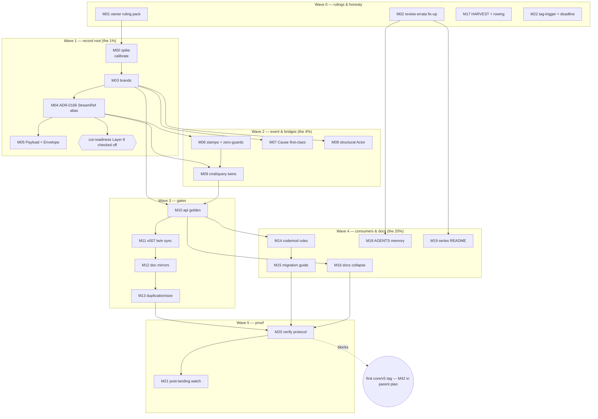

# SUPERB — v5 Core-Type Finalization (2026-11-19 20:52 CET)

> **Leverage v5 for a huge cleanup — the pre-first-tag type window.**
> Source review: `docs/reviews/2026-11-19_core-data-model-review.html` (R1–R12) ·
> Session postmortem: `docs/status/2026-11-19_20-35_data-model-review-session-postmortem.md`
> Parent program: [2026-11-13 truth-green release train & v5 runway](2026-11-13_21-12_SUPERB-truth-green-release-train-v5-runway-pareto-plan.md) (M41/M42/M43) ·
> Sequencing authority: [v5-cut-readiness checklist](2026-10-01_v5-cut-readiness-checklist.md) (Layers 0–13)

---

> **Window deadline — pinned by M22 (executed 2026-11-19, before Wave 1): GATE-ORDERED, no calendar deadline.**
> The first `core/v5.x.y` tag rides the **full v5.0.0 cut**. Evidence (all three
> sources read, no ambiguity remains):
> parent-plan M42 (:109) — "cut v5.0.0 (:1966) per the cut-readiness checklist";
> parent-plan M43 (:110) — "slice 2 (:225, blocked on first core/v5 tag — **M42 cuts it**)";
> cut-readiness Layer 13 — "Tag v5.0.0 for all modules (tag-wave mechanics)".
> TODO_LIST :395 is a *downstream blocker* on that cut ("proxy must serve it"),
> not evidence of an earlier tag; no recorded plan tags core/v5 early.
> M42 itself is gated by M41 (v4 deletions) + M43 (core/v5 completion — whose
> 23 copy-forwards inherit THIS plan's shape) + Layer 0 rulings. Ordering
> consequence: this plan's Waves 1–3 must land **before M43's copy-forwards
> complete**, which places the plan comfortably inside the window.
> Wave sizing: unchanged — Wave 1 stays the protected minimum regardless.

---

## 1. Context — what this plan is and is not

The data-model review found the core type model carrying 12 findings. Research into the
existing v5 program **changes how two of them must be executed**:

**The R1 reconciliation (the load-bearing discovery).** core/v5 is a verbatim ADR-0152
copy-forward carrying 61 `Deprecated:` markers — but that is **recorded strategy, not
drift**: `cmd/cqrs-lint/v4/pkg/rules/version/v007_tables_symbols_v5.go` documents the
deprecated twins as *"removed together with the v4 train in T26"*, and the art-dupl
accepts in core/v5 say the same. The strategy exists so the `cqrs-upgrade --to-v5`
**import-rewrite stays mechanical**: a v4 consumer of a deprecated API lands on the
same-name core/v5 API, and the deprecated surface dies once, with the v4 train.
Deleting the deprecated halves from core/v5 *now* (the review's original R1 fix) would
strand those consumers mid-migration. **Verdict: the deprecation cut is T26-gated; the
review's R1 "execute now" is amended (see Errata).**

**The true free window.** What NO recorded decision protects — and what never comes
back — is the shape of the **new** surface before the **first core/v5 tag**:

- Fleet census this session: **zero production consumers** of `core/v5`
  (`grep -rl 'go-cqrs-lite/core/v5' ~/projects/*/go.mod` → no matches).
- In-repo imports are tooling-only (cqrs-lint catalog data, cqrs-upgrade
  `rewrite_v5.go` — the codemod already has its v5 skeleton).
- M42 (11-13 plan) cuts the first `core/v5.x.y` tag. **After that tag, every field
  rename, every re-branding, every presence-fix becomes a v6-scale break.**

So the huge cleanup is: **finalize core/v5's clean surface NOW** — brands
(R2/R3), `Payload` presence (R4), the ADR-0166 StreamRef unification (R5, already
owner-lined), the first-class `Cause` field (R6), structural Actor (R7), honest stamps
(R8), zero-Stream for queries (R9), zero-struct guards (R10) — while every change is
still free. The deprecated twins ride along untouched until T26.

**Deliberately out of scope (existing rows own them):**

| Not-here | Owner row |
| --- | --- |
| v4-side deletions (stack/*, read tiers, tombstone API, ADR-0126 shells) | M41 / T10 / T11 (:205–:206) |
| The v5.0.0 cut mechanics + tag waves | M42 + cut-readiness Layers 0–13 |
| The 23 copy-forwards completion, codemod slice 2 | M43 / P1 (:2585, :2375, :225) |
| Deleting deprecated twins from core/v5 | T26 (v4-train removal) — NOT now |
| `mesh-demo/` disposition | owner question, parked |

**Evidence base (all verified this session):** core/v5 = ONE module
(`github.com/larsartmann/go-cqrs-lite/core/v5`), 9 packages (command, dedup,
dispatcher, event, id, kv, metadata, query, record), registered in go.work:17,
flake.nix:323, `check-module-layers.sh` LAYER 5, api-stability `main.go:191`;
deprecated markers per package: command 13, event 22, id 15, metadata 2, query 4,
record 5 (= 61); `id.StreamRef` is already the struct `{Type, ID}` in v4 — ADR-0166
makes core/v5's `record.StreamRef` its alias and retires the slash string form.

**Two framing facts added in v2:** (a) cut-readiness **Layer 8 ("Breaking core-type
change") has exactly one row** — the validating `NewStreamRef` — which is M04 of
this plan: **executing Wave 1 checks off Layer 8 of the sequencing authority.**
(b) The plan assumed "M42 cuts the first core/v5 tag" — but whether the first
`core/v5.x.y` tag rides the full v5.0.0 cut or lands EARLIER (the codemod's
slice 2 is "blocked on the first core/v5 tag", TODO_LIST :395) is **ambiguous in
the parent plan** — if it lands earlier, the window is shorter than assumed.
M22 pins the trigger before Wave 1 starts. **Pinned 2026-11-19 (M22 executed): it
rides the FULL cut** — see the header block. No recorded plan tags core/v5 early;
TODO_LIST :395 is a downstream blocker on M42's cut, not an early-tag signal.

---

## 2. Pareto breakdown

### The 1% that delivers 51%

**Retype `core/v5/record.Record` + implement ADR-0166's alias** (M03+M04 below,
de-risked by the M00 spike).
Everything else in core/v5 — event, command, query, metadata, the bridges, the
codemod, the docs — compiles against this one type. It is the root of the type tree;
landing it first means every later task lands on the final shape instead of
re-touching its predecessor. It is also cut-readiness Layer 8's only row.

### The 4% that delivers 64%

**+ the bridges and the gates** (M06, M09, M10): Cause promoted onto the event
(M07 is close), stamps fixed, command/query twins aligned, api-stability golden +
`TestEvery` regenerated, v007 v5-twin drift scans green. After these, core/v5
compiles, tests, and gates with its final public shape — the cleanup is *real*,
not aspirational.

### The 20% that delivers 80%

**+ codemod rules, migration guide, docs collapse, harvest/memory** (M14–M18):
consumers can actually be migrated to the new shape mechanically, the guide tells
them what changed, DOMAIN_LANGUAGE collapses the split StreamRef vocabulary, and
TODO_LIST/AGENTS absorb the plan. This is where "cleanup" becomes shippable value.

### The other 20% (to 100%)

The execution tail: scoped verify + full `#verify` (M20), the review-errata
annotation (M02), mirror/duplication gate verification (M12/M13), series README
(M19), and — outside this plan but required for the window to pay off — M41/M42/M43
in the parent program (v4 deletions, the cut, the 23 copy-forwards), each already
rowed there.

---

## 3. Comprehensive plan — medium tasks (30–100 min each)

Sorted by importance → impact → effort. `Dep` = dependencies. Est = minutes.
All tasks that touch code run their module tests as the definition of done (per-module
`GOWORK=off go test -count=1 ./...`); gate tasks name their gate command.

| ID | Task | Why (impact) | Est | Tier | Dep |
|----|------|--------------|-----|------|-----|
| M00 | **Spike: scratch-branch retype prototype** — retype Record + StreamRef alias in a throwaway branch, count the compile-fallout blast radius, calibrate M03/M04/M09 estimates against reality; discard the branch | De-risks the plan's two largest estimates before committing to them; wrong estimates discovered at M03 instead of M20 | 60 | 1% | — |
| M01 | **Owner ruling pack (1 page)**: (a) ratify this plan's reconciliation — deprecated twins stay until T26, new-surface finalization proceeds now; (b) ADR-0166 ratify-at-implementation confirmed (Proposed → Accepted when M04 lands); (c) brand-now over string-shape-compat approved (codemod absorbs the mechanical rewrites) | Prevents executing the review's amended-away R1 fix against the recorded T26 strategy; unblocks everything | 30 | 1% | — |
| M02 | **Review errata + fix-up**: annotate the committed data-model review (R1 → T26-gated amendment; methodology = honest inventory "24/91 files read"; census claim → cite the grep; R10 severity badge; hero scope) + postmortem cross-link | The audit artifact must stop overstating; honesty debt from this session | 30 | 20% | — |
| M03 | **core/v5/record brands**: add `InstanceID`, `StreamType`, `Version` (uint64, 0=unversioned), `CorrelationID` brands; retype `Record.ID/.Type/.Version/.StreamType` + `CommonMetadata.CorrelationID`; Parse*/lockstep tests (the `event.Type = record.Type` cross-comparison pattern) | R2+R3 root fix; the type everything compiles against | 90 | 1% | M01 |
| M04 | **ADR-0166 in core/v5**: `record.StreamRef = id.StreamRef` alias (struct canonical); validating `NewStreamRef`/`ParseStreamRef`; `StreamKey()` storage form; zero-ref = not-a-stream-member; adapt Split/Validate/NewStreamRefOrZero users inside core/v5; flip ADR-0166 status Proposed→Accepted + `#check-adr-numbering` | R5 as already decided by the owner line; kills the slash/colon split brain at the root | 90 | 1% | M03 |
| M05 | **core/v5/record Payload**: `Payload{Data []byte; Enc Encoding}` + `EncodingEnvelope`; absent/opaque/wrapped tri-state tests; `recordEncoding` bridge gets one home | R4; payload presence becomes three values, not one conflated zero | 60 | 4% | M03 |
| M06 | **Stamps + zero-guards in core/v5 bridges**: AsRecord twins stamp `Received` at intake (not relabeling occurredAt as client clock); `Created` only for client clock; queries leave Stream zero (R9); zero-struct treated like nil in Reconstruct/AsRecord (R10) | R8+R9+R10; the bridges stop lying about clocks and identity | 60 | 4% | M04, M05 |
| M07 | **Cause first-class in core/v5/event**: `cause record.Cause` field on ImmutableEvent stamped by WithCommandCausality; `Causation.CommandType` → `record.Type`; the `*Causation` pointer stays as deprecated twin (T26); AsRecord precedence collapses to "field wins, tracing fallback" | R6; causation typed at birth instead of three homes | 100 | 4% | M03 |
| M08 | **Structural Actor in core/v5 metadata twin**: Tracing carries `Actor{Kind,Raw}`; `id.ActorID` stays the wire form; ActorString precedence documented as THE rule | R7; parse tax moves to the wire edge only | 60 | 4% | M03 |
| M09 | **command/query core/v5 twins aligned**: AsRecord twins use brands, zero-Stream for queries, Version=0 unversioned; PersistedCommand/PersistedQuery accessors through the new types | Keeps the trinity on one shape | 60 | 4% | M04, M06 |
| M10 | **Gate: api golden + untested-exports**: `cd cmd/api-stability/v4 && GOWORK=off go run . --update` + `TestEvery`; `#check-untested-exports --update` for new symbols (tests must cover them) | The compatibility promise starts recorded and honest | 45 | 4% | M03–M09 |
| M11 | **Gate: v007 v5-twin table sync**: drift scans green post-divergence; twin-table replacement texts updated where semantics changed (AsRecord stamps, ParseType rows); NO twin deletions (T26-gated) | Keeps the deprecation ratchet truthful while twins survive | 30 | 4% | M10 |
| M12 | **Gate: doc-check mirrors + md-go**: six mirror aliases (event, command, query, dispatcher, id, kv) still classify informational post-divergence; updated doc fences parse | Docs don't false-alarm on the diverged twin | 30 | 20% | M10 |
| M13 | **Gate: duplication + file-size**: `#check-duplication` — verify copy-forward twin accepts still cover post-divergence regions; surgical baseline insert (specview flow) only if new clone shapes emerge; `#check-file-size` green | Divergence must not re-flag sanctioned twins | 45 | 20% | M10 |
| M14 | **cqrs-upgrade v5 rules for the new surface**: extend `rewrite_v5.go` — `rec.Type`→string coercion sites, StreamRef constructor rewrite, Causation→cause field, query Stream zero; fixture tests | Migration stays mechanical after the shape change | 100 | 20% | M10 |
| M15 | **V5-MIGRATION-GUIDE before/after sections** for the type model (brands, StreamRef, Payload, Cause field, stamps) — rides the T14 row | Consumers get the map for exactly these changes | 60 | 20% | M14 |
| M16 | **Docs collapse**: DOMAIN_LANGUAGE single StreamRef row (ADR-0166 consequence), Record/CommonMetadata rows for the core/v5 shape, `doc-check` canonical run green | One vocabulary; the split-brain row dies | 45 | 20% | M10 |
| M17 | **HARVEST + rowing**: TODO_LIST rows for this plan (mark M41/M42/M43 dedupe relationships), postmortem §f routed, plan linked from the 11-13 plan's follow-ups note | Plans die entombed; TODO_LIST is the living source | 30 | 20% | — |
| M18 | **AGENTS.md memory**: Deep-Dive list row for the 11-19 review; core/v5 free-window fact; the v007-v5-twin-table pointer (the thing the review missed — next session shouldn't) | Session knowledge becomes repo memory | 30 | 20% | M02 |
| M19 | **Series README for docs/reviews/** + read the 10-17 findings table + real cross-refs into the 11-19 review | Review series reads as one conversation | 30 | 20% | M02 |
| M20 | **Verification protocol**: scoped suites per changed module (core/v5, cqrs-upgrade, api-stability, cqrs-lint v007 tests), `GT_LINT_MODULES="core/v5 cmd/cqrs-upgrade/v4 cmd/api-stability/v4" nix run .#lint-scope`, then full `nix run .#verify` (exclusive window) | Nothing ships on vibes | 90 | 20% | all |
| M21 | **Post-landing watch**: first green master CI after merge + untagged-API gate (T26-row :378) catches any consumer surprise; fold receipts into TODO_LIST rows | The window closes loudly, not silently | 30 | 20% | M20 |
| M22 | **Pin the first-core/v5-tag trigger + deadline axis**: read TODO_LIST :1966/:395 + cut-readiness Layer 13; determine whether the first `core/v5.x.y` tag rides the full v5.0.0 cut or lands earlier for the codemod; write the resulting deadline (or "no deadline, gate-ordered") at the top of this plan and re-check wave sizing | The plan's "closing window" urgency is currently an assumption about parent-program timing | 30 | 1% | — |
| M23 | **v4-untouched negative check**: prove the v4 train is byte-identical after Waves 1–3 (`git diff --stat -- record/ event/ command/ query/ metadata/ id/ dispatcher/ dedup/ kv/` excluding core/v5 must be empty; api golden diff limited to core/v5 module section) | The cleanup must cost v4 nothing; a silent v4 touch would break the frozen-train contract | 30 | 4% | M10 |
| M24 | **Downstream-shape compat review**: enumerate v4 `metaengine`/`system` consumers of `record.Record` fields (OnRecord folds, projectionadapter) and confirm the retype maps 1:1 onto what M43's copy-forwards will need; record divergences as design notes on the :2585 row | M43 inherits whatever shape Wave 1 finalizes; surprises there are this plan's fault | 45 | 4% | M04 |

**Totals:** 25 tasks, ~21.8 h. Tier 1% = M00+M03+M04+M22 (~4h). Tier 4% = +M05–M11, M23, M24 (~8.5h).
Tier 20% = +M02, M12–M19, M21 (~6.25h). Tail = M20 (inside 20% envelope).

---

## 4. Fine breakdown — tasks ≤ 12 min each

Sorted by importance/impact/effort within dependency order. Est = minutes.

| ID | Task | Est | Dep |
|----|------|-----|-----|
| M00·a | Scratch branch: retype Record fields + StreamRef alias, no tests | 12 | — |
| M00·b | Count compile-fallout sites across core/v5; recalibrate M03/M04/M09 ests | 12 | M00·a |
| M00·c | Discard branch; write calibration note into this plan's §8 | 10 | M00·b |
| M01·a | Draft the 1-page ruling sheet (three decisions, evidence links, recommendation each) | 12 | — |
| M01·b | Walk owner through sheet; record verdicts verbatim into TODO_LIST D-sheet format | 12 | M01·a |
| M02·a | Review fix-up edit: R1 card gets "Amended 2026-11-19: cut is T26-gated (v007 v5-twin table); the free window applies to the new surface" | 12 | — |
| M02·b | Methodology paragraph → honest inventory (24/91 files, list of reads, census grep citation) | 10 | — |
| M02·c | R10 severity badge → `issue-important`; hero scope sentence corrected | 6 | — |
| M02·d | Re-validate report HTML (tag balance + anchors) after edits; commit fix-up | 10 | M02·a-c |
| M03·a | Add brand types to core/v5/record (InstanceID, StreamType, Version uint64, CorrelationID) with doc comments | 12 | M01 |
| M03·b | Retype Record fields (Type, ID, Version, StreamType) + CommonMetadata.CorrelationID | 12 | M03·a |
| M03·c | Fix compile fallout inside core/v5/record (Split, NewStreamRefOrZero, Validate signatures) | 12 | M03·b |
| M03·d | Parse constructors: ParseInstanceID/ParseVersion rules + error sentinels | 12 | M03·c |
| M03·e | Lockstep tests: cross-type comparisons (record.Type vs event.Type pattern), zero-value semantics | 12 | M03·d |
| M03·f | core/v5/record suite green (`cd core/v5 && GOWORK=off go test ./record/... -count=1`) | 10 | M03·e |
| M04·a | Replace `type StreamRef string` with `= id.StreamRef` alias in core/v5/record | 10 | M03·f |
| M04·b | Validating NewStreamRef + ParseStreamRef (empty type ILLEGAL, zero ID ILLEGAL) | 12 | M04·a |
| M04·c | StreamKey() plumbing check inside core/v5; adapt string-form call sites | 12 | M04·b |
| M04·d | Zero-ref = not-a-member: IsZero branch sites + tests (queries) | 12 | M04·c |
| M04·e | Lockstep alias test (record.StreamRef ↔ id.StreamRef cross-compare) | 10 | M04·d |
| M04·f | Flip ADR-0166 status Proposed→Accepted + dated implementation note; `#check-adr-numbering` before/after | 12 | M04·e |
| M05·a | Define Payload struct + EncodingEnvelope in core/v5/record | 12 | M03·f |
| M05·b | Retype Record.Payload; PayloadFrom helper (bytes+enc → Payload) | 12 | M05·a |
| M05·c | Tri-state tests: absent / opaque(Unknown) / wrapped(Envelope) round-trips | 12 | M05·b |
| M05·d | recordEncoding bridge: one home, one direction; JSON/CBOR/unknown probes | 12 | M05·c |
| M06·a | event AsRecord twin: Received=NewStamp(intake), Created zero for server-minted | 12 | M04·f, M05·d |
| M06·b | query twin: Stream zero (kill the fabricated ref); IsZero consumer test | 12 | M06·a |
| M06·c | Zero-struct guards: AsRecord/Reconstruct twins validate ID/type like nil | 12 | M06·b |
| M06·d | Bridge behavior tests (stamps, zero-handling) green | 12 | M06·c |
| M07·a | Add `cause record.Cause` field + accessor to core/v5 ImmutableEvent | 12 | M03·f |
| M07·b | WithCommandCausality stamps the field at construction (ctx path) | 12 | M07·a |
| M07·c | Causation.CommandType → record.Type; pointer marked deprecated twin (T26 note) | 12 | M07·b |
| M07·d | AsRecord: cause field wins, tracing fallback, prose precedence deleted | 12 | M07·c |
| M07·e | Cause lifecycle tests: typed birth, unknown-kind fallback, none | 12 | M07·d |
| M08·a | Tracing gains structural Actor{Kind,Raw} in core/v5 metadata twin | 12 | M03·f |
| M08·b | ActorString/RecordActor precedence documented + single helper | 12 | M08·a |
| M08·c | Actor round-trip tests (struct ↔ wire form at edges only) | 12 | M08·b |
| M09·a | command twin: brands through PersistedCommand/AsRecord, Version semantics | 12 | M04·f, M06·d |
| M09·b | query twin: same alignment pass | 12 | M09·a |
| M09·c | Trinity contract test: one Record shape across event/command/query twins | 12 | M09·b |
| M10·a | api golden regen: `cd cmd/api-stability/v4 && GOWORK=off go run . --update` | 10 | M03–M09 |
| M10·b | `TestEvery` + module-count sanity green | 10 | M10·a |
| M10·c | `#check-untested-exports --update` with reasons; verify no naked new exports | 12 | M10·b |
| M11·a | Run v007 drift scans; read every failure as table-vs-source truth | 10 | M10·c |
| M11·b | Update changed twin-table replacement texts (AsRecord, ParseType rows) | 12 | M11·a |
| M12·a | doc-check canonical run; six mirrors still informational | 10 | M10·c |
| M12·b | md-go validator over any doc touched later (dry-run now) | 6 | M12·a |
| M13·a | `#check-duplication` run; triage any new clone groups post-divergence | 12 | M10·c |
| M13·b | Surgical baseline insert ONLY for genuinely-new accepted shapes (specview flow) | 12 | M13·a |
| M13·c | `#check-file-size` on changed files (350-line rule) | 6 | M13·b |
| M14·a | Extend rewrite_v5.go: StreamRef constructor rewrites (v4 string→v5 ctor) | 12 | M10·c |
| M14·b | rec.Type/string coercion rewrites; Version conversions | 12 | M14·a |
| M14·c | Causation→cause field rewrite rule | 12 | M14·b |
| M14·d | Fixture tests per rule (before/after Go sources) | 12 | M14·c |
| M14·e | Codemod suite green + one end-to-end apply-mode smoke on a fixture repo | 12 | M14·d |
| M15·a | Guide: StreamRef before/after (slash string → struct/ctor/StreamKey) | 12 | M14·e |
| M15·b | Guide: brands + Version + Payload before/after | 12 | M15·a |
| M15·c | Guide: Cause field + stamps + query zero-Stream before/after; doc-check green | 12 | M15·b |
| M16·a | DOMAIN_LANGUAGE: collapse StreamRef to one row (ADR-0166 shape) | 12 | M10·c |
| M16·b | DOMAIN_LANGUAGE: Record/CommonMetadata rows for core/v5 shape | 12 | M16·a |
| M16·c | Verification block import list still resolves; canonical doc-check exit 0 | 10 | M16·b |
| M17·a | TODO_LIST: add M01–M21 outcome rows with receipts format | 12 | — |
| M17·b | Mark dedupe pointers (M41/M42/M43/T11/:2585/:2380 relationships) | 10 | M17·a |
| M17·c | Postmortem §f items routed (22 items → rows or explicit NOT-DO) | 12 | M17·b |
| M18·a | AGENTS.md: Deep-Dive list row for the 11-19 review + this plan | 10 | M02·d |
| M18·b | AGENTS.md: core/v5 free-window + v007-v5-twin-table gotcha rows | 10 | M18·a |
| M19·a | docs/reviews/README.md series index (reports + one-line takeaways) | 12 | M02·d |
| M19·b | Read 10-17 findings table; add 2 real cross-refs to the 11-19 review | 12 | M19·a |
| M20·a | Scoped: core/v5 full suite `-count=1` | 12 | all code |
| M20·b | Scoped: cqrs-upgrade + api-stability + cqrs-lint v007 suites | 12 | M20·a |
| M20·c | `GT_LINT_MODULES=... #lint-scope` over the changed set | 12 | M20·b |
| M20·d | Full `nix run .#verify` in an exclusive window; receipts to TODO_LIST | 12+ | M20·c |
| M21·a | Watch first master CI green post-merge; record run URL | 10 | M20·d |
| M21·b | Untagged-API gate (T26-row :378) observed against the merged state; close out | 12 | M21·a |
| M22·a | Read :1966/:395 + Layer 13; write the tag-trigger finding | 12 | — |
| M22·b | Deadline axis written into plan header; wave sizing re-check verdict | 12 | M22·a |
| M23·a | v4-diff negative check (tree + golden section-scoped) | 12 | M10·c |
| M23·b | Receipt rowed (empty-diff output quoted) | 6 | M23·a |
| M24·a | Enumerate record.Record field consumers in v4 metaengine/system | 12 | M04·f |
| M24·b | Map each consumer onto the retype; list friction sites | 12 | M24·a |
| M24·c | Design notes onto the :2585 row; divergences escalated | 12 | M24·b |

**Fine totals:** 81 tasks · ~15.7 h direct · **plus ~30% integration/test overhead**
(acknowledged gap to the ~21.8 h medium sum: module suites, golden regens, and
re-runs after review feedback are real time the 12-min chopping hides — the
medium estimates carry it; fine estimates are hands-on-keyboard only).
Every task ≤ 12 min.

---

## 5. Execution graph (mermaid)

**Critical path:** M01 → M00 → M03 → M04 → M06/M09 → M10 → M14 → M20 → M21.
**Parallelism (corrected in v2):** core/v5 is ONE package tree — Waves 1–2 tasks
touching the same packages (M03/M04/M05, then M06–M09) run **sequentially**;
true parallelism exists only across W0, the W3 gates after M10, and the W4
docs/codemod track. The mermaid fan-out shows dependency order, not a
concurrency license.
**Serialization points:** api golden (M10) and `#verify` (M20) each run once,
exclusively — no concurrent writers.

---

## 6. Errata (stale/inherited claims corrected by this plan's research)

1. **The 11-19 review's R1** said the core/v5 deprecation cut "has not been executed
   where it matters" and prescribed executing it now. Research found the recorded
   counter-decision (`v007_tables_symbols_v5.go`: twins "removed together with the
   v4 train in T26") — the cut is deliberately sequenced for mechanical migration.
   R1's prescription is amended; the finding's *urgency* transfers to the new-surface
   finalization (this plan).
2. **The review's D5** (keep string ref + derived StreamType) is superseded by
   ADR-0166 (struct canonical, alias, slash form retires) — the owner line already
   decided the shape this review re-derived differently. The plan follows ADR-0166.
3. **The review's methodology** overclaimed reading coverage (24/91 files, not all);
   fixed by M02·b.
4. **TODO_LIST :2585** ("finish the 23 copy-forwards") remains open and correct; this
   plan does not replace it — it ensures the copies that matter (record/event family)
   land in final shape first.
5. **The postmortem's census assertion** ("fleet census shows zero core/v5
   consumers") was true but unverified at writing time; now verified (grep, this
   session) and cited in §1.

## 7. Verification protocol (per-task DoD)

- Code tasks: module suite green (`cd core/v5 && GOWORK=off go test ./... -count=1`,
  or the touched cmd module), compile-clean workspace (`go build ./...` at repo root
  with workspace env sourced).
- Gate tasks: the named gate command green in the same edit window as the change
  (api golden regen rule, ADR-0123 contract #5).
- Docs tasks: `cmd/doc-check` canonical scan exit 0; md-go validator on touched
  fences.
- **Wave stop-checkpoints (added v2):** a wave ends only when (1) its gate tasks are
  green, (2) the PREVIOUS wave's suites still pass (no cross-wave regression), and
  (3) the v4-negative check (M23, after Wave 3) holds. A red checkpoint halts the
  next wave — fix or revert the offending task, never the gate.
- Final: `nix run .#verify` (exclusive), receipts rowed in TODO_LIST (M20·d).
- Anti-verschlimmbessern rule: every task leaves its gate state no worse than found;
  a red gate that was green = revert the task, not the gate.

## 8. Risks

| Risk | Mitigation |
| --- | --- |
| **Estimates wrong (M03/M04/M09 are the plan's largest)** | M00 spike measures the real blast radius first; wave boundary re-estimates from M00·b calibration; over-budget tasks get their own row instead of silent under-delivery. **M00 EXECUTED 2026-11-20 (calibration note):** full retype on a scratch branch (brands + `Stream StreamRef` single home + Version uint64 + CorrelationID brand + id-alias) → `go vet ./...` fallout = **46 type errors in 5 files**: the three AsRecord bridges (command 22, query 12, event 7 — exactly the toll points R2/R8/R9 named) + event/asrecord_test.go (4) + record/record_test.go (1). `kv` and `metadata` compile untouched. Consequences: (a) M03/M04 are type-declaration work with near-zero internal fallout; (b) M06/M09 absorb the bridge errors — their estimates carry the wave's real work; (c) no estimate escalation warranted; (d) vet, not build, is the fallout counter (build masks dependent-package errors) |
| **First-tag timing ambiguity** — window may be shorter than assumed if a core/v5 tag lands before the full v5.0.0 cut | M22 pins the trigger from :1966/:395 + Layer 13 BEFORE Wave 1; if the window is short, Wave 1 (brands + alias) is the protected minimum and W4 docs follow the tag |
| ADR-0166 implementation detail drift (storage keys) | StreamKey() stays the disk truth (ADR contract); sticky dual-read for legacy display-form journals already specified |
| **M43 inherits an incompatible shape** | M24 compat review of v4 metaengine/system Record consumers before the shape hardens; divergences noted on the :2585 row |
| Codemod complexity grows past M14 budget | Rules ship behind the existing `--to-v5` slice structure; anything over budget becomes its own row, not a silent simplification |
| Divergence trips mirror/duplication gates unexpectedly | M12/M13 are verification tasks, not assumptions; specview surgical-insert flow documented in AGENTS #14 |
| Owner ruling (M01) changes the reconciliation | Plan's waves are ordered so only W1 retargets; W0 is one page, cheap to re-run |

## 9. Plan revision log

- **v1 (2026-11-19 20:52):** 21 medium / 71 fine tasks.
- **v2 (2026-11-19, same session, self-audit):** +M00 spike, +M22 tag-trigger
  pin-down, +M23 v4-negative check, +M24 downstream compat review; arithmetic
  corrected (v1 claimed 16.6h for a 19.1h table); fine-vs-medium overhead gap made
  explicit (~30%); parallelism claim corrected (core/v5 is one package tree —
  Waves 1–2 sequential, parallelism only in W0/W3-gates/W4); wave stop-checkpoints
  added to §7; Layer-8-of-cut-readiness framing added; estimate and tag-timing
  risks added to §8.
- **v2.1 (2026-11-19, M22 executed):** tag trigger pinned — first `core/v5.x.y`
  tag rides the full v5.0.0 cut (M42 + Layer 13; no early tag in any recorded
  plan). Deadline axis = gate-ordered. Wave sizing unchanged; Waves 1–3 ordered
  before M43's copy-forwards. Header block + §1(b) amended.
