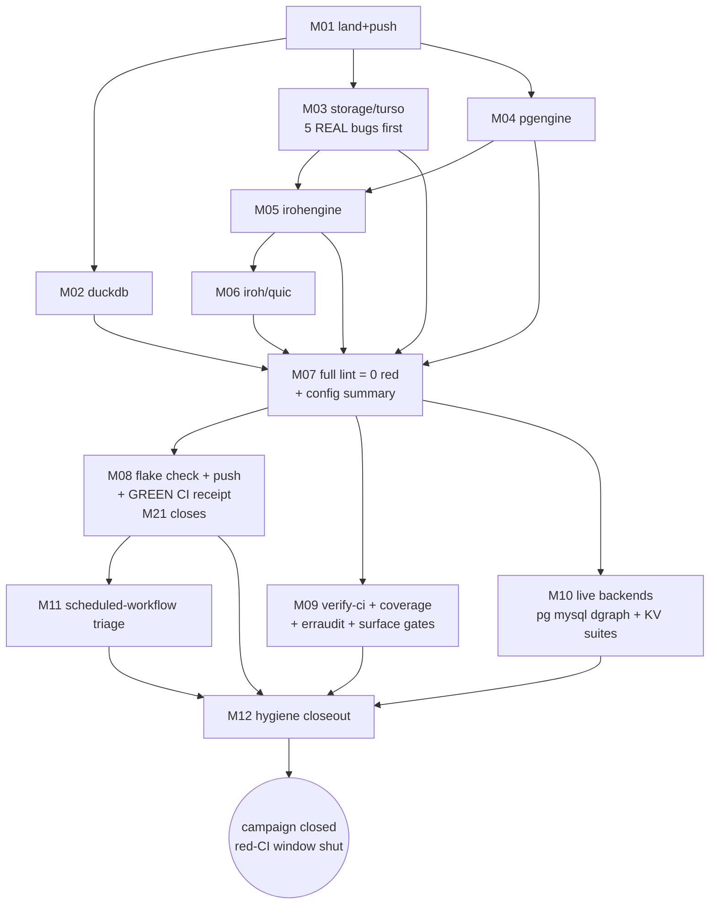

# SUPERB — Lint-Campaign Closeout & Green-CI Chain (2026-11-21 19:50 CET)

> **Finish the 47-module lint campaign (5 modules left) and CLOSE the red-CI window open since 2026-11-18.**
> Context reports: [17-02 mass-execution](../status/2026-11-21_17-02_ci-heal-round2-lint-campaign-mass-execution.md) ·
> [19-21 landing delta](../status/2026-11-21_19-21_report-landing-row-insert-battle-delta.md) ·
> Campaign start: [13-13 first sweep](../status/2026-11-21_13-13_ci-heal-and-lint-campaign-first-sweep.md).
> Standing order: NOW-GET-SHIT-DONE; **push explicitly granted in the commissioning message (2026-11-21 19:50)** — this plan's boundary commits get pushed.

## 1. Where we are (measured, not assumed)

- **29 of 34 red-set modules at lint ZERO** with per-module build+vet+short-tests green (28 in the 17-02 report + storage/bbolt in `10bf8ade5` + pebbleengine in `15e12522d`).
- **Remaining findings ≈ 119 across 5 modules** (`build/lint-tail.log`, `build/lint-batch4.log`):
  duckdbengine ~8 (mid-edit, build green, uncommitted) · storage/turso 29 (incl. **5 REAL sqlclosecheck unclosed-Rows bugs**) · pgengine 21 · irohengine 36 · irohengine/quic 33.
- **Local master 3 commits ahead of origin** (pebble/bbolt-storage/badger-bbalt wave); CI has validated NOTHING after the four healed legs — every CI leg's fix sits in the pushed-but-later-than-origin window.
- **Tree right now**: duckdb pass-1 (green) + two status reports + README rows, uncommitted.
- Carried 3+ sessions: `#verify-ci` changed-set, `#check-coverage`, `#erraudit`; scheduled-Benchmarks 44859030708 undiagnosed; queue pg/mysql conformance verified on sqlite only.

## 2. Pareto breakdown

| Tier | The items | Why they deliver that much |
| --- | --- | --- |
| **1% → 51%** | **PUSH.** Publish the 3+ local commits (owner-granted) so CI runs on fully-healed code. | Every heal since 13:18 is invisible to CI until origin catches up; one `git push` converts ~10 hours of local green into the first green-master candidate since 2026-11-18. |
| **4% → 64%** | Finish the **last 5 lint modules** (M02–M06) + ONE full `#lint` re-measure at 0 red (M07). | `#lint` green IS the Nix Flake Check's failing step; nothing else in the chain can go green while it is red. |
| **20% → 80%** | CI-watch to the green receipt (M21 close, M08) + the carried verification chain (`#verify-ci`, `#check-coverage`, `#erraudit` — M09) + live-backend validation of the refactored engines (M10). | Converts "lint green" into "behavior green on real backends" — the queue-SQL incident proved lint green ≠ test green; this tier is where trust is earned. |
| **Other 20% → 100%** | Scheduled-Benchmarks diagnosis (M11), hygiene closeout: CHANGELOG final counts, parallel-overlap audit (`c2363922f` vs `1c2a0e212`), `add-status-row.sh`, config summary comment, TODO_LIST harvest, final doc gates + session report (M12). | Long tail: small, real, and each prevents a future session from re-deriving or re-breaking something. |

## 3. Comprehensive plan — medium tasks (30–100 min each)

Sorted by importance/impact (customer-value here = fleet consumers' CI trust + the library's own gates), effort in parens.

| ID | Task (100 min ≥ T ≥ 30 min) | Impact | Effort | Depends |
| --- | --- | --- | --- | --- |
| M01 | **Land + push the current wave**: commit duckdb pass-1 (green), the two status reports + README rows, this plan; `git push` (granted); watch the CI run start | 🔥🔥🔥 unblocks every CI leg | S (30) | — |
| M02 | **duckdbengine finish** (8): reflect.Kind exhaustive ×2 (annotate w/ reason), reset/typed_wal data-table rows (extend mysqlengine row), test gocyclo ×2 (extraction), nestif ×2 (aggregations FilterIn + explain ladder — mysql's `writeAggregateSelect` is the template); lint 0 + tests + commit | 🔥🔥 | S (40) | — |
| M03 | **storage/turso grind** (29): fix the 5 sqlclosecheck unclosed-Rows REAL bugs first; SA1019 deprecated-storage bridge row (cite ADR-0123 like the stack row); wrapcheck first-party delegation sigs/row ×8; goconst events/commands consts; exhaustruct Advisor.mu + TursoSyncDbConfig patterns; `close` shadow rename; varnamelen ×2; warmup const twin; lint 0 + tests + commit | 🔥🔥🔥 5 real bugs | M (80) | — |
| M04 | **metaengine/pgengine grind** (21, `build/lint-tail.log`): classes mirror mysql/duckdb (priors consts, err113 sentinel, G202 annotations, SplitN consts, reset rows); lint 0 + tests + commit | 🔥🔥 | M (60) | — |
| M05 | **metaengine/irohengine grind** (36): demo scoping check, codec-mode globals, latency consts, exhaustruct patterns (LatencySnapshot/peerConn rides shared patterns), varnamelen, mnd; lint 0 + tests + commit | 🔥🔥 | L (90) | — |
| M06 | **metaengine/irohengine/quic grind** (33): shares iroh classes + quic transport/config patterns; lint 0 + tests + commit | 🔥🔥 | M (75) | M05 (shared patterns) |
| M07 | **Full `#lint` re-measure (all 104 modules) → 0 red**; add the config exclusions summary comment block; final hash pin; commit | 🔥🔥🔥 campaign DONE marker | M (50) | M02–M06 |
| M08 | **Nix Flake Check local re-run** + push the closeout commit + **CI-watch to the green receipt** (run URL recorded → M21 TODO_LIST row closes); MySQL-QEMU + NATS legs verified on the run | 🔥🔥🔥 closes the red window | M (60) | M01, M07 |
| M09 | **Carried verification chain**: `#verify-ci` over the changed set (≈20 modules, GOWORK=off per-module build+test); `#check-coverage` (+`--update` baselines if the refactors moved lines); `#erraudit` sweep (new wrap sites); `#check-untested-exports` + `#check-package-surface` + `#check-test-runtime` sanity | 🔥🔥 trust tier | L (90) | M02–M06 |
| M10 | **Live-backend validation of the refactors**: `#integration-pg` + `#integration-mysql-nspawn` (queue pg/mysql conformance — SQL repair is sqlite-verified only); `#integration-dgraph` (DQL-const refactor touched every builder); pebble/bbolt/badger full suites | 🔥🔥🔥 behavior green | L (80) | M02–M06 |
| M11 | **Scheduled-workflow triage**: diagnose 44859030708 (58s fast-fail ≠ the 03:02 calibration-dump class); Gates Rollup + NATS legs on the green run; verdict rows | 🔥 | S (40) | M08 |
| M12 | **Hygiene closeout**: CHANGELOG lint row final counts (31→34); parallel-overlap audit (`c2363922f` vs `1c2a0e212` — duplicate config rows?); `scripts/add-status-row.sh` (the 3-session row-insert footgun); config summary comment (if not in M07); TODO_LIST harvest (docs-health); final md-go + canonical-facts + readme-links; session report + README row; commit + push | 🔥 | M (60) | M08 |

**Wave structure:** W1 = M01 · W2 = M02–M06 (M03 first — real bugs) · W3 = M07–M08 (the green receipt) · W4 = M09–M10 (trust) · W5 = M11–M12 (closeout). Stop-checkpoints after each wave: W2 → all-module scoped lint 0; W3 → green CI run URL in TODO_LIST; W4 → all gates green; W5 → reports indexed, tree clean, origin synced.

## 4. Fine breakdown — ALL tasks ≤ 12 min each

| Fine ID | Task (≤12 min) | Parent |
| --- | --- | --- |
| F01 | Commit duckdb pass-1 (message: priors+sentinel+consts+G202, build/vet/tests green) | M01 |
| F02 | Commit reports+README (docs(status): 17-02 + 19-21 delta) | M01 |
| F03 | Commit this plan (docs(planning): SUPERB closeout plan) | M01 |
| F04 | `git push`; capture the CI run URL | M01 |
| F05 | duckdb: annotate the two reflect.Kind switches (`default` arm = closed-world mapping reason) | M02 |
| F06 | duckdb: extend the reset/typed_wal gochecknoglobals row to duckdbengine; hash re-pin | M02 |
| F07 | duckdb: extract reset_cgo_test assertions (dgraph/badger template) | M02 |
| F08 | duckdb: extract ColumnarAggregation test subtests; lint + tests + commit | M02 |
| F09 | duckdb: extract aggregations FilterIn nestif arm | M02 |
| F10 | duckdb: extract explain SELECT ladder (mysql template); lint 0 + tests + commit | M02 |
| F11 | turso: read the 5 sqlclosecheck sites; fix rows-close on each error path | M03 |
| F12 | turso: sqlclosecheck tests still green; commit (REAL-bug fix, own commit) | M03 |
| F13 | turso: SA1019 bridge row citing ADR-0123; hash re-pin | M03 |
| F14 | turso: wrapcheck delegation sigs (NewSQLite* family) or scoped row with reason | M03 |
| F15 | turso: goconst events/commands consts (advisor_data + index) | M03 |
| F16 | turso: exhaustruct patterns (Advisor.mu lazy, TursoSyncDbConfig driver options) | M03 |
| F17 | turso: `close`→`closeFn` shadow fix; varnamelen a×2 renames | M03 |
| F18 | turso: warmup 25ms const twin; lint 0 + tests + commit | M03 |
| F19 | pg: priors const pass (profile.go) | M04 |
| F20 | pg: err113/G202/SplitN class fixes | M04 |
| F21 | pg: remaining findings per `lint-scope` output; lint 0 + tests + commit | M04 |
| F22 | iroh: demo-scope rows check; codec-mode globals row | M05 |
| F23 | iroh: latency/EWMA consts; varnamelen renames | M05 |
| F24 | iroh: exhaustruct patterns from the shared list | M05 |
| F25 | iroh: remaining findings; lint 0 + tests + commit | M05 |
| F26 | quic: transport/config/peerConn patterns + latency consts | M06 |
| F27 | quic: mnd/forbidigo demo rows; varnamelen | M06 |
| F28 | quic: remaining findings; lint 0 + tests + commit | M06 |
| F29 | Full `#lint` background run (all modules) → parse: expect 0 red | M07 |
| F30 | Config exclusions summary comment block; hash re-pin | M07 |
| F31 | Commit campaign-complete (CHANGELOG count update rides here or M12) | M07 |
| F32 | `nix flake check` local (fmt gate + lint leg) | M08 |
| F33 | Push closeout commit; watch CI run to conclusion | M08 |
| F34 | Record green run URL → M21 TODO_LIST row closes | M08 |
| F35 | Verify MySQL-QEMU + NATS legs on that run | M08 |
| F36 | `#verify-ci` changed-set sweep (background, ~30 min) | M09 |
| F37 | `#check-coverage` (+ `--update` only if refactors moved lines; mutation-check the move) | M09 |
| F38 | `#erraudit` sweep; fix or annotate any new wrap findings | M09 |
| F39 | `#check-untested-exports` + `#check-package-surface` + `#check-test-runtime` sanity | M09 |
| F40 | `#integration-pg` (queue pg conformance + pgengine suite) | M10 |
| F41 | `#integration-mysql-nspawn` or `-vm` (queue mysql conformance) | M10 |
| F42 | `#integration-dgraph` (DQL-const refactor validation) | M10 |
| F43 | pebble/bbolt/badger full (non-short) suites | M10 |
| F44 | Pull 44859030708 logs; classify the 58s failure | M11 |
| F45 | Fix or file the scheduled-benchmarks root cause; rerun workflow | M11 |
| F46 | Gates Rollup + NATS legs verified on the green run; verdict rows | M11 |
| F47 | CHANGELOG lint row final counts; `check-changelog-symbols` | M12 |
| F48 | Parallel-overlap audit: diff `c2363922f` vs `1c2a0e212` config rows; dedupe if needed | M12 |
| F49 | `scripts/add-status-row.sh` (pad+insert+link-check; `--self-test` per gate-script policy) | M12 |
| F50 | TODO_LIST harvest (this plan + the two reports' §f residue) | M12 |
| F51 | Final gates: md-go + canonical-facts + readme-links + doc-check | M12 |
| F52 | Session report + README row (via the new helper) + commit + push | M12 |

## 5. Execution graph

## 6. Verification protocol (per-task DoD)

- Every module task: `GT_LINT_MODULES=<mod> nix run .#lint-scope` = 0 issues AND `cd <mod> && GOWORK=off go build ./... && go vet ./... && go test -short -count=1 .` green (test-after-lint — the queue lesson, codified) before commit.
- Every `.golangci.yml` edit: `check-golangci-hash.sh --update` in the SAME edit; commit both files.
- Boundary commits: retry protocol (pre-written message file, `--no-verify` after hand-run hook equivalents, 8× retry), real message per the owner's phase-boundary ruling.
- Pushes: granted by the commissioning message; never `--force`.
- Green-CI receipt: run URL recorded in TODO_LIST M21 row; a scheduled/Dependabot run does NOT count (the T01.5 rule).

## 7. Risks

| Risk | Mitigation |
| --- | --- |
| The 5 modules hide more REAL bugs like turso's unclosed Rows | Fix-bugs-first ordering inside each module; live-backend wave (M10) is the safety net |
| Another parallel session pushes conflicting config rows | M48's overlap audit; commit quickly after each module; pull before push |
| `#verify`/integration exclusivity windows collide with parallel sessions | `can-run-composed-gate` handles it; serial heavy gates (M09/M10) queued behind W3 |
| Coverage baselines shift from the refactors | `--update` ONLY with a named cause per module (ratchet discipline) |
| Verschlembesserung | No behavior changes without a test; every config row carries its reason; reverts documented per class |

## 8. Plan revision log

- v1 (2026-11-21 19:50): 12 medium / 52 fine tasks; waves W1–W5; Pareto split 1%/4%/20%/rest.
