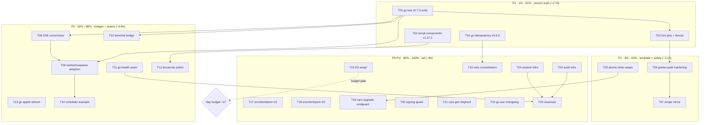

# SUPERB — Fleet-Libs Audit → Pareto Execution Plan

> Planned: 2026-11-22 16:34 CET · Repo: go-cqrs-lite @ `f936f7a39` (audit landed in `02d2ba4aa`)
> Source: 23-library utilization audit (`docs/review/libs/index.html`, 900 verified citations)
>
> - its TODO_LIST harvest (TODO_LIST.md:3046) + session-status §f (37 items, deduped to 40 work items W1–W40 below)
>   Scope: convert audit findings into fleet benefit. NO speculative rewrites — every task traces to a
>   report finding. **Verschlimmbesser guard:** if a task's change does not leave tests+docs verifiably
>   no worse, it stops and gets re-planned instead of pushed through.

## 0. Context

The audit's one-line verdict: core deps pinned current and sound, but leveraged at a fraction of
their surface, with the top pattern being **bridges built, never crossed** and 3 **split-pin drifts**
forming an accidental two-version test matrix. The consumer here is the FLEET: go-cqrs-lite is the
template every LarsArtmann app copies, so example/recipe quality and pin truth propagate fleet-wide.

Hard repo rules that shape every task:

- v4 train is **byte-frozen for behavior**; pin bumps and test/example changes are safe; exported-API
  changes need api-golden regen in the same edit (none of these tasks move exported API except T15/T19,
  which carry the ritual inline).
- `#verify` runs exclusively; per-module tests gate each task; `scripts/go-env.sh` before go/buildflow
  commands; core/v5 free window is NOT touched by this plan.
- Multi-repo tasks (T13 go-appkit, T22 go-sse, T24 lessons/runbook) happen in their own checkouts with
  their own gates.

## 1. Pareto Breakdown

**The 1% that delivers 51% — the version-truth sweep (T01–T04, ~2.7h):**
One mechanical command-class (pin bumps + tidy + fences) that (a) collapses the two-version test
matrix (go-sse v0.6.2/v0.7.0, go-idempotency v0.3.2/v0.6.0, atomic-write split), (b) lands the
security-hardening patches the audit found missed (templ-components rendered-surface break-outs,
httputil GO-2026-6859-adjacent MaxBodySize era fixes), and (c) makes every later task build on a
single version truth. Precondition for everything else; zero design risk.

**The 4% that delivers 64% — + template quality and file safety (T05–T07, ~2.1h):**
The golden path (example + recipe §2.47) is what the fleet clones; hardening it once fixes every
future app. The two atomic-write swaps protect user source files in cqrs-upgrade and the lint
baseline. Small, surgical, highest customer-value-per-line.

**The 20% that delivers 80% — + cross the bridges and the free seams (T08–T14, ~6.6h):**
ssetest/sseparse in our own harnesses, Last-Event-ID correctness, the benchkit system bridge, the
go-health seam, docserver 304s, go-appkit's deadlock-fix pin, the modern scheduler example. Each was
already built or is signature-identical to an existing seam — the audit proved the bridge exists;
these tasks walk it.

**The other 80% of effort for the final 20% of result (T15–T25, ~8h):**
Consolidations with real but bounded payoff (retry.Do, errorfamilytest ×2, D2 swap, cqrs-upgrade on
cmdguard), dogfood proofs, upstream/infra hygiene, and closeouts. Valuable, none blocking.

## 2. Backlog verification (Step 0, 2026-11-22 16:34)

All headline rows confirmed still open at planning time: `metaengine/v4/go.mod` go-sse **v0.6.2**;
`system/v4/go.mod` go-idempotency **v0.3.2**; example httputil **v1.8.0**; cmdguard **v5.0.0**;
templ-components **v1.27.0**; zero `retry.Do` in middleware; zero `LastEventIDFromRequest` in
metaengine; zero `RegisterHealth`/`Recovery` in the example; TODO_LIST harvest section present at
TODO_LIST.md:3046. No errata — nothing ranked here has shipped.

## 3. Table A — Comprehensive plan (30–100 min tasks, ALL items, sorted)

Sort key: Priority (P1 fleet-risk/template > P2 bridges/seams > P3 consolidation > P4 hygiene), then
impact ÷ effort, then customer value. IDs stable into Table B.

| ID  | Pri | Task (work items)                                                                                                                                                                                                                    | Effort | Impact   | Customer value                                              | Done-when                                                             |
| --- | --- | ------------------------------------------------------------------------------------------------------------------------------------------------------------------------------------------------------------------------------------ | ------ | -------- | ----------------------------------------------------------- | --------------------------------------------------------------------- |
| T01 | P1  | Version-truth I: go-sse → v0.7.0 (W1): metaengine direct bump, tidy sweep over 40 indirects, delete dup 64-literal → `DefaultSubscriberBuffer`, module tests, CHANGELOG `[Unreleased]`, pin-wave tag prep                            | 45m    | High     | Kills dual-version test matrix fleet-wide                   | `rg 'go-sse v0.6' -g go.mod` → 0; metaengine tests green              |
| T02 | P1  | Version-truth II: go-idempotency → v0.6.0 (W2) in 5 modules + tests                                                                                                                                                                  | 35m    | High     | Same matrix kill; WithClock path opens                      | zero v0.3.2 pins; system/middleware tests green                       |
| T03 | P1  | Version-truth III: tool pins (W17+W18): httputil v1.9.0 (example), cmdguard v5.1.0 ×5 tools, recipe fence pins v1.5.0→v1.9.0 + server_timing v1.0.2→v1.0.3                                                                           | 40m    | Med-High | Tools on current; docs/examples agree                       | fence compile test green; 5 tools build                               |
| T04 | P1  | Version-truth IV: templ-components v1.27.0 → v1.27.2 (W19) in catalog/v4 + `templ generate` regen + docs-ui.css pipeline check                                                                                                       | 45m    | High     | Lands rendered-surface break-out hardening                  | catalog tests + check-csp + docserver render green                    |
| T05 | P1  | File safety: go-atomic-write in cqrs-lint `baseline_file.go` + cqrs-upgrade `util.go`/`rewrite_v5*` (W9+W10), direct pins both tools                                                                                                 | 40m    | High     | User source files can no longer be half-written             | self-test simulating kill-mid-write; tools green                      |
| T06 | P1  | Golden-path hardening (W6+W23): example/taskmanager — httputil Recovery, MaxBodySize on decodeJSON, RegisterHealth + `/ready` store probe, ServerTimingMiddlewareWhen gating, drain-order 2-line fix (stop projections AFTER intake) | 50m    | High     | Every cloned fleet app inherits the posture                 | example tests incl. new 413/500/ready tests green                     |
| T07 | P1  | Recipe §2.47 mirror (W7): job-table rows, fence sync with T06, `MeasureWithDesc` on query phase, prod-posture sentence                                                                                                               | 35m    | High     | Docs teach the hardened path                                | recipes compile + doc-check green                                     |
| T08 | P2  | SSE correctness (W3+W28): `LastEventIDFromRequest` at metaengine/v4/sse.go:252 + malformed→400 test, `WriteRetry` advertisement, drop-old-vs-Broadcaster rationale paragraph                                                         | 60m    | High     | No silent full-journal replays; deliberate reconnect pacing | new unit tests green; doc paragraph in metaengine SSE docs            |
| T09 | P2  | SSE test-kit adoption (W4+W5): ssetest.Collect/WithLastEventID replaces metaengine raw-TCP legs; sseparse replaces systemscenario hand-rolled parser (surfaces `id:` asserts)                                                        | 70m    | Med-High | Wire-format fixes get exercised by our own tests            | sse_replay + systemscenario suites green on typed asserts             |
| T10 | P2  | Cross the benchkit bridge (W8): cqrs-bench factory path via `FactoryFromSystem`, default one backend through it, bench smoke run                                                                                                     | 60m    | Med-High | Bench tool stops riding v5-doomed presets only              | bench smoke green via system factory; factory.go preset marked legacy |
| T11 | P2  | go-health seam (W11): `health.NewChecks{"engines": sys.HealthCheck}` adapter in example + recipe; dashboard flip-trigger noted                                                                                                       | 45m    | Med      | Fleet apps get dashboard path for free                      | example /healthz renders go-health output; recipe compiled            |
| T12 | P2  | docserver polish (W12+W22+W24): etag.New wrap on 18 routes (304 test), `display.CodeBlock` replaces hand-rolled pre/code, nonce-vs-httputil.Nonce budget note                                                                        | 40m    | Med      | Faster docs; one less duplication                           | 304 integration test; catalog tests green                             |
| T13 | P2  | go-appkit pin refresh (W21, other repo): metaengine v4.26.0, sqliteengine v4.9.1 (EnforceCap deadlock fix), system v4.19.0, catalog v4.15.0, systemscenario v4.3.0 + its tests + release                                             | 30m    | Med-High | Companion stops missing the deadlock fix                    | appkit integration green; versions.json updated                       |
| T14 | P2  | Scheduler engine-path example (W25): new `example/scheduler-engine-status` on `scheduling/engine.TimerStore`; old sqlstore demo banner updated to point at it                                                                        | 90m    | Med      | v5-doomed path stops being the only demo                    | new example builds+runs; old banner cross-references                  |
| T15 | P3  | catalog D2 → go-output/d2 (W13, BUDGET-GATED): dep-budget decision row first, then replace 633-line hand-rolled DSL (connections/services/sanitizeID)                                                                                | 90m    | Med      | Shared D2 fixes reach docserver                             | budget row + check-arch green; D2 export golden unchanged             |
| T16 | P3  | Retry consolidation (W14+W15): middleware/v4 loop → `retry.Do` (or ADR'd refusal note); same decision for event PublishRetry                                                                                                         | 60m    | Med      | Deadline-vs-cancel fix + jitter arrive                      | middleware tests green; decision recorded either way                  |
| T17 | P3  | errorfamilytest sweep 1/2 (W16): ~49 of 98 hand-rolled Classify/Family asserts → kit asserts (metaengine+storage modules)                                                                                                            | 80m    | Med      | Taxonomy tests stop drifting from lib semantics             | sweep diff green; count halved                                        |
| T18 | P3  | errorfamilytest sweep 2/2 (W16): remaining ~49 (middleware/decider/system/etc.)                                                                                                                                                      | 80m    | Med      | Same                                                        | zero hand-rolled family asserts (or rowed remainder)                  |
| T19 | P3  | cqrs-upgrade → cmdguard (W20): struct-tag flags, subcommands, exit-code contract; codemod behavior byte-identical                                                                                                                    | 55m    | Med      | Sixth CLI joins the fleet chassis                           | golden-file codemod tests unchanged; cqrs-upgrade suite green         |
| T20 | P3  | Signing-seam guard (W26): test asserting event codec implements `DeterministicCodec` in signing middleware tests                                                                                                                     | 30m    | Med      | Signature stability pinned                                  | new test green in signing/v4                                          |
| T21 | P3  | cqrs-gen dogfood (W29): one example type with `//cqrs:` tags + README loop + recipe fence                                                                                                                                            | 30m    | Med      | Codegen loop proven end-to-end                              | generated code compiles; recipe classified                            |
| T22 | P4  | Upstream: go-sse CHANGELOG [0.7.0] section (W27, other repo)                                                                                                                                                                         | 30m    | Low-Med  | Fleet changelog hygiene                                     | section cut; no code change                                           |
| T23 | P4  | Audit infra (W33+W34): citation-sweep CI wiring + frozen baseline; index→report links check                                                                                                                                          | 40m    | Low-Med  | Future audits inherit the gate                              | gate green with 900-cite baseline; self-tests pass                    |
| T24 | P4  | Session infra (W30+W31+W32): status-row via add-status-row.sh (clean-tree gated); border-before-trim lesson into crush-config lessons; sequential-dispatch pattern into fleet runbook                                                | 30m    | Low      | Next sessions inherit the lessons                           | row landed; lesson committed in crush-config; runbook updated         |
| T25 | P4  | Closeouts (W35+W36+W37+W39): `#verify-fast` after foreign edits settle; `level=warn` stray investigation (owner-confirm → trash); error-taxonomy doc header v0.10.0→v0.12.0; remote-tags re-stamp decision (owner Q3)                | 30m    | Low      | Clean tree, honest docs                                     | verify-fast green or rowed; stray dispositioned; header fixed         |

Total: **25 tasks ≈ 17.9 h**. All 40 work items W1–W40 covered (W38 folded into T08, W40 into T13).

## 4. Table B — Fine breakdown (≤12 min each, ALL tasks, sorted within parents)

Micro-IDs `mNN`; parent in col 2. "✓" column = done-when is executable as stated.

| ID  | Parent | Micro-task (each ≤12 min)                                                                                    | ✓ verify                         |
| --- | ------ | ------------------------------------------------------------------------------------------------------------ | -------------------------------- |
| m01 | T01    | Bump go-sse v0.7.0 in metaengine/v4 go.mod + `go mod tidy`                                                   | metaengine builds                |
| m02 | T01    | Sweep 40 indirect v0.6.2 pins: per-module `go get go-sse@v0.7.0 && go mod tidy` (batched 8/module-set)       | `rg 'go-sse v0.6' -g go.mod` → 0 |
| m03 | T01    | Replace SSEConfig 64-literal with `sse.DefaultSubscriberBuffer` (metaengine/v4/sse.go:117)                   | grep no bare 64; build green     |
| m04 | T01    | Run metaengine + integration-tier module tests                                                               | green                            |
| m05 | T01    | CHANGELOG `[Unreleased]` row (cite `metaengine/v4/go.mod`) + changelog-symbols gate                          | gate green                       |
| m06 | T01    | Pin-wave tag prep: list changed modules for batch-release.sh                                                 | list committed to wave notes     |
| m07 | T02    | Bump go-idempotency v0.6.0: system, integration, idempotency/sqlstore, commandlifecycle, example/taskmanager | builds green                     |
| m08 | T02    | Stale-comment fix: storage/pebble adapter_test KVStore comment (idempotency report)                          | grep clean                       |
| m09 | T02    | Run the 5 modules' tests + CHANGELOG row                                                                     | green                            |
| m10 | T03    | httputil v1.9.0 + server_timing pins refresh in example/taskmanager                                          | build green                      |
| m11 | T03    | cmdguard v5.1.0 in all 5 cmd tools + builds                                                                  | 5 builds green                   |
| m12 | T03    | Recipe compile-fence pins: httputil v1.5.0→v1.9.0, server_timing v1.0.2→v1.0.3, go-etag v0.6.1→v0.6.2        | recipes_compile_test green       |
| m13 | T03    | doc-check + cqrs-lint/doc-check suites re-run                                                                | green                            |
| m14 | T04    | templ-components v1.27.2 bump in catalog/v4 + tidy                                                           | build green                      |
| m15 | T04    | `templ generate` regen + commit generated                                                                    | diff only in templ outputs       |
| m16 | T04    | docs-ui.css pipeline: build-docserver-css.sh + check-csp                                                     | gates green                      |
| m17 | T04    | catalog module tests + docserver render sanity                                                               | green                            |
| m18 | T05    | Direct-pin go-atomic-write in cqrs-lint + cqrs-upgrade go.mod                                                | builds                           |
| m19 | T05    | cqrs-lint `baseline_file.go` write → atomicwrite (drop DIY temp+rename)                                      | unit tests green                 |
| m20 | T05    | cqrs-upgrade `util.go` + `rewrite_v5*` os.WriteFile → atomicwrite                                            | codemod golden tests unchanged   |
| m21 | T05    | Kill-mid-write self-test (SIGKILL during write; file intact old-or-new)                                      | test green                       |
| m22 | T06    | Add Recovery + MaxBodySize middleware to example server wiring                                               | panic-test 500; 413 test green   |
| m23 | T06    | Swap hand-rolled /health → `httputil.RegisterHealth` + `/ready` probe on store                               | endpoint tests green             |
| m24 | T06    | Gate Server-Timing: `ServerTimingMiddlewareWhen` behind debug predicate                                      | header absent w/o flag           |
| m25 | T06    | Drain-order fix: move projections-stop AFTER http Shutdown (2-line)                                          | ordering test/comment            |
| m26 | T06    | Example suite re-run + race                                                                                  | green                            |
| m27 | T07    | Recipe fence sync with T06 helpers (recovery/health lines)                                                   | compile test green               |
| m28 | T07    | Job-table rows + prod-posture sentence in §2.47                                                              | doc-check green                  |
| m29 | T07    | `MeasureWithDesc("query", ...)` in httpx.go + recipe                                                         | header shows desc                |
| m30 | T08    | metaengine sse.go:252 → `sse.LastEventIDFromRequest`                                                         | unit green                       |
| m31 | T08    | Malformed Last-Event-ID → 400 test (was: silent full replay)                                                 | test green                       |
| m32 | T08    | `sse.WriteRetry` at stream start (configurable, default off?)                                                | test green                       |
| m33 | T08    | Drop-old-vs-Broadcaster rationale paragraph in metaengine SSE docs                                           | doc present                      |
| m34 | T09    | systemscenario/v4/sse.go parser → sseparse NewStreamReader                                                   | harness tests green              |
| m35 | T09    | Add `id:`-field assertion now visible via sseparse                                                           | test green                       |
| m36 | T09    | metaengine sse_replay_test raw-TCP leg 1 → ssetest.Collect + WithLastEventID                                 | typed asserts green              |
| m37 | T09    | raw-TCP leg 2 + drop/ordering tests → ssetest                                                                | suite green                      |
| m38 | T10    | cqrs-bench: add system-factory option (FactoryFromSystem) beside presets                                     | flag builds                      |
| m39 | T10    | Default memory backend through system factory; presets marked legacy-path comment                            | smoke run green                  |
| m40 | T10    | Bench smoke (memory) + benchkit tests                                                                        | green                            |
| m41 | T11    | Example adapter: health.NewChecks over System.HealthCheck → /healthz                                         | endpoint renders checks          |
| m42 | T11    | Recipe: bridge snippet + dashboard flip-trigger note                                                         | compiled + cataloged             |
| m43 | T12    | etag.New wrap on docserver mux + If-None-Match 304 test                                                      | 304 test green                   |
| m44 | T12    | d2view.templ: hand-rolled pre/code → display.CodeBlock (+CopyButton)                                         | render + csp green               |
| m45 | T12    | Nonce budget-decision note in docserver docs (vs httputil.Nonce)                                             | note present                     |
| m46 | T13    | go-appkit: bump metaengine/sqliteengine/system/catalog/systemscenario pins                                   | build green (their repo)         |
| m47 | T13    | go-appkit integration tests + versions/CHANGELOG bump per its ritual                                         | green + released                 |
| m48 | T14    | Scaffold example/scheduler-engine-status on scheduling/engine.TimerStore                                     | builds                           |
| m49 | T14    | Port otel/status hooks from legacy example (minus ClaimMetrics banners)                                      | runs locally                     |
| m50 | T14    | Old example banner: point to new path; README row; examplePaths registration + CI                            | check-example-standalone green   |
| m51 | T15    | Budget decision row: catalog/v4 dep budget +1 (go-output) — check-arch map edit                              | gate green with rationale        |
| m52 | T15    | Swap connections.go/services.go builders → go-output/d2 + escape.D2                                          | D2 golden unchanged              |
| m53 | T15    | Delete sanitizeID + dead helpers; coverage of new path                                                       | tests green                      |
| m54 | T16    | Middleware retry loop → retry.Do (Config parity: backoff, jitter, exhaustion)                                | middleware tests green           |
| m55 | T16    | PublishRetry decision: migrate or ADR'd refusal note (event/v4)                                              | decision recorded                |
| m56 | T17    | errorfamilytest sweep batch 1 (metaengine engines)                                                           | ~25 asserts converted            |
| m57 | T17    | errorfamilytest sweep batch 2 (storage/*)                                                                    | ~24 asserts converted            |
| m58 | T18    | errorfamilytest sweep batch 3 (middleware/decider)                                                           | ~25 asserts converted            |
| m59 | T18    | errorfamilytest sweep batch 4 (system/queue/remainder) + count row                                           | zero hand-rolled (or rowed)      |
| m60 | T19    | cqrs-upgrade: flags struct + cmdguard NewCLI scaffold                                                        | --help parity                    |
| m61 | T19    | Subcommands wired (v5-mode etc.), exit-code contract                                                         | exit codes pinned by test        |
| m62 | T19    | Codemod golden-file suite unchanged + full tool tests                                                        | green                            |
| m63 | T20    | signing/v4: DeterministicCodec assertion test at the middleware seam                                         | test green                       |
| m64 | T21    | //cqrs: tags on one example type + cqrs-gen run + commit generated                                           | compiles                         |
| m65 | T21    | Recipe/README loop documented; recipes_catalog entry                                                         | doc-check green                  |
| m66 | T22    | go-sse repo: write CHANGELOG [0.7.0] from v0.6.2..v0.7.0 diff                                                | section present                  |
| m67 | T23    | citation-sweep: flake app wrapper + baseline file for frozen reports                                         | gate green on 900 cites          |
| m68 | T23    | review-links check: index.html ↔ 23 reports + assets link                                                    | check green                      |
| m69 | T24    | add-status-row.sh for 16-30 report (requires clean status README)                                            | row landed                       |
| m70 | T24    | crush-config lessons.md: border-before-trim screenshot lesson (commit there)                                 | lesson merged                    |
| m71 | T24    | SKILLS library-deep-dive runbook: sequential-dispatch + resume pattern                                       | runbook updated                  |
| m72 | T25    | `#verify-fast` run once foreign edits settle; row failures triaged                                           | green or rowed                   |
| m73 | T25    | `level=warn` stray: identify origin, ask owner, trash on confirm                                             | dispositioned                    |
| m74 | T25    | error-taxonomy doc header v0.10.0 → v0.12.0                                                                  | doc matches pins                 |
| m75 | T25    | Remote-tags re-stamp: apply owner answer to Q3 (fetch or stay local)                                         | policy recorded in AGENTS        |

**75 micro-tasks**, every one ≤12 min, every Table-A task fully decomposed, sorted by parent priority.
(The plan deliberately keeps micro-tasks coarse-grained enough to stay verifiable — no "open editor"
noise.)

## 5. Execution graph

Edges are hard dependencies; unconnected tasks are freely parallelizable (different modules/repos).
`T15` is gated by the dep-budget decision — if refused, T15 is dropped, not forced (verschlimmbesser
guard). Recommended waves: **W1 = T01–T04** (one pin-wave commit series), **W2 = T05–T07**, **W3 =
T08–T14** (T13 parallel in appkit repo), **W4 = tail by ID**.

## 6. Per-class verification gates

- Pin tasks (T01–T04, T13): zero stale pins by rg; touched-module `GOWORK=off go test -count=1`;
  changelog-symbols gate where CHANGELOG rows cite symbols; wave tags via `batch-release.sh`
  (tests-first per AGENTS: release verify=ok does NOT run tests).
- Example/recipe tasks (T06, T07, T11, T14, T21): example standalone check
  (`scripts/check-example-standalone.sh`), recipes compile harness, doc-check.
- Behavior tasks (T08, T09, T16): the new test IS the deliverable; old behavior documented in the
  CHANGELOG row.
- Tooling tasks (T05, T10, T19, T23): tool's own suite + one self-test proving the new property
  (kill-mid-write, 304, exit-code, 900-cite baseline).
- Infra/closeout (T22, T24, T25): the artifact exists in its owning repo; nothing else moved.

## 7. Explicitly NOT in this plan

No core/v5 edits; no exported-API additions on the v4 train beyond what T15/T19 touch (both carry
api-golden ritual); no new runtime dependencies besides go-output/d2 (T15, budget-gated) and
go-atomic-write (T05, already in the tools' graphs); no adoption of go-business-rules /
go-credentials-store / go-daemon / go-filewatcher / go-datastar (audit verdicts: justified
non-adoption with named flip triggers — re-litigating them is exactly the verschlimmbesser to avoid).
